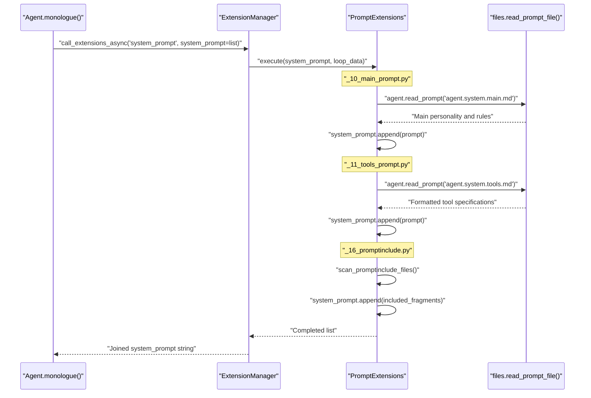
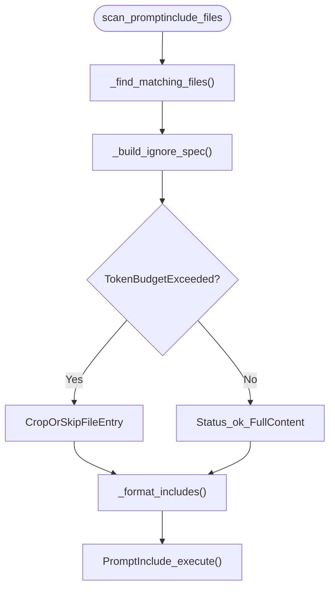
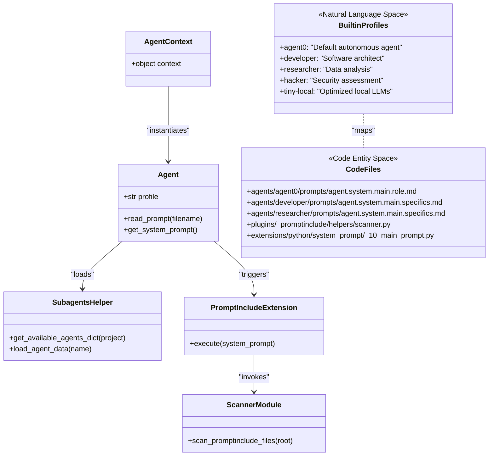

<!-- source: DeepWiki mcp.deepwiki.com · repo agent0ai/agent-zero · page 2.2 Prompt System & Agent Profiles · fetched 2026-10-29 -->

# Prompt System & Agent Profiles

Relevant source files

The following files were used as context for generating this wiki page:

- [agents/AGENTS.md](agents/AGENTS.md)
- [agents/_example/prompts/agent.system.main.specifics.md](agents/_example/prompts/agent.system.main.specifics.md)
- [agents/agent0/prompts/agent.system.main.role.md](agents/agent0/prompts/agent.system.main.role.md)
- [agents/agent0/prompts/agent.system.main.specifics.md](agents/agent0/prompts/agent.system.main.specifics.md)
- [agents/agent0/prompts/agent.system.tool.response.md](agents/agent0/prompts/agent.system.tool.response.md)
- [agents/developer/AGENTS.md](agents/developer/AGENTS.md)
- [agents/developer/prompts/agent.system.main.specifics.md](agents/developer/prompts/agent.system.main.specifics.md)
- [agents/hacker/prompts/agent.system.main.specifics.md](agents/hacker/prompts/agent.system.main.specifics.md)
- [agents/researcher/AGENTS.md](agents/researcher/AGENTS.md)
- [agents/researcher/prompts/agent.system.main.specifics.md](agents/researcher/prompts/agent.system.main.specifics.md)
- [extensions/python/_functions/agent/Agent/prepare_prompt/end/_00_restore_settings.py](extensions/python/_functions/agent/Agent/prepare_prompt/end/_00_restore_settings.py)
- [extensions/python/_functions/agent/Agent/prepare_prompt/start/_99_snapshot_settings.py](extensions/python/_functions/agent/Agent/prepare_prompt/start/_99_snapshot_settings.py)
- [extensions/python/message_loop_prompts_after/_75_include_workdir_extras.py](extensions/python/message_loop_prompts_after/_75_include_workdir_extras.py)
- [helpers/file_tree.py](helpers/file_tree.py)
- [helpers/file_tree.py.dox.md](helpers/file_tree.py.dox.md)
- [plugins/_a0_connector/skills/host-file-editing/SKILL.md](plugins/_a0_connector/skills/host-file-editing/SKILL.md)
- [plugins/_code_execution/prompts/agent.system.tool.code_exe.md](plugins/_code_execution/prompts/agent.system.tool.code_exe.md)
- [plugins/_code_execution/prompts/agent.system.tool.input.md](plugins/_code_execution/prompts/agent.system.tool.input.md)
- [plugins/_promptinclude/AGENTS.md](plugins/_promptinclude/AGENTS.md)
- [plugins/_promptinclude/extensions/python/system_prompt/_16_promptinclude.py](plugins/_promptinclude/extensions/python/system_prompt/_16_promptinclude.py)
- [plugins/_promptinclude/helpers/scanner.py](plugins/_promptinclude/helpers/scanner.py)
- [plugins/_promptinclude/prompts/agent.system.promptinclude.md](plugins/_promptinclude/prompts/agent.system.promptinclude.md)
- [plugins/_promptinclude/prompts/fw.promptinclude.includes.md](plugins/_promptinclude/prompts/fw.promptinclude.includes.md)
- [prompts/agent.system.main.communication.md](prompts/agent.system.main.communication.md)
- [prompts/agent.system.main.communication_additions.md](prompts/agent.system.main.communication_additions.md)
- [prompts/agent.system.main.md](prompts/agent.system.main.md)
- [prompts/agent.system.main.solving.md](prompts/agent.system.main.solving.md)
- [prompts/agent.system.main.tips.md](prompts/agent.system.main.tips.md)
- [prompts/agent.system.main.tips.py](prompts/agent.system.main.tips.py)
- [prompts/agent.system.tool.response.md](prompts/agent.system.tool.response.md)
- [tests/test_default_prompt_budget.py](tests/test_default_prompt_budget.py)
- [tests/test_promptinclude.py](tests/test_promptinclude.py)
- [webui/components/modals/image-viewer/image-viewer-store.js](webui/components/modals/image-viewer/image-viewer-store.js)
- [webui/components/modals/image-viewer/image-viewer.html](webui/components/modals/image-viewer/image-viewer.html)
- [webui/components/projects/project-file-structure-test.html](webui/components/projects/project-file-structure-test.html)
- [webui/components/settings/agent/workdir-file-structure-test.html](webui/components/settings/agent/workdir-file-structure-test.html)

## Purpose & Scope

The Agent Zero prompt system is a modular, extensible architecture that assembles complex system instructions from discrete Markdown fragments. Instead of relying on a monolithic prompt string, the system dynamically constructs the LLM's persona, operational rules, tool capabilities, and environmental context at the start of every message processing loop (`Agent.monologue()`).

This page details how system prompts are assembled via extension points [extensions/python/system_prompt/_10_main_prompt.py:7-18](), how the `prompts/` and `agents/` directory trees are structured, how agent profiles override framework defaults [helpers/subagents.py:51-85](), and how dynamic features like the `_promptinclude` scanner [plugins/_promptinclude/helpers/scanner.py:32-41]() and prompt catalogs operate.

Sources: [extensions/python/system_prompt/_10_main_prompt.py:7-18](), [plugins/_promptinclude/helpers/scanner.py:32-41](), [helpers/subagents.py:51-85]()

---

## System Prompt Assembly & Extension Pipeline

The system prompt is assembled dynamically by the `system_prompt` extension chain. During the agent's preparation phase, the framework invokes registered extension handlers that append specific instructional blocks to a shared `system_prompt` list, which is then joined into the final instruction string passed to the LLM.

### The Assembly Pipeline
The assembly order is governed by the numerical sorting of extension filenames located in `extensions/python/system_prompt/` and plugin directories [extensions/python/system_prompt/_10_main_prompt.py:7-18]():

| Priority | Extension Class | Purpose | Source File |
| :--- | :--- | :--- | :--- |
| 09 | `TextEditorConfig` | Injects configuration constraints and line limits for text editor tools. | [plugins/_text_editor/extensions/python/system_prompt/_09_text_editor_config.py:9-23]() |
| 10 | `MainPrompt` | Loads core personality, rules, and behavioral fragments from `agent.system.main.md`. | [extensions/python/system_prompt/_10_main_prompt.py:7-18]() |
| 11 | `ToolsPrompt` | Discovers and formats all available tool definition fragments matching `agent.system.tool.*.md`. | [extensions/python/system_prompt/_11_tools_prompt.py:13-25]() |
| 12 | `MCPToolsPrompt` | Appends tools exposed by active Model Context Protocol servers. | [extensions/python/system_prompt/_12_mcp_prompt.py:8-21]() |
| 13 | `SecretsPrompt` | Injects masked environment variables and project secrets. | [extensions/python/system_prompt/_13_secrets_prompt.py:8-19]() |
| 13 | `SkillsPrompt` | Injects summaries of available reusable skills from the skills registry. | [extensions/python/system_prompt/_13_skills_prompt.py:8-21]() |
| 14 | `ProjectPrompt` | Adds project-specific instructions, variables, and discovered `AGENTS.md` context. | [extensions/python/system_prompt/_14_project_prompt.py:8-21]() |
| 16 | `PromptInclude` | Scans and injects persistent user-defined prompt fragments (`*.promptinclude.md`) from the workspace. | [plugins/_promptinclude/extensions/python/system_prompt/_16_promptinclude.py:10-46]() |

### Prompt Assembly Data Flow
The sequence below illustrates how the `Agent` engine interacts with the `ExtensionManager` and file system helpers to build the prompt string.

Title: "System Prompt Assembly Sequence"

Sources: [extensions/python/system_prompt/_10_main_prompt.py:7-18](), [extensions/python/system_prompt/_11_tools_prompt.py:13-25](), [plugins/_promptinclude/extensions/python/system_prompt/_16_promptinclude.py:10-46]()

---

## Natural Language Space to Code Entity Space: Prompt Fragment Mapping

This diagram bridges human-facing prompt concepts (Natural Language Space) to their corresponding markdown files and extension loaders in the codebase (Code Entity Space).

Title: "Prompt Fragment Code Mapping"

```mermaid
graph TD
    subgraph NaturalLanguageSpace["Natural Language Space"]
        CorePersona["Core Persona & Rules"]
        CommRules["Communication & JSON Contract"]
        SolvingLogic["Problem Solving Methodology"]
        UserIncludes["Workspace Prompt Inclusions"]
    end

    subgraph CodeEntitySpace["Code Entity Space"]
        MainPromptPy["extensions/python/system_prompt/_10_main_prompt.py"]
        MainMd["prompts/agent.system.main.md"]
        CommMd["prompts/agent.system.main.communication.md"]
        SolvingMd["prompts/agent.system.main.solving.md"]
        PromptIncludePy["plugins/_promptinclude/extensions/python/system_prompt/_16_promptinclude.py"]
        ScannerPy["plugins/_promptinclude/helpers/scanner.py"]
    end

    CorePersona --> MainMd
    CommRules --> CommMd
    SolvingLogic --> SolvingMd
    UserIncludes --> ScannerPy

    MainPromptPy --> MainMd
    MainPromptPy --> CommMd
    MainPromptPy --> SolvingMd
    PromptIncludePy --> ScannerPy
```

Sources: [extensions/python/system_prompt/_10_main_prompt.py:7-18](), [prompts/agent.system.main.communication.md:1-39](), [prompts/agent.system.main.solving.md:1-44](), [plugins/_promptinclude/extensions/python/system_prompt/_16_promptinclude.py:10-46](), [plugins/_promptinclude/helpers/scanner.py:32-41]()

---

## The `prompts/` Directory Structure & Fragment Architecture

The root `prompts/` directory houses Markdown files acting as base templates. These templates support variable interpolation and recursive file/snippet inclusion via helper functions. The `read_prompt_file` function handles parsing directives, conditional blocks (`{{if}}`), and placeholder substitutions [helpers/files.py:123-162]().

### Core Fragment Architecture
*   **`agent.system.main.md`**: Master entry point that integrates role definitions, communication rules, and problem-solving methodologies.
*   **`agent.system.main.communication.md`**: Enforces strict JSON output formatting (`thoughts`, `headline`, `tool_name`, `tool_args`), forbidding unformatted text [prompts/agent.system.main.communication.md:2-19]().
*   **`agent.system.main.solving.md`**: Outlines high-agency planning, subtask partitioning, and tool-verification requirements [prompts/agent.system.main.solving.md:1-44]().
*   **`agent.system.tool.code_exe.md`**: Provides detailed rules and examples for invoking the `code_execution_tool` across terminal, python, and nodejs runtimes [plugins/_code_execution/prompts/agent.system.tool.code_exe.md:1-25]().
*   **`agent.system.tool.response.md`**: Directs final response formatting, tone, tables, and latex usage [agents/agent0/prompts/agent.system.tool.response.md:1-15]().

Sources: [prompts/agent.system.main.communication.md:2-39](), [prompts/agent.system.main.solving.md:1-44](), [plugins/_code_execution/prompts/agent.system.tool.code_exe.md:1-25](), [agents/agent0/prompts/agent.system.tool.response.md:1-15]()

---

## The `_promptinclude` Plugin & Scanner Implementation

The `_promptinclude` plugin allows users to drop custom prompt additions directly into their working directory or project space without modifying framework code [plugins/_promptinclude/extensions/python/system_prompt/_16_promptinclude.py:10-46](). 

The background scanner (`plugins/_promptinclude/helpers/scanner.py`) searches the workspace for files matching a configured name pattern (default: `*.promptinclude.md`), enforcing strict token budgeting, depth caps, per-file limits, and `.gitignore` rule matching via `PathSpec` [plugins/_promptinclude/helpers/scanner.py:32-112]().

Title: "Promptinclude Scanner Flow"

Sources: [plugins/_promptinclude/helpers/scanner.py:32-112](), [plugins/_promptinclude/extensions/python/system_prompt/_16_promptinclude.py:10-46]()

---

## Agent Profiles, Overrides & Metadata Merging

Agent Zero supports distinct execution profiles (e.g., `agent0`, `researcher`, `developer`, `hacker`, `tiny-local`). Profiles modify the agent's persona, system instructions, and tool access via a sparse override mechanism [extensions/python/agent_init/_15_load_profile_settings.py:10-40]().

### Profile Resolution Order
When an agent instance initializes with a given profile, the framework searches directories in the following priority:
1.  **Project-space**: `.a0proj/agents/<profile>/` [helpers/subagents.py:83-85]()
2.  **User-space**: `usr/agents/<profile>/` [helpers/subagents.py:76-77]()
3.  **Plugin-space**: `plugins/<plugin>/agents/<profile>/` [helpers/subagents.py:72-74]()
4.  **Built-in**: `agents/<profile>/` [helpers/subagents.py:68-69]()

### Metadata Merging
Profile configurations are defined in `agent.yaml` or `agent.json` [helpers/subagents.py:155-161](). The helper functions merge profile properties against base defaults. Missing keys inherit downward, while explicitly empty string or list values act as intentional overrides [helpers/subagents.py:51-63]().

Sources: [helpers/subagents.py:51-85](), [extensions/python/agent_init/_15_load_profile_settings.py:10-40]()

### Natural Language Space to Code Entity Space: Profile & Prompt Architecture

This diagram bridges human-facing agent profiles and system prompts to their corresponding implementation classes and filesystem entities in the codebase.

Title: "Profile and Prompt Mapping Architecture"

Sources: [helpers/subagents.py:51-85](), [plugins/_promptinclude/helpers/scanner.py:32-41](), [extensions/python/system_prompt/_10_main_prompt.py:7-18]()

### Profile Specializations
| Profile | Focus & Characteristics | Key Source Files |
| :--- | :--- | :--- |
| `agent0` | Balanced, general-purpose autonomous user-facing agent. | [agents/agent0/prompts/agent.system.main.role.md:1-5]() |
| `developer` | Elite software architect emphasizing TDD, caller tracing, and clean code patterns. | [agents/developer/prompts/agent.system.main.specifics.md:1-47]() |
| `researcher` | Information gathering, source validation, structured reporting, and evidence tracking. | [agents/researcher/prompts/agent.system.main.specifics.md:1-35]() |
| `hacker` | Penetration testing, vulnerability research, and controlled security exploration. | [agents/hacker/prompts/agent.system.main.specifics.md:1-9]() |
| `tiny-local` | Stripped reasoning blocks and simplified JSON contracts tailored for restricted local LLMs. | [tests/test_default_prompt_budget.py:121-160]() |

Sources: [agents/developer/prompts/agent.system.main.specifics.md:1-81](), [agents/researcher/prompts/agent.system.main.specifics.md:1-84](), [tests/test_default_prompt_budget.py:121-183]()

---

## Project-Specific Prompts & Tiny Local Profile

### Project Prompts (`AGENTS.md`)
When a project scope is active, the `ProjectPrompt` extension scans the directory hierarchy for `AGENTS.md` or `AGENTS.override.md` files. These files supply project-specific operating instructions and local context that are injected dynamically into the system prompt at priority 14 [extensions/python/system_prompt/_14_project_prompt.py:8-21]().

### Tiny Local Optimizations
The `tiny-local` profile adapts the prompt contract for smaller local models by suppressing hidden `thoughts` and `headline` fields to reduce token overhead, enforcing direct execution of `tool_name` and `tool_args` parameters, and providing streamlined tool invocation examples compatible with limited context windows [tests/test_default_prompt_budget.py:121-183]().

Sources: [extensions/python/system_prompt/_14_project_prompt.py:8-21](), [tests/test_default_prompt_budget.py:121-183]()

---

