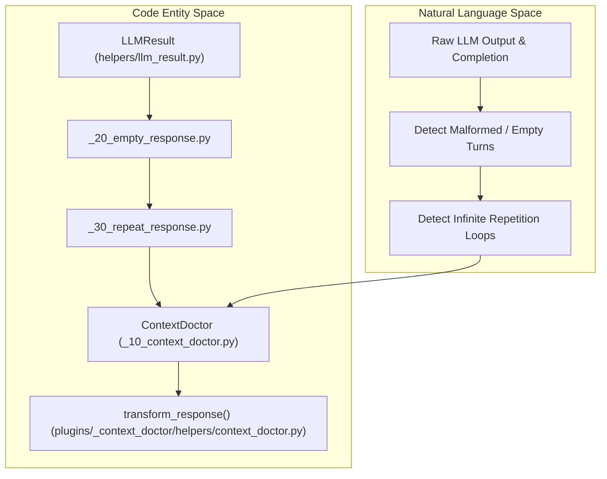
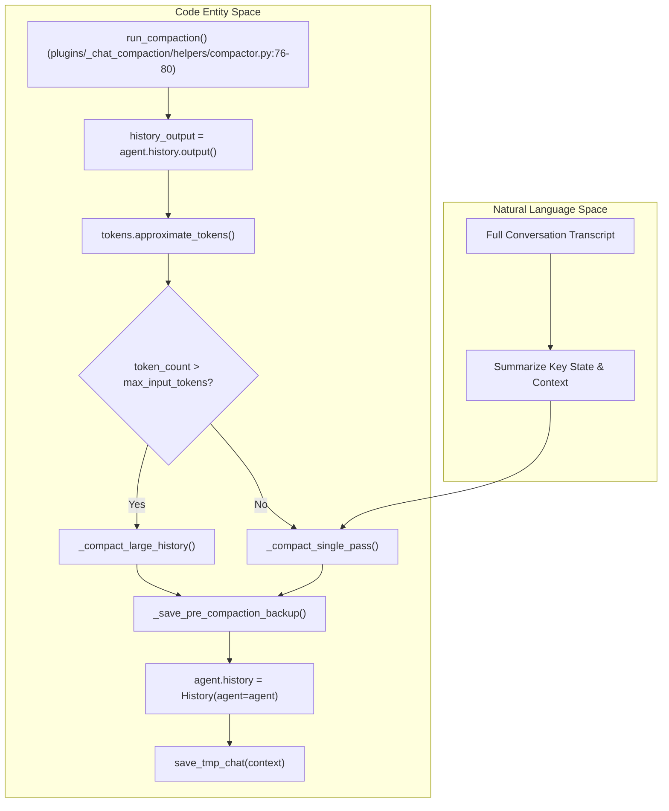

<!-- source: DeepWiki mcp.deepwiki.com · repo agent0ai/agent-zero · page 2.4 Response Handling, Repair & History · fetched 2026-10-29 -->

# Response Handling, Repair & History

<details>
<summary>Relevant source files</summary>

The following files were used as context for generating this wiki page:

- [extensions/python/_functions/agent/Agent/hist_add_warning/end/_90_stop_unusable_response_loop.py](extensions/python/_functions/agent/Agent/hist_add_warning/end/_90_stop_unusable_response_loop.py)
- [extensions/python/message_loop_end/AGENTS.md](extensions/python/message_loop_end/AGENTS.md)
- [extensions/python/message_loop_end/_10_organize_history.py](extensions/python/message_loop_end/_10_organize_history.py)
- [extensions/python/message_loop_prompts_before/_90_organize_history_wait.py](extensions/python/message_loop_prompts_before/_90_organize_history_wait.py)
- [extensions/python/message_loop_result/AGENTS.md](extensions/python/message_loop_result/AGENTS.md)
- [extensions/python/message_loop_result/_20_empty_response.py](extensions/python/message_loop_result/_20_empty_response.py)
- [extensions/python/message_loop_result/_30_repeat_response.py](extensions/python/message_loop_result/_30_repeat_response.py)
- [helpers/history.py](helpers/history.py)
- [helpers/history.py.dox.md](helpers/history.py.dox.md)
- [helpers/persist_chat.py](helpers/persist_chat.py)
- [helpers/persist_chat.py.dox.md](helpers/persist_chat.py.dox.md)
- [helpers/settings.py](helpers/settings.py)
- [helpers/settings.py.dox.md](helpers/settings.py.dox.md)
- [plugins/_chat_compaction/AGENTS.md](plugins/_chat_compaction/AGENTS.md)
- [plugins/_chat_compaction/helpers/compactor.py](plugins/_chat_compaction/helpers/compactor.py)
- [plugins/_context_doctor/AGENTS.md](plugins/_context_doctor/AGENTS.md)
- [plugins/_context_doctor/README.md](plugins/_context_doctor/README.md)
- [plugins/_context_doctor/default_config.yaml](plugins/_context_doctor/default_config.yaml)
- [plugins/_context_doctor/extensions/python/message_loop_result/_10_context_doctor.py](plugins/_context_doctor/extensions/python/message_loop_result/_10_context_doctor.py)
- [plugins/_context_doctor/helpers/context_doctor.py](plugins/_context_doctor/helpers/context_doctor.py)
- [plugins/_context_doctor/helpers/json_repair_patch.py](plugins/_context_doctor/helpers/json_repair_patch.py)
- [plugins/_context_doctor/plugin.yaml](plugins/_context_doctor/plugin.yaml)
- [plugins/_context_doctor/prompts/fw.msg_thoughts_fallback.md](plugins/_context_doctor/prompts/fw.msg_thoughts_fallback.md)
- [plugins/_context_doctor/prompts/fw.msg_thoughts_fallback_response.md](plugins/_context_doctor/prompts/fw.msg_thoughts_fallback_response.md)
- [plugins/_context_doctor/tests/conftest.py](plugins/_context_doctor/tests/conftest.py)
- [plugins/_context_doctor/tests/test_context_doctor.py](plugins/_context_doctor/tests/test_context_doctor.py)
- [plugins/_context_doctor/webui/config.html](plugins/_context_doctor/webui/config.html)
- [plugins/_context_window/AGENTS.md](plugins/_context_window/AGENTS.md)
- [plugins/_context_window/README.md](plugins/_context_window/README.md)
- [plugins/_context_window/api/context_window.py](plugins/_context_window/api/context_window.py)
- [plugins/_context_window/default_config.yaml](plugins/_context_window/default_config.yaml)
- [plugins/_context_window/extensions/webui/apply_snapshot_before/refresh-context-window.js](plugins/_context_window/extensions/webui/apply_snapshot_before/refresh-context-window.js)
- [plugins/_context_window/extensions/webui/model-context-strip-end/context-window.html](plugins/_context_window/extensions/webui/model-context-strip-end/context-window.html)
- [plugins/_context_window/helpers/currency.py](plugins/_context_window/helpers/currency.py)
- [plugins/_context_window/tests/test_context_window.py](plugins/_context_window/tests/test_context_window.py)
- [plugins/_context_window/webui/config.html](plugins/_context_window/webui/config.html)
- [plugins/_context_window/webui/context-window-store.js](plugins/_context_window/webui/context-window-store.js)
- [plugins/_goal/AGENTS.md](plugins/_goal/AGENTS.md)
- [plugins/_goal/extensions/webui/apply_snapshot_before/refresh-goal.js](plugins/_goal/extensions/webui/apply_snapshot_before/refresh-goal.js)
- [plugins/_goal/extensions/webui/initFw_end/goal-menu-injector.js](plugins/_goal/extensions/webui/initFw_end/goal-menu-injector.js)
- [plugins/_goal/tests/test_goal_plugin.py](plugins/_goal/tests/test_goal_plugin.py)
- [plugins/_goal/webui/goal-store.js](plugins/_goal/webui/goal-store.js)
- [plugins/_model_config/extensions/webui/apply_snapshot_before/refresh-switcher.js](plugins/_model_config/extensions/webui/apply_snapshot_before/refresh-switcher.js)
- [prompts/fw.msg_repeat_response.md](prompts/fw.msg_repeat_response.md)
- [prompts/fw.msg_unusable_response_limit.md](prompts/fw.msg_unusable_response_limit.md)
- [tests/test_chat_compaction.py](tests/test_chat_compaction.py)
- [tests/test_chat_loading_refresh.py](tests/test_chat_loading_refresh.py)
- [tests/test_history.py](tests/test_history.py)
- [tests/test_history_compression_wait.py](tests/test_history_compression_wait.py)
- [tests/test_message_loop_result.py](tests/test_message_loop_result.py)
- [tests/test_persist_chat_log_ids.py](tests/test_persist_chat_log_ids.py)
- [tests/test_settings_cache.py](tests/test_settings_cache.py)
- [tests/test_tool_args_preference.py](tests/test_tool_args_preference.py)
- [tests/test_unusable_response_loop.py](tests/test_unusable_response_loop.py)
- [webui/components/settings/agent/agent.html](webui/components/settings/agent/agent.html)
- [webui/js/time-utils.js](webui/js/time-utils.js)

</details>


This wiki page covers the technical implementation of response handling, output repair, streaming logging, history compression, and token usage tracking in Agent Zero. It details how completed model responses are intercepted, validated, normalized, repaired, logged, and summarized.

---

## 1. Message Loop Result Extensions & Normalization

When an LLM call completes, the raw output is encapsulated into an `LLMResult` object [helpers/llm_result.py]() and passed through the `message_loop_result` extension chain before default assistant history recording and tool dispatch occur [extensions/python/message_loop_result/AGENTS.md:1-5](). 

Extensions in this pipeline execute in deterministic filename order [extensions/python/message_loop_result/AGENTS.md:16](). If an extension handles a malformed or repetitive result, it sets `result_data["skip_default_processing"] = True` and manages its own history and UI side effects [extensions/python/message_loop_result/AGENTS.md:9]().

### Key Extension Modules

* **Empty & Reasoning-Only Responses (`_20_empty_response.py`)**: Intercepts fully empty turns (no text, no reasoning). Increments the unusable-response counter without adding history warnings, using `fw.msg_empty_response.md` for UI warnings [extensions/python/message_loop_result/AGENTS.md:10](). Reasoning-only turns trigger `fw.msg_reasoning_only.md` history warnings and are routed through the stop-unusable-response loop [extensions/python/message_loop_result/AGENTS.md:11]().
* **Repeat Response Detection (`_30_repeat_response.py`)**: Compares canonical function calls or response text against `loop_data.last_response` [extensions/python/message_loop_result/AGENTS.md:12](). If a repetition is detected independently of reasoning content, it halts processing, issues a `fw.msg_repeat.md` warning, and forces a retry [extensions/python/message_loop_result/AGENTS.md:12]().

Diagram: Response Processing Pipeline (Natural Language to Code Entity Space)


Sources: `extensions/python/message_loop_result/AGENTS.md`, `extensions/python/message_loop_result/_20_empty_response.py`, `extensions/python/message_loop_result/_30_repeat_response.py`

---

## 2. The `_context_doctor` JSON Repair Plugin

The `_context_doctor` plugin repairs malformed tool-call JSON produced by LLMs and preserves raw output as compact thoughts JSON when repair fails to produce a valid tool call [plugins/_context_doctor/AGENTS.md:3-5]().

### Implementation & Data Flow

The plugin hooks into the `message_loop_result` extension point via `ContextDoctor` (`plugins/_context_doctor/extensions/python/message_loop_result/_10_context_doctor.py`) [plugins/_context_doctor/AGENTS.md:12](). 

1. **Extraction & Validation**: The plugin checks if the `LLMResult` contains native canonical function calls; if so, it yields execution to avoid interfering with the agent's policy dispatcher [plugins/_context_doctor/extensions/python/message_loop_result/_10_context_doctor.py:27-29]().
2. **JSON Salvage & Repair**: It uses `json_repair` with a customized salvage schema (`_A0_SALVAGE_SCHEMA`) to extract structured fields (`thoughts`, `headline`, `tool_name`, `tool_args`) [plugins/_context_doctor/helpers/context_doctor.py:18-77]().
3. **Fallback & Thought Splitting**: If no valid tool call is recognized, the raw text is wrapped in a compact thoughts JSON object (`{"thoughts": [response]}`) [plugins/_context_doctor/helpers/context_doctor.py:124-136](). Blank-line-separated thoughts are expanded into separate entries if splitting is enabled [plugins/_context_doctor/AGENTS.md:21]().
4. **Log Refresh**: `update_log_item()` updates the active generation log item while preserving streamed reasoning key-value pairs (`kvps`) [plugins/_context_doctor/helpers/context_doctor.py:169-203]().

Sources: `plugins/_context_doctor/AGENTS.md`, `plugins/_context_doctor/helpers/context_doctor.py`, `plugins/_context_doctor/extensions/python/message_loop_result/_10_context_doctor.py`

---

## 3. Unusable-Response Loop Limits

To prevent agents from entering infinite loops of malformed outputs, empty turns, or repeats, Agent Zero implements a strict stop mechanism via `_90_stop_unusable_response_loop.py` [extensions/python/_functions/agent/Agent/hist_add_warning/end/_90_stop_unusable_response_loop.py]().

### Loop Limit Mechanics

* **Consecutive Tracking**: Warnings issued by filters (`fw.msg_misformat.md`, `fw.msg_repeat.md`, `fw.msg_empty_response.md`, `fw.msg_reasoning_only.md`, `fw.msg_thoughts_fallback.md`) increment a persistent consecutive failure counter stored in `loop_data.params_persistent` [plugins/_context_doctor/AGENTS.md:25]().
* **Threshold Enforcement**: Controlled by setting `max_consecutive_unusable_responses` (default: `5`) [helpers/settings.py:62](). When the counter reaches this threshold, the extension raises a `HandledException` with a formatted error message (`fw.msg_unusable_response_limit.md`), terminating the agent turn [tests/test_unusable_response_loop.py:64-68]().
* **Recovery Windows**: Non-consecutive valid responses reset the failure counter, establishing a new recovery window [tests/test_unusable_response_loop.py:71-87]().

Sources: `helpers/settings.py`, `extensions/python/_functions/agent/Agent/hist_add_warning/end/_90_stop_unusable_response_loop.py`, `tests/test_unusable_response_loop.py`

---

## 4. Streaming Logging Extensions

During generation, Agent Zero streams token output to the WebUI in real time using response stream extensions (`extensions/python/response_stream/`) [extensions/python/response_stream/_10_log_from_stream.py]().

### Streaming Log Architecture

* **Stream Logging (`_10_log_from_stream.py`)**: Intercepts incremental chunks from the LLM wrapper, updating the active log item's content buffer.
* **Live Response Parsing (`_20_live_response.py`)**: Parses partial JSON structures on the fly. It tolerates incomplete tool arguments and updates progress indicators (e.g., rendering headings like `Using code_execution_tool...` or `Writing Python code... (3)`) as structural keys arrive [extensions/python/response_stream/_20_live_response.py]().
* **Completion Finalization (`LogPlainResponses`)**: When a non-tool plain text or plain JSON response completes, `LogPlainResponses` converts the generating log entry into a final `response` item type [extensions/python/response_stream/_10_log_from_stream.py]().

Sources: `extensions/python/response_stream/_10_log_from_stream.py`, `extensions/python/response_stream/_20_live_response.py`

---

## 5. History Compression & The `_chat_compaction` Plugin

When conversation histories grow large and approach token window limits, the `_chat_compaction` plugin provides automated and manual context reduction [plugins/_chat_compaction/helpers/compactor.py:76-80]().

### Compaction Workflow (`run_compaction`)

Diagram: Chat Compaction Architecture (Natural Language to Code Entity Space)


1. **Text Extraction**: Extracts the entire conversation transcript using `history_output = agent.history.output()` [plugins/_chat_compaction/helpers/compactor.py:100]().
2. **Token Estimation & Budgeting**: Estimates tokens using `tokens.approximate_tokens()` and determines the input token budget (70% of the model's context window) [plugins/_chat_compaction/helpers/compactor.py:107-111]().
3. **Chunking vs. Single-Pass**: If the token count exceeds the threshold, `_compact_large_history` splits the history into chunks and summarizes them iteratively; otherwise, `_compact_single_pass` summarizes the transcript in one LLM call [plugins/_chat_compaction/helpers/compactor.py:123-130]().
4. **Pre-Compaction Backups**: Saves JSON and plain-text transcripts to the chat's `backups/` directory before overwriting history [plugins/_chat_compaction/helpers/compactor.py:32-48]().
5. **State Reset**: Resets the active message history to a single compacted message node, clears subordinate execution chains, and resets the WebUI log view [plugins/_chat_compaction/helpers/compactor.py:146-163]().

Sources: `plugins/_chat_compaction/helpers/compactor.py`

---

## 6. The `_context_window` Usage Tracker

The `_context_window` plugin tracks per-prompt token usage and exposes metrics through an API endpoint and a WebUI indicator popover [plugins/_context_window/AGENTS.md:3-6]().

### Token Bucket Accounting

Token consumption is categorized into six distinct usage buckets [plugins/_context_window/AGENTS.md:20-21]():

| Bucket Name | Description | Source / Measurement |
| :--- | :--- | :--- |
| `messages` | Conversation history turns | History record token ledger [plugins/_context_window/AGENTS.md:26-27]() |
| `system_tools` | Built-in framework tools | Prompt builder recording [plugins/_context_window/AGENTS.md:22-23]() |
| `skills` | Loaded agent skills | Extensible prompt builder [plugins/_context_window/AGENTS.md:22-23]() |
| `mcp_tools` | External Model Context Protocol tools | Extensible prompt builder [plugins/_context_window/AGENTS.md:22-23]() |
| `system_prompt` | Core instructions & protocol | Unclaimed remainder after bucket reconciliation [plugins/_context_window/AGENTS.md:28-29]() |
| `extras` | Time, project variables, workspace context | Protocol and prompt extras [plugins/_context_window/AGENTS.md:25]() |

### API Endpoint (`plugins/_context_window/api/context_window.py`)

The token usage API endpoint returns structured token counts and effective model limits without leaking raw prompt content [plugins/_context_window/AGENTS.md:13-14]():

```python
{
    "tokens": 120,
    "context_window": 128000,
    "usage": {
        "messages": 42,
        "system_tools": 10,
        "skills": 0,
        "mcp_tools": 0,
        "system_prompt": 50,
        "extras": 18
    },
    "provider_usage": {}
}
```
*[plugins/_context_window/api/context_window.py]()

Sources: `plugins/_context_window/AGENTS.md`, `plugins/_context_window/helpers/usage.py`, `plugins/_context_window/api/context_window.py`

---

