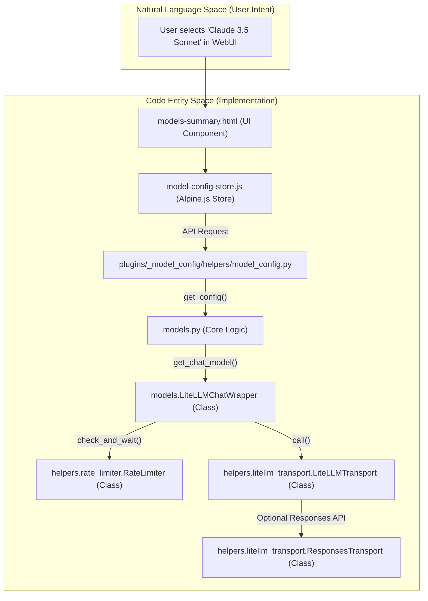
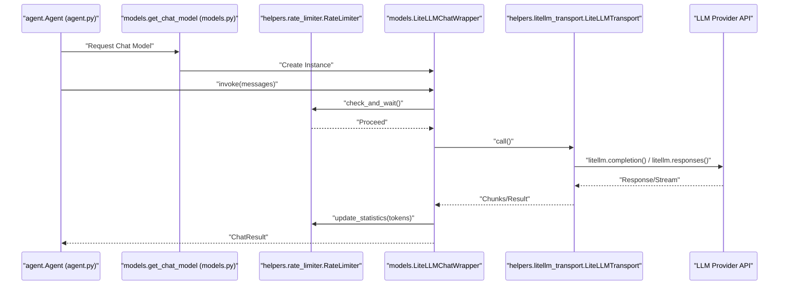
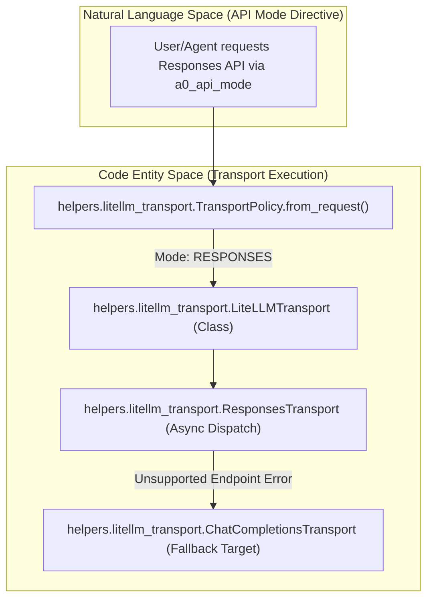

<!-- source: DeepWiki mcp.deepwiki.com · repo agent0ai/agent-zero · page 2.5 LLM Model Abstraction & Rate Limiting · fetched 2026-10-29 -->

# LLM Model Abstraction & Rate Limiting

Relevant source files

The following files were used as context for generating this wiki page:

- [AGENTS.md](AGENTS.md)
- [agent.py](agent.py)
- [conf/AGENTS.md](conf/AGENTS.md)
- [conf/model_providers.yaml](conf/model_providers.yaml)
- [helpers/litellm_transport.py](helpers/litellm_transport.py)
- [helpers/litellm_transport.py.dox.md](helpers/litellm_transport.py.dox.md)
- [helpers/llm_result.py](helpers/llm_result.py)
- [helpers/llm_result.py.dox.md](helpers/llm_result.py.dox.md)
- [helpers/responses_history.py](helpers/responses_history.py)
- [helpers/responses_history.py.dox.md](helpers/responses_history.py.dox.md)
- [initialize.py](initialize.py)
- [models.py](models.py)
- [plugins/_model_config/api/model_search.py](plugins/_model_config/api/model_search.py)
- [plugins/_model_config/default_config.yaml](plugins/_model_config/default_config.yaml)
- [plugins/_model_config/extensions/python/banners/_20_missing_api_key.py](plugins/_model_config/extensions/python/banners/_20_missing_api_key.py)
- [plugins/_model_config/provider_metadata.yaml](plugins/_model_config/provider_metadata.yaml)
- [plugins/_onboarding/webui/onboarding-providers.js](plugins/_onboarding/webui/onboarding-providers.js)
- [preload.py](preload.py)
- [requirements.txt](requirements.txt)
- [run_ui.py](run_ui.py)
- [tests/test_embedding_model_preload.py](tests/test_embedding_model_preload.py)
- [tests/test_litellm_sdk.py](tests/test_litellm_sdk.py)
- [tests/test_model_config_api_keys.py](tests/test_model_config_api_keys.py)
- [tests/test_model_search.py](tests/test_model_search.py)
- [tests/test_responses_architecture.py](tests/test_responses_architecture.py)
- [tests/test_responses_history.py](tests/test_responses_history.py)
- [tests/test_stream_tool_early_stop.py](tests/test_stream_tool_early_stop.py)

## Purpose and Scope

This page details how Agent Zero abstracts Large Language Model (LLM) interactions, manages multi-provider configurations via LiteLLM (`models.py`), and implements rate limiting, token approximation (`helpers.tokens`), thinking tags (`ChatGenerationResult`), prompt caching, and advanced transport adapters (`helpers.litellm_transport.py`).

Sources: `[models.py:1-164]`, `[helpers/litellm_transport.py:27-146]`, `[conf/model_providers.yaml:1-27]`

---

## Model Resolution Architecture

Agent Zero routes all provider requests through a tiered abstraction layer consisting of global settings, model configuration helpers, LangChain wrappers (`LiteLLMChatWrapper`), and LiteLLM transports (`LiteLLMTransport`, `ResponsesTransport`).

### Diagram: Model Request Translation

Sources: `[models.py:243-250]`, `[models.py:461-465]`, `[models.py:25-28]`, `[helpers/litellm_transport.py:186-191]`

---

## Provider Configuration via model_providers.yaml

Supported model providers are registered in `conf/model_providers.yaml`, mapping internal identifiers to LiteLLM provider names, endpoint URLs, and default arguments.

| Field | Description |
| :--- | :--- |
| `litellm_provider` | The underlying provider string expected by LiteLLM (e.g., `anthropic`, `openai`, `gemini`) `[conf/model_providers.yaml:13]` |
| `kwargs` | Extra parameter dictionary (e.g., `api_base`, `extra_headers`, `venice_parameters`) `[conf/model_providers.yaml:16-17]` |
| `models_list` | Endpoint URL and formatting rules used by the Model Configuration plugin to list available models `[conf/model_providers.yaml:19-27]` |

Sources: `[conf/model_providers.yaml:1-27]`

---

## Core Classes and Functions

### LiteLLMChatWrapper & Model Functions
Inheriting from LangChain's `SimpleChatModel` `[models.py:34]`, `LiteLLMChatWrapper` manages execution streams, tool binding, reasoning processing, and rate-limit enforcement.

* `get_chat_model()`: Instantiates and configures a `LiteLLMChatWrapper` using a resolved `ModelConfig` `[models.py:143-164]`, `[models.py:461-465]`.
* `get_embedding_model()`: Returns either a LiteLLM-backed embedding handler or a local `SentenceTransformer` instance for HuggingFace embeddings `[models.py:532-550]`.

### Diagram: Execution Data Flow

Sources: `[models.py:461-470]`, `[models.py:317-325]`, `[models.py:335-340]`, `[helpers/litellm_transport.py:178-200]`

---

## Rate Limiting & Token Management

Agent Zero uses `RateLimiter` (`helpers/rate_limiter.py`) to manage requests-per-minute (`limit_requests`) and token quotas (`limit_input`, `limit_output`) defined in `ModelConfig` `[models.py:143-154]`. If limits are approached or exhausted, the limiter forces asynchronous pauses (`asyncio.sleep`) to prevent 429 rate-limit errors. Per project contracts `[AGENTS.md:27]`, `models.apply_rate_limiter` skips token counting and returns no limiter when all request, input, and output limits are unset.

Token counts are estimated quickly via `approximate_tokens` from `helpers.tokens` to avoid the performance cost of remote tokenizers during message construction `[models.py:29]`.

Sources: `[models.py:27-29]`, `[models.py:143-154]`, `[AGENTS.md:27]`

---

## Thinking Tags & Reasoning

Models that emit reasoning tokens (such as DeepSeek R1 or OpenAI o1) or structured XML tags are processed via `ChatGenerationResult` `[models.py:171-209]`.
* **Native Reasoning**: Captured directly from the provider's `reasoning_delta` stream chunks `[models.py:184-187]`.
* **Thinking Tags**: If native reasoning is missing, text inside configured pairs (e.g., ``) is parsed manually and placed into the reasoning buffer rather than the main response string `[models.py:180-209]`.

Sources: `[models.py:171-209]`

---

## Prompt Caching & Global Kwargs

Global parameters such as `drop_params` are merged into LiteLLM calls through `get_litellm_global_kwargs()` and `set_litellm_params()` `[models.py:89-122]`. 

Explicit prompt caching is enabled via the `a0_explicit_prompt_caching` keyword argument, which injects provider-specific cache control markers for supported models (such as Anthropic, Gemini, and OpenAI) `[helpers/litellm_transport.py:193-200]`.

Sources: `[models.py:89-122]`, `[helpers/litellm_transport.py:193-200]`, `[helpers/litellm_transport.py.dox.md:48-52]`

---

## Advanced Transport: Responses API & Fallback Routing

`LiteLLMTransport` inspects request policies via `TransportPolicy` to route calls either through standard Chat Completions or the OpenAI Responses API (`ResponsesTransport`) `[helpers/litellm_transport.py:83-146]`.

### Diagram: Transport Selection & Fallback Routing

Sources: `[helpers/litellm_transport.py:83-172]`, `[helpers/litellm_transport.py.dox.md:32-37]`

* **Fallback Behavior**: If a provider rejects the Responses API or encounters compatibility errors, the transport automatically falls back to standard chat completions `[helpers/litellm_transport.py:167-174]`.
* **Tool Conversion**: Agent Zero tool prompts and MCP schemas are translated into native function tool definitions `[helpers/responses_tools.py:31-33]`.

Sources: `[helpers/litellm_transport.py:83-174]`, `[helpers/responses_tools.py:31-33]`, `[helpers/litellm_transport.py.dox.md:32-37]`

---

## Tool Request Extraction

When using standard Chat Completions, raw text outputs are parsed for embedded JSON tool requests using `json_parse_dirty` and `extract_json_root_string` in `helpers/extract_tools.py`, backed by the fault-tolerant `DirtyJson` parser `[helpers/dirty_json.py:30]`.

Sources: `[helpers/extract_tools.py:7-20]`, `[helpers/dirty_json.py:30]`

---

