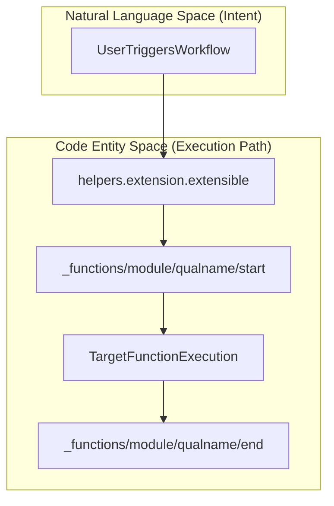
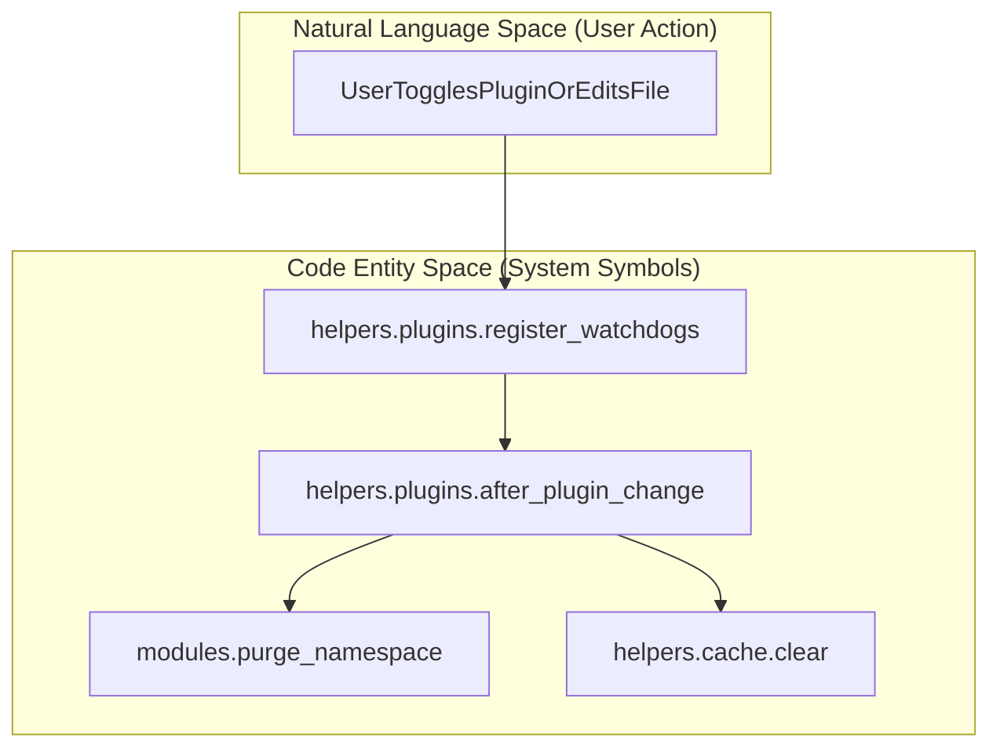

<!-- source: DeepWiki mcp.deepwiki.com · repo agent0ai/agent-zero · page 3 Extension & Plugin System · fetched 2026-10-29 -->

# Extension & Plugin System

Relevant source files

The following files were used as context for generating this wiki page:

- [docs/developer/architecture.md](docs/developer/architecture.md)
- [docs/developer/extensions.md](docs/developer/extensions.md)
- [docs/developer/notifications.md](docs/developer/notifications.md)
- [docs/guides/agent-profiles.md](docs/guides/agent-profiles.md)
- [docs/guides/projects.md](docs/guides/projects.md)
- [docs/guides/usage.md](docs/guides/usage.md)
- [helpers/plugins.py](helpers/plugins.py)
- [helpers/plugins.py.dox.md](helpers/plugins.py.dox.md)
- [helpers/providers.py](helpers/providers.py)
- [helpers/providers.py.dox.md](helpers/providers.py.dox.md)
- [helpers/subagents.py](helpers/subagents.py)
- [helpers/subagents.py.dox.md](helpers/subagents.py.dox.md)
- [plugins/_a0_connector/api/v1/agent_profile_set.py](plugins/_a0_connector/api/v1/agent_profile_set.py)
- [tests/test_plugin_activation_ui.py](tests/test_plugin_activation_ui.py)
- [tests/test_plugin_asset_precedence.py](tests/test_plugin_asset_precedence.py)
- [tests/test_plugin_hook_context.py](tests/test_plugin_hook_context.py)
- [tests/test_subagent_metadata_merge.py](tests/test_subagent_metadata_merge.py)

Agent Zero is built as a modular framework where core behaviors are heavily decoupled. The system relies on two primary extension mechanisms: **Extensions**, which inject low-level Python hooks into functions and classes, and **Plugins**, which package tools, API routes, hooks, and UI panels into self-contained directories.

This is a parent page. For deep technical implementation details, refer to the following child pages:
- Extension Framework: See [Extension Framework](#3.1)
- Plugin Architecture & Lifecycle: See [Plugin Architecture & Lifecycle](#3.2)
- Built-in Plugins Reference: See [Built-in Plugins Reference](#3.3)
- Plugin Hub, Installer & Validator: See [Plugin Hub, Installer & Validator](#3.4)
- Slash Commands System: See [Slash Commands System](#3.5)

---

## 3.1. Extension Framework

The extension framework enables developers to inject custom logic into Python functions without altering their original source code [docs/developer/extensions.md:1-46](). It uses the `@extensible` decorator to create interception points at function execution boundaries [helpers/plugins.py:184-189]().

- **`@extensible` Decorator**: Registers execution hooks based on target modules and qualified function names [helpers/plugins.py:184-189]().
- **Base Class & Execution**: Custom extensions inherit from the `Extension` base class and execute synchronously or asynchronously [tests/test_plugin_asset_precedence.py:37-43]().
- **Watchdog Cache Invalidation**: File modifications trigger watchdog handlers that purge cached extension states and reload module namespaces [helpers/plugins.py:122-214]().

For detailed coverage of the `@extensible` decorator, the `Extension` base class, asynchronous/synchronous execution helpers, and watchdog cache invalidation, see [Extension Framework](#3.1).

### Diagram: Extension Hook Execution Flow

**Sources:** [docs/developer/extensions.md:1-46](), [helpers/plugins.py:184-214]()

---

## 3.2. Plugin Architecture & Lifecycle

Plugins package complex features into discoverable directories under core bundled paths (`plugins/`) or user/custom directories (`usr/plugins/`) [tests/test_plugin_asset_precedence.py:15-46]().

- **Manifest**: Every plugin defines metadata such as `name`, `title`, and config flags in `plugin.yaml` [helpers/plugins.py:74-83]().
- **Toggle States**: Global and scoped activation are managed via `.toggle-1` (enabled) and `.toggle-0` (disabled) marker files [tests/test_plugin_asset_precedence.py:127-130]().
- **Lifecycle & Watchdogs**: The `helpers.plugins.register_watchdogs()` function monitors plugin roots and invokes `after_plugin_change()` to refresh namespaces and clear caches [helpers/plugins.py:122-189]().
- **Scoped Configuration**: Plugins support per-project and per-agent configuration overrides [helpers/plugins.py:80-81](), managed through dedicated UI settings components [tests/test_plugin_activation_ui.py:123-143]().

For detailed coverage of plugin manifests, toggle states, discovery rules, `hooks.py`, and the plugin settings UI, see [Plugin Architecture & Lifecycle](#3.2).

### Diagram: Plugin Discovery and State Management Flow

**Sources:** [helpers/plugins.py:74-107](), [helpers/plugins.py:122-189](), [helpers/plugins.py:197-214]()

---

## 3.3. Built-in Plugins Reference

Agent Zero includes a robust collection of built-in system plugins that handle everything from vector memory and model configuration to code execution and error recovery [helpers/providers.py:63-81]().

| Plugin Name | Purpose | Key Code Reference |
| :--- | :--- | :--- |
| `_memory` | FAISS-based vector storage and automatic recall | [helpers/plugins.py:65-67]() |
| `_model_config` | Unified model presets and provider configuration | [helpers/providers.py:63-81]() |
| `_code_execution` | Sandboxed Python and shell command execution | [tests/test_plugin_activation_ui.py:184-186]() |
| `_text_editor` & `_editor` | File editing and ACE-based source/preview panels | [helpers/plugins.py:97-101]() |
| `_chat_branching` | Conversation management and history branching | [helpers/plugins.py:65-68]() |
| `_error_retry` | Resilient tool-call recovery and error handling | [helpers/plugins.py.dox.md:98-99]() |
| `_goal` & `_pin_to_top` | Task tracking and interface pinning helpers | [helpers/plugins.py:74-83]() |
| `_chat_naming` & `_whats_new` | Automated chat naming and release note overlays | [helpers/plugins.py:85-107]() |
| `_sidebar_folders` & `_tool_access` | Workspace file tree and granular tool access control | [helpers/plugins.py:93-96]() |

For a full index and description of all bundled system plugins, see [Built-in Plugins Reference](#3.3).

**Sources:** [helpers/plugins.py:60-105](), [helpers/providers.py:63-81]()

---

## 3.4. Plugin Hub, Installer & Validator

The ecosystem provides robust mechanisms for discovering, installing, and validating third-party packages:
- **`_plugin_installer`**: Manages Git repository cloning and zip archive extraction workflows [helpers/plugins.py:109-120]().
- **`_plugin_scan`**: Powers the Plugin Hub catalog index for discovering available extensions [helpers/plugins.py:85-107]().
- **`_plugin_validator`**: Implements automated review pipelines, static code inspections, and schema checks [helpers/plugins.py:74-84]().
- **Developer Skills**: Bundles authoring helpers (`a0-create-plugin`) to guide developers through custom plugin creation [docs/developer/extensions.md:14-20]().

For installation workflows, catalog structure, and validation rules, see [Plugin Hub, Installer & Validator](#3.4).

**Sources:** [helpers/plugins.py:74-120](), [docs/developer/extensions.md:14-20]()

---

## 3.5. Slash Commands System

The slash command system is driven by the `_commands` plugin [helpers/plugins.py:64](), enabling users and agents to trigger specialized routines directly from the chat composer.
- **Definitions**: Supports custom command declarations via YAML metadata and Python handlers [helpers/plugins.py:64-70]().
- **Discovery**: Automatically scans plugin directories for command modules during startup [helpers/plugins.py:85-107]().
- **Store & Menu**: Exposes command UI stores and dropdown handlers in the frontend [tests/test_plugin_activation_ui.py:15-35]().

For command parsing, connector integration, and handler implementations, see [Slash Commands System](#3.5).

**Sources:** [helpers/plugins.py:64-107](), [tests/test_plugin_activation_ui.py:15-35]()

---

