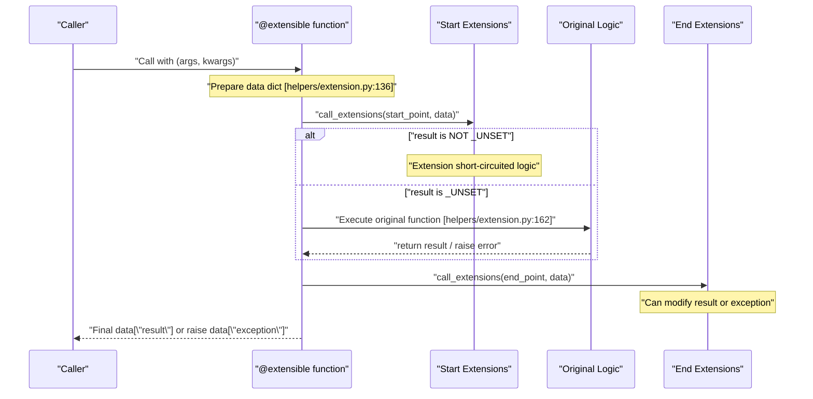
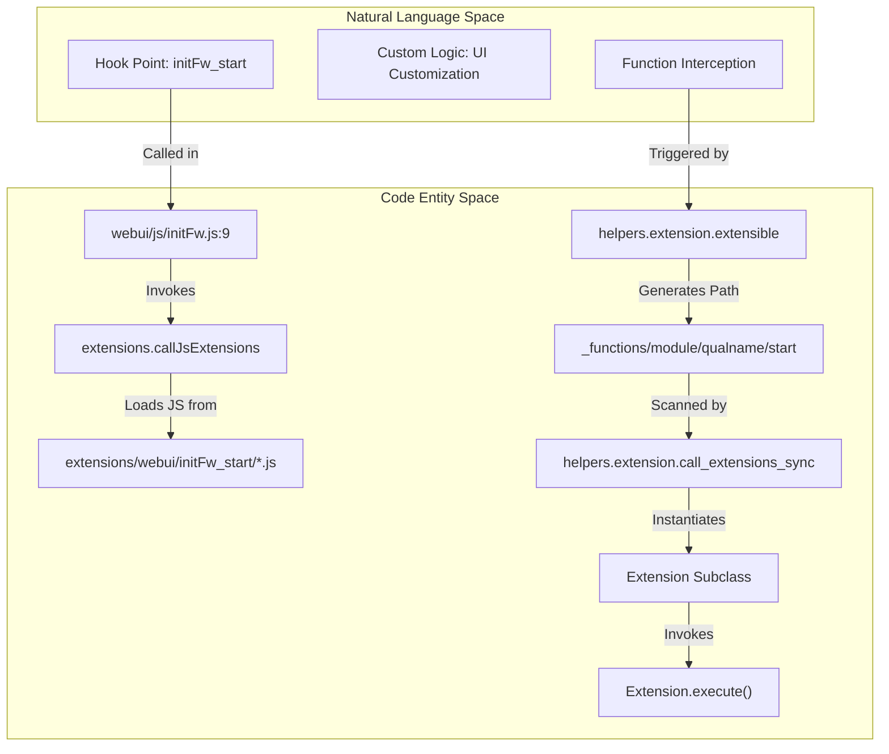
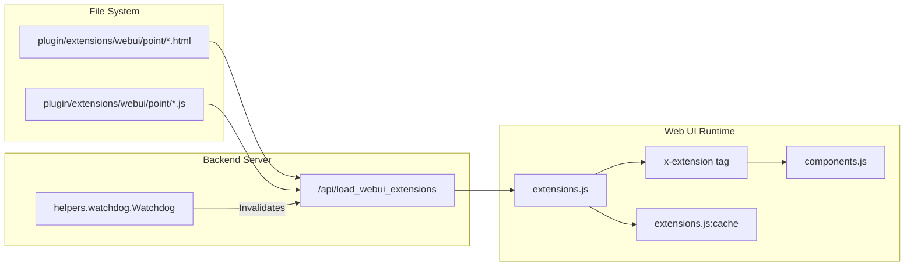

<!-- source: DeepWiki mcp.deepwiki.com · repo agent0ai/agent-zero · page 3.1 Extension Framework · fetched 2026-10-29 -->

# Extension Framework

Relevant source files

The following files were used as context for generating this wiki page:

- [docs/developer/architecture.md](docs/developer/architecture.md)
- [docs/developer/extensions.md](docs/developer/extensions.md)
- [docs/developer/notifications.md](docs/developer/notifications.md)
- [docs/guides/agent-profiles.md](docs/guides/agent-profiles.md)
- [docs/guides/projects.md](docs/guides/projects.md)
- [docs/guides/usage.md](docs/guides/usage.md)
- [extensions/python/agent_init/AGENTS.md](extensions/python/agent_init/AGENTS.md)
- [extensions/python/job_loop/_50_trim_cache.py](extensions/python/job_loop/_50_trim_cache.py)
- [helpers/api.py](helpers/api.py)
- [helpers/cache.py](helpers/cache.py)
- [helpers/extension.py](helpers/extension.py)
- [helpers/files.py](helpers/files.py)
- [helpers/files.py.dox.md](helpers/files.py.dox.md)
- [helpers/watchdog.py](helpers/watchdog.py)
- [plugins/_a0_connector/api/v1/agent_profile_set.py](plugins/_a0_connector/api/v1/agent_profile_set.py)
- [plugins/_infection_check/.toggle-0](plugins/_infection_check/.toggle-0)
- [plugins/_memory/AGENTS.md](plugins/_memory/AGENTS.md)
- [plugins/_memory/api/memory_dashboard.py](plugins/_memory/api/memory_dashboard.py)
- [plugins/_memory/tools/memory_load.py](plugins/_memory/tools/memory_load.py)
- [plugins/_memory/webui/memory-dashboard.html](plugins/_memory/webui/memory-dashboard.html)
- [prompts/AGENTS.md](prompts/AGENTS.md)
- [prompts/agent.system.tool.call_sub.py](prompts/agent.system.tool.call_sub.py)
- [tests/test_http_auth_csrf.py](tests/test_http_auth_csrf.py)
- [tests/test_initial_message.py](tests/test_initial_message.py)
- [tests/test_memory_json_serialization.py](tests/test_memory_json_serialization.py)
- [tests/test_prompt_catalogs.py](tests/test_prompt_catalogs.py)
- [tests/test_webui_message_window.py](tests/test_webui_message_window.py)
- [tests/test_webui_plugin_process_types.py](tests/test_webui_plugin_process_types.py)
- [webui/AGENTS.md](webui/AGENTS.md)
- [webui/components/messages/AGENTS.md](webui/components/messages/AGENTS.md)
- [webui/js/AGENTS.md](webui/js/AGENTS.md)
- [webui/js/cache.js](webui/js/cache.js)
- [webui/js/components.js](webui/js/components.js)
- [webui/js/extensions.js](webui/js/extensions.js)
- [webui/js/message-window.js](webui/js/message-window.js)
- [webui/login.css](webui/login.css)
- [webui/login.html](webui/login.html)

The Extension Framework is a core architectural component of Agent Zero that allows for non-invasive modification of system behavior. Unlike traditional plugin systems that require explicit hook calls, the extension framework uses a directory-based discovery mechanism and a powerful `@extensible` decorator to create implicit extension points across the codebase.

### Core Architecture

The framework operates by scanning specific directory structures for Python classes that inherit from a base `Extension` class `[helpers/extension.py:217-233]()`. These extensions are then executed either synchronously or asynchronously at defined extension points.

#### The Extension Base Class
Every extension must be a class inheriting from `helpers.extension.Extension` `[helpers/extension.py:217-233]()`.
- **Initialization**: The `__init__` method receives the current `Agent` instance (if available) and any additional keyword arguments passed during the call `[helpers/extension.py:219-221]()`.
- **Execution**: The `execute` method is the entry point for the extension's logic and can be synchronous or return an `Awaitable` `[helpers/extension.py:223-224]()`.

#### Extension Discovery and Priority
Extensions are loaded from two primary locations:
1.  **System Extensions**: `python/extensions` (defined as `DEFAULT_EXTENSIONS_FOLDER`) `[helpers/extension.py:16]()`.
2.  **User Extensions**: `usr/extensions` (defined as `USER_EXTENSIONS_FOLDER`) `[helpers/extension.py:17]().`

The framework resolves extension points by looking into subdirectories named after the extension point. Within each hook point, extensions are executed in numeric order based on their filename (e.g., `_10_*.py` runs before `_20_*.py`).

Sources: `[helpers/extension.py:16-17]()`, `[helpers/extension.py:217-233]()`

### The @extensible Decorator

The `@extensible` decorator is the primary tool for making existing functions pluggable without modifying their internal logic `[helpers/extension.py:57-214]()`. When a function is decorated, it automatically generates two implicit extension points: `start` and `end` `[helpers/extension.py:63-64]()`.

#### Data Flow in @extensible
When an `@extensible` function is called, a `data` dictionary is created to share state between the extensions and the original function `[helpers/extension.py:136-141]()`:
- `data["args"]`: Positional arguments (mutable by extensions) `[helpers/extension.py:137]()`.
- `data["kwargs"]`: Keyword arguments (mutable by extensions) `[helpers/extension.py:138]()`.
- `data["result"]`: The return value. If set in a `start` extension to something other than `_UNSET`, the original function is skipped `[helpers/extension.py:139]()`, `[helpers/extension.py:178]`, `[helpers/extension.py:202]()`.
- `data["exception"]`: An exception object. If set, it forces the function to raise or allows `end` extensions to suppress errors `[helpers/extension.py:140]()`, `[helpers/extension.py:146-150]()`.

#### Naming Convention
The decorator derives folder paths based on the module and function name `[helpers/extension.py:120-132]()`:
- `_functions/<module_path>/<qualname>/start`
- `_functions/<module_path>/<qualname>/end`

Example: A function in module `helpers.something` with qualname `Outer.Inner.__init__` generates paths `_functions/helpers/something/Outer/Inner/__init__/start` and `end` `[helpers/extension.py:70-78]()`.

Sources: `[helpers/extension.py:57-214]()`, `[helpers/extension.py:70-78]()`

### Extension Execution Flow

The following diagram illustrates how the `@extensible` decorator intercepts function calls and interacts with the `Extension` classes.

Implicit Extension Point Lifecycle

Sources: `[helpers/extension.py:57-214]()`

### Extension Entity Mapping

The framework uses `call_extensions_sync` and `call_extensions_async` to trigger hooks `[helpers/extension.py:245-310]()`. These functions handle the discovery of extension classes within the file system.

Extension Entity Mapping

Sources: `[helpers/extension.py:57-132]()`, `[helpers/extension.py:245-310]()`, `[webui/js/initFw.js:9]()`

### Web UI Extensions

The Web UI utilizes a similar pattern for JavaScript and HTML extensions. Hooks are called using `callJsExtensions` or `loadHtmlExtensions` `[webui/js/extensions.js:62]()`, `[webui/js/extensions.js:117]()`.

#### JavaScript Extensions
JS extensions are loaded dynamically using `import()` `[webui/js/extensions.js:99]()`. They must export a `default` function which receives the extension point data `[webui/js/extensions.js:66]()`. The `callJsExtensions` function handles the execution and ensures that extensions for points like `initFw_start` and `initFw_end` are run during the Alpine.js bootstrap `[webui/js/extensions.js:62-71]()`.

#### HTML Extensions
The UI uses a custom `<x-extension id="point_name">` tag to define injection points in the DOM `[webui/js/extensions.js:126]()`.
1. **Discovery**: `loadHtmlExtensions` scans the DOM for these tags `[webui/js/extensions.js:125-127]()`.
2. **Loading**: The `importHtmlExtensions` function queries the backend via `/api/load_webui_extensions` for available `.html` files for that point if not in manifest `[webui/js/extensions.js:201-207]()`.
3. **Injection**: Discovered extensions are injected as `<x-component>` tags, which are then handled by the component loader `[webui/js/components.js:11-191]()`.

#### Extension Caching
To optimize performance, the frontend maintains separate cache areas for JS and HTML extensions `[webui/js/extensions.js:21-22]()`. These can be cleared via `clearCache()` `[webui/js/extensions.js:41-44]()`.

Sources: `[webui/js/extensions.js:1-218]()`, `[webui/js/components.js:11-191]()`

### Watchdog and Cache Invalidation

Agent Zero employs a watchdog-based system to monitor changes in extension and plugin directories to allow hot-reloading. The `helpers/watchdog.py` module manages these monitors.

1.  **Monitoring**: The system monitors directories for file changes, specifically watching patterns like `**/extensions/**/*`.
2.  **Invalidation**:
    - **Python Cache**: When a change is detected, internal cache areas like `extension_folder_classes(extensions)` `[helpers/extension.py:19]()` and `extension_classes(extensions)` `[helpers/extension.py:20]()` are invalidated.
    - **Web UI Cache**: A reset is triggered via frontend cache clearing in `extensions.js` `[webui/js/extensions.js:41-44]()`.
    - **Module Purging**: If a `.py` file changes, the system uses namespace purging to remove stale modules from `sys.modules`.

WebUI Component & Extension Data Flow

Sources: `[helpers/extension.py:19-28]()`, `[helpers/watchdog.py:1-50]()`, `[webui/js/extensions.js:62-218]()`, `[webui/js/components.js:11-191]()`

### Key Functions and Classes

| Entity | Role |
| :--- | :--- |
| `Extension` | Abstract base class for all Python extensions `[helpers/extension.py:217]()`. |
| `call_extensions_sync` | Synchronously executes all extensions for a given point `[helpers/extension.py:285]()`. |
| `call_extensions_async` | Asynchronously executes all extensions for a given point `[helpers/extension.py:245]()`. |
| `extensible` | Decorator that wraps functions with `start` and `end` hooks `[helpers/extension.py:57]()`. |
| `callJsExtensions` | Frontend helper to execute JS extensions for a point `[webui/js/extensions.js:62]()`. |
| `importHtmlExtensions` | Frontend helper to inject HTML extensions into the DOM `[webui/js/extensions.js:189]()`. |
| `importComponent` | Core loader for `<x-component>` and extension assets `[webui/js/components.js:11]()`. |

Sources: `[helpers/extension.py:1-350]()`, `[webui/js/extensions.js:1-218]()`, `[webui/js/components.js:11-191]()`

---

