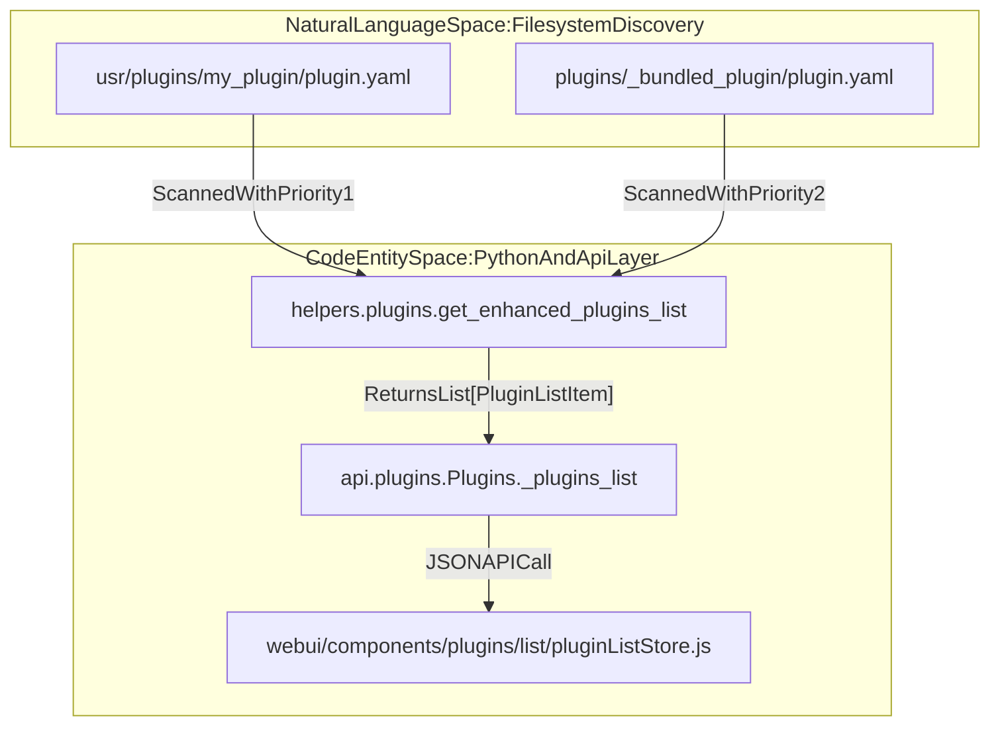
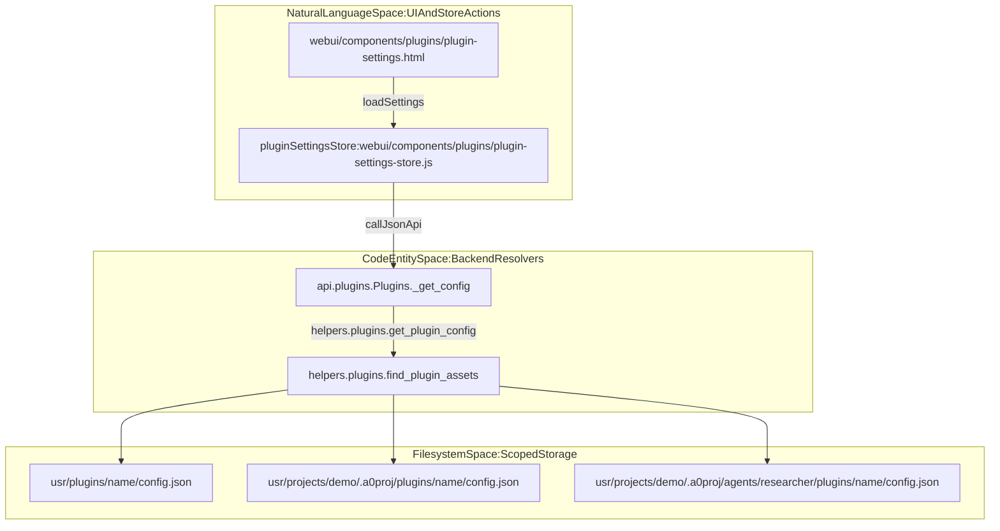

<!-- source: DeepWiki mcp.deepwiki.com · repo agent0ai/agent-zero · page 3.2 Plugin Architecture & Lifecycle · fetched 2026-10-29 -->

# Plugin Architecture & Lifecycle

Relevant source files

The following files were used as context for generating this wiki page:

- [helpers/plugins.py](helpers/plugins.py)
- [helpers/plugins.py.dox.md](helpers/plugins.py.dox.md)
- [helpers/providers.py](helpers/providers.py)
- [helpers/providers.py.dox.md](helpers/providers.py.dox.md)
- [helpers/subagents.py](helpers/subagents.py)
- [helpers/subagents.py.dox.md](helpers/subagents.py.dox.md)
- [tests/test_plugin_activation_ui.py](tests/test_plugin_activation_ui.py)
- [tests/test_plugin_asset_precedence.py](tests/test_plugin_asset_precedence.py)
- [tests/test_plugin_hook_context.py](tests/test_plugin_hook_context.py)
- [tests/test_subagent_metadata_merge.py](tests/test_subagent_metadata_merge.py)
- [webui/components/plugins/list/plugin-list.html](webui/components/plugins/list/plugin-list.html)
- [webui/components/plugins/list/pluginListStore.js](webui/components/plugins/list/pluginListStore.js)
- [webui/components/plugins/plugin-info.html](webui/components/plugins/plugin-info.html)
- [webui/components/plugins/plugin-settings-store.js](webui/components/plugins/plugin-settings-store.js)
- [webui/components/plugins/plugin-settings.html](webui/components/plugins/plugin-settings.html)
- [webui/components/plugins/toggle/plugin-toggle-store.js](webui/components/plugins/toggle/plugin-toggle-store.js)
- [webui/components/plugins/toggle/plugin-toggles.html](webui/components/plugins/toggle/plugin-toggles.html)
- [webui/components/settings/plugins/plugins-subsection.html](webui/components/settings/plugins/plugins-subsection.html)

Agent Zero implements a convention-over-configuration plugin model where runtime capabilities are dynamically discovered from the filesystem directory structure. Plugins extend backend capabilities (such as tools, provider configurations, and background hooks), frontend UI components and settings screens, and agent definitions (`agents/` or `prompts/`) without modifying core codebase files [helpers/plugins.py:1-227]().

Sources: [helpers/plugins.py:1-227]()

---

## 1. Plugin Discovery & Hierarchy

The framework resolves plugins from two primary root directories (`plugins/` for bundled system plugins and `usr/plugins/` for user-defined or community-installed plugins) [helpers/plugins.py:225-230](). User-defined plugins take precedence over core system plugins on name collisions [helpers/plugins.py:225-230](), [tests/test_plugin_asset_precedence.py:1-70]().

| Priority | Root Directory Path | Purpose & Precedence |
| :--- | :--- | :--- |
| 1 (High) | `usr/plugins/` | User-developed, custom, or community-installed plugins. Isolated from framework updates [helpers/plugins.py:228](). |
| 2 (Low) | `plugins/` | Core system plugins bundled with the framework distribution [helpers/plugins.py:229](). |

### Discovery Mechanism & Code Entities
Plugin discovery is managed by `helpers.plugins.get_enhanced_plugins_list()` which scans directories containing a valid `plugin.yaml` manifest file [helpers/plugins.py:57](), [helpers/plugins.py.dox.md:27](). Watchdogs registered via `helpers.plugins.register_watchdogs()` monitor plugin roots, extensions, and toggle files (`.toggle-[01]`, `hooks.py`), invoking `after_plugin_change()` to purge module caches and notify the frontend [helpers/plugins.py:60-64](), [helpers/plugins.py:122-194]().

Title: Discovery to Code Entity Mapping

Sources: [helpers/plugins.py:57](), [helpers/plugins.py:122-194](), [helpers/plugins.py.dox.md:27](), [webui/components/plugins/list/pluginListStore.js:45-62]()

---

## 2. Plugin Manifest (`plugin.yaml`)

Every plugin directory must contain a `plugin.yaml` metadata file [helpers/plugins.py:57](). This manifest is validated and loaded into the `PluginMetadata` Pydantic model [helpers/plugins.py:74-84]().

### Manifest Schema & Pydantic Fields
| Field Name | Type | Description in `PluginMetadata` |
| :--- | :--- | :--- |
| `name` | string | Unique machine identifier used for directory routing and internal registries [helpers/plugins.py:75](). |
| `title` | string | Human-readable title rendered in the WebUI card header [helpers/plugins.py:76](). |
| `description` | string | Summary description of the plugin's function [helpers/plugins.py:77](). |
| `version` | string | Semver version string tracked for updates [helpers/plugins.py:78](). |
| `settings_sections` | list[str] | UI settings tabs where the plugin subsection injects controls [helpers/plugins.py:79](). |
| `per_project_config` | bool | Enables project-scoped configuration files and toggle rule overrides [helpers/plugins.py:80](). |
| `per_agent_config` | bool | Enables agent-profile-scoped configuration files and toggle rules [helpers/plugins.py:81](). |
| `always_enabled` | bool | Forces the plugin active at runtime and hides toggle management controls [helpers/plugins.py:82](), [tests/test_plugin_activation_ui.py:62-77](). |

Sources: [helpers/plugins.py:57](), [helpers/plugins.py:74-84](), [tests/test_plugin_activation_ui.py:62-77]()

---

## 3. Activation & Toggle States

Plugin activation status is persisted using marker files in the plugin root directory [helpers/plugins.py:60-63]():
*   `.toggle-1`: Explicitly enabled state [helpers/plugins.py:61]().
*   `.toggle-0`: Explicitly disabled state [helpers/plugins.py:60]().

### Toggle Logic & API Handlers
Plugins marked with `always_enabled: true` in their `plugin.yaml` bypass toggle files entirely, forcing active runtime inclusion and rejecting any disable requests with a `ValueError` [helpers/plugins.py:82](), [tests/test_plugin_activation_ui.py:62-121]().

The backend checks effective toggle state via `helpers.plugins.get_toggle_state()` and exposes state mutation via `api.plugins.Plugins._toggle_plugin()` [api/plugins.py:94-142](). The frontend management is powered by `webui/components/plugins/toggle/plugin-toggle-store.js` which fetches status and updates scoping parameters via `/plugins` API calls [webui/components/plugins/toggle/plugin-toggle-store.js:132-170]().

Sources: [helpers/plugins.py:60-63](), [api/plugins.py:94-142](), [webui/components/plugins/toggle/plugin-toggle-store.js:132-170](), [tests/test_plugin_activation_ui.py:62-121]()

---

## 4. Lifecycle Hooks & Scripts (`hooks.py`)

Plugins can execute initialization logic and hook into framework extension points via a `hooks.py` script located in the plugin root [helpers/plugins.py:64]().

### Hook Runtime & Watchdogs
*   **Watchdog Tracking**: `helpers.plugins.register_watchdogs()` explicitly monitors `hooks.py` changes to trigger cache clearance and module reloading [helpers/plugins.py:64](), [helpers/plugins.py:141]().
*   **Execution Context**: Hooks receive a `hook_context` mapping containing caller information (`caller: "ui" | "agent" | "api"`) [helpers/plugins.py:48](), [helpers/plugins.py.dox.md:65]().
*   **Caching**: Plugin hooks are indexed under the cache area `plugin_hooks(plugins)` [helpers/plugins.py:65]().

Sources: [helpers/plugins.py:48](), [helpers/plugins.py:64-65](), [helpers/plugins.py:141](), [helpers/plugins.py.dox.md:65]()

---

## 5. Configuration & Scoping

Plugins support hierarchical configuration. Default values are provided via `default_config.yaml`, while user adjustments are saved into `config.json` [helpers/plugins.py:58-59](). When `per_project_config` or `per_agent_config` are enabled, configurations can be isolated per project or agent profile [helpers/plugins.py:80-81](), [webui/components/plugins/plugin-settings.html:31-88]().

### Configuration Resolution Code Flow
Title: Configuration Resolution to Filesystem

Sources: [api/plugins.py:56-91](), [webui/components/plugins/plugin-settings.html:31-88](), [webui/components/plugins/plugin-settings-store.js:83-120]()

---

## 6. Plugin Settings UI & Management

The plugin settings architecture spans several UI components and Alpine.js stores that coordinate listing, scoping, configuration forms, and activation toggles:
*   `webui/components/plugins/list/plugin-list.html` and `pluginListStore.js`: Tabbed navigation (`Custom`, `Builtin`, `Browse`), search filtering, and action triggers (`Open`, `Config`, `Execute`) [webui/components/plugins/list/plugin-list.html:14-119](), [webui/components/plugins/list/pluginListStore.js:45-123]().
*   `webui/components/plugins/plugin-settings.html` and `plugin-settings-store.js`: Modal interface hosting project and agent profile dropdown scopes, live JSON configuration binding, and direct scope activation toggles [webui/components/plugins/plugin-settings.html:31-119](), [webui/components/plugins/plugin-settings-store.js:7-120]().
*   `webui/components/settings/plugins/plugins-subsection.html`: Reusable subsection embedded inside global settings tabs for inline plugin parameter configuration [webui/components/settings/plugins/plugins-subsection.html:8-54]().

Sources: [webui/components/plugins/list/plugin-list.html:14-119](), [webui/components/plugins/plugin-settings.html:31-119](), [webui/components/plugins/list/pluginListStore.js:45-123](), [webui/components/plugins/plugin-settings-store.js:7-120](), [webui/components/settings/plugins/plugins-subsection.html:8-54]()

---

