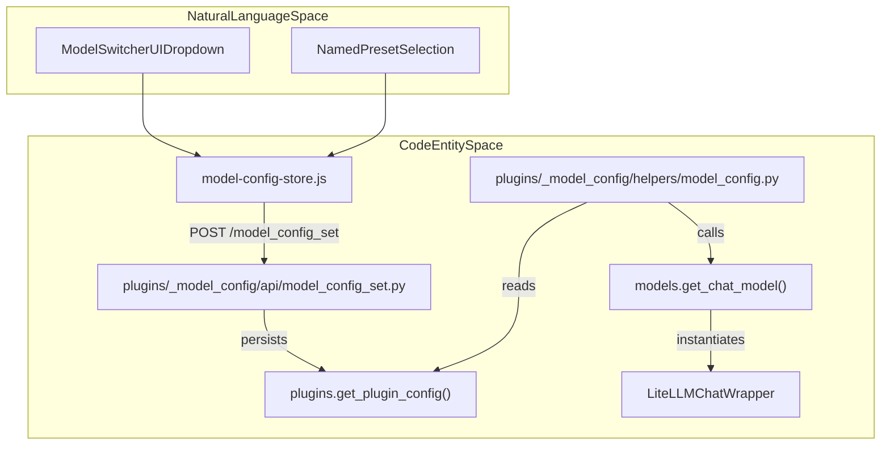
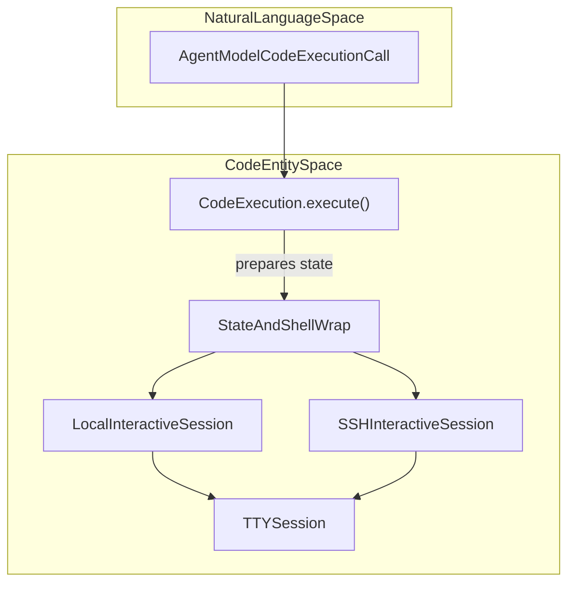

<!-- source: DeepWiki mcp.deepwiki.com · repo agent0ai/agent-zero · page 3.3 Built-in Plugins Reference · fetched 2026-10-29 -->

# Built-in Plugins Reference

Relevant source files

The following files were used as context for generating this wiki page:

- [extensions/python/monologue_start/AGENTS.md](extensions/python/monologue_start/AGENTS.md)
- [extensions/webui/set_messages_after_loop/AGENTS.md](extensions/webui/set_messages_after_loop/AGENTS.md)
- [plugins/_chat_branching/AGENTS.md](plugins/_chat_branching/AGENTS.md)
- [plugins/_chat_branching/README.md](plugins/_chat_branching/README.md)
- [plugins/_chat_branching/api/branch_chat.py](plugins/_chat_branching/api/branch_chat.py)
- [plugins/_chat_branching/tests/test_branch_chat.py](plugins/_chat_branching/tests/test_branch_chat.py)
- [plugins/_chat_compaction/.toggle-1](plugins/_chat_compaction/.toggle-1)
- [plugins/_chat_compaction/api/compact_chat.py](plugins/_chat_compaction/api/compact_chat.py)
- [plugins/_chat_compaction/default_config.yaml](plugins/_chat_compaction/default_config.yaml)
- [plugins/_chat_compaction/extensions/webui/chat-input-bottom-actions-start/compact-button.html](plugins/_chat_compaction/extensions/webui/chat-input-bottom-actions-start/compact-button.html)
- [plugins/_chat_compaction/plugin.yaml](plugins/_chat_compaction/plugin.yaml)
- [plugins/_chat_compaction/prompts/compact.msg.md](plugins/_chat_compaction/prompts/compact.msg.md)
- [plugins/_chat_compaction/webui/compact-modal.html](plugins/_chat_compaction/webui/compact-modal.html)
- [plugins/_chat_compaction/webui/compact-store.js](plugins/_chat_compaction/webui/compact-store.js)
- [plugins/_chat_naming/AGENTS.md](plugins/_chat_naming/AGENTS.md)
- [plugins/_chat_naming/README.md](plugins/_chat_naming/README.md)
- [plugins/_chat_naming/api/__init__.py](plugins/_chat_naming/api/__init__.py)
- [plugins/_chat_naming/api/chat_name.py](plugins/_chat_naming/api/chat_name.py)
- [plugins/_chat_naming/commands/rename_command.py](plugins/_chat_naming/commands/rename_command.py)
- [plugins/_chat_naming/default_config.yaml](plugins/_chat_naming/default_config.yaml)
- [plugins/_chat_naming/extensions/python/monologue_end/_60_rename_chat.py](plugins/_chat_naming/extensions/python/monologue_end/_60_rename_chat.py)
- [plugins/_chat_naming/helpers/naming.py](plugins/_chat_naming/helpers/naming.py)
- [plugins/_chat_naming/tests/test_chat_naming.py](plugins/_chat_naming/tests/test_chat_naming.py)
- [plugins/_chat_naming/webui/config.html](plugins/_chat_naming/webui/config.html)
- [plugins/_error_retry/AGENTS.md](plugins/_error_retry/AGENTS.md)
- [plugins/_error_retry/README.md](plugins/_error_retry/README.md)
- [plugins/_error_retry/extensions/python/_functions/agent/Agent/handle_exception/end/_80_retry_critical_exception.py](plugins/_error_retry/extensions/python/_functions/agent/Agent/handle_exception/end/_80_retry_critical_exception.py)
- [plugins/_error_retry/webui/config.html](plugins/_error_retry/webui/config.html)
- [plugins/_infection_check/README.md](plugins/_infection_check/README.md)
- [plugins/_pin_to_top/AGENTS.md](plugins/_pin_to_top/AGENTS.md)
- [plugins/_pin_to_top/README.md](plugins/_pin_to_top/README.md)
- [plugins/_pin_to_top/api/get_pins.py](plugins/_pin_to_top/api/get_pins.py)
- [plugins/_pin_to_top/api/toggle_pin.py](plugins/_pin_to_top/api/toggle_pin.py)
- [plugins/_pin_to_top/extensions/webui/initFw_end/pin-indicators.js](plugins/_pin_to_top/extensions/webui/initFw_end/pin-indicators.js)
- [plugins/_pin_to_top/extensions/webui/sidebar-row-actions-menu/pin-to-top.html](plugins/_pin_to_top/extensions/webui/sidebar-row-actions-menu/pin-to-top.html)
- [plugins/_pin_to_top/helpers/pins.py](plugins/_pin_to_top/helpers/pins.py)
- [plugins/_pin_to_top/plugin.yaml](plugins/_pin_to_top/plugin.yaml)
- [plugins/_pin_to_top/tests/test_pins.py](plugins/_pin_to_top/tests/test_pins.py)
- [plugins/_pin_to_top/webui/pin-to-top-store.js](plugins/_pin_to_top/webui/pin-to-top-store.js)
- [plugins/_sidebar_folders/AGENTS.md](plugins/_sidebar_folders/AGENTS.md)
- [plugins/_sidebar_folders/README.md](plugins/_sidebar_folders/README.md)
- [plugins/_sidebar_folders/api/layout.py](plugins/_sidebar_folders/api/layout.py)
- [plugins/_sidebar_folders/api/move_chat.py](plugins/_sidebar_folders/api/move_chat.py)
- [plugins/_sidebar_folders/default_config.yaml](plugins/_sidebar_folders/default_config.yaml)
- [plugins/_sidebar_folders/extensions/webui/chats-header-controls/options.html](plugins/_sidebar_folders/extensions/webui/chats-header-controls/options.html)
- [plugins/_sidebar_folders/extensions/webui/sidebar-chats-list-view/folders.html](plugins/_sidebar_folders/extensions/webui/sidebar-chats-list-view/folders.html)
- [plugins/_sidebar_folders/extensions/webui/sidebar-tasks-list-view/folders.html](plugins/_sidebar_folders/extensions/webui/sidebar-tasks-list-view/folders.html)
- [plugins/_sidebar_folders/plugin.yaml](plugins/_sidebar_folders/plugin.yaml)
- [plugins/_sidebar_folders/tests/test_folders.py](plugins/_sidebar_folders/tests/test_folders.py)
- [plugins/_sidebar_folders/tests/test_frontend.mjs](plugins/_sidebar_folders/tests/test_frontend.mjs)
- [plugins/_sidebar_folders/webui/folder-list.html](plugins/_sidebar_folders/webui/folder-list.html)
- [plugins/_sidebar_folders/webui/sidebar-folders-store.js](plugins/_sidebar_folders/webui/sidebar-folders-store.js)
- [plugins/_whats_new/AGENTS.md](plugins/_whats_new/AGENTS.md)
- [plugins/_whats_new/extensions/webui/initFw_end/whats-new.js](plugins/_whats_new/extensions/webui/initFw_end/whats-new.js)
- [plugins/_whats_new/plugin.yaml](plugins/_whats_new/plugin.yaml)
- [plugins/_whats_new/webui/assets/mcp-servers.png](plugins/_whats_new/webui/assets/mcp-servers.png)
- [plugins/_whats_new/webui/assets/parallel-subs.webm](plugins/_whats_new/webui/assets/parallel-subs.webm)
- [plugins/_whats_new/webui/assets/skills-scanner.png](plugins/_whats_new/webui/assets/skills-scanner.png)
- [plugins/_whats_new/webui/main.html](plugins/_whats_new/webui/main.html)
- [plugins/_whats_new/webui/whats-new-slides.js](plugins/_whats_new/webui/whats-new-slides.js)
- [plugins/_whats_new/webui/whats-new-store.js](plugins/_whats_new/webui/whats-new-store.js)
- [plugins/_whats_new/webui/whats-new.html](plugins/_whats_new/webui/whats-new.html)
- [tests/test_error_retry_plugin.py](tests/test_error_retry_plugin.py)
- [tests/test_model_refusal.py](tests/test_model_refusal.py)
- [tests/test_whats_new_static.py](tests/test_whats_new_static.py)

This page provides a comprehensive technical overview of core built-in plugins bundled with Agent Zero. These plugins extend framework capabilities across model configuration, execution runtimes, UI management, session control, memory, and chat maintenance [plugins/AGENTS.md:5-7]().

---

## Model Configuration (`_model_config`)

The `_model_config` plugin is the central authority for managing LLM providers, model selection, API credentials, and runtime presets. It exposes unified configuration hooks for the three primary model execution slots: **Main Model** (reasoning and chat), **Utility Model** (background inference, summarization, and naming), and **Embedding Model** (vectorization).

### Implementation & Data Flow
Configuration is managed across global, project-specific, and agent-profile levels using **Presets**—named collections of settings toggled via the WebUI [plugins/_model_config/helpers/model_config.py:34-47]().

**Model Resolution Flow:**
1. **Override Check**: Checks for active per-chat overrides from the UI switcher [plugins/_model_config/helpers/model_config.py:72-82]().
2. **Preset Resolution**: Extracts `chat` or `utility` configurations from selected presets [plugins/_model_config/helpers/model_config.py:84-91]().
3. **Hierarchy Lookup**: Falls back to plugin configurations via `plugins.get_plugin_config` [plugins/_model_config/helpers/model_config.py:24-31]().

Diagram: Model Config Data Flow (Bridging Natural Language Space to Code Entity Space)

Sources: [plugins/_model_config/helpers/model_config.py:24-198](), [plugins/_model_config/api/model_search.py:13-32]()

---

## Code Execution & Shell Sessions (`_code_execution`)

The `_code_execution` plugin manages terminal, Python, and Node.js execution environments through persistent local or SSH-backed interactive subprocess sessions [plugins/_code_execution/AGENTS.md:3-5]().

### Implementation & Data Flow
- **Tool Dispatch**: `CodeExecution` (`plugins/_code_execution/tools/code_execution_tool.py`) handles runtime selection (`python`, `nodejs`, `terminal`, `output`, `reset`) [plugins/_code_execution/tools/code_execution_tool.py:53-112]().
- **TTY Management**: `TTYSession` (`plugins/_code_execution/helpers/tty_session.py`) coordinates POSIX PTY / Winpty subprocess spawning, non-blocking stream pumping (`_pump_stdout`), and timeout management [plugins/_code_execution/helpers/tty_session.py:26-194]().
- **Session State**: Maintained via `State` and `ShellWrap` structures stored in agent data (`_cet_state`), ensuring long-running processes or compound multiline commands retain shell variables and working directories [plugins/_code_execution/tools/code_execution_tool.py:40-52,134-179]().

Diagram: Code Execution Dispatch (Bridging Natural Language Space to Code Entity Space)

Sources: [plugins/_code_execution/AGENTS.md:3-13](), [plugins/_code_execution/tools/code_execution_tool.py:53-180](), [plugins/_code_execution/helpers/tty_session.py:26-194]()

---

## Text Editing & File Operations (`_text_editor`)

The `_text_editor` plugin provides a native tool for reading, writing, and patching text files with stale-read tracking and atomic replacements [plugins/_text_editor/AGENTS.md:3-10]().

### Key Mechanisms
- **Execution & Logging**: `TextEditor` dispatches file operations (`edits`, `patch_text`, and `old_text`/`new_text` replacements), logging actions under `type="text_editor"` [plugins/_text_editor/AGENTS.md:16-20]().
- **File Operations**: `file_ops.py` preserves file permissions, UIDs, and GIDs when executing as root, and validates stale-read timestamps before atomic writes [plugins/_text_editor/AGENTS.md:21-24]().
- **Canvas Integration**: Passes active agent context identifiers in result metadata so canvas UI components open the correct document context [plugins/_text_editor/AGENTS.md:26]().

Sources: [plugins/_text_editor/AGENTS.md:1-38]()

---

## Sidebar Folders (`_sidebar_folders`) & Pin to Top (`_pin_to_top`)

The `_sidebar_folders` and `_pin_to_top` plugins coordinate presentation, sorting, manual ordering, and pinning for chats, scheduled tasks, and project folders [plugins/_sidebar_folders/AGENTS.md:3-13](), [plugins/_pin_to_top/AGENTS.md:3-13]().

### Implementation & Data Flow
- **Sidebar Folders Store**: `webui/sidebar-folders-store.js` manages presentation, drag-and-drop ordering, folder expansion states, and project/status/activity filters [plugins/_sidebar_folders/AGENTS.md:9](), [plugins/_sidebar_folders/webui/sidebar-folders-store.js:18-52](). It registers row list extensions via `sidebar.registerRowListExtension` [plugins/_sidebar_folders/webui/sidebar-folders-store.js:44-49]().
- **Layout Persistence**: `api/layout.py` persists independent project, chat, and task order lists using `helpers.kvp` [plugins/_sidebar_folders/AGENTS.md:12]().
- **Pin to Top**: `helpers/pins.py` owns persistent pin states (`chat`, `task`, `project`) stored in user KVP storage [plugins/_pin_to_top/AGENTS.md:10,17](). The virtual **No project** folder (`""`) starts pinned by default [plugins/_pin_to_top/AGENTS.md:18-19]().

Sources: [plugins/_sidebar_folders/AGENTS.md:3-39](), [plugins/_sidebar_folders/webui/sidebar-folders-store.js:18-78](), [plugins/_pin_to_top/AGENTS.md:3-25](), [plugins/_pin_to_top/helpers/pins.py:10-87]()

---

## Goal Management (`_goal`)

The `_goal` plugin provides persistent agent objectives surfaced via a UI goal strip and loop modifiers [plugins/_goal/AGENTS.md:5-17]().

### Key Mechanisms
- **File-Backed Storage**: Goals are stored under `usr/plugins/_goal/goals/{context_id}.json` [plugins/_goal/tests/test_goal_plugin.py:173-183]().
- **Response Tool Override**: Overrides `ResponseTool` so active goals prevent monologue termination, treating responses as intermediate updates [plugins/_goal/tools/response.py:15-30](), [plugins/_goal/AGENTS.md:16,29]().
- **Commands & State Sync**: `/goal <objective>` sets objectives, while state updates push context revisions to the frontend store via `state_monitor_integration` [plugins/_goal/AGENTS.md:26-33](), [plugins/_goal/commands/goal_command.py:60-82]().

Sources: [plugins/_goal/AGENTS.md:3-33](), [plugins/_goal/api/goal.py:8-64](), [plugins/_goal/tools/response.py:15-30](), [plugins/_goal/tests/test_goal_plugin.py:34-185]()

---

## Chat Compaction (`_chat_compaction`) & Chat Branching (`_chat_branching`)

### Chat Compaction (`_chat_compaction`)
Solves context window exhaustion by summarizing long conversation histories into a dense AI message [plugins/_chat_compaction/AGENTS.md:3-12]().
- **Threshold & Backup**: Triggers based on token counts, saving JSON and TXT backups in `backups/` before replacing history [plugins/_chat_compaction/helpers/compactor.py:18-48]().
- **Replacement**: Clears `agent.history`, injects the summary message, and cleans up active response provider state [plugins/_chat_compaction/helpers/compactor.py:123-152]().

### Chat Branching (`_chat_branching`)
Enables users to fork an existing conversation from any historical message [plugins/_chat_branching/README.md:3-7]().
- **ID-Based Linking**: Logs and history share UUIDs [plugins/_chat_branching/README.md:11-12]().
- **Clone and Trim**: `BranchChat.process` serializes the source context, trims log entries up to `log_no`, filters history, and saves a brand-new context [plugins/_chat_branching/api/branch_chat.py:96-160]().

Sources: [plugins/_chat_compaction/helpers/compactor.py:18-181](), [plugins/_chat_branching/api/branch_chat.py:13-166](), [plugins/_chat_branching/README.md:1-36]()

---

## Chat Naming (`_chat_naming`)

The `_chat_naming` plugin automatically or manually names chat sessions using a Utility Model invocation based on early user messages [plugins/_chat_naming/AGENTS.md:3-12]().

### Key Mechanisms
- **User Message Extraction**: `naming.get_user_messages` filters out assistant outputs and tool results to isolate pure user intent [plugins/_chat_naming/tests/test_chat_naming.py:55-66]().
- **Automatic Naming Modes**: Supports `once` (naming on first request if unnamed) and `always` (updating names as context evolves) modes [plugins/_chat_naming/tests/test_chat_naming.py:69-166]().
- **Background Execution**: Scheduled from `monologue_end` as a background task (`_60_rename_chat.py`) to prevent blocking main inference [plugins/_chat_naming/AGENTS.md:18-19](), [plugins/_chat_naming/tests/test_chat_naming.py:168-191]().

Sources: [plugins/_chat_naming/AGENTS.md:1-25](), [plugins/_chat_naming/tests/test_chat_naming.py:1-204](), [plugins/_chat_naming/extensions/python/monologue_end/_60_rename_chat.py:1-77]()

---

## Error Retry (`_error_retry`) & Commands (`_commands`)

### Error Retry (`_error_retry`)
Hooks into agent exception handling (`_80_retry_critical_exception.py`) to automatically retry critical unhandled exceptions up to a configured limit before failing [plugins/_error_retry/README.md:1-21](), [plugins/_error_retry/extensions/python/_functions/agent/Agent/handle_exception/end/_80_retry_critical_exception.py:13-106]().

### Commands Manager (`_commands`)
Coordinates discovery and execution of built-in and user-defined slash commands, powering the chat composer slash picker across project, global user, and plugin scopes [plugins/_commands/AGENTS.md:1-25](), [plugins/_commands/helpers/commands.py:39-206]().

Sources: [plugins/_error_retry/README.md:1-21](), [plugins/_error_retry/extensions/python/_functions/agent/Agent/handle_exception/end/_80_retry_critical_exception.py:13-106](), [plugins/_commands/AGENTS.md:1-39]()

---

## Memory (`_memory`), Document Query (`_document_query`) & Prompt Modularity (`_promptinclude`)

- **`_memory`**: Manages FAISS vector-backed memory spaces, consolidation, and semantic recall [plugins/AGENTS.md:10]().
- **`_document_query`**: Provides document parsing, text chunking, and semantic retrieval for RAG with SSRF validation on fetched URLs [tests/test_document_query_plugin.py:118-125]().
- **`_promptinclude`**: Dynamically assembles system prompts from fragment files matching `*.promptinclude.md` under strict token budgets [plugins/_promptinclude/extensions/python/system_prompt/_16_promptinclude.py:10-78]().

Sources: [plugins/AGENTS.md:5-15](), [plugins/_document_query/helpers/document_query.py:1-188](), [plugins/_promptinclude/extensions/python/system_prompt/_16_promptinclude.py:10-78]()

---

## Additional Core Plugins Overview

- **`_editor`**: Provides ACE-based source editing surfaces.
- **`_whats_new`**: Supplies onboarding cards, feature announcements, and welcome screen hand-offs.
- **`_tool_access`**: Manages security scopes and tool permission policies.
- **`_plugin_validator` & `_plugin_installer`**: Handle plugin verification, git/zip installations, and hub catalogs [plugins/AGENTS.md:13]().

Sources: [plugins/AGENTS.md:5-15]()

---

