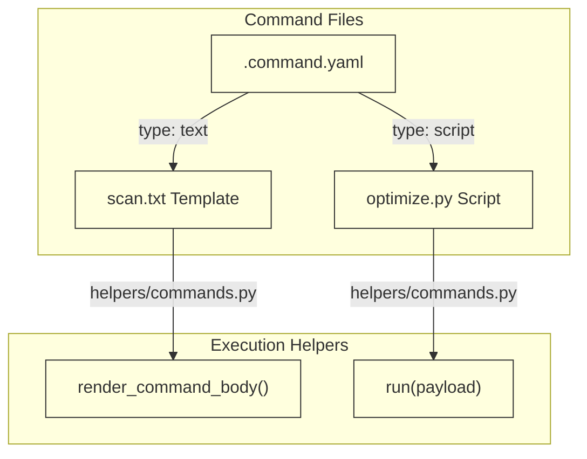
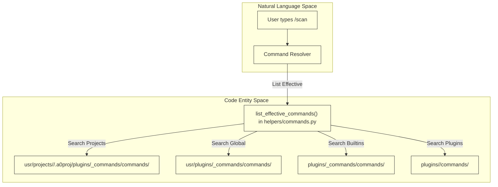
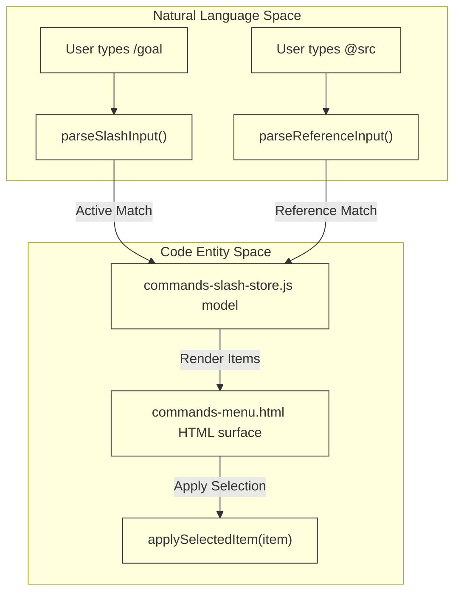

<!-- source: DeepWiki mcp.deepwiki.com · repo agent0ai/agent-zero · page 3.5 Slash Commands System · fetched 2026-10-29 -->

# Slash Commands System

<details>
<summary>Relevant source files</summary>

The following files were used as context for generating this wiki page:

- [plugins/_a0_connector/api/v1/agent_editor.py](plugins/_a0_connector/api/v1/agent_editor.py)
- [plugins/_agent_editor/extensions/webui/initFw_end/agent-editor.js](plugins/_agent_editor/extensions/webui/initFw_end/agent-editor.js)
- [plugins/_commands/AGENTS.md](plugins/_commands/AGENTS.md)
- [plugins/_commands/README.md](plugins/_commands/README.md)
- [plugins/_commands/api/commands.py](plugins/_commands/api/commands.py)
- [plugins/_commands/commands/connector_commands.py](plugins/_commands/commands/connector_commands.py)
- [plugins/_commands/commands/permissions.command.yaml](plugins/_commands/commands/permissions.command.yaml)
- [plugins/_commands/commands/profile.command.yaml](plugins/_commands/commands/profile.command.yaml)
- [plugins/_commands/extensions/python/_functions/agent/AgentContext/_process_chain/start/_10_resolve_slash_command.py](plugins/_commands/extensions/python/_functions/agent/AgentContext/_process_chain/start/_10_resolve_slash_command.py)
- [plugins/_commands/extensions/webui/chat-input-box-start/commands-menu.html](plugins/_commands/extensions/webui/chat-input-box-start/commands-menu.html)
- [plugins/_commands/extensions/webui/send_message_before/_10_resolve_slash_command.js](plugins/_commands/extensions/webui/send_message_before/_10_resolve_slash_command.js)
- [plugins/_commands/tests/test_commands_plugin.py](plugins/_commands/tests/test_commands_plugin.py)
- [plugins/_commands/tests/test_plugin_command_discovery.py](plugins/_commands/tests/test_plugin_command_discovery.py)
- [plugins/_commands/webui/commands-slash-store.js](plugins/_commands/webui/commands-slash-store.js)
- [plugins/_commands/webui/commands-store.js](plugins/_commands/webui/commands-store.js)
- [plugins/_commands/webui/main.html](plugins/_commands/webui/main.html)

</details>


The slash commands system (`_commands`) provides a unified extension for user-facing and agent-driven `/commands` in Agent Zero. It manages file-backed command discovery across project, global, and plugin scopes, chat composer slash-menu interactions, `@` reference pickers, argument parsing, script hooks, and built-in connector command execution.

Sources: `plugins/_commands/AGENTS.md:1-19` [plugins/_commands/AGENTS.md:1-19](), `plugins/_commands/README.md:1-23` [plugins/_commands/README.md:1-23]()

---

## 1. Command Architecture & File Definitions

Each command is defined by a pair of files within a command directory: a `.command.yaml` configuration file and a paired content file (`.txt` for text templates or `.py` for Python script hooks) [plugins/_commands/README.md:5-9]().

```yaml
# Example config schema (.command.yaml)
name: scan
description: Scan a Git repository.
argument_hint: /scan --git-url <url>
type: text
template_path: scan.txt
```

Standard configuration keys recognized by `plugins/_commands/helpers/commands.py` include `name`, `description`, `argument_hint`, `type`, `template_path`, `script_path`, and `include_history` [plugins/_commands/README.md:14-17](). Script commands expose a `run(payload)` function and return either a string or a dictionary containing `text` and optional UI `effects` [plugins/_commands/AGENTS.md:31-31]().


*Figure 1: Command file definition and execution layout.*

Sources: `plugins/_commands/README.md:24-74` [plugins/_commands/README.md:24-74](), `plugins/_commands/AGENTS.md:20-32` [plugins/_commands/AGENTS.md:20-32]()

---

## 2. Discovery, Scope Precedence & Legacy Migration

Commands are discovered across four distinct storage hierarchies. Scope precedence ensures that project-level definitions override global definitions, which override built-in defaults and other plugin contributions [plugins/_commands/AGENTS.md:24-25]().

| Precedence | Scope Name | Path Pattern | Description |
| :--- | :--- | :--- | :--- |
| 1 (Highest) | Project | `usr/projects/<project>/.a0proj/plugins/_commands/commands/` | Project-scoped overrides and custom commands [plugins/_commands/README.md:119](). |
| 2 | Global | `usr/plugins/_commands/commands/` | User global custom commands [plugins/_commands/README.md:120](). |
| 3 | Built-in | `plugins/_commands/commands/` | Bundled read-only default commands (e.g., `/stop`, `/project`, `/permissions`) [plugins/_commands/README.md:121](). |
| 4 (Lowest) | Plugin | `plugins/<plugin>/commands/` or `usr/plugins/<plugin>/commands/` | Commands contributed by other enabled plugins [plugins/_commands/README.md:122](). |

### Legacy Community Plugin Migration
On startup, the built-in `_commands` plugin automatically migrates files from the older community `commands` plugin namespace [plugins/_commands/README.md:131-139](). It copies `usr/plugins/commands/commands/` into `usr/plugins/_commands/commands/`, copies skills, maps scoped legacy command folders, skips existing files, and disables the legacy `commands` plugin roots to prevent duplicate WebUI popovers [plugins/_commands/AGENTS.md:30-30](), [plugins/_commands/README.md:131-139]().


*Figure 2: Natural language command invocation bridging to scope discovery code entities.*

Sources: `plugins/_commands/AGENTS.md:20-30` [plugins/_commands/AGENTS.md:20-30](), `plugins/_commands/README.md:115-140` [plugins/_commands/README.md:115-140]()

---

## 3. Slash-Command Menu Store & Chat Composer Integration

The WebUI frontend relies on an Alpine.js store located at `plugins/_commands/webui/commands-slash-store.js` [plugins/_commands/webui/commands-slash-store.js:1-15]() and a template at `plugins/_commands/extensions/webui/chat-input-box-start/commands-menu.html` [plugins/_commands/tests/test_commands_plugin.py:124-126](). The commands manager UI is controlled via `plugins/_commands/webui/commands-store.js` and `plugins/_commands/webui/main.html` [plugins/_commands/webui/commands-store.js:1-128](), [plugins/_commands/webui/main.html:1-46]().

### Input Parsing (`parseSlashInput` & `parseReferenceInput`)
* **Prefix Syntax (`/goal objective`)**: Opens the slash picker modal as the user types, filtering commands by query [plugins/_commands/README.md:10-10]().
* **Postfix Syntax (`objective /goal`)**: Hides the composer picker while typing, but resolves successfully when submitted [plugins/_commands/README.md:10-10]().
* **Reference Tokens (`@`)**: Inserts plain references (`@[./path]`, `@[agent/profile]`, `@[skill/name]`, `@[mcp/server]`) without immediate side-effects [plugins/_commands/AGENTS.md:34-34]().


*Figure 3: Chat composer input parser mapping to frontend store components.*

Sources: `plugins/_commands/webui/commands-slash-store.js:1-110` [plugins/_commands/webui/commands-slash-store.js:1-110](), `plugins/_commands/webui/commands-store.js:1-128` [plugins/_commands/webui/commands-store.js:1-128](), `plugins/_commands/AGENTS.md:33-37` [plugins/_commands/AGENTS.md:33-37]()

---

## 4. Connector Commands & Execution Backend

Bundled core operations (such as chat manipulation, project switching, and agent pause/resume) are driven by the connector command pack in `plugins/_commands/commands/connector_commands.py` [plugins/_commands/commands/connector_commands.py:1-98]().

```python
# Example dispatcher signature in plugins/_commands/commands/connector_commands.py
def run(payload: dict[str, Any]) -> dict[str, Any]:
    invocation = payload.get("invocation") or {}
    raw_name = str(invocation.get("command_name") or "").strip().lower()
    ...
```

The script execution contract returns a payload containing replacement text and UI effects (`_effects`, `_toast`, `_show_markdown`) [plugins/_commands/commands/connector_commands.py:88-98](). Commands like `/quit` are restricted to the A0 CLI shell [plugins/_commands/commands/connector_commands.py:12-14](), while others interface directly with the agent lifecycle, projects, or model configurations.

Sources: `plugins/_commands/commands/connector_commands.py:1-98` [plugins/_commands/commands/connector_commands.py:1-98](), `plugins/_commands/README.md:20-21` [plugins/_commands/README.md:20-21]()

---

## 5. Invocation Parsing, API Handlers & Integration Helpers

Backend resolution of slash command strings and WebUI actions is supported by the Commands API handler and helper modules:

* `plugins/_commands/api/commands.py`: Exposes API actions such as `list_effective`, `list_scope`, `get`, `save`, `delete`, `duplicate`, `scope_info`, and `resolve` [plugins/_commands/api/commands.py:8-166]().
* `plugins/_commands/helpers/commands.py`: Handles command name sanitization, argument parsing (`parse_arguments`), scope resolution, file persistence, plugin command discovery, and invocation execution [plugins/_commands/AGENTS.md:11-11]().
* `ResolveSlashCommand` (`plugins/_commands/extensions/python/_functions/agent/AgentContext/_process_chain/start/_10_resolve_slash_command.py`): Intercepts incoming messages during agent execution to resolve raw slash commands before they reach the agent core [plugins/_commands/tests/test_commands_plugin.py:24-28]().

Sources: `plugins/_commands/api/commands.py:1-167` [plugins/_commands/api/commands.py:1-166](), `plugins/_commands/AGENTS.md:11-18` [plugins/_commands/AGENTS.md:11-18](), `plugins/_commands/tests/test_commands_plugin.py:24-28` [plugins/_commands/tests/test_commands_plugin.py:24-28]()

---

