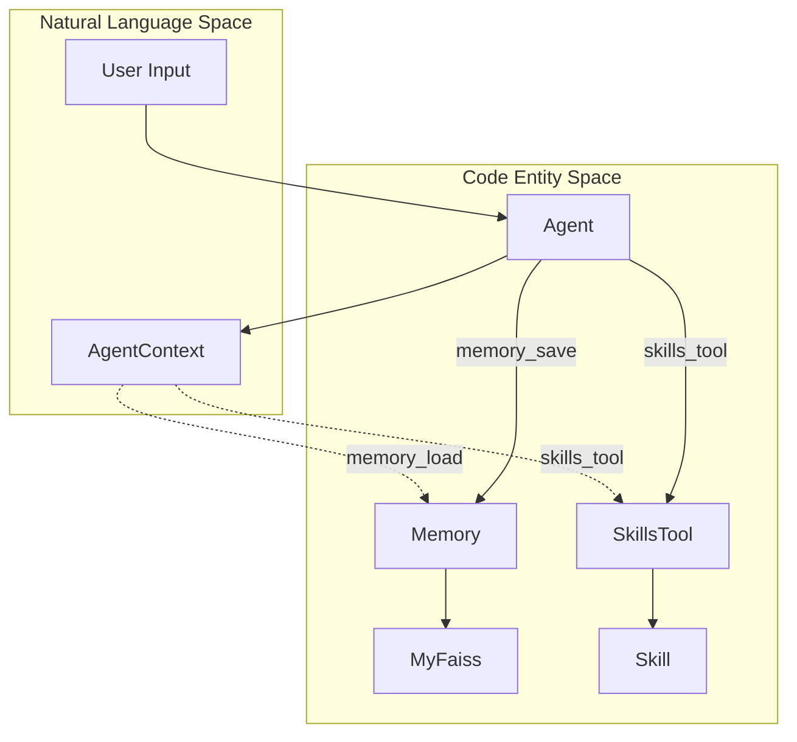
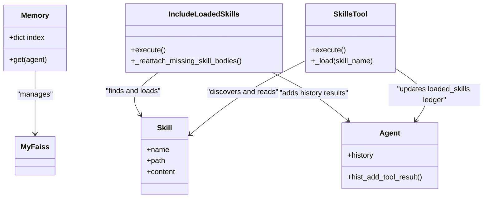

<!-- source: DeepWiki mcp.deepwiki.com · repo agent0ai/agent-zero · page 4 Memory, Knowledge & Skills · fetched 2026-10-29 -->

# Memory, Knowledge & Skills

Relevant source files

The following files were used as context for generating this wiki page:

- [plugins/_memory/extensions/python/message_loop_prompts_after/_50_recall_memories.py](plugins/_memory/extensions/python/message_loop_prompts_after/_50_recall_memories.py)
- [plugins/_memory/extensions/python/message_loop_prompts_after/_91_recall_wait.py](plugins/_memory/extensions/python/message_loop_prompts_after/_91_recall_wait.py)
- [plugins/_memory/helpers/memory.py](plugins/_memory/helpers/memory.py)
- [plugins/_memory/helpers/memory_consolidation.py](plugins/_memory/helpers/memory_consolidation.py)
- [plugins/_memory/prompts/agent.system.memories.md](plugins/_memory/prompts/agent.system.memories.md)
- [plugins/_memory/prompts/agent.system.tool.memory.md](plugins/_memory/prompts/agent.system.tool.memory.md)
- [plugins/_memory/prompts/memory.consolidation.sys.md](plugins/_memory/prompts/memory.consolidation.sys.md)
- [plugins/_memory/prompts/memory.memories_filter.sys.md](plugins/_memory/prompts/memory.memories_filter.sys.md)
- [plugins/_memory/tools/memory_delete.py](plugins/_memory/tools/memory_delete.py)
- [plugins/_memory/tools/memory_forget.py](plugins/_memory/tools/memory_forget.py)
- [tests/test_memory_cleanup.py](tests/test_memory_cleanup.py)
- [tests/test_memory_recall.py](tests/test_memory_recall.py)

## Purpose and Scope

This wiki page provides an overview of how Agent Zero stores, organizes, and retrieves information across sessions. Agent Zero is designed as an organic framework that maintains persistent state through a tripartite subsystem: **Memory** (for personal experiences and past solutions), **Knowledge** (for static reference data), and **Skills** (for reusable, structured capabilities). 

As a parent page, this document offers a high-level architectural view and links to specialized child pages for deep technical details.

Sources: [plugins/_memory/helpers/memory.py:54-94](), [helpers/skills.py:47-61]()

---

## System Architecture Overview

The following diagram illustrates how the information systems interact with the core agent loop, bridging natural language prompts to concrete code entities in the codebase.

### Information Flow Diagram

Sources: [plugins/_memory/helpers/memory.py:54-94](), [tools/skills_tool.py:14-25]()

---

## 4.1 Memory System & Vector Database

The Memory System provides long-term persistence for the agent's experiences. It utilizes a FAISS-based Vector Database via the `MyFaiss` class to store and retrieve memories based on semantic similarity [plugins/_memory/helpers/memory.py:41-51]().

*   **Memory Areas:** Information is categorized into areas via the `Memory.Area` enum: `MAIN`, `FRAGMENTS`, and `SOLUTIONS` [plugins/_memory/helpers/memory.py:56-60]().
*   **Intelligent Consolidation:** The memory subsystem uses LLM analysis and consolidation routines to determine if new memories should be merged, updated, or replaced, preventing redundant entries for mutable facts like user preferences [plugins/_memory/prompts/memory.consolidation.sys.md:1-15]().
*   **Memory Tools:** The agent interacts with memory through specialized tools such as `memory_load`, `memory_save`, `memory_delete`, and `memory_forget` [plugins/_memory/prompts/agent.system.tool.memory.md:1-7]().

For technical details on implementation, embedding caches, and the Memory Dashboard UI, see [Memory System & Vector Database](#4.1).

Sources: [plugins/_memory/helpers/memory.py:41-123](), [plugins/_memory/prompts/memory.consolidation.sys.md:1-15](), [plugins/_memory/prompts/agent.system.tool.memory.md:1-7]()

---

## 4.2 Knowledge Base & Document Query

The Knowledge Base allows Agent Zero to query static reference documentation, source files, and imported datasets stored under the `knowledge/` directory structure [plugins/_memory/helpers/memory.py:84-88](). 

*   **Indexing & Reindexing:** Knowledge documents are scanned, chunked, and embedded into vector store partitions associated with active projects or global configurations [plugins/_memory/helpers/memory.py:84-88]().
*   **Document Query Plugin:** The `_document_query` plugin orchestrates text parsing, LiteParse document workers, file fetching, and query optimization to supply context snippets without polluting long-term agent memory.

For details on the knowledge directory layout, reindexing flows, and parsing plugins, see [Knowledge Base & Document Query](#4.2).

Sources: [plugins/_memory/helpers/memory.py:84-88]()

---

## 4.3 Skills System

The Skills System allows Agent Zero to load portable, structured expertise defined in `SKILL.md` files following the `agentskills.io` standard [helpers/skills.py:47-61]().

*   **SKILL.md Format:** Skills are defined using YAML frontmatter for metadata (name, description, tags, triggers) and Markdown for instructions [helpers/skills.py:47-65]().
*   **Dynamic Loading:** The agent uses `SkillsTool` to `list`, `search`, `load`, and `read_file` [tools/skills_tool.py:14-25](). Loading a skill appends its full instructions to the chat history as a tool result with `skill_instructions` metadata [tools/skills_tool.py:14-25]().
*   **Skill Reattachment:** The `IncludeLoadedSkills` extension ensures that even after chat history compaction, previously loaded skill instructions are re-inserted into the context if they fall out of the model's active window [extensions/python/message_loop_prompts_after/_65_include_loaded_skills.py:12-33]().
*   **Always-On Skills:** The `_skills` plugin (`ACTIVE_SKILLS_PLUGIN_NAME`) allows pinning specific skills that are always available to the agent via global or project-level configuration [helpers/skills.py:22-27]().

For details on creating and contributing skills, scoping, and the Skills management UI, see [Skills System](#4.3).

Sources: [helpers/skills.py:22-65](), [tools/skills_tool.py:14-25](), [extensions/python/message_loop_prompts_after/_65_include_loaded_skills.py:12-33](), [prompts/agent.system.tool.skills.md:1-14]()

---

## 4.4 Time Travel (Workspace Versioning)

The `_time_travel` plugin provides Git-backed versioning for the user workspace (`/a0/usr`). It allows the agent and the user to treat the workspace as a stateful entity that can be snapshotted and reverted.

*   **Automatic Snapshots:** The system creates snapshots of the workspace when code execution occurs, ensuring experimental changes can be undone safely.
*   **Git Integration:** It leverages Git under the hood to manage snapshots of the `usr/` directory.
*   **UI Controls:** Users can view the history of snapshots, compare differences (diff), and revert the workspace to a previous state via the Time Travel canvas panel.

For details on the snapshot system, watchdog debounce timers, and Git-backed versioning, see [Time Travel (Workspace Versioning)](#4.4).

Sources: [tests/test_skills_runtime.py:9-20]()

---

## Data Interaction Components

The following table maps high-level concepts to the specific code entities that manage them across the codebase.

| Concept | Code Entity | Primary File |
| :--- | :--- | :--- |
| **Vector Storage** | `MyFaiss` | [plugins/_memory/helpers/memory.py:41-51]() |
| **Memory Interface** | `Memory` | [plugins/_memory/helpers/memory.py:54-94]() |
| **Skill Management** | `SkillsTool` | [tools/skills_tool.py:14-25]() |
| **Skill Definition** | `Skill` | [helpers/skills.py:47-61]() |
| **Skill Reattachment** | `IncludeLoadedSkills` | [extensions/python/message_loop_prompts_after/_65_include_loaded_skills.py:12-33]() |

### Code Entity Relationship Diagram

Sources: [plugins/_memory/helpers/memory.py:41-94](), [helpers/skills.py:47-61](), [tools/skills_tool.py:14-25](), [extensions/python/message_loop_prompts_after/_65_include_loaded_skills.py:12-33]()

---

