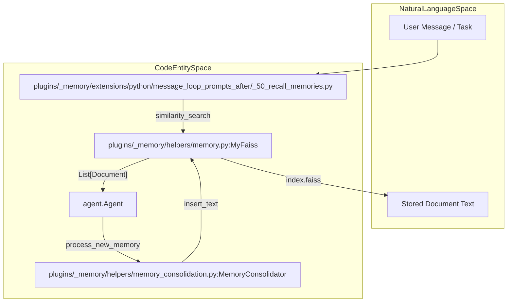
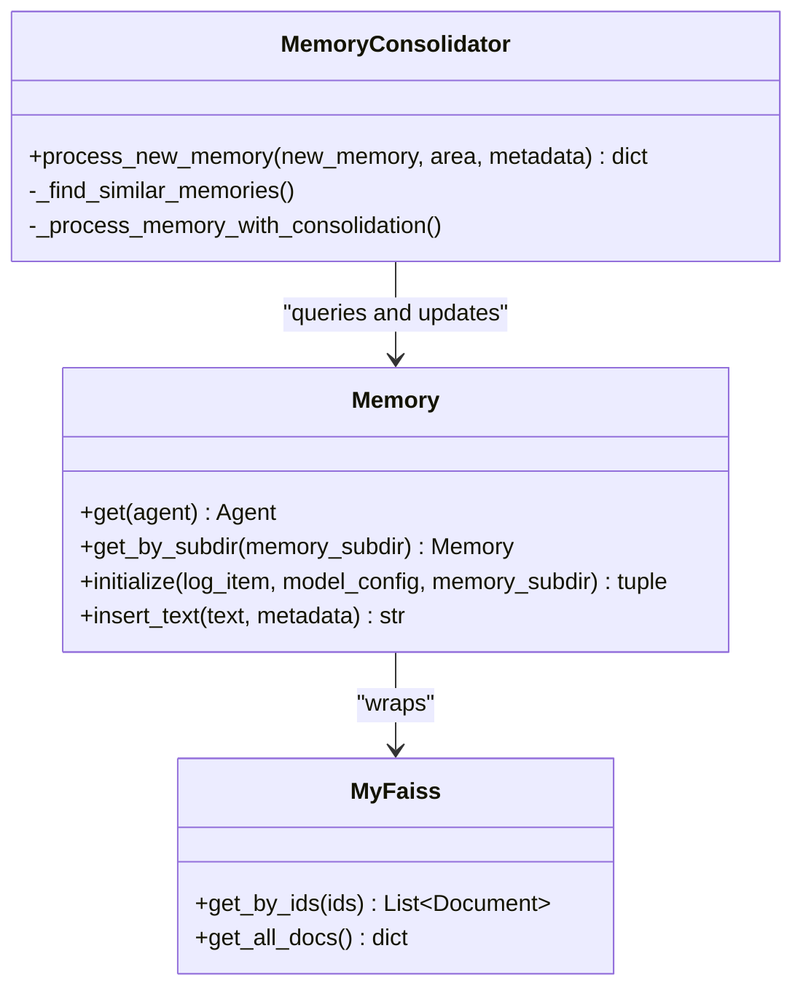
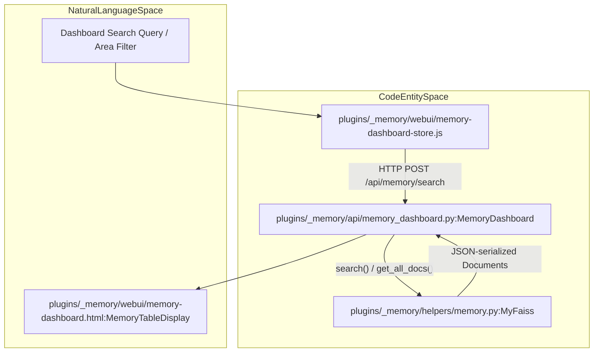

<!-- source: DeepWiki mcp.deepwiki.com · repo agent0ai/agent-zero · page 4.1 Memory System & Vector Database · fetched 2026-10-29 -->

# Memory System & Vector Database

Relevant source files

The following files were used as context for generating this wiki page:

- [extensions/python/job_loop/_50_trim_cache.py](extensions/python/job_loop/_50_trim_cache.py)
- [helpers/api.py](helpers/api.py)
- [helpers/cache.py](helpers/cache.py)
- [helpers/extension.py](helpers/extension.py)
- [helpers/files.py](helpers/files.py)
- [helpers/files.py.dox.md](helpers/files.py.dox.md)
- [helpers/watchdog.py](helpers/watchdog.py)
- [plugins/_infection_check/.toggle-0](plugins/_infection_check/.toggle-0)
- [plugins/_memory/AGENTS.md](plugins/_memory/AGENTS.md)
- [plugins/_memory/api/memory_dashboard.py](plugins/_memory/api/memory_dashboard.py)
- [plugins/_memory/extensions/python/message_loop_prompts_after/_50_recall_memories.py](plugins/_memory/extensions/python/message_loop_prompts_after/_50_recall_memories.py)
- [plugins/_memory/extensions/python/message_loop_prompts_after/_91_recall_wait.py](plugins/_memory/extensions/python/message_loop_prompts_after/_91_recall_wait.py)
- [plugins/_memory/helpers/memory.py](plugins/_memory/helpers/memory.py)
- [plugins/_memory/helpers/memory_consolidation.py](plugins/_memory/helpers/memory_consolidation.py)
- [plugins/_memory/prompts/agent.system.memories.md](plugins/_memory/prompts/agent.system.memories.md)
- [plugins/_memory/prompts/agent.system.tool.memory.md](plugins/_memory/prompts/agent.system.tool.memory.md)
- [plugins/_memory/prompts/memory.consolidation.sys.md](plugins/_memory/prompts/memory.consolidation.sys.md)
- [plugins/_memory/prompts/memory.memories_filter.sys.md](plugins/_memory/prompts/memory.memories_filter.sys.md)
- [plugins/_memory/tools/memory_delete.py](plugins/_memory/tools/memory_delete.py)
- [plugins/_memory/tools/memory_forget.py](plugins/_memory/tools/memory_forget.py)
- [plugins/_memory/tools/memory_load.py](plugins/_memory/tools/memory_load.py)
- [plugins/_memory/webui/memory-dashboard.html](plugins/_memory/webui/memory-dashboard.html)
- [tests/test_http_auth_csrf.py](tests/test_http_auth_csrf.py)
- [tests/test_memory_cleanup.py](tests/test_memory_cleanup.py)
- [tests/test_memory_json_serialization.py](tests/test_memory_json_serialization.py)
- [tests/test_memory_recall.py](tests/test_memory_recall.py)
- [webui/AGENTS.md](webui/AGENTS.md)
- [webui/login.css](webui/login.css)
- [webui/login.html](webui/login.html)

## Purpose and Scope

The Memory System in Agent Zero provides a persistent, searchable storage layer that allows agents to retain information across sessions. It leverages a FAISS-based vector database (`MyFaiss`) to perform semantic retrieval, enabling automatic recall extensions, intelligent memory consolidation via `MemoryConsolidator`, manual/agent-driven memory management tools, and the Memory Dashboard administrative UI.

Sources: [plugins/_memory/AGENTS.md:1-13](), [plugins/_memory/helpers/memory.py:41-59]()

---

## Vector Database Architecture & FAISS Implementation

Agent Zero utilizes **FAISS** (Facebook AI Similarity Search) wrapped by the `MyFaiss` class, which extends the LangChain `FAISS` implementation [plugins/_memory/helpers/memory.py:41-53](). This provides high-performance similarity searching of dense embedding vectors.

### Memory Areas
The system categorizes stored records into three logical scopes defined by the `Memory.Area` enum [plugins/_memory/helpers/memory.py:56-59]():
*   **MAIN**: General long-term storage for verified facts and user preferences.
*   **FRAGMENTS**: Short snippets or partial information automatically extracted from conversation streams.
*   **SOLUTIONS**: High-value entries containing validated fixes, code snippets, or procedures for technical problems.

### Embedding and Caching Pipeline
The `Memory` class manages directory-scoped vector indexes via `Memory.get()` and `Memory.get_by_subdir()` [plugins/_memory/helpers/memory.py:69-123](). To prevent redundant LLM embedding calls, it uses `CacheBackedEmbeddings` backed by a `LocalFileStore` located in `tmp/memory/embeddings` [plugins/_memory/helpers/memory.py:145-171]().

Title: "Memory Retrieval and Storage Flow"

Sources: [plugins/_memory/helpers/memory.py:41-171](), [plugins/_memory/helpers/memory_consolidation.py:63-79]()

---

## Memory Tools & Intelligent Consolidation

Agents interact with durable memory through tools and automated consolidation logic.

### Memory Tools
The `_memory` plugin defines native tools for agent execution [plugins/_memory/prompts/agent.system.tool.memory.md:1-6]():
*   **`memory_load`**: Args `query`, optional `threshold`, `limit`, `filter`; performs semantic search by meaning and metadata [plugins/_memory/prompts/agent.system.tool.memory.md:3]().
*   **`memory_save`**: Args `text`, optional `area` and metadata; stores durable facts and returns a unique memory ID [plugins/_memory/prompts/agent.system.tool.memory.md:4]().
*   **`memory_delete`**: Arg comma-separated `ids`; deletes specific entries by exact ID lookup [plugins/_memory/prompts/agent.system.tool.memory.md:5]().
*   **`memory_forget`**: Args `query`, optional `threshold`, `filter`; finds and removes matching records plus cascading exact/fragment records [plugins/_memory/prompts/agent.system.tool.memory.md:6, 16-17]().

### Intelligent Consolidation
The `MemoryConsolidator` class manages background deduplication and merging [plugins/_memory/helpers/memory_consolidation.py:63-71](). When `process_new_memory()` is invoked [plugins/_memory/helpers/memory_consolidation.py:73-79]():
1.  **Discovery**: It searches for similar existing records using vector similarity [plugins/_memory/helpers/memory_consolidation.py:125]().
2.  **Validation**: It verifies document existence via `db.db.get_by_ids()` to avoid race conditions [plugins/_memory/helpers/memory_consolidation.py:163-165]().
3.  **LLM Analysis**: It uses LLM prompts (`memory.consolidation.sys.md`) to evaluate whether to `MERGE`, `REPLACE`, `UPDATE`, `KEEP_SEPARATE`, or `SKIP` [plugins/_memory/helpers/memory_consolidation.py:18-24]().
4.  **Execution**: It updates the FAISS index by purging superseded items and inserting consolidated documentation.

Title: "Memory System Class Relationships"

Sources: [plugins/_memory/helpers/memory.py:54-192](), [plugins/_memory/helpers/memory_consolidation.py:63-145](), [plugins/_memory/prompts/agent.system.tool.memory.md:1-17]()

---

## Automatic Recall & Prompt Integration

The system injects relevant historical context automatically during message loops.

### Automatic Recall Extensions
*   **Recall Execution**: Extensions such as `plugins/_memory/extensions/python/message_loop_prompts_after/_50_recall_memories.py` embed queries and retrieve matching documents from `Memory`.
*   **Prompt Formatting**: Retrieved documents are rendered into the system prompt using templates like `plugins/_memory/prompts/agent.system.memories.md` [plugins/_memory/prompts/agent.system.memories.md:1-8]().
*   **Relevance Filtering**: The system evaluates retrieved fragments against quality rules (`memory.memories_filter.sys.md`), discarding stale or redundant entries before LLM ingestion.

Sources: [plugins/_memory/prompts/agent.system.memories.md:1-8](), [plugins/_memory/AGENTS.md:15-25]()

---

## Memory Dashboard UI & API Backend

The Memory Dashboard provides a web administrative interface for inspecting, searching, and managing stored vector indexes.

### API Handler (`MemoryDashboard`)
The backend API is implemented in `plugins/_memory/api/memory_dashboard.py` via the `MemoryDashboard` class inheriting from `ApiHandler`. It supports actions such as:
*   `get_memory_subdirs`: Lists available memory subdirectories.
*   `search`: Performs threshold-filtered vector searches or raw index retrieval.
*   `delete` / `bulk_delete`: Removes documents by ID.

### Frontend UI (`memory-dashboard.html`)
The frontend is structured around `plugins/_memory/webui/memory-dashboard.html` and its Alpine.js store `memory-dashboard-store.js` [plugins/_memory/webui/memory-dashboard.html:5-14](). It includes directory selectors, area filters, threshold sliders, and pagination controls styled via `webui/css/tables.css` [plugins/_memory/webui/memory-dashboard.html:17-120](), [webui/css/tables.css:1-200]().

Title: "Memory Dashboard Data Flow"

Sources: [plugins/_memory/api/memory_dashboard.py](), [plugins/_memory/webui/memory-dashboard.html:1-120](), [webui/css/tables.css:1-200]()

### Serialization Safeguards
Because legacy metadata fields may contain NumPy scalar types (e.g., `np.float32`), helper formatters normalize numeric fields before JSON serialization to prevent WS/API serialization errors [tests/test_memory_json_serialization.py:11-33]().

Sources: [plugins/_memory/api/memory_dashboard.py](), [plugins/_memory/webui/memory-dashboard.html:1-120](), [tests/test_memory_json_serialization.py:11-33]()

---

