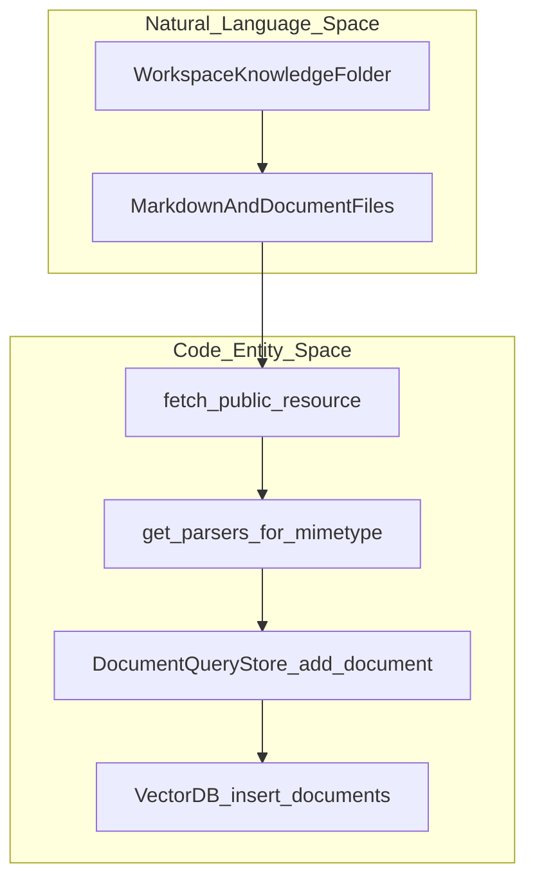
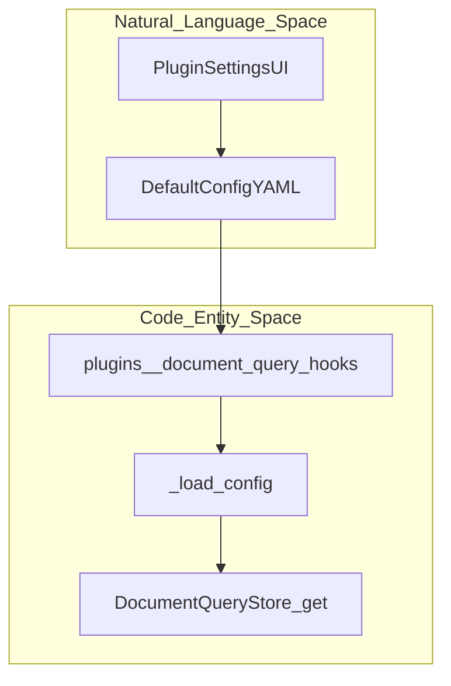
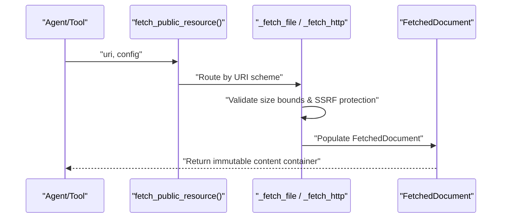
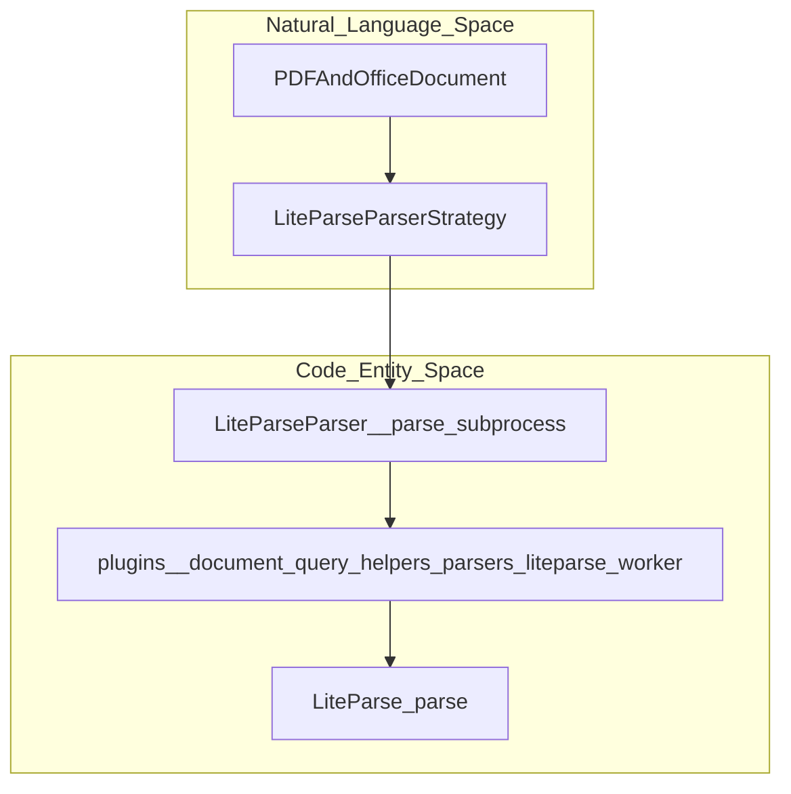

<!-- source: DeepWiki mcp.deepwiki.com · repo agent0ai/agent-zero · page 4.2 Knowledge Base & Document Query · fetched 2026-10-29 -->

# Knowledge Base & Document Query

Relevant source files

The following files were used as context for generating this wiki page:

- [plugins/_document_query/README.md](plugins/_document_query/README.md)
- [plugins/_document_query/default_config.yaml](plugins/_document_query/default_config.yaml)
- [plugins/_document_query/extensions/python/startup_migration/_20_document_query_runtime.py](plugins/_document_query/extensions/python/startup_migration/_20_document_query_runtime.py)
- [plugins/_document_query/helpers/document_query.py](plugins/_document_query/helpers/document_query.py)
- [plugins/_document_query/helpers/fetch.py](plugins/_document_query/helpers/fetch.py)
- [plugins/_document_query/helpers/parsers/liteparse.py](plugins/_document_query/helpers/parsers/liteparse.py)
- [plugins/_document_query/helpers/parsers/liteparse_worker.py](plugins/_document_query/helpers/parsers/liteparse_worker.py)
- [plugins/_document_query/hooks.py](plugins/_document_query/hooks.py)
- [plugins/_document_query/prompts/fw.document_query.optimize_query.md](plugins/_document_query/prompts/fw.document_query.optimize_query.md)
- [plugins/_document_query/webui/config.html](plugins/_document_query/webui/config.html)
- [plugins/_document_query/webui/thumbnail.jpg](plugins/_document_query/webui/thumbnail.jpg)
- [tests/test_document_query_fallback.py](tests/test_document_query_fallback.py)
- [tests/test_document_query_plugin.py](tests/test_document_query_plugin.py)

## Purpose and Scope

This page covers the knowledge management subsystem and the `_document_query` extension plugin in Agent Zero. It details the workspace `knowledge/` directory layout, document import and vector reindexing workflows, centralized resource fetching (`plugins/_document_query/helpers/fetch.py`), the strategy-pattern parser subsystem (`plugins/_document_query/helpers/parsers/`), process-isolated LiteParse workers (`plugins/_document_query/helpers/parsers/liteparse.py`), adaptive OCR configuration, vector-backed retrieval, and query optimization (`plugins/_document_query/prompts/fw.document_query.optimize_query.md`).

Sources: `plugins/_document_query/README.md:1-42`[], `plugins/_document_query/helpers/document_query.py:1-27`[]

---

## 1. Knowledge Base Directory Structure & Reindexing

Agent Zero maintains structured reference material inside the workspace `knowledge/` directory. Projects and local contexts can inject documentation, specifications, and contextual markdown or binary artifacts that the engine indexes into its FAISS vector database for contextual grounding during chat conversations and autonomous agent tasks.

When projects activate or initialize, the workspace scanner walks the `knowledge/` hierarchy, detecting new or updated files, parsing them via MIME-type routing, and upserting chunked representations into the vector database instance via `DocumentQueryStore`.

Sources: `plugins/_document_query/helpers/document_query.py:122-150`[]

---

## 2. The `_document_query` Plugin Architecture & Configuration

The `_document_query` plugin provides the underlying document handling, parsing, caching, and Q&A retrieval tools for agents. Its behavior is configured via `plugins/_document_query/default_config.yaml` and managed via its WebUI settings panel (`plugins/_document_query/webui/config.html`). 

Dependency management is handled during plugin startup via `plugins/_document_query/hooks.py`, which ensures that framework-runtime packages like `liteparse` are installed automatically using `uv` if not already present.

Sources: `plugins/_document_query/default_config.yaml:1-38`[], `plugins/_document_query/helpers/document_query.py:66-98`[], `plugins/_document_query/hooks.py:25-61`[]

---

## 3. Centralized Fetching & Protocol Handlers

Before any parsing occurs, documents from local filesystem paths or remote HTTP(S) URLs are fetched exactly once via `fetch_public_resource` in `plugins/_document_query/helpers/fetch.py`. This ensures size validation, protocol security checks (blocking private/internal IP ranges to mitigate SSRF), and MIME-type detection happen uniformly.

Sources: `plugins/_document_query/helpers/fetch.py:77-184`[]

---

## 4. Parser Strategy Pattern & MIME Routing

The parser subsystem maps input MIME types to dedicated parser classes inheriting from `BaseParser`. If a parser fails or is disabled, the system falls back through registered alternatives. Synchronous parsers are offloaded to an asynchronous thread pool and bounded by process-wide semaphores to protect shared resources.

| Parser Class | MIME Types | Backend Implementation |
| :--- | :--- | :--- |
| `LiteParseParser` | PDF, Office/OpenDocument, images | LiteParse via subprocess worker |
| `PdfParser` | `application/pdf` | PyMuPDF (`fitz`) + Tesseract OCR fallback |
| `HtmlParser` | `text/html` | Markdownify transformer |
| `TextParser` | `text/*`, JSON, YAML, XML, TOML, JS, TS | Direct text decode |
| `UnstructuredParser` | `*` (catch-all) | UnstructuredLoader hi-res |

Sources: `plugins/_document_query/README.md:46-56`[], `plugins/_document_query/helpers/parsers/liteparse.py:27-44`[]

---

## 5. LiteParse Workers & Adaptive OCR

To protect the main Web UI and Agent Zero framework process from native segfaults or blocking OCR threads, `LiteParseParser` offloads parsing tasks to an isolated child process via `plugins/_document_query/helpers/parsers/liteparse_worker.py`. Furthermore, `_should_disable_ocr` inspects PDF page counts and text profiles, automatically disabling OCR for lengthy documents to prevent pathological parse latency.

Sources: `plugins/_document_query/helpers/parsers/liteparse.py:68-185`[], `plugins/_document_query/helpers/parsers/liteparse_worker.py:9-21`[]

---

## 6. Document Query Store, Text Splitting & Retrieval Optimization

Extracted text is split into overlapping chunks via `DocumentQueryStore._split_text_for_index()` in `plugins/_document_query/helpers/document_query.py`, leveraging LangChain's `RecursiveCharacterTextSplitter`. If chunks exceed `max_index_chunks`, adaptive chunk sizing scales up the chunk targets.

Query optimization relies on `plugins/_document_query/prompts/fw.document_query.optimize_query.md`, which instructs a utility model to transform conversational user questions into concise, keyword-focused vector store search queries.

Sources: `plugins/_document_query/helpers/document_query.py:72-188`[], `plugins/_document_query/prompts/fw.document_query.optimize_query.md:1-29`[]

---

