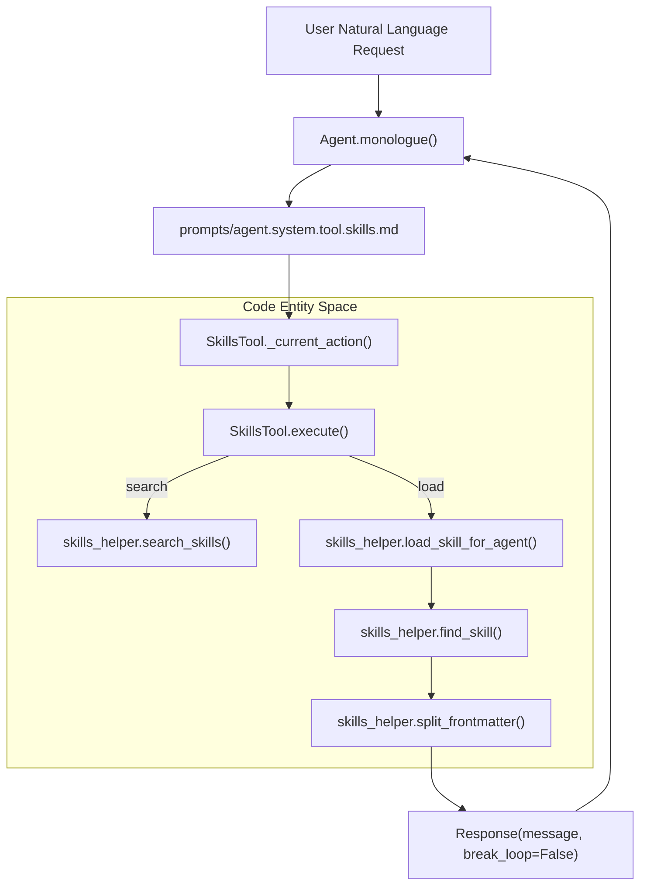
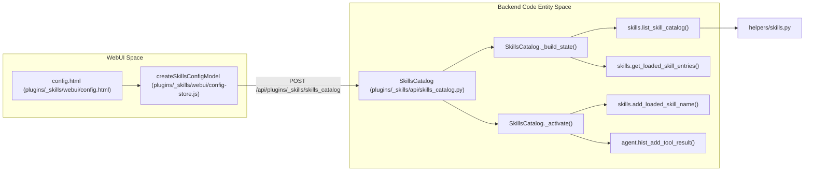

<!-- source: DeepWiki mcp.deepwiki.com · repo agent0ai/agent-zero · page 4.3 Skills System · fetched 2026-10-29 -->

# Skills System

<details>
<summary>Relevant source files</summary>

The following files were used as context for generating this wiki page:

- [extensions/python/message_loop_prompts_after/AGENTS.md](extensions/python/message_loop_prompts_after/AGENTS.md)
- [extensions/python/message_loop_prompts_after/_65_include_loaded_skills.py](extensions/python/message_loop_prompts_after/_65_include_loaded_skills.py)
- [helpers/skills.py](helpers/skills.py)
- [helpers/skills.py.dox.md](helpers/skills.py.dox.md)
- [plugins/_chat_compaction/prompts/compact.sys.md](plugins/_chat_compaction/prompts/compact.sys.md)
- [plugins/_skills/AGENTS.md](plugins/_skills/AGENTS.md)
- [plugins/_skills/README.md](plugins/_skills/README.md)
- [plugins/_skills/api/skills_catalog.py](plugins/_skills/api/skills_catalog.py)
- [plugins/_skills/default_config.yaml](plugins/_skills/default_config.yaml)
- [plugins/_skills/extensions/webui/initFw_end/skills-menu-injector.js](plugins/_skills/extensions/webui/initFw_end/skills-menu-injector.js)
- [plugins/_skills/helpers/__init__.py](plugins/_skills/helpers/__init__.py)
- [plugins/_skills/hooks.py](plugins/_skills/hooks.py)
- [plugins/_skills/plugin.yaml](plugins/_skills/plugin.yaml)
- [plugins/_skills/webui/config-store.js](plugins/_skills/webui/config-store.js)
- [plugins/_skills/webui/config.html](plugins/_skills/webui/config.html)
- [prompts/agent.system.tool.skills.md](prompts/agent.system.tool.skills.md)
- [prompts/fw.bulk_summary.sys.md](prompts/fw.bulk_summary.sys.md)
- [prompts/fw.topic_summary.sys.md](prompts/fw.topic_summary.sys.md)
- [tests/test_skills_runtime.py](tests/test_skills_runtime.py)
- [tests/test_skills_scan.py](tests/test_skills_scan.py)
- [tests/test_tool_action_contracts.py](tests/test_tool_action_contracts.py)
- [tools/skills_tool.py](tools/skills_tool.py)
- [tools/skills_tool.py.dox.md](tools/skills_tool.py.dox.md)
- [webui/components/projects/project-edit-skills.html](webui/components/projects/project-edit-skills.html)
- [webui/components/settings/skills/import.html](webui/components/settings/skills/import.html)
- [webui/components/settings/skills/list.html](webui/components/settings/skills/list.html)
- [webui/components/settings/skills/skills-import-store.js](webui/components/settings/skills/skills-import-store.js)
- [webui/components/settings/skills/skills-list-store.js](webui/components/settings/skills/skills-list-store.js)
- [webui/components/settings/skills/skills-settings.html](webui/components/settings/skills/skills-settings.html)
- [webui/public/skills.svg](webui/public/skills.svg)

</details>


## Purpose and Scope

The Skills System in Agent Zero provides a standardized framework to extend agent capabilities through structured instructions, metadata, and executable code. Following the `agentskills.io` standard, skills allow agents to discover, load, and execute specialized procedures dynamically within their operational context [tools/skills_tool.py:14-25](), [helpers/skills.py:47-65](). 

The system encompasses skill discovery across hierarchical directories, parsing and validation of YAML frontmatter, scoped visibility policies, execution through `skills_tool`, web management interfaces via the `_skills` plugin, and state persistence across conversation history [helpers/skills.py:47-130](), [tools/skills_tool.py:14-25](), [plugins/_skills/api/skills_catalog.py:12-33]().

Sources: [helpers/skills.py:47-130](), [tools/skills_tool.py:14-25](), [plugins/_skills/api/skills_catalog.py:12-33]()

---

## Skill Structure and the `agentskills.io` Standard

Skills are organized around the `agentskills.io` standard, residing in dedicated directories that contain a mandatory `SKILL.md` manifest [helpers/skills.py:108-130]().

### The `Skill` Dataclass and Frontmatter

The helper module parses `SKILL.md` files into the `Skill` dataclass (`helpers.skills.Skill`), which encapsulates core metadata and body content [helpers/skills.py:47-65]():
*   `name`: Canonical name of the skill [helpers/skills.py:49-49]().
*   `description`: Human-readable summary used by search matching [helpers/skills.py:50-50]().
*   `path` / `skill_md_path`: Absolute filesystem locations [helpers/skills.py:51-52]().
*   `tags`, `triggers`, `allowed_tools`: Lists controlling discovery matching and capability boundaries [helpers/skills.py:55-57]().
*   `content`: Markdown body content parsed via `split_frontmatter()` [helpers/skills.py:63-63](), [helpers/skills.py:157-194]().

**Directory Layout**
```text
/a0/usr/skills/
└── <skill-name>/
    ├── SKILL.md           # Required: Manifest and operational instructions
    ├── scripts/           # Optional: Executable Python or Bash scripts
    └── ...                # Optional: Support templates, files, or docs
```

Sources: [helpers/skills.py:47-65](), [helpers/skills.py:108-130](), [helpers/skills.py:157-194]()

---

## Discovery, Scoping and Visibility Policies

The helper module `helpers/skills.py` implements hierarchical scanning and visibility resolution [helpers/skills.py:70-101]().

### Skill Root Resolution

The extensible function `get_skill_roots(agent: Agent|None)` aggregates paths from core defaults, user global storage, project containers, and plugins [helpers/skills.py:71-101]():
*   Core paths: `skills/` and `usr/skills/` [helpers/skills.py:90-91]().
*   Project and agent scopes: `usr/projects/*/.a0proj/skills/` and `usr/agents/*/skills/` [helpers/skills.py:81-83]().
*   Plugin scopes: `plugins/*/skills/` and `usr/plugins/*/skills/` [helpers/skills.py:85-86]().

### Visibility Policies

`_skills.visibility_policy` provides profile-aware filtering [helpers/skills.py.dox.md:66-73](). Functions like `get_visibility_policy()`, `is_skill_allowed()`, and `hide_chat_skill()` filter discovery and search operations without altering instructions already stored in historical message turns [helpers/skills.py.dox.md:67-73](), [tests/test_skills_runtime.py:182-197]().

Sources: [helpers/skills.py:70-101](), [helpers/skills.py.dox.md:66-73](), [tests/test_skills_runtime.py:182-197]()

---

## Skill Execution and Retrieval (`SkillsTool`)

Agents interact with skills via `SkillsTool` (registered as `skills_tool`), which exposes actions for discovery, searching, loading, and reading relative files [tools/skills_tool.py:14-25]().

### Tool Actions

*   `list`: Discovers and returns all visible skills sorted alphabetically [tools/skills_tool.py:118-119](), [tools/skills_tool.py:142-161]().
*   `search`: Scores skills matching queries or trigger phrases using `skills_helper.search_skills()` [tools/skills_tool.py:120-121](), [tools/skills_tool.py:163-186]().
*   `load`: Appends a skill's full markdown body to chat history via `skills_helper.load_skill_for_agent()` [tools/skills_tool.py:122-123](), [tools/skills_tool.py:188-195]().
*   `read_file`: Opens specific relative files inside a loaded skill directory [tools/skills_tool.py:124-128]().

### Natural Language Space to Code Entity Space: Tool Execution Flow

Title: "SkillsTool Execution Data Flow"


Sources: [tools/skills_tool.py:14-141](), [prompts/agent.system.tool.skills.md:1-13](), [helpers/skills.py:157-194]()

---

## Skills Management UI and `_skills` Plugin

The WebUI provides settings panels for managing skills catalogs and visibility states [plugins/_skills/webui/config.html:7-14]().

### Backend API (`skills_catalog.py`)

The `_skills` plugin exposes an API handler `SkillsCatalog` at `/plugins/_skills/skills_catalog` [plugins/_skills/api/skills_catalog.py:12-16](). It processes actions such as `list`, `activate`, `hide`, `show`, and `_build_state` [plugins/_skills/api/skills_catalog.py:19-33](), [plugins/_skills/api/skills_catalog.py:91-116]().

### Natural Language / UI Space to Backend Code Entity Space

Title: "Skills Catalog API and WebUI State Synchronization"


Sources: [plugins/_skills/api/skills_catalog.py:12-64](), [plugins/_skills/api/skills_catalog.py:91-116](), [plugins/_skills/webui/config-store.js:71-104](), [plugins/_skills/webui/config.html:7-14]()

---

## History Persistence, Compaction and Reattachment

Loaded skills are maintained across the conversation lifecycle via chat history integration and context data ledgers [tools/skills_tool.py.dox.md:29-31]().

*   **Tool-Result History Integration**: Activating a skill appends its full body content to chat history as a tool result accompanied by `skill_instructions` metadata [tools/skills_tool.py.dox.md:29-29]().
*   **Chat-Wide Context Data**: Loaded identifiers are stored under `CONTEXT_DATA_NAME_LOADED_SKILLS`, allowing them to survive chat compaction and reattachment [helpers/skills.py:24-25](), [plugins/_chat_compaction/AGENTS.md:23-23]().
*   **Active Skill Limits**: To prevent context exhaustion, active skills are capped at 20 (`MAX_ACTIVE_SKILLS`), configurable via `get_max_active_skills()` [helpers/skills.py:22-22](), [helpers/skills.py:38-40]().
*   **Automatic Reattachment**: The extension `IncludeLoadedSkills` (`extensions/python/message_loop_prompts_after/_65_include_loaded_skills.py`) detects when conversation compaction removes loaded skill instructions and re-injects missing skill bodies into history within a defined token budget (`SKILL_REATTACHMENT_TOKEN_BUDGET = 12_000`) [extensions/python/message_loop_prompts_after/_65_include_loaded_skills.py:6-71]().

Sources: [helpers/skills.py:21-28](), [tools/skills_tool.py.dox.md:23-33](), [extensions/python/message_loop_prompts_after/_65_include_loaded_skills.py:6-71]()

---

