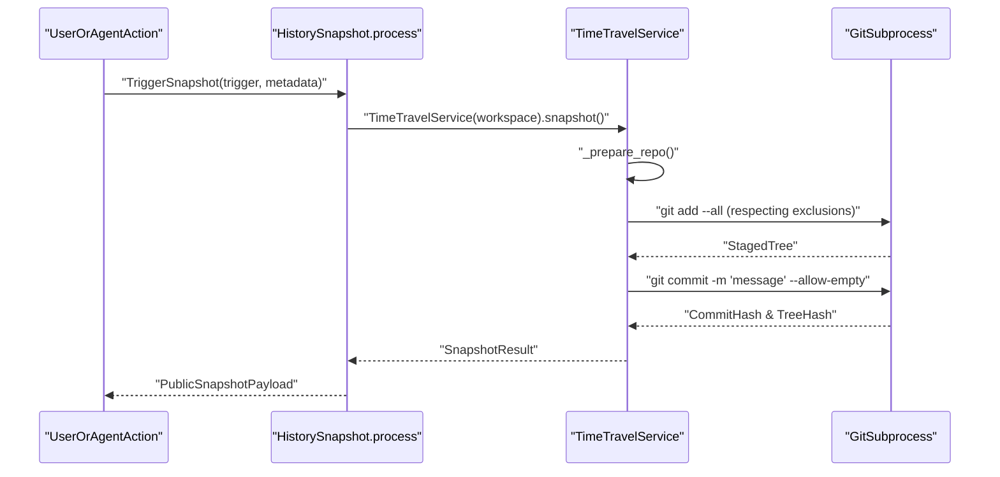
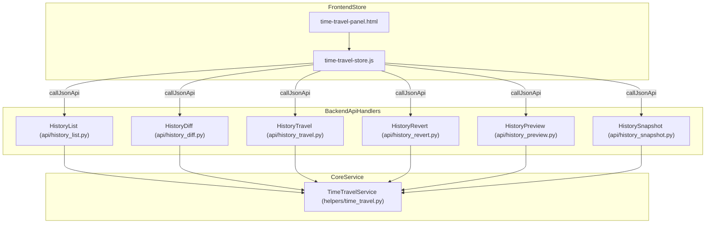

<!-- source: DeepWiki mcp.deepwiki.com · repo agent0ai/agent-zero · page 4.4 Time Travel (Workspace Versioning) · fetched 2026-10-29 -->

# Time Travel (Workspace Versioning)

Relevant source files

The following files were used as context for generating this wiki page:

- [plugins/_time_travel/api/history_diff.py](plugins/_time_travel/api/history_diff.py)
- [plugins/_time_travel/api/history_list.py](plugins/_time_travel/api/history_list.py)
- [plugins/_time_travel/api/history_preview.py](plugins/_time_travel/api/history_preview.py)
- [plugins/_time_travel/api/history_revert.py](plugins/_time_travel/api/history_revert.py)
- [plugins/_time_travel/api/history_snapshot.py](plugins/_time_travel/api/history_snapshot.py)
- [plugins/_time_travel/api/history_travel.py](plugins/_time_travel/api/history_travel.py)
- [plugins/_time_travel/helpers/time_travel.py](plugins/_time_travel/helpers/time_travel.py)
- [plugins/_time_travel/plugin.yaml](plugins/_time_travel/plugin.yaml)
- [plugins/_time_travel/webui/main.html](plugins/_time_travel/webui/main.html)
- [plugins/_time_travel/webui/time-travel-panel.html](plugins/_time_travel/webui/time-travel-panel.html)
- [plugins/_time_travel/webui/time-travel-store.js](plugins/_time_travel/webui/time-travel-store.js)
- [tests/test_time_travel.py](tests/test_time_travel.py)

The `_time_travel` plugin provides Git-backed versioning for workspaces inside the `/a0/usr` directory [plugins/_time_travel/helpers/time_travel.py:23-25](). It enables users and agents to capture snapshots of the workspace, visualize file changes via diffs, and perform "Time Travel" (checkout specific historical states) or "Revert" (rollback changes) operations [plugins/_time_travel/helpers/time_travel.py:1-1559](). It operates transparently using a shadow repository system that tracks modifications without interfering with any pre-existing `.git` repositories in the user's workspace [plugins/_time_travel/helpers/time_travel.py:24-25]().

Sources: [plugins/_time_travel/helpers/time_travel.py:1-1559]()

## System Architecture & Workspace Isolation

The subsystem comprises a Python service executing Git subprocesses, a watchdog-based auto-snapshot debounce engine, REST API endpoints, and an Alpine.js-based canvas panel and modal interface [plugins/_time_travel/helpers/time_travel.py:1-1559](), [plugins/_time_travel/webui/time-travel-store.js:1-501](), [plugins/_time_travel/webui/time-travel-panel.html:1-936]().

Time Travel operates exclusively on workspaces inside the `/a0/usr` boundary [plugins/_time_travel/helpers/time_travel.py:187-190](). Each workspace is identified by a unique ID generated from its canonical path [plugins/_time_travel/helpers/time_travel.py:192-194](). To prevent corruption of user projects, the plugin maintains bare-style shadow repositories located at `/a0/usr/.time_travel/workspaces/{workspace_id}/repo.git` [plugins/_time_travel/helpers/time_travel.py:24-25](). These repositories target the actual workspace directory as their worktree by passing explicit `--git-dir` and `--work-tree` arguments to Git subprocesses.

### Code Entity Map: Backend Logic

| Code Entity | Type | Role & Description |
| :--- | :--- | :--- |
| `TimeTravelService` | `class` | Core service class responsible for executing Git commands, creating snapshots, diffing commits, traveling, and reverting [plugins/_time_travel/helpers/time_travel.py:1-1559]() |
| `WorkspaceInfo` | `dataclass` | Holds metadata about a workspace including its real path, shadow repository path, and ID [plugins/_time_travel/helpers/time_travel.py:132-155]() |
| `resolve_workspace()` | `function` | Determines the active workspace based on `AgentContext` or settings [plugins/_time_travel/helpers/time_travel.py:1-1559]() |
| `HistoryList` | `class` | API handler for listing commit histories and filtered file changes [plugins/_time_travel/api/history_list.py:13-27]() |
| `HistoryDiff` | `class` | API handler for generating unified diff patches per file/commit [plugins/_time_travel/api/history_diff.py:12-26]() |
| `HistoryTravel` | `class` | API handler for checking out historical commit states [plugins/_time_travel/api/history_travel.py:12-25]() |
| `HistoryRevert` | `class` | API handler for rolling back changes via inverse commits [plugins/_time_travel/api/history_revert.py:12-25]() |
| `HistorySnapshot` | `class` | API handler for manually triggering workspace snapshots [plugins/_time_travel/api/history_snapshot.py:13-29]() |
| `HistoryPreview` | `class` | API handler for previewing operations before commit mutation [plugins/_time_travel/api/history_preview.py:12-25]() |

Sources: [plugins/_time_travel/helpers/time_travel.py:1-1559](), [plugins/_time_travel/api/history_list.py:13-27](), [plugins/_time_travel/api/history_snapshot.py:13-29](), [plugins/_time_travel/api/history_preview.py:12-25]()

## Snapshot & Versioning Data Flow

Snapshots are created via distinct triggers:
1. **Manual:** User interaction via the UI Snapshot button [plugins/_time_travel/webui/time-travel-panel.html:31-33]().
2. **Automatic (Tool Execution):** Triggered following tool executions via extension hooks.
3. **Watchdog:** A file system observer detecting modifications under `/a0/usr` [plugins/_time_travel/helpers/time_travel.py:1-1559]().

### Diagram: Snapshot Code Entity Flow
This diagram bridges natural language snapshot requests to the underlying Python functions and Git subprocess execution handlers.

Sources: [plugins/_time_travel/helpers/time_travel.py:1-1559](), [plugins/_time_travel/api/history_snapshot.py:13-29]()

## Watchdog & Debouncing

To avoid excessive disk I/O and commit spam during rapid file modification cycles, the plugin implements a double-debounce strategy:
- **File Watcher Debounce:** Changes detected by watchdog trigger a timer of `WATCHDOG_DEBOUNCE_SECONDS` (1.0s) [plugins/_time_travel/helpers/time_travel.py:33](). Subsequent modifications reset this timer.
- **Commit Cool-off:** Once a snapshot completes, an `AUTO_SNAPSHOT_DEBOUNCE_SECONDS` (10.0s) cool-off window is enforced per workspace [plugins/_time_travel/helpers/time_travel.py:31]().

Sources: [plugins/_time_travel/helpers/time_travel.py:31-33]()

## Time Travel & Revert Operations

The plugin provides primary ways to navigate version history:

| Operation | Service Method | Description |
| :--- | :--- | :--- |
| **Travel** | `travel()` | Executes a checkout of a specific commit hash. Preserves the prior dirty state in `refs/a0-time-travel/preserved` to prevent accidental data loss [plugins/_time_travel/helpers/time_travel.py:1-1559]() |
| **Revert** | `revert()` | Applies the inverse changes of a commit onto the current tree using `git revert --no-commit`, creating a new history commit representing the rollback [plugins/_time_travel/helpers/time_travel.py:1-1559]() |

### Conflict Handling
If a `revert` or `travel` operation encounters uncommitted local changes that conflict with the target state, `TimeTravelConflictError` is raised [plugins/_time_travel/helpers/time_travel.py:121-122](). The API handlers catch this exception and return structured technical details for UI resolution [plugins/_time_travel/api/history_revert.py:28-31]().

Sources: [plugins/_time_travel/helpers/time_travel.py:121-122](), [plugins/_time_travel/api/history_revert.py:12-31](), [tests/test_time_travel.py:97-111]()

## API Layer & Web UI Architecture

The Time Travel interface is rendered via Alpine.js components communicating with Flask API handlers [plugins/_time_travel/webui/time-travel-store.js:1-501](), [plugins/_time_travel/api/history_list.py:13-31]().

### Diagram: API & Store Integration
This diagram bridges frontend store actions in `time-travel-store.js` to backend API handler classes and service methods.

Sources: [plugins/_time_travel/webui/time-travel-store.js:1-182](), [plugins/_time_travel/api/history_list.py:13-31](), [plugins/_time_travel/api/history_diff.py:12-30](), [plugins/_time_travel/api/history_travel.py:12-33](), [plugins/_time_travel/api/history_revert.py:12-31](), [plugins/_time_travel/api/history_preview.py:12-29](), [plugins/_time_travel/api/history_snapshot.py:13-33]()

## Exclusions & Security

To maintain clean shadow repositories, the plugin enforces strict file exclusion rules:
- **Environment Files:** `.env` and `.env.*` files are excluded from tracking [plugins/_time_travel/helpers/time_travel.py:81-88]().
- **Dependency & Cache Directories:** `node_modules`, `venv`, `.venv`, `__pycache__`, and build outputs are ignored [plugins/_time_travel/helpers/time_travel.py:51-75]().
- **System Internals:** `.git` and `.time_travel` directories are explicitly excluded to prevent recursion [plugins/_time_travel/helpers/time_travel.py:51-54]().

Sources: [plugins/_time_travel/helpers/time_travel.py:51-89]()

---

