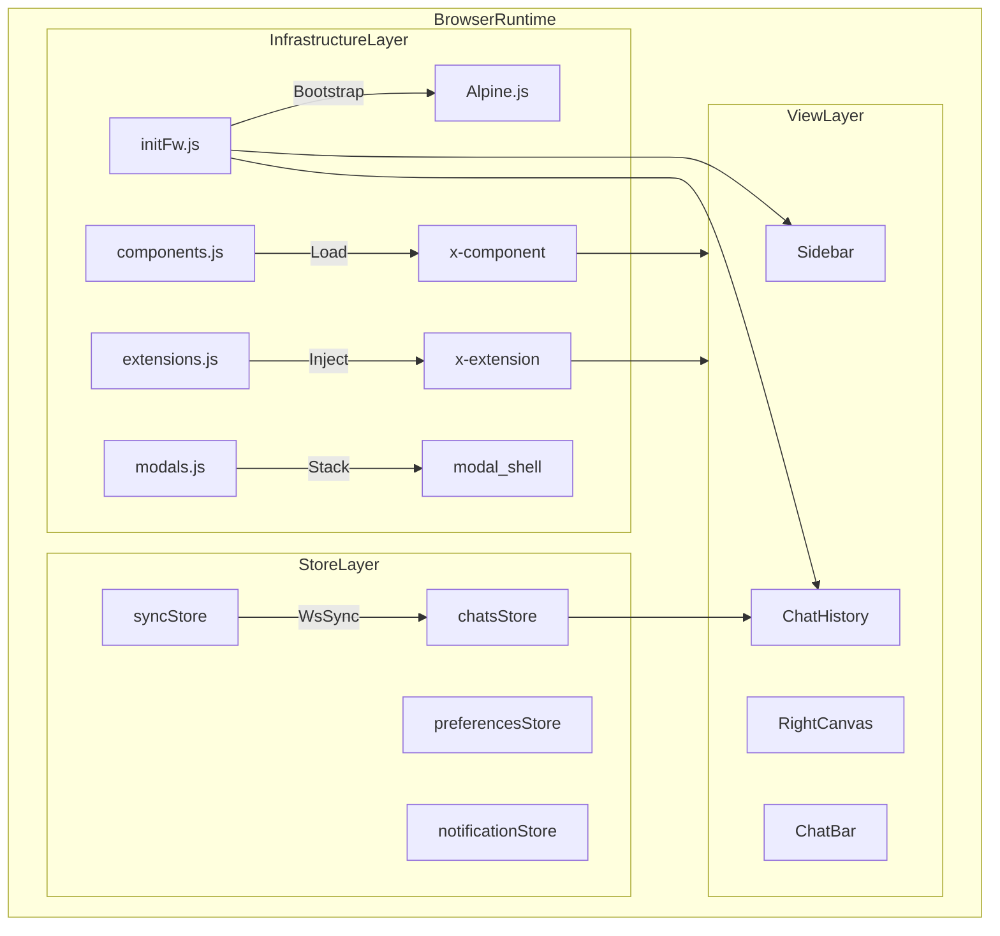
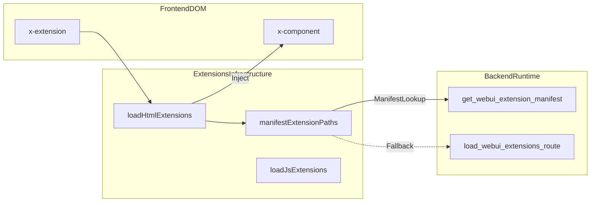

<!-- source: DeepWiki mcp.deepwiki.com · repo agent0ai/agent-zero · page 5 Web UI Architecture · fetched 2026-10-29 -->

# Web UI Architecture

Relevant source files

The following files were used as context for generating this wiki page:

- [extensions/python/agent_init/AGENTS.md](extensions/python/agent_init/AGENTS.md)
- [extensions/webui/fetch_api_call_after/.gitkeep](extensions/webui/fetch_api_call_after/.gitkeep)
- [extensions/webui/fetch_api_call_before/.gitkeep](extensions/webui/fetch_api_call_before/.gitkeep)
- [extensions/webui/json_api_call_after/.gitkeep](extensions/webui/json_api_call_after/.gitkeep)
- [extensions/webui/json_api_call_after/cache_reset.js](extensions/webui/json_api_call_after/cache_reset.js)
- [extensions/webui/json_api_call_before/.gitkeep](extensions/webui/json_api_call_before/.gitkeep)
- [jsconfig.json](jsconfig.json)
- [prompts/AGENTS.md](prompts/AGENTS.md)
- [prompts/agent.system.tool.call_sub.py](prompts/agent.system.tool.call_sub.py)
- [tests/test_initial_message.py](tests/test_initial_message.py)
- [tests/test_prompt_catalogs.py](tests/test_prompt_catalogs.py)
- [tests/test_webui_message_window.py](tests/test_webui_message_window.py)
- [tests/test_webui_plugin_process_types.py](tests/test_webui_plugin_process_types.py)
- [webui/components/messages/AGENTS.md](webui/components/messages/AGENTS.md)
- [webui/js/AGENTS.md](webui/js/AGENTS.md)
- [webui/js/api.js](webui/js/api.js)
- [webui/js/cache.js](webui/js/cache.js)
- [webui/js/components.js](webui/js/components.js)
- [webui/js/extensions.js](webui/js/extensions.js)
- [webui/js/initFw.js](webui/js/initFw.js)
- [webui/js/message-window.js](webui/js/message-window.js)

The Agent Zero Web UI is a reactive single-page application (SPA) built using **Alpine.js** [webui/js/initFw.js:15-18](). It provides real-time feedback, a modular component system, and a centralized store pattern to handle multi-agent interactions. The frontend visualizes the backend agent monologue loop, transforming raw logs into structured, interactive message threads [webui/js/AGENTS.md:1-20](). 

As a parent architectural overview, this page introduces core frontend infrastructure, component loading, store patterns, and real-time synchronization. Detailed implementation specifics are delegated to dedicated child pages.

Sources: [webui/js/AGENTS.md:1-20](), [webui/js/initFw.js:15-18]()

## Core Technology Stack & Infrastructure

The frontend avoids heavy framework overhead in favor of a modular browser architecture:
*   **Alpine.js**: Powers reactive UI bindings, component directives, and global store management via `Alpine.store` [webui/js/initFw.js:15-18]().
*   **Socket.io / WebSockets**: Provides real-time bidirectional communication between the Flask backend and browser clients [webui/js/AGENTS.md:12]().
*   **Marked.js & KaTeX**: Handles Markdown rendering and mathematical delimiter conversion for agent responses [webui/js/AGENTS.md:19]().
*   **Component Loader (`components.js`)**: Enables modular HTML fragments with scoped scripts and styles via the `<x-component>` tag [webui/js/components.js:11-191]().
*   **API Client (`api.js`)**: A fetch wrapper (`fetchApi` and `callJsonApi`) that handles CSRF token exchange, automatic 403 retries, and extension hooks [webui/js/api.js:8-125]().
*   **Extension Loader (`extensions.js`)**: Dynamically resolves and loads JavaScript and HTML extensions from plugins at runtime using a manifest-first approach [webui/js/extensions.js:46-108]().

Sources: [webui/js/AGENTS.md:10-15](), [webui/js/initFw.js:15-18](), [webui/js/components.js:11-191](), [webui/js/api.js:8-125](), [webui/js/extensions.js:46-108]()

## System Layout & Main Shell

The main layout follows a sidebar-and-panel structure rendered from `webui/index.html`. The bootstrap module `initFw.js` initializes the environment, registers custom Alpine directives (`x-destroy`, `x-create`, `x-move-to`, `x-every-second`), and loads essential services [webui/js/initFw.js:1-188]().

### Main UI Shell Architecture
| Module / File | Code Symbol / Role |
| :--- | :--- |
| **`webui/index.html`** | Entry point defining the layout and non-blocking script loading. |
| **`webui/js/components.js`** | `importComponent()` handles `<x-component>` loading, asset caching, and module injection [webui/js/components.js:11-191](). |
| **`webui/js/modals.js`** | `openModal()`, `closeModal()` manage a stacked modal shell with z-index control [webui/js/AGENTS.md:15](). |
| **`webui/js/surfaces.js`** | Manages shared surface registration for the right-canvas and modal routing [webui/js/AGENTS.md:16](). |
| **`webui/js/icons.js`** | Owns the native `<x-icon>` custom element and Material Symbols font bridging [webui/js/AGENTS.md:18](). |

### Diagram: Frontend Runtime Architecture and Boot Sequence

Sources: [webui/js/initFw.js:1-188](), [webui/js/components.js:11-191](), [webui/js/AGENTS.md:10-19]()

## Component & Extension System

The Web UI achieves plugin extensibility through modular component tags and extension points:
*   **`<x-component path="...">`**: Fetches HTML templates, extracts inline `<style>` and `<script type="module">` tags, caches module promises, and executes them exactly once before mounting [webui/js/components.js:11-191]().
*   **`<x-extension id="...">`**: Defines injection points where plugins can append UI elements. `extensions.js` queries `runtimeInfo.webuiExtensions` to resolve paths without per-surface API roundtrips [webui/js/extensions.js:46-53]().
*   **JS Extensions**: Plugins hook into lifecycle events such as `initFw_start` or `json_api_call_before` by exporting a default function [webui/js/extensions.js:62-71]().

### Diagram: Extension and Component Loading Pipeline

Sources: [webui/js/extensions.js:46-53](), [webui/js/extensions.js:189-216](), [webui/js/components.js:11-191]()

## Real-Time Synchronization & Store Pattern

State synchronization between the Flask backend and the Alpine.js frontend is managed by `syncStore` in conjunction with WebSocket and polling layers.
*   **State Updates**: Incremental snapshots patch existing records, while full log snapshots (starting at log `no` 0) replace the message DOM entirely [webui/js/AGENTS.md:55]().
*   **Connection Modes**: `syncStore` manages handshake lifecycle states (`DISCONNECTED`, `HANDSHAKE_PENDING`, `HEALTHY`, `DEGRADED`), automatically falling back to polling if WebSocket connectivity degrades.

Sources: [webui/js/AGENTS.md:55-60]()

---

## Child Pages Overview

For granular technical documentation on specific frontend subsystems, refer to the following child pages:

- [Chat Interface & Message Rendering](#5.1) — Covers `setMessages()`, `applySnapshot()`, process group rendering, message window virtualization, smooth-scroll management via `Scroller`, process step details, and the chat input bar.
- [Sidebar & Navigation](#5.2) — Covers the left-sidebar layout, `chatsStore` conversation CRUD, `tasksStore`, `sidebarStore`, quick actions toolbar, attachments, and mobile responsiveness.
- [Settings, Modals & UI Components](#5.3) — Covers the settings panel architecture, the A0 modal stack system (`modals.js`), right canvas surfaces, preferences panel, toast notifications, and the welcome screen.
- [Speech Interface (STT/TTS)](#5.4) — Covers the `_whisper_stt` and `_kokoro_tts` plugins: speech state machine (LISTENING/RECORDING/WAITING/PROCESSING), Whisper integration, Kokoro streaming, and silence detection.
- [File Browser & Editor Surfaces](#5.5) — Covers file browser stores, lazy file tree navigation, picker modes, remote connections (`/@connections`), and the `_editor` plugin's ACE-based source/preview editor panel.

Sources: [webui/js/AGENTS.md:1-60](), [webui/js/components.js:1-191]()

---

