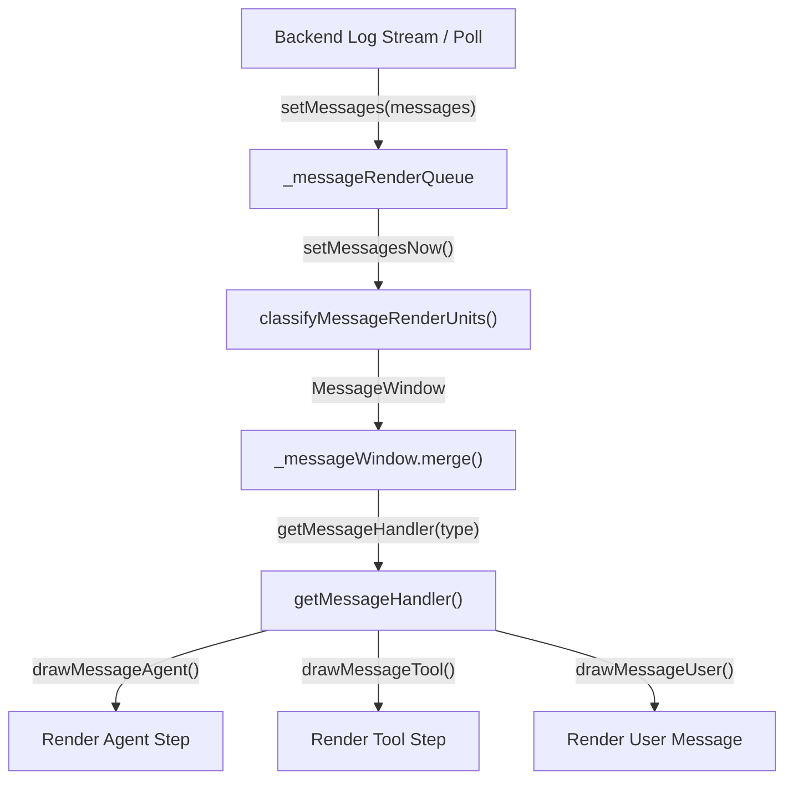
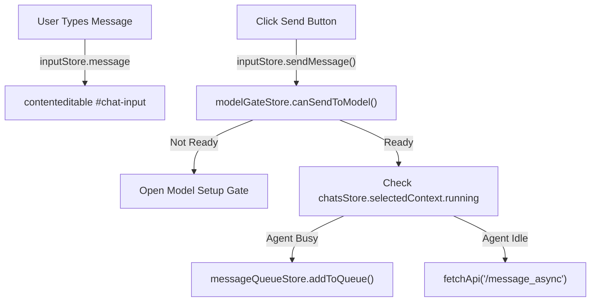

<!-- source: DeepWiki mcp.deepwiki.com · repo agent0ai/agent-zero · page 5.1 Chat Interface & Message Rendering · fetched 2026-10-29 -->

# Chat Interface & Message Rendering

Relevant source files

The following files were used as context for generating this wiki page:

- [api/settings_get.py.dox.md](api/settings_get.py.dox.md)
- [api/settings_set.py.dox.md](api/settings_set.py.dox.md)
- [extensions/python/banners/AGENTS.md](extensions/python/banners/AGENTS.md)
- [extensions/python/banners/_10_unsecured_connection.py](extensions/python/banners/_10_unsecured_connection.py)
- [plugins/AGENTS.md](plugins/AGENTS.md)
- [prompts/fw.intervention.md](prompts/fw.intervention.md)
- [prompts/fw.msg_nudge.md](prompts/fw.msg_nudge.md)
- [prompts/fw.msg_reasoning_only.md](prompts/fw.msg_reasoning_only.md)
- [prompts/fw.msg_reasoning_only_response.md](prompts/fw.msg_reasoning_only_response.md)
- [prompts/fw.user_message.md](prompts/fw.user_message.md)
- [tests/test_chat_input_drafts.py](tests/test_chat_input_drafts.py)
- [tests/test_file_tree_indent.py](tests/test_file_tree_indent.py)
- [tests/test_intervention_llm_abort.py](tests/test_intervention_llm_abort.py)
- [tests/test_unsecured_connection_banner.py](tests/test_unsecured_connection_banner.py)
- [tests/test_webui_message_ordering_static.py](tests/test_webui_message_ordering_static.py)
- [tests/test_webui_tooltips.py](tests/test_webui_tooltips.py)
- [tests/test_welcome_composer_static.py](tests/test_welcome_composer_static.py)
- [webui/components/chat/AGENTS.md](webui/components/chat/AGENTS.md)
- [webui/components/chat/attachments/attachmentsStore.js](webui/components/chat/attachments/attachmentsStore.js)
- [webui/components/chat/attachments/dragDropOverlay.html](webui/components/chat/attachments/dragDropOverlay.html)
- [webui/components/chat/attachments/inputPreview.html](webui/components/chat/attachments/inputPreview.html)
- [webui/components/chat/input/bottom-actions.html](webui/components/chat/input/bottom-actions.html)
- [webui/components/chat/input/chat-bar-input.html](webui/components/chat/input/chat-bar-input.html)
- [webui/components/chat/input/chat-bar.html](webui/components/chat/input/chat-bar.html)
- [webui/components/chat/input/input-store.js](webui/components/chat/input/input-store.js)
- [webui/components/chat/input/progress.html](webui/components/chat/input/progress.html)
- [webui/components/chat/message-queue/message-queue-store.js](webui/components/chat/message-queue/message-queue-store.js)
- [webui/components/chat/message-queue/message-queue.html](webui/components/chat/message-queue/message-queue.html)
- [webui/components/chat/navigation/chat-navigation-store.js](webui/components/chat/navigation/chat-navigation-store.js)
- [webui/components/chat/top-section/chat-top-store.js](webui/components/chat/top-section/chat-top-store.js)
- [webui/components/chat/top-section/chat-top.html](webui/components/chat/top-section/chat-top.html)
- [webui/components/messages/action-buttons/simple-action-buttons.css](webui/components/messages/action-buttons/simple-action-buttons.css)
- [webui/components/messages/action-buttons/simple-action-buttons.js](webui/components/messages/action-buttons/simple-action-buttons.js)
- [webui/components/messages/process-group/process-group.css](webui/components/messages/process-group/process-group.css)
- [webui/components/modals/context/context.html](webui/components/modals/context/context.html)
- [webui/components/modals/history/history.html](webui/components/modals/history/history.html)
- [webui/components/modals/process-step-detail/process-step-detail.html](webui/components/modals/process-step-detail/process-step-detail.html)
- [webui/components/modals/process-step-detail/step-detail-store.js](webui/components/modals/process-step-detail/step-detail-store.js)
- [webui/components/sidebar/bottom/preferences/preferences-panel.html](webui/components/sidebar/bottom/preferences/preferences-panel.html)
- [webui/components/sidebar/bottom/preferences/preferences-store.js](webui/components/sidebar/bottom/preferences/preferences-store.js)
- [webui/components/tooltips/AGENTS.md](webui/components/tooltips/AGENTS.md)
- [webui/components/tooltips/tooltip-store.js](webui/components/tooltips/tooltip-store.js)
- [webui/components/welcome/AGENTS.md](webui/components/welcome/AGENTS.md)
- [webui/components/welcome/welcome-screen.html](webui/components/welcome/welcome-screen.html)
- [webui/components/welcome/welcome-store.js](webui/components/welcome/welcome-store.js)
- [webui/css/messages.css](webui/css/messages.css)
- [webui/index.css](webui/index.css)
- [webui/index.html](webui/index.html)
- [webui/index.js](webui/index.js)
- [webui/js/messages.js](webui/js/messages.js)
- [webui/js/scroller.js](webui/js/scroller.js)

## Purpose and Scope
This document covers the technical architecture of the Agent Zero Web UI chat interface and message rendering subsystem. It details the synchronization routines (`setMessages()`, `applySnapshot()`), the message rendering pipeline (process groups, process steps, status badges), windowed virtualization, auto-scroll mechanics via the `Scroller` class, process step inspection modals, and the Alpine.js-driven chat input bar.

Sources: [webui/js/messages.js:1-196](), [webui/index.js:87-190]()

---

## Rendering Pipeline & Snapshot Synchronization

The rendering engine transforms backend log streams into structured, hierarchical DOM elements. The entry point for rendering updates is `setMessages(messages)`, which serializes execution through a promise queue (`_messageRenderQueue`) to prevent race conditions during rapid WebSocket or polling updates [webui/js/messages.js:192-200]().

### Data Flow & Handlers
1. **Queueing**: `setMessages(messages)` locks onto `_messageRenderGeneration` and appends work to `_messageRenderQueue` [webui/js/messages.js:192-196]().
2. **Classification**: `classifyMessageRenderUnits(messages)` determines boundaries for process groups and individual steps [webui/js/messages.js:46-50]().
3. **Handler Resolution**: `getMessageHandler(type)` maps log types (such as `user`, `agent`, `tool`, `mcp`, `subagent`, `warning`, `error`, etc.) to specific rendering functions or custom JS extensions [webui/js/messages.js:145-188]().
4. **Windowing**: The `MessageWindow` class manages virtualized rendering frames to keep memory footprints low on large chat histories [webui/js/messages.js:65-68]().

### Diagram: Natural Language to Code Mapping for Rendering Pipeline

Sources: [webui/js/messages.js:46-200](), [webui/css/messages.css:2-20]()

---

## Process Groups, Steps & Status Badges

To organize complex multi-step reasoning cycles, Agent Zero nests individual process steps inside **Process Groups**.

### Structure and Collapsing
* **Process Groups**: Group headers expose titles, step counts, and metrics [webui/components/messages/process-group/process-group.css:50-105](). Older steps collapse automatically after a delay defined by `STEP_COLLAPSE_DELAY` (2000ms for agents, 4000ms for tools) [webui/js/messages.js:32-36]().
* **Status Badges**: Every process step carries a 3-letter uppercase badge (`.step-badge`) styled via CSS variable scopes (`--step-accent`) [webui/components/messages/process-group/process-group.css:122-159]():
  * `GEN`: LLM Generation (`#38bdf8` / `#0284c7`) [webui/components/messages/process-group/process-group.css:154-159]()
  * `END`: Response / Completion (`#22c55e` / `#15803d`) [webui/components/messages/process-group/process-group.css:162-167]()
  * `USE` / `MCP`: Tool or MCP Usage (`#fbbf24` / `#b45309`) [webui/components/messages/process-group/process-group.css:169-183]()
  * `SUB` / `RES`: Subagent Delegation (`#14b8a6` / `#0f766e`) [webui/components/messages/process-group/process-group.css:186-197]()
  * `WWW`: Browser Action (`#818cf8` / `#4f46e5`) [webui/components/messages/process-group/process-group.css:200-205]()
  * `HDL`: Handling / Progress (`#94a3b8` / `#475569`) [webui/components/messages/process-group/process-group.css:208-213]()
  * `ERR`: Error State (`var(--color-error-text)`) [webui/components/messages/process-group/process-group.css:241-246]()

Sources: [webui/js/messages.js:32-38](), [webui/components/messages/process-group/process-group.css:50-256]()

---

## Message Window Virtualization & Performance

When rendering long histories, `MessageWindow` prevents browser layout thrashing.

* **Thresholds**: If entries exceed `DEFERRED_REPLAY_ENTRY_THRESHOLD` (30 items) or text length exceeds `DEFERRED_REPLAY_TEXT_THRESHOLD` (50,000 chars), message replay is deferred [webui/js/messages.js:88-89]().
* **Lazy Preview**: Large message bodies use truncation flags governed by `LAZY_MESSAGE_PREVIEW_CHARS` (6000 chars) [webui/js/messages.js:87]().
* **Staging Mode**: `#chat-history` toggles `.message-window-staging` to disable CSS animations and transitions during bulk window swaps [webui/css/messages.css:22-26]().

Sources: [webui/js/messages.js:65-90](), [webui/css/messages.css:2-26]()

---

## Auto-Scroll & Scroller Subsystem

The `Scroller` utility and local flags manage automatic viewport anchoring.

* **Tail Following**: Controlled by `_messageWindowFollowTail`, determining if incoming chat chunks should automatically push the viewport down [webui/js/messages.js:75]().
* **User Grace Period**: `MESSAGE_WINDOW_USER_SCROLL_GRACE_MS` (1200ms) pauses auto-scroll when user scroll activity is detected, preventing abrupt jumps while reading [webui/js/messages.js:79-86]().
* **Explicit Scroll Trigger**: Invoking `scrollOnNextProcessGroup()` flags the system to pin the viewport to the bottom on the next render cycle [webui/js/messages.js:132-134](), which is triggered automatically when a user sends a new message [webui/index.js:141-142]().

Sources: [webui/js/messages.js:74-86](), [webui/index.js:141-142]()

---

## Chat Input Bar & Message Queuing

The chat input component (`chat-bar-input.html`) is backed by `inputStore` in `input-store.js` and provides a rich `contenteditable` text interface [webui/components/chat/input/chat-bar-input.html:29](), [webui/components/chat/input/input-store.js:52]().

### Input Lifecycle & Queuing
1. **Placeholder Resolution**: Computes contextual states via `inputPlaceholder` and `_getSendState()`, adapting to active agent runs and queues [webui/components/chat/input/input-store.js:84-114]().
2. **Model Gates**: Before dispatching, `modelGateStore.canSendToModel()` verifies that API keys and models are configured; otherwise, it intercepts the send action to show the model setup modal [webui/index.js:111-127]().
3. **Queueing**: If `chatsStore.selectedContext?.running` is true, messages are routed to `messageQueueStore.addToQueue()` rather than executing immediately [webui/index.js:130-138]().
4. **Transmission**: Text-only prompts and multipart attachments are submitted asynchronously to `/message_async` using `FormData` packaging [webui/index.js:160-188]().

### Diagram: Natural Language to Code Mapping for Input Dispatch

Sources: [webui/components/chat/input/chat-bar-input.html:12-54](), [webui/components/chat/input/input-store.js:52-169](), [webui/index.js:87-190]()

---

## Action Buttons & Process Step Detail Modal

Each rendered message or step includes utility action buttons generated dynamically.

* **Action Buttons**: `createActionButton(icon, text, handler)` constructs icon-only copy, speech, or detail-view controls with built-in clipboard fallback support and visual check/error feedback states [webui/components/messages/action-buttons/simple-action-buttons.js:31-134]().
* **Process Step Detail Modal**: Managed by `stepDetailStore`, the modal (`process-step-detail.html`) renders structured segment blocks (Heading, flattened Key-Value Pairs, Content) [webui/components/modals/process-step-detail/process-step-detail.html:13-84]().
* **Raw JSON Mode**: Users can toggle a raw JSON view backed by an embedded ACE editor instance initialized via `$store.stepDetail.initRawEditor()` [webui/components/modals/process-step-detail/process-step-detail.html:11-50]().

Sources: [webui/components/messages/action-buttons/simple-action-buttons.js:31-134](), [webui/components/modals/process-step-detail/process-step-detail.html:1-88]()

---

