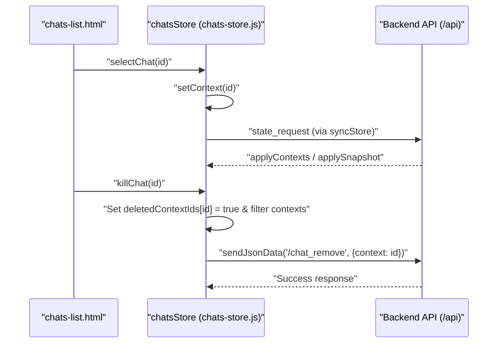
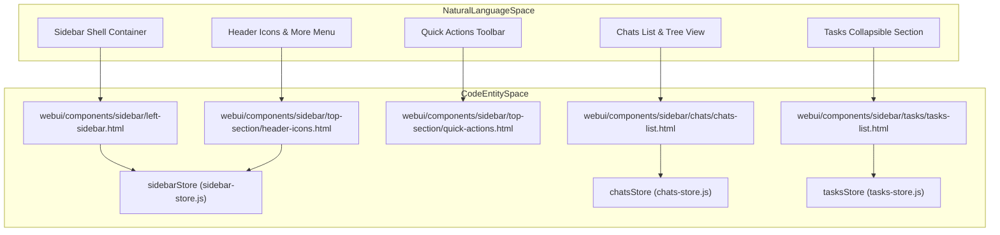
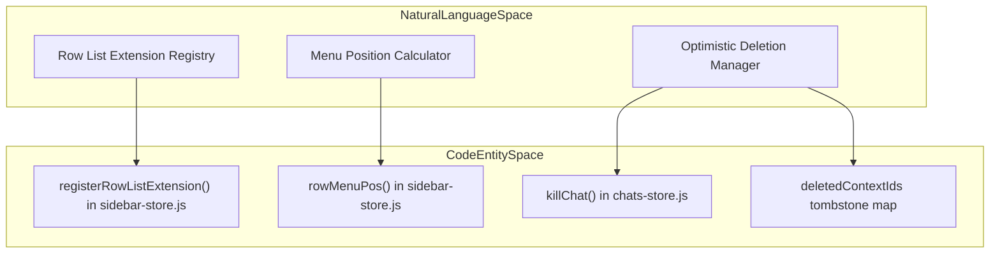

<!-- source: DeepWiki mcp.deepwiki.com · repo agent0ai/agent-zero · page 5.2 Sidebar & Navigation · fetched 2026-10-29 -->

# Sidebar & Navigation

Relevant source files

The following files were used as context for generating this wiki page:

- [plugins/_sidebar_folders/AGENTS.md](plugins/_sidebar_folders/AGENTS.md)
- [plugins/_sidebar_folders/README.md](plugins/_sidebar_folders/README.md)
- [plugins/_sidebar_folders/api/layout.py](plugins/_sidebar_folders/api/layout.py)
- [plugins/_sidebar_folders/api/move_chat.py](plugins/_sidebar_folders/api/move_chat.py)
- [plugins/_sidebar_folders/default_config.yaml](plugins/_sidebar_folders/default_config.yaml)
- [plugins/_sidebar_folders/extensions/webui/chats-header-controls/options.html](plugins/_sidebar_folders/extensions/webui/chats-header-controls/options.html)
- [plugins/_sidebar_folders/extensions/webui/sidebar-chats-list-view/folders.html](plugins/_sidebar_folders/extensions/webui/sidebar-chats-list-view/folders.html)
- [plugins/_sidebar_folders/extensions/webui/sidebar-tasks-list-view/folders.html](plugins/_sidebar_folders/extensions/webui/sidebar-tasks-list-view/folders.html)
- [plugins/_sidebar_folders/plugin.yaml](plugins/_sidebar_folders/plugin.yaml)
- [plugins/_sidebar_folders/tests/test_folders.py](plugins/_sidebar_folders/tests/test_folders.py)
- [plugins/_sidebar_folders/tests/test_frontend.mjs](plugins/_sidebar_folders/tests/test_frontend.mjs)
- [plugins/_sidebar_folders/webui/folder-list.html](plugins/_sidebar_folders/webui/folder-list.html)
- [plugins/_sidebar_folders/webui/sidebar-folders-store.js](plugins/_sidebar_folders/webui/sidebar-folders-store.js)
- [tests/test_chat_import_export.py](tests/test_chat_import_export.py)
- [tests/test_sidebar_row_actions.py](tests/test_sidebar_row_actions.py)
- [tests/test_webui_chat_deletion.py](tests/test_webui_chat_deletion.py)
- [tests/test_webui_extension_surfaces.py](tests/test_webui_extension_surfaces.py)
- [webui/components/sidebar/AGENTS.md](webui/components/sidebar/AGENTS.md)
- [webui/components/sidebar/chats/chat-tree.html](webui/components/sidebar/chats/chat-tree.html)
- [webui/components/sidebar/chats/chats-list.html](webui/components/sidebar/chats/chats-list.html)
- [webui/components/sidebar/chats/chats-store.js](webui/components/sidebar/chats/chats-store.js)
- [webui/components/sidebar/left-sidebar.html](webui/components/sidebar/left-sidebar.html)
- [webui/components/sidebar/sidebar-store.js](webui/components/sidebar/sidebar-store.js)
- [webui/components/sidebar/tasks/task-row.html](webui/components/sidebar/tasks/task-row.html)
- [webui/components/sidebar/tasks/tasks-list.html](webui/components/sidebar/tasks/tasks-list.html)
- [webui/components/sidebar/top-section/header-icons.html](webui/components/sidebar/top-section/header-icons.html)
- [webui/components/sidebar/top-section/quick-actions.html](webui/components/sidebar/top-section/quick-actions.html)
- [webui/public/a0-fullDark.svg](webui/public/a0-fullDark.svg)

The Sidebar and Navigation subsystem in Agent Zero provides a centralized interface for managing chat contexts, background tasks, project organization, and global application surfaces. Built using **Alpine.js**, it operates on a store-driven architecture where reactive frontend stores synchronize directly with backend state and real-time WebSocket updates.

---

## Sidebar Layout & Shell

The sidebar is structured as a vertical panel (`#left-panel`) that houses several functional sections. It is managed by `sidebarStore` [webui/components/sidebar/sidebar-store.js:220]() and composes distinct UI components to accommodate both desktop and mobile viewports [webui/components/sidebar/left-sidebar.html:13-38]().

### Component Architecture
*   **Header Icons**: Contains the application logo, sidebar toggle, dashboard, plugins, settings, and the "More options" dropdown trigger [webui/components/sidebar/top-section/header-icons.html:18-63]().
*   **Quick Actions**: A grid-based toolbar for common actions and plugin-injected controls [webui/components/sidebar/top-section/quick-actions.html:28-35]().
*   **Chats List**: A scrollable tree view of active and historical chat contexts supporting parent/subagent hierarchies [webui/components/sidebar/chats/chats-list.html:12-41]().
*   **Tasks List**: A collapsible section for background and scheduled task contexts [webui/components/sidebar/tasks/tasks-list.html:8-45]().
*   **Sidebar Bottom**: Houses secondary preferences, status indicators, and version details [webui/components/sidebar/left-sidebar.html:34-36]().

### Layout & Flexbox Mechanics
The sidebar shell utilizes a vertical flexbox model (`display: flex; flex-direction: column`) where the upper panel (`.left-panel-top`) expands to occupy available vertical space (`flex: 1`) [webui/components/sidebar/left-sidebar.html:59-109](). The chat section (`#chats-section`) is configured to take all remaining flexible space (`flex: 1 1 auto`), while the task section (`#tasks-section`) is capped at a maximum height of 40% when expanded [webui/components/sidebar/left-sidebar.html:131-160]().

Sources:
* [webui/components/sidebar/left-sidebar.html:13-38]()
* [webui/components/sidebar/sidebar-store.js:220]()
* [webui/components/sidebar/top-section/header-icons.html:18-63]()
* [webui/components/sidebar/top-section/quick-actions.html:28-35]()
* [webui/components/sidebar/chats/chats-list.html:12-41]()
* [webui/components/sidebar/tasks/tasks-list.html:8-45]()

---

## sidebarStore (UI State & Extension Registry)

The `sidebarStore` (defined in `webui/components/sidebar/sidebar-store.js`) manages global sidebar visibility, section collapse states, popup menus, and row list extension registries.

### Key Properties & Methods
*   `isOpen`: Boolean flag controlling whether the sidebar panel is expanded or collapsed [webui/components/sidebar/sidebar-store.js:5]().
*   `sectionStates`: Dictionary tracking collapsed/expanded states for sections like `tasks`, `chatActions`, and `preferences`, persisted to `localStorage` under `sidebarSections` [webui/components/sidebar/sidebar-store.js:13-51]().
*   `rowListExtensions`: Registry mapping collection kinds (`chat`, `task`) to extension plug-ins that customize list views, sorting, and row dividers [webui/components/sidebar/sidebar-store.js:10]().
*   `toggleSection(name)`: Toggles section visibility and triggers persistence [webui/components/sidebar/sidebar-store.js:59-63]().
*   `menuToggle(triggerElement)` and `rowMenuToggle(id, kind, triggerElement)`: Compute dynamic fixed-positioning (`dropdownStyle`, `rowMenuStyle`) to ensure dropdown menus escape parent overflow containers without clipping [webui/components/sidebar/sidebar-store.js:107-113](), [webui/components/sidebar/sidebar-store.js:175-184]().

Sources:
* [webui/components/sidebar/sidebar-store.js:5-184]()

---

## chatsStore & Chat Tree Management

The `chatsStore` (defined in `webui/components/sidebar/chats/chats-store.js`) manages the lifecycle of chat contexts, parent-child subagent delegations, selection persistence, and synchronization.

### Key Operations
1.  **Selection (`selectChat(id)`)**: Updates the active `AgentContext` via `setContext(id)`, persists the selection to `sessionStorage`, and requests state synchronization [webui/components/sidebar/chats/chats-store.js:153-180]().
2.  **Creation**: Initializes new chat sessions, supporting optional project scoping [webui/components/sidebar/chats/chats-list.html:17-19]().
3.  **Deletion (`killChat(id)`)**: Optimistically removes contexts from local arrays using `deletedContextIds` tombstones to prevent out-of-order polling snapshots from reintroducing deleted rows before issuing `POST /chat_remove` [webui/components/sidebar/chats/chats-store.js:183-207]().
4.  **Tree Hierarchy**: Renders nested subordinate contexts using `parent_context_id` references, automatically expanding ancestor chains via `expandAncestors(context)` and managing toggle state through `toggleChildren(parentId)` [webui/components/sidebar/chats/chats-store.js:115-145]().

### Data Flow: Chat Selection and Deletion

Sources:
* [webui/components/sidebar/chats/chats-store.js:115-207]()
* [webui/components/sidebar/chats/chats-list.html:17-41]()

---

## tasksStore & Tasks List

The `tasksStore` manages background scheduler-backed tasks distinct from chat-bound parallel execution children [webui/components/sidebar/AGENTS.md:24]().

*   **Status Badges**: Tasks render status badges (`idle`, `running`, `disabled`, `error`) utilizing corresponding `.scheduler-status-*` CSS classes [webui/components/sidebar/tasks/tasks-list.html:135-144]().
*   **Collapsible Integration**: The task list container is wrapped in a Bootstrap Collapse component controlled by `sidebarStore.isSectionOpen('tasks')` [webui/components/sidebar/tasks/tasks-list.html:21-22]().

Sources:
* [webui/components/sidebar/tasks/tasks-list.html:8-45]()
* [webui/components/sidebar/AGENTS.md:24-24]()

---

## Quick Actions, Attachments & Extension Points

The sidebar incorporates extensible slots and secondary menus for auxiliary features:

*   **Quick Actions Toolbar**: Defined in `webui/components/sidebar/top-section/quick-actions.html`, it provides a grid layout backed by `<x-extension>` insertion slots [webui/components/sidebar/top-section/quick-actions.html:28-35]().
*   **Extension Points**: Key hooks include `sidebar-quick-actions-main-start`, `sidebar-chats-list-start`, `sidebar-tasks-list-view`, and `sidebar-row-actions-menu` [webui/components/sidebar/top-section/quick-actions.html:12-13](), [webui/components/sidebar/chats/chats-list.html:13](), [webui/components/sidebar/left-sidebar.html:42]().
*   **Bottom Actions Menu**: Chat composition bottom menus provide file/folder uploads (`chat-bottom-menu-file-input`), Model Context Protocol (MCP) server integration (`mcpServersStore`), chat history inspection (`history-store.js`), and context window inspection (`context-store.js`) [webui/components/sidebar/left-sidebar.html:34-36]().

Sources:
* [webui/components/sidebar/top-section/quick-actions.html:12-35]()
* [webui/components/sidebar/left-sidebar.html:34-43]()
* [webui/components/sidebar/chats/chats-list.html:13-13]()

---

## Mobile Responsiveness & Viewport Adaptation

The navigation system adapts to narrow viewports (`<= 768px`) through reactive store handlers and responsive CSS rules [webui/components/sidebar/sidebar-store.js:96-98](), [webui/components/sidebar/left-sidebar.html:211-218]().

*   **Overlay Transition**: On mobile viewports, `#left-panel` switches to `position: fixed` with a high z-index overlay model [webui/components/sidebar/left-sidebar.html:211-218]().
*   **Resize Handling**: `sidebarStore.handleResize()` evaluates `isMobile()` on window resize events, automatically closing the panel (`isOpen = false`) and dismissing open menus to preserve screen space [webui/components/sidebar/sidebar-store.js:87-93]().

Sources:
* [webui/components/sidebar/sidebar-store.js:87-98]()
* [webui/components/sidebar/left-sidebar.html:211-218]()

---

## System-to-Code Mappings

Title: "Sidebar Architectural Component Mapping"

Sources:
* [webui/components/sidebar/left-sidebar.html:1-38]()
* [webui/components/sidebar/sidebar-store.js:220]()
* [webui/components/sidebar/chats/chats-store.js:1-15]()
* [webui/components/sidebar/chats/chats-list.html:10-41]()
* [webui/components/sidebar/tasks/tasks-list.html:8-45]()

Title: "Extension and Row Dispatch Flow Mapping"

Sources:
* [webui/components/sidebar/sidebar-store.js:141-217]()
* [webui/components/sidebar/chats/chats-store.js:25-207]()

---

