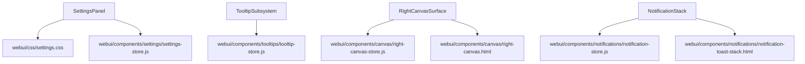
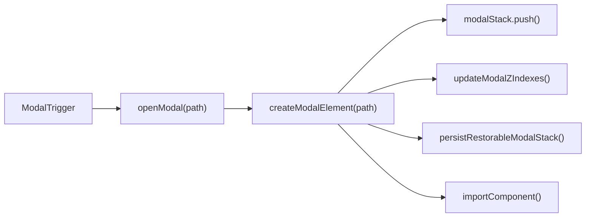

<!-- source: DeepWiki mcp.deepwiki.com · repo agent0ai/agent-zero · page 5.3 Settings, Modals & UI Components · fetched 2026-10-29 -->

# Settings, Modals & UI Components

<details>
<summary>Relevant source files</summary>

The following files were used as context for generating this wiki page:

- [extensions/python/user_message_ui/AGENTS.md](extensions/python/user_message_ui/AGENTS.md)
- [extensions/python/user_message_ui/_10_update_check.py](extensions/python/user_message_ui/_10_update_check.py)
- [tests/test_download_toast_regressions.py](tests/test_download_toast_regressions.py)
- [tests/test_model_config_ui.py](tests/test_model_config_ui.py)
- [tests/test_settings_developer_sections.py](tests/test_settings_developer_sections.py)
- [tests/test_settings_mobile.py](tests/test_settings_mobile.py)
- [tests/test_ui_control_visibility.py](tests/test_ui_control_visibility.py)
- [webui/components/canvas/AGENTS.md](webui/components/canvas/AGENTS.md)
- [webui/components/canvas/right-canvas-store.js](webui/components/canvas/right-canvas-store.js)
- [webui/components/canvas/right-canvas.css](webui/components/canvas/right-canvas.css)
- [webui/components/canvas/right-canvas.html](webui/components/canvas/right-canvas.html)
- [webui/components/notifications/AGENTS.md](webui/components/notifications/AGENTS.md)
- [webui/components/notifications/notification-icons.html](webui/components/notifications/notification-icons.html)
- [webui/components/notifications/notification-modal.html](webui/components/notifications/notification-modal.html)
- [webui/components/notifications/notification-store.js](webui/components/notifications/notification-store.js)
- [webui/components/notifications/notification-toast-stack.html](webui/components/notifications/notification-toast-stack.html)
- [webui/components/settings/AGENTS.md](webui/components/settings/AGENTS.md)
- [webui/components/settings/agent/interface.html](webui/components/settings/agent/interface.html)
- [webui/components/settings/agent/workdir.html](webui/components/settings/agent/workdir.html)
- [webui/components/settings/backup/backup-settings.html](webui/components/settings/backup/backup-settings.html)
- [webui/components/settings/developer/dev.html](webui/components/settings/developer/dev.html)
- [webui/components/settings/external/api_keys.html](webui/components/settings/external/api_keys.html)
- [webui/components/settings/external/auth.html](webui/components/settings/external/auth.html)
- [webui/components/settings/external/external-settings.html](webui/components/settings/external/external-settings.html)
- [webui/components/settings/external/external_api.html](webui/components/settings/external/external_api.html)
- [webui/components/settings/external/litellm.html](webui/components/settings/external/litellm.html)
- [webui/components/settings/external/secrets.html](webui/components/settings/external/secrets.html)
- [webui/components/settings/external/update_checker.html](webui/components/settings/external/update_checker.html)
- [webui/components/settings/settings-store.js](webui/components/settings/settings-store.js)
- [webui/components/settings/settings.html](webui/components/settings/settings.html)
- [webui/css/modals.css](webui/css/modals.css)
- [webui/css/notification.css](webui/css/notification.css)
- [webui/css/settings.css](webui/css/settings.css)
- [webui/js/modals.js](webui/js/modals.js)
- [webui/js/surfaces.js](webui/js/surfaces.js)

</details>


This page covers the architecture and implementation of the Agent Zero Web UI interaction layer, detailing the unified modal system, settings panel architecture and field abstraction, preferences management, right canvas surfaces, toast notifications, specialized modals, tooltips, and UI entity mappings.

## Modal Systems

Agent Zero utilizes a unified stack-based **A0 Modal System** managed via `webui/js/modals.js` [webui/js/modals.js:6-145]().

### A0 Modal System Architecture
The current modal subsystem supports stacking multiple windows with managed backdrop scaling and z-index ordering [webui/js/modals.js:6-188]().

*   **Dynamic Loading:** Modals load components asynchronously using `importComponent()` [webui/js/modals.js:2]() inside `createModalElement()` [webui/js/modals.js:191-196]().
*   **Stack Management:** A `modalStack` array tracks open modals [webui/js/modals.js:6](). Opening a new modal captures the scroll offset of the current top modal via `captureModalScrollSnapshot()` and restores it upon closing via `restoreModalScrollSnapshot()` [webui/js/modals.js:125-145]().
*   **Backdrop Management:** A single `.modal-backdrop` element is shared across all modal instances [webui/js/modals.js:148-152](). Its `z-index` adjusts dynamically depending on whether backdrops are suppressed (`modalNoBackdrop`) [webui/js/modals.js:42-45]().
*   **Explicit Closing:** Modals can enforce explicit dismissal (disabling background click-to-close) using the `modal-explicit-close` class or `modalExplicitClose` dataset flag [webui/js/modals.js:37-40]().
*   **Footer Slots:** Components specify footers with `data-modal-footer`, which the system extracts into a fixed `.modal-footer-slot` outside the scrollable body container [webui/js/modals.js:230-238]().
*   **Session Restoration:** Modals marked with `data-modal-restore="surface"` persist their paths to `sessionStorage` under `a0.modalStack.restorable`, surviving full page reloads [webui/js/modals.js:7-81]().

### Legacy Modals
Legacy components rely on static classes such as `.modal-overlay` and `.modal-container` defined in `webui/css/modals.css` [webui/css/modals.css:40-81](). These classes remain for compatibility while structural migration completes [webui/css/modals.css:2-6]().

Sources: [webui/js/modals.js:1-280](), [webui/css/modals.css:1-266]()

## Settings Architecture & Field Abstraction

The Settings panel provides a centralized interface for configuring agent parameters, external services, and developer overrides, backed by settings stores and UI components [webui/components/settings/settings-store.js:1-193]().

### Tabs and Navigation Structure
Settings are organized into top-level tabs and nested sections defined in `TAB_ITEMS` within `webui/components/settings/settings-store.js` [webui/components/settings/settings-store.js:26-103]().
*   **Navigation Groups:** High-level categories (Agent, File Browser, Skills, External, MCP/A2A, Developer, Check for updates) [webui/components/settings/settings-store.js:26-103]().
*   **Search Filtering:** A reactive search input filters options across all tabs instantly [webui/css/settings.css:217-270]().
*   **Settings Persistence:** Settings load via `settings_get` and update via backend API handlers [webui/components/settings/settings-store.js:169-175]().

### Field Abstraction & Toggler Component
UI fields render inside a standardized grid framework:
*   **`.field`**: Standard container utilizing a 55% grid split for labels versus interactive controls (`.field-full` spans 100%) [webui/css/settings.css:4-14]().
*   **`.field-label`**: Encloses `.field-title` and `.field-description` [webui/css/settings.css:17-33]().
*   **`.field-control`**: Houses inputs, textareas, drop-downs, or switches [webui/css/settings.css:36-40]().
*   **Toggler Component:** Boolean settings use a CSS-based slide switch:
    ```html
    <label class="toggle">
      <input type="checkbox">
      <span class="toggler"></span>
    </label>
    ```
    The `.toggler` class governs the animated knob translation and background color transition (`#2196f3` when checked) [webui/css/settings.css:98-143]().

Sources: [webui/components/settings/settings-store.js:26-193](), [webui/css/settings.css:4-143]()

## Preferences Panel

User-specific interface preferences are centralized in `preferencesStore` (`webui/components/sidebar/bottom/preferences/preferences-store.js`) [webui/components/sidebar/bottom/preferences/preferences-store.js:1-275]().

*   **Toggles & State:** Manages layout and display preferences.
*   **Persistence:** Individual states synchronize automatically with `localStorage` (falling back to secure defaults if storage is unavailable).
*   **UI Control Visibility:** Manages responsive visibility rules (`ui_control_visibility`) across mobile and desktop breakpoints for items like the project selector, time display, connection status, and the right canvas rail [webui/components/settings/settings-store.js:19-24]().

Sources: [webui/components/sidebar/bottom/preferences/preferences-store.js:1-275](), [webui/components/settings/settings-store.js:19-24]()

## Notification & Toast System

Agent Zero employs a dual-tier notification architecture combining transient **Toast Notifications** with historical **Notification Modals**.

*   **`notificationStore`**: Manages global toast stacks and persistent notification logs (`webui/components/notifications/notification-store.js`) [webui/components/notifications/notification-store.js:1-10]().
*   **Toast Rendering:** Rendered via stack templates (`webui/components/notifications/notification-toast-stack.html`) [webui/components/notifications/notification-toast-stack.html:12-15]() supporting `info`, `success`, `warning`, `error`, and `progress` variants.
*   **Grouping & Persistence:** Supports persistent grouped downloads and action buttons (`.toast-action-row`) [webui/components/notifications/notification-toast-stack.html:153-155]().

Sources: [webui/components/notifications/notification-store.js:1-10](), [webui/components/notifications/notification-toast-stack.html:1-231](), [tests/test_download_toast_regressions.py:1-161]()

## Right Canvas Surfaces

The Right Canvas provides a flexible split-panel surface workspace managed by `rightCanvasStore` (`webui/components/canvas/right-canvas-store.js`) [webui/components/canvas/right-canvas-store.js:44-221]().

*   **Surface Registration:** Extensions and plugins register dynamic surfaces via `registerSurface()` (defining metadata, icons, order, and open/close callbacks) [webui/components/canvas/right-canvas-store.js:93-125]().
*   **Docking & Floating:** Surfaces transition seamlessly between docked side-panel views (`SURFACE_MODE_DOCKED`) and floating modal overlays (`SURFACE_MODE_FLOATING`) depending on viewport constraints and user preference [webui/components/canvas/right-canvas-store.js:138-184]().
*   **Layout Persistence:** Dimensions and open/closed states persist in `localStorage` under `a0.rightCanvas` [webui/components/canvas/right-canvas-store.js:16-17]().
*   **Resizing Handle:** A dynamic column-resize handle (`.right-canvas-resize-handle`) updates width constraints interactively [webui/components/canvas/right-canvas.css:19-22]().

Sources: [webui/components/canvas/right-canvas-store.js:44-221](), [webui/components/canvas/right-canvas.css:1-289](), [webui/components/canvas/right-canvas.html:1-133]()

## Tooltip Subsystem

Tooltips are managed globally through `tooltips` store (`webui/components/tooltips/tooltip-store.js`) [webui/components/tooltips/tooltip-store.js:136-144]().

*   **Bootstrap Integration:** Wraps Bootstrap 5 tooltips, dynamically initializing elements matching `[title]` or `[data-bs-original-title]` selectors [webui/components/tooltips/tooltip-store.js:52-61]().
*   **Mutation Observer:** Automatically watches DOM mutations (`childList` and attributes) to initialize new tooltip targets and dispose of removed elements cleanly to avoid memory leaks [webui/components/tooltips/tooltip-store.js:75-126]().
*   **Touch Prevention:** Intercepts touch events on touch-only devices (`hover: none` media query) to prevent phantom tooltip triggering [webui/components/tooltips/tooltip-store.js:5-7]().

Sources: [webui/components/tooltips/tooltip-store.js:1-144]()

## Specialized UI Components & Welcome Screen

### File Browser & Scheduler
*   **File Browser:** Managed by file browser stores, providing workspace navigation, archive management, and file picker flows.
*   **Scheduler Modal:** Coordinates cron-based automated execution, planned task checklists, and live status tracking.

### Welcome Screen
Rendered when no active chat session is selected, the Welcome Screen presents the agent introduction, quick action shortcuts, and dynamic alert banners fetched via backend APIs.

Sources: [webui/components/settings/settings-store.js:1-745](), [webui/components/canvas/right-canvas-store.js:1-695]()

## UI Entity Mapping & Data Flow

The following diagrams map conceptual UI subsystems to their corresponding source code entities and execution paths.

Title: "UI Entity Mapping"

Sources: [webui/css/settings.css](), [webui/components/settings/settings-store.js](), [webui/components/tooltips/tooltip-store.js](), [webui/components/canvas/right-canvas-store.js](), [webui/components/notifications/notification-store.js]()

Title: "Modal System Data Flow"

Sources: [webui/js/modals.js:6-141](), [webui/js/components.js]()

---

