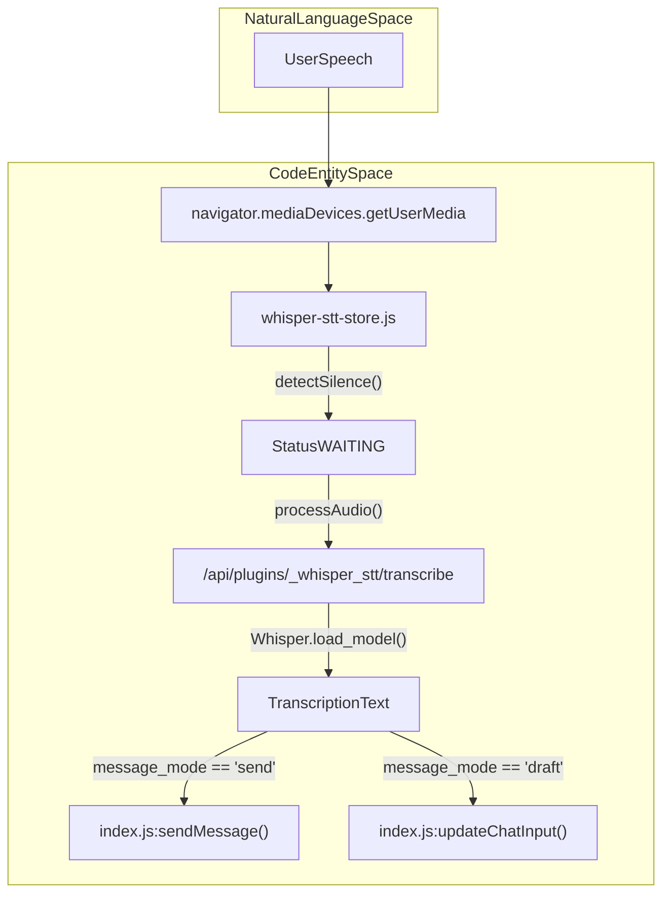
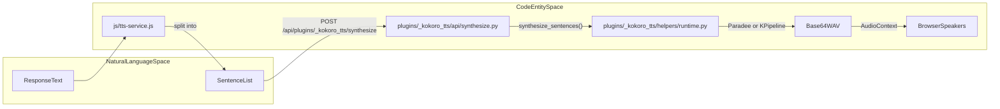

<!-- source: DeepWiki mcp.deepwiki.com · repo agent0ai/agent-zero · page 5.4 Speech Interface (STT/TTS) · fetched 2026-10-29 -->

# Speech Interface (STT/TTS)

Relevant source files

The following files were used as context for generating this wiki page:

- [plugins/_kokoro_tts/AGENTS.md](plugins/_kokoro_tts/AGENTS.md)
- [plugins/_kokoro_tts/README.md](plugins/_kokoro_tts/README.md)
- [plugins/_kokoro_tts/api/status.py](plugins/_kokoro_tts/api/status.py)
- [plugins/_kokoro_tts/api/synthesize.py](plugins/_kokoro_tts/api/synthesize.py)
- [plugins/_kokoro_tts/default_config.yaml](plugins/_kokoro_tts/default_config.yaml)
- [plugins/_kokoro_tts/extensions/webui/voice-settings-main/kokoro-card.html](plugins/_kokoro_tts/extensions/webui/voice-settings-main/kokoro-card.html)
- [plugins/_kokoro_tts/helpers/runtime.py](plugins/_kokoro_tts/helpers/runtime.py)
- [plugins/_kokoro_tts/hooks.py](plugins/_kokoro_tts/hooks.py)
- [plugins/_kokoro_tts/plugin.yaml](plugins/_kokoro_tts/plugin.yaml)
- [plugins/_kokoro_tts/webui/config.html](plugins/_kokoro_tts/webui/config.html)
- [plugins/_kokoro_tts/webui/kokoro-tts-store.js](plugins/_kokoro_tts/webui/kokoro-tts-store.js)
- [plugins/_kokoro_tts/webui/main.html](plugins/_kokoro_tts/webui/main.html)

The purpose of this page is to document the Speech Interface subsystem in Agent Zero, encompassing both the Speech-to-Text (STT) capabilities provided by the `_whisper_stt` plugin and the Text-to-Speech (TTS) streaming pipeline provided by the `_kokoro_tts` plugin. This architecture establishes a full-duplex voice interface, utilizing client-side audio capture, silence detection, frontend state machines, and server-side model execution supporting both Paradee-8M and Kokoro-82M engines.

## Speech-to-Text (STT) and Whisper

The STT system is primarily managed by the `_whisper_stt` plugin, which integrates OpenAI's Whisper model for high-accuracy transcription of user speech.

### Whisper State Machine

The frontend logic is encapsulated in `whisper-stt-store.js`, which maintains a strict state machine to manage the microphone lifecycle and UI feedback [plugins/_whisper_stt/webui/whisper-stt-store.js:10-17]().

| State | Description |
| :--- | :--- |
| `INACTIVE` | Default state; microphone is off. |
| `ACTIVATING` | Requesting hardware access or initializing the audio context. |
| `LISTENING` | Microphone is active and monitoring for audio levels. |
| `RECORDING` | Speech detected; audio data is being buffered. |
| `WAITING` | Silence detected; waiting for `waiting_timeout` to confirm the end of speech. |
| `PROCESSING` | Audio buffer is being sent to the `/api/plugins/_whisper_stt/transcribe` endpoint. |

Sources: [plugins/_whisper_stt/webui/whisper-stt-store.js:10-17]()

### Transcription Logic and Configuration

The STT engine uses client-side silence detection to trigger transcription automatically.
*   **Silence Detection**: Configurable via `silence_threshold` (amplitude) and `silence_duration` (time in milliseconds) [plugins/_whisper_stt/webui/whisper-stt-store.js:59-60]().
*   **Message Mode**: The `message_mode` setting determines if the transcribed text is sent immediately (`send`) or placed in the chat composer as a `draft` [plugins/_whisper_stt/webui/whisper-stt-store.js:118-119]().
*   **TTS Interruption**: The system automatically stops listening if the agent starts speaking, preventing the agent from hearing its own synthesized output [plugins/_whisper_stt/webui/whisper-stt-store.js:92-95]().

**Whisper STT Data Flow**

Sources: [plugins/_whisper_stt/webui/whisper-stt-store.js:10-159](), [plugins/_whisper_stt/webui/whisper-stt-store.js:202-226](), [tests/test_speech_plugin_split.py:122-126]()

## Text-to-Speech (TTS): Kokoro & Paradee Engines

Agent Zero supports high-quality, low-latency speech synthesis through the built-in `_kokoro_tts` plugin or browser-native speech synthesis APIs [plugins/_kokoro_tts/README.md:1-11]().

### Dual-Engine Architecture and Dependencies

The `_kokoro_tts` plugin supports two backend speech models:
*   **Paradee-8M v1.0**: The default CPU-based model utilizing a single American English Heart voice (`voice: paradee`) [plugins/_kokoro_tts/README.md:7](). Paradee relies on ONNX Runtime and an English phonemizer, prepared automatically via `hooks.py` [plugins/_kokoro_tts/README.md:12](), [plugins/_kokoro_tts/hooks.py:15-57]().
*   **Kokoro-82M**: An advanced alternative supporting single voices, comma-separated equal blends, and in-memory weighted blends [plugins/_kokoro_tts/README.md:9]().

Dependency management is handled in `plugins/_kokoro_tts/hooks.py` using `uv` to ensure packages like `onnxruntime` and `en_core_web_sm` are present during startup or enable events [plugins/_kokoro_tts/hooks.py:34-57]().

Sources: [plugins/_kokoro_tts/README.md:1-14](), [plugins/_kokoro_tts/hooks.py:15-57](), [plugins/_kokoro_tts/helpers/runtime.py:28-96]()

### Voice Blending and Normalization

The plugin validates and normalizes configurations via `helpers/runtime.py`:
*   **Normalization**: `normalize_config` verifies voice identifiers against `VOICE_ID_PATTERN` (`^[a-z]{2}_[a-z0-9_]+$`) and validates floating-point speed and weights [plugins/_kokoro_tts/helpers/runtime.py:33-77]().
*   **Weighted Blending**: `_resolve_voice` computes linear combinations of Kokoro voice packs in memory using positive finite weights [plugins/_kokoro_tts/helpers/runtime.py:155-168](). Paradee cannot be blended and uses its reserved token [plugins/_kokoro_tts/AGENTS.md:23]().

Sources: [plugins/_kokoro_tts/helpers/runtime.py:33-168](), [plugins/_kokoro_tts/AGENTS.md:23]()

### Synthesis Workflow

1.  **Text Chunking**: The `ttsService` breaks agent responses into manageable sentences [plugins/_kokoro_tts/webui/kokoro-tts-store.js:4]().
2.  **Dispatch**: The API endpoint `Synthesize` receives text input, validates global status, and invokes `runtime.synthesize_sentences()` [plugins/_kokoro_tts/api/synthesize.py:5-20](), [plugins/_kokoro_tts/helpers/runtime.py:141-152]().
3.  **Synthesis Execution**: Depending on configuration, execution routes to `paradee.synthesize` or `_synthesize_sentences` using `KPipeline`, producing a Base64-encoded WAV response [plugins/_kokoro_tts/helpers/runtime.py:141-197]().
4.  **Playback**: The frontend `kokoro-tts-store.js` registers as a provider in `ttsService` and plays the audio via the browser's audio context [plugins/_kokoro_tts/webui/kokoro-tts-store.js:68-87]().

**TTS Streaming and Synthesis Pipeline**

Sources: [plugins/_kokoro_tts/api/synthesize.py:5-22](), [plugins/_kokoro_tts/helpers/runtime.py:141-197](), [plugins/_kokoro_tts/webui/kokoro-tts-store.js:68-87]()

## UI Integration and Components

### Microphone Controls

The microphone button is injected into the chat input bar via a WebUI extension point [plugins/_whisper_stt/extensions/webui/chat-input-box-end/microphone-button.html:88-102](). It uses dynamic CSS classes reflecting the Whisper state machine:
*   `.mic-listening`: Red state indicator [plugins/_whisper_stt/extensions/webui/chat-input-box-end/microphone-button.html:36-38]().
*   `.mic-recording`: Green state indicator [plugins/_whisper_stt/extensions/webui/chat-input-box-end/microphone-button.html:40-42]().
*   `.mic-processing`: Darkcyan with a pulsing animation [plugins/_whisper_stt/extensions/webui/chat-input-box-end/microphone-button.html:48-55]().

Sources: [plugins/_whisper_stt/extensions/webui/chat-input-box-end/microphone-button.html:36-102]()

### Voice Settings and Status Panel

The voice settings panel integrates multiple plugin surfaces:
*   **Kokoro Card (`kokoro-card.html`)**: Displays the active engine model name (`Paradee-8M` or `Kokoro-82M`), voice summary, speed multiplier, and state badge (`is-ok` or `is-warn`) [plugins/_kokoro_tts/extensions/webui/voice-settings-main/kokoro-card.html:1-32]().
*   **Config UI (`plugins/_kokoro_tts/webui/config.html`)**: Provides controls for voice selection, datalist catalog lookup, and weighted blend editing [plugins/_kokoro_tts/webui/config.html:8-121]().
*   **Status Panel (`plugins/_kokoro_tts/webui/main.html`)**: Displays detailed provider runtime states and resolved configurations [plugins/_kokoro_tts/webui/main.html:10-55]().

Sources: [plugins/_kokoro_tts/extensions/webui/voice-settings-main/kokoro-card.html:1-32](), [plugins/_kokoro_tts/webui/config.html:8-121](), [plugins/_kokoro_tts/webui/main.html:10-55]()

### Browser Integration and Fallback

When server-side TTS is disabled or fails, the system transparently falls back to browser-native `speechSynthesis` [plugins/_kokoro_tts/README.md:11](). The `ttsService` module abstracts provider routing so callers do not tightly couple to backend implementations [plugins/_kokoro_tts/webui/kokoro-tts-store.js:4]().

Sources: [plugins/_kokoro_tts/README.md:11](), [plugins/_kokoro_tts/webui/kokoro-tts-store.js:4]()

---

