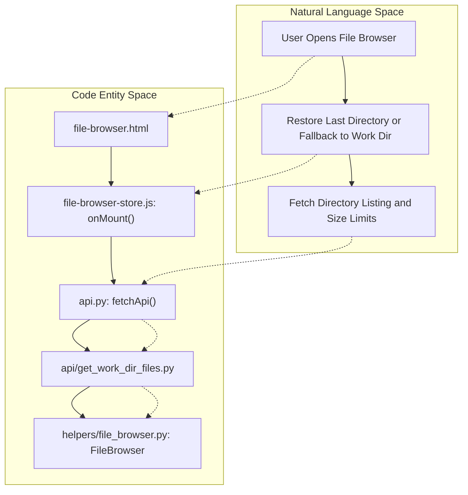
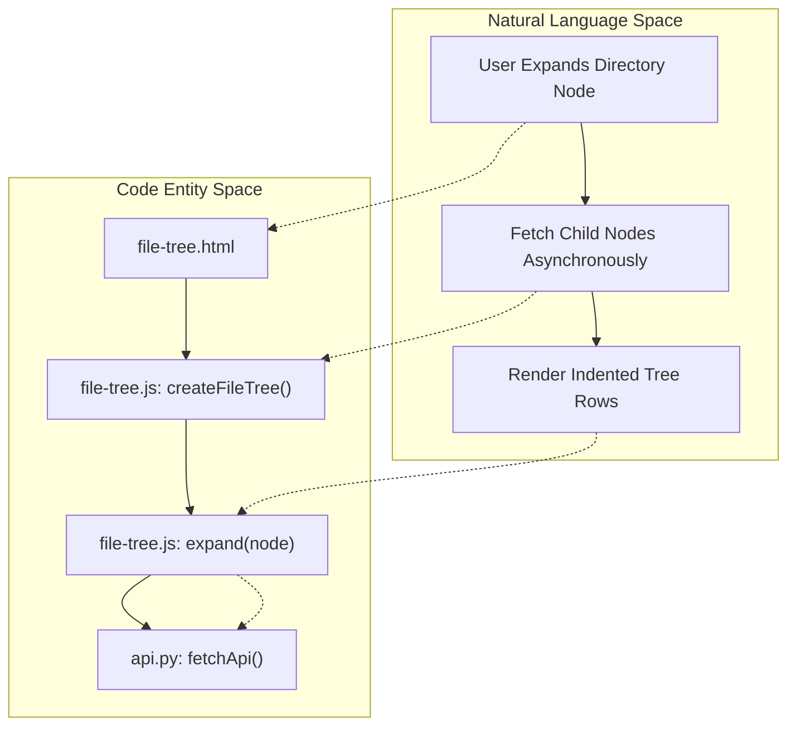
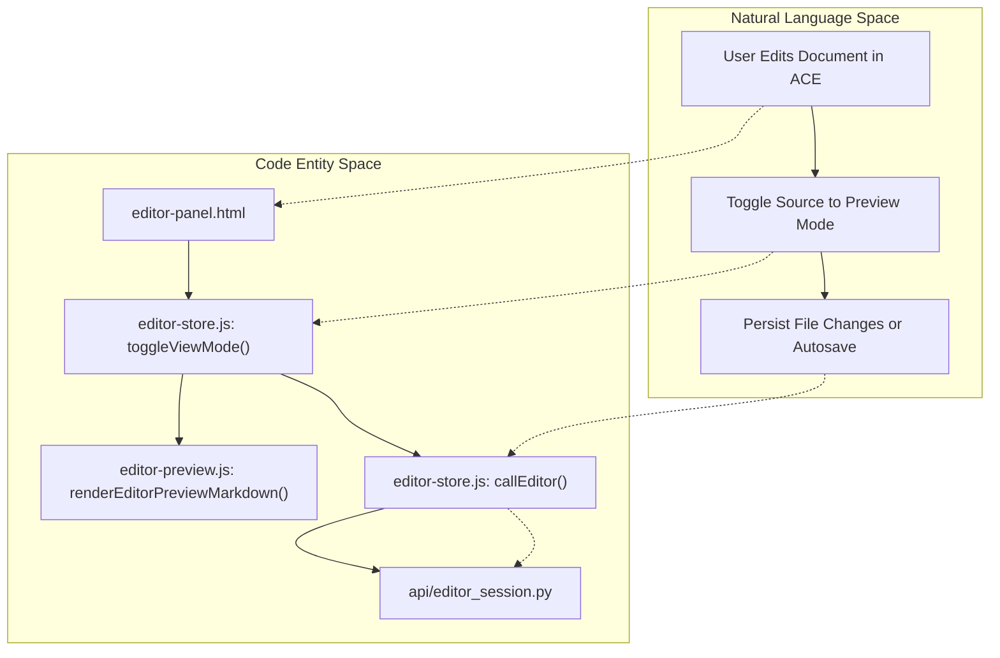

<!-- source: DeepWiki mcp.deepwiki.com · repo agent0ai/agent-zero · page 5.5 File Browser & Editor Surfaces · fetched 2026-10-29 -->

# File Browser & Editor Surfaces

Relevant source files

The following files were used as context for generating this wiki page:

- [api/AGENTS.md](api/AGENTS.md)
- [api/delete_work_dir_file.py](api/delete_work_dir_file.py)
- [api/delete_work_dir_files.py](api/delete_work_dir_files.py)
- [api/delete_work_dir_files.py.dox.md](api/delete_work_dir_files.py.dox.md)
- [api/download_work_dir_file.py](api/download_work_dir_file.py)
- [api/download_work_dir_file.py.dox.md](api/download_work_dir_file.py.dox.md)
- [api/download_work_dir_files.py](api/download_work_dir_files.py)
- [api/download_work_dir_files.py.dox.md](api/download_work_dir_files.py.dox.md)
- [api/edit_work_dir_file.py](api/edit_work_dir_file.py)
- [api/file_browser_settings.py](api/file_browser_settings.py)
- [api/file_browser_settings.py.dox.md](api/file_browser_settings.py.dox.md)
- [api/rename_work_dir_file.py](api/rename_work_dir_file.py)
- [api/rename_work_dir_file.py.dox.md](api/rename_work_dir_file.py.dox.md)
- [api/upload_work_dir_files.py](api/upload_work_dir_files.py)
- [api/upload_work_dir_files.py.dox.md](api/upload_work_dir_files.py.dox.md)
- [helpers/file_browser.py](helpers/file_browser.py)
- [helpers/file_browser.py.dox.md](helpers/file_browser.py.dox.md)
- [plugins/_desktop/webui/desktop-panel.html](plugins/_desktop/webui/desktop-panel.html)
- [plugins/_desktop/webui/desktop-store.js](plugins/_desktop/webui/desktop-store.js)
- [plugins/_editor/AGENTS.md](plugins/_editor/AGENTS.md)
- [plugins/_editor/extensions/webui/right_canvas_register_surfaces/register-editor.js](plugins/_editor/extensions/webui/right_canvas_register_surfaces/register-editor.js)
- [plugins/_editor/webui/editor-panel.html](plugins/_editor/webui/editor-panel.html)
- [plugins/_editor/webui/editor-preview.js](plugins/_editor/webui/editor-preview.js)
- [plugins/_editor/webui/editor-store.js](plugins/_editor/webui/editor-store.js)
- [tests/test_download_folder_naming.py](tests/test_download_folder_naming.py)
- [tests/test_download_work_dir_file.py](tests/test_download_work_dir_file.py)
- [tests/test_download_work_dir_paths.py](tests/test_download_work_dir_paths.py)
- [tests/test_editor_files.py](tests/test_editor_files.py)
- [tests/test_file_browser_navigation.py](tests/test_file_browser_navigation.py)
- [tests/test_file_browser_path_link.py](tests/test_file_browser_path_link.py)
- [tests/test_file_tree.py](tests/test_file_tree.py)
- [tests/test_upload_atomic.py](tests/test_upload_atomic.py)
- [tests/test_webui_startup_assets.py](tests/test_webui_startup_assets.py)
- [webui/components/modals/file-browser/AGENTS.md](webui/components/modals/file-browser/AGENTS.md)
- [webui/components/modals/file-browser/file-browser-store.js](webui/components/modals/file-browser/file-browser-store.js)
- [webui/components/modals/file-browser/file-browser.html](webui/components/modals/file-browser/file-browser.html)
- [webui/components/modals/file-browser/file-tree.html](webui/components/modals/file-browser/file-tree.html)
- [webui/components/modals/file-browser/file-tree.js](webui/components/modals/file-browser/file-tree.js)
- [webui/components/modals/file-browser/rename-modal.html](webui/components/modals/file-browser/rename-modal.html)
- [webui/components/settings/file-browser/file-browser-settings.html](webui/components/settings/file-browser/file-browser-settings.html)
- [webui/css/AGENTS.md](webui/css/AGENTS.md)
- [webui/css/surfaces.css](webui/css/surfaces.css)

## Purpose and Scope

This page covers the architectural design, stores, routing, and UI components for Agent Zero's file management and text editing subsystems. This includes the file browser modal and canvas surface (`[webui/components/modals/file-browser/file-browser.html](), [webui/components/modals/file-browser/file-browser-store.js]()`), the lazy-loaded file tree (`[webui/components/modals/file-browser/file-tree.html](), [webui/components/modals/file-browser/file-tree.js]()`), file picker flows (`PICKER_MODE_TEXT_OPEN`, `PICKER_MODE_SAVE_AS`), remote connection virtualization (`/@connections`), and the `_editor` plugin's ACE-based multi-tab source and markdown preview panel (`[plugins/_editor/webui/editor-panel.html](), [plugins/_editor/webui/editor-store.js]()`).

Sources: `[webui/components/modals/file-browser/AGENTS.md:3-14](), [plugins/_editor/AGENTS.md:3-13]()`

---

## 1. File Browser Architecture & Stores

The File Browser subsystem provides directory exploration, file inspection, batch operations (zip, download, delete, extract), and file uploads. It is instantiated either as a modal dialog or as a right-canvas workspace surface (`data-canvas-surface="files"`).

The core runtime state is managed by `[webui/components/modals/file-browser/file-browser-store.js]()`, while layout markup is defined in `[webui/components/modals/file-browser/file-browser.html]()`.

### Initialization and Remembering Directory State

When the file browser mounts, `onMount()` initializes the store, checks for an explicit opening path, falls back to the remembered last directory (`fileBrowser.lastDirectory`), or defaults to `$WORK_DIR` (`/a0`) as specified in `[tests/test_file_browser_navigation.py:27-57]()`.

Size restrictions (such as maximum text size, transfer size, and archive entry counts) are queried from the backend directory API with `?limits=1` (`[webui/components/modals/file-browser/file-browser-store.js:75-84]()`), which invokes underlying constraints in `[helpers/file_browser.py]()` and `[api/get_work_dir_files.py]()`.

Title: "File Browser Initialization & Metadata Flow"

Sources: `[webui/components/modals/file-browser/file-browser.html:1-25](), [webui/components/modals/file-browser/file-browser-store.js:68-122](), [tests/test_file_browser_navigation.py:27-57]()`

---

## 2. Lazy File Tree Component

The file tree sidebar provides a hierarchical representation of directories using lazy expansion. It is shared between the File Browser modal and the Editor panel, maintaining independent expansion and selection states per host.

### Implementation Details

- **Template & Styles:** Defined in `[webui/components/modals/file-browser/file-tree.html]()`.
- **Store Factory:** Implemented via `createFileTree()` in `[webui/components/modals/file-browser/file-tree.js]()`.
- **Asynchronous Expansion:** Clicking expand triggers a fetch for child nodes of the target directory without resetting unrelated tree branches (`[tests/test_file_tree.py:6-48]()`).
- **Filtering:** Supports live client-side string filtering on loaded directories via an input search model (`[webui/components/modals/file-browser/file-tree.html:4-7]()`).

Title: "Lazy File Tree Expansion Flow"

Sources: `[webui/components/modals/file-browser/file-tree.html:1-28](), [webui/components/modals/file-browser/file-tree.js](), [tests/test_file_tree.py:6-48]()`

---

## 3. Picker Modes & Context Actions

The File Browser can be invoked in specialized picker modes supporting upstream workflows such as text file opening and saving:

- **`PICKER_MODE_TEXT_OPEN`**: Constrains selection to text or code files, omitting folder check boxes while permitting directory navigation, exposing an "Open Selected" primary footer action (`[tests/test_file_browser_navigation.py:101-123]()`).
- **`PICKER_MODE_SAVE_AS`**: Selects a target folder and pairs it with a plain text filename input in the footer area, allowing extensionless or custom-named saves (`[tests/test_file_browser_navigation.py:101-123]()`).

### Action Menus and Plugin Extensions

Row-level actions (More actions, Download, Delete) are supplemented by an HTML extension point `file-browser-actions-menu` (`[webui/components/modals/file-browser/file-browser.html](), [webui/components/modals/file-browser/AGENTS.md:25-27]()`). Plugins contribute custom dropdown items by placing templates in `extensions/webui/file-browser-actions-menu/*.html`.

Sources: `[webui/components/modals/file-browser/file-browser.html:1-130](), [webui/components/modals/file-browser/AGENTS.md:15-43](), [tests/test_file_browser_navigation.py:96-139]()`

---

## 4. Remote Connections (`/@connections`)

Remote connections allow Agent Zero to interface with external storage providers (SSH, WebDAV, SMB, S3, FTPS) through unified File Browser surfaces.

### Routing and Execution

- **Path Convention:** Remote paths use the structure `/@connections/<provider>/<id>/...` (legacy `/@ssh` is also supported) (`[webui/components/modals/file-browser/AGENTS.md:39-41]()`).
- **API Dispatch:** Operations on remote connections bypass local filesystem calls and are routed through `[api/file_browser_connections.py]`, which delegates to `[helpers/file_connections.py]()`.
- **Permissions:** Provider capabilities and permission flags dictate which operations (edit, upload, delete) are permitted in the UI. Private credentials (such as SSH private keys or passwords) are strictly withheld from client responses.

Sources: `[webui/components/modals/file-browser/AGENTS.md:35-41](), [helpers/file_connections.py](), [api/file_browser_connections.py]()`

---

## 5. The `_editor` plugin & ACE-Based Panel

The `_editor` plugin is an always-enabled system component providing the primary text and code editing interface (`[plugins/_editor/AGENTS.md:17-19]()`). It renders an ACE editor instance alongside a split Markdown preview parser.

### Core Architecture

- **Markup & State:** Defined by `[plugins/_editor/webui/editor-panel.html]()` and managed by `[plugins/_editor/webui/editor-store.js]()`.
- **Communication:** Sessions synchronize state across WebSocket messages (`editorSocket` with `ws_webui` handlers) and JSON APIs (`[plugins/_editor/webui/editor-store.js:22-183]()`). Inputs exceeding 64 KiB are automatically routed through authenticated HTTP session APIs to prevent WebSocket frame limitations (`[plugins/_editor/AGENTS.md:24-25]()`).
- **Modes:** Supports toggling between `source` mode (leveraging ACE line numbers and language syntax highlighting based on file extensions) and `preview` mode (rendering Markdown pages with relative path resolution).

Title: "Editor Session & Fallback Dispatch Flow"

Sources: `[plugins/_editor/webui/editor-panel.html:1-127](), [plugins/_editor/webui/editor-store.js:1-183](), [plugins/_editor/webui/editor-preview.js](), [plugins/_editor/AGENTS.md:17-25]()`

---

