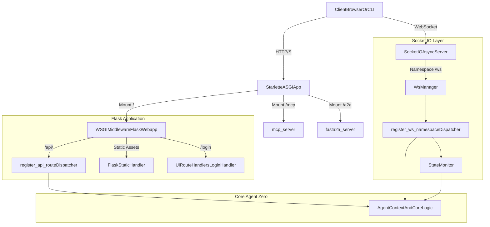
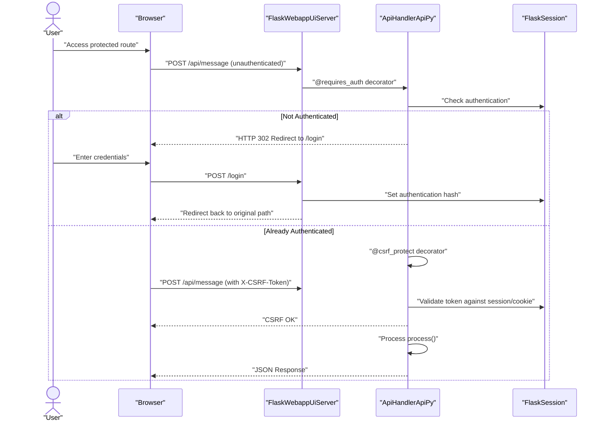

<!-- source: DeepWiki mcp.deepwiki.com · repo agent0ai/agent-zero · page 6 Backend Server & API Layer · fetched 2026-10-29 -->

# Backend Server & API Layer

Relevant source files

The following files were used as context for generating this wiki page:

- [extensions/python/job_loop/_50_trim_cache.py](extensions/python/job_loop/_50_trim_cache.py)
- [helpers/api.py](helpers/api.py)
- [helpers/cache.py](helpers/cache.py)
- [helpers/extension.py](helpers/extension.py)
- [helpers/files.py](helpers/files.py)
- [helpers/files.py.dox.md](helpers/files.py.dox.md)
- [helpers/ui_bundler.py](helpers/ui_bundler.py)
- [helpers/ui_bundler.py.dox.md](helpers/ui_bundler.py.dox.md)
- [helpers/ui_server.py](helpers/ui_server.py)
- [helpers/ui_server.py.dox.md](helpers/ui_server.py.dox.md)
- [helpers/watchdog.py](helpers/watchdog.py)
- [plugins/_infection_check/.toggle-0](plugins/_infection_check/.toggle-0)
- [plugins/_memory/AGENTS.md](plugins/_memory/AGENTS.md)
- [plugins/_memory/api/memory_dashboard.py](plugins/_memory/api/memory_dashboard.py)
- [plugins/_memory/tools/memory_load.py](plugins/_memory/tools/memory_load.py)
- [plugins/_memory/webui/memory-dashboard.html](plugins/_memory/webui/memory-dashboard.html)
- [tests/test_http_auth_csrf.py](tests/test_http_auth_csrf.py)
- [tests/test_memory_json_serialization.py](tests/test_memory_json_serialization.py)
- [tests/test_run_ui_config.py](tests/test_run_ui_config.py)
- [tests/test_ui_bundler.py](tests/test_ui_bundler.py)
- [tests/test_webui_service_worker.py](tests/test_webui_service_worker.py)
- [webui/AGENTS.md](webui/AGENTS.md)
- [webui/login.css](webui/login.css)
- [webui/login.html](webui/login.html)

The Agent Zero backend is a hybrid Flask and ASGI server architecture designed to provide a robust, real-time interface for both the built-in Web UI and external clients [helpers/ui_server.py:74-134](), [helpers/api.py:33-60](). It manages the lifecycle of `AgentContext` objects, handles long-running agent monologue loops, and synchronizes state across WebSockets using a debounced push mechanism [helpers/ui_server.py:74-134](), [helpers/ws_manager.py:48-154]().

As a parent page, this section provides a high-level overview of the server architecture, API handler framework, WebSocket real-time synchronization, and external connectivity channels. For detailed technical references, refer to the child pages:
- [API Handlers & Authentication](#6.1) — ApiHandler base class, register_api_route(), CSRF, auth decorators, /api dispatch, ui_server/ui_bundler, key endpoints in api/.
- [WebSocket & Real-Time Sync](#6.2) — WsHandler/WsManager, StateMonitor debounced push, Socket.io namespaces, poll() fallback, applySnapshot, lastLogVersion cursor.
- [External Connectivity: MCP, A2A & REST API](#6.3) — Agent Zero as MCP server, FastA2A protocol, External REST API, token auth, project-scoped routing.
- [MCP Client Integration](#6.4) — mcp_handler.py for consuming external MCP servers, mcpServersStore UI, JSON config, status polling, tool introspection.
- [A0 Connector Plugin](#6.5) — _a0_connector: HTTP+WebSocket protocol, capabilities, feature negotiation, remote code execution/text editor, ws_runtime.py, host file browser, launcher gateway.
- [OAuth & External Auth](#6.6) — _oauth plugin: Codex device-code flow, Copilot/Gemini/xAI providers, PKCE, auth.json, loopback wrapper, usage plans, config UI.
- [Host Computer Use (Remote Desktop Control)](#6.7) — computer_use_remote tool: WebSocket screen capture and input simulation, structural targeting, Rearm security model, session lifecycle, skills.
- [Agent Client Protocol (ACP)](#6.8) — _a0_acp plugin: ACP bridge for editor-hosted file/terminal access, session metadata API, transport modes, config, migration.

---

## Server Architecture

The server architecture utilizes a multi-layered approach to handle different types of traffic. It combines a Flask application for standard RESTful endpoints and static file serving with a `python-socketio` ASGI server for real-time bidirectional communication [helpers/ui_server.py:74-134](). The `UiServerRuntime` class encapsulates the creation and configuration of these components [helpers/ui_server.py:74-134]().

### Component Stack
*   **Web Framework:** Flask (running as a WSGI app within the ASGI stack via `WSGIMiddleware`) [helpers/ui_server.py:27](), [helpers/api.py:8-18]().
*   **Real-time Layer:** Socket.io with custom namespace management via `WsManager` [helpers/ws_manager.py:48-154]().
*   **Task Management:** `DeferredTask` for background execution [helpers/ws_manager.py:15]().
*   **State Monitoring:** `StateMonitor` for tracking dirty states and scheduling pushes [helpers/state_monitor.py:41-53]().
*   **Extension System:** Hooks into the API and WebSocket layers via the `@extensible` decorator to allow plugins to modify request/response flows [helpers/extension.py:57-104]().

### Backend Server Architecture

Sources: [helpers/ui_server.py:143-204](), [helpers/api.py:206-209](), [helpers/ws_manager.py:48-154]()

---

## API Layer & Authentication

The API layer is built on Flask and handles traditional HTTP requests. It uses a dispatch pattern to route requests to appropriate `ApiHandler` classes [helpers/api.py:33-60]().

### API Handler Pattern & Security
Each API endpoint corresponds to a Python file in the `api/` directory (or plugin `api/` directories), containing a class that inherits from `ApiHandler`. The `register_api_route` function dynamically discovers and registers these handlers [helpers/api.py:206-209](). 

Security decorators safeguard these endpoints:
*   **CSRF Protection:** `@csrf_protect` validates `X-CSRF-Token` headers or runtime cookies against session tokens [helpers/api.py:190-203](), [tests/test_http_auth_csrf.py:75-131]().
*   **Authentication:** `@requires_auth` ensures user sessions match configured credentials, redirecting unauthenticated traffic to `/login` with safe next-URL preservation [helpers/api.py:175-187](), [tests/test_http_auth_csrf.py:162-182]().
*   **API Keys:** `@requires_api_key` validates `X-API-KEY` headers or payload keys against the MCP server token [helpers/api.py:144-162]().
*   **Open Redirect Defenses:** `is_safe_next_url` prevents protocol-relative and backslash-based open redirect vectors [helpers/api.py:106-126](), [tests/test_http_auth_csrf.py:148-201]().

For detailed endpoint documentation, see [API Handlers & Authentication](#6.1).

### Authentication Flow

Sources: [helpers/api.py:144-203](), [helpers/ui_server.py:149-154](), [tests/test_http_auth_csrf.py:38-182]()

---

## WebSocket & Real-Time Sync

The WebSocket layer provides real-time, bidirectional communication using Socket.io, managed via `WsManager` and `WsHandler` [helpers/ws_manager.py:48-154](), [helpers/ws.py:186-207](). Application state changes are monitored by `StateMonitor`, which uses a debounced push mechanism to broadcast updates and handle log cursors (`lastLogVersion`) [helpers/state_monitor.py:41-53]().

For deeper coverage on namespaces, snapshot sync modes, and fallback polling, see [WebSocket & Real-Time Sync](#6.2).
Sources: [helpers/ws.py:186-207](), [helpers/ws_manager.py:48-154](), [helpers/state_monitor.py:41-53]()

---

## External Connectivity & Integration Plugins

Agent Zero extends its reach through several dedicated connectors, protocols, and client integrations:

*   **External Connectivity (MCP & A2A):** Mounting Agent Zero as an MCP server and implementing the FastA2A protocol [helpers/ui_server.py:31](). Details in [External Connectivity: MCP, A2A & REST API](#6.3).
*   **MCP Client Integration:** Consuming external MCP servers via `mcp_handler.py` and `mcpServersStore` [MCP Client Integration](#6.4).
*   **A0 Connector Plugin (`_a0_connector`):** Bridging host machine file access and remote execution into Docker containers using the `a0-connector.v1` protocol [A0 Connector Plugin](#6.5).
*   **OAuth & External Auth (`_oauth`):** Device-code flows, PKCE, token management, and provider wrapper implementations [OAuth & External Auth](#6.6).
*   **Host Computer Use:** Remote desktop control, screen capture, and input simulation via WebSockets in `computer_use_remote` [Host Computer Use (Remote Desktop Control)](#6.7).
*   **Agent Client Protocol (ACP):** Editor-hosted file and terminal access via the `_a0_acp` plugin bridge [Agent Client Protocol (ACP)](#6.8).

Sources: [helpers/ui_server.py:31-45](), [helpers/api.py:33-203](), [helpers/ws_manager.py:48-154]()

---

