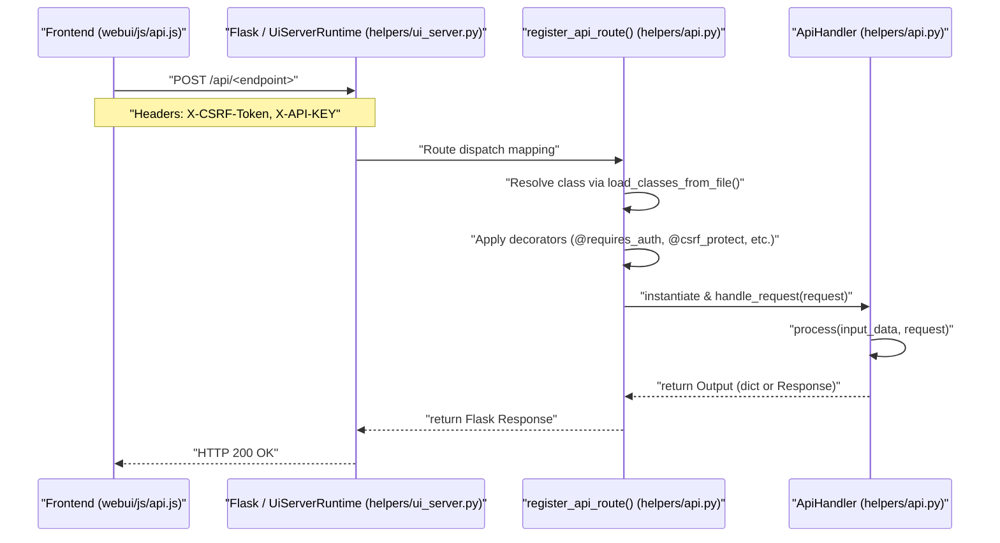
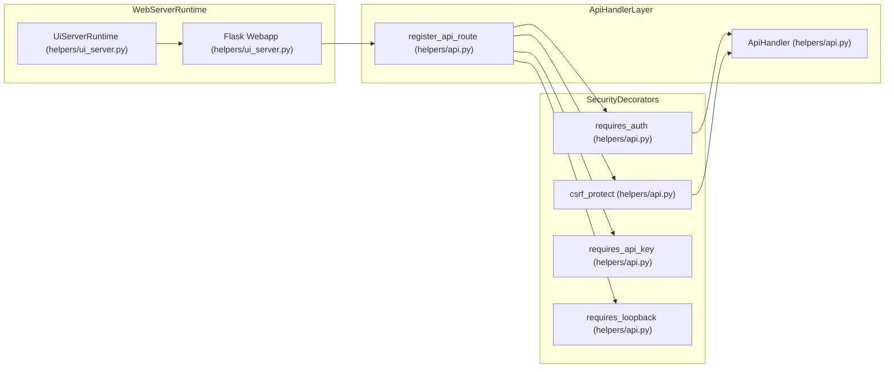

<!-- source: DeepWiki mcp.deepwiki.com · repo agent0ai/agent-zero · page 6.1 API Handlers & Authentication · fetched 2026-10-29 -->

# API Handlers & Authentication

<details>
<summary>Relevant source files</summary>

The following files were used as context for generating this wiki page:

- [api/upload.py](api/upload.py)
- [api/upload.py.dox.md](api/upload.py.dox.md)
- [extensions/python/job_loop/_50_trim_cache.py](extensions/python/job_loop/_50_trim_cache.py)
- [helpers/api.py](helpers/api.py)
- [helpers/cache.py](helpers/cache.py)
- [helpers/extension.py](helpers/extension.py)
- [helpers/files.py](helpers/files.py)
- [helpers/files.py.dox.md](helpers/files.py.dox.md)
- [helpers/ui_bundler.py](helpers/ui_bundler.py)
- [helpers/ui_bundler.py.dox.md](helpers/ui_bundler.py.dox.md)
- [helpers/ui_server.py](helpers/ui_server.py)
- [helpers/ui_server.py.dox.md](helpers/ui_server.py.dox.md)
- [helpers/watchdog.py](helpers/watchdog.py)
- [plugins/_a0_connector/api/file_browser_transfer.py](plugins/_a0_connector/api/file_browser_transfer.py)
- [plugins/_a0_connector/extensions/python/_functions/agent/AgentContext/kill_process/start/_70_cancel_transfers.py](plugins/_a0_connector/extensions/python/_functions/agent/AgentContext/kill_process/start/_70_cancel_transfers.py)
- [plugins/_a0_connector/extensions/python/_functions/agent/AgentContext/remove/start/_70_cancel_transfers.py](plugins/_a0_connector/extensions/python/_functions/agent/AgentContext/remove/start/_70_cancel_transfers.py)
- [plugins/_a0_connector/extensions/python/file_browser_providers/host.py](plugins/_a0_connector/extensions/python/file_browser_providers/host.py)
- [plugins/_a0_connector/helpers/file_browser.py](plugins/_a0_connector/helpers/file_browser.py)
- [plugins/_infection_check/.toggle-0](plugins/_infection_check/.toggle-0)
- [plugins/_memory/AGENTS.md](plugins/_memory/AGENTS.md)
- [plugins/_memory/api/memory_dashboard.py](plugins/_memory/api/memory_dashboard.py)
- [plugins/_memory/tools/memory_load.py](plugins/_memory/tools/memory_load.py)
- [plugins/_memory/webui/memory-dashboard.html](plugins/_memory/webui/memory-dashboard.html)
- [tests/test_file_browser_host.py](tests/test_file_browser_host.py)
- [tests/test_http_auth_csrf.py](tests/test_http_auth_csrf.py)
- [tests/test_memory_json_serialization.py](tests/test_memory_json_serialization.py)
- [tests/test_run_ui_config.py](tests/test_run_ui_config.py)
- [tests/test_ui_bundler.py](tests/test_ui_bundler.py)
- [tests/test_webui_service_worker.py](tests/test_webui_service_worker.py)
- [webui/AGENTS.md](webui/AGENTS.md)
- [webui/login.css](webui/login.css)
- [webui/login.html](webui/login.html)

</details>


The API layer in Agent Zero provides a structured, secure framework for handling HTTP requests, enforcing access control through CSRF protection, session-based authentication, API key validation, and loopback restrictions [helpers/api.py:33-259](). It combines a dynamic dispatch pattern managed by `register_api_route()` with class-based request processors (`ApiHandler`) and a high-performance ASGI/Flask backend (`UiServerRuntime` in `helpers/ui_server.py`) paired with the asset bundler (`ui_bundler.py`) [helpers/api.py:33-60](), [helpers/ui_server.py:75-135]().

Sources: [helpers/api.py:33-259](), [helpers/ui_server.py:75-135]()

---

## Architecture & Dispatch Pattern

The backend utilizes a centralized dispatch mechanism implemented in `helpers/api.py`. Instead of registering traditional static Flask route decorators for every endpoint, the system maps a dynamic `/api/<path>` route where `<path>` resolves to a specific `ApiHandler` subclass [helpers/api.py:206-259]().

### ApiHandler Base Class

All backend operations exposed through `/api/` are implemented by subclassing `ApiHandler`. This class defines the standard request handling lifecycle, input parsing, error trapping, and class-level security postures [helpers/api.py:33-60]().

| Property / Method | Default | Description |
| :--- | :--- | :--- |
| `requires_auth()` | `True` | Enforces valid user session authentication [helpers/api.py:47-49](). |
| `requires_csrf()` | `True` | Enforces CSRF token verification (defaults to `requires_auth()`) [helpers/api.py:55-57](). |
| `requires_api_key()` | `False` | Requires `X-API-KEY` header or JSON payload key for headless/MCP clients [helpers/api.py:43-45](). |
| `requires_loopback()` | `False` | Restricts access strictly to loopback addresses (`127.0.0.1` / `::1`) [helpers/api.py:38-40](). |
| `get_methods()` | `["POST"]` | Allowed HTTP methods for the route [helpers/api.py:51-53](). |
| `process(input, request)` | (abstract) | Core execution logic implemented by subclasses [helpers/api.py:58-60](). |

Sources: [helpers/api.py:33-60]()

### Natural Language to Code Mapping: Dispatch Architecture

```mermaid
graph TD
    subgraph "NaturalLanguageSpace"
        NL_Req[""Incoming HTTP Request Routing""]
        NL_Handler[""Dynamic API Handler Resolution""]
    end

    subgraph "CodeEntitySpace"
        CE_Server[""UiServerRuntime (helpers/ui_server.py)""]
        CE_Reg[""register_api_route() (helpers/api.py)""]
        CE_Handler[""ApiHandler (helpers/api.py)""]
    end

    NL_Req --> CE_Server
    CE_Server --> CE_Reg
    NL_Handler --> CE_Reg
    CE_Reg --> CE_Handler
```
Sources: [helpers/api.py:33-60](), [helpers/api.py:206-259](), [helpers/ui_server.py:75-135]()

### API Dispatch & Request Lifecycle

When an HTTP request hits `/api/<path>`, the dispatcher resolves the corresponding module file across built-in, plugin, and user directories, instantiates the handler, wraps it with appropriate security decorators, and invokes `handle_request()` [helpers/api.py:62-96](), [helpers/api.py:206-259]().


Sources: [helpers/api.py:62-96](), [helpers/api.py:206-259](), [helpers/ui_server.py:143-204]()

---

## Authentication & Security Mechanisms

Agent Zero implements a multi-layered security model to protect agent environments, user files, and execution runtimes.

### 1. Session-Based Authentication (`requires_auth`)
For Web UI interactions, authentication relies on Flask sessions backed by a username/password hash [helpers/api.py:175-187]().
* **Decorator**: `@requires_auth` [helpers/api.py:175-177]()
* **Implementation**: Compares `session.get("authentication")` against the credential hash generated by `login.get_credentials_hash()` [helpers/api.py:180-183](). If no credentials are configured in the environment, access is permitted [helpers/api.py:181-182](). If authentication fails, it issues an HTTP 302 redirect to `/login` preserving the target path via `get_current_request_next_url()` [helpers/api.py:184](), [helpers/api.py:138-142]().

### 2. CSRF Protection (`csrf_protect`)
To mitigate Cross-Site Request Forgery across state-changing endpoints, state-changing requests require token validation [helpers/api.py:190-203]().
* **Decorator**: `@csrf_protect` [helpers/api.py:190-192]()
* **Implementation**: Validates that the token present in the `X-CSRF-Token` request header or the runtime-scoped cookie (`csrf_token_<runtime_id>`) matches `session.get("csrf_token")` [helpers/api.py:195-199](). Runtime-scoped cookies prevent token leakage across separate backend instances [helpers/api.py:197]().

### 3. API Key Authentication (`requires_api_key`)
External integrations (such as Model Context Protocol (MCP) clients or automated scripts) use token-based authentication [helpers/api.py:144-162]().
* **Decorator**: `@requires_api_key` [helpers/api.py:144-146]()
* **Implementation**: Verifies the `X-API-KEY` header or the `api_key` JSON request body field against `mcp_server_token` retrieved from settings [helpers/api.py:149-159]().

### 4. Loopback Restriction (`requires_loopback`)
* **Decorator**: `@requires_loopback` [helpers/api.py:165-167]()
* **Implementation**: Restricts execution strictly to requests originating from loopback interfaces (`127.0.0.1` or `::1`), returning HTTP 403 if violated [helpers/api.py:168-170]().

Sources: [helpers/api.py:144-203](), [tests/test_http_auth_csrf.py:38-131]()

---

## Key Endpoints & Handlers

API handlers are located in the top-level `api/` directory as well as within individual plugin folders. 

### Chat & Message Management
* **`api/chat_create.py`**: Initializes new conversation contexts, setting up working directory trees and default agent states.
* **`helpers/persist_chat.py`**: Handles chat serialization and atomic file writes (`save_tmp_chat()`), deserialization during startup (`load_tmp_chats()`), and directory cleanup (`remove_chat()`).

### File Operations, Downloads & Bundling
* **`api/upload.py`**: Provides multipart file upload handling through `UploadFile` subclassing `ApiHandler`, validating and saving uploaded files atomically via `save_upload_atomic()` [api/upload.py:8-37]().
* **`api/download_work_dir_file.py`**: Streams individual files or archive downloads from the workspace sandbox using `file_archives.resolve_download_path()` [api/download_work_dir_file.py:15-80]().
* **`api/download_work_dir_files.py`**: Manages multi-file packaging, batch requests, token-registered download URLs, and enforcement of file size limits (`FileLimitExceeded`).
* **`helpers/ui_server.py` & `helpers/ui_bundler.py`**: `UiServerRuntime` configures static folders, Gzip middleware, Socket.IO transports, and custom asset routing for builtin plugins (`/plugins/<plugin_name>/<path>`), user plugins (`/usr/plugins/<plugin_name>/<path>`), and webui extensions (`/extensions/webui/<path>`) [helpers/ui_server.py:75-204]().

Sources: [helpers/api.py:206-259](), [helpers/ui_server.py:75-204](), [api/upload.py:1-37](), [api/download_work_dir_file.py:1-80]()

---

## Extension Hooks & Bundling Integration

The API and WebUI server layers integrate deeply with the Agent Zero extension framework (`helpers/extension.py`) and UI asset bundler (`helpers/ui_bundler.py`).

### Natural Language to Code Mapping: Extension Framework

```mermaid
graph TD
    subgraph "NaturalLanguageSpace"
        NL_Intercept[""Intercept API Execution Path""]
        NL_Modify[""Modify Request or Response Data""]
    end

    subgraph "CodeEntitySpace"
        CE_Ext[""extensible decorator (helpers/extension.py)""]
        CE_Sync[""call_extensions_sync() (helpers/extension.py)""]
        CE_Async[""call_extensions_async() (helpers/extension.py)""]
        CE_Data[""data payload dict (helpers/extension.py)""]
    end

    NL_Intercept --> CE_Ext
    NL_Modify --> CE_Data
    CE_Ext --> CE_Sync
    CE_Ext --> CE_Async
    CE_Data --> CE_Sync
    CE_Data --> CE_Async
```
Sources: [helpers/extension.py:57-104](), [helpers/extension.py:167-214]()

### Backend Function Interception (`@extensible`)
Backend operations can be intercepted or short-circuited using the `@extensible` decorator, which emits `start` and `end` extension points under `_functions/<module_path>/<qualname>/` [helpers/extension.py:57-104]().

### Server & Dispatcher Component Mapping


Sources: [helpers/api.py:33-60](), [helpers/api.py:206-259](), [helpers/ui_server.py:75-135]()

---

## Implementation Details

### Dynamic Route Registration (`register_api_route`)
The `register_api_route` function dynamically scans and mounts routes into Flask [helpers/api.py:206-259]().
1. **Directory Search Order**: Resolves handler modules sequentially across:
   * Built-in `api/` directory [helpers/api.py:221-228]()
   * Enabled plugin `api/` directories (`plugins/<plugin_name>/api/`) [helpers/api.py:230-234]()
   * User-defined fallback `usr/api/` [helpers/api.py:236-240]()
2. **Decorator Wrapping**: Dynamically wraps the instantiated handler's `handle_request()` method with `@requires_auth`, `@csrf_protect`, `@requires_api_key`, and `@requires_loopback` based on class attributes (`requires_auth()`, `requires_csrf()`, `requires_api_key()`, `requires_loopback()`) [helpers/api.py:43-57](), [helpers/api.py:241-259]().

Sources: [helpers/api.py:206-259]()

---

