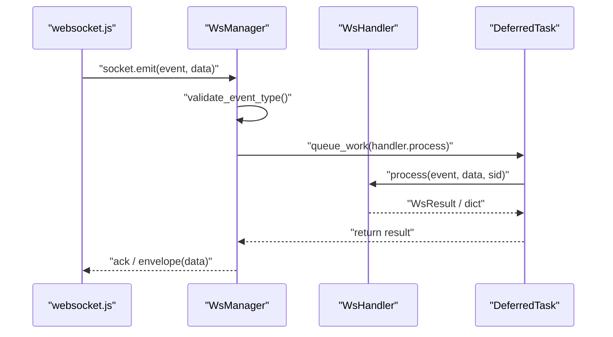
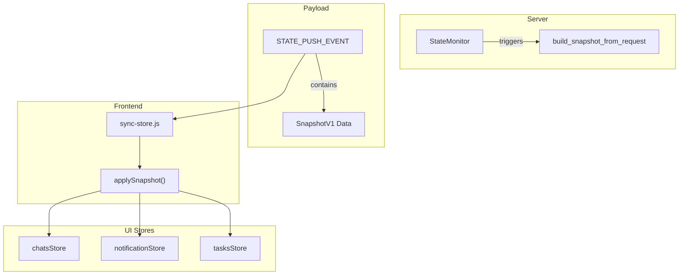
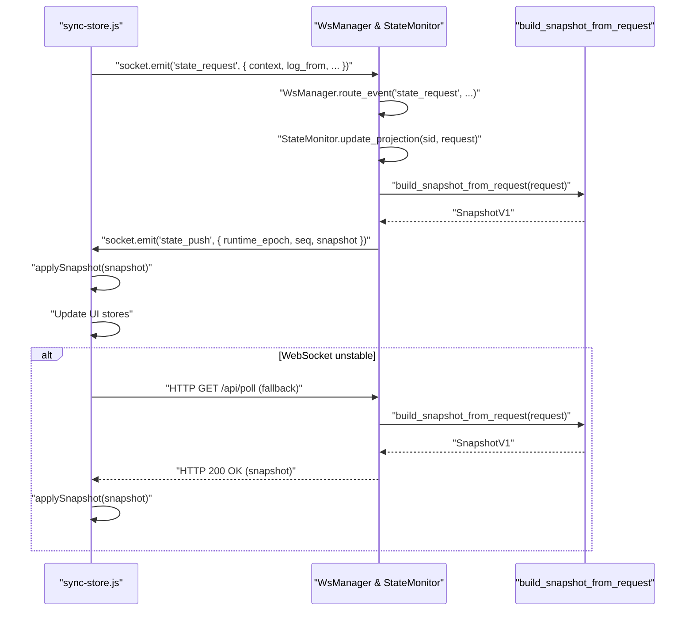

<!-- source: DeepWiki mcp.deepwiki.com · repo agent0ai/agent-zero · page 6.2 WebSocket & Real-Time Sync · fetched 2026-10-29 -->

# WebSocket & Real-Time Sync

Relevant source files

The following files were used as context for generating this wiki page:

- [api/notification_create.py](api/notification_create.py)
- [api/settings_set.py](api/settings_set.py)
- [api/ws_dev_test.py](api/ws_dev_test.py)
- [api/ws_hello.py](api/ws_hello.py)
- [api/ws_webui.py](api/ws_webui.py)
- [extensions/python/message_loop_prompts_after/_60_include_current_datetime.py](extensions/python/message_loop_prompts_after/_60_include_current_datetime.py)
- [helpers/context_utils.py](helpers/context_utils.py)
- [helpers/document_query.py](helpers/document_query.py)
- [helpers/network.py](helpers/network.py)
- [helpers/notification.py](helpers/notification.py)
- [helpers/notification.py.dox.md](helpers/notification.py.dox.md)
- [helpers/state_monitor.py](helpers/state_monitor.py)
- [helpers/state_snapshot.py](helpers/state_snapshot.py)
- [helpers/state_snapshot.py.dox.md](helpers/state_snapshot.py.dox.md)
- [helpers/ws.py](helpers/ws.py)
- [helpers/ws_manager.py](helpers/ws_manager.py)
- [tests/test_message_action_buttons_static.py](tests/test_message_action_buttons_static.py)
- [tests/test_snapshot_parity.py](tests/test_snapshot_parity.py)
- [tests/test_snapshot_schema_v1.py](tests/test_snapshot_schema_v1.py)
- [tests/test_ws_client_api_surface.py](tests/test_ws_client_api_surface.py)
- [webui/components/settings/backup/backup-store.js](webui/components/settings/backup/backup-store.js)
- [webui/components/settings/developer/websocket-event-console-store.js](webui/components/settings/developer/websocket-event-console-store.js)
- [webui/components/settings/developer/websocket-test-store.js](webui/components/settings/developer/websocket-test-store.js)
- [webui/components/sync/AGENTS.md](webui/components/sync/AGENTS.md)
- [webui/components/sync/sync-store.js](webui/components/sync/sync-store.js)
- [webui/js/websocket.js](webui/js/websocket.js)

This page details the real-time communication layer between the Agent Zero Python backend and the Alpine.js frontend. It covers the WebSocket implementation via `python-socketio`, the `WsManager` switchboard, the `StateMonitor` for debounced pushes, Socket.io namespaces, polling fallbacks, snapshot reconciliation via `applySnapshot`, and cursor-based synchronization using `lastLogVersion` and `log_from`.

---

## 1. WebSocket Architecture & Namespaces

Agent Zero implements an asynchronous WebSocket server using `python-socketio.AsyncServer` [helpers/ws.py:10-10](). Client connections and custom event routing primarily occur on the `/ws` namespace [helpers/ws.py:166-166]().

### WsManager & WsHandler
- **`WsManager`**: Orchestrates event routing, connection tracking, payload size enforcement, and result serialization across active sockets [helpers/ws_manager.py:38-76](). It validates event size limits (`WsPayloadTooLargeError`, `socketio_event_size`) before transmitting over Engine.IO packets [helpers/ws_manager.py:38-76]().
- **`WsResult`**: A standardized wrapper returned by handlers that maps success data or structured error codes into the canonical `RequestResultItem` shape expected by the client [helpers/ws_manager.py:96-182]().
- **`WsHandler`**: The base class for all backend WebSocket handlers loaded from api directories [helpers/ws.py:186-193](). Handlers support declarative security metadata and execute within background worker loops managed by `WsManager` to avoid blocking the main server thread [helpers/ws_manager.py:534-534]().

### Security & Cross-Site WebSocket Hijacking (CSWSH) Mitigation
During the Socket.IO handshake, `validate_ws_origin()` inspects incoming connection headers (`HTTP_ORIGIN`, `HTTP_REFERER`, `HTTP_HOST`, and `X-Forwarded` proxies) to reject unauthorized cross-origin requests [helpers/ws.py:81-137](). Active tunnel origins (such as Cloudflare Tunnels) are dynamically evaluated and permitted against the request origin [helpers/ws.py:152-155]().

### Diagram: Client-Manager-Handler Interaction
Title: "Client-Manager-Handler Interaction"

Sources: [helpers/ws_manager.py:38-76](), [helpers/ws_manager.py:481-510](), [helpers/ws_manager.py:534-534](), [helpers/ws.py:186-194]()

---

## 2. Real-Time Sync & State Monitoring

Instead of traditional high-frequency polling, Agent Zero uses an event-driven push architecture governed by `StateMonitor`.

### StateMonitor & Connection Projections
- **`StateMonitor`**: Tracks dirty state per connection identity (`ConnectionIdentity` tuple of `(namespace, sid)`) and schedules debounced pushes using a configured `debounce_seconds` window [helpers/state_monitor.py:42-48]().
- **`ConnectionProjection`**: Maintains runtime tracking parameters per connection, including `seq`, `seq_base`, `dirty_version`, `pushed_version`, and the active `StateRequestV1` filters [helpers/state_monitor.py:25-38]().
- **Dirty Signaling**: Subsystems trigger state broadcasts via `mark_dirty_all()`, `mark_dirty()`, or `mark_dirty_for_context(context_id)` to target specifically subscribed client sessions viewing an active `AgentContext` [helpers/state_monitor.py:88-128](), [helpers/state_monitor.py:151-187]().

Sources: [helpers/state_monitor.py:25-53](), [helpers/state_monitor.py:88-128](), [helpers/state_monitor.py:151-187]()

---

## 3. State Request, Push Delivery & Cursors

State synchronization relies on structured requests and snapshots defined in `helpers/state_snapshot.py`.

### State Requests & Snapshot Schema
- **`StateRequestV1`**: A frozen dataclass specifying the client's current synchronization cursor (`context`, `log_from`, `notifications_from`, `timezone`, and `collections_delta`) [helpers/state_snapshot.py:34-41]().
- **`SnapshotV1`**: A TypedDict payload containing delta-compatible log structures, context arrays, task arrays, and notifications [helpers/state_snapshot.py:17-33]().
- **Validation**: Incoming state request payloads are rigorously validated against timezone availability and numerical constraints via `parse_state_request_payload()` [helpers/state_snapshot.py:158-195](), while snapshots are validated using `validate_snapshot_schema_v1()` [helpers/state_snapshot.py:87-107]().

### Diagram: State Push to Store Synchronization
Title: "State Push to Store Synchronization"

Sources: [helpers/state_monitor.py:41-53](), [helpers/state_snapshot.py:17-41](), [helpers/state_snapshot.py:87-107](), [helpers/state_snapshot.py:158-195]()

---

## 4. Frontend Sync Store & Lifecycle

The frontend state machine (`webui/components/sync/sync-store.js`) manages connection resilience and message batching.

### Sync Modes & Polling Fallback
- **`SYNC_MODES`**: Defines connection health states: `DISCONNECTED`, `HANDSHAKE_PENDING`, `HEALTHY`, and `DEGRADED` [webui/components/sync/sync-store.js:13-18]().
- **Degraded Polling**: When WebSocket instability triggers a `DEGRADED` mode transition, the frontend gracefully falls back to REST polling endpoints while attempting exponential backoff handshakes and forced reconnections [webui/components/sync/sync-store.js:81-218]().
- **Coalescing**: Incoming `state_push` events are queued and coalesced to prevent render thrashing during high-frequency agent activity, ensuring that the latest record versions and ordered notifications are processed sequentially without racing [webui/components/sync/AGENTS.md:17-19]().

### Diagram: State Request and Push Flow
Title: "State Request and Push Flow"

Sources: [helpers/state_monitor.py:116-136](), [helpers/state_snapshot.py:228-229](), [webui/components/sync/AGENTS.md:17-19](), [webui/components/sync/sync-store.js:13-218]()

---

## 5. Diagnostics & Development Tools

Agent Zero provides built-in debugging features for real-time message tracing:
- **`A0_WS_DEBUG`**: An environment variable toggle that enables verbose WebSocket debug logging via `ws_debug()` [helpers/ws.py:29-39]().
- **Diagnostic Projections**: The `StateMonitor` tracks wave identifiers (`wave_id`) and dirty reasons when debug mode is active to assist developers in tracking synchronization lag or unnecessary push bursts [helpers/state_monitor.py:36-39](), [helpers/state_monitor.py:88-114]().

Sources: [helpers/ws.py:29-39](), [helpers/state_monitor.py:36-39](), [helpers/state_monitor.py:88-114]()

---

