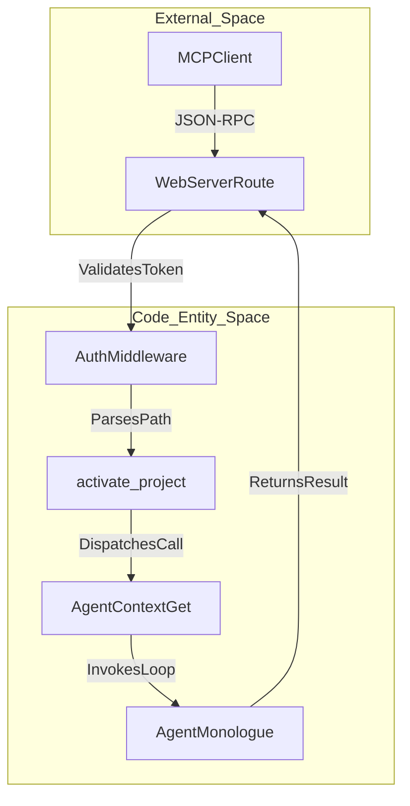
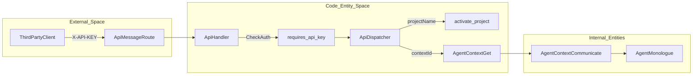
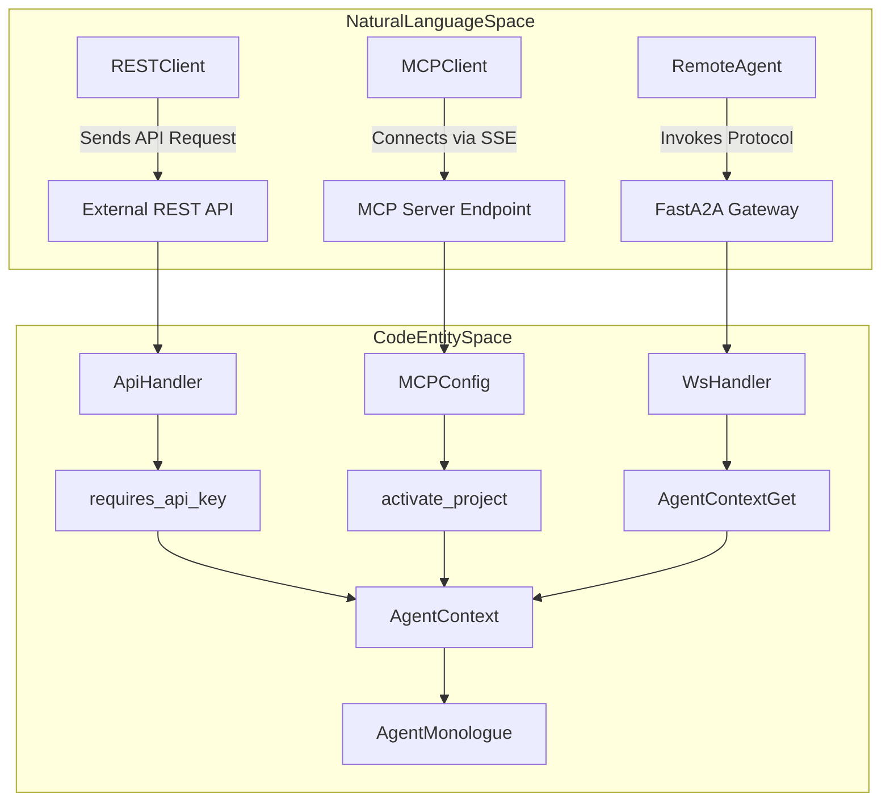
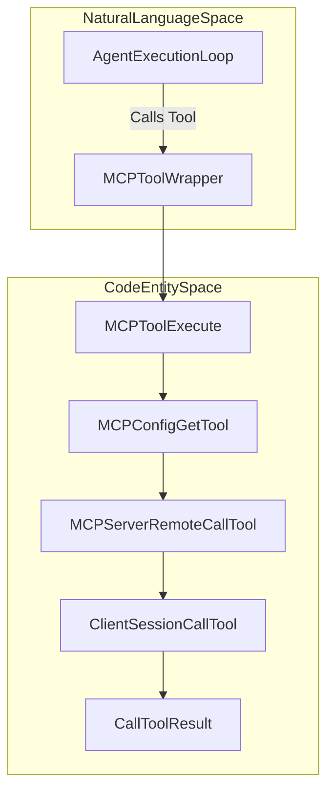

<!-- source: DeepWiki mcp.deepwiki.com · repo agent0ai/agent-zero · page 6.3 External Connectivity: MCP, A2A & REST API · fetched 2026-10-29 -->

# External Connectivity: MCP, A2A & REST API

Relevant source files

The following files were used as context for generating this wiki page:

- [docker/run/fs/ins/post_install.sh](docker/run/fs/ins/post_install.sh)
- [docker/run/fs/ins/setup_ssh.sh](docker/run/fs/ins/setup_ssh.sh)
- [docs/developer/connectivity.md](docs/developer/connectivity.md)
- [docs/developer/contributing-skills.md](docs/developer/contributing-skills.md)
- [docs/developer/mcp-configuration.md](docs/developer/mcp-configuration.md)
- [extensions/python/startup_migration/AGENTS.md](extensions/python/startup_migration/AGENTS.md)
- [extensions/python/startup_migration/_05_framework_dependencies.py](extensions/python/startup_migration/_05_framework_dependencies.py)
- [extensions/python/startup_migration/_10_self_update_manager.py](extensions/python/startup_migration/_10_self_update_manager.py)
- [tests/AGENTS.md](tests/AGENTS.md)
- [tests/chunk_parser_test.py](tests/chunk_parser_test.py)
- [tests/rate_limiter_test.py](tests/rate_limiter_test.py)
- [tests/test_fasta2a_client.py](tests/test_fasta2a_client.py)
- [tests/test_framework_dependencies.py](tests/test_framework_dependencies.py)
- [tests/test_self_update_runtime_sync.py](tests/test_self_update_runtime_sync.py)
- [webui/components/settings/a2a/a2a-connection.html](webui/components/settings/a2a/a2a-connection.html)
- [webui/components/settings/external/api-examples.html](webui/components/settings/external/api-examples.html)
- [webui/components/settings/mcp/client/mcp-server-tools.html](webui/components/settings/mcp/client/mcp-server-tools.html)
- [webui/components/settings/mcp/client/mcp-servers-store.js](webui/components/settings/mcp/client/mcp-servers-store.js)
- [webui/components/settings/mcp/client/mcp-servers.html](webui/components/settings/mcp/client/mcp-servers.html)
- [webui/components/settings/mcp/mcp_server.html](webui/components/settings/mcp/mcp_server.html)
- [webui/components/settings/mcp/server/example.html](webui/components/settings/mcp/server/example.html)

Agent Zero provides external connectivity protocols enabling it to function as a Model Context Protocol (MCP) server, a FastA2A node for agent-to-agent collaboration, and a standard REST API provider for third-party integrations. This document covers the implementation details, authentication flows, routing patterns, and client-side integration mechanisms.

---

## 1. Authentication & Token System

All external connectivity pathways—including MCP endpoints, FastA2A sockets, and REST API routes—rely on a unified token-based authentication mechanism.

*   **Token Derivation**: The system API token (`mcp_server_token`) is automatically generated and derived from active user credentials [webui/components/settings/mcp/server/example.html:19-20]().
*   **Rotation**: When system credentials or passwords are updated, the token dynamically changes, immediately invalidating old URLs and historical bearer headers [webui/components/settings/mcp/server/example.html:20-21]().
*   **Transport Channels**: The token is supplied either inline within the URL path (for SSE/A2A) or passed explicitly via the `X-API-KEY` header for REST requests [webui/components/settings/external/api-examples.html:45-45]().
*   **UI Binding**: The frontend exposes the active token via the Alpine.js store as `$store.settings.settings.mcp_server_token` [webui/components/settings/mcp/server/example.html:24-24]().

Sources:
* `webui/components/settings/mcp/server/example.html:13-28` 
* `webui/components/settings/external/api-examples.html:17-24` 

---

## 2. Agent Zero as an MCP Server

Agent Zero exposes its internal agentic loop and execution utilities as an MCP (Model Context Protocol) server. External clients (such as Claude Desktop or remote instances) can connect using standard Server-Sent Events (SSE) or Streamable HTTP.

### Endpoint Structure & Project-Scoped Routing

The server routes incoming requests based on the embedded token and optional project selector:

| Protocol / Transport | URL Pattern | Description |
| :--- | :--- | :--- |
| **SSE (Server-Sent Events)** | `/mcp/t-{token}[/p-{project}]/sse` [webui/components/settings/mcp/server/example.html:89-89]() | Event-driven duplex stream for tool discovery and execution |
| **Streamable HTTP** | `/mcp/t-{token}[/p-{project}]/http` [webui/components/settings/mcp/server/example.html:93-94]() | Stateless HTTP transport for chunked JSON-RPC payloads |

*   **Project Scoping**: Inserting `/p-{project_name}` into the path triggers project context activation via `helpers.projects` prior to handling client requests [webui/components/settings/mcp/server/example.html:81-82]().

### Data Flow: External MCP Request Processing

Title: MCP Request Data Flow

Sources:
* `webui/components/settings/mcp/server/example.html:80-96` 
* `helpers/mcp_handler.py:155-170` 

---

## 3. FastA2A Protocol (Agent-to-Agent)

The FastA2A protocol facilitates peer-to-peer dialogues between distinct Agent Zero instances or compatible external agent harnesses.

### Connection & Capabilities
*   **Authentication**: Supports token-embedded URL routing (`/a2a/t-{token}`), standard Bearer authentication (`Authorization: Bearer {token}`), and API key headers (`X-API-KEY`) [webui/components/settings/a2a/a2a-connection.html:82-85]().
*   **Agent Discovery**: Remote systems query capabilities and exposed tools by requesting the standard agent manifest: `GET /a2a/.well-known/agent.json` [tests/test_fasta2a_client.py:28-31]().

Sources:
* `webui/components/settings/a2a/a2a-connection.html:9-42` 
* `tests/test_fasta2a_client.py:15-85` 

---

## 4. External REST API

The External REST API allows third-party web services to programmatically interact with agent threads, submit tasks, and query execution logs.

### Key API Endpoints
*   **`POST /api_message`**: Submits a prompt or task into a conversation context. Accepts parameters including `context_id`, `message`, base64-encoded `attachments`, `lifetime_hours`, and `project_name` [webui/components/settings/external/api-examples.html:28-43]().
*   **`GET/POST /api_log_get`**: Fetches the structured execution log buffer for a specific `context_id` [webui/components/settings/external/api-examples.html:67-79]().
*   **`POST /api_terminate_chat`**: Destroys an active conversation context to release server-side memory [webui/components/settings/external/api-examples.html:97-108]().
*   **`POST /api_reset_chat`**: Resets conversation history while maintaining the underlying `context_id` binding [webui/components/settings/external/api-examples.html:122-132]().

### REST API Execution Flow

Title: REST API Execution Flow

Sources:
* `webui/components/settings/external/api-examples.html:1-135` 

---

## 5. System Entity Mapping: Natural Language to Code Entities

The following architecture diagrams explicitly bridge high-level system descriptions to internal Python code entities within the backend runtime.

### Diagram A: Request Routing & Context Initialization

Title: Request Routing and Context Initialization

Sources:
* `webui/components/settings/external/api-examples.html:28-47` 
* `helpers/mcp_handler.py:155-170` 

---

## 6. MCP Client Handler Implementation

While Agent Zero acts as a server, it also consumes external Model Context Protocol servers via `helpers/mcp_handler.py`.

### Core Classes & Components
*   **`MCPConfig`**: A singleton manager responsible for loading, validating, and merging global settings with project-scoped MCP server manifests [helpers/mcp_handler.py:37-51]().
*   **`MCPTool`**: A subclass of `Tool` that encapsulates remote MCP tool execution, normalizing result payloads and handling multimodal content (such as image tokens) [helpers/mcp_handler.py:172-174]().
*   **`MCPServerLocal` & `MCPServerRemote`**: Lifecycle managers for executing local `stdio` subprocesses versus maintaining persistent SSE/HTTP client sessions [helpers/mcp_handler.py:19-36]().

### Tool Resolution & Namespace Qualified Naming
MCP tool identifiers are structured using dot notation (`server_name.tool_name`) [helpers/mcp_handler.py:101-108](). During execution, `MCPConfig.get_tool()` maps the incoming request to the correct server instance and dispatches the payload via the underlying client session.

### Diagram B: MCP Client Tool Invocation Flow

Title: MCP Client Tool Invocation Flow

Sources:
* `helpers/mcp_handler.py:1-172` 
* `helpers/mcp_handler.py.dox.md:1-98` 

---

