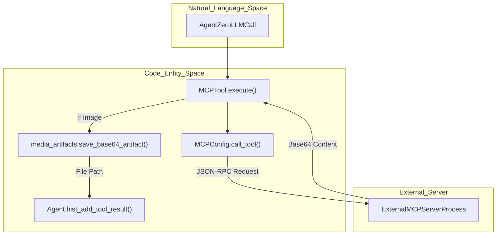
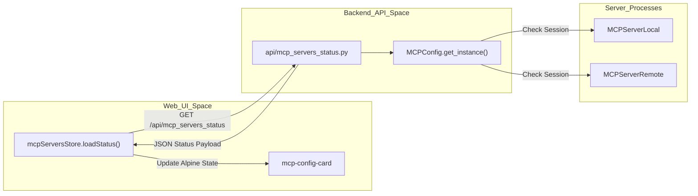

<!-- source: DeepWiki mcp.deepwiki.com · repo agent0ai/agent-zero · page 6.4 MCP Client Integration · fetched 2026-10-29 -->

# MCP Client Integration

Relevant source files

The following files were used as context for generating this wiki page:

- [api/mcp_server_get_detail.py.dox.md](api/mcp_server_get_detail.py.dox.md)
- [api/mcp_servers_status.py.dox.md](api/mcp_servers_status.py.dox.md)
- [extensions/python/message_loop_prompts_after/_63_recall_relevant_skills.py](extensions/python/message_loop_prompts_after/_63_recall_relevant_skills.py)
- [extensions/python/system_prompt/AGENTS.md](extensions/python/system_prompt/AGENTS.md)
- [extensions/python/system_prompt/_10_main_prompt.py](extensions/python/system_prompt/_10_main_prompt.py)
- [extensions/python/system_prompt/_12_mcp_prompt.py](extensions/python/system_prompt/_12_mcp_prompt.py)
- [extensions/python/system_prompt/_13_secrets_prompt.py](extensions/python/system_prompt/_13_secrets_prompt.py)
- [extensions/python/system_prompt/_13_skills_prompt.py](extensions/python/system_prompt/_13_skills_prompt.py)
- [extensions/python/system_prompt/_14_project_prompt.py](extensions/python/system_prompt/_14_project_prompt.py)
- [helpers/mcp_handler.py](helpers/mcp_handler.py)
- [helpers/mcp_handler.py.dox.md](helpers/mcp_handler.py.dox.md)
- [plugins/_memory/prompts/agent.system.tool.behaviour.md](plugins/_memory/prompts/agent.system.tool.behaviour.md)
- [tests/test_mcp_handler_multimodal.py](tests/test_mcp_handler_multimodal.py)
- [tests/test_prompt_protocol.py](tests/test_prompt_protocol.py)
- [webui/components/settings/mcp/client/example.html](webui/components/settings/mcp/client/example.html)
- [webui/components/settings/mcp/client/mcp-scan-checks.json](webui/components/settings/mcp/client/mcp-scan-checks.json)
- [webui/components/settings/mcp/client/mcp-scan-prompt.md](webui/components/settings/mcp/client/mcp-scan-prompt.md)
- [webui/components/settings/mcp/client/mcp-server-scan.html](webui/components/settings/mcp/client/mcp-server-scan.html)

Agent Zero supports the **Model Context Protocol (MCP)**, allowing it to act as an MCP client that consumes external tools and resources from both local and remote MCP servers. This integration is handled via `helpers/mcp_handler.py`, managing server lifecycles, tool introspection, multimodal content handling, and configuration persistence across global and project scopes.

Sources: [helpers/mcp_handler.py:1-205](), [helpers/mcp_handler.py.dox.md:1-101]()

## Overview and Configuration

The MCP client integration allows users to extend Agent Zero's capabilities by connecting to any compliant MCP server. Configuration is managed through a JSON-based format conforming to the standard `mcpServers` schema.

### JSON Configuration Format
The configuration is structured around server definitions parsed by `MCPConfig` and managed via the frontend UI stores [webui/components/settings/mcp/client/example.html:37-66]().

| Field | Type | Description |
| :--- | :--- | :--- |
| `mcpServers` | Object | A map where keys are server names and values are server configurations [webui/components/settings/mcp/client/example.html:38-65](). |
| `command` | String | (Local) The executable to run (e.g., `uvx`, `npx`, `python`) [webui/components/settings/mcp/client/example.html:41](). |
| `args` | Array | (Local) Command line arguments passed to the executable [webui/components/settings/mcp/client/example.html:42-46](). |
| `env` | Object | (Local) Environment variables for the server process. |
| `url` | String | (Remote) The endpoint for remote servers (SSE or HTTP) [webui/components/settings/mcp/client/example.html:62](). |
| `type` | String | Protocol type: `stdio`, `sse`, or `streamable-http` [helpers/mcp_handler.py:76-80](). |
| `headers` | Object | (Remote) HTTP headers for remote server authentication. |
| `disabled_tools` | Array | List of specific tool names to hide from the agent [helpers/mcp_handler.py.dox.md:99](). |
| `init_timeout` | Number | Server-specific timeout for initialization operations [helpers/mcp_handler.py.dox.md:100](). |
| `tool_timeout` | Number | Server-specific timeout for tool executions [helpers/mcp_handler.py.dox.md:100](). |

Sources: [helpers/mcp_handler.py:75-100](), [helpers/mcp_handler.py.dox.md:99-100](), [webui/components/settings/mcp/client/example.html:37-66]()

## MCP Handler Implementation

The core logic for interacting with MCP servers resides in `helpers/mcp_handler.py`. This module handles the abstraction between different transport types (`Stdio`, `SSE`, `Streamable HTTP`) and converts MCP tool outputs into formats Agent Zero understands.

### Initialization and Server Detection
The `initialize_mcp` function [helpers/mcp_handler.py:156-172]() updates the singleton `MCPConfig` with the provided JSON configuration. The handler determines the server type using `_determine_server_type` [helpers/mcp_handler.py:75-95]():
- **Remote (`MCPServerRemote`)**: If the `type` is `sse`, `streamable-http`, or if a `url` is present [helpers/mcp_handler.py:79-92]().
- **Local (`MCPServerLocal`)**: If the `type` is `stdio` or if no URL is specified [helpers/mcp_handler.py:81-94]().

### Multimodal Content Handling
The `MCPTool` class [helpers/mcp_handler.py:173]() processes various content types returned by MCP servers during execution.

1. **Images**: Materialized to artifact files using helper routines. It uses `media_artifacts` and returns an image reference object for the LLM history.
2. **Resources**: MCP resources are processed with a character limit of 12,000 (`MAX_MCP_RESOURCE_TEXT_CHARS`) to prevent context window overflow [helpers/mcp_handler.py:53]().
3. **Timeouts**: Server-specific `init_timeout` and `tool_timeout` override global MCP client timeout settings [helpers/mcp_handler.py.dox.md:100]().

### Qualified Tool Naming
Agent Zero uses a qualified naming convention: `server_name.tool_name`. The `_split_qualified_tool_name` function [helpers/mcp_handler.py:102-110]() ensures that dots within the original MCP tool name are preserved while splitting off the server prefix. Server names themselves are normalized using `normalize_name` [helpers/mcp_handler.py:65-72]() to remove non-alphanumeric characters.

Sources: [helpers/mcp_handler.py:52-110](), [helpers/mcp_handler.py:156-173](), [helpers/mcp_handler.py.dox.md:84-100]()

## Management UI (`mcpServersStore`)

The Web UI provides a dedicated interface for managing MCP servers, located in the settings panel. This interface interacts with backend APIs to support status polling, tool introspection, and configuration persistence.

### Key UI Features
* **JSON Editor**: Provides a raw view for configuration editing backed by an Ace JSON editor instance [webui/components/settings/mcp/client/example.html:68-78]().
* **Status Polling**: Automatically refreshes connection states and tool counts via backend endpoints.
* **Tool Toggling**: Users can enable or disable specific tools within a server, writing `disabled_tools` into the configuration [helpers/mcp_handler.py.dox.md:99]().

### API Interaction
The UI communicates with the backend through dedicated endpoints:
* `mcp_servers_status`: Returns current connection states, active tool counts, and error messages for all configured servers [api/mcp_servers_status.py.dox.md:5-21]().
* `mcp_server_get_detail`: Retrieves full tool schemas, including those in the `disabled_tools` list [api/mcp_server_get_detail.py.dox.md:5-21]().

Sources: [helpers/mcp_handler.py.dox.md:99](), [webui/components/settings/mcp/client/example.html:68-78](), [api/mcp_servers_status.py.dox.md:5-21](), [api/mcp_server_get_detail.py.dox.md:5-21]()

## Data Flow Diagrams

### Diagram: MCP Tool Execution and Media Handling

Sources: [helpers/mcp_handler.py:173-205](), [helpers/mcp_handler.py.dox.md:79-84]()

### Diagram: Real-Time Status Monitoring

Sources: [helpers/mcp_handler.py.dox.md:37-50](), [api/mcp_servers_status.py.dox.md:5-29]()

## Server Status Indicators
The UI uses a color-coded status system to represent the state of MCP servers:

| Indicator | Condition | Meaning |
| :--- | :--- | :--- |
| **Filled Green** | `status.connected` | Server is active and session is established [helpers/mcp_handler.py.dox.md:83](). |
| **Yellow Warning** | `status.error` | Server is connected but reported initialization or runtime errors. |
| **Red Error** | `!status.connected` | Server is offline or the process failed to start. |

Sources: [helpers/mcp_handler.py.dox.md:80-92]()

## Project Scoping
MCP servers can be configured at both **Global** and **Project** levels:
* Project-scoped MCP servers overlay global servers by normalized name [helpers/mcp_handler.py.dox.md:82]().
* `MCPConfig.get_for_agent(agent)` resolves the correct configuration instance based on the active agent's project context [helpers/mcp_handler.py.dox.md:83]().
* Configuration changes across scopes automatically invalidate cached client sessions to ensure correct tool routing.

Sources: [helpers/mcp_handler.py.dox.md:81-84]()

---

