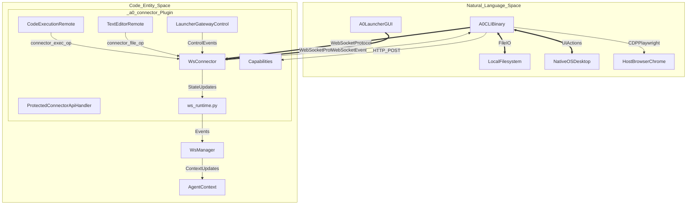
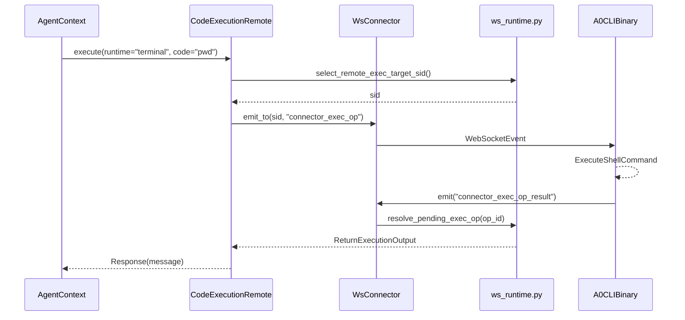

<!-- source: DeepWiki mcp.deepwiki.com · repo agent0ai/agent-zero · page 6.5 A0 Connector Plugin · fetched 2026-10-29 -->

# A0 Connector Plugin

Relevant source files

The following files were used as context for generating this wiki page:

- [docs/guides/a0-cli-connector.md](docs/guides/a0-cli-connector.md)
- [docs/guides/browser.md](docs/guides/browser.md)
- [helpers/images.py](helpers/images.py)
- [plugins/_a0_connector/api/v1/capabilities.py](plugins/_a0_connector/api/v1/capabilities.py)
- [plugins/_a0_connector/api/v1/launcher_gateway_control.py](plugins/_a0_connector/api/v1/launcher_gateway_control.py)
- [plugins/_a0_connector/api/v1/launcher_gateway_status.py](plugins/_a0_connector/api/v1/launcher_gateway_status.py)
- [plugins/_a0_connector/api/ws_connector.py](plugins/_a0_connector/api/ws_connector.py)
- [plugins/_a0_connector/helpers/event_bridge.py](plugins/_a0_connector/helpers/event_bridge.py)
- [plugins/_a0_connector/helpers/text_editor_freshness.py](plugins/_a0_connector/helpers/text_editor_freshness.py)
- [plugins/_a0_connector/helpers/ws_runtime.py](plugins/_a0_connector/helpers/ws_runtime.py)
- [plugins/_a0_connector/plugin.yaml](plugins/_a0_connector/plugin.yaml)
- [plugins/_a0_connector/prompts/agent.system.tool.code_execution_remote.md](plugins/_a0_connector/prompts/agent.system.tool.code_execution_remote.md)
- [plugins/_a0_connector/prompts/agent.system.tool.text_editor_remote.md](plugins/_a0_connector/prompts/agent.system.tool.text_editor_remote.md)
- [plugins/_a0_connector/skills/host-code-execution/SKILL.md](plugins/_a0_connector/skills/host-code-execution/SKILL.md)
- [plugins/_a0_connector/tools/code_execution_remote.py](plugins/_a0_connector/tools/code_execution_remote.py)
- [plugins/_a0_connector/tools/text_editor_remote.py](plugins/_a0_connector/tools/text_editor_remote.py)
- [plugins/_browser/helpers/selector.py](plugins/_browser/helpers/selector.py)
- [plugins/_text_editor/AGENTS.md](plugins/_text_editor/AGENTS.md)
- [plugins/_text_editor/README.md](plugins/_text_editor/README.md)
- [plugins/_text_editor/helpers/context_patch.py](plugins/_text_editor/helpers/context_patch.py)
- [plugins/_text_editor/helpers/file_ops.py](plugins/_text_editor/helpers/file_ops.py)
- [plugins/_text_editor/helpers/patch_request.py](plugins/_text_editor/helpers/patch_request.py)
- [plugins/_text_editor/helpers/patch_state.py](plugins/_text_editor/helpers/patch_state.py)
- [plugins/_text_editor/prompts/agent.system.tool.text_editor.md](plugins/_text_editor/prompts/agent.system.tool.text_editor.md)
- [plugins/_text_editor/tools/text_editor.py](plugins/_text_editor/tools/text_editor.py)
- [tests/test_a0_connector_attachment_metadata.py](tests/test_a0_connector_attachment_metadata.py)
- [tests/test_text_editor_context_patch.py](tests/test_text_editor_context_patch.py)

The `_a0_connector` plugin implements the **a0-connector.v1** protocol, a specialized HTTP and WebSocket interface designed for the **A0 CLI tool** and **A0 Launcher**. While the standard Web UI provides a graphical interface, the A0 Connector allows Agent Zero to operate directly on a user's host machine files, terminal, and desktop from within its isolated Docker container. It bridges the gap between the "Computer as a Tool" philosophy and the security of containerization by delegating execution to a connected client.

Sources: [plugins/_a0_connector/api/v1/capabilities.py:1-107](), [plugins/_a0_connector/api/ws_connector.py:1-82]()

## Architecture Overview

The connector operates as a plugin that extends the Agent Zero backend with a set of protected API endpoints and a dedicated WebSocket runtime (`ws_runtime.py`). It enables feature negotiation, remote code execution, host file browsing, and real-time state synchronization between the CLI (running on the host) and the Agent Zero framework (running in Docker).

### Data Flow: Host to Container
The A0 CLI acts as a secure bridge. When Agent Zero needs to read files, execute shell commands, or control the host environment, it dispatches requests through the `_a0_connector` WebSocket channel on the `/ws` namespace [plugins/_a0_connector/api/ws_connector.py:1-9](). The `WsConnector` class processes these events, routing payloads via `ws_runtime.py` to target the active client session ID (`sid`) [plugins/_a0_connector/helpers/ws_runtime.py:178-196]().

### System Entity Map
Title: "A0 Connector Entity Mapping"

Sources: [plugins/_a0_connector/api/ws_connector.py:108-164](), [plugins/_a0_connector/api/v1/capabilities.py:78-100](), [plugins/_a0_connector/helpers/ws_runtime.py:141-196](), [plugins/_a0_connector/tools/code_execution_remote.py:38-42](), [plugins/_a0_connector/tools/text_editor_remote.py:64-70]()

## Protected API & Feature Negotiation

All internal API endpoints within the connector plugin inherit from `ProtectedConnectorApiHandler` (or `PublicConnectorApiHandler` for discovery endpoints like `Capabilities`). These base classes ensure that only authorized CLI clients can interact with the agent's internal state by enforcing authentication constraints.

### Feature Negotiation
The protocol begins with a handshake at the `Capabilities` endpoint (`plugins/_a0_connector/api/v1/capabilities.py`) [plugins/_a0_connector/api/v1/capabilities.py:1-84](). This allows the CLI and the server to agree on supported features before establishing a long-lived WebSocket connection [plugins/_a0_connector/api/v1/capabilities.py:80-106](). The `_feature_list()` function dynamically determines available features based on module availability in Python's runtime [plugins/_a0_connector/api/v1/capabilities.py:72-78]().

| Feature | Description |
| :--- | :--- |
| `code_execution_remote` | Allows the agent to send code blocks (Python, Node.js, Shell) to the CLI for host execution [plugins/_a0_connector/api/v1/capabilities.py:27](). |
| `text_editor_remote` | Enables the agent to read, write, and patch files on the host using the CLI as a proxy [plugins/_a0_connector/api/v1/capabilities.py:26](). |
| `computer_use_remote` | Allows the agent to control the host desktop via screenshots and simulated input [plugins/_a0_connector/api/v1/capabilities.py:28](). |
| `launcher_gateway` | Supports A0 Launcher gateway declarations for additive host access [plugins/_a0_connector/api/v1/capabilities.py:33](). |
| `launcher_gateway_file_write` | Explicitly advertises remote file write capabilities through the gateway [plugins/_a0_connector/api/v1/capabilities.py:34](). |
| `browser_host_remote` | Enables host browser integration via the CLI [plugins/_a0_connector/api/v1/capabilities.py:29](). |
| `remote_file_tree` | Exposes the host filesystem tree for remote browsing and selection [plugins/_a0_connector/api/v1/capabilities.py:32](). |

Sources: [plugins/_a0_connector/api/v1/capabilities.py:14-107](), [plugins/_a0_connector/api/ws_connector.py:67-82]()

## WebSocket Runtime (`ws_runtime.py`)

The core of real-time interaction resides in `plugins/_a0_connector/helpers/ws_runtime.py` and `plugins/_a0_connector/api/ws_connector.py`. This layer manages the registry of connected CLI clients (`sid`), their subscriptions, payloads, and state metadata.

### Connection & Payload Management
*   **Registration:** When a CLI or Launcher connects, `register_sid(sid)` tracks the session, setting up peer max payload bytes and default transfer protocols [plugins/_a0_connector/helpers/ws_runtime.py:199-208]().
*   **Payload Bounds:** `WsConnector.emit_to()` inspects the peer ceiling per authenticated `sid` (defaulting to the legacy floor). Oversize payloads are caught as `WsPayloadTooLargeError` and structured into `PAYLOAD_TOO_LARGE` errors rather than abruptly dropping the transport connection [plugins/_a0_connector/api/ws_connector.py:182-201]().
*   **Metadata Storage:** Clients report capabilities stored via helpers like `store_sid_remote_file_metadata()`, `store_sid_remote_exec_metadata()`, and `store_sid_launcher_gateway_metadata()` [plugins/_a0_connector/helpers/ws_runtime.py:47-53]().

Sources: [plugins/_a0_connector/api/ws_connector.py:118-201](), [plugins/_a0_connector/helpers/ws_runtime.py:1-239]()

## Host Machine Remote Tools & File Browser

The plugin exposes specialized tools (`code_execution_remote`, `computer_use_remote`, `text_editor_remote`) active when a corresponding CLI client is connected and its metadata requirements are met.

### 1. Code Execution Remote (`tools/code_execution_remote.py`)
Allows running shell-backed commands on a connected A0 CLI host [plugins/_a0_connector/prompts/agent.system.tool.code_execution_remote.md:1-5]().
*   **Execution Checking:** `CodeExecutionRemote.execute()` queries `remote_exec_metadata_for_sid()` and `remote_file_metadata_for_sid()` to ensure write access is enabled when mutations are requested [plugins/_a0_connector/tools/code_execution_remote.py:120-155]().
*   **Timeouts:** Runtimes map to specific timeout groups (`code_exec_timeouts` or `output_timeouts`) with transport grace buffers [plugins/_a0_connector/tools/code_execution_remote.py:58-86]().

### 2. Text Editor Remote & Host File Browser (`tools/text_editor_remote.py`)
Enables reading, writing, and patching files on the host filesystem via the connected CLI session [plugins/_a0_connector/prompts/agent.system.tool.text_editor_remote.md:1-5]().
*   **Freshness Checking:** Integrates with `plugins/_a0_connector/helpers/text_editor_freshness.py` to ensure local file state and patch freshness before applying line edits or context patches [plugins/_a0_connector/tools/text_editor_remote.py:15-30]().
*   **Host File Tree:** `ws_runtime.py` caches remote tree snapshots (`RemoteTreeSnapshot`) per session ID (`sid`), enabling the Web UI and agent tools to navigate and query host directory structures without scanning local Docker storage [plugins/_a0_connector/helpers/ws_runtime.py:108-112](), [plugins/_a0_connector/helpers/ws_runtime.py:185]().

Title: "Remote Tool Execution Flow"

Sources: [plugins/_a0_connector/tools/code_execution_remote.py:38-183](), [plugins/_a0_connector/helpers/ws_runtime.py:77-106](), [plugins/_a0_connector/tools/text_editor_remote.py:64-148]()

## Launcher Gateways & Control

The runtime supports a "Launcher Gateway" model where an A0 Launcher GUI application supplies host access capabilities.

*   **Identity & Fallback:** A `connector_hello` message registers a versioned gateway object containing its ID, host label, and states. Distinct simultaneous IDs fail closed as `multiple_hosts`, while matching IDs replace stale socket registrations.
*   **Scope Dependencies:** Scopes enforce strict hierarchical dependencies: File writing depends on reading (`files`), and Code execution depends on file writing (`file_write`).
*   **Control API:** `LauncherGatewayControl` handles master state toggles, scope updates, and emergency disconnects (`emergency_disconnect`) through authenticated API routes [plugins/_a0_connector/api/v1/launcher_gateway_control.py:24-98]().

Sources: [plugins/_a0_connector/api/v1/launcher_gateway_control.py:1-98](), [plugins/_a0_connector/helpers/ws_runtime.py:168-176]()

---

