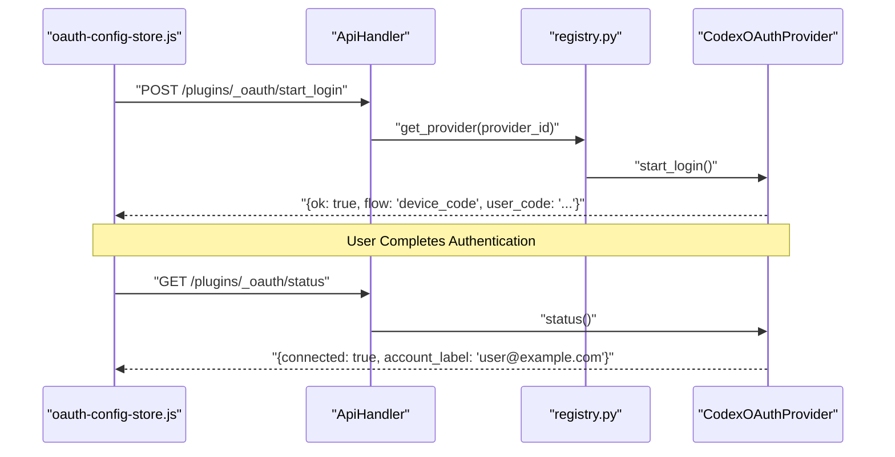

<!-- source: DeepWiki mcp.deepwiki.com · repo agent0ai/agent-zero · page 6.6 OAuth & External Auth · fetched 2026-10-29 -->

# OAuth & External Auth

<details>
<summary>Relevant source files</summary>

The following files were used as context for generating this wiki page:

- [plugins/_oauth/AGENTS.md](plugins/_oauth/AGENTS.md)
- [plugins/_oauth/README.md](plugins/_oauth/README.md)
- [plugins/_oauth/api/models.py](plugins/_oauth/api/models.py)
- [plugins/_oauth/api/poll_device_login.py](plugins/_oauth/api/poll_device_login.py)
- [plugins/_oauth/api/start_device_login.py](plugins/_oauth/api/start_device_login.py)
- [plugins/_oauth/api/start_login.py](plugins/_oauth/api/start_login.py)
- [plugins/_oauth/conf/model_providers.yaml](plugins/_oauth/conf/model_providers.yaml)
- [plugins/_oauth/default_config.yaml](plugins/_oauth/default_config.yaml)
- [plugins/_oauth/extensions/python/_functions/models/get_api_key/end/_20_oauth_account_dummy_key.py](plugins/_oauth/extensions/python/_functions/models/get_api_key/end/_20_oauth_account_dummy_key.py)
- [plugins/_oauth/extensions/python/chat_model_call_before/_20_codex_session.py](plugins/_oauth/extensions/python/chat_model_call_before/_20_codex_session.py)
- [plugins/_oauth/helpers/codex.py](plugins/_oauth/helpers/codex.py)
- [plugins/_oauth/helpers/config.py](plugins/_oauth/helpers/config.py)
- [plugins/_oauth/helpers/providers/base.py](plugins/_oauth/helpers/providers/base.py)
- [plugins/_oauth/helpers/providers/codex.py](plugins/_oauth/helpers/providers/codex.py)
- [plugins/_oauth/helpers/providers/common.py](plugins/_oauth/helpers/providers/common.py)
- [plugins/_oauth/helpers/providers/gemini_api.py](plugins/_oauth/helpers/providers/gemini_api.py)
- [plugins/_oauth/helpers/providers/github_copilot.py](plugins/_oauth/helpers/providers/github_copilot.py)
- [plugins/_oauth/helpers/providers/xai_grok.py](plugins/_oauth/helpers/providers/xai_grok.py)
- [plugins/_oauth/helpers/routes.py](plugins/_oauth/helpers/routes.py)
- [plugins/_oauth/helpers/summary.py](plugins/_oauth/helpers/summary.py)
- [plugins/_oauth/helpers/usage_plans.py](plugins/_oauth/helpers/usage_plans.py)
- [plugins/_oauth/webui/config.html](plugins/_oauth/webui/config.html)
- [plugins/_oauth/webui/oauth-config-store.js](plugins/_oauth/webui/oauth-config-store.js)
- [tests/test_oauth_codex.py](tests/test_oauth_codex.py)
- [tests/test_oauth_github_copilot.py](tests/test_oauth_github_copilot.py)
- [tests/test_oauth_providers.py](tests/test_oauth_providers.py)
- [tests/test_oauth_reconnect.mjs](tests/test_oauth_reconnect.mjs)
- [tests/test_oauth_static.py](tests/test_oauth_static.py)

</details>


The `_oauth` plugin provides infrastructure for authenticating with external AI providers using modern OAuth 2.0 flows. It enables Agent Zero to act as a client for account-backed models, including **OpenAI Codex (ChatGPT)**, **GitHub Copilot**, **Google Cloud Gemini**, and **xAI Grok** [plugins/_oauth/README.md:13-41](). The plugin exposes these authenticated sessions via local OpenAI-compatible proxy endpoints, such as `/oauth/codex/v1` [plugins/_oauth/webui/oauth-config-store.js:48-49](), managed through `conf/model_providers.yaml` [plugins/_oauth/conf/model_providers.yaml:1-38]().

Sources: [plugins/_oauth/README.md:13-41](), [plugins/_oauth/webui/oauth-config-store.js:48-49](), [plugins/_oauth/conf/model_providers.yaml:1-38]()

---

## 1. Plugin Architecture & Ownership

The plugin isolates external provider integration logic from core model code, maintaining modular boundaries across manifests, configuration, routing, and UI stores.

*   `plugin.yaml`, `default_config.yaml`, and `README.md` define the plugin manifest, default parameters, and user documentation [plugins/_oauth/AGENTS.md:12-12]().
*   `conf/model_providers.yaml` defines OAuth-backed model providers with `api_key_mode: oauth` [plugins/_oauth/AGENTS.md:13-13]().
*   `api/` houses provider-aware endpoints for status, login initiation, polling, manual callback processing, and disconnection [plugins/_oauth/AGENTS.md:14-14]().
*   `helpers/providers/` implements provider-specific flows, metadata parsing, and token persistence logic [plugins/_oauth/AGENTS.md:15-15]().
*   `helpers/routes.py` manages local OAuth callback handlers and OpenAI-compatible proxy routing [plugins/_oauth/AGENTS.md:17-17]().

Sources: [plugins/_oauth/AGENTS.md:12-17]()

---

## 2. Authentication Flows & PKCE

The plugin implements device-code and PKCE-based authorization flows coordinated by `provider_registry()` [plugins/_oauth/helpers/providers/registry.py:39]() and backed by state management in `plugins/_oauth/helpers/state.py` [plugins/_oauth/AGENTS.md:15-15]().

### Device Code Flow
Used by **OpenAI Codex** and **GitHub Copilot** [plugins/_oauth/README.md:17-24]().
*   **Initiation**: The backend requests a device authorization grant, yielding a `user_code` and a `verification_url` [tests/test_oauth_reconnect.mjs:20-20]().
*   **Polling**: The frontend `oauth-config-store.js` polls the backend device login status [plugins/_oauth/webui/oauth-config-store.js:13-17](). Polling logic dynamically adapts to provider interval updates, expiration thresholds, and `slow_down` directives [plugins/_oauth/AGENTS.md:29-29]().
*   **User Interface**: Verification codes are rendered in a selectable container with clipboard copy integration [plugins/_oauth/AGENTS.md:30-30]().

### Browser PKCE Flow
Used by **Google Cloud Gemini** and **xAI Grok** [plugins/_oauth/README.md:28-40]().
*   **PKCE Generation**: `generate_pkce()` generates an unpadded base64url-encoded verifier (43-128 chars) and an SHA256 challenge [tests/test_oauth_codex.py:37-45]().
*   **Authorization**: `build_authorize_url()` constructs the redirect URI incorporating `code_challenge`, `code_challenge_method=S256`, and a cryptographically secure `state` parameter [plugins/_oauth/helpers/codex.py:104-122]().
*   **Manual Callback**: For remote deployment targets where browser redirects cannot directly reach local container ports, users can paste the full callback URL, query string, or bare authorization code into the provider input card [plugins/_oauth/README.md:51-59]().

Title: OAuth Entity Mapping
```mermaid
graph TD
    User["User"]
    WebBrowser["WebBrowser"]
    OAuthStore["oauth-config-store.js"]
    PkcePair["PkcePair"]
    Exchange["exchange_code_for_tokens"]
    Persist["persist_exchanged_tokens"]
    AuthJson["auth.json"]

    User -->| "ClicksConnect" | OAuthStore
    OAuthStore -->| "Triggers" | PkcePair
    PkcePair -->| "Challenge" | WebBrowser
    WebBrowser -->| "AuthCode" | Exchange
    Exchange -->| "Tokens" | Persist
    Persist -->| "JSONWrite" | AuthJson
```
Sources: [plugins/_oauth/helpers/codex.py:71-74](), [plugins/_oauth/helpers/codex.py:117-151](), [plugins/_oauth/helpers/codex.py:181-211](), [plugins/_oauth/webui/oauth-config-store.js:103-146]()

Sources: [plugins/_oauth/README.md:17-59](), [plugins/_oauth/helpers/codex.py:37-122](), [plugins/_oauth/helpers/providers/registry.py:39](), [plugins/_oauth/webui/oauth-config-store.js:13-17](), [plugins/_oauth/AGENTS.md:29-30]()

---

## 3. Token Storage, Security & Lifecycle

Tokens are stored securely in provider-specific `auth.json` files within plugin-owned private directories (e.g., `usr/plugins/_oauth/<provider>/auth.json`) [plugins/_oauth/AGENTS.md:42-42]().

### auth.json Structure & EffectiveAuth
*   `auth_mode`: Indicates the credential type (e.g., `"chatgpt"`) [plugins/_oauth/helpers/codex.py:206]().
*   `OPENAI_API_KEY`: Runtime shim or exchanged API key [plugins/_oauth/helpers/codex.py:207]().
*   `tokens`: Object containing `id_token`, `access_token`, `refresh_token`, and `account_id` [plugins/_oauth/helpers/codex.py:208-213]().
*   `last_refresh`: ISO 8601 UTC timestamp tracking synchronization [plugins/_oauth/helpers/codex.py:214]().

### Refresh Lifecycle
*   **Expiry Margin**: An `ACCESS_EXPIRY_MARGIN` of 5 minutes is evaluated prior to dispatching requests [plugins/_oauth/helpers/codex.py:41]().
*   **EffectiveAuth**: `load_auth()` returns an `EffectiveAuth` dataclass containing access tokens, identifiers, and a `reconnect_required` flag [plugins/_oauth/helpers/codex.py:84-93](). If tokens are revoked, the UI surfaces an reconnection prompt [plugins/_oauth/README.md:21-21]().

Sources: [plugins/_oauth/helpers/codex.py:39-93](), [plugins/_oauth/helpers/codex.py:203-214](), [plugins/_oauth/README.md:21-21](), [plugins/_oauth/AGENTS.md:42-42]()

---

## 4. OpenAI-Compatible Proxy & Session Routing

The plugin registers loopback HTTP proxy routes via `register_oauth_routes()` [plugins/_oauth/helpers/routes.py:23-53]() allowing standard OpenAI-compatible callers to leverage authenticated provider sessions [plugins/_oauth/conf/model_providers.yaml:1-38]().

### Codex Request Shaping & Session Hook
*   **CodexSession Hook**: `chat_model_call_before/_20_codex_session.py` defines the `CodexSession` extension which injects stable per-chat, per-agent session and thread identifiers into `client_metadata` for backend cache routing [plugins/_oauth/AGENTS.md:49-49]().
*   **Reasoning Translation**: Translates legacy top-level `reasoning_effort` fields into structured `reasoning.effort` objects [tests/test_oauth_codex.py:87-98]() while adhering to configuration defaults in `default_config.yaml` [plugins/_oauth/default_config.yaml:28-32]().
*   **Dummy Key Injection**: OAuth-backed model providers do not require static billing API keys [plugins/_oauth/README.md:10-12](). Instead, `_20_oauth_account_dummy_key.py` supplies a runtime dummy API key after connection status is verified [plugins/_oauth/AGENTS.md:39-39]().

Title: OAuth UI & API Flow

Sources: [plugins/_oauth/webui/oauth-config-store.js:103-146](), [plugins/_oauth/helpers/providers/registry.py:39](), [plugins/_oauth/helpers/providers/codex.py:65-106](), [plugins/_oauth/AGENTS.md:14-14]()

Sources: [plugins/_oauth/helpers/routes.py:23-53](), [plugins/_oauth/conf/model_providers.yaml:1-38](), [plugins/_oauth/extensions/python/chat_model_call_before/_20_codex_session.py:4-22](), [plugins/_oauth/default_config.yaml:28-39](), [plugins/_oauth/AGENTS.md:39-49]()

---

## 5. Supported Providers Reference

The plugin supports four connectable account-backed providers registered via `provider_registry()` [plugins/_oauth/helpers/providers/registry.py:39]():

| Provider ID | Display Name | Auth Flow | Proxy Endpoint | Notes |
| :--- | :--- | :--- | :--- | :--- |
| `codex_oauth` | Codex/ChatGPT Account | Device Code | `/oauth/codex/v1` | Custom Responses API mapping and session management [plugins/_oauth/conf/model_providers.yaml:2-11](). |
| `github_copilot_oauth` | GitHub Copilot Account | Device Code | `/oauth/github-copilot/v1` | Exchanges GitHub access tokens for Copilot tokens [plugins/_oauth/conf/model_providers.yaml:12-20](). |
| `gemini_api_oauth` | Google Cloud Gemini Account | PKCE / OAuth Client | `/oauth/gemini-api/v1` | Requires user-provided GCP client ID/secret and quota project [plugins/_oauth/conf/model_providers.yaml:21-29](). |
| `xai_grok_oauth` | xAI Grok Account | Browser PKCE | `/oauth/xai-grok/v1` | Supports manual callback paste for remote instances [plugins/_oauth/conf/model_providers.yaml:30-38](). |

Sources: [plugins/_oauth/conf/model_providers.yaml:1-38](), [plugins/_oauth/README.md:13-41](), [plugins/_oauth/helpers/providers/registry.py:39]()

---

## 6. Usage Plans & Monitoring

The plugin aggregates quota and subscription metadata through `helpers/summary.py` and `helpers/usage_plans.py` [plugins/_oauth/README.md:43-47]().

*   **Codex Usage**: Queried through backend usage paths (`USAGE_ENDPOINT_PATHS`) to track window consumption [plugins/_oauth/helpers/codex.py:64-68]().
*   **Usage Plan Catalog**: Exposes subscription tiers (Free, Plus, Pro, Enterprise) to visualize quota percentages and reset timers in the settings UI and discovery cards [plugins/_oauth/README.md:43-48]().

Sources: [plugins/_oauth/README.md:43-48](), [plugins/_oauth/helpers/codex.py:64-68](), [plugins/_oauth/helpers/summary.py:1-140]()

---

## 7. Configuration UI & Model Slot Integration

The OAuth Connections panel (`plugins/_oauth/webui/config.html`) provides an Alpine.js interface powered by `oauth-config-store.js` [plugins/_oauth/AGENTS.md:18-18]().

*   **`loadStatus()`**: Periodically or manually polls `provider_map` and readiness status [plugins/_oauth/webui/oauth-config-store.js:143-148]().
*   **Model Slot Association**: Allows assigning connected OAuth providers and specific models independently to the **Main model** (`chat_model`) and **Utility model** (`utility_model`) slots [plugins/_oauth/AGENTS.md:32-32]().
*   **Inline Controls**: Pending-auth controls, device codes, and setup fields render inline under the relevant provider row rather than in a detached section [plugins/_oauth/AGENTS.md:29-29]().

Sources: [plugins/_oauth/webui/config.html:1-125](), [plugins/_oauth/webui/oauth-config-store.js:143-148](), [plugins/_oauth/AGENTS.md:18-32]()

---

