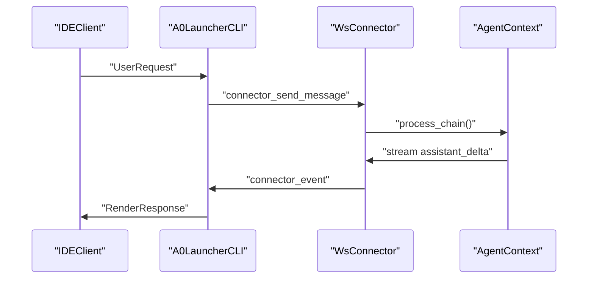
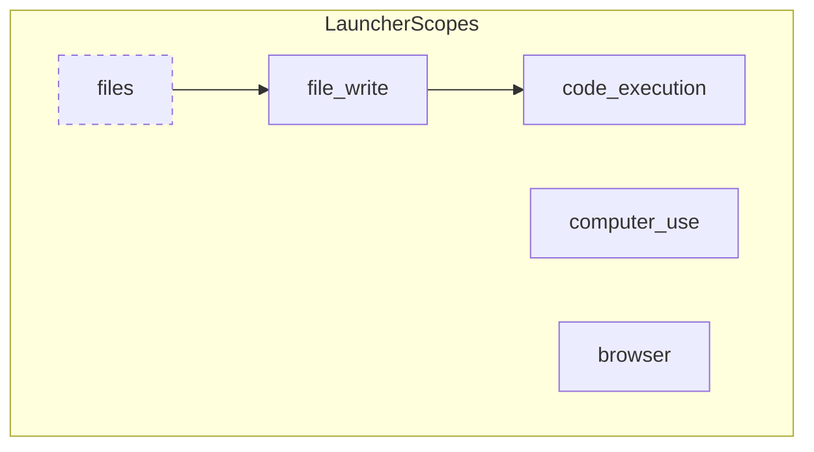
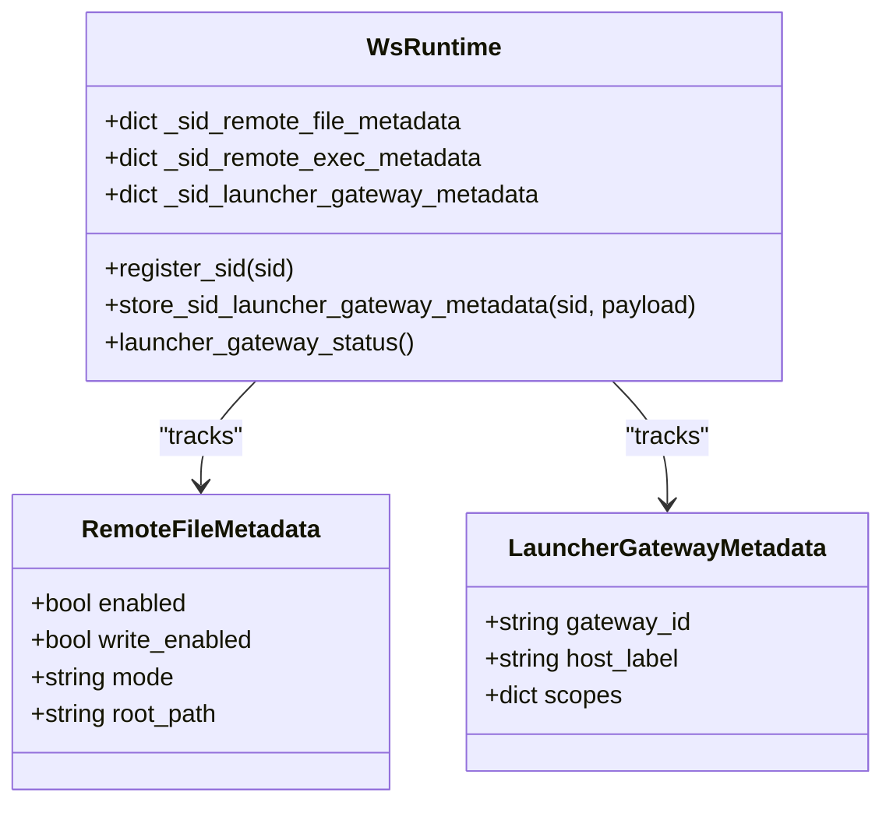

<!-- source: DeepWiki mcp.deepwiki.com · repo agent0ai/agent-zero · page 6.8 Agent Client Protocol (ACP) · fetched 2026-10-29 -->

# Agent Client Protocol (ACP)

Relevant source files

The following files were used as context for generating this wiki page:

- [plugins/_a0_connector/api/v1/capabilities.py](plugins/_a0_connector/api/v1/capabilities.py)
- [plugins/_a0_connector/api/v1/launcher_gateway_control.py](plugins/_a0_connector/api/v1/launcher_gateway_control.py)
- [plugins/_a0_connector/api/v1/launcher_gateway_status.py](plugins/_a0_connector/api/v1/launcher_gateway_status.py)
- [plugins/_a0_connector/api/ws_connector.py](plugins/_a0_connector/api/ws_connector.py)
- [plugins/_a0_connector/helpers/event_bridge.py](plugins/_a0_connector/helpers/event_bridge.py)
- [plugins/_a0_connector/helpers/ws_runtime.py](plugins/_a0_connector/helpers/ws_runtime.py)
- [plugins/_a0_connector/prompts/agent.system.tool.code_execution_remote.md](plugins/_a0_connector/prompts/agent.system.tool.code_execution_remote.md)
- [plugins/_a0_connector/skills/host-code-execution/SKILL.md](plugins/_a0_connector/skills/host-code-execution/SKILL.md)
- [plugins/_a0_connector/tools/code_execution_remote.py](plugins/_a0_connector/tools/code_execution_remote.py)
- [tests/test_a0_connector_attachment_metadata.py](tests/test_a0_connector_attachment_metadata.py)

The Agent Client Protocol (ACP) plugin (`_a0_acp`) provides a specialized bridge for editor-hosted environments (such as VS Code or JetBrains IDEs). It enables Agent Zero to interact directly with the host machine's file system and terminal, while supporting advanced transport modes, session metadata APIs, and model/mode configurations [plugins/_a0_connector/api/v1/capabilities.py:81-107]().

Sources: [plugins/_a0_connector/api/v1/capabilities.py:81-107]()

---

## Purpose and Architecture

The ACP bridge allows Agent Zero to operate as an IDE-hosted coding assistant by:
1. **Bridging File and Terminal Access**: Utilizing `WsConnector` infrastructure in `plugins/_a0_connector/api/ws_connector.py` to proxy host-machine file trees and shell operations [plugins/_a0_connector/api/ws_connector.py:118-141]().
2. **Session Metadata Management**: Exposing session-scoped APIs via `Capabilities` in `plugins/_a0_connector/api/v1/capabilities.py` to control agent behavior [plugins/_a0_connector/api/v1/capabilities.py:81-107]().
3. **Transport Negotiation**: Managing transitions between the `a0-connector.v1` protocol and chunked transfer mechanisms in `plugins/_a0_connector/helpers/ws_runtime.py` [plugins/_a0_connector/helpers/ws_runtime.py:31-44]().

### Data Flow: IDE to Agent Zero

The following diagram bridges natural language IDE actions to the underlying code entities in the backend:

**IDE Integration Flow**

Sources: [plugins/_a0_connector/api/ws_connector.py:66-82](), [plugins/_a0_connector/api/v1/capabilities.py:81-107]()

---

## The Connector Bridge & Remote Capabilities

The ACP subsystem relies on `_a0_connector` to establish secure WebSockets and map remote files and execution routines [plugins/_a0_connector/api/ws_connector.py:118-172]().

### Protocol Features and Scopes
Remote capabilities are tracked per socket ID (`sid`) within `plugins/_a0_connector/helpers/ws_runtime.py` [plugins/_a0_connector/helpers/ws_runtime.py:188-192](). The launcher gateway manages granular security scopes via handlers like `LauncherGatewayControl` in `plugins/_a0_connector/api/v1/launcher_gateway_control.py` [plugins/_a0_connector/api/v1/launcher_gateway_control.py:29-60]():

**Launcher Scope Dependencies**

*Note: Disabling `files` (Read) automatically revokes `file_write` and `code_execution` to enforce strict security boundaries [plugins/_a0_connector/api/v1/launcher_gateway_control.py:53-57]().*

Sources: [plugins/_a0_connector/api/v1/launcher_gateway_control.py:29-60](), [plugins/_a0_connector/helpers/ws_runtime.py:188-192]()

### Code Entity Space: WsRuntime Tracking

**Remote Entity Mapping**

Sources: [plugins/_a0_connector/helpers/ws_runtime.py:152-176](), [plugins/_a0_connector/helpers/ws_runtime.py:188-192]()

---

## Session Metadata & ACP Modes

The `_a0_acp` plugin injects operational modifiers into the monologue loop based on the active session configuration.

### Mode Behavior Matrix
| Mode | Injected Prompt Fragment / Behavior |
| :--- | :--- |
| `plan` | Emphasizes analysis and architectural tradeoffs. Modifying files is restricted unless explicitly requested by the user [plugins/_a0_connector/prompts/agent.system.tool.code_execution_remote.md:10-15](). |
| `act` | Directs the agent to execute actionable work end-to-end with rigorous implementation and validation [plugins/_a0_connector/prompts/agent.system.tool.code_execution_remote.md:39-42](). |

The session API handlers expose endpoints under `/api/plugins/_a0_acp/session` to update these parameters dynamically during an active conversation [plugins/_a0_connector/api/v1/capabilities.py:14-37]().

Sources: [plugins/_a0_connector/api/v1/capabilities.py:14-37](), [plugins/_a0_connector/prompts/agent.system.tool.code_execution_remote.md:10-42]()

---

## Transport Modes

The ACP subsystem supports multiple transport configurations:
1. **Connector Transport (Default)**: Proxies tool calls through the `WsConnector` WebSocket bridge, executing file reads, writes, and shell tasks on the host machine via `CodeExecutionRemote` [plugins/_a0_connector/api/ws_connector.py:118-141](), [plugins/_a0_connector/tools/code_execution_remote.py:38-42]().
2. **Container Fallback**: Binds operations to predefined container IDs for isolated sandboxed execution.

Large file and stream transfers utilize chunked payloads (`TRANSFER_CHUNK_BYTES`) over WebSocket with SHA-256 integrity verification and temporary file spooling defined in `plugins/_a0_connector/helpers/ws_runtime.py` [plugins/_a0_connector/helpers/ws_runtime.py:31-64]().

Sources: [plugins/_a0_connector/api/ws_connector.py:118-141](), [plugins/_a0_connector/tools/code_execution_remote.py:38-42](), [plugins/_a0_connector/helpers/ws_runtime.py:31-64]()

---

## Migration from Legacy Installations

The `_a0_acp` plugin provides automated startup migration paths to transition users from deprecated standalone installations.

### Migration Mechanics
- **Startup Hook**: Startup extensions scan for legacy configuration files (`acp_config.json`) in the user directory.
- **Config Porting**: Valid settings are translated into the unified `_a0_acp` plugin settings store.
- **Artifact Cleanup**: Legacy artifacts are purged or archived to prevent namespace collisions with the `_a0_connector` framework [plugins/_a0_connector/api/ws_connector.py:142-172]().

Sources: [plugins/_a0_connector/api/ws_connector.py:142-172]()

---

