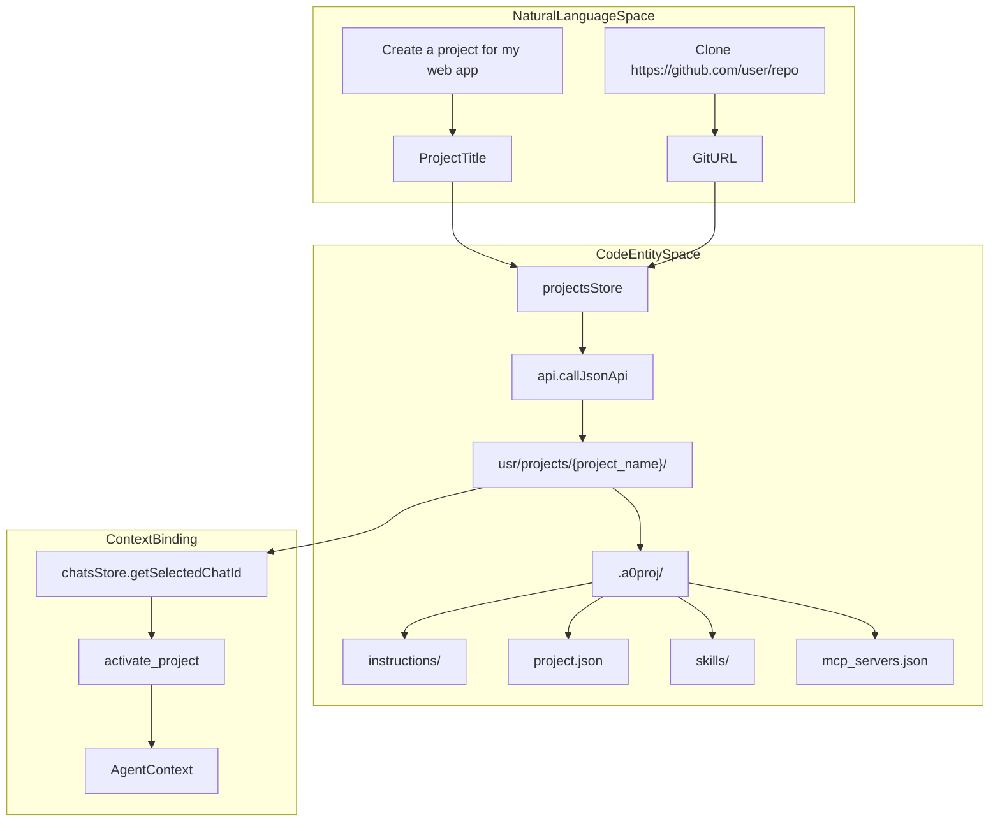
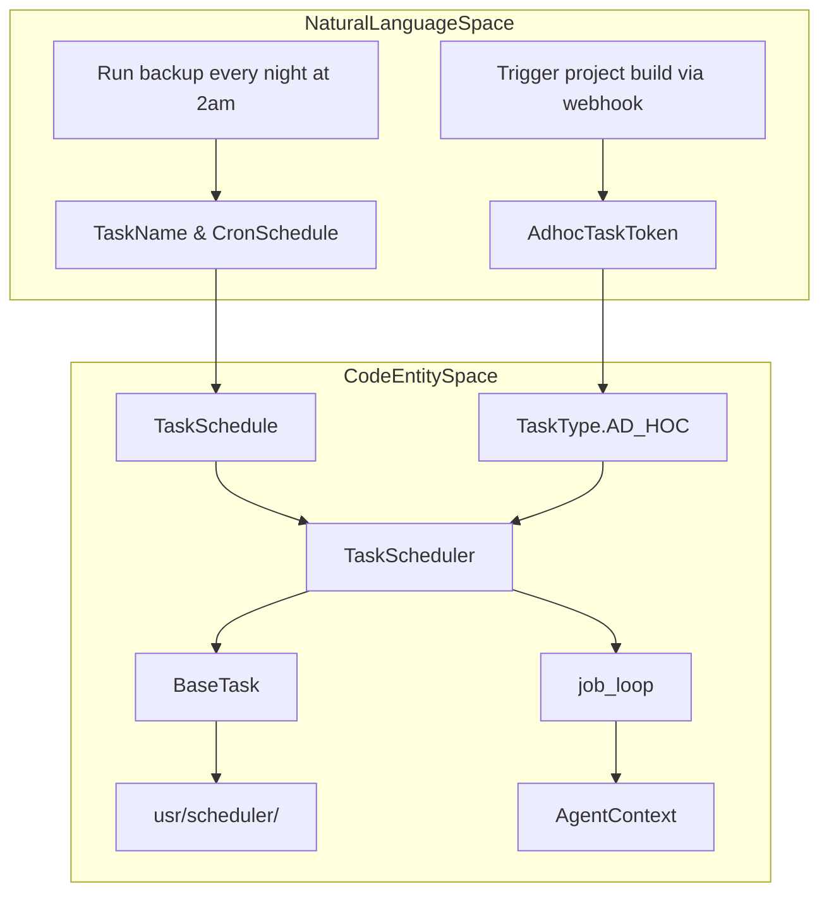
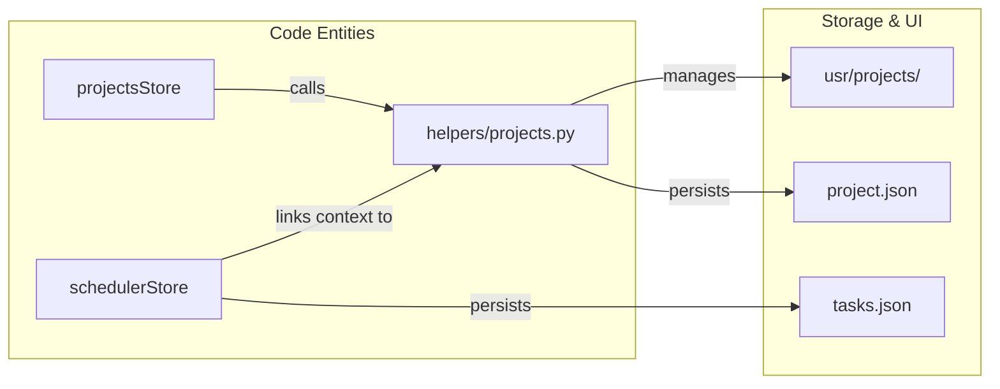

<!-- source: DeepWiki mcp.deepwiki.com · repo agent0ai/agent-zero · page 7 Projects & Task Scheduler · fetched 2026-10-29 -->

# Projects & Task Scheduler

Relevant source files

The following files were used as context for generating this wiki page:

- [helpers/AGENTS.md](helpers/AGENTS.md)
- [helpers/projects.py](helpers/projects.py)
- [helpers/projects.py.dox.md](helpers/projects.py.dox.md)
- [prompts/agent.protocol.projects.agents_md.md](prompts/agent.protocol.projects.agents_md.md)
- [prompts/agent.system.projects.active.md](prompts/agent.system.projects.active.md)
- [tests/test_projects.py](tests/test_projects.py)

The Projects and Task Scheduler subsystems provide Agent Zero with organizational structure and autonomous operational capabilities. Projects allow for strict isolation of files, instructions, and secrets between different use cases, while the Task Scheduler enables the agent to perform background operations without active user interaction.

## Purpose and Scope

This page serves as a high-level parent overview of the Projects isolation framework and the background Task Scheduler. Detailed technical implementations, such as Git cloning workflows, `.a0proj` metadata structures, cron parsing, and the `job_loop` runtime are documented in their respective child pages:
- **[Projects System](#7.1)**
- **[Task Scheduler](#7.2)**

---

## Projects System

The Projects system is designed to isolate the agent's work environment. Each project is a dedicated directory within `usr/projects/` [helpers/projects.py:11]() containing a `.a0proj` metadata folder [helpers/projects.py:12](). When a project is activated for a specific chat context via `activate_project()` [helpers/projects.py:48](), the system binds that context to the project's metadata, instructions, and secrets.

### Key Features
*   **Isolation:** The agent is instructed to work strictly inside the project path and follow project-specific rules [prompts/agent.system.projects.active.md:1-9]().
*   **Git Integration:** Projects can be created as empty directories or cloned from remote repositories via `clone_git_project()` [helpers/projects.py:121](). Private repository access uses temporary tokens via `git.clone_repo()` [helpers/projects.py:135]().
*   **Prompt Injection:** Project instructions, variables, and `AGENTS.md` files are automatically parsed and injected into the system prompt when a project is active [helpers/projects.py:51]().
*   **Secrets & Variables:** Projects manage sensitive credentials and environment variables separately from public instructions [helpers/projects.py:64-65]().

### Project Entity Mapping

**Sources:** [helpers/projects.py:11-17](), [helpers/projects.py:48](), [helpers/projects.py:121-135]()

For complete details on project creation, `.a0proj` metadata, Git cloning, instruction injection, and the Projects UI, see **[Projects System](#7.1)**.

---

## Task Scheduler

The Task Scheduler allows Agent Zero to execute tasks in the background, enabling long-running operations or periodic checks even when the Web UI is closed. Tasks are managed via the `schedulerStore` frontend and executed by backend task scheduling loops.

### Key Concepts
*   **Task Types:** Supports recurring tasks (`scheduled`), manual or one-time executions (`adhoc`), and timestamp-based triggers (`planned`) using `TaskType` [helpers/task_scheduler.py:85-89]().
*   **Task States:** Tasks transition between `idle`, `running`, `disabled`, and `error` states managed via `TaskState` [helpers/task_scheduler.py:78-83]().
*   **Cron & Timezone Handling:** Scheduled tasks use standard crontab syntax defined in `TaskSchedule` with timezone awareness derived from user settings [helpers/task_scheduler.py:91-98]().

### Task Scheduler Entity Mapping

**Sources:** [helpers/task_scheduler.py:78-98](), [helpers/task_scheduler.py:162-180]()

For details on the `TaskScheduler` class, crontab syntax, the `job_loop` implementation, and the Scheduler UI modal, see **[Task Scheduler](#7.2)**.

---

## Subsystem Relationship

The Projects and Scheduler systems are tightly coupled. A background task can be bound to a specific project context, ensuring that when the scheduler wakes the agent, it operates with the correct project-specific instructions, secrets, and file paths.

### Entity Association Diagram

**Sources:** [helpers/projects.py:11](), [helpers/task_scheduler.py:29-29]()

| Feature | Projects System | Task Scheduler |
| :--- | :--- | :--- |
| **Primary Controller** | `projectsStore` | `schedulerStore` |
| **Storage Location** | `usr/projects/` [helpers/projects.py:11]() | `usr/scheduler/` (backend) [helpers/task_scheduler.py:29-29]() |
| **UI Component** | `project-edit.html` | `scheduler-modal.html` |
| **Context** | Workspace isolation and LLM prompt injection | Background autonomous execution |
| **Interaction** | Manual activation per chat session | Automated wake-up via backend `job_loop` |

**Sources:** [helpers/projects.py:11](), [helpers/task_scheduler.py:29-29]()

---

