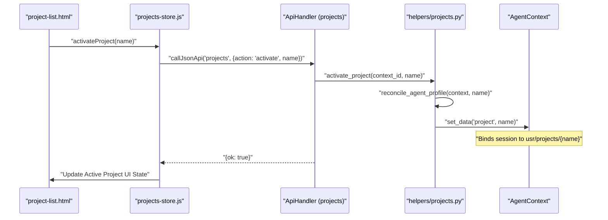

<!-- source: DeepWiki mcp.deepwiki.com · repo agent0ai/agent-zero · page 7.1 Projects System · fetched 2026-10-29 -->

# Projects System

<details>
<summary>Relevant source files</summary>

The following files were used as context for generating this wiki page:

- [helpers/AGENTS.md](helpers/AGENTS.md)
- [helpers/projects.py](helpers/projects.py)
- [helpers/projects.py.dox.md](helpers/projects.py.dox.md)
- [plugins/_a0_connector/api/v1/model_presets.py](plugins/_a0_connector/api/v1/model_presets.py)
- [prompts/agent.protocol.projects.agents_md.md](prompts/agent.protocol.projects.agents_md.md)
- [prompts/agent.system.projects.active.md](prompts/agent.system.projects.active.md)
- [tests/test_projects.py](tests/test_projects.py)
- [webui/components/projects/AGENTS.md](webui/components/projects/AGENTS.md)
- [webui/components/projects/project-create.html](webui/components/projects/project-create.html)
- [webui/components/projects/project-edit-basic-data.html](webui/components/projects/project-edit-basic-data.html)
- [webui/components/projects/project-edit-instructions.html](webui/components/projects/project-edit-instructions.html)
- [webui/components/projects/project-edit-llm.html](webui/components/projects/project-edit-llm.html)
- [webui/components/projects/project-edit-secrets.html](webui/components/projects/project-edit-secrets.html)
- [webui/components/projects/project-edit.html](webui/components/projects/project-edit.html)
- [webui/components/projects/project-list.html](webui/components/projects/project-list.html)
- [webui/components/projects/project-selector.html](webui/components/projects/project-selector.html)
- [webui/components/projects/projects-store.js](webui/components/projects/projects-store.js)

</details>


The Projects System in Agent Zero provides a mechanism for workspace isolation, allowing users to separate different use cases, clients, or tasks into dedicated environments. Each project maintains its own file structure, custom instructions, secrets, MCP servers, knowledge base, and memory, preventing context bleed and ensuring the agent operates within the specific boundaries of a given task [helpers/projects.py:11-17]().

Sources: [helpers/projects.py:11-17]()

## Project Structure and Metadata

Every project is stored under the `usr/projects/` directory within the Agent Zero environment [helpers/projects.py:11-11](). A project is identified by its folder name, and its configuration is managed via a hidden `.a0proj` metadata directory [helpers/projects.py:12-12]().

### Key Components of a Project
| Component | Location / Implementation | Purpose |
| :--- | :--- | :--- |
| **Metadata** | `.a0proj/project.json` | Stores title, color, description, and basic configuration [helpers/projects.py:16-16](). |
| **Instructions** | `.a0proj/instructions/` | Additional text files injected into the system prompt [helpers/projects.py:13-13](). |
| **Knowledge** | `.a0proj/knowledge/` | Project-scoped documents used for knowledge base and reindexing [helpers/projects.py:14-14](). |
| **MCP Servers** | `.a0proj/mcp_servers.json` | Project-scoped Model Context Protocol server configurations [helpers/projects.py:17-17](). |
| **Secrets** | `.a0proj/secrets.env` | Sensitive credentials masked in logs and prompt views [helpers/projects.py:65-65](). |
| **Variables** | `.a0proj/variables.env` | Non-sensitive environment variables injected into the system prompt [helpers/projects.py:64-64](). |
| **Skills** | `.a0proj/skills/` | Project-specific executable skills available to the agent [helpers/projects.py:15-15](). |
| **Agents** | `.a0proj/agents.json` | Registry of project-scoped agent profile availability [helpers/projects.py:81-87](). |

Sources: [helpers/projects.py:11-17](), [helpers/projects.py:64-65](), [helpers/projects.py:81-87]()

## Project Lifecycle and Data Flow

The lifecycle of a project involves creation (optionally via Git), activation (binding to a chat context), and prompt injection.

### 1. Creation and Git Integration
Projects can be created as empty directories or cloned from Git repositories [helpers/projects.py:107-118](), [helpers/projects.py:121-164]().
*   **Git Cloning**: The backend `clone_git_project` handles cloning via `git.clone_repo` [helpers/projects.py:121-135]().
*   **Authentication**: Supports access tokens for private repositories; tokens are used via `http.extraHeader` during cloning and are not stored permanently [helpers/projects.py:134-136]().
*   **Merging**: If a cloned repository already contains an `.a0proj` directory, the system merges user-specified fields while preserving existing configuration [helpers/projects.py:138-146]().
*   **Naming**: Project names are validated to ensure they are safe for filesystem use [helpers/projects.py:89-97](). The frontend uses `_toFolderName` to sanitize titles [webui/components/projects/projects-store.js:55-68]().

### 2. Activation and Context Binding
Activation binds a project to the current `AgentContext`. This is triggered via the `activate_project` helper which associates the project with a specific `context_id` [helpers/projects.py:467-470]().
*   **Context Storage**: The project association is stored in the chat context data under the key `project` [helpers/projects.py:27-27]().
*   **Profile Reconciliation**: Activating a project triggers `reconcile_agent_profile`. If the current profile is not available in the new project scope, it falls back to a valid profile (e.g., `agent0`) [helpers/projects.py:445-455]().
*   **Deactivation**: The `deactivate_project` helper removes the binding and reverts the profile if necessary [helpers/projects.py:478-482]().

### 3. Prompt Injection, Secrets, Variables & Knowledge Reindexing
When a project is active, its metadata, variables, secrets, and file structure are injected into the agent's system prompt by prompt extensions such as `IncludeWorkdirExtras` [extensions/python/message_loop_prompts_after/_75_include_workdir_extras.py:9-10]().
*   **File Structure Injection**: The system can inject a directory tree of the project into the prompt, governed by `FileStructureInjectionSettings` (max depth, max files, gitignore) [helpers/projects.py:30-37](), [extensions/python/message_loop_prompts_after/_75_include_workdir_extras.py:25-42]().
*   **Instructions & Variables**: The content of the `instructions` field, instruction files within `.a0proj/instructions/`, and variables from `variables.env` are appended to the agent's context [helpers/projects.py:545-555]().
*   **Secrets Masking**: Secrets defined in `secrets.env` are masked across agent logs and error traces [helpers/projects.py:65-65]().
*   **Knowledge Reindexing**: Documents placed in `.a0proj/knowledge/` are indexed into the project-scoped vector database, allowing the agent to perform document queries over project files [helpers/projects.py:14-14]().
*   **AGENTS.md Discovery**: The system searches for project-specific documentation in a chain (`AGENTS.override.md`, `AGENTS.md`) to guide agent behavior [helpers/projects.py:18-24](), [helpers/projects.py:522-530]().

Sources: [helpers/projects.py:27-164](), [helpers/projects.py:445-482](), [helpers/projects.py:522-555](), [extensions/python/message_loop_prompts_after/_75_include_workdir_extras.py:9-42](), [webui/components/projects/projects-store.js:55-68]()

## Project-Scoped Agent Profiles

Agent Zero allows for controlling which agent profiles are active within a project [helpers/projects.py:589-601]().
*   **Availability Registry**: Project-scoped profile availability is persisted sparsely in `.a0proj/agents.json` [helpers/projects.py:81-84]().
*   **Toggle Mechanism**: `set_project_subagent_enabled` updates the registry, preserving unrelated entries and refusing malformed data [helpers/projects.py:611-622]().
*   **Reconciliation**: During project switches, `reconcile_agent_profiles` ensures that all active chats in the scope are using profiles currently enabled for that project [helpers/projects.py:457-465]().

Sources: [helpers/projects.py:81-84](), [helpers/projects.py:457-465](), [helpers/projects.py:611-622]()

## Technical Implementation Diagrams

### Project Activation Flow
This diagram illustrates how a UI interaction triggers a backend state change to bind a project to a chat session.


Sources: [helpers/projects.py:27-27](), [helpers/projects.py:467-470](), [webui/components/projects/projects-store.js:209-215]()

### Natural Language to Code Entity Space: Project Creation & Persistence
This diagram maps frontend user inputs to backend Python functions and files responsible for project creation, metadata storage, and git cloning.

```mermaid
graph TD
    subgraph NaturalLanguageSpaceUI
        Title["ProjectTitleInput"]
        Instr["InstructionsTextarea"]
        MCPServers["MCPServersJSONEditor"]
        SecretsInput["SecretsEditorEnvFormat"]
        GitUrl["GitRepositoryURL"]
    end

    subgraph CodeEntitySpaceBackendFiles
        PHelper["helpers/projects.py"]
        CreateProj["create_project()"]
        CloneProj["clone_git_project()"]
        PJson[".a0proj/project.json"]
        PMcpJson[".a0proj/mcp_servers.json"]
        PSecretsEnv[".a0proj/secrets.env"]
        GitHelper["helpers/git.py"]
    end

    Title -->| "confirmCreate()" | PHelper
    GitUrl -->| "cloneProject()" | CloneProj
    CloneProj -->| "git.clone_repo()" | GitHelper
    PHelper -->| "create_project()" | CreateProj
    CreateProj -->| "save_project_header()" | PJson
    Instr -->| "save_project_header()" | PJson
    MCPServers -->| "save_project_mcp_servers()" | PMcpJson
    SecretsInput -->| "save_project_extended_data()" | PHelper
    PHelper -->| "get_project_meta()" | PSecretsEnv
```
Sources: [helpers/projects.py:107-157](), [helpers/projects.py:16-17](), [webui/components/projects/projects-store.js:116-201]()

### Natural Language to Code Entity Space: Activation & Prompt Injection
This diagram maps UI activation actions and workspace directories to the active agent execution context and prompt pipeline.

```mermaid
graph TD
    subgraph NaturalLanguageSpaceUI
        Selector["project-selector.html"]
        ProjList["project-list.html"]
        StoreAction["projects-store.js: activateProject()"]
    end

    subgraph CodeEntitySpaceBackendRuntime
        Activate["helpers/projects.py: activate_project()"]
        Reconcile["helpers/projects.py: reconcile_agent_profile()"]
        Context["agent.py: AgentContext"]
        Injector["extensions/python/message_loop_prompts_after/_75_include_workdir_extras.py"]
        PromptVars["helpers/projects.py: build_system_prompt_vars()"]
    end

    Selector -->| "Click Project" | StoreAction
    ProjList -->| "Click Activate" | StoreAction
    StoreAction -->| "API Call" | Activate
    Activate -->| "Verify Profile" | Reconcile
    Activate -->| "Bind Context" | Context
    Context -->| "Include Extras" | Injector
    Injector -->| "Render Prompt" | PromptVars
```
Sources: [helpers/projects.py:445-470](), [webui/components/projects/project-selector.html:48-52](), [extensions/python/message_loop_prompts_after/_75_include_workdir_extras.py:9-42]()

## Project UI Components

The Projects system is managed through several Alpine.js-powered components:

*   **`project-list.html`**: The main management modal showing all available projects with their status, color coding, and activation toggles [webui/components/projects/project-list.html:12-86]().
*   **`project-create.html`**: A wizard for initializing new projects, supporting both empty projects and Git clones with security warnings [webui/components/projects/project-create.html:11-62](), [webui/components/projects/projects-store.js:130-147]().
*   **`project-edit.html`**: A comprehensive interface composed of sub-components for detailed configuration [webui/components/projects/project-edit.html:11-106]().
*   **`project-selector.html`**: A dropdown component integrated into the navigation bar for quick project switching and status inspection [webui/components/projects/project-selector.html:11-56]().

### Configuration Sub-components
| Component | Purpose | Code Reference |
| :--- | :--- | :--- |
| `project-edit-basic-data.html` | Title, color, and description | [helpers/projects.py:41-44]() |
| `project-edit-llm.html` | Project-specific model selection and presets | [webui/components/projects/project-edit-llm.html:12-32]() |
| `project-edit-instructions.html` | System prompt fragments and file management | [helpers/projects.py:13-13]() |
| `project-edit-skills.html` | Management and importing of project-scoped skills | [webui/components/projects/projects-store.js:70-89]() |
| `project-edit-mcp.html` | Configuration for project-specific MCP servers | [helpers/projects.py:17-17]() |
| `project-edit-secrets.html` | Scoped environment variables and hashed secrets | [helpers/projects.py:64-65]() |

Sources: [webui/components/projects/projects-store.js:70-89](), [webui/components/projects/project-edit.html:33-88](), [webui/components/projects/project-edit-llm.html:12-32](), [webui/components/projects/project-selector.html:11-56]()

---

