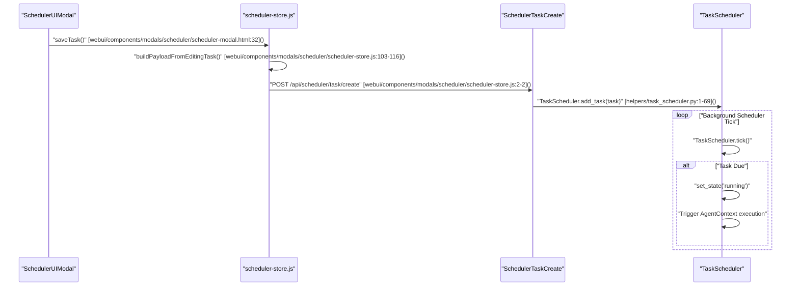

<!-- source: DeepWiki mcp.deepwiki.com · repo agent0ai/agent-zero · page 7.2 Task Scheduler · fetched 2026-10-29 -->

# Task Scheduler

<details>
<summary>Relevant source files</summary>

The following files were used as context for generating this wiki page:

- [api/scheduler_task_create.py](api/scheduler_task_create.py)
- [api/scheduler_task_create.py.dox.md](api/scheduler_task_create.py.dox.md)
- [helpers/task_scheduler.py](helpers/task_scheduler.py)
- [helpers/task_scheduler.py.dox.md](helpers/task_scheduler.py.dox.md)
- [tests/test_scheduler_editor.py](tests/test_scheduler_editor.py)
- [webui/components/modals/AGENTS.md](webui/components/modals/AGENTS.md)
- [webui/components/modals/scheduler/scheduler-modal.html](webui/components/modals/scheduler/scheduler-modal.html)
- [webui/components/modals/scheduler/scheduler-prompt-editor.html](webui/components/modals/scheduler/scheduler-prompt-editor.html)
- [webui/components/modals/scheduler/scheduler-store.js](webui/components/modals/scheduler/scheduler-store.js)
- [webui/components/modals/scheduler/scheduler-task-detail.html](webui/components/modals/scheduler/scheduler-task-detail.html)
- [webui/components/modals/scheduler/scheduler-task-editor.html](webui/components/modals/scheduler/scheduler-task-editor.html)
- [webui/components/modals/scheduler/scheduler-task-list.html](webui/components/modals/scheduler/scheduler-task-list.html)
- [webui/css/buttons.css](webui/css/buttons.css)
- [webui/css/scheduler.css](webui/css/scheduler.css)
- [webui/css/tables.css](webui/css/tables.css)

</details>


The **Task Scheduler** is a background subsystem in Agent Zero responsible for managing and executing automated agent workloads. It supports recurring crontab-based schedules, ad-hoc API-triggered executions via tokens, and complex multi-step "planned" tasks. The scheduler operates within the framework runtime to trigger agent instances based on time-based or state-based conditions.

---

## Architecture & Data Flow

The scheduler follows a producer-consumer pattern where the backend maintains a persistent state of tasks under `usr/scheduler`, and a background loop continuously evaluates which tasks are due for execution [helpers/task_scheduler.py:29-29](), [helpers/task_scheduler.py.dox.md:86-89]().

### Task Types and States
Tasks are categorized by their trigger mechanism and current lifecycle phase:

| Property | Values | Description |
| :--- | :--- | :--- |
| **TaskType** | `adhoc`, `scheduled`, `planned` | Defines if a task runs once via a secret token (`adhoc`), repeats via cron (`scheduled`), or follows specific timestamps (`planned`). [helpers/task_scheduler.py:85-89]() |
| **TaskState** | `idle`, `running`, `disabled`, `error` | Represents the current execution status of the task. [helpers/task_scheduler.py:78-83]() |

### System Data Flow & Code Space Mapping
The following sequence diagram maps natural language scheduler operations to their concrete implementations in `api/scheduler_task_create.py`, `helpers/task_scheduler.py`, and the frontend `scheduler-store.js`.

**Scheduler Execution & Creation Flow (Natural Language to Code Space)**

Sources: [webui/components/modals/scheduler/scheduler-store.js:1-237](), [webui/components/modals/scheduler/scheduler-modal.html:12-24](), [api/scheduler_task_create.py:1-165](), [helpers/task_scheduler.py:1-202]()

---

## Core Backend Components

### 1. Data Models (`helpers/task_scheduler.py`)
The scheduler backend relies on strict Pydantic models to serialize and validate task parameters:
*   **`TaskSchedule`**: Encapsulates cron fields (`minute`, `hour`, `day`, `month`, `weekday`) and a `timezone` string [helpers/task_scheduler.py:91-101]().
*   **`TaskPlan`**: Manages explicit timestamps for `planned` task executions across `todo`, `in_progress`, and `done` collections [helpers/task_scheduler.py:103-160]().
*   **`BaseTask`**: The core data structure holding `uuid`, `name`, `system_prompt`, `prompt`, `attachments`, `project_name`, `project_color`, and execution timestamps [helpers/task_scheduler.py:162-182]().

### 2. Task Creation API (`api/scheduler_task_create.py`)
The `SchedulerTaskCreate` handler processes incoming task creation requests from the WebUI:
*   Extracts or normalizes project metadata via `load_basic_project_data` [api/scheduler_task_create.py:1-165]().
*   Generates a secure random token if an `adhoc` task is created without one [api/scheduler_task_create.py:1-165]().
*   Instantiates either `ScheduledTask`, `PlannedTask`, or `AdHocTask`, validates required fields, and registers the task with the singleton `TaskScheduler` instance [api/scheduler_task_create.py:1-165](), [helpers/task_scheduler.py:60-68]().

Sources: [helpers/task_scheduler.py:78-182](), [api/scheduler_task_create.py:12-165]()

---

## Scheduling Mechanisms

### Crontab-based Scheduling & Timezone Handling
For `scheduled` tasks, Agent Zero combines the python `crontab` library with explicit timezone resolution:
*   Cron expressions are parsed into minute, hour, day, month, and weekday components [helpers/task_scheduler.py:15-15](), [helpers/task_scheduler.py:91-101]().
*   **Timezone Aliases**: Timezone names are normalized using `normalize_schedule_timezone()`, converting shorthand aliases (`local`, `user`, `default`) into valid `pytz` timezones or falling back to the user's localized configuration [helpers/task_scheduler.py:30-43]().

### Planned Tasks
`planned` tasks maintain a chronological list of future execution datetimes in their `TaskPlan.todo` array [helpers/task_scheduler.py:103-119](). When `should_launch()` evaluates that the current time (`_now()`) exceeds the next launch timestamp, the scheduler promotes the execution time to `in_progress` [helpers/task_scheduler.py:132-160]().

Sources: [helpers/task_scheduler.py:15-160]()

---

## Scheduler UI Modal & Code Entity Mapping

The Scheduler UI is structured around Alpine.js stores and modular HTML components that handle listing, filtering, detail inspection, and editing [webui/components/modals/scheduler/scheduler-store.js:1-117](), [webui/components/modals/scheduler/scheduler-modal.html:1-39]().

**Architecture Component Mapping (Natural Language to Code Space)**
```mermaid
graph TD
    subgraph "WebUIComponents"
        Modal["scheduler-modal.html"]
        List["scheduler-task-list.html"]
        Editor["scheduler-task-editor.html"]
        Detail["scheduler-task-detail.html"]
    end

    subgraph "StateManagement"
        StoreJS["scheduler-store.js"]
        Editing["editingTask"]
    end

    subgraph "BackendAPI"
        CreateAPI["SchedulerTaskCreate"]
        SchedulerPy["TaskScheduler"]
    end

    Modal --> List
    Modal --> Editor
    Modal --> Detail
    
    Editor -- "x-model" --> Editing [webui/components/modals/scheduler/scheduler-task-editor.html:8-35]()
    StoreJS -- "POST /api/scheduler/task/create" --> CreateAPI
    CreateAPI -- "add_task()" --> SchedulerPy
```
Sources: [webui/components/modals/scheduler/scheduler-modal.html:1-39](), [webui/components/modals/scheduler/scheduler-store.js:1-237](), [api/scheduler_task_create.py:12-165]()

### Task Configuration Options in UI
*   **Task Name & Type**: Unique identifier and execution type selector (`scheduled`, `adhoc`, `planned`) [webui/components/modals/scheduler/scheduler-task-editor.html:18-35]().
*   **Project Assignment**: Binds tasks to specific project slugs or inherits the active chat project context [webui/components/modals/scheduler/scheduler-task-editor.html:38-54]().
*   **Initial State**: Configurable when creating new tasks (`idle` or `disabled`) [webui/components/modals/scheduler/scheduler-task-editor.html:56-65]().
*   **Attachments**: File paths injected into the task context, normalized via `normalizeAttachments()` into clean array lists [webui/components/modals/scheduler/scheduler-store.js:136-148]().

Sources: [webui/components/modals/scheduler/scheduler-task-editor.html:1-113](), [webui/components/modals/scheduler/scheduler-store.js:1-148]()

---

## Key Functions and Entities

| Entity | Location | Role |
| :--- | :--- | :--- |
| `TaskScheduler` | `helpers/task_scheduler.py` | Core singleton manager handling task persistence, reloading, and ticking [helpers/task_scheduler.py.dox.md:60-68](). |
| `TaskSchedule` | `helpers/task_scheduler.py:91` | Pydantic model for crontab expressions and timezone configuration [helpers/task_scheduler.py:91-101](). |
| `TaskPlan` | `helpers/task_scheduler.py:103` | Manages planned timestamps (`todo`, `in_progress`, `done`) [helpers/task_scheduler.py:103-107](). |
| `SchedulerTaskCreate` | `api/scheduler_task_create.py:12` | API handler validating and persisting new tasks [api/scheduler_task_create.py:12-165](). |
| `defaultSchedule` | `webui/components/modals/scheduler/scheduler-store.js:88` | Generates default cron parameters using user timezone [webui/components/modals/scheduler/scheduler-store.js:88-95](). |
| `normalizeSchedule` | `webui/components/modals/scheduler/scheduler-store.js:150` | Parses and normalizes cron strings or objects in the frontend store [webui/components/modals/scheduler/scheduler-store.js:150-173](). |
| `normalizePlanStruct` | `webui/components/modals/scheduler/scheduler-store.js:175` | Sanitizes planned task date arrays into ISO strings [webui/components/modals/scheduler/scheduler-store.js:175-199](). |
| `normalizeAttachments` | `webui/components/modals/scheduler/scheduler-store.js:136` | Cleans and filters attachment lists for task payloads [webui/components/modals/scheduler/scheduler-store.js:136-148](). |

Sources: [helpers/task_scheduler.py:1-202](), [api/scheduler_task_create.py:1-165](), [webui/components/modals/scheduler/scheduler-store.js:88-237]()

---

