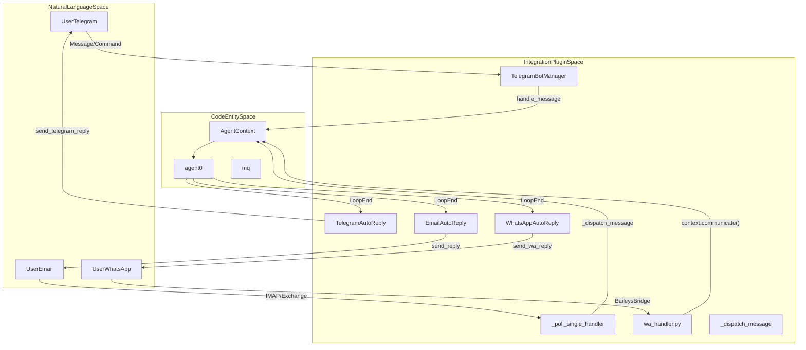
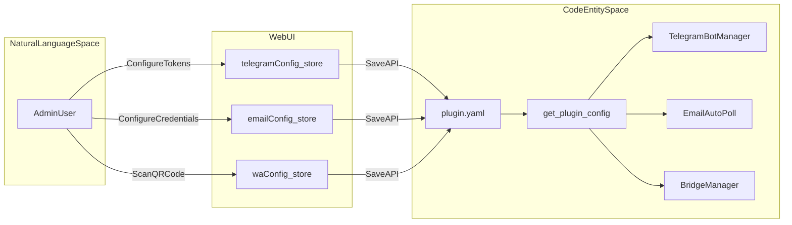

<!-- source: DeepWiki mcp.deepwiki.com · repo agent0ai/agent-zero · page 8 Integration Plugins · fetched 2026-10-29 -->

# Integration Plugins

Relevant source files

The following files were used as context for generating this wiki page:

- [helpers/integration_commands.py](helpers/integration_commands.py)
- [plugins/_telegram_integration/README.md](plugins/_telegram_integration/README.md)
- [plugins/_telegram_integration/extensions/python/job_loop/_10_telegram_bot.py](plugins/_telegram_integration/extensions/python/job_loop/_10_telegram_bot.py)
- [plugins/_telegram_integration/extensions/python/process_chain_end/_55_telegram_reply.py](plugins/_telegram_integration/extensions/python/process_chain_end/_55_telegram_reply.py)
- [plugins/_telegram_integration/extensions/python/system_prompt/_20_telegram_context.py](plugins/_telegram_integration/extensions/python/system_prompt/_20_telegram_context.py)
- [plugins/_telegram_integration/extensions/python/tool_execute_after/_50_telegram_response.py](plugins/_telegram_integration/extensions/python/tool_execute_after/_50_telegram_response.py)
- [plugins/_telegram_integration/extensions/python/tool_execute_before/_45_telegram_draft_tool.py](plugins/_telegram_integration/extensions/python/tool_execute_before/_45_telegram_draft_tool.py)
- [plugins/_telegram_integration/helpers/bot_manager.py](plugins/_telegram_integration/helpers/bot_manager.py)
- [plugins/_telegram_integration/helpers/command_ui.py](plugins/_telegram_integration/helpers/command_ui.py)
- [plugins/_telegram_integration/helpers/constants.py](plugins/_telegram_integration/helpers/constants.py)
- [plugins/_telegram_integration/helpers/handler.py](plugins/_telegram_integration/helpers/handler.py)
- [plugins/_telegram_integration/helpers/settings_ui.py](plugins/_telegram_integration/helpers/settings_ui.py)
- [plugins/_telegram_integration/helpers/telegram_client.py](plugins/_telegram_integration/helpers/telegram_client.py)
- [plugins/_telegram_integration/hooks.py](plugins/_telegram_integration/hooks.py)
- [plugins/_telegram_integration/prompts/fw.telegram.user_message.md](plugins/_telegram_integration/prompts/fw.telegram.user_message.md)
- [tests/test_telegram_media_delivery.py](tests/test_telegram_media_delivery.py)
- [tests/test_telegram_sessions_picker.py](tests/test_telegram_sessions_picker.py)

Integration plugins in Agent Zero connect the core agentic engine to external communication platforms. These plugins allow the agent to receive messages, process attachments, and respond within existing conversation threads on platforms like Telegram, Email, and WhatsApp. They leverage the `Extension` framework to hook into the agent's lifecycle, ensuring that external interactions feel native to the platform while maintaining consistent agent behavior.

## Overview

The integration system is designed to be multi-account and multi-platform. Each integration typically consists of:
- **Polling/Webhook Handlers**: Background tasks that monitor for new incoming messages.
- **Context Mapping**: Logic that associates external identifiers (e.g., a Telegram User ID or a WhatsApp JID) with a specific `AgentContext` [agent.py:1-20]().
- **Command Handling**: Support for control commands like `/project`, `/model`, and `/send` to manage the agent session directly from the messaging app [helpers/integration_commands.py:1-20]().
- **Response Extensions**: Hooks that trigger after the agent finishes its monologue loop to send the final response back to the external platform [plugins/_telegram_integration/extensions/python/process_chain_end/_55_telegram_reply.py:1-30]().
- **Web UI Configuration**: Custom settings panels for managing API tokens, server credentials, and access control [plugins/_telegram_integration/README.md:81-83]().

### System Architecture: Messaging to Code

The following diagram illustrates how external messages from different platforms are routed into the Agent Zero core and how responses are sent back, bridging the natural language space to code entity space.

**Message Routing and Response Flow**

Sources: [plugins/_telegram_integration/helpers/handler.py:155-169](), [plugins/_telegram_integration/extensions/python/job_loop/_10_telegram_bot.py:14-21](), [plugins/_telegram_integration/extensions/python/process_chain_end/_55_telegram_reply.py:18-30]()

---

## Supported Integrations

### Telegram Integration
The Telegram plugin manages one or more bot instances via the `TelegramBotManager` extension [plugins/_telegram_integration/extensions/python/job_loop/_10_telegram_bot.py:14-14](). It supports both long-polling and webhooks [plugins/_telegram_integration/helpers/bot_manager.py:159-206](), allowing the agent to function behind NAT or on public servers. It features a "Group Mode" that controls whether the agent responds to every message or only when explicitly mentioned [plugins/_telegram_integration/helpers/bot_manager.py:72-88]().

For details, see [Telegram Integration](#8.1).

Sources: [plugins/_telegram_integration/extensions/python/job_loop/_10_telegram_bot.py:14-21](), [plugins/_telegram_integration/helpers/bot_manager.py:72-206]()

### Email Integration
The Email plugin connects Agent Zero to standard mailboxes via IMAP (or Microsoft Exchange) and SMTP. It uses an "Email Dispatcher" agent to intelligently route incoming mail to existing chats or create new ones, supporting process-chain-end reply extensions and system-context prompts.

For details, see [Email Integration](#8.2).

Sources: [plugins/_email_integration/helpers/handler.py:1-40](), [plugins/_email_integration/extensions/python/process_chain_end/_55_email_reply.py:1-25]()

### WhatsApp Integration
The WhatsApp integration uses a bridge architecture to connect the Python framework to a Node.js-based WhatsApp client using the `Baileys` library via `bridge_manager.py` and `wa_client` polling. It supports QR code pairing, allowed-numbers access control, media delivery, and session persistence.

For details, see [WhatsApp Integration](#8.3).

Sources: [plugins/_whatsapp_integration/README.md:1-20]()

---

## Plugin Lifecycle & Configuration

Integration plugins are managed via the standard plugin system. They can be toggled on/off, and their configurations are stored in `plugin.yaml` within the respective plugin directory.

### Configuration UI Mapping

Each integration provides a configuration interface within the Web UI. These interfaces map frontend state to backend configuration using Alpine.js stores, tying frontend user actions directly to backend classes and manifest files.

**Configuration Entity Mapping**

Sources: [plugins/_telegram_integration/extensions/python/job_loop/_10_telegram_bot.py:17-18](), [plugins/_telegram_integration/helpers/handler.py:69-70]()

### Comparison of Integration Features

| Feature | Telegram | Email | WhatsApp |
| :--- | :--- | :--- | :--- |
| **Transport** | HTTPS (Polling/Webhook) [plugins/_telegram_integration/helpers/bot_manager.py:159-206]() | IMAP / SMTP / Exchange [plugins/_email_integration/helpers/handler.py:80-91]() | Node.js Bridge (Baileys) |
| **Authentication** | Bot Token [plugins/_telegram_integration/extensions/python/job_loop/_10_telegram_bot.py:20-20]() | Username / Password [plugins/_email_integration/helpers/handler.py:89-90]() | QR Code Pairing |
| **Threading** | `bot:user:chat` key [plugins/_telegram_integration/helpers/handler.py:63-64]() | Subject [a0-id] / AI Dispatcher [plugins/_email_integration/helpers/dispatcher.py:1-20]() | WhatsApp JID |
| **Attachments** | Supported [plugins/_telegram_integration/helpers/telegram_client.py:68-75]() | Supported | Supported |
| **Typing Indicator** | Supported [plugins/_telegram_integration/helpers/handler.py:254-255]() | N/A | Supported |
| **Group Support** | Mention / All / Off [plugins/_telegram_integration/helpers/bot_manager.py:72-88]() | CC / Mailing Lists | Supported |

Sources: [plugins/_telegram_integration/helpers/handler.py:1-40](), [plugins/_telegram_integration/helpers/bot_manager.py:53-91]()

---

