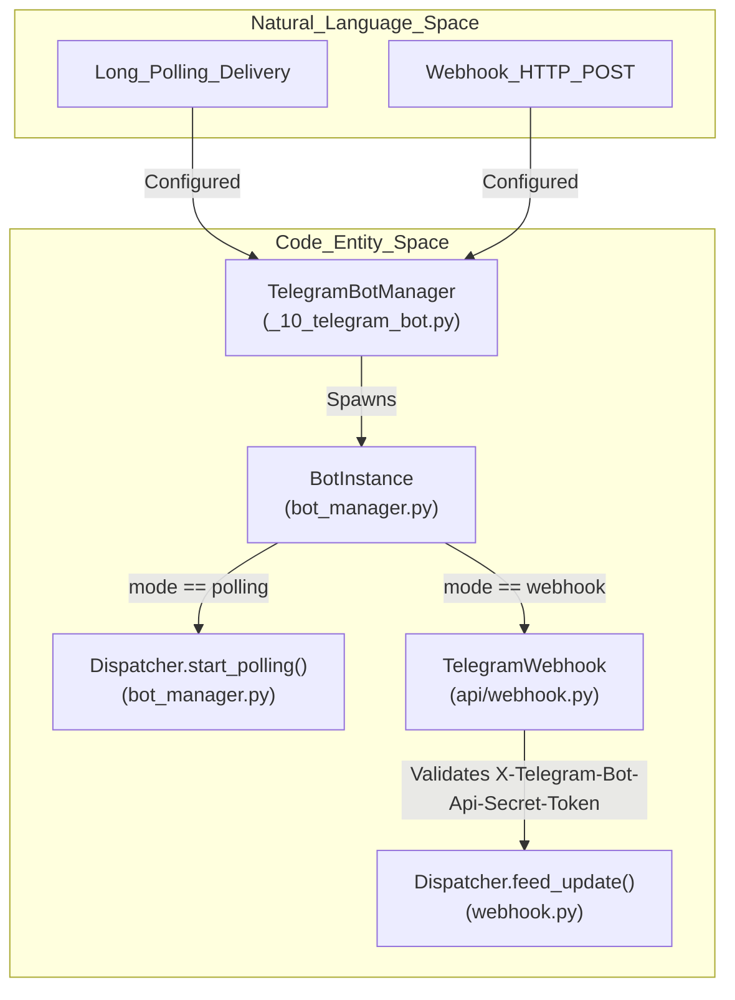
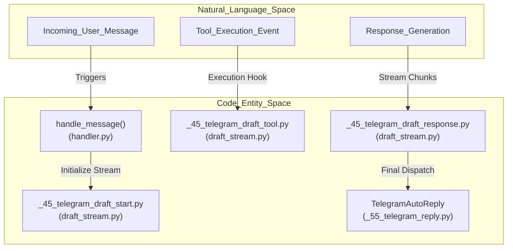

<!-- source: DeepWiki mcp.deepwiki.com · repo agent0ai/agent-zero · page 8.1 Telegram Integration · fetched 2026-10-29 -->

# Telegram Integration

Relevant source files

The following files were used as context for generating this wiki page:

- [api/agents.py.dox.md](api/agents.py.dox.md)
- [helpers/integration_commands.py](helpers/integration_commands.py)
- [helpers/integration_commands.py.dox.md](helpers/integration_commands.py.dox.md)
- [plugins/_email_integration/api/test_connection.py](plugins/_email_integration/api/test_connection.py)
- [plugins/_telegram_integration/AGENTS.md](plugins/_telegram_integration/AGENTS.md)
- [plugins/_telegram_integration/README.md](plugins/_telegram_integration/README.md)
- [plugins/_telegram_integration/api/test_connection.py](plugins/_telegram_integration/api/test_connection.py)
- [plugins/_telegram_integration/api/webhook.py](plugins/_telegram_integration/api/webhook.py)
- [plugins/_telegram_integration/default_config.yaml](plugins/_telegram_integration/default_config.yaml)
- [plugins/_telegram_integration/extensions/python/_functions/agent/Agent/handle_exception/end/_85_telegram_error.py](plugins/_telegram_integration/extensions/python/_functions/agent/Agent/handle_exception/end/_85_telegram_error.py)
- [plugins/_telegram_integration/extensions/python/job_loop/_10_telegram_bot.py](plugins/_telegram_integration/extensions/python/job_loop/_10_telegram_bot.py)
- [plugins/_telegram_integration/extensions/python/message_loop_start/_45_telegram_draft_start.py](plugins/_telegram_integration/extensions/python/message_loop_start/_45_telegram_draft_start.py)
- [plugins/_telegram_integration/extensions/python/process_chain_end/_55_telegram_reply.py](plugins/_telegram_integration/extensions/python/process_chain_end/_55_telegram_reply.py)
- [plugins/_telegram_integration/extensions/python/response_stream/_45_telegram_draft_response.py](plugins/_telegram_integration/extensions/python/response_stream/_45_telegram_draft_response.py)
- [plugins/_telegram_integration/extensions/python/system_prompt/_20_telegram_context.py](plugins/_telegram_integration/extensions/python/system_prompt/_20_telegram_context.py)
- [plugins/_telegram_integration/extensions/python/tool_execute_after/_50_telegram_response.py](plugins/_telegram_integration/extensions/python/tool_execute_after/_50_telegram_response.py)
- [plugins/_telegram_integration/extensions/python/tool_execute_before/_45_telegram_draft_tool.py](plugins/_telegram_integration/extensions/python/tool_execute_before/_45_telegram_draft_tool.py)
- [plugins/_telegram_integration/helpers/bot_manager.py](plugins/_telegram_integration/helpers/bot_manager.py)
- [plugins/_telegram_integration/helpers/command_ui.py](plugins/_telegram_integration/helpers/command_ui.py)
- [plugins/_telegram_integration/helpers/constants.py](plugins/_telegram_integration/helpers/constants.py)
- [plugins/_telegram_integration/helpers/draft_stream.py](plugins/_telegram_integration/helpers/draft_stream.py)
- [plugins/_telegram_integration/helpers/error_ui.py](plugins/_telegram_integration/helpers/error_ui.py)
- [plugins/_telegram_integration/helpers/handler.py](plugins/_telegram_integration/helpers/handler.py)
- [plugins/_telegram_integration/helpers/heartbeat.py](plugins/_telegram_integration/helpers/heartbeat.py)
- [plugins/_telegram_integration/helpers/settings_ui.py](plugins/_telegram_integration/helpers/settings_ui.py)
- [plugins/_telegram_integration/helpers/telegram_client.py](plugins/_telegram_integration/helpers/telegram_client.py)
- [plugins/_telegram_integration/hooks.py](plugins/_telegram_integration/hooks.py)
- [plugins/_telegram_integration/prompts/fw.telegram.user_message.md](plugins/_telegram_integration/prompts/fw.telegram.user_message.md)
- [plugins/_telegram_integration/webui/config.html](plugins/_telegram_integration/webui/config.html)
- [plugins/_telegram_integration/webui/telegram-config-store.js](plugins/_telegram_integration/webui/telegram-config-store.js)
- [plugins/_whatsapp_integration/api/test_connection.py](plugins/_whatsapp_integration/api/test_connection.py)
- [plugins/_whatsapp_integration/plugin.yaml](plugins/_whatsapp_integration/plugin.yaml)
- [plugins/_whatsapp_integration/webui/config.html](plugins/_whatsapp_integration/webui/config.html)
- [plugins/_whatsapp_integration/webui/whatsapp-config-store.js](plugins/_whatsapp_integration/webui/whatsapp-config-store.js)
- [security-review/LEDGER.md](security-review/LEDGER.md)
- [tests/test_telegram_error_ui.py](tests/test_telegram_error_ui.py)
- [tests/test_telegram_heartbeat.py](tests/test_telegram_heartbeat.py)
- [tests/test_telegram_intermediate_response.py](tests/test_telegram_intermediate_response.py)
- [tests/test_telegram_media_delivery.py](tests/test_telegram_media_delivery.py)
- [tests/test_telegram_sessions_picker.py](tests/test_telegram_sessions_picker.py)
- [tests/test_telegram_webhook_security.py](tests/test_telegram_webhook_security.py)
- [tests/test_whatsapp_config_store.mjs](tests/test_whatsapp_config_store.mjs)

The purpose of this page is to document the implementation, architecture, and operational mechanics of the Telegram Integration plugin (`_telegram_integration`) within Agent Zero. The scope covers bot lifecycle management via `TelegramBotManager`, `BotInstance` orchestration, long-polling and webhook dispatch mechanisms, multi-user `AgentContext` session mapping, access control, group interaction modes, Markdown-to-HTML translation, attachment processing, draft streaming, inline keyboard handling, and error recovery protocols.

Sources: `[plugins/_telegram_integration/README.md:1-83]`, `[plugins/_telegram_integration/AGENTS.md:1-16]`

---

## 1. TelegramBotManager & BotInstance Lifecycle

The `TelegramBotManager` class is implemented as a job loop extension (`[plugins/_telegram_integration/extensions/python/job_loop/_10_telegram_bot.py:14-114]()`) that executes on every scheduling tick to inspect plugin configurations and synchronize active bot instances (`[plugins/_telegram_integration/README.md:14-18]()`).

- **Dependency Bootstrap**: During active ticks, it invokes `ensure_dependencies()` from `helpers/dependencies.py` to install `aiogram` into the runtime environment if any bot is enabled (`[plugins/_telegram_integration/extensions/python/job_loop/_10_telegram_bot.py:27-28]`, `[plugins/_telegram_integration/README.md:11-13]()`).
- **BotInstance Management**: Each configured bot is wrapped in a `BotInstance` dataclass (`[plugins/_telegram_integration/helpers/bot_manager.py:18-30]()`) which holds the `aiogram.Bot` instance, `Dispatcher`, `Router`, background polling `asyncio.Task`, webhook state flags, and cached `bot_info` (`[plugins/_telegram_integration/helpers/bot_manager.py:18-30]()`).
- **Re-creation Triggers**: If settings such as `token`, `mode` (`polling` vs `webhook`), `webhook_url`, `webhook_secret`, or `group_mode` change, the manager stops the running instance via `stop_bot()` and instantiates a replacement (`[plugins/_telegram_integration/extensions/python/job_loop/_10_telegram_bot.py:61-78]()`).

### Polling vs. Webhook Architecture

*Figure 1: TelegramBotManager routing incoming updates via long-polling or webhook endpoints.*

- **Polling Mode**: Initiates a background task invoking `instance.dispatcher.start_polling()` with signal handling disabled (`[plugins/_telegram_integration/helpers/bot_manager.py:165-183]()`).
- **Webhook Mode**: Exposes an HTTP POST endpoint at `/api/plugins/_telegram_integration/webhook` managed by `TelegramWebhook` (`[plugins/_telegram_integration/README.md:81-82]()`). Incoming requests are authenticated against `instance.webhook_secret` using constant-time comparison (`secrets.compare_digest`) via the `X-Telegram-Bot-Api-Secret-Token` header prior to feeding updates into the dispatcher (`[plugins/_telegram_integration/AGENTS.md:28]()`).

Sources: `[plugins/_telegram_integration/extensions/python/job_loop/_10_telegram_bot.py:14-121]`, `[plugins/_telegram_integration/helpers/bot_manager.py:18-194]`, `[plugins/_telegram_integration/api/webhook.py:1-55]`

---

## 2. AgentContext Mapping & State Persistence

Conversational threads across framework reloads are preserved by mapping Telegram chats and users to Agent Zero `AgentContext` instances (`[plugins/_telegram_integration/helpers/handler.py:40-60]()`).

- **Composite Key Structure**: Sessions are indexed using `_map_key(bot_name, user_id, chat_id)`, producing string keys formatted as `bot_name:user_id:chat_id` (`[plugins/_telegram_integration/helpers/handler.py:63-64]()`).
- **JSON State Serialization**: Mapping records are loaded and stored via `_load_state()` and `_save_state()` interacting with `STATE_FILE` (`[plugins/_telegram_integration/helpers/handler.py:47-61]()`).
- **Project Binding**: Each bot configuration maps individual users (`user_projects`) or falls back to a `default_project` for workspace scoping (`[plugins/_telegram_integration/helpers/handler.py:118-123]()`).
- **Access Control**: The `_is_allowed()` helper evaluates user IDs or `@usernames` against `allowed_users`. An empty list permits all users (`[plugins/_telegram_integration/helpers/handler.py:99-115]()`).

Sources: `[plugins/_telegram_integration/helpers/handler.py:40-123]`, `[plugins/_telegram_integration/helpers/constants.py:1-27]`

---

## 3. Message Processing Pipeline & Group Modes

Incoming messages are intercepted by `handle_message()` in `helpers/handler.py`, executing user authorization, command resolution, slash command processing, and queue dispatch (`[plugins/_telegram_integration/helpers/handler.py:155-212]()`).

### Group Interaction Modes

| Group Mode | Behavior | Implementation Detail |
| :--- | :--- | :--- |
| `off` | Private chats only; ignores groups entirely. | Registered with `ChatType.PRIVATE` filter (`[plugins/_telegram_integration/helpers/bot_manager.py:60-80]()`). |
| `mention` | Private chats receive all messages; groups respond only to explicit `@mentions`, replies to the bot, or mention entities. | Managed by `_make_group_mention_filter()` (`[plugins/_telegram_integration/helpers/bot_manager.py:81-88]`, `[plugins/_telegram_integration/helpers/bot_manager.py:118-161]()`). |
| `all` | Responds to all messages across private and group chats. | Unfiltered message router registration (`[plugins/_telegram_integration/helpers/bot_manager.py:90-91]()`). |

### Attachment Pipeline
- Telegram media (photos, documents, audio, voice, video) are downloaded into `usr/uploads/` using a filename prefix of `tg_{bot_name}_` (`[plugins/_telegram_integration/helpers/handler.py:190-192]`, `[plugins/_telegram_integration/README.md:40-41]()`).
- `cleanup_old_attachments()` runs on startup ticks to prune files older than `attachment_max_age_hours` (`[plugins/_telegram_integration/helpers/handler.py:67-95]()`).

Sources: `[plugins/_telegram_integration/helpers/handler.py:67-212]`, `[plugins/_telegram_integration/helpers/bot_manager.py:45-96]`

---

## 4. Markdown-to-HTML Conversion & Message Splitting

Telegram messages are dispatched using HTML formatting (`ParseMode.HTML`) (`[plugins/_telegram_integration/helpers/bot_manager.py:55]()`).

- **Markdown-to-HTML**: The `telegram_client.py` module converts standard Markdown elements (bold, italic, code blocks, links) into Telegram-compliant HTML tags while sanitizing malformed syntax (`[plugins/_telegram_integration/helpers/telegram_client.py:1-206]`, `[plugins/_telegram_integration/README.md:47-49]()`).
- **Chunking & Fallback**: If outbound text exceeds Telegram's 4096-character limit (`MAX_MESSAGE_LENGTH`), `send_text()` splits the payload into discrete chunks (`[plugins/_telegram_integration/helpers/telegram_client.py:20-42]()`). If a `TelegramBadRequest` exception occurs due to formatting errors, it strips HTML tags and retries dispatching as plain text (`[plugins/_telegram_integration/helpers/telegram_client.py:51-60]()`).

Sources: `[plugins/_telegram_integration/helpers/telegram_client.py:1-116]`

---

## 5. Draft Streaming, Tool Progress & Typing Indicators

*Figure 2: Draft streaming lifecycle across framework extension hooks and helper modules.*

- **Draft Streaming**: Managed via `draft_stream.py` and extension hooks (`_45_telegram_draft_start.py`, `_45_telegram_draft_tool.py`, `_45_telegram_draft_response.py`), which update live Telegram messages in-place using `editMessageText` to display tool progress and response previews without notification spam (`[plugins/_telegram_integration/README.md:72-80]()`).
- **Typing Indicator**: A background thread runs `bot.send_chat_action("typing")` periodically while processing, cancelled cleanly via `CTX_TG_TYPING_STOP` once the reply is transmitted (`[plugins/_telegram_integration/helpers/handler.py:36]`, `[plugins/_telegram_integration/extensions/python/process_chain_end/_55_telegram_reply.py:39-42]()`).

Sources: `[plugins/_telegram_integration/helpers/draft_stream.py:1-100]`, `[plugins/_telegram_integration/extensions/python/process_chain_end/_55_telegram_reply.py:18-48]`, `[plugins/_telegram_integration/helpers/handler.py:1-212]`

---

## 6. Heartbeat, Error UI & Recovery

- **Heartbeat**: Background heartbeats monitor long-running sessions, dispatching status pings or maintaining connection health (`[plugins/_telegram_integration/helpers/heartbeat.py:1-50]`, `[tests/test_telegram_heartbeat.py:1-50]()`).
- **Error UI**: Unhandled agent exceptions or critical failures trigger `_85_telegram_error.py` and `error_ui.py`, feeding formatted error prompts back into the context or sending clean alert notifications to the user (`[plugins/_telegram_integration/extensions/python/_functions/agent/Agent/handle_exception/end/_85_telegram_error.py:1-40]`, `[plugins/_telegram_integration/helpers/error_ui.py:1-50]()`).
- **Delivery Retries**: `TelegramAutoReply` implements retry logic (`MAX_SEND_RETRIES = 2`), injecting failure notifications (`fw.telegram.send_failed.md`) into the agent context if replies fail to transmit (`[plugins/_telegram_integration/extensions/python/process_chain_end/_55_telegram_reply.py:14-103]()`).

Sources: `[plugins/_telegram_integration/helpers/heartbeat.py:1-50]`, `[plugins/_telegram_integration/helpers/error_ui.py:1-50]`, `[plugins/_telegram_integration/extensions/python/process_chain_end/_55_telegram_reply.py:14-103]`, `[plugins/_telegram_integration/extensions/python/_functions/agent/Agent/handle_exception/end/_85_telegram_error.py:1-40]`

---

## 7. WebUI Configuration & Management

The plugin configuration UI (`webui/config.html` and `webui/telegram-config-store.js`) provides an Alpine.js-driven setup wizard for managing bot tokens, delivery modes, webhook URLs, group filtering options, and access lists (`[plugins/_telegram_integration/webui/config.html:1-139]`, `[plugins/_telegram_integration/webui/telegram-config-store.js:1-141]()`).

Sources: `[plugins/_telegram_integration/webui/config.html:1-139]`, `[plugins/_telegram_integration/webui/telegram-config-store.js:1-141]`

---

