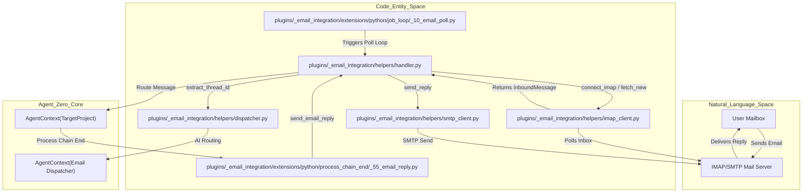
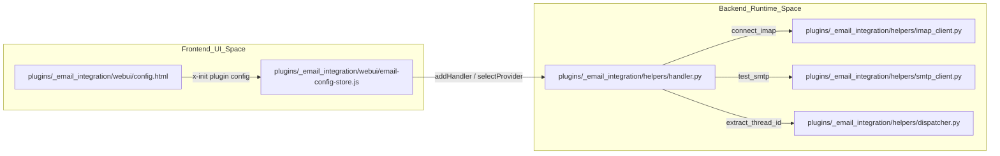

<!-- source: DeepWiki mcp.deepwiki.com · repo agent0ai/agent-zero · page 8.2 Email Integration · fetched 2026-10-29 -->

# Email Integration

Relevant source files

The following files were used as context for generating this wiki page:

- [helpers/job_loop.py](helpers/job_loop.py)
- [plugins/_email_integration/AGENTS.md](plugins/_email_integration/AGENTS.md)
- [plugins/_email_integration/README.md](plugins/_email_integration/README.md)
- [plugins/_email_integration/default_config.yaml](plugins/_email_integration/default_config.yaml)
- [plugins/_email_integration/extensions/python/job_loop/_10_email_poll.py](plugins/_email_integration/extensions/python/job_loop/_10_email_poll.py)
- [plugins/_email_integration/extensions/python/process_chain_end/_55_email_reply.py](plugins/_email_integration/extensions/python/process_chain_end/_55_email_reply.py)
- [plugins/_email_integration/extensions/python/system_prompt/_20_email_context.py](plugins/_email_integration/extensions/python/system_prompt/_20_email_context.py)
- [plugins/_email_integration/extensions/python/tool_execute_after/_50_email_response.py](plugins/_email_integration/extensions/python/tool_execute_after/_50_email_response.py)
- [plugins/_email_integration/helpers/__init__.py](plugins/_email_integration/helpers/__init__.py)
- [plugins/_email_integration/helpers/attachment_reader.py](plugins/_email_integration/helpers/attachment_reader.py)
- [plugins/_email_integration/helpers/attachment_writer.py](plugins/_email_integration/helpers/attachment_writer.py)
- [plugins/_email_integration/helpers/dispatcher.py](plugins/_email_integration/helpers/dispatcher.py)
- [plugins/_email_integration/helpers/handler.py](plugins/_email_integration/helpers/handler.py)
- [plugins/_email_integration/helpers/imap_client.py](plugins/_email_integration/helpers/imap_client.py)
- [plugins/_email_integration/helpers/smtp_client.py](plugins/_email_integration/helpers/smtp_client.py)
- [plugins/_email_integration/plugin.yaml](plugins/_email_integration/plugin.yaml)
- [plugins/_email_integration/prompts/fw.email.dispatcher_system.md](plugins/_email_integration/prompts/fw.email.dispatcher_system.md)
- [plugins/_email_integration/prompts/fw.email.send_failed.md](plugins/_email_integration/prompts/fw.email.send_failed.md)
- [plugins/_email_integration/prompts/fw.email.system_context.md](plugins/_email_integration/prompts/fw.email.system_context.md)
- [plugins/_email_integration/prompts/fw.email.system_context_reply.md](plugins/_email_integration/prompts/fw.email.system_context_reply.md)
- [plugins/_email_integration/prompts/fw.email.update_error.md](plugins/_email_integration/prompts/fw.email.update_error.md)
- [plugins/_email_integration/prompts/fw.email.update_ok.md](plugins/_email_integration/prompts/fw.email.update_ok.md)
- [plugins/_email_integration/prompts/fw.email.user_message.md](plugins/_email_integration/prompts/fw.email.user_message.md)
- [plugins/_email_integration/webui/config.html](plugins/_email_integration/webui/config.html)
- [plugins/_email_integration/webui/email-config-store.js](plugins/_email_integration/webui/email-config-store.js)
- [tests/test_email_integration_sender.py](tests/test_email_integration_sender.py)

The purpose of this page is to document the **Email Integration** plugin (`_email_integration`), which enables Agent Zero to communicate with users through standard email protocols including IMAP, SMTP, and Microsoft Exchange. The integration transforms email inboxes into interactive multi-turn agent sessions supporting file attachments, intelligent thread routing, system-context prompt injections, and automated reply handling.

Sources: `[plugins/_email_integration/README.md:1-58]`, `[plugins/_email_integration/plugin.yaml:1-8]()`

---

## System Architecture & High-Level Data Flow

The email integration runs as a background service within the Agent Zero architecture, leveraging extension hooks into the main `job_loop`, agent monologue execution, and system prompt generation pipelines.

### High-Level Data Flow (Natural Language Space to Code Entity Space)

The following diagram bridges natural language concepts with concrete code entities in the email plugin.

**Email Integration Flow**

Sources: `[plugins/_email_integration/extensions/python/job_loop/_10_email_poll.py:24-45]`, `[plugins/_email_integration/helpers/handler.py:73-126]`, `[plugins/_email_integration/extensions/python/process_chain_end/_55_email_reply.py:13-36]()`

---

## Inbound Processing & Polling

The plugin uses a persistent polling mechanism registered in the framework's `job_loop`.

### Polling Mechanism
The `EmailAutoPoll` extension (`[plugins/_email_integration/extensions/python/job_loop/_10_email_poll.py:24]`) runs on every job loop tick. It manages a registry of `_poll_tasks` to ensure that each configured email handler has exactly one active polling loop (`[plugins/_email_integration/extensions/python/job_loop/_10_email_poll.py:42-45]()`). This task registry is stored in `handler.py` to persist across module reloads (`[plugins/_email_integration/helpers/handler.py:48-51]()`).

*   **Intervals:** Supports fixed second intervals or `crontab` expressions via `_get_sleep_seconds` (`[plugins/_email_integration/extensions/python/job_loop/_10_email_poll.py:93-103]()`).
*   **State Persistence:** The highest processed UID for each handler is stored in `usr/email/state.json` (defined by `STATE_FILE`) to prevent duplicate processing (`[plugins/_email_integration/helpers/handler.py:39-67]()`).
*   **Historical Processing:** On first run, `process_unread_days` allows the agent to fetch and process unread emails from a specified historical window via `fetch_unread_since` (`[plugins/_email_integration/helpers/handler.py:94-115]()`).

### Client Implementation
*   **IMAP:** Implemented in `plugins/_email_integration/helpers/imap_client.py`. It uses `IMAPClient` and attempts to use `gmail_search` for `category:primary is:unread` to avoid processing automated or promotional emails (`[plugins/_email_integration/helpers/imap_client.py:90-94]()`).
*   **Exchange:** Supports Microsoft Exchange/Office 365 via `connect_exchange` and `fetch_unread_exchange` (`[plugins/_email_integration/helpers/handler.py:132-142]()`).

Sources: `[plugins/_email_integration/helpers/handler.py:39-142]`, `[plugins/_email_integration/helpers/imap_client.py:46-161]`, `[plugins/_email_integration/extensions/python/job_loop/_10_email_poll.py:24-103]()`

---

## The Dispatcher System

When a new email arrives, the dispatcher determines whether to continue an existing conversation or start a new one.

### Thread Identification & AI Routing
1.  **Thread ID:** The system looks for a unique identifier in the subject line formatted as `[a0-xxxxxxxx]` using `_THREAD_ID_RE` (`[plugins/_email_integration/helpers/dispatcher.py:11-13]()`).
2.  **AI Dispatcher:** If no thread ID matches, a background `AgentContext` named `Email Dispatcher` is invoked (`[plugins/_email_integration/helpers/handler.py:150-160]()`). It analyzes the sender, subject, and body against active chats summarized via `build_chat_summary` (`[plugins/_email_integration/helpers/dispatcher.py:50-67]()`).
3.  **Prompt Guidance:** The dispatcher uses `fw.email.dispatcher_system.md` to instruct the model to respond with a single-line action: `ACTION context_id reason` (`[plugins/_email_integration/prompts/fw.email.dispatcher_system.md:1-10]()`).

### Dispatch Actions
Parsed via `parse_dispatcher_response` (`[plugins/_email_integration/helpers/dispatcher.py:96-112]()`):
*   `NEW_CHAT`: Creates a new `AgentContext` associated with the configured project (`[plugins/_email_integration/helpers/handler.py:156-160]()`).
*   `CONTINUE`: Routes the message to an existing `AgentContext` ID (`[plugins/_email_integration/helpers/handler.py:186-191]()`).

Sources: `[plugins/_email_integration/helpers/dispatcher.py:11-112]`, `[plugins/_email_integration/helpers/handler.py:150-217]`, `[plugins/_email_integration/prompts/fw.email.dispatcher_system.md:1-10]()`

---

## Outbound Processing & SMTP Client

Replies are handled automatically when an agent finishes its processing chain in an email-bound context.

### Reply Extension
The `EmailAutoReply` extension (`[plugins/_email_integration/extensions/python/process_chain_end/_55_email_reply.py:13]`) hooks into `process_chain_end`. If `CTX_EMAIL_HANDLER` is present in context data, it extracts the final agent response and triggers an asynchronous SMTP send task (`[plugins/_email_integration/extensions/python/process_chain_end/_55_email_reply.py:19-30]()`).

### SMTP Client Features
Implemented in `plugins/_email_integration/helpers/smtp_client.py`:
*   **HTML Rendering:** Converts Markdown responses into styled HTML (including blockquotes and code blocks) using the `markdown` library (`[plugins/_email_integration/helpers/smtp_client.py:50-68]()`).
*   **Threading Headers:** Populates `In-Reply-To` and `References` headers (`[plugins/_email_integration/helpers/smtp_client.py:96-98]()`).
*   **Retry Logic:** If sending fails, up to `MAX_SEND_RETRIES` (2) attempts are made, notifying the agent via `fw.email.send_failed.md` prompts (`[plugins/_email_integration/extensions/python/process_chain_end/_55_email_reply.py:9-52]`, `[plugins/_email_integration/prompts/fw.email.send_failed.md:1-4]()`).

Sources: `[plugins/_email_integration/extensions/python/process_chain_end/_55_email_reply.py:1-52]`, `[plugins/_email_integration/helpers/smtp_client.py:38-120]`, `[plugins/_email_integration/prompts/fw.email.send_failed.md:1-4]()`

---

## Attachment Handling

The integration supports bidirectional file transfer between users and the agent.

| Direction | Implementation Module | Details & Storage |
| :--- | :--- | :--- |
| **Inbound** | `plugins/_email_integration/helpers/imap_client.py` | Downloads incoming attachments into `usr/email/attachments` (`DOWNLOAD_FOLDER`) and provides paths to the agent (`[plugins/_email_integration/helpers/handler.py:38]()`). |
| **Outbound** | `plugins/_email_integration/helpers/smtp_client.py` | Agents specify file paths in the `attachments` array of the `response` tool. Multiple files are zipped before being attached as `application/octet-stream` (`[plugins/_email_integration/helpers/smtp_client.py:70-86]`, `[plugins/_email_integration/prompts/fw.email.system_context_reply.md:7-8]()`). |

Sources: `[plugins/_email_integration/helpers/handler.py:38]`, `[plugins/_email_integration/helpers/imap_client.py:192-231]`, `[plugins/_email_integration/helpers/smtp_client.py:70-86]`, `[plugins/_email_integration/prompts/fw.email.system_context_reply.md:1-34]()`

---

## System-Context Prompts & Reply Extension

When an agent operates inside an email session, specialized system prompts guide its communication style.

### System Prompt Injection
The `EmailContextPrompt` extension intercepts system prompt assembly. If `CTX_EMAIL_HANDLER` is set, it injects:
1.  `fw.email.system_context_reply.md`, instructing the agent to use the `response` tool to send emails rather than raw code, explaining `break_loop` usage (`[plugins/_email_integration/prompts/fw.email.system_context_reply.md:1-34]()`).
2.  Optional handler-specific instructions (`agent_instructions`) via user message templates (`[plugins/_email_integration/extensions/python/system_prompt/_20_email_context.py:31-42]()`).

Sources: `[plugins/_email_integration/prompts/fw.email.system_context_reply.md:1-34]`, `[plugins/_email_integration/prompts/fw.email.system_context.md:1-4]()`

---

## Email Configuration UI & Stores

Configuration for handlers, accounts, whitelists, and polling intervals is managed through the Web UI.

### UI to Backend Mapping (Code Entity Bridge)

**Email UI Architecture**

Sources: `[plugins/_email_integration/webui/config.html:1-12]`, `[plugins/_email_integration/helpers/handler.py:73-91]`, `[plugins/_email_integration/helpers/smtp_client.py:126-144]()`

### Key Configuration Fields
*   **Account Type:** `imap` or `exchange` (`[plugins/_email_integration/helpers/handler.py:75-80]()`).
*   **Sender Whitelist:** Restricts processing to specific email addresses or glob patterns (`[plugins/_email_integration/helpers/handler.py:76]()`).
*   **Poll Mode & Interval:** Configured as seconds or `crontab` expressions (`[plugins/_email_integration/extensions/python/job_loop/_10_email_poll.py:93-103]()`).

Sources: `[plugins/_email_integration/webui/config.html:1-100]`, `[plugins/_email_integration/helpers/handler.py:73-91]`, `[plugins/_email_integration/extensions/python/job_loop/_10_email_poll.py:93-103]()`

---

