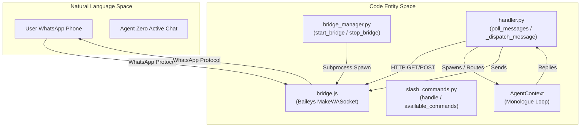
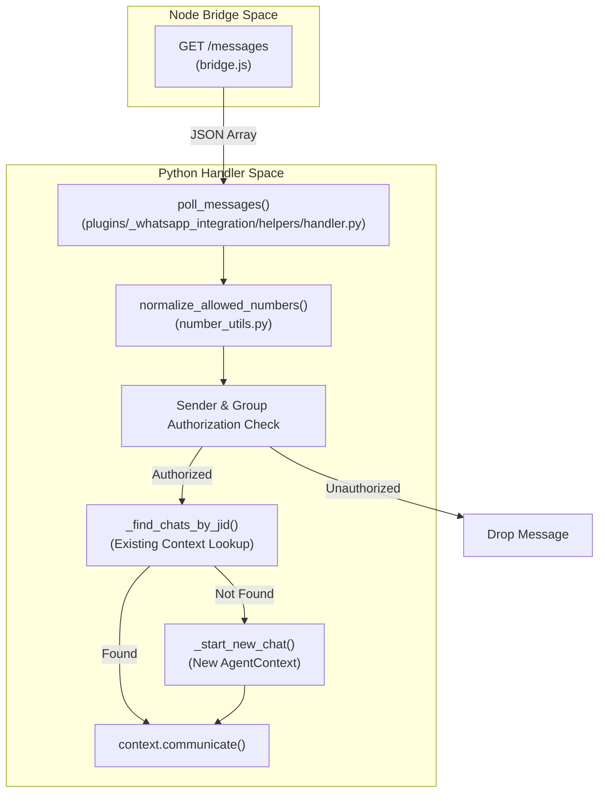

<!-- source: DeepWiki mcp.deepwiki.com · repo agent0ai/agent-zero · page 8.3 WhatsApp Integration · fetched 2026-10-29 -->

# WhatsApp Integration

Relevant source files

The following files were used as context for generating this wiki page:

- [plugins/_commands/helpers/commands.py](plugins/_commands/helpers/commands.py)
- [plugins/_telegram_integration/helpers/slash_commands.py](plugins/_telegram_integration/helpers/slash_commands.py)
- [plugins/_whatsapp_integration/AGENTS.md](plugins/_whatsapp_integration/AGENTS.md)
- [plugins/_whatsapp_integration/README.md](plugins/_whatsapp_integration/README.md)
- [plugins/_whatsapp_integration/helpers/handler.py](plugins/_whatsapp_integration/helpers/handler.py)
- [plugins/_whatsapp_integration/helpers/slash_commands.py](plugins/_whatsapp_integration/helpers/slash_commands.py)
- [plugins/_whatsapp_integration/prompts/fw.wa.user_message.md](plugins/_whatsapp_integration/prompts/fw.wa.user_message.md)
- [plugins/_whatsapp_integration/prompts/fw.wa.user_message_group.md](plugins/_whatsapp_integration/prompts/fw.wa.user_message_group.md)
- [tests/test_whatsapp_bridge.mjs](tests/test_whatsapp_bridge.mjs)
- [tests/test_whatsapp_commands.py](tests/test_whatsapp_commands.py)

## Purpose and Scope

The WhatsApp Integration plugin enables Agent Zero to communicate over the WhatsApp protocol via a Baileys-based Node.js bridge. This page details the implementation of the `bridge_manager.py` lifecycle manager, polling loops, `wa_client` HTTP interactions, message dispatching and session management in `plugins/_whatsapp_integration/helpers/handler.py`, allowed-numbers filtering, text-menu slash commands in `plugins/_whatsapp_integration/helpers/slash_commands.py`, media attachment security, QR pairing, and persistent session storage.

Sources: `[plugins/_whatsapp_integration/README.md:1-80]()`, `[plugins/_whatsapp_integration/AGENTS.md:1-29]()`

---

## Architecture & Code Entity Mapping

The integration bridges the external WhatsApp network with Agent Zero's execution core through a decoupled architecture. A standalone Node.js process (`bridge.js`) manages the Baileys WebSocket socket, while Python modules (`bridge_manager.py`, `handler.py`, and `slash_commands.py`) orchestrate process lifecycle, polling, authorization, and agent context dispatch.

### Diagram: Natural Language Space to Code Entity Space

"WhatsAppSubsystemArchitecture"

Sources: `[plugins/_whatsapp_integration/AGENTS.md:5-14]()`, `[plugins/_whatsapp_integration/README.md:70-80]()`

---

## Bridge Lifecycle & Subprocess Management (`bridge_manager.py`)

The Node.js bridge subprocess lifecycle and dependencies are managed to ensure stable background execution and automatic recovery.

### Key Aspects
- **Lifecycle Ownership**: `plugins/_whatsapp_integration/helpers/bridge_manager.py` manages process startup, health checking, and termination.
- **Dependency Verification**: Verifies `node_modules` integrity and automatically triggers dependency installation if missing or corrupted `[plugins/_whatsapp_integration/README.md:12-20]()`.

Sources: `[plugins/_whatsapp_integration/AGENTS.md:9-10]()`, `[plugins/_whatsapp_integration/README.md:12-20]()`

---

## Node.js Bridge & Baileys Integration (`bridge.js`)

The runtime bridge resides in `plugins/_whatsapp_integration/whatsapp-bridge/bridge.js` and runs as an independent Node.js process interacting with the Baileys library `[plugins/_whatsapp_integration/README.md:70-80]()`, `[tests/test_whatsapp_bridge.mjs:1-47]()`.

### Core Responsibilities
- **Baileys WebSocket Socket**: Utilizes `@whiskeysockets/baileys` to connect to WhatsApp servers, handling connection updates, disconnections, and auto-reconnect logic `[tests/test_whatsapp_bridge.mjs:35-37]()`.
- **REST Endpoints**: Exposes an Express server providing routes for polling messages (`/messages`), sending messages (`/send`), and handling media downloads `[tests/test_whatsapp_bridge.mjs:30]()`.
- **Media Security**: Enforces authorization before downloading media and contains media writes strictly within the designated cache directory `[plugins/_whatsapp_integration/AGENTS.md:20]()`, `[tests/test_whatsapp_bridge.mjs:49-58]()`.

Sources: `[plugins/_whatsapp_integration/README.md:70-81]`, `[tests/test_whatsapp_bridge.mjs:1-70]()`

---

## Polling, Authorization & Message Dispatch (`handler.py`)

Incoming messages are retrieved periodically and routed to Agent Zero contexts.

### Message Dispatch Flow
The polling mechanism invokes `poll_messages()` in `plugins/_whatsapp_integration/helpers/handler.py`, which fetches queued messages from the local bridge REST endpoint `[plugins/_whatsapp_integration/helpers/handler.py:67-85]()`. Sender validation normalizes phone numbers via `normalize_allowed_numbers()` and `normalize_number()` and cross-references against `allowed_numbers` before any dispatch or media extraction occurs `[plugins/_whatsapp_integration/helpers/handler.py:88-101]()`, `[tests/test_whatsapp_bridge.mjs:49-70]()`.

### Diagram: Message Authorization and Dispatch Logic

"WhatsAppMessageDispatchFlow"

Sources: `[plugins/_whatsapp_integration/helpers/handler.py:67-154]()`, `[tests/test_whatsapp_bridge.mjs:49-70]()`

---

## Slash Commands & Text Menus (`helpers/slash_commands.py`)

The WhatsApp integration adapts Agent Zero's shared command resolver into text menus (`plugins/_whatsapp_integration/helpers/slash_commands.py`) `[plugins/_whatsapp_integration/AGENTS.md:11]()`, `[plugins/_whatsapp_integration/helpers/slash_commands.py:1-40]()`.

### Core Behaviors
- **Pagination and Catalogs**: Command discovery uses `commands.list_context_commands(context)`, supporting paginated menus via commands like `/commands` or `/commands 2` `[plugins/_whatsapp_integration/README.md:34-36]()`, `[plugins/_whatsapp_integration/helpers/slash_commands.py:17-37]()`.
- **Session Management**: Commands such as `/sessions`, `/chat <id>`, and `/new` allow switching between or creating independent conversation contexts bound to the originating WhatsApp JID `[plugins/_whatsapp_integration/README.md:39]`, `[plugins/_whatsapp_integration/helpers/slash_commands.py:56-63, 110-119]()`.
- **Advanced Controls**: Supports configuration overrides, compaction requests (`/compact`), and transcript exports (`/copy`) over plain text messaging `[plugins/_whatsapp_integration/README.md:41-44]()`, `[plugins/_whatsapp_integration/helpers/slash_commands.py:64-69, 124-127]()`.

Sources: `[plugins/_whatsapp_integration/helpers/slash_commands.py:1-142]()`, `[plugins/_whatsapp_integration/README.md:34-47]()`

---

## Media Handling & Security Controls

Bidirectional media attachments adhere to strict security boundaries.

- **Inbound Security**: Sender and group authorization checks execute *before* media downloads are triggered. Media files are restricted strictly beneath the configured cache directory (`usr/whatsapp/media/`), and filenames are reduced to basenames to prevent path traversal attacks `[plugins/_whatsapp_integration/AGENTS.md:20]()`, `[plugins/_whatsapp_integration/README.md:32]`, `[tests/test_whatsapp_bridge.mjs:49-70]()`.
- **Outbound Media**: Agent-generated documents or images are dispatched through the bridge using endpoints managed by `whatsapp-bridge/bridge.js` `[plugins/_whatsapp_integration/README.md:68]()`.

Sources: `[plugins/_whatsapp_integration/AGENTS.md:20]()`, `[plugins/_whatsapp_integration/README.md:32]()`, `[tests/test_whatsapp_bridge.mjs:49-70]()`

---

## Configuration Reference

The following settings configure the WhatsApp Integration plugin:

| Setting | Type | Default | Description |
| :--- | :--- | :--- | :--- |
| `enabled` | boolean | `false` | Enables the bridge subprocess and polling loop. |
| `mode` | string | `"self-chat"` | Operating mode: `"self-chat"` (personal number) or `"dedicated"` (bot number). |
| `allow_group` | boolean | `false` | Responds in group chats when explicitly mentioned or replied to. |
| `bridge_port` | integer | `3100` | Local HTTP port for the Node.js bridge API. |
| `poll_interval_seconds` | integer | `3` | Polling frequency in seconds (minimum `2`). |
| `allowed_numbers` | list | `[]` | Phone numbers without `+` prefix permitted to interact with the agent. Empty allows open access. |
| `project` | string | `""` | Default project activated for incoming WhatsApp chats. |
| `agent_instructions` | string | `""` | Additional specialized agent prompt instructions. |

Sources: `[plugins/_whatsapp_integration/README.md:50-60]()`

---

