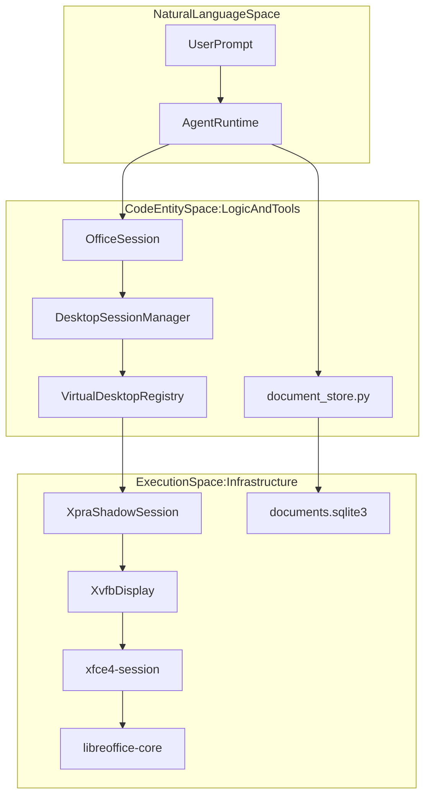
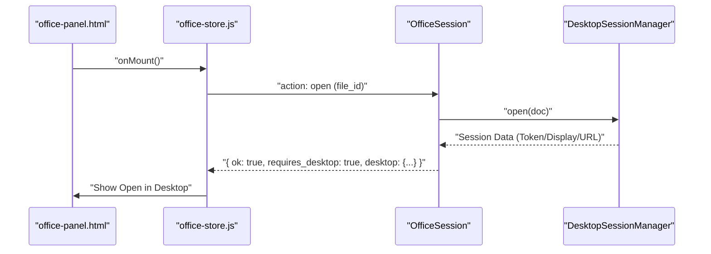

<!-- source: DeepWiki mcp.deepwiki.com · repo agent0ai/agent-zero · page 9 Office Plugin & Virtual Desktop · fetched 2026-10-29 -->

# Office Plugin & Virtual Desktop

Relevant source files

The following files were used as context for generating this wiki page:

- [docker/run/AGENTS.md](docker/run/AGENTS.md)
- [docker/run/fs/ins/install_additional.sh](docker/run/fs/ins/install_additional.sh)
- [helpers/system_packages.py](helpers/system_packages.py)
- [helpers/system_packages.py.dox.md](helpers/system_packages.py.dox.md)
- [plugins/_desktop/AGENTS.md](plugins/_desktop/AGENTS.md)
- [plugins/_desktop/helpers/desktop_session.py](plugins/_desktop/helpers/desktop_session.py)
- [plugins/_desktop/helpers/refresh_xpra_index.sh](plugins/_desktop/helpers/refresh_xpra_index.sh)
- [plugins/_desktop/helpers/rename_office_document.py](plugins/_desktop/helpers/rename_office_document.py)
- [plugins/_desktop/hooks.py](plugins/_desktop/hooks.py)
- [plugins/_office/AGENTS.md](plugins/_office/AGENTS.md)
- [plugins/_office/api/office_session.py](plugins/_office/api/office_session.py)
- [plugins/_office/extensions/webui/lib/document-actions.js](plugins/_office/extensions/webui/lib/document-actions.js)
- [plugins/_office/extensions/webui/set_messages_after_loop/auto-open-document-results.js](plugins/_office/extensions/webui/set_messages_after_loop/auto-open-document-results.js)
- [plugins/_office/helpers/artifact_editor.py](plugins/_office/helpers/artifact_editor.py)
- [plugins/_office/helpers/document_store.py](plugins/_office/helpers/document_store.py)
- [plugins/_office/hooks.py](plugins/_office/hooks.py)
- [plugins/_office/webui/office-panel.html](plugins/_office/webui/office-panel.html)
- [plugins/_office/webui/office-store.js](plugins/_office/webui/office-store.js)
- [tests/test_office_canvas_setup.py](tests/test_office_canvas_setup.py)
- [tests/test_office_document_store.py](tests/test_office_document_store.py)
- [tests/test_system_packages.py](tests/test_system_packages.py)

The `_office` plugin provides Agent Zero with a comprehensive suite for document manipulation and visual operating system control. It bridges the gap between structured file editing and human-like GUI interaction by combining a direct XML-based document artifact system with a persistent Linux desktop environment. The architecture decouples the core desktop runtime into a shared `_desktop` plugin, which `_office` leverages for LibreOffice and general Linux GUI workflows [plugins/_desktop/helpers/desktop_session.py:21-23]().

The purpose of this page is to provide a high-level overview of the `_office` and `_desktop` plugins. For deeper technical specifications, refer to the child pages: [Virtual Desktop & LibreOffice Session](#9.1) and [Document Artifact System](#9.2).

Sources: [plugins/_office/helpers/document_store.py:25-53](), [plugins/_desktop/helpers/desktop_session.py:21-23]()

### System Overview

The office subsystem is composed of two primary layers: a **Document Artifact System** for deterministic file operations and a **Virtual Desktop** for visual confirmation and GUI-based workflows. These are surfaced to the user via the **Office Canvas Panel** in the Web UI.

Title: "Office and Desktop Plugin Architecture"

Sources: [plugins/_office/helpers/document_store.py:47-53](), [plugins/_office/api/office_session.py:8-16](), [plugins/_desktop/helpers/desktop_session.py:135-146](), [helpers/virtual_desktop.py:49-57]()

---

## 9.1 Virtual Desktop & LibreOffice Session
Agent Zero includes a persistent Linux desktop environment powered by **XFCE**, **Xvfb**, and **Xpra**. This allows the agent to interact with GUI applications exactly as a human would, using mouse movements, keyboard input, and visual observation [plugins/_desktop/AGENTS.md:3-5]().

- **Desktop Runtime Management**: The `DesktopSessionManager` handles the lifecycle of the system desktop (defaulting to `:120`) and manages X11 display availability [plugins/_desktop/helpers/desktop_session.py:38-42]().
- **Xpra Shadowing & Virtual Registry**: Xpra bridges the virtual X11 display to the Web UI via HTML5 while `VirtualDesktopRegistry` coordinates endpoints and window resizes [helpers/virtual_desktop.py:49-77]().

For details on display management, Xpra configuration, viewport sync, apt provisioning, and runtime lifecycle, see [Virtual Desktop & LibreOffice Session](#9.1).

Sources: [plugins/_desktop/AGENTS.md:3-5](), [plugins/_desktop/helpers/desktop_session.py:135-152](), [helpers/virtual_desktop.py:49-77]()

---

## 9.2 Document Artifact System
The artifact system allows the agent to create and edit office documents (Word, Excel, PowerPoint, and OpenDocument formats) programmatically without requiring a GUI.

- **Metadata Store**: A SQLite-backed `document_store.py` tracks document paths, file identifiers, and version hashes across the workspace [plugins/_office/helpers/document_store.py:47-53]().
- **Supported Formats**: Manages OpenDocument formats (`.odt`, `.ods`, `.odp`), OOXML formats (`.docx`, `.xlsx`, `.pptx`), and text editor formats (`.md`, `.txt`) [plugins/_office/helpers/document_store.py:26-29]().
- **Validation**: Created and updated documents are validated using ODF and OOXML validation logic to ensure package integrity before returning results [plugins/_office/api/office_session.py:38-46]().

For details on XML schemas, `artifact_editor.py`, template generation, canvas context, affordance extensions, and office skills, see [Document Artifact System](#9.2).

Sources: [plugins/_office/helpers/document_store.py:26-53](), [plugins/_office/api/office_session.py:38-46]()

---

## Web UI: The Office Canvas
The Office Canvas is a specialized panel in the Agent Zero Web UI (`office-panel.html`) that provides a dual-mode interface for document work. It leverages the `surfaces.js` registry to identify as a managed surface [tests/test_office_canvas_setup.py:40-52]().

Title: "Office WebUI Session Flow"

Sources: [plugins/_office/webui/office-panel.html:8-15](), [plugins/_office/webui/office-store.js:69-87](), [plugins/_office/api/office_session.py:47-57](), [plugins/_desktop/helpers/desktop_session.py:154-189]()

### Key Components
| Component | File Path | Role |
| :--- | :--- | :--- |
| **Office Panel** | `plugins/_office/webui/office-panel.html` | Main Alpine.js template for the office surface [plugins/_office/webui/office-panel.html:8-42](). |
| **Office Store** | `plugins/_office/webui/office-store.js` | Manages document state, creation logic, and API calls [plugins/_office/webui/office-store.js:52-114](). |
| **API Handler** | `plugins/_office/api/office_session.py` | Backend endpoint for office session management and file registration [plugins/_office/api/office_session.py:8-16](). |

Sources: [plugins/_office/webui/office-panel.html:1-42](), [plugins/_office/webui/office-store.js:1-51](), [plugins/_office/api/office_session.py:1-62]()

---

