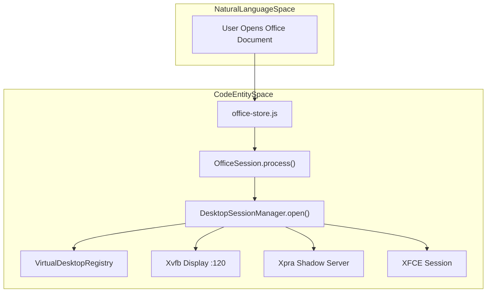
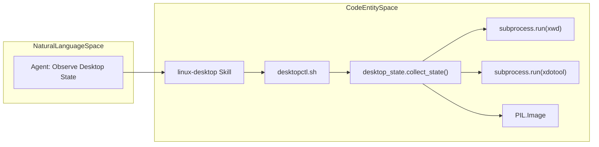

<!-- source: DeepWiki mcp.deepwiki.com · repo agent0ai/agent-zero · page 9.1 Virtual Desktop & LibreOffice Session · fetched 2026-10-29 -->

# Virtual Desktop & LibreOffice Session

Relevant source files

The following files were used as context for generating this wiki page:

- [docker/run/AGENTS.md](docker/run/AGENTS.md)
- [docker/run/fs/ins/install_additional.sh](docker/run/fs/ins/install_additional.sh)
- [helpers/state_migration.py](helpers/state_migration.py)
- [helpers/system_packages.py](helpers/system_packages.py)
- [helpers/system_packages.py.dox.md](helpers/system_packages.py.dox.md)
- [helpers/virtual_desktop.py](helpers/virtual_desktop.py)
- [helpers/virtual_desktop.py.dox.md](helpers/virtual_desktop.py.dox.md)
- [plugins/_browser/helpers/interactive_view.py](plugins/_browser/helpers/interactive_view.py)
- [plugins/_desktop/AGENTS.md](plugins/_desktop/AGENTS.md)
- [plugins/_desktop/api/desktop_session.py](plugins/_desktop/api/desktop_session.py)
- [plugins/_desktop/extensions/python/startup_migration/_20_desktop_routes.py](plugins/_desktop/extensions/python/startup_migration/_20_desktop_routes.py)
- [plugins/_desktop/helpers/desktop_session.py](plugins/_desktop/helpers/desktop_session.py)
- [plugins/_desktop/helpers/desktop_state.py](plugins/_desktop/helpers/desktop_state.py)
- [plugins/_desktop/helpers/refresh_xpra_index.sh](plugins/_desktop/helpers/refresh_xpra_index.sh)
- [plugins/_desktop/helpers/rename_office_document.py](plugins/_desktop/helpers/rename_office_document.py)
- [plugins/_desktop/hooks.py](plugins/_desktop/hooks.py)
- [plugins/_desktop/skills/linux-desktop/SKILL.md](plugins/_desktop/skills/linux-desktop/SKILL.md)
- [plugins/_desktop/skills/linux-desktop/scripts/desktopctl.sh](plugins/_desktop/skills/linux-desktop/scripts/desktopctl.sh)
- [plugins/_office/AGENTS.md](plugins/_office/AGENTS.md)
- [plugins/_office/api/office_session.py](plugins/_office/api/office_session.py)
- [plugins/_office/extensions/python/startup_migration/_20_office_routes.py](plugins/_office/extensions/python/startup_migration/_20_office_routes.py)
- [plugins/_office/extensions/webui/lib/document-actions.js](plugins/_office/extensions/webui/lib/document-actions.js)
- [plugins/_office/extensions/webui/set_messages_after_loop/auto-open-document-results.js](plugins/_office/extensions/webui/set_messages_after_loop/auto-open-document-results.js)
- [plugins/_office/helpers/artifact_editor.py](plugins/_office/helpers/artifact_editor.py)
- [plugins/_office/helpers/document_store.py](plugins/_office/helpers/document_store.py)
- [plugins/_office/hooks.py](plugins/_office/hooks.py)
- [plugins/_office/webui/office-panel.html](plugins/_office/webui/office-panel.html)
- [plugins/_office/webui/office-store.js](plugins/_office/webui/office-store.js)
- [tests/test_office_canvas_setup.py](tests/test_office_canvas_setup.py)
- [tests/test_office_desktop_state.py](tests/test_office_desktop_state.py)
- [tests/test_office_document_store.py](tests/test_office_document_store.py)
- [tests/test_system_packages.py](tests/test_system_packages.py)

The Virtual Desktop system provides a persistent, multi-user Linux graphical environment within the Agent Zero container. It is primarily used to host **LibreOffice** for visual document editing and **XFCE** for general GUI automation. The system leverages **Xvfb** for headless display management and **Xpra** for high-performance remote desktop streaming to the Web UI via HTML5.

Sources: [plugins/_desktop/AGENTS.md:1-10](), [plugins/_office/AGENTS.md:1-10]()

---

## Architectural Overview

The desktop environment is managed by the `DesktopSessionManager` class, which handles the lifecycle of Xvfb displays, Xpra shadow servers, and XFCE session components.

### Natural Language to Code Entity Mapping

| System Concept | Code Entity | File Path |
| :--- | :--- | :--- |
| **Desktop Manager** | `DesktopSessionManager` | [plugins/_desktop/helpers/desktop_session.py:135-152]() |
| **Session State** | `DesktopSession` | [plugins/_desktop/helpers/desktop_session.py:91-133]() |
| **Display Registry** | `VirtualDesktopRegistry` | [helpers/virtual_desktop.py:49-78]() |
| **Office Frontend Store** | `office-store.js` | [plugins/_office/webui/office-store.js:52-192]() |
| **Office Session API** | `OfficeSession` | [plugins/_office/api/office_session.py:8-62]() |
| **State Collector** | `collect_state` | [plugins/_desktop/helpers/desktop_state.py:62-108]() |

Sources: [plugins/_desktop/helpers/desktop_session.py:91-152](), [helpers/virtual_desktop.py:49-78](), [plugins/_office/webui/office-store.js:52-192](), [plugins/_office/api/office_session.py:8-62](), [plugins/_desktop/helpers/desktop_state.py:62-108]()

### System Component Interaction

The following diagram illustrates the data flow from the Web UI through the API layer to the underlying Linux processes, bridging natural operations to code entities.

**Desktop Control & Streaming Flow**

Sources: [plugins/_desktop/helpers/desktop_session.py:135-187](), [plugins/_office/webui/office-store.js:44-50](), [plugins/_office/api/office_session.py:47-57](), [helpers/virtual_desktop.py:49-97]()

---

## Backend Display Management

The system initializes a "System Desktop" on a base display (default `:120`) and port (default `14500`) [plugins/_desktop/helpers/desktop_session.py:38-39]().

### DesktopSessionManager & VirtualDesktopRegistry
`DesktopSessionManager` is a singleton managing the lifecycle of the virtual environment. Key responsibilities include:
*   **Session Lifecycle**: `ensure_system_desktop()` reaps dead sessions via `_reap_dead_locked()`, starts the Xvfb server, initializes the DBUS session, and launches the XFCE desktop environment [plugins/_desktop/helpers/desktop_session.py:140-152]().
*   **Xpra Integration**: Spawns an Xpra shadow server attaching to the Xvfb display, proxied over WebSockets via `virtual_desktop` [helpers/virtual_desktop.py:79-97]().
*   **XFCE Profile Setup**: Configures a custom XFCE profile in `PROFILE_DIR`, pinning specific launchers (Projects, Skills, Downloads) and hiding system entries like `xfce4-session-logout.desktop` [plugins/_desktop/helpers/desktop_session.py:33-69]().
*   **Viewport Synchronization**: Handles resizing the virtual display to match the browser window size via `normalize_size` and `resize_session` [helpers/virtual_desktop.py:108-110](), [helpers/virtual_desktop.py:215-225]().
*   **Shutdown Bridge**: Handles graceful termination, ensuring Xpra and Xvfb processes are terminated [plugins/_desktop/helpers/desktop_session.py:223-233]().

Sources: [plugins/_desktop/helpers/desktop_session.py:33-152](), [helpers/virtual_desktop.py:49-110](), [helpers/virtual_desktop.py:215-225]()

### Runtime Preparation & Migration
The `_desktop` and `_office` plugins include startup extensions that trigger background preparation [plugins/_desktop/hooks.py:96-134](), [plugins/_office/hooks.py:75-137]().
*   **Idempotent Cleanup**: `cleanup_stale_runtime_state()` reaps dead sessions and ensures required APT packages (LibreOffice, Xpra, fonts) are present [plugins/_desktop/hooks.py:96-134](), [plugins/_office/hooks.py:75-137]().
*   **State Migration**: Automatically migrates legacy desktop and session state from retired directories using state migration helpers [plugins/_desktop/hooks.py:148-161]().

Sources: [plugins/_desktop/hooks.py:96-161](), [plugins/_office/hooks.py:75-137]()

---

## Frontend Integration (`office-store.js` & `desktop-store.js`)

The Alpine.js stores manage UI state and the connection to the Xpra session and document management flows.

### Viewport & Resize Logic
The store detects changes in UI surface size to trigger backend display adjustments:
1.  **Debouncing**: Resizes are debounced by delay thresholds to prevent overwhelming the backend [plugins/_office/webui/office-store.js:52-192]().
2.  **Syncing**: Viewport sync sends new dimensions to the backend API via desktop request handlers [plugins/_office/webui/office-store.js:44-50]().
3.  **Xpra Normalization**: Applies custom configurations to the Xpra HTML5 client (e.g., setting encoding and quality parameters for optimal streaming) [helpers/virtual_desktop.py:121-154]().

### Event Bridging & Keepalive
*   **Keyboard & Wheel Bridging**: Focus management ensures keyboard events are forwarded to the remote desktop when the iframe is active, avoiding conflicts with the Agent Zero chat input [plugins/_office/webui/office-store.js:52-192]().
*   **Heartbeat Mechanism**: Uses polling intervals to verify that the session remains alive [plugins/_office/webui/office-store.js:52-192]().
*   **Shutdown Bridge**: Coordinates environment termination across browser tabs [plugins/_office/webui/office-store.js:52-192]().

Sources: [plugins/_office/webui/office-store.js:52-192](), [helpers/virtual_desktop.py:121-154]()

---

## Agent Automation & State Inspection

Agents interact with the desktop using the `linux-desktop` skill, which wraps control scripts and invokes underlying Python state collectors.

**Agent Automation Space to Code Entity Space**

Sources: [plugins/_desktop/helpers/desktop_state.py:62-108](), [plugins/_desktop/skills/linux-desktop/SKILL.md:1-60]()

| Command | Purpose | Entity / Function |
| :--- | :--- | :--- |
| `state` | Returns structured Desktop state as JSON (windows, mouse, geometry) | `desktop_state.collect_state()` [plugins/_desktop/helpers/desktop_state.py:62-108]() |
| `observe` | Captures a screenshot and JSON metadata of all open windows | `desktop_state.capture_screenshot()` [plugins/_desktop/helpers/desktop_state.py:110-182]() |
| `launch` | Starts applications within the XFCE session | `desktopctl.sh launch` [plugins/_desktop/skills/linux-desktop/scripts/desktopctl.sh:1-50]() |
| `focus` | Brings a specific window to the foreground using `xdotool` | `desktopctl.sh focus` [plugins/_desktop/skills/linux-desktop/scripts/desktopctl.sh:1-50]() |

Sources: [plugins/_desktop/helpers/desktop_state.py:62-182](), [plugins/_desktop/skills/linux-desktop/scripts/desktopctl.sh:1-50]()

---

## Runtime APT Package Provisioning & Infrastructure

The virtual desktop requires system-level packages installed in the Docker container, managed via `install_additional.sh` and system package helpers:
*   **Xpra**: Streaming server stack (`xpra-server`, `xpra-client`, `xpra-html5`) pinned to compatible releases [docker/run/fs/ins/install_additional.sh:46-53]().
*   **Xvfb**: Virtual frame buffer server [docker/run/fs/ins/install_additional.sh:95]().
*   **XFCE4**: Desktop environment components (`xfwm4`, `xfce4-panel`, `xfdesktop4`, `thunar`) [docker/run/fs/ins/install_additional.sh:80-85]().
*   **LibreOffice**: Core office applications (`libreoffice-writer`, `libreoffice-calc`, `libreoffice-impress`, `python3-uno`) pinned to specific snapshot versions (e.g., Debian snapshot archive `20260624T000000Z`) for stability [docker/run/fs/ins/install_additional.sh:38-45]().
*   **Automation Tools**: `xdotool` for input simulation and `xwd` for screenshot capture [docker/run/fs/ins/install_additional.sh:92]().
*   **Fonts**: Comprehensive font packages (DejaVu, Noto, Liberation) for correct document rendering [docker/run/fs/ins/install_additional.sh:97-103]().

Sources: [docker/run/fs/ins/install_additional.sh:15-105](), [plugins/_desktop/hooks.py:14-78](), [helpers/system_packages.py:1-50]()

---

