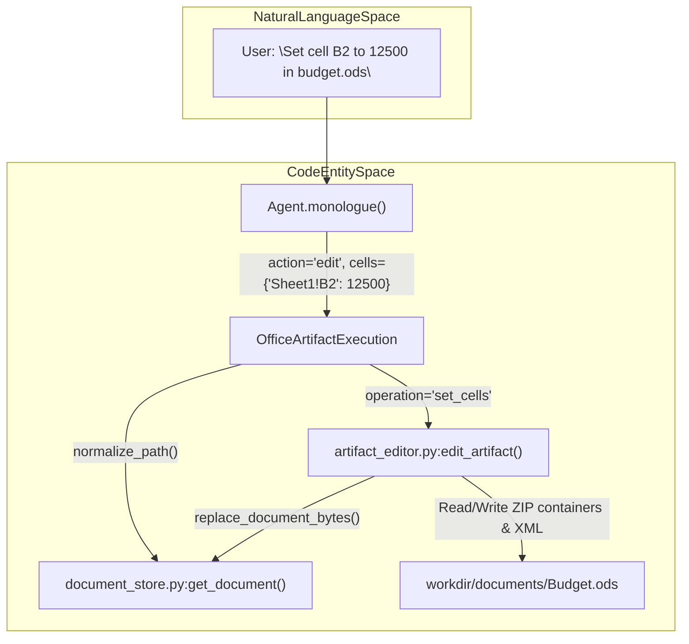
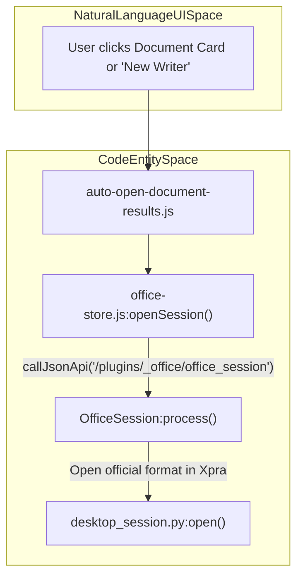

<!-- source: DeepWiki mcp.deepwiki.com · repo agent0ai/agent-zero · page 9.2 Document Artifact System · fetched 2026-10-29 -->

# Document Artifact System

Relevant source files

The following files were used as context for generating this wiki page:

- [docker/run/AGENTS.md](docker/run/AGENTS.md)
- [docker/run/fs/ins/install_additional.sh](docker/run/fs/ins/install_additional.sh)
- [helpers/system_packages.py](helpers/system_packages.py)
- [helpers/system_packages.py.dox.md](helpers/system_packages.py.dox.md)
- [plugins/_a0_connector/api/v1/skills_activate.py](plugins/_a0_connector/api/v1/skills_activate.py)
- [plugins/_a0_connector/api/v1/skills_delete.py](plugins/_a0_connector/api/v1/skills_delete.py)
- [plugins/_a0_connector/api/v1/skills_list.py](plugins/_a0_connector/api/v1/skills_list.py)
- [plugins/_desktop/AGENTS.md](plugins/_desktop/AGENTS.md)
- [plugins/_desktop/helpers/desktop_session.py](plugins/_desktop/helpers/desktop_session.py)
- [plugins/_desktop/helpers/refresh_xpra_index.sh](plugins/_desktop/helpers/refresh_xpra_index.sh)
- [plugins/_desktop/helpers/rename_office_document.py](plugins/_desktop/helpers/rename_office_document.py)
- [plugins/_desktop/hooks.py](plugins/_desktop/hooks.py)
- [plugins/_office/AGENTS.md](plugins/_office/AGENTS.md)
- [plugins/_office/api/office_session.py](plugins/_office/api/office_session.py)
- [plugins/_office/extensions/webui/lib/document-actions.js](plugins/_office/extensions/webui/lib/document-actions.js)
- [plugins/_office/extensions/webui/set_messages_after_loop/auto-open-document-results.js](plugins/_office/extensions/webui/set_messages_after_loop/auto-open-document-results.js)
- [plugins/_office/helpers/artifact_editor.py](plugins/_office/helpers/artifact_editor.py)
- [plugins/_office/helpers/document_store.py](plugins/_office/helpers/document_store.py)
- [plugins/_office/hooks.py](plugins/_office/hooks.py)
- [plugins/_office/skills/calc-spreadsheets/SKILL.md](plugins/_office/skills/calc-spreadsheets/SKILL.md)
- [plugins/_office/skills/impress-presentations/SKILL.md](plugins/_office/skills/impress-presentations/SKILL.md)
- [plugins/_office/skills/markdown-documents/SKILL.md](plugins/_office/skills/markdown-documents/SKILL.md)
- [plugins/_office/skills/office-artifacts/SKILL.md](plugins/_office/skills/office-artifacts/SKILL.md)
- [plugins/_office/skills/writer-documents/SKILL.md](plugins/_office/skills/writer-documents/SKILL.md)
- [plugins/_office/webui/office-panel.html](plugins/_office/webui/office-panel.html)
- [plugins/_office/webui/office-store.js](plugins/_office/webui/office-store.js)
- [tests/test_office_canvas_setup.py](tests/test_office_canvas_setup.py)
- [tests/test_office_document_store.py](tests/test_office_document_store.py)
- [tests/test_system_packages.py](tests/test_system_packages.py)

The Document Artifact System provides Agent Zero with the capability to create, read, and manipulate structured office documents (ODF and OOXML) as well as Markdown text files. It bridges raw text generation and professional document deliverables via a dedicated toolset, a SQLite-backed metadata and version store, and low-level XML manipulation routines.

---

## Architectural Overview

The system consists of the `office_artifact` tool endpoint, the `document_store.py` SQLite metadata manager, the `artifact_editor.py` XML manipulation library, and the `office_session.py` API controller.

### Core Components

| Component | File Path | Responsibility |
| :--- | :--- | :--- |
| **Office Session API** | `plugins/_office/api/office_session.py` | Handles backend routing for document creation, opening, closing, and renaming actions. |
| **Artifact Editor** | `plugins/_office/helpers/artifact_editor.py` | Manages direct ODT, ODS, ODP, DOCX, XLSX, and PPTX XML inspection and mutation. |
| **Document Store** | `plugins/_office/helpers/document_store.py` | Manages SQLite-backed file IDs, paths, versions, allowed roots, and backups. |

### Diagram: Tool Execution Data Flow (Natural Language to Code Entity Space)

Sources: [plugins/_office/helpers/artifact_editor.py:1-210](), [plugins/_office/helpers/document_store.py:165-216](), [plugins/_office/api/office_session.py:8-62]()

---

## The `office_artifact` Tool & API Handlers

The `office_artifact` tool acts as the agent's primary entry point for binary document management. Requests are dispatched to `OfficeSession` in `plugins/_office/api/office_session.py` [plugins/_office/api/office_session.py:8-62]().

### Supported Actions
- **`create`**: Initializes a new document from a template format (`odt`, `ods`, `odp`, `docx`, `xlsx`, `pptx`) [plugins/_office/api/office_session.py:23-46]().
- **`open`**: Registers or fetches an existing document path, validating permissions and generating session identifiers [plugins/_office/api/office_session.py:47-57]().
- **`read`**: Extracts a compact textual representation of the document for agent context via `artifact_editor.read_artifact`.
- **`edit`**: Applies precise XML modifications (such as text replacement, cell updates, row appending, or chart generation).
- **`renamed`**: Retargets file associations and updates workspace path tracking [plugins/_office/api/office_session.py:121-146]().

Sources: [plugins/_office/api/office_session.py:9-62](), [plugins/_office/helpers/artifact_editor.py:49-145]()

---

## Artifact Editor & XML Manipulation

`artifact_editor.py` handles direct manipulation of OpenDocument Format (ODF) and Office Open XML (OOXML) files without requiring a running LibreOffice GUI instance. It registers standard namespaces for WordprocessingML (`w`), DrawingML (`a`), PresentationML (`p`), and ODF elements (`office`, `text`, `table`).

### Key Functions
- **`read_artifact`**: Dispatches to format-specific handlers to parse XML and return a trimmed payload within character limits.
- **`edit_artifact`**: Reads raw file bytes, executes format-specific mutation logic, updates document bytes via `document_store.replace_document_bytes`, and invalidates active sessions [plugins/_office/helpers/document_store.py:186-216]().
- **`_normalize_edit_inputs`**: Normalizes incoming argument shapes (`content`, `find`, `replace`, `cells`, `rows`, `chart`, `slides`) and maps agent synonyms to internal operations.

Sources: [plugins/_office/helpers/artifact_editor.py:1-210](), [plugins/_office/helpers/document_store.py:186-216]()

---

## Document Store & Persistence

`document_store.py` manages file metadata, validation boundaries, and transactional persistence in a SQLite database located at `usr/plugins/_office/documents/documents.sqlite3` [plugins/_office/helpers/document_store.py:45-48]().

### Metadata Tracking & Security
- **Allowed Roots**: Files must reside within allowed directories such as the active project folder, `usr/workdir`, or designated workdir paths. Symlink traversal outside these roots raises a `PermissionError` [plugins/_office/helpers/document_store.py:136-175]().
- **Versioning**: Each update increments version counters and stores historical backups in `BACKUP_DIR` [plugins/_office/helpers/document_store.py:49-67]().

Sources: [plugins/_office/helpers/document_store.py:45-184](), [tests/test_office_document_store.py:79-112]()

---

## Web UI Integration & Canvas Context

The Document Artifact System exposes frontend components and canvas panels to let users inspect and edit documents interactively.

### Diagram: UI Action to API Dispatch (User Space to Code Entity Space)

Sources: [plugins/_office/webui/office-store.js:44-50](), [plugins/_office/api/office_session.py:8-57](), [plugins/_desktop/helpers/desktop_session.py:135-187]()

### Key Frontend Files
- **`office-store.js`**: Alpine.js store managing initialization, document opening state, format checks (`DESKTOP_DOCUMENT_EXTENSIONS`), and API calls to `/plugins/_office/office_session` [plugins/_office/webui/office-store.js:1-173]().
- **`office-panel.html`**: Renders the canvas view with quick action buttons for opening file browsers or creating Writer (`odt`), Calc (`ods`), and Impress (`odp`) files [plugins/_office/webui/office-panel.html:1-40]().

Sources: [plugins/_office/webui/office-store.js:1-173](), [plugins/_office/webui/office-panel.html:1-40]()

---

## Office Skills

Pre-defined skills instruct the agent on correct tool usage and formatting standards:
- **`office-artifacts`**: General guidelines instructing agents to use ODF formats (`odt`, `ods`, `odp`) as first-class citizens, reserving OOXML (`docx`, `xlsx`, `pptx`) for explicit compatibility requirements.
- **Format-specific skills**: `writer-documents`, `calc-spreadsheets`, and `impress-presentations` provide detailed workflows for text editing, cell manipulation (`set_cells`), and slide deck generation.
- **`markdown-documents`**: Specifies standard Markdown handling via the `text_editor` tool for non-binary notes and reports.

Sources: [plugins/_office/skills/office-artifacts/SKILL.md:1-166](), [plugins/_office/skills/markdown-documents/SKILL.md:1-50]()

---

