# Page: Agent Zero Overview

# Agent Zero Overview

<details>
<summary>Relevant source files</summary>

The following files were used as context for generating this wiki page:

- [AGENTS.md](AGENTS.md)
- [README.md](README.md)
- [agent.py](agent.py)
- [docker/run/fs/exe/initialize.sh](docker/run/fs/exe/initialize.sh)
- [docs/README.md](docs/README.md)
- [docs/guides/troubleshooting.md](docs/guides/troubleshooting.md)
- [docs/quickstart.md](docs/quickstart.md)
- [docs/setup/dev-setup.md](docs/setup/dev-setup.md)
- [docs/setup/installation.md](docs/setup/installation.md)
- [initialize.py](initialize.py)
- [models.py](models.py)
- [plugins/_browser/api/status.py](plugins/_browser/api/status.py)
- [plugins/_browser/extensions/python/startup_migration/_20_browser_playwright_cache.py](plugins/_browser/extensions/python/startup_migration/_20_browser_playwright_cache.py)
- [plugins/_browser/helpers/playwright.py](plugins/_browser/helpers/playwright.py)
- [plugins/_browser/hooks.py](plugins/_browser/hooks.py)
- [preload.py](preload.py)
- [requirements.txt](requirements.txt)
- [run_ui.py](run_ui.py)
- [tests/test_docker_initialize_limits.py](tests/test_docker_initialize_limits.py)
- [tests/test_embedding_model_preload.py](tests/test_embedding_model_preload.py)

</details>


## Purpose and Scope
Sources: `[README.md:6-9]`, `[run_ui.py:9-38]`

This page serves as a high-level introduction to Agent Zero, outlining its core philosophy, architectural concepts, and the relationship between its major subsystems. It acts as a parent portal, providing concise summaries of fundamental components and linking directly to dedicated child pages for deeper technical coverage.

- For setup procedures, environment variables, and first-run configuration, refer to [Getting Started & Installation](#1.1).
- For foundational architectural ideas like the Monologue loop and `AgentContext`, see [Core Concepts & Terminology](#1.2).
- For initialization workflows and provider selection gates, see [Onboarding & Discovery Experience](#1.3).

---

## Philosophy & Core Principles
Sources: `[README.md:6-40]`, `[agent.py:18-19]`, `[initialize.py:12-17]`

Agent Zero is built upon organic agentic growth and direct interaction with the operating environment rather than relying strictly on constrained, pre-programmed API calls.

1. **Computer as a Tool:** The agent leverages a fully realized Linux environment, local shell terminals, GUI applications, and web browsers to execute real-world tasks `[README.md:6-9]`, `[README.md:32]`, `[README.md:117-125]`.
2. **Superior/Subordinate Hierarchy:** Complex goals are dynamically decomposed by orchestrators and delegated to specialized child instances managed via helper modules `[agent.py:18-19]`, `[README.md:38]`.
3. **Framework vs. Execution Runtime:** Clear separation between the control plane framework (`run_ui.py`) and sandbox execution environments `[run_ui.py:9-22]`.
4. **Universal Canvas:** Shared collaborative surfaces combining browser viewport annotation, interactive markdown editing, and virtual desktop cowork spaces `[README.md:32-34]`, `[README.md:117-125]`.

---

## System Architecture & Code Entity Space
Sources: `[agent.py:56-111]`, `[run_ui.py:9-49]`, `[initialize.py:1-68]`, `[models.py:142-164]`

Agent Zero bridges high-level natural language user inputs to concrete Python classes, API handlers, and execution routines.

### Subsystem Component Mapping
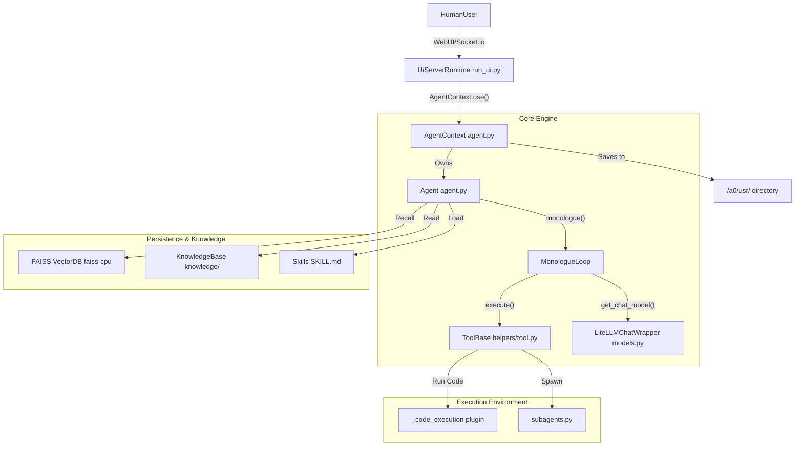
Sources: `[agent.py:56-111]`, `[run_ui.py:9-49]`, `[initialize.py:1-68]`

### Request Execution Flow
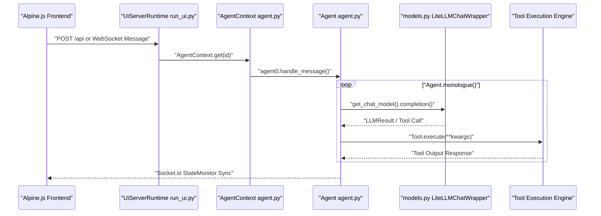
Sources: `[run_ui.py:9-49]`, `[agent.py:56-111]`, `[models.py:142-164]`

---

## Key Subsystems & Child Pages
Sources: `[README.md:44-93]`, `[agent.py:56-111]`, `[initialize.py:12-17]`, `[run_ui.py:76-96]`

Detailed technical specifications are divided across dedicated child pages:

### 1.1 Getting Started & Installation
Covers installation pathways including Docker containers, native scripts, and hybrid RFC development modes. Discusses environment variables in `.env` and first-run server configuration.
- For setup instructions, see [Getting Started & Installation](#1.1).
Sources: `[README.md:44-93]`, `[docs/setup/installation.md:20-75]`

### 1.2 Core Concepts & Terminology
Explores foundational paradigms such as the Computer-as-a-Tool philosophy, Superior/Subordinate agent hierarchies, `AgentContext` state isolation, the Monologue loop execution cycle, and the distinction between Framework and Execution Runtimes.
- For deep dives, see [Core Concepts & Terminology](#1.2).
Sources: `[agent.py:56-111]`, `[agent.py:50-54]`

### 1.3 Onboarding & Discovery Experience
Examines initialization plugins (`_onboarding`, `_discovery`), model setup gates, provider selection flows, discovery cards, notification banners, and welcome screen hand-offs.
- For configuration walkthroughs, see [Onboarding & Discovery Experience](#1.3).
Sources: `[run_ui.py:76-96]`, `[initialize.py:6-47]`

---

# Page: Getting Started & Installation

# Getting Started & Installation

<details>
<summary>Relevant source files</summary>

The following files were used as context for generating this wiki page:

- [LICENSE](LICENSE)
- [README.md](README.md)
- [docker/base/build.txt](docker/base/build.txt)
- [docker/run/Dockerfile](docker/run/Dockerfile)
- [docker/run/build.txt](docker/run/build.txt)
- [docker/run/docker-compose.yml](docker/run/docker-compose.yml)
- [docker/run/fs/exe/initialize.sh](docker/run/fs/exe/initialize.sh)
- [docker/run/fs/exe/run_A0.sh](docker/run/fs/exe/run_A0.sh)
- [docker/run/fs/ins/install_A0.sh](docker/run/fs/ins/install_A0.sh)
- [docker/run/fs/ins/install_A02.sh](docker/run/fs/ins/install_A02.sh)
- [docs/README.md](docs/README.md)
- [docs/guides/troubleshooting.md](docs/guides/troubleshooting.md)
- [docs/quickstart.md](docs/quickstart.md)
- [docs/setup/dev-setup.md](docs/setup/dev-setup.md)
- [docs/setup/installation.md](docs/setup/installation.md)
- [plugins/_browser/api/status.py](plugins/_browser/api/status.py)
- [plugins/_browser/extensions/python/startup_migration/_20_browser_playwright_cache.py](plugins/_browser/extensions/python/startup_migration/_20_browser_playwright_cache.py)
- [plugins/_browser/helpers/playwright.py](plugins/_browser/helpers/playwright.py)
- [plugins/_browser/hooks.py](plugins/_browser/hooks.py)
- [tests/test_docker_initialize_limits.py](tests/test_docker_initialize_limits.py)

</details>


## Purpose & Scope

This page provides a comprehensive technical guide for setting up the Agent Zero environment. It covers primary Docker-based deployment, automated installer scripts, build internals, container initialization mechanics (`docker/run/fs/exe/initialize.sh`), environment configuration, and the hybrid development mode utilizing the A0 CLI connector for host-machine integration.

Sources: [README.md:41-95](), [docs/setup/installation.md:7-75](), [docs/quickstart.md:8-26]()

---

## Installation Paths & Quick Start

Agent Zero is designed to run within an isolated containerized environment while interacting with the host system via specific bridges. Depending on your operational environment, several installation pathways are supported:

| Path | Target Audience | Command / Reference |
| :--- | :--- | :--- |
| **A0 Launcher** | Desktop users (macOS, Windows, Linux) | [A0 Launcher Releases](https://github.com/agent0ai/a0-launcher/releases/tag/v1.9) [README.md:51-54]() |
| **A0 Install (Unix)** | Headless servers, SSH sessions, scripts | `curl -fsSL https://bash.agent-zero.ai \| bash` [README.md:66-66]() |
| **A0 Install (Windows)** | Windows PowerShell environments | `irm https://ps.agent-zero.ai | iex` [README.md:72-72]() |
| **Docker Direct** | Manual deployment / CLI control | `docker run -p 80:80 -v a0_usr:/a0/usr agent0ai/agent-zero` [README.md:92-92]() |

For automated infrastructure deployments, the install script accepts a Quick Start flag to provision a single instance without interactive prompts [README.md:77-85](), [docs/setup/installation.md:58-64]().

Sources: [README.md:41-95](), [docs/setup/installation.md:7-75](), [docs/quickstart.md:8-26]()

---

## Docker Deployment Architecture

The Docker container acts as both the **Framework Runtime** (hosting the Flask and Socket.io servers) and the **Execution Runtime** (where the agent executes code, manages tools, and invokes shell commands). 

### Container Initialization Flow
When the container initializes, the entrypoint triggers `docker/run/fs/exe/initialize.sh`, which invokes `raise_open_file_limit()` to adjust descriptor limits, configures persistent mount directories, and hands process management over to `supervisord` [docker/run/fs/exe/initialize.sh:1-68]().

Title: "Container Startup Sequence and Process Hand-off"
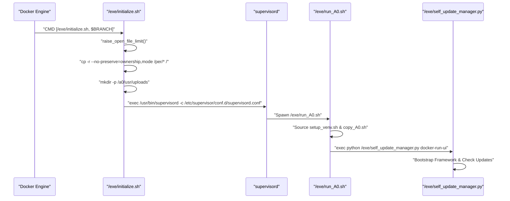
Sources: [docker/run/fs/exe/initialize.sh:1-68](), [docker/run/fs/exe/run_A0.sh:1-7](), [docker/run/Dockerfile:33-36]()

### Persistence and Volume Structure
To persist settings, project workspaces, memory stores, and chat logs across container rebuilds, the `/a0/usr` path must be mapped to a host-side volume or directory.

*   **Docker Compose Configuration**: Mapped via `docker-compose.yml` under services [docker/run/docker-compose.yml:5-6]().
*   **Key Subdirectories under `/a0/usr/`**:
    *   `/a0/usr/chats/`: Serialized conversation histories in JSON format [docs/quickstart.md:102-102]().
    *   `/a0/usr/uploads/`: Temporary and persistent file storage for Web UI uploads [docker/run/fs/exe/initialize.sh:58-60]().
    *   `/a0/usr/secrets.env`: Environment secrets and masked API credentials [docs/guides/troubleshooting.md:53-54]().

Sources: [docker/run/fs/exe/initialize.sh:1-68](), [docker/run/fs/exe/run_A0.sh:1-7](), [docker/run/docker-compose.yml:1-14]()

---

## Build Mechanics & Package Provisioning

For advanced deployments or custom source modifications, images can be built locally using the provided Docker configurations.

### Build Lifecycle Scripts
The build process coordinates several shell scripts to provision dependencies and initialize embedding caches:
*   **`install_A0.sh`**: Clones the specified repository branch, sets up the virtual environment, installs Python requirements via `uv`, configures Playwright binaries, and runs `preload.py` to cache embedding models [docker/run/fs/ins/install_A0.sh:1-44]().

Title: "Build and Preload Dataflow"
```mermaid
graph TD
    subgraph "Build_Stage" ["Docker Build Execution"]
        "dockerfile"["Dockerfile"] -->|"RUN install_A0.sh"| "install_script"["/ins/install_A0.sh"]
        "install_script" -->|"uv pip install"| "requirements"["requirements.txt"]
        "install_script" -->|"install_playwright.sh"| "playwright"["Playwright Binaries"]
        "install_script" -->|"preload.py"| "preload_script"["preload.py"]
    end

    subgraph "Preload_Runtime" ["Model Preloading & Caching"]
        "preload_script" -->|"dockerized=true"| "runtime_init"["Initialization Runtime"]
    end
```
Sources: [docker/run/Dockerfile:1-36](), [docker/run/fs/ins/install_A0.sh:1-44]()

---

## Hybrid Development & Host Connectivity

Agent Zero runs securely inside an isolated container, but the optional **A0 CLI Connector** enables the agent to operate directly on host-machine files and development tools.

Title: "Host Connectivity and A0 CLI Bridge Architecture"
```mermaid
graph TD
    subgraph "Host_Machine" ["Host Machine (User Space)"]
        "a0_cli"["a0 (CLI Connector Client)"]
        "local_files"["Local Project Files & Repos"]
        "host_browser"["Host Browser (Chrome/Edge)"]
    end

    subgraph "Docker_Container" ["Docker Execution Environment"]
        "connector_plugin"["_a0_connector Plugin (WsHandler)"]
        "ws_runtime"["ws_runtime.py (Remote Execution)"]
        "browser_runtime"["ConnectorBrowserRuntime"]
    end

    "a0_cli" <-->| "WebSocket Protocol (a0-connector.v1)" | "connector_plugin"
    "a0_cli" <-->| "Read/Write Operations" | "local_files"
    "a0_cli" <-->| "CDP / Screencast Stream" | "host_browser"
    "connector_plugin" --> "ws_runtime"
    "connector_plugin" --> "browser_runtime"
```
Sources: [docs/quickstart.md:34-60](), [README.md:37-37](), [docs/setup/installation.md:82-82]()

---

## Environment Configuration & First-Run Setup

### Key Environment Variables

| Variable | Default | Description |
| :--- | :--- | :--- |
| `A0_NOFILE_LIMIT` | `65535` | Sets the open file soft descriptor limit during initialization [docker/run/fs/exe/initialize.sh:13-13](). |
| `BRANCH` | `main` | Determines the git branch to clone during container build [docker/run/Dockerfile:7-9](). |
| `CACHE_DATE` | `none` | Cache buster argument forcing invalidation in `install_A02.sh` [docker/run/Dockerfile:24-25](). |

Sources: [docker/run/fs/exe/initialize.sh:12-47](), [docker/run/Dockerfile:7-25]()

### First-Run Configuration Workflow
Upon launching the Web UI for the first time (`http://localhost:<PORT>`), the application invokes the onboarding wizard:
1.  **Provider & API Key Selection**: Configured via the Web UI settings or stored in `/a0/usr/secrets.env` [docs/quickstart.md:62-67]().
2.  **Model Profile Assignment**: Assigns the primary chat model and the fast utility model used for background inference [docs/quickstart.md:66-67]().
3.  **Local Model Binding**: Optional configuration to link local inference engines such as Ollama or LM Studio via local HTTP endpoints [docs/setup/installation.md:88-89]().

Sources: [docs/quickstart.md:62-72](), [docs/setup/installation.md:88-89]()

---

# Page: Core Concepts & Terminology

# Core Concepts & Terminology

<details>
<summary>Relevant source files</summary>

The following files were used as context for generating this wiki page:

- [AGENTS.md](AGENTS.md)
- [agent.py](agent.py)
- [docs/developer/architecture.md](docs/developer/architecture.md)
- [docs/developer/extensions.md](docs/developer/extensions.md)
- [docs/developer/notifications.md](docs/developer/notifications.md)
- [docs/guides/agent-profiles.md](docs/guides/agent-profiles.md)
- [docs/guides/projects.md](docs/guides/projects.md)
- [docs/guides/usage.md](docs/guides/usage.md)
- [initialize.py](initialize.py)
- [models.py](models.py)
- [plugins/_a0_connector/api/v1/agent_profile_set.py](plugins/_a0_connector/api/v1/agent_profile_set.py)
- [preload.py](preload.py)
- [requirements.txt](requirements.txt)
- [run_ui.py](run_ui.py)
- [tests/test_embedding_model_preload.py](tests/test_embedding_model_preload.py)

</details>


## Purpose and Scope

This page defines the foundational architectural ideas and core terminology behind Agent Zero. It covers the "Computer as a Tool" philosophy, the superior/subordinate execution hierarchy, `AgentContext` state management, the iterative monologue loop, and the critical security separation between the Framework Runtime and the Execution Runtime.

Sources: [agent.py:50-111](), [models.py:137-160](), [initialize.py:6-68]()

## Computer as a Tool Philosophy

Unlike traditional agent frameworks that rely on a fixed, hard-coded library of specialized functions, Agent Zero is built on the principle that the **operating system itself is the primary tool**.

*   **Dynamic Tool Creation:** The agent is not limited to static APIs; it uses general-purpose code execution (`agent.py`) to write, debug, and execute Python scripts or shell commands dynamically [agent.py:10-20]().
*   **Minimal Defaults:** The core initialization (`initialize.py`) provides essential bootstrap capabilities like online search, vector memory access, and terminal execution, expecting the agent to expand its capabilities organically [initialize.py:13-17]().
*   **Organic Growth:** Successful execution patterns are saved as reusable "Skills" or custom scripts, allowing the system to acquire new behaviors over time [models.py:137-160]().
*   **Universal Canvas:** The framework provides interactive visual surfaces (such as the virtual desktop, browser, and document editors) directly accessible to the agent runtime [models.py:137-160]().

Sources: [agent.py:10-20](), [initialize.py:13-17](), [models.py:137-160]()

## Superior/Subordinate Hierarchy

Agent Zero utilizes a recursive organizational structure to manage complex, multi-step operations cleanly.

*   **The Chain of Command:** Every `Agent` instance has a designated **Superior** (who issues directives) and can spawn **Subordinates** to handle isolated subtasks via helper utilities [agent.py:18-19]().
*   **Agent 0 (`agent0`):** The root agent instantiated within an `AgentContext`, whose ultimate superior is the human user [agent.py:105-111]().
*   **Context Isolation:** Delegating subtasks to child agents prevents the parent's context window and message history from being cluttered with low-level debugging output or intermediate tool logs [agent.py:18-19]().

| Entity | Role | Code Implementation |
| :--- | :--- | :--- |
| **Superior** | Provides tasks and guidance | Human User or parent `Agent` instance |
| **Agent** | Executes the monologue loop and tool calls | `class Agent` in [agent.py:105-111]() |
| **Subordinate** | Handles delegated subtasks in isolation | Spawned via [agent.py:18-19]() (`helpers.subagents`) |

Sources: [agent.py:18-19](), [agent.py:105-111]()

## AgentContext and State Management

The `AgentContext` class (`agent.py`) acts as the central state container for an active conversation, managing the primary agent (`agent0`), persistent logs, background deferred tasks, and metadata [agent.py:56-111]().

*   **Identity & Types:** Each context has a unique 8-character string ID generated via `AgentContext.generate_id()` and an `AgentContextType` (`USER`, `TASK`, or `BACKGROUND`) [agent.py:50-81]().
*   **Thread-Safe Tracking:** Active contexts are maintained in a thread-safe global registry (`_contexts`), supporting session resumption and concurrent execution [agent.py:56-92]().

### Diagram: Context Entity Mapping

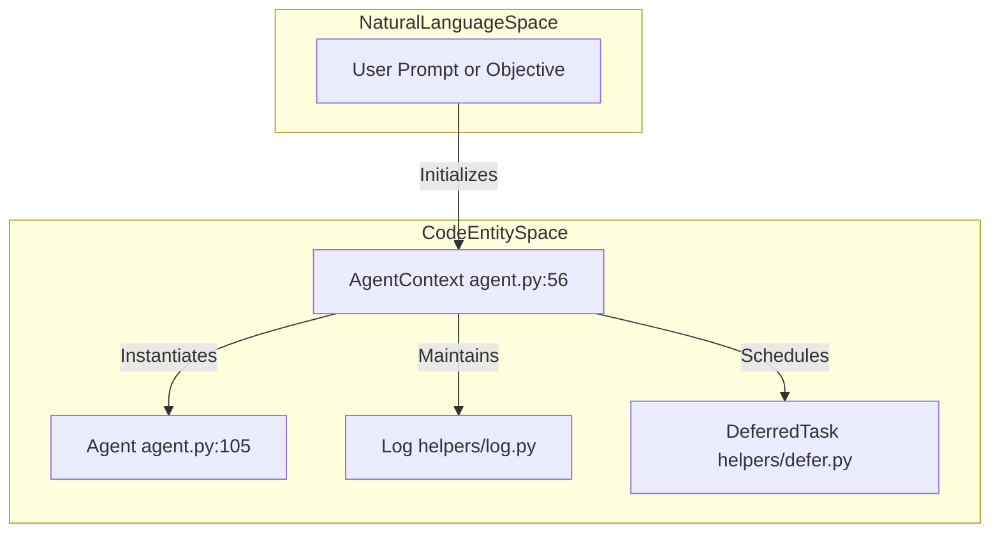
Sources: [agent.py:56-111](), [helpers/defer.py]()

## The Monologue Loop

The core thinking engine of an agent is the **Monologue Loop**, an iterative cycle where the agent observes state, reasons through model generations, and invokes tools.

1.  **Observation:** Incoming messages, tool responses, and system constraints are compiled into the prompt structure.
2.  **Reasoning:** The LLM generates internal monologue and thoughts. The framework supports native reasoning/thinking tags (e.g., `<think>`) parsed via `ChatGenerationResult` [models.py:171-195]().
3.  **Action:** The agent executes tools via structured function calls or tool parsers [agent.py:10-20]().
4.  **Feedback & Iteration:** Tool outputs are fed back into history until the termination condition is met.

### Diagram: Monologue Loop Mapping

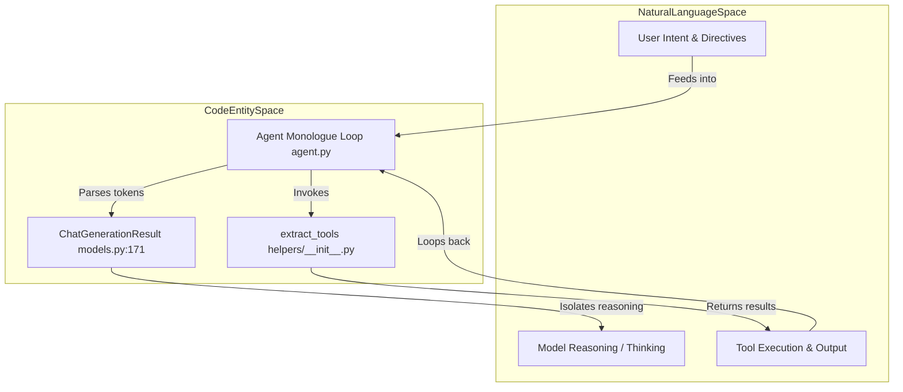
Sources: [agent.py:10-20](), [models.py:171-195]()

## Runtime Distinction: Framework vs. Execution Runtime

A critical security and architectural separation exists between the environment hosting Agent Zero and the environment where code executes.

### Framework Runtime
*   **Purpose:** Runs the Flask/ASGI server (`run_ui.py`), LLM client orchestration (`models.py`), WebSocket handlers, and background job loops.
*   **Initialization:** Managed by `initialize.py` and configured via `requirements.txt` [initialize.py:6-68](), [requirements.txt:1-60]().

### Execution Runtime
*   **Purpose:** The sandboxed shell or container environment where agent-generated code, shell scripts, and package installations (`pip install`) run.
*   **Isolation:** Ensures that destructive operations or dependency conflicts triggered by the agent's code execution do not compromise the core framework runtime.

### Diagram: Runtime Separation

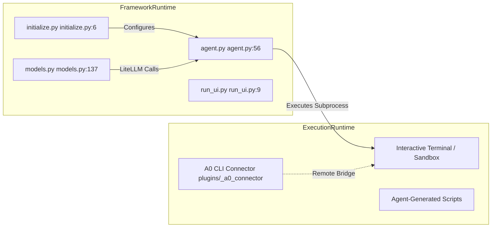
Sources: [initialize.py:6-68](), [agent.py:56-111](), [models.py:137-160](), [run_ui.py:9-52](), [requirements.txt:1-60]()

## Key Terminology Summary

| Term | Definition | Source |
| :--- | :--- | :--- |
| **Agent Profile** | Configuration profile determining system prompts and default behaviors. | [initialize.py:13-17]() |
| **Intervention** | Manual user pause or redirection mechanism via `InterventionException`. | [agent.py:35-35]() |
| **Knowledge Base** | Document collection indexed for agent retrieval. | [initialize.py:15-15]() |
| **LiteLLM** | Unified LLM abstraction and transport wrapper layer. | [models.py:21-32]() |
| **MCP** | Model Context Protocol integration for external tools/data. | [initialize.py:57-62]() |
| **DeferredTask** | Asynchronous background task execution wrapper. | [agent.py:31-31](), [agent.py:102-102]() |

Sources: [initialize.py:13-62](), [agent.py:31-102](), [models.py:21-32]()

---

# Page: Onboarding & Discovery Experience

# Onboarding & Discovery Experience

<details>
<summary>Relevant source files</summary>

The following files were used as context for generating this wiki page:

- [conf/AGENTS.md](conf/AGENTS.md)
- [conf/model_providers.yaml](conf/model_providers.yaml)
- [plugins/_discovery/extensions/python/banners/10_discovery_cards.py](plugins/_discovery/extensions/python/banners/10_discovery_cards.py)
- [plugins/_discovery/extensions/webui/onboarding-success-end/discovery-cards.html](plugins/_discovery/extensions/webui/onboarding-success-end/discovery-cards.html)
- [plugins/_discovery/extensions/webui/welcome-actions-end/discovery-cards.html](plugins/_discovery/extensions/webui/welcome-actions-end/discovery-cards.html)
- [plugins/_discovery/webui/assets/cli-connector-preview.png](plugins/_discovery/webui/assets/cli-connector-preview.png)
- [plugins/_discovery/webui/assets/hero-openai-oauth.png](plugins/_discovery/webui/assets/hero-openai-oauth.png)
- [plugins/_discovery/webui/discovery-store.js](plugins/_discovery/webui/discovery-store.js)
- [plugins/_model_config/api/model_search.py](plugins/_model_config/api/model_search.py)
- [plugins/_model_config/default_config.yaml](plugins/_model_config/default_config.yaml)
- [plugins/_model_config/extensions/python/banners/_20_missing_api_key.py](plugins/_model_config/extensions/python/banners/_20_missing_api_key.py)
- [plugins/_model_config/provider_metadata.yaml](plugins/_model_config/provider_metadata.yaml)
- [plugins/_onboarding/webui/onboarding-providers.js](plugins/_onboarding/webui/onboarding-providers.js)
- [plugins/_onboarding/webui/onboarding-store.js](plugins/_onboarding/webui/onboarding-store.js)
- [plugins/_onboarding/webui/onboarding.html](plugins/_onboarding/webui/onboarding.html)
- [tests/test_litellm_sdk.py](tests/test_litellm_sdk.py)
- [tests/test_model_config_api_keys.py](tests/test_model_config_api_keys.py)
- [tests/test_model_search.py](tests/test_model_search.py)
- [tests/test_onboarding_static.py](tests/test_onboarding_static.py)
- [webui/components/chat/model-gate-store.js](webui/components/chat/model-gate-store.js)
- [webui/components/chat/model-setup-gate.html](webui/components/chat/model-setup-gate.html)

</details>


## Purpose and Scope
This page details the technical implementation of the `_onboarding` and `_discovery` plugins, covering the first-run provider wizard (`plugins/_onboarding/webui/onboarding-store.js`), unified provider selection modes, model setup gates (`webui/components/chat/model-gate-store.js`), backend model search routing (`plugins/_model_config/api/model_search.py`), banner generation extensions (`plugins/_discovery/extensions/python/banners/10_discovery_cards.py` and `plugins/_model_config/extensions/python/banners/_20_missing_api_key.py`), and the welcome screen hand-off.

---

## 1. Onboarding Plugin & First-Run Wizard (`_onboarding`)

The onboarding subsystem guides unconfigured instances through selecting a primary LLM provider, providing API keys or account links, configuring utility models, and validating setup readiness.

The wizard state is driven by the Alpine.js store defined in `plugins/_onboarding/webui/onboarding-store.js` [plugins/_onboarding/webui/onboarding-store.js:80-155] and rendered via `plugins/_onboarding/webui/onboarding.html` [plugins/_onboarding/webui/onboarding.html:1-178]. The multi-step wizard progresses through four sequential steps: `connect`, `setup`, `utility`, and `ready` [plugins/_onboarding/webui/onboarding-store.js:81,109-114].

Providers are categorized into cloud APIs, account-backed connections, and local runtimes using provider ID arrays and metadata overrides defined in `plugins/_onboarding/webui/onboarding-providers.js`:
- **Top Cloud Providers**: `TOP_CLOUD_PROVIDER_IDS` (`openrouter`, `a0_venice`, `openai`, `anthropic`, `google`, `deepseek`, etc.) [plugins/_onboarding/webui/onboarding-providers.js:1-13].
- **More Cloud Providers**: `MORE_CLOUD_PROVIDER_IDS` (`ollama_cloud`, `bedrock`, `groq`, `cerebras`, `xai`, `moonshot`, etc.) [plugins/_onboarding/webui/onboarding-providers.js:15-28].
- **Local Providers**: `LOCAL_PROVIDER_IDS` (`ollama`, `lm_studio`, `omlx`, `llama_cpp`, `vllm`, `other`) [plugins/_onboarding/webui/onboarding-providers.js:30].

Provider-specific configurations, logos, setup URLs, documentation links, and default model strings are merged via `ONBOARDING_PROVIDER_OVERRIDES` [plugins/_onboarding/webui/onboarding-providers.js:32] and server-side definitions in `conf/model_providers.yaml` [conf/model_providers.yaml:28-227].

### Onboarding Provider & Configuration Flow

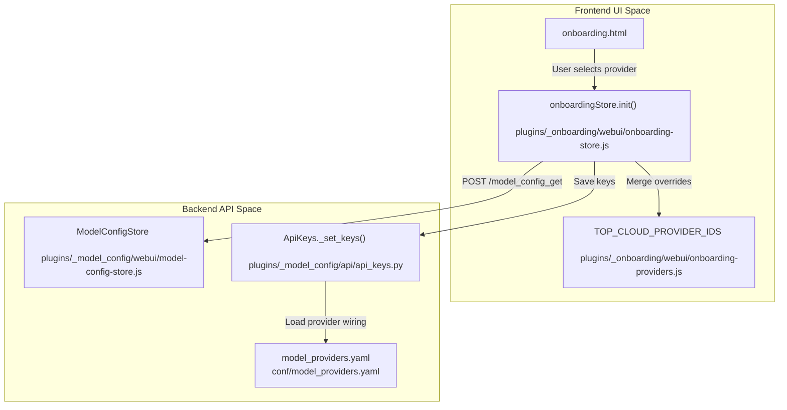
*Sources:* `plugins/_onboarding/webui/onboarding-store.js` [plugins/_onboarding/webui/onboarding-store.js:80-177], `plugins/_onboarding/webui/onboarding-providers.js` [plugins/_onboarding/webui/onboarding-providers.js:1-40], `conf/model_providers.yaml` [conf/model_providers.yaml:28-40].

Sources: `plugins/_onboarding/webui/onboarding.html` [plugins/_onboarding/webui/onboarding.html:1-178], `plugins/_onboarding/webui/onboarding-store.js` [plugins/_onboarding/webui/onboarding-store.js:80-155], `plugins/_onboarding/webui/onboarding-providers.js` [plugins/_onboarding/webui/onboarding-providers.js:1-40].

---

## 2. Model Setup Gate & Deferred Message Dispatch

When a user attempts to send a message without a configured model or valid API key, the chat interface intercepts the action via the model setup gate managed by `modelGateStore` in `webui/components/chat/model-gate-store.js` and rendered via `webui/components/chat/model-setup-gate.html`.

Instead of blocking the UI with static error modals, missing model setup is deferred. The pending message and its attachments are cached in `sessionStorage` under `a0:model-gate-pending:v1`, and synthetic log entries are injected into the active message list (`syntheticMessages()` and `mergeSyntheticMessages()`) [tests/test_model_config_api_keys.py:86-103]. Once the onboarding wizard or preset configuration fires configuration events, `dispatchPendingIfConfigured()` automatically resumes and dispatches the payload via `globalThis.sendMessage()`.

### Model Setup Gate Execution & Deferred Dispatch Flow

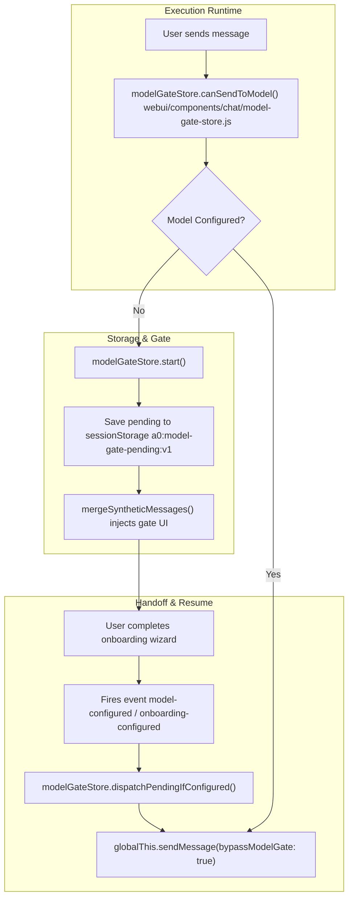
*Sources:* `tests/test_model_config_api_keys.py` [tests/test_model_config_api_keys.py:86-103].

Sources: `tests/test_model_config_api_keys.py` [tests/test_model_config_api_keys.py:86-103].

---

## 3. Model Search & Endpoint Resolution (`ModelSearch`)

The model configuration plugin provides backend model discovery via the `ModelSearch` class located in `plugins/_model_config/api/model_search.py`. This handler resolves provider endpoint URLs, constructs authentication headers, and queries upstream model listing APIs.

```python
# Core request handling and fallback in ModelSearch
# plugins/_model_config/api/model_search.py:37-70
```

`ModelSearch` performs the following validation and fetching steps:
1. **Config & URL Resolution**: Resolves provider configuration via `get_provider_config` [plugins/_model_config/api/model_search.py:74] and determines endpoint URLs using `_resolve_url()` [plugins/_model_config/api/model_search.py:142].
2. **Authentication Injection**: Attaches provider-specific API keys retrieved via `models.get_api_key(provider)` [plugins/_model_config/api/model_search.py:95], supporting custom query parameters (e.g., Google API keys) [plugins/_model_config/api/model_search.py:114] and headers (e.g., Anthropic `x-api-key`) [plugins/_model_config/api/model_search.py:181].
3. **Filtering**: Excludes non-chat models (such as text-to-speech, embeddings, and image generation) using `_NON_CHAT_EXCLUDE` [plugins/_model_config/api/model_search.py:11].
4. **LiteLLM Fallback**: If upstream provider endpoints fail or return empty lists, `ModelSearch` falls back to LiteLLM's internal registry (`_litellm_fallback`) [plugins/_model_config/api/model_search.py:53].

Sources: `plugins/_model_config/api/model_search.py` [plugins/_model_config/api/model_search.py:1-296], `conf/model_providers.yaml` [conf/model_providers.yaml:1-227].

---

## 4. Discovery Cards & Banner Subsystem (`_discovery` & `_model_config`)

Agent Zero features an extensible banner notification and discovery card system powered by Python extension classes and rendered on the welcome screen and onboarding success surfaces.

### Banner Aggregation & Ingestion Pipeline

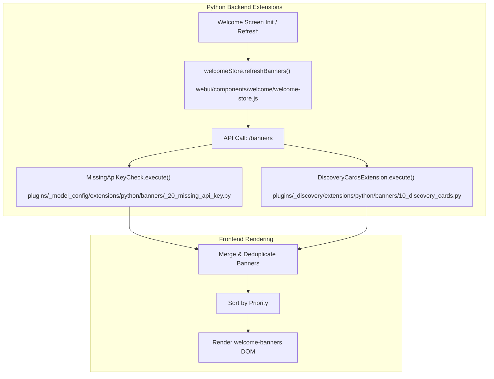
*Sources:* `webui/components/welcome/welcome-store.js` [webui/components/welcome/welcome-store.js:56-141], `plugins/_discovery/extensions/python/banners/10_discovery_cards.py` [plugins/_discovery/extensions/python/banners/10_discovery_cards.py:58-153], `plugins/_model_config/extensions/python/banners/_20_missing_api_key.py` [plugins/_model_config/extensions/python/banners/_20_missing_api_key.py:11-28].

Key components of the discovery and banner subsystem:
- **Missing API Key Check**: `MissingApiKeyCheck` (`plugins/_model_config/extensions/python/banners/_20_missing_api_key.py`) evaluates effective missing model providers and injects the `missing-api-key` warning banner with a direct Call-to-Action (CTA) launching the onboarding modal (`open-modal:/plugins/_onboarding/webui/onboarding.html`) [plugins/_model_config/extensions/python/banners/_20_missing_api_key.py:5-28].
- **Discovery Cards Extension**: `DiscoveryCardsExtension` (`plugins/_discovery/extensions/python/banners/10_discovery_cards.py`) inspects configuration states for integrations (`_telegram_integration`, `_email_integration`, `_whatsapp_integration`) and OAuth account summaries (`_oauth`), injecting feature cards, plugin hub banners, and OAuth account cards with usage windows into the banner list [plugins/_discovery/extensions/python/banners/10_discovery_cards.py:58-153].

Sources: `plugins/_discovery/extensions/python/banners/10_discovery_cards.py` [plugins/_discovery/extensions/python/banners/10_discovery_cards.py:1-155], `plugins/_model_config/extensions/python/banners/_20_missing_api_key.py` [plugins/_model_config/extensions/python/banners/_20_missing_api_key.py:1-28].

---

## 5. Welcome Screen Hand-off & Session Initialization

When Agent Zero loads with no active chat selected (`chatsStore.selected` is null), the application displays the welcome screen defined in `webui/components/welcome/welcome-screen.html` and managed by `welcomeStore` (`webui/components/welcome/welcome-store.js`).

The hand-off from the welcome screen to an active chat session occurs when a user submits input into the welcome composer or triggers a quick action card. This instantiates a new chat session via `chatsStore`, transitioning `welcomeStore.isVisible` to `false` and mounting the chat interface.

Sources: `webui/components/welcome/welcome-store.js` [webui/components/welcome/welcome-store.js:1-286], `plugins/_discovery/extensions/python/banners/10_discovery_cards.py` [plugins/_discovery/extensions/python/banners/10_discovery_cards.py:1-155].

---

# Page: Core Agent Architecture

# Core Agent Architecture

<details>
<summary>Relevant source files</summary>

The following files were used as context for generating this wiki page:

- [AGENTS.md](AGENTS.md)
- [agent.py](agent.py)
- [initialize.py](initialize.py)
- [models.py](models.py)
- [preload.py](preload.py)
- [requirements.txt](requirements.txt)
- [run_ui.py](run_ui.py)
- [tests/test_embedding_model_preload.py](tests/test_embedding_model_preload.py)

</details>


This wiki page provides a high-level overview of the Agent Zero engine, focusing on the core architectural components that drive agent behavior, conversation state, and execution loops: `AgentContext`, `Agent`, and the Monologue Loop [agent.py:50-111](), [agent.py:1052-1100](). Deep technical details regarding the monologue lifecycle, prompts, tools, error handling, and LLM abstractions are deferred to the child pages linked below.

### High-Level Engine Overview

The following diagram illustrates how the core classes interact to process a user request, mapping the conceptual "Natural Language Space" to the concrete "Code Entity Space".

**Engine Entity Mapping**
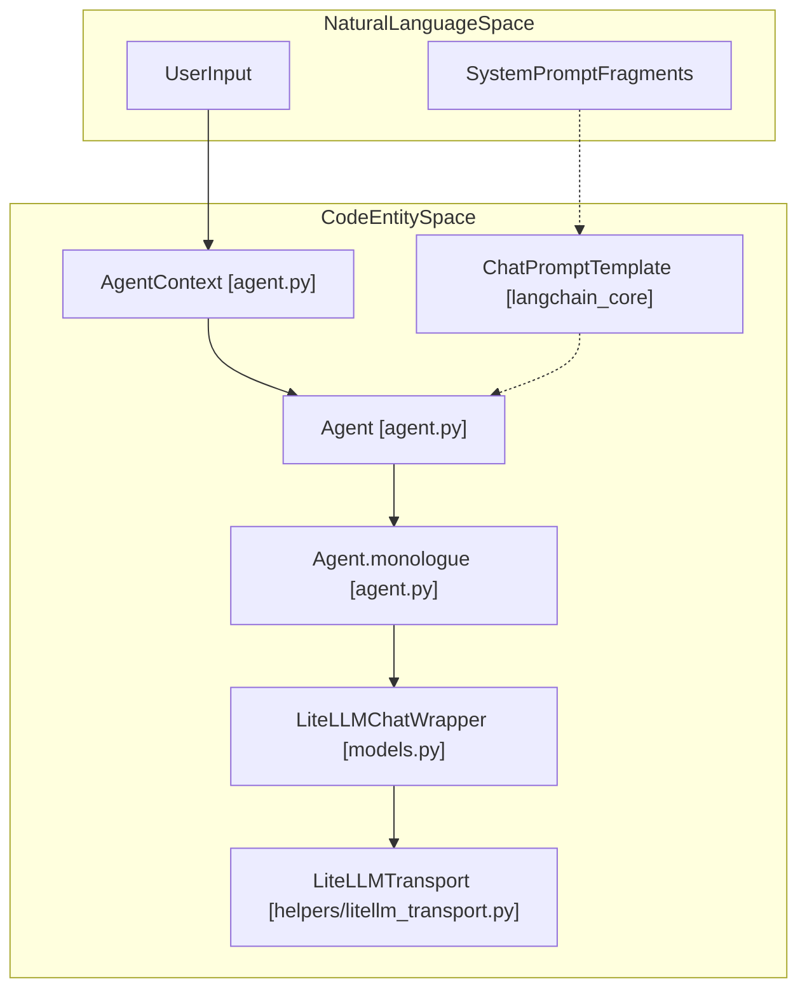
Sources: [agent.py:50-111](), [agent.py:1052-1100](), [models.py:246-280](), [agent.py:24-28](), [helpers/litellm_transport.py:43-45]()

---

### Core Components

#### 1. AgentContext
The `AgentContext` acts as the container for a specific session or task. It manages the lifecycle of the primary agent (`agent0`), handles logging, and stores persistent data [agent.py:56-111]().
- **Identity:** Every context has a unique `id` and a `type` (`USER`, `TASK`, or `BACKGROUND`) [agent.py:50-54](), [agent.py:81-104]().
- **Persistence:** It holds `data` and `output_data` dictionaries used to maintain state across the monologue loop [agent.py:96-97](), [agent.py:177-191]().
- **Task Management:** It can wrap execution in a `DeferredTask` to allow asynchronous, non-blocking operations [agent.py:102](), [helpers/defer.py:84-104]().
- **Global Registry:** Contexts are managed via a thread-safe registry `_contexts` using an `RLock` [agent.py:58-59]().

Sources: [agent.py:56-111](), [helpers/defer.py:84-104]()

#### 2. The Agent Class
The `Agent` class is the primary reasoning engine. It manages its profile, assembles system prompts, and tracks its position in the multi-agent hierarchy [agent.py:821-860]().
- **Initialization:** Agents are initialized with an `AgentConfig` and linked to a parent `AgentContext` [agent.py:110](), [initialize.py:13-17]().
- **Hierarchy:** Agents track their level (0 for the root agent) and their superior agent, allowing recursive sub-agent spawning [helpers/subagents.py:23-43]().
- **Prompting:** The agent reads and assembles prompts using helper utilities that handle localization and fragment stitching [agent.py:919-940]().

Sources: [agent.py:110](), [initialize.py:13-17](), [helpers/subagents.py:23-43]()

#### 3. The Monologue Loop
The `Agent.monologue()` method drives execution. It is an asynchronous loop that continues until the agent provides a final response or an intervention occurs [agent.py:1052-1100]().
- **Chain of Thought:** The agent generates thoughts and tool calls via the LLM.
- **Action and Observation:** Tools execute, and results feed back into the agent history as observations.
- **Interventions:** The loop can be interrupted by users or system events using `InterventionException`, `RepairableException`, or `HandledException` [agent.py:35]().

For details on initialization, message processing, and error recovery, see **[Agent Lifecycle & Monologue Loop](#2.1)**.

Sources: [agent.py:35](), [agent.py:1052-1100]()

---

### Prompt & Tool Definition Mapping

To bridge declarative configurations and code execution, prompt fragments and tool specifications map directly to runtime loaders and tool registries.

**PromptAndToolResolutionMapping**
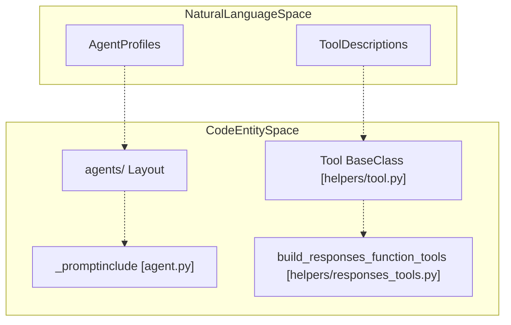
Sources: [agent.py:919-940](), [helpers/responses_tools.py:44-45]()

---

### Subsystem Integration & Child Overviews

The architecture delegates responsibilities to specialized systems, which are covered in depth on the child pages:

| Subsystem | Scope & Overview | Child Page Link |
| :--- | :--- | :--- |
| **Prompt System & Agent Profiles** | How system prompts assemble from fragment files and how profiles (`agent0`, `researcher`, developer, etc.) override defaults. | **[Prompt System & Agent Profiles](#2.2)** |
| **Tool System** | The `Tool` base class, built-in tools (code execution, response, call_subordinate, memory, browser, etc.), and parallel execution. | **[Tool System](#2.3)** |
| **Response Handling & History** | Message loop extensions, JSON repair (`_context_doctor`), loop limits, and history compaction (`_chat_compaction`). | **[Response Handling, Repair & History](#2.4)** |
| **LLM Model Abstraction** | `LiteLLMChatWrapper`, transport layers (`LiteLLMTransport`, `ResponsesTransport`), rate limiting, and thinking tags. | **[LLM Model Abstraction & Rate Limiting](#2.5)** |

**Agent Execution Sequence**
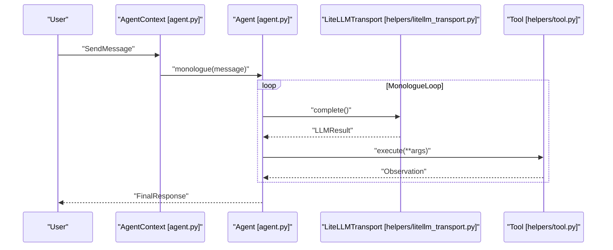
Sources: [agent.py:1052-1150](), [helpers/litellm_transport.py:43-45](), [helpers/llm_result.py:36-42]()

---

### Extensibility & Infrastructure

- **Plugin Hooks:** Functions marked with `@extensible` create extension points allowing plugins to mutate arguments or intercept execution flows [helpers/extension.py:52-99](), [agent.py:63-64]().
- **Thinking Tag Parsing:** The `ChatGenerationResult` class handles both native reasoning and manual parsing of `<think>` or `<reasoning>` tags [models.py:168-214]().
- **Rate Limiting:** API calls are governed via a `RateLimiter` configured per provider [models.py:27]().

Sources: [helpers/extension.py:52-99](), [models.py:27](), [models.py:168-214](), [agent.py:63-64]()

---

# Page: Agent Lifecycle & Monologue Loop

# Agent Lifecycle & Monologue Loop

<details>
<summary>Relevant source files</summary>

The following files were used as context for generating this wiki page:

- [AGENTS.md](AGENTS.md)
- [agent.py](agent.py)
- [extensions/python/_functions/agent/AgentContext/run_task/end/_10_mark_state_dirty.py](extensions/python/_functions/agent/AgentContext/run_task/end/_10_mark_state_dirty.py)
- [extensions/python/agent_init/_10_initial_message.py](extensions/python/agent_init/_10_initial_message.py)
- [helpers/defer.py](helpers/defer.py)
- [helpers/defer.py.dox.md](helpers/defer.py.dox.md)
- [helpers/log.py](helpers/log.py)
- [helpers/log.py.dox.md](helpers/log.py.dox.md)
- [helpers/state_monitor.py.dox.md](helpers/state_monitor.py.dox.md)
- [helpers/state_monitor_integration.py](helpers/state_monitor_integration.py)
- [initialize.py](initialize.py)
- [models.py](models.py)
- [plugins/_text_editor/helpers/log.py](plugins/_text_editor/helpers/log.py)
- [preload.py](preload.py)
- [prompts/fw.initial_user_message.md](prompts/fw.initial_user_message.md)
- [requirements.txt](requirements.txt)
- [run_ui.py](run_ui.py)
- [tests/test_defer_lifecycle.py](tests/test_defer_lifecycle.py)
- [tests/test_embedding_model_preload.py](tests/test_embedding_model_preload.py)
- [tools/AGENTS.md](tools/AGENTS.md)

</details>


## Purpose & Scope

This page provides a deep technical dive into the core execution engine of Agent Zero. It covers the `AgentContext` state container [agent.py:56-108](), the `Agent.monologue()` reasoning loop, `LoopData` execution tracking, background execution via `DeferredTask` [helpers.defer.py:84-104](), user intervention handling (`InterventionException`) [agent.py:35](), the recursive-iterative `_process_chain` execution core, error recovery mechanisms including `RepairableException`, `HandledException` [agent.py:35](), and error retry flows, alongside framework startup initialization [initialize.py:6-83]().

---

## AgentContext: The State Container

The `AgentContext` class is the central authority managing an agent's lifecycle, containing configuration, active agents, logs, and metadata [agent.py:56-111]().

### Context Registry and Lifecycle Management
Contexts are tracked in a thread-safe global registry dictionary `AgentContext._contexts` protected by an `RLLock` (`AgentContext._contexts_lock`) [agent.py:58-59](). Each context is assigned an 8-character alphanumeric identifier generated via `AgentContext.generate_id()` [agent.py:152-161]().

*   **Initialization**: Instantiating `AgentContext` configures state variables, assigns a logging instance (`Log`), and instantiates the root agent `agent0` (`Agent(0, self.config, self)`) [agent.py:93-111](). If an existing context shares the ID, its active task is terminated before replacement [agent.py:83-89]().
*   **Thread Association**: Current context IDs are resolved and bound thread-locally using `AgentContext.current()`, `AgentContext.set_current()`, and `AgentContext.use()` [agent.py:120-138]().
*   **Persistence**: Persistence is managed by serialization handlers that write chat states to disk during server bootstrap and execution updates.
*   **Cleanup**: Calling `AgentContext.remove(id)` pops the context from the registry and terminates any associated background tasks [agent.py:170-177]().

### Context Properties Reference
| Property | Type | Code Entity / Definition | Description |
| :--- | :--- | :--- | :--- |
| `id` | `str` | `AgentContext.id` [agent.py:81]() | Unique session/chat identifier string. |
| `agent0` | `Agent` | `AgentContext.agent0` [agent.py:110]() | Root agent instance (`Agent`) bound to this context. |
| `log` | `Log.Log` | `AgentContext.log` [agent.py:98]() | Event logger (`Log`) used for real-time WebUI synchronization. |
| `task` | `DeferredTask \| None` | `AgentContext.task` [agent.py:102]() | Background `DeferredTask` running the active monologue. |
| `type` | `AgentContextType` | `AgentContext.type` [agent.py:104]() | Enum classifying context as `USER`, `TASK`, or `BACKGROUND` [agent.py:50-54](). |

Sources: [agent.py:56-177]()

---

## The Monologue Loop

The `Agent.monologue()` method serves as the entry point for autonomous agent reasoning, driving the iterative "Thought -> Action -> Observation" cycle.

### Execution Flow: Natural Language Space to Code Entity Space
The following diagram connects high-level execution concepts to concrete codebase symbols.

Title: "Monologue Execution Architecture"
```mermaid
graph TD
    subgraph NaturalLanguageSpace
        UserMessage[""User Prompt / Input Message""]
        ReasoningCycle[""Autonomous Reasoning Loop""]
        TerminalOutput[""Final Tool Response / Output""]
    end

    subgraph CodeEntitySpace
        Context[""AgentContext (agent.py:56)""]
        Task[""DeferredTask (helpers/defer.py:84)""]
        Agent[""Agent.monologue() (agent.py)""]
        LoopData[""LoopData (agent.py)""]
        Chain[""Agent._process_chain() (agent.py)""]
        Transport[""LiteLLMTransport (models.py:31)""]
        Extractor[""extract_tools (helpers/extract_tools.py:23)""]
    end

    UserMessage --> Context
    Context -->|"spawns"| Task
    Task -->|"executes"| Agent
    Agent -->|"initializes"| LoopData
    LoopData --> Chain
    Chain -->|"invokes chat"| Transport
    Transport -->|"parses output"| Extractor
    Extractor -->|"returns observations"| Chain
    Chain -->|"terminal action"| TerminalOutput

    Context -.->|"owns root agent"| Agent
    Agent -.->|"drives loop"| Chain
```
Sources: [agent.py:56-111](), [helpers/defer.py:84-120](), [models.py:31]()

### LoopData & State Tracking
State across a single invocation chain is tracked via a `LoopData` instance. It encapsulates iteration counters, token expenditure metrics, active timeouts, and user intervention buffers [extensions/python/agent_init/_10_initial_message.py:41]().

Sources: [agent.py:1-49](), [extensions/python/agent_init/_10_initial_message.py:41]()

---

## _process_chain: The Iterative Core

The `_process_chain` method manages the step-by-step cycle of model prompting, response parsing, and tool dispatching.

1.  **Prompt Assembly**: Compiles chat history, system prompt definitions, and tool schemas.
2.  **LLM Transmission**: Dispatches requests via `LiteLLMTransport` or alternative protocol transports [models.py:31]().
3.  **Thinking Tag Parsing**: The `ChatGenerationResult` class processes streaming chunks, separating reasoning strings from response strings by parsing native provider reasoning or searching for `<think>` and `<reasoning>` tags [models.py:171-209]().
4.  **Tool Extraction**: Scans model output using parsing helpers to extract tool invocation blocks, handling malformed or "dirty" JSON syntax [models.py:30]().
5.  **Execution & Termination**: Dispatches tool calls; terminal tools (such as `response`) halt the monologue chain.

Sources: [models.py:30-31](), [models.py:171-209]()

---

## DeferredTask, Interventions & Error Recovery

Because LLM invocations and multi-step tasks are long-running, Agent Zero isolates execution inside background threads using `DeferredTask` [helpers.defer.py:84-120]() running on managed `EventLoopThread` instances [helpers.defer.py:12-43]().

*   **Intervention Handling**: If a user submits input while an agent is active, an `InterventionException` is raised [agent.py:35](). The monologue loop catches this exception, integrates the user message into the loop state as an intervention, and resumes execution.
*   **Error Recovery**: Exceptions during tool execution or LLM interaction are classified. `RepairableException` prompts the LLM to self-correct its code or syntax [agent.py:35](), whereas `HandledException` gracefully exits the step without crashing the agent context [agent.py:35](). Additionally, error retry handlers intercept critical exceptions, maintain retry counters per monologue, and inject agent-facing error messages before failing [agent.py:35]().

### Intervention and Error Recovery Architecture
Title: "Intervention and Error Recovery Architecture"
```mermaid
graph TD
    subgraph NaturalLanguageSpace
        UserInput[""User Interrupt / Message""]
        ErrorState[""Tool Execution Error""]
        SelfCorrection[""Self-Correction / Retry""]
    end

    subgraph CodeEntitySpace
        Defer[""DeferredTask (helpers/defer.py:84)""]
        Intervention[""InterventionException (agent.py:35)""]
        Repairable[""RepairableException (agent.py:35)""]
        Handled[""HandledException (agent.py:35)""]
        Monologue[""Agent.monologue() (agent.py)""]
    end

    UserInput -->|"triggers"| Intervention
    Intervention -->|"caught by"| Monologue
    ErrorState -->|"raises"| Repairable
    ErrorState -->|"raises"| Handled
    Repairable -->|"triggers"| SelfCorrection
    SelfCorrection --> Monologue
    Handled -->|"graceful exit"| Monologue
    Defer -->|"hosts thread"| Monologue
```
Sources: [agent.py:30-35](), [helpers.defer.py:12-120]()

---

## Initialization & Recovery

Agent Zero boots up via a structured startup sequence managed by entry points (`run_ui.py`) and framework initializers (`initialize.py`) that ensure state consistency, dependency preloading, and persistence restoration.

### Startup & Initialization Architecture
Title: "Initialization and Bootstrap Flow"
```mermaid
graph TD
    subgraph ExecutionRuntime
        RunUI[""run_ui.py run() (run_ui.py:9)""]
        Migration[""initialize_migration() (initialize.py:75)""]
        AgentInit[""initialize_agent() (initialize.py:7)""]
        ChatsInit[""initialize_chats() (initialize.py:50)""]
        MCPInit[""initialize_mcp() (initialize.py:57)""]
        JobLoop[""initialize_job_loop() (initialize.py:65)""]
        Preload[""initialize_preload() (initialize.py:70)""]
    end

    subgraph PersistenceAndModelSubsystems
        ModelConfig[""ModelConfig & LiteLLM (models.py:143)""]
        PreloadWorker[""preload.py preload() (preload.py:7)""]
    end

    RunUI --> Migration
    Migration --> AgentInit
    AgentInit --> ChatsInit
    AgentInit --> MCPInit
    AgentInit --> JobLoop
    AgentInit --> Preload

    Preload --> PreloadWorker
    AgentInit --> ModelConfig
```
Sources: [run_ui.py:9-25](), [initialize.py:6-83](), [models.py:143-164](), [preload.py:7-22]()

---

# Page: Prompt System & Agent Profiles

# Prompt System & Agent Profiles

<details>
<summary>Relevant source files</summary>

The following files were used as context for generating this wiki page:

- [agents/AGENTS.md](agents/AGENTS.md)
- [agents/_example/prompts/agent.system.main.specifics.md](agents/_example/prompts/agent.system.main.specifics.md)
- [agents/agent0/prompts/agent.system.main.role.md](agents/agent0/prompts/agent.system.main.role.md)
- [agents/agent0/prompts/agent.system.main.specifics.md](agents/agent0/prompts/agent.system.main.specifics.md)
- [agents/agent0/prompts/agent.system.tool.response.md](agents/agent0/prompts/agent.system.tool.response.md)
- [agents/developer/AGENTS.md](agents/developer/AGENTS.md)
- [agents/developer/prompts/agent.system.main.specifics.md](agents/developer/prompts/agent.system.main.specifics.md)
- [agents/hacker/prompts/agent.system.main.specifics.md](agents/hacker/prompts/agent.system.main.specifics.md)
- [agents/researcher/AGENTS.md](agents/researcher/AGENTS.md)
- [agents/researcher/prompts/agent.system.main.specifics.md](agents/researcher/prompts/agent.system.main.specifics.md)
- [extensions/python/_functions/agent/Agent/prepare_prompt/end/_00_restore_settings.py](extensions/python/_functions/agent/Agent/prepare_prompt/end/_00_restore_settings.py)
- [extensions/python/_functions/agent/Agent/prepare_prompt/start/_99_snapshot_settings.py](extensions/python/_functions/agent/Agent/prepare_prompt/start/_99_snapshot_settings.py)
- [extensions/python/message_loop_prompts_after/_75_include_workdir_extras.py](extensions/python/message_loop_prompts_after/_75_include_workdir_extras.py)
- [helpers/file_tree.py](helpers/file_tree.py)
- [helpers/file_tree.py.dox.md](helpers/file_tree.py.dox.md)
- [plugins/_a0_connector/skills/host-file-editing/SKILL.md](plugins/_a0_connector/skills/host-file-editing/SKILL.md)
- [plugins/_code_execution/prompts/agent.system.tool.code_exe.md](plugins/_code_execution/prompts/agent.system.tool.code_exe.md)
- [plugins/_code_execution/prompts/agent.system.tool.input.md](plugins/_code_execution/prompts/agent.system.tool.input.md)
- [plugins/_promptinclude/AGENTS.md](plugins/_promptinclude/AGENTS.md)
- [plugins/_promptinclude/extensions/python/system_prompt/_16_promptinclude.py](plugins/_promptinclude/extensions/python/system_prompt/_16_promptinclude.py)
- [plugins/_promptinclude/helpers/scanner.py](plugins/_promptinclude/helpers/scanner.py)
- [plugins/_promptinclude/prompts/agent.system.promptinclude.md](plugins/_promptinclude/prompts/agent.system.promptinclude.md)
- [plugins/_promptinclude/prompts/fw.promptinclude.includes.md](plugins/_promptinclude/prompts/fw.promptinclude.includes.md)
- [prompts/agent.system.main.communication.md](prompts/agent.system.main.communication.md)
- [prompts/agent.system.main.communication_additions.md](prompts/agent.system.main.communication_additions.md)
- [prompts/agent.system.main.md](prompts/agent.system.main.md)
- [prompts/agent.system.main.solving.md](prompts/agent.system.main.solving.md)
- [prompts/agent.system.main.tips.md](prompts/agent.system.main.tips.md)
- [prompts/agent.system.main.tips.py](prompts/agent.system.main.tips.py)
- [prompts/agent.system.tool.response.md](prompts/agent.system.tool.response.md)
- [tests/test_default_prompt_budget.py](tests/test_default_prompt_budget.py)
- [tests/test_promptinclude.py](tests/test_promptinclude.py)
- [webui/components/modals/image-viewer/image-viewer-store.js](webui/components/modals/image-viewer/image-viewer-store.js)
- [webui/components/modals/image-viewer/image-viewer.html](webui/components/modals/image-viewer/image-viewer.html)
- [webui/components/projects/project-file-structure-test.html](webui/components/projects/project-file-structure-test.html)
- [webui/components/settings/agent/workdir-file-structure-test.html](webui/components/settings/agent/workdir-file-structure-test.html)

</details>


## Purpose & Scope

The Agent Zero prompt system is a modular, extensible architecture that assembles complex system instructions from discrete Markdown fragments. Instead of relying on a monolithic prompt string, the system dynamically constructs the LLM's persona, operational rules, tool capabilities, and environmental context at the start of every message processing loop (`Agent.monologue()`).

This page details how system prompts are assembled via extension points [extensions/python/system_prompt/_10_main_prompt.py:7-18](), how the `prompts/` and `agents/` directory trees are structured, how agent profiles override framework defaults [helpers/subagents.py:51-85](), and how dynamic features like the `_promptinclude` scanner [plugins/_promptinclude/helpers/scanner.py:32-41]() and prompt catalogs operate.

Sources: [extensions/python/system_prompt/_10_main_prompt.py:7-18](), [plugins/_promptinclude/helpers/scanner.py:32-41](), [helpers/subagents.py:51-85]()

---

## System Prompt Assembly & Extension Pipeline

The system prompt is assembled dynamically by the `system_prompt` extension chain. During the agent's preparation phase, the framework invokes registered extension handlers that append specific instructional blocks to a shared `system_prompt` list, which is then joined into the final instruction string passed to the LLM.

### The Assembly Pipeline
The assembly order is governed by the numerical sorting of extension filenames located in `extensions/python/system_prompt/` and plugin directories [extensions/python/system_prompt/_10_main_prompt.py:7-18]():

| Priority | Extension Class | Purpose | Source File |
| :--- | :--- | :--- | :--- |
| 09 | `TextEditorConfig` | Injects configuration constraints and line limits for text editor tools. | [plugins/_text_editor/extensions/python/system_prompt/_09_text_editor_config.py:9-23]() |
| 10 | `MainPrompt` | Loads core personality, rules, and behavioral fragments from `agent.system.main.md`. | [extensions/python/system_prompt/_10_main_prompt.py:7-18]() |
| 11 | `ToolsPrompt` | Discovers and formats all available tool definition fragments matching `agent.system.tool.*.md`. | [extensions/python/system_prompt/_11_tools_prompt.py:13-25]() |
| 12 | `MCPToolsPrompt` | Appends tools exposed by active Model Context Protocol servers. | [extensions/python/system_prompt/_12_mcp_prompt.py:8-21]() |
| 13 | `SecretsPrompt` | Injects masked environment variables and project secrets. | [extensions/python/system_prompt/_13_secrets_prompt.py:8-19]() |
| 13 | `SkillsPrompt` | Injects summaries of available reusable skills from the skills registry. | [extensions/python/system_prompt/_13_skills_prompt.py:8-21]() |
| 14 | `ProjectPrompt` | Adds project-specific instructions, variables, and discovered `AGENTS.md` context. | [extensions/python/system_prompt/_14_project_prompt.py:8-21]() |
| 16 | `PromptInclude` | Scans and injects persistent user-defined prompt fragments (`*.promptinclude.md`) from the workspace. | [plugins/_promptinclude/extensions/python/system_prompt/_16_promptinclude.py:10-46]() |

### Prompt Assembly Data Flow
The sequence below illustrates how the `Agent` engine interacts with the `ExtensionManager` and file system helpers to build the prompt string.

Title: "System Prompt Assembly Sequence"
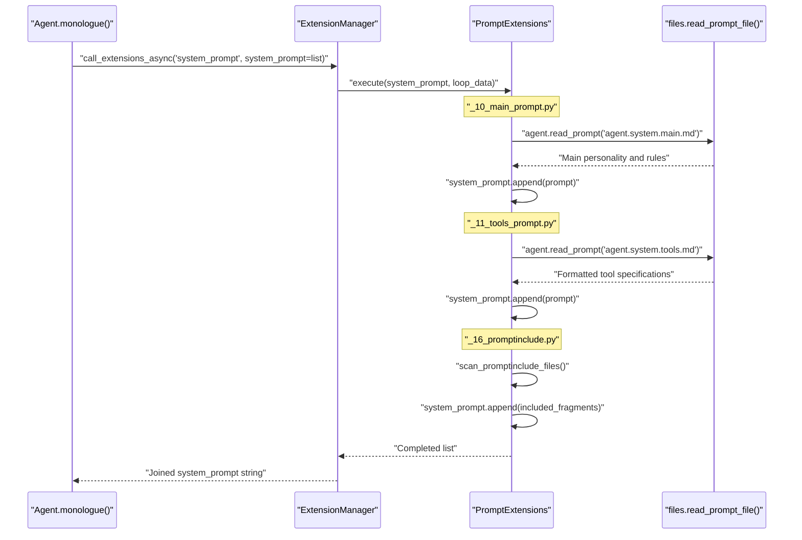
Sources: [extensions/python/system_prompt/_10_main_prompt.py:7-18](), [extensions/python/system_prompt/_11_tools_prompt.py:13-25](), [plugins/_promptinclude/extensions/python/system_prompt/_16_promptinclude.py:10-46]()

---

## Natural Language Space to Code Entity Space: Prompt Fragment Mapping

This diagram bridges human-facing prompt concepts (Natural Language Space) to their corresponding markdown files and extension loaders in the codebase (Code Entity Space).

Title: "Prompt Fragment Code Mapping"
```mermaid
graph TD
    subgraph NaturalLanguageSpace["Natural Language Space"]
        CorePersona["Core Persona & Rules"]
        CommRules["Communication & JSON Contract"]
        SolvingLogic["Problem Solving Methodology"]
        UserIncludes["Workspace Prompt Inclusions"]
    end

    subgraph CodeEntitySpace["Code Entity Space"]
        MainPromptPy["extensions/python/system_prompt/_10_main_prompt.py"]
        MainMd["prompts/agent.system.main.md"]
        CommMd["prompts/agent.system.main.communication.md"]
        SolvingMd["prompts/agent.system.main.solving.md"]
        PromptIncludePy["plugins/_promptinclude/extensions/python/system_prompt/_16_promptinclude.py"]
        ScannerPy["plugins/_promptinclude/helpers/scanner.py"]
    end

    CorePersona --> MainMd
    CommRules --> CommMd
    SolvingLogic --> SolvingMd
    UserIncludes --> ScannerPy

    MainPromptPy --> MainMd
    MainPromptPy --> CommMd
    MainPromptPy --> SolvingMd
    PromptIncludePy --> ScannerPy
```
Sources: [extensions/python/system_prompt/_10_main_prompt.py:7-18](), [prompts/agent.system.main.communication.md:1-39](), [prompts/agent.system.main.solving.md:1-44](), [plugins/_promptinclude/extensions/python/system_prompt/_16_promptinclude.py:10-46](), [plugins/_promptinclude/helpers/scanner.py:32-41]()

---

## The `prompts/` Directory Structure & Fragment Architecture

The root `prompts/` directory houses Markdown files acting as base templates. These templates support variable interpolation and recursive file/snippet inclusion via helper functions. The `read_prompt_file` function handles parsing directives, conditional blocks (`{{if}}`), and placeholder substitutions [helpers/files.py:123-162]().

### Core Fragment Architecture
*   **`agent.system.main.md`**: Master entry point that integrates role definitions, communication rules, and problem-solving methodologies.
*   **`agent.system.main.communication.md`**: Enforces strict JSON output formatting (`thoughts`, `headline`, `tool_name`, `tool_args`), forbidding unformatted text [prompts/agent.system.main.communication.md:2-19]().
*   **`agent.system.main.solving.md`**: Outlines high-agency planning, subtask partitioning, and tool-verification requirements [prompts/agent.system.main.solving.md:1-44]().
*   **`agent.system.tool.code_exe.md`**: Provides detailed rules and examples for invoking the `code_execution_tool` across terminal, python, and nodejs runtimes [plugins/_code_execution/prompts/agent.system.tool.code_exe.md:1-25]().
*   **`agent.system.tool.response.md`**: Directs final response formatting, tone, tables, and latex usage [agents/agent0/prompts/agent.system.tool.response.md:1-15]().

Sources: [prompts/agent.system.main.communication.md:2-39](), [prompts/agent.system.main.solving.md:1-44](), [plugins/_code_execution/prompts/agent.system.tool.code_exe.md:1-25](), [agents/agent0/prompts/agent.system.tool.response.md:1-15]()

---

## The `_promptinclude` Plugin & Scanner Implementation

The `_promptinclude` plugin allows users to drop custom prompt additions directly into their working directory or project space without modifying framework code [plugins/_promptinclude/extensions/python/system_prompt/_16_promptinclude.py:10-46](). 

The background scanner (`plugins/_promptinclude/helpers/scanner.py`) searches the workspace for files matching a configured name pattern (default: `*.promptinclude.md`), enforcing strict token budgeting, depth caps, per-file limits, and `.gitignore` rule matching via `PathSpec` [plugins/_promptinclude/helpers/scanner.py:32-112]().

Title: "Promptinclude Scanner Flow"
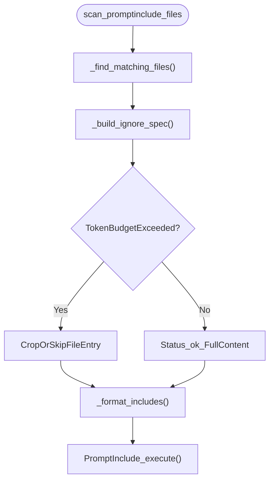
Sources: [plugins/_promptinclude/helpers/scanner.py:32-112](), [plugins/_promptinclude/extensions/python/system_prompt/_16_promptinclude.py:10-46]()

---

## Agent Profiles, Overrides & Metadata Merging

Agent Zero supports distinct execution profiles (e.g., `agent0`, `researcher`, `developer`, `hacker`, `tiny-local`). Profiles modify the agent's persona, system instructions, and tool access via a sparse override mechanism [extensions/python/agent_init/_15_load_profile_settings.py:10-40]().

### Profile Resolution Order
When an agent instance initializes with a given profile, the framework searches directories in the following priority:
1.  **Project-space**: `.a0proj/agents/<profile>/` [helpers/subagents.py:83-85]()
2.  **User-space**: `usr/agents/<profile>/` [helpers/subagents.py:76-77]()
3.  **Plugin-space**: `plugins/<plugin>/agents/<profile>/` [helpers/subagents.py:72-74]()
4.  **Built-in**: `agents/<profile>/` [helpers/subagents.py:68-69]()

### Metadata Merging
Profile configurations are defined in `agent.yaml` or `agent.json` [helpers/subagents.py:155-161](). The helper functions merge profile properties against base defaults. Missing keys inherit downward, while explicitly empty string or list values act as intentional overrides [helpers/subagents.py:51-63]().

Sources: [helpers/subagents.py:51-85](), [extensions/python/agent_init/_15_load_profile_settings.py:10-40]()

### Natural Language Space to Code Entity Space: Profile & Prompt Architecture

This diagram bridges human-facing agent profiles and system prompts to their corresponding implementation classes and filesystem entities in the codebase.

Title: "Profile and Prompt Mapping Architecture"
```mermaid
classDiagram
    class AgentContext {
        +object context
    }
    class Agent {
        +str profile
        +read_prompt(filename)
        +get_system_prompt()
    }
    class SubagentsHelper {
        +get_available_agents_dict(project)
        +load_agent_data(name)
    }
    class PromptIncludeExtension {
        +execute(system_prompt)
    }
    class ScannerModule {
        +scan_promptinclude_files(root)
    }

    AgentContext --> Agent : "instantiates"
    Agent --> SubagentsHelper : "loads"
    Agent --> PromptIncludeExtension : "triggers"
    PromptIncludeExtension --> ScannerModule : "invokes"
    
    class BuiltinProfiles {
        <<Natural Language Space>>
        +agent0: "Default autonomous agent"
        +developer: "Software architect"
        +researcher: "Data analysis"
        +hacker: "Security assessment"
        +tiny-local: "Optimized local LLMs"
    }
    class CodeFiles {
        <<Code Entity Space>>
        +agents/agent0/prompts/agent.system.main.role.md
        +agents/developer/prompts/agent.system.main.specifics.md
        +agents/researcher/prompts/agent.system.main.specifics.md
        +plugins/_promptinclude/helpers/scanner.py
        +extensions/python/system_prompt/_10_main_prompt.py
    }

    BuiltinProfiles .. CodeFiles : "maps"
```
Sources: [helpers/subagents.py:51-85](), [plugins/_promptinclude/helpers/scanner.py:32-41](), [extensions/python/system_prompt/_10_main_prompt.py:7-18]()

### Profile Specializations
| Profile | Focus & Characteristics | Key Source Files |
| :--- | :--- | :--- |
| `agent0` | Balanced, general-purpose autonomous user-facing agent. | [agents/agent0/prompts/agent.system.main.role.md:1-5]() |
| `developer` | Elite software architect emphasizing TDD, caller tracing, and clean code patterns. | [agents/developer/prompts/agent.system.main.specifics.md:1-47]() |
| `researcher` | Information gathering, source validation, structured reporting, and evidence tracking. | [agents/researcher/prompts/agent.system.main.specifics.md:1-35]() |
| `hacker` | Penetration testing, vulnerability research, and controlled security exploration. | [agents/hacker/prompts/agent.system.main.specifics.md:1-9]() |
| `tiny-local` | Stripped reasoning blocks and simplified JSON contracts tailored for restricted local LLMs. | [tests/test_default_prompt_budget.py:121-160]() |

Sources: [agents/developer/prompts/agent.system.main.specifics.md:1-81](), [agents/researcher/prompts/agent.system.main.specifics.md:1-84](), [tests/test_default_prompt_budget.py:121-183]()

---

## Project-Specific Prompts & Tiny Local Profile

### Project Prompts (`AGENTS.md`)
When a project scope is active, the `ProjectPrompt` extension scans the directory hierarchy for `AGENTS.md` or `AGENTS.override.md` files. These files supply project-specific operating instructions and local context that are injected dynamically into the system prompt at priority 14 [extensions/python/system_prompt/_14_project_prompt.py:8-21]().

### Tiny Local Optimizations
The `tiny-local` profile adapts the prompt contract for smaller local models by suppressing hidden `thoughts` and `headline` fields to reduce token overhead, enforcing direct execution of `tool_name` and `tool_args` parameters, and providing streamlined tool invocation examples compatible with limited context windows [tests/test_default_prompt_budget.py:121-183]().

Sources: [extensions/python/system_prompt/_14_project_prompt.py:8-21](), [tests/test_default_prompt_budget.py:121-183]()

---

# Page: Tool System

# Tool System

<details>
<summary>Relevant source files</summary>

The following files were used as context for generating this wiki page:

- [extensions/python/_functions/AGENTS.md](extensions/python/_functions/AGENTS.md)
- [extensions/python/_functions/agent/Agent/hist_add_ai_response/end/_10_log_plain_responses.py](extensions/python/_functions/agent/Agent/hist_add_ai_response/end/_10_log_plain_responses.py)
- [extensions/python/response_stream/AGENTS.md](extensions/python/response_stream/AGENTS.md)
- [extensions/python/response_stream/_10_log_from_stream.py](extensions/python/response_stream/_10_log_from_stream.py)
- [extensions/python/response_stream/_20_live_response.py](extensions/python/response_stream/_20_live_response.py)
- [extensions/python/response_stream_end/AGENTS.md](extensions/python/response_stream_end/AGENTS.md)
- [extensions/python/response_stream_end/_15_log_from_stream_end.py](extensions/python/response_stream_end/_15_log_from_stream_end.py)
- [extensions/python/system_prompt/_11_tools_prompt.py](extensions/python/system_prompt/_11_tools_prompt.py)
- [helpers/extract_tools.py](helpers/extract_tools.py)
- [helpers/extract_tools.py.dox.md](helpers/extract_tools.py.dox.md)
- [helpers/responses_tools.py](helpers/responses_tools.py)
- [helpers/responses_tools.py.dox.md](helpers/responses_tools.py.dox.md)
- [helpers/tool_policy.py](helpers/tool_policy.py)
- [helpers/tool_policy.py.dox.md](helpers/tool_policy.py.dox.md)
- [plugins/_a0_connector/helpers/remote_tool_prompts.py](plugins/_a0_connector/helpers/remote_tool_prompts.py)
- [plugins/_tool_access/AGENTS.md](plugins/_tool_access/AGENTS.md)
- [plugins/_tool_access/README.md](plugins/_tool_access/README.md)
- [plugins/_tool_access/default_config.yaml](plugins/_tool_access/default_config.yaml)
- [prompts/agent.system.response_tool_tips.md](prompts/agent.system.response_tool_tips.md)
- [tests/test_plain_response_logging.py](tests/test_plain_response_logging.py)
- [tests/test_response_stream_cadence.py](tests/test_response_stream_cadence.py)
- [tests/test_response_tool_validation.py](tests/test_response_tool_validation.py)
- [tests/test_responses_tools.py](tests/test_responses_tools.py)
- [tests/test_tool_policy.py](tests/test_tool_policy.py)
- [tools/response.py](tools/response.py)
- [tools/response.py.dox.md](tools/response.py.dox.md)
- [webui/components/plugins/AGENTS.md](webui/components/plugins/AGENTS.md)

</details>


The Tool System in Agent Zero provides a standardized interface for agents to interact with the external world. By following the "Computer as a Tool" philosophy, the system abstracts complex operations—such as code execution, web browsing, multi-agent coordination, and memory management—into discrete, callable entities that the LLM can invoke using structured JSON or provider-native function calling.

For details on parallel execution and multimodal vision loading, see [Parallel Tools & Vision Loading](#2.3.1). For delegation and sub-agents, see [Subordinate Agents & Delegation](#2.3.2).

Sources: `[helpers/responses_tools.py:1-120]()`, `[helpers/tool_policy.py:1-196]()`

## The Tool Base Class and Lifecycle

All tools in Agent Zero inherit from the `Tool` base class. This class defines the common lifecycle and execution pattern for any tool implementation, as seen in code execution tool subclasses (`[plugins/_code_execution/tools/code_execution_tool.py:53-113]()`).

### Lifecycle Hooks
1. **`before_execution`**: Optional hook invoked prior to main logic execution for pre-checks or logging setup.
2. **`execute`**: The core asynchronous method implemented by each subclass to perform the tool's action (`[plugins/_code_execution/tools/code_execution_tool.py:55-66]()`).
3. **`after_execution`**: Optional post-processing hook used to log results, update history state, or trigger follow-up actions (`[plugins/_code_execution/tools/code_execution_tool.py:131-133]()`).

The output of any tool execution is a `Response` object containing a text message and a `break_loop` boolean flag, which instructs the monologue engine whether to halt or continue the agent loop.

Title: Tool Execution Lifecycle
```mermaid
graph TD
    "Agent"["Agent.monologue()"] -- "Invokes Tool" --> "ToolBase"["Tool.execute()"]
    "ToolBase" -- "1. Pre-Check" --> "Before"["Tool.before_execution()"]
    "Before" -- "2. Core Logic" --> "Exec"["Tool.execute()"]
    "Exec" -- "3. Post-Processing" --> "After"["Tool.after_execution()"]
    "After" -- "Returns" --> "Resp"["Response"]
```

Sources: `[plugins/_code_execution/tools/code_execution_tool.py:53-133]()`

## Built-In Tools Overview

Agent Zero bundles a set of core built-in tools covering primary system capabilities, tracked by canonical parameters and prompt definitions (`[helpers/responses_tools.py:36-120]()`):

| Tool Name | Module / Path | Purpose |
| :--- | :--- | :--- |
| `code_execution_tool` | `[plugins/_code_execution/tools/code_execution_tool.py:53]()` | Executes Python, Node.js, and terminal commands in persistent sessions (`[helpers/responses_tools.py:74-80]()`). |
| `response` | `[tools/response.py]()` | Conveys the final answer to the user and halts the current monologue loop (`[helpers/responses_tools.py:37-39]()`). |
| `call_subordinate` | `[tools/call_subordinate.py]()` | Delegates tasks to specialized subordinate agent profiles (`[helpers/responses_tools.py:60-67]()`). |
| `memory` (load/save/delete/forget) | `[plugins/_memory/tools/memory_load.py]()` | Interacts with the FAISS-backed vector database for durable memory retrieval and storage (`[helpers/responses_tools.py:96-111]()`). |
| `skills_tool` | `[tools/skills_tool.py]()` | Manages `SKILL.md`-based runtime capabilities (list, search, load, read) (`[helpers/responses_tools.py:68-73]()`). |
| `vision_load` | `[tools/vision_load.py]()` | Loads local image paths into the visual context for multimodal inference (`[helpers/responses_tools.py:41-44]()`). |

Sources: `[helpers/responses_tools.py:36-120]()`, `[plugins/_code_execution/tools/code_execution_tool.py:53-56]()`

## Tool Discovery and Native Schema Building

Tools are discovered dynamically via the prompt system and directory paths managed by `subagents`. Markdown prompt files (`agent.system.tool.*.md`) define the descriptive interface exposed to the LLM.

The helper module `[helpers/responses_tools.py:139-165]()` translates these prompt definitions and Model Context Protocol (MCP) schemas into OpenAI-compatible or provider-native function definitions (`build_responses_function_tools`). It preserves original tool names through native name maps and applies strict schema definitions (`[helpers/responses_tools.py.dox.md:5-35]()`).

Sources: `[helpers/responses_tools.py:139-173]()`, `[helpers/responses_tools.py.dox.md:5-35]()`

## Tool Policy and Access Control

Access to tools is governed by the profile-aware tool policy system defined in `[helpers/tool_policy.py]()`. The policy engine supports inheritance or custom configurations (`mode: custom`) defining explicit default behaviors, allowed lists, and blocked lists for local plugins and canonical MCP tools (`[tests/test_tool_policy.py:57-64]()`).

* **Non-Configurable Invariants**: Essential core capabilities like `response` cannot be disabled by profile policies (`[helpers/tool_policy.py:15-16]()`).
* **Policy Enforcement**: Before any tool executes, extension guards such as `EnforceToolPolicy` verify that the target tool is permitted under the agent's current configuration, raising a `RepairableException` if blocked (`[tests/test_tool_policy.py:14-16]()`, `[tests/test_tool_policy.py:194-200]()`).

Sources: `[helpers/tool_policy.py:1-196]()`, `[tests/test_tool_policy.py:57-64]()`, `[tests/test_tool_policy.py:14-16]()`, `[tests/test_tool_policy.py:194-200]()`

## Parallel Tools & Vision Loading

Agent Zero supports concurrent tool execution using background `DeferredTask` workflows and the `ParallelTool` implementation. Additionally, multimodal capabilities allow agents to process images dynamically via `vision_load`.

For deep technical details on job lifecycles, parallel worker bindings, and multimodal image handling, see [Parallel Tools & Vision Loading](#2.3.1).

Sources: `[helpers/responses_tools.py:41-44]()`

## Subordinate Agents & Delegation

Agents can delegate autonomous subtasks to specialized worker instances using the `call_subordinate` tool. This integrates with helper infrastructure to instantiate isolated subagent contexts with distinct prompt profiles and project scopes.

For detailed documentation on delegation protocols, subagent profiles, and external harness adapters, see [Subordinate Agents & Delegation](#2.3.2).

Sources: `[helpers/responses_tools.py:60-67]()`

## Unknown Tool Fallback and Extraction

When an LLM stream includes tool calls embedded within natural language text or thoughts, the extraction parser identifies and parses JSON blocks using robust parsing strategies that tolerate markdown fences and minor formatting anomalies (`[helpers/extract_tools.py:7-20]()`).

If an unrecognized tool name or malformed argument structure is provided, the system normalizes the request structure (`[helpers/extract_tools.py:82-128]`), intercepts errors, generates clear validation feedback, and feeds it back into the agent context to allow self-correction during subsequent monologue turns.

Sources: `[helpers/extract_tools.py:7-128]()`, `[helpers/responses_tools.py.dox.md:13-36]()`

---

# Page: Parallel Tools & Vision Loading

# Parallel Tools & Vision Loading

<details>
<summary>Relevant source files</summary>

The following files were used as context for generating this wiki page:

- [extensions/python/tool_execute_before/_10_unmask_secrets.py](extensions/python/tool_execute_before/_10_unmask_secrets.py)
- [helpers/parallel_tools.py](helpers/parallel_tools.py)
- [helpers/parallel_tools.py.dox.md](helpers/parallel_tools.py.dox.md)
- [prompts/agent.system.tool.parallel.md](prompts/agent.system.tool.parallel.md)
- [prompts/agent.system.tools_vision.md](prompts/agent.system.tools_vision.md)
- [prompts/fw.vision_load.md](prompts/fw.vision_load.md)
- [tests/test_parallel_code_lifetime.py](tests/test_parallel_code_lifetime.py)
- [tests/test_parallel_tool.py](tests/test_parallel_tool.py)
- [tests/test_parallel_tool_args.py](tests/test_parallel_tool_args.py)
- [tests/test_tool_request_normalization.py](tests/test_tool_request_normalization.py)
- [tests/test_vision_load_image_refs.py](tests/test_vision_load_image_refs.py)
- [tools/parallel.py](tools/parallel.py)
- [tools/parallel.py.dox.md](tools/parallel.py.dox.md)
- [tools/vision_load.py](tools/vision_load.py)
- [tools/vision_load.py.dox.md](tools/vision_load.py.dox.md)

</details>


This page covers the core implementation of asynchronous concurrent tool execution (`helpers/parallel_tools.py` and `tools/parallel.py`) and multimodal vision ingestion (`tools/vision_load.py`). It details job state lifecycles, worker isolation models, tool validation rules, and vision model routing.

Sources: [helpers/parallel_tools.py:1-40](), [tools/vision_load.py:1-35]()

---

## 1. Normalization & Safety Guardrails

The parallel tool subsystem accepts batch requests from the agent, normalizing various payload shapes into canonical structures and enforcing recursion guards and tool restrictions.

Normalization begins when `parallel_tools.normalize_parallel_tool_calls()` parses raw input dictionaries, JSON strings, or full agent-reply envelopes [helpers/parallel_tools.py:83-114](). Each wrapped call is validated against `_ensure_parallel_tool_allowed()` [helpers/parallel_tools.py:117-132](), which rejects nested `parallel` calls, state-mutating session terminal commands (`code_execution_tool` with `output` or `reset`), and heavy/parent-bound tools such as `document_query`, `response`, `goal`, `input`, and `input_remote` [helpers/parallel_tools.py:35]().

```mermaid
flowchart TD
    NL[""Natural Language / Model JSON Payload""] -->|extract_tool_calls| Raw[""Raw Call Array / JSON String""]
    Raw -->|normalize_parallel_tool_calls| Norm[""helpers/parallel_tools.py:83""]
    Norm -->|normalize_tool_request| Ext[""helpers/extract_tools.py""]
    Ext -->|check rules| Guard[""helpers/parallel_tools.py:_ensure_parallel_tool_allowed""]
    Guard -->|Valid| Out[""list[NormalizedToolCall]""]
    Guard -->|Disallowed Tool| Err[""ValueError Exception""]
```
Sources: [helpers/parallel_tools.py:32-132](), [helpers/extract_tools.py:12-17](), [prompts/agent.system.tool.parallel.md:1-21]()

### Key Normalization Symbols
- `NormalizedToolCall`: Dataclass holding `index`, `tool_name`, and `tool_args` [helpers/parallel_tools.py:43-46]().
- `extract_tool_calls()`: Locates wrapped items across `tool_calls`, `calls`, or `items` keys [helpers/parallel_tools.py:76-80]().
- `DEFAULT_MAX_CALLS`: Limits a single parallel batch to at most `8` calls [helpers/parallel_tools.py:32]().
- `DISALLOWED_PARALLEL_TOOLS`: Set containing `document_query`, `response`, `goal`, `input`, and `input_remote` [helpers/parallel_tools.py:35]().

Sources: [helpers/parallel_tools.py:32-80](), [helpers/parallel_tools.py:43-46]()

---

## 2. ParallelJob Lifecycle & Worker Subsystems

Active parallel work is managed via `ParallelJob` instances tracked within the agent context. Jobs operate under two distinct execution topologies: **direct tool workers** and **subordinate agent workers**.

```mermaid
flowchart TD
    Start[""start_parallel_jobs()""] --> Pending[""JobState: pending""]
    Pending --> Running[""JobState: running (DeferredTask)""]
    Running --> Success[""JobState: success""]
    Running --> Error[""JobState: error""]
    Running --> Cancelled[""JobState: cancelled""]
    Running --> Timeout[""JobState: timeout""]
    
    Sub[""JobKind: subordinate""] -.->|Delegation| SubAgent[""Child Agent Context""]
    Tool[""JobKind: tool""] -.->|Background Task| DirectWorker[""Isolated Background Context""]
```
Sources: [helpers/parallel_tools.py:37-69](), [helpers/parallel_tools.py.dox.md:29-34]()

### Job States & Worker Kinds
- `JobState`: Literal type restricted to `"pending"`, `"running"`, `"success"`, `"error"`, `"cancelled"`, or `"timeout"` [helpers/parallel_tools.py:38]().
- `JobKind`: Distinguishes between `"tool"` (direct tool execution) and `"subordinate"` (`call_subordinate` agent delegation) [helpers/parallel_tools.py:39]().
- `ParallelJob`: Dataclass recording execution metadata, timings, parent contexts, and underlying `DeferredTask` handles [helpers/parallel_tools.py:50-69]().
- Worker detection helpers (`is_parallel_worker()`, `get_parallel_worker_job()`) identify whether an executing tool resides inside a background parallel context [helpers/parallel_tools.py:182-194]().

Sources: [helpers/parallel_tools.py:37-69](), [helpers/parallel_tools.py:182-194]()

---

## 3. ParallelTool Actions (`start`, `await`, `collect`, `cancel`) & Execution Flow

The `ParallelTool` class located in `tools/parallel.py` exposes the user-facing interface for controlling asynchronous jobs [tools/parallel.py.dox.md:5-18](). It accepts an `action` argument (`start`, `await`, `collect`, or `cancel`) alongside `tool_calls`, `job_ids`, `wait`, and `timeout`.

```mermaid
flowchart TD
    NLAction[""Agent Prompt: parallel action=start|await|collect|cancel""] --> ToolExec[""tools/parallel.py:ParallelTool.execute()""]
    ToolExec --> Coerce[""Coerce timeout & job_ids""]
    Coerce --> ActCheck{Action Type?}
    
    ActCheck -->|cancel| Cancel[""helpers/parallel_tools.py:cancel_parallel_jobs()""]
    ActCheck -->|start / default| Start[""helpers/parallel_tools.py:start_parallel_jobs()""]
    Start --> AwaitCheck{Wait Flag?}
    AwaitCheck -->|True| Await[""helpers/parallel_tools.py:await_parallel_jobs()""]
    AwaitCheck -->|False| ReturnJobIDs[""Return started job handles""]
    
    ActCheck -->|await / collect| AwaitColl[""helpers/parallel_tools.py:await_parallel_jobs()""]
    AwaitColl --> Collect[""ParallelTool.after_execution: collect_parallel_jobs()""]
```
Sources: [tools/parallel.py.dox.md:13-35](), [helpers/parallel_tools.py.dox.md:50-54]()

### Execution Flow & History Promotion
- `before_execution()`: Prepares runtime state prior to action handling [tools/parallel.py.dox.md:16]().
- `after_execution()`: Sanitizes response messages, records tool results in agent history, and invokes `collect_parallel_jobs()` with `promote_parent_history=True` to flush queued worker history in proper order [tools/parallel.py.dox.md:17](), [helpers/parallel_tools.py.dox.md:53]().
- Timeout handling: `coerce_timeout()` validates integer second durations, defaulting to `300` seconds (`DEFAULT_TIMEOUT_SECONDS`) [helpers/parallel_tools.py:33](), [helpers/parallel_tools.py:158-168]().

Sources: [tools/parallel.py.dox.md:13-18](), [helpers/parallel_tools.py:33](), [helpers/parallel_tools.py:158-168]()

---

## 4. Vision Loading & Multimodal Ingestion (`vision_load`)

The `VisionLoad` tool (`tools/vision_load.py`) processes images for visual reasoning, supporting ephemeral image references, base64 data URLs, and local file paths [tools/vision_load.py:25-105]().

### Image Resolution & Routing Logic
1. **Path Normalization & Limits**: Resolves input paths into a limited set based on `max_embeds` configuration (defaulting to `10`) [tools/vision_load.py:45-55](), [tools/vision_load.py:107-109]().
2. **Ephemerals & Data URLs**: Consumes ephemeral image references (`ephemeral_images.consume_image`) and parses data URLs (`_store_data_url`) [tools/vision_load.py:60-78]().
3. **Local Files**: Validates file existence via `runtime.call_development_function()` and maps mime types via `mimetypes.guess_type()` [tools/vision_load.py:1](), [tools/vision_load.py:79-90]().
4. **Vision Model Call**: If a vision model configuration is active (`get_vision_model_config`), all loaded image paths are batched into a single unified call via `build_vision_model()` using the prompt template `fw.vision_load.md` [tools/vision_load.py:93-102](), [tools/vision_load.py:121-144](). Otherwise, images are attached directly to native model-visible history blocks.

Sources: [tools/vision_load.py:1-144](), [tools/vision_load.py.dox.md:13-38]()

---

# Page: Subordinate Agents & Delegation

# Subordinate Agents & Delegation

<details>
<summary>Relevant source files</summary>

The following files were used as context for generating this wiki page:

- [api/agent_profile_set.py](api/agent_profile_set.py)
- [api/agent_profile_set.py.dox.md](api/agent_profile_set.py.dox.md)
- [helpers/plugins.py](helpers/plugins.py)
- [helpers/plugins.py.dox.md](helpers/plugins.py.dox.md)
- [helpers/providers.py](helpers/providers.py)
- [helpers/providers.py.dox.md](helpers/providers.py.dox.md)
- [helpers/subagents.py](helpers/subagents.py)
- [helpers/subagents.py.dox.md](helpers/subagents.py.dox.md)
- [plugins/_office/prompts/agent.system.tool.office_artifact.md](plugins/_office/prompts/agent.system.tool.office_artifact.md)
- [plugins/_orchestrator/AGENTS.md](plugins/_orchestrator/AGENTS.md)
- [plugins/_orchestrator/README.md](plugins/_orchestrator/README.md)
- [plugins/_orchestrator/default_config.yaml](plugins/_orchestrator/default_config.yaml)
- [plugins/_orchestrator/helpers/adapters/AGENTS.md](plugins/_orchestrator/helpers/adapters/AGENTS.md)
- [plugins/_orchestrator/helpers/adapters/gemini.py](plugins/_orchestrator/helpers/adapters/gemini.py)
- [plugins/_orchestrator/helpers/registry.py](plugins/_orchestrator/helpers/registry.py)
- [plugins/_orchestrator/plugin.yaml](plugins/_orchestrator/plugin.yaml)
- [plugins/_orchestrator/skills/orchestrator/AGENTS.md](plugins/_orchestrator/skills/orchestrator/AGENTS.md)
- [plugins/_orchestrator/skills/orchestrator/SKILL.md](plugins/_orchestrator/skills/orchestrator/SKILL.md)
- [plugins/_orchestrator/skills/orchestrator/references/AGENTS.md](plugins/_orchestrator/skills/orchestrator/references/AGENTS.md)
- [plugins/_orchestrator/skills/orchestrator/references/gemini.md](plugins/_orchestrator/skills/orchestrator/references/gemini.md)
- [plugins/_orchestrator/tests/test_status_adapters.py](plugins/_orchestrator/tests/test_status_adapters.py)
- [plugins/_orchestrator/webui/thumbnail.png](plugins/_orchestrator/webui/thumbnail.png)
- [prompts/agent.system.tool.call_sub.md](prompts/agent.system.tool.call_sub.md)
- [tests/test_plugin_activation_ui.py](tests/test_plugin_activation_ui.py)
- [tests/test_plugin_asset_precedence.py](tests/test_plugin_asset_precedence.py)
- [tests/test_plugin_hook_context.py](tests/test_plugin_hook_context.py)
- [tests/test_subagent_metadata_merge.py](tests/test_subagent_metadata_merge.py)
- [tests/test_subagent_profiles.py](tests/test_subagent_profiles.py)
- [tests/test_subordinate_lifecycle.py](tests/test_subordinate_lifecycle.py)
- [tools/call_subordinate.py](tools/call_subordinate.py)
- [tools/call_subordinate.py.dox.md](tools/call_subordinate.py.dox.md)

</details>


## Purpose and Scope

This page covers the sub-agent architecture of Agent Zero, detailing how tasks are delegated to specialized subordinate agents or external harnesses. It focuses on the `call_subordinate` tool (`tools/call_subordinate.py`), subagent profile loading and merging via `helpers/subagents.py`, profile validation semantics, and the `_orchestrator` plugin which bridges Agent Zero to external terminal agents and coding harnesses.

Sources: [tools/call_subordinate.py:1-46](), [helpers/subagents.py:1-90](), [plugins/_orchestrator/AGENTS.md:1-10]()

---

## 1. The `call_subordinate` Tool & Delegation Mechanics

The `call_subordinate` tool allows an agent to delegate research, development tasks, or specialized sub-workflows to a subordinate agent instance [prompts/agent.system.tool.call_sub.md:1-4](). 

### Execution and Arguments

The core tool implementation resides in `tools/call_subordinate.py` under the `Delegation` class (`Tool`) [tools/call_subordinate.py.dox.md:1-15](). It accepts the following arguments during execution:
- `message`: The concrete task instruction, role definition, and goal for the subordinate [prompts/agent.system.tool.call_sub.md:5-11]().
- `profile`: Optional string designating a named prompt profile key (e.g., `researcher`, `developer`) [prompts/agent.system.tool.call_sub.md:6]() [tests/test_subagent_profiles.py:104-124]().
- `reset`: Boolean (`true`/`false`) determining whether to spawn a fresh child instance or continue an existing one [prompts/agent.system.tool.call_sub.md:8]() [tools/call_subordinate.py:122-139]().
- `context_id`: Stable child ID returned by a prior direct or parallel call, used alongside `reset: false` to target an exact child context [prompts/agent.system.tool.call_sub.md:9]() [tools/call_subordinate.py:122-139]().

### Hierarchy and Context Isolation

Every agent caller creates its next level in the delegation tree: A0 instantiates A1 children, A1 instantiates A2 children, and so forth (`parent.number + 1`) [prompts/agent.system.tool.call_sub.md:12]() [tools/call_subordinate.py:165](). Subordinates operate within isolated child contexts containing metadata linking them back to their superior [tools/call_subordinate.py:166-169]():
- `parent_context_id`: Stores the superior agent's context ID [tools/call_subordinate.py:13]() [tools/call_subordinate.py:168]().
- `parent_agent_number`: Tracks the generation depth (`parent.number`) [tools/call_subordinate.py:14]() [tools/call_subordinate.py:169]().
- `subordinate_slot`: Logical slot key (default is `"default"`) [tools/call_subordinate.py:17-18]().

Registered subordinates are maintained in the superior agent's persistent data store under the key `_subordinates` (`SUBORDINATES_DATA_KEY`) [tools/call_subordinate.py:12]() [tools/call_subordinate.py:49-54]().

```mermaid
graph TD
    NL1["Natural Language Instruction: Call Subordinate Agent"] -->|Tool Invocation JSON| CE1["tools/call_subordinate.py:Delegation.execute()"]
    CE1 -->|Resolve Profile| CE2["tools/call_subordinate.py:_validate_subordinate_profile()"]
    CE2 -->|Instantiate Child| CE3["agent.py:Agent() & AgentContext"]
    CE3 -->|Track Hierarchy| CE4["tools/call_subordinate.py:_register_subordinate()"]
    CE4 -->|Execute Loop| CE5["agent.py:Agent.monologue()"]
```
*Diagram 1: Bridging Natural Language tool invocation space to internal Python delegation execution functions (`Delegation`, `_validate_subordinate_profile`, `Agent`, `_register_subordinate`).*

Sources: [tools/call_subordinate.py:1-169](), [tools/call_subordinate.py.dox.md:1-40](), [prompts/agent.system.tool.call_sub.md:1-27]()

---

## 2. Subagent Profiles & Resolution (`helpers/subagents.py`)

Agent Zero handles subagent profiles dynamically, merging system defaults, installed plugins, custom user configurations, and project-specific overrides [helpers/subagents.py:48-90]().

### Data Models

Profiles are defined using Pydantic models in `helpers/subagents.py`:
- `SubAgentListItem`: Contains metadata such as `name`, `title`, `description`, `context`, `path`, `origin` list (`default`, `plugin`, `user`, `project`), and `enabled` status [helpers/subagents.py:23-32]().
- `SubAgent`: Extends `SubAgentListItem` with a `prompts` dictionary holding custom `.md` prompt fragment overrides [helpers/subagents.py:40-41]().

### Resolution Hierarchy

When `get_agents_dict()` or `load_agent_data()` is invoked, agents are discovered and merged across the filesystem in a strict precedence order [helpers/subagents.py:48-155]():
1. **Default Agents:** Loaded from `agents/` (`DEFAULT_AGENTS_DIR`) [helpers/subagents.py:11]() [helpers/subagents.py:68]().
2. **Plugin Agents:** Discovered via enabled plugin paths providing agent directories [helpers/subagents.py:72-76]().
3. **User Agents:** Loaded from custom user paths (`usr/agents/`) [helpers/subagents.py:12]() [helpers/subagents.py:79-80]().
4. **Project Agents:** Loaded from active project metadata (`projects.get_project_meta(project_name, "agents")`) [helpers/subagents.py:83-88]().

```mermaid
graph TD
    NL2["User Request for Subagent Profile List"] -->|Query Agents| CE6["helpers/subagents.py:get_agents_dict()"]
    CE6 -->|1. Load Defaults| CE7["helpers/subagents.py:_get_agents_list_from_dir('agents')"]
    CE6 -->|2. Load Plugins| CE8["helpers/plugins.py:get_enabled_plugin_paths()"]
    CE6 -->|3. Load User Custom| CE9["helpers/subagents.py:_get_agents_list_from_dir('usr/agents')"]
    CE6 -->|4. Load Project| CE10["helpers/projects.py:get_project_meta()"]
    CE7 & CE8 & CE9 & CE10 --> CE11["helpers/subagents.py:Merged Dictionary Output"]
```
*Diagram 2: Bridging Natural Language profile queries to code entity space within `helpers/subagents.py` and `helpers/plugins.py`.*

Sources: [helpers/subagents.py:1-155]()

---

## 3. Profile Validation & Error Recovery

When `call_subordinate` specifies a profile, `_validate_subordinate_profile()` cross-references it against available profile titles and names [tools/call_subordinate.py:29-36](). If an unknown profile key is supplied, a `RepairableException` is raised, listing all available valid profiles so the agent can self-correct and retry [tools/call_subordinate.py:44-46]() [tests/test_subagent_profiles.py:104-124]().

Sources: [tools/call_subordinate.py:29-46](), [tests/test_subagent_profiles.py:104-124]()

---

## 4. The `_orchestrator` Plugin & External-Harness Adapters

The `_orchestrator` plugin extends Agent Zero's delegation capabilities by providing structured integration with external terminal and headless coding harnesses (such as Codex CLI, Claude Code, Cursor CLI, Gemini CLI, Grok Build, Hermes Agent, and OpenCode) [plugins/_orchestrator/AGENTS.md:1-8]() [plugins/_orchestrator/tests/test_status_adapters.py:40-50]().

### Toolless Architecture

Unlike built-in subagents managed by `call_subordinate`, the orchestrator plugin is deliberately **toolless**: it defines no `terminal_agent.py` tool or custom subprocess execution runner [plugins/_orchestrator/AGENTS.md:14-17](). Instead, repository and coding work is delegated to external CLI agents through Agent Zero's standard code execution tools, guided by the `orchestrator` skill (`plugins/_orchestrator/skills/orchestrator/SKILL.md`) [plugins/_orchestrator/AGENTS.md:15-18]().

### Adapters and Status Detection

Adapters inherit from `TerminalAgentAdapter` and reside under `plugins/_orchestrator/helpers/adapters/` [plugins/_orchestrator/tests/test_status_adapters.py:16-26](). Their scope is restricted to status reporting:
- `auth_status()`: Verifies connection state, authentication paths, and configuration modes [plugins/_orchestrator/tests/test_status_adapters.py:24-26]() [plugins/_orchestrator/tests/test_status_adapters.py:91-116]().
- Binary resolution: Locates and validates executable availability on the host or within the container [plugins/_orchestrator/tests/test_status_adapters.py:28-38]().

The orchestrator settings UI and API handlers manage status dashboards, device-login polling (such as Codex OAuth flows), and safe disconnect paths without coupling execution mechanics directly to Python runtime runners [plugins/_orchestrator/AGENTS.md:15-32]().

Sources: [plugins/_orchestrator/AGENTS.md:1-64](), [plugins/_orchestrator/tests/test_status_adapters.py:1-178]()

---

# Page: Response Handling, Repair & History

# Response Handling, Repair & History

<details>
<summary>Relevant source files</summary>

The following files were used as context for generating this wiki page:

- [extensions/python/_functions/agent/Agent/hist_add_warning/end/_90_stop_unusable_response_loop.py](extensions/python/_functions/agent/Agent/hist_add_warning/end/_90_stop_unusable_response_loop.py)
- [extensions/python/message_loop_end/AGENTS.md](extensions/python/message_loop_end/AGENTS.md)
- [extensions/python/message_loop_end/_10_organize_history.py](extensions/python/message_loop_end/_10_organize_history.py)
- [extensions/python/message_loop_prompts_before/_90_organize_history_wait.py](extensions/python/message_loop_prompts_before/_90_organize_history_wait.py)
- [extensions/python/message_loop_result/AGENTS.md](extensions/python/message_loop_result/AGENTS.md)
- [extensions/python/message_loop_result/_20_empty_response.py](extensions/python/message_loop_result/_20_empty_response.py)
- [extensions/python/message_loop_result/_30_repeat_response.py](extensions/python/message_loop_result/_30_repeat_response.py)
- [helpers/history.py](helpers/history.py)
- [helpers/history.py.dox.md](helpers/history.py.dox.md)
- [helpers/persist_chat.py](helpers/persist_chat.py)
- [helpers/persist_chat.py.dox.md](helpers/persist_chat.py.dox.md)
- [helpers/settings.py](helpers/settings.py)
- [helpers/settings.py.dox.md](helpers/settings.py.dox.md)
- [plugins/_chat_compaction/AGENTS.md](plugins/_chat_compaction/AGENTS.md)
- [plugins/_chat_compaction/helpers/compactor.py](plugins/_chat_compaction/helpers/compactor.py)
- [plugins/_context_doctor/AGENTS.md](plugins/_context_doctor/AGENTS.md)
- [plugins/_context_doctor/README.md](plugins/_context_doctor/README.md)
- [plugins/_context_doctor/default_config.yaml](plugins/_context_doctor/default_config.yaml)
- [plugins/_context_doctor/extensions/python/message_loop_result/_10_context_doctor.py](plugins/_context_doctor/extensions/python/message_loop_result/_10_context_doctor.py)
- [plugins/_context_doctor/helpers/context_doctor.py](plugins/_context_doctor/helpers/context_doctor.py)
- [plugins/_context_doctor/helpers/json_repair_patch.py](plugins/_context_doctor/helpers/json_repair_patch.py)
- [plugins/_context_doctor/plugin.yaml](plugins/_context_doctor/plugin.yaml)
- [plugins/_context_doctor/prompts/fw.msg_thoughts_fallback.md](plugins/_context_doctor/prompts/fw.msg_thoughts_fallback.md)
- [plugins/_context_doctor/prompts/fw.msg_thoughts_fallback_response.md](plugins/_context_doctor/prompts/fw.msg_thoughts_fallback_response.md)
- [plugins/_context_doctor/tests/conftest.py](plugins/_context_doctor/tests/conftest.py)
- [plugins/_context_doctor/tests/test_context_doctor.py](plugins/_context_doctor/tests/test_context_doctor.py)
- [plugins/_context_doctor/webui/config.html](plugins/_context_doctor/webui/config.html)
- [plugins/_context_window/AGENTS.md](plugins/_context_window/AGENTS.md)
- [plugins/_context_window/README.md](plugins/_context_window/README.md)
- [plugins/_context_window/api/context_window.py](plugins/_context_window/api/context_window.py)
- [plugins/_context_window/default_config.yaml](plugins/_context_window/default_config.yaml)
- [plugins/_context_window/extensions/webui/apply_snapshot_before/refresh-context-window.js](plugins/_context_window/extensions/webui/apply_snapshot_before/refresh-context-window.js)
- [plugins/_context_window/extensions/webui/model-context-strip-end/context-window.html](plugins/_context_window/extensions/webui/model-context-strip-end/context-window.html)
- [plugins/_context_window/helpers/currency.py](plugins/_context_window/helpers/currency.py)
- [plugins/_context_window/tests/test_context_window.py](plugins/_context_window/tests/test_context_window.py)
- [plugins/_context_window/webui/config.html](plugins/_context_window/webui/config.html)
- [plugins/_context_window/webui/context-window-store.js](plugins/_context_window/webui/context-window-store.js)
- [plugins/_goal/AGENTS.md](plugins/_goal/AGENTS.md)
- [plugins/_goal/extensions/webui/apply_snapshot_before/refresh-goal.js](plugins/_goal/extensions/webui/apply_snapshot_before/refresh-goal.js)
- [plugins/_goal/extensions/webui/initFw_end/goal-menu-injector.js](plugins/_goal/extensions/webui/initFw_end/goal-menu-injector.js)
- [plugins/_goal/tests/test_goal_plugin.py](plugins/_goal/tests/test_goal_plugin.py)
- [plugins/_goal/webui/goal-store.js](plugins/_goal/webui/goal-store.js)
- [plugins/_model_config/extensions/webui/apply_snapshot_before/refresh-switcher.js](plugins/_model_config/extensions/webui/apply_snapshot_before/refresh-switcher.js)
- [prompts/fw.msg_repeat_response.md](prompts/fw.msg_repeat_response.md)
- [prompts/fw.msg_unusable_response_limit.md](prompts/fw.msg_unusable_response_limit.md)
- [tests/test_chat_compaction.py](tests/test_chat_compaction.py)
- [tests/test_chat_loading_refresh.py](tests/test_chat_loading_refresh.py)
- [tests/test_history.py](tests/test_history.py)
- [tests/test_history_compression_wait.py](tests/test_history_compression_wait.py)
- [tests/test_message_loop_result.py](tests/test_message_loop_result.py)
- [tests/test_persist_chat_log_ids.py](tests/test_persist_chat_log_ids.py)
- [tests/test_settings_cache.py](tests/test_settings_cache.py)
- [tests/test_tool_args_preference.py](tests/test_tool_args_preference.py)
- [tests/test_unusable_response_loop.py](tests/test_unusable_response_loop.py)
- [webui/components/settings/agent/agent.html](webui/components/settings/agent/agent.html)
- [webui/js/time-utils.js](webui/js/time-utils.js)

</details>


This wiki page covers the technical implementation of response handling, output repair, streaming logging, history compression, and token usage tracking in Agent Zero. It details how completed model responses are intercepted, validated, normalized, repaired, logged, and summarized.

---

## 1. Message Loop Result Extensions & Normalization

When an LLM call completes, the raw output is encapsulated into an `LLMResult` object [helpers/llm_result.py]() and passed through the `message_loop_result` extension chain before default assistant history recording and tool dispatch occur [extensions/python/message_loop_result/AGENTS.md:1-5](). 

Extensions in this pipeline execute in deterministic filename order [extensions/python/message_loop_result/AGENTS.md:16](). If an extension handles a malformed or repetitive result, it sets `result_data["skip_default_processing"] = True` and manages its own history and UI side effects [extensions/python/message_loop_result/AGENTS.md:9]().

### Key Extension Modules

* **Empty & Reasoning-Only Responses (`_20_empty_response.py`)**: Intercepts fully empty turns (no text, no reasoning). Increments the unusable-response counter without adding history warnings, using `fw.msg_empty_response.md` for UI warnings [extensions/python/message_loop_result/AGENTS.md:10](). Reasoning-only turns trigger `fw.msg_reasoning_only.md` history warnings and are routed through the stop-unusable-response loop [extensions/python/message_loop_result/AGENTS.md:11]().
* **Repeat Response Detection (`_30_repeat_response.py`)**: Compares canonical function calls or response text against `loop_data.last_response` [extensions/python/message_loop_result/AGENTS.md:12](). If a repetition is detected independently of reasoning content, it halts processing, issues a `fw.msg_repeat.md` warning, and forces a retry [extensions/python/message_loop_result/AGENTS.md:12]().

Diagram: Response Processing Pipeline (Natural Language to Code Entity Space)
```mermaid
graph TD
    subgraph NaturalLanguageSpace ["Natural Language Space"]
        NL_Input["Raw LLM Output & Completion"] --> NL_Filter["Detect Malformed / Empty Turns"]
        NL_Filter --> NL_Repeat["Detect Infinite Repetition Loops"]
    end

    subgraph CodeEntitySpace ["Code Entity Space"]
        CE_Result["LLMResult (helpers/llm_result.py)"] --> CE_Empty["_20_empty_response.py"]
        CE_Empty --> CE_Repeat["_30_repeat_response.py"]
        CE_Repeat --> CE_Doctor["ContextDoctor (_10_context_doctor.py)"]
        CE_Doctor --> CE_Transform["transform_response() (plugins/_context_doctor/helpers/context_doctor.py)"]
    end

    NL_Repeat --> CE_Doctor
```

Sources: `extensions/python/message_loop_result/AGENTS.md`, `extensions/python/message_loop_result/_20_empty_response.py`, `extensions/python/message_loop_result/_30_repeat_response.py`

---

## 2. The `_context_doctor` JSON Repair Plugin

The `_context_doctor` plugin repairs malformed tool-call JSON produced by LLMs and preserves raw output as compact thoughts JSON when repair fails to produce a valid tool call [plugins/_context_doctor/AGENTS.md:3-5]().

### Implementation & Data Flow

The plugin hooks into the `message_loop_result` extension point via `ContextDoctor` (`plugins/_context_doctor/extensions/python/message_loop_result/_10_context_doctor.py`) [plugins/_context_doctor/AGENTS.md:12](). 

1. **Extraction & Validation**: The plugin checks if the `LLMResult` contains native canonical function calls; if so, it yields execution to avoid interfering with the agent's policy dispatcher [plugins/_context_doctor/extensions/python/message_loop_result/_10_context_doctor.py:27-29]().
2. **JSON Salvage & Repair**: It uses `json_repair` with a customized salvage schema (`_A0_SALVAGE_SCHEMA`) to extract structured fields (`thoughts`, `headline`, `tool_name`, `tool_args`) [plugins/_context_doctor/helpers/context_doctor.py:18-77]().
3. **Fallback & Thought Splitting**: If no valid tool call is recognized, the raw text is wrapped in a compact thoughts JSON object (`{"thoughts": [response]}`) [plugins/_context_doctor/helpers/context_doctor.py:124-136](). Blank-line-separated thoughts are expanded into separate entries if splitting is enabled [plugins/_context_doctor/AGENTS.md:21]().
4. **Log Refresh**: `update_log_item()` updates the active generation log item while preserving streamed reasoning key-value pairs (`kvps`) [plugins/_context_doctor/helpers/context_doctor.py:169-203]().

Sources: `plugins/_context_doctor/AGENTS.md`, `plugins/_context_doctor/helpers/context_doctor.py`, `plugins/_context_doctor/extensions/python/message_loop_result/_10_context_doctor.py`

---

## 3. Unusable-Response Loop Limits

To prevent agents from entering infinite loops of malformed outputs, empty turns, or repeats, Agent Zero implements a strict stop mechanism via `_90_stop_unusable_response_loop.py` [extensions/python/_functions/agent/Agent/hist_add_warning/end/_90_stop_unusable_response_loop.py]().

### Loop Limit Mechanics

* **Consecutive Tracking**: Warnings issued by filters (`fw.msg_misformat.md`, `fw.msg_repeat.md`, `fw.msg_empty_response.md`, `fw.msg_reasoning_only.md`, `fw.msg_thoughts_fallback.md`) increment a persistent consecutive failure counter stored in `loop_data.params_persistent` [plugins/_context_doctor/AGENTS.md:25]().
* **Threshold Enforcement**: Controlled by setting `max_consecutive_unusable_responses` (default: `5`) [helpers/settings.py:62](). When the counter reaches this threshold, the extension raises a `HandledException` with a formatted error message (`fw.msg_unusable_response_limit.md`), terminating the agent turn [tests/test_unusable_response_loop.py:64-68]().
* **Recovery Windows**: Non-consecutive valid responses reset the failure counter, establishing a new recovery window [tests/test_unusable_response_loop.py:71-87]().

Sources: `helpers/settings.py`, `extensions/python/_functions/agent/Agent/hist_add_warning/end/_90_stop_unusable_response_loop.py`, `tests/test_unusable_response_loop.py`

---

## 4. Streaming Logging Extensions

During generation, Agent Zero streams token output to the WebUI in real time using response stream extensions (`extensions/python/response_stream/`) [extensions/python/response_stream/_10_log_from_stream.py]().

### Streaming Log Architecture

* **Stream Logging (`_10_log_from_stream.py`)**: Intercepts incremental chunks from the LLM wrapper, updating the active log item's content buffer.
* **Live Response Parsing (`_20_live_response.py`)**: Parses partial JSON structures on the fly. It tolerates incomplete tool arguments and updates progress indicators (e.g., rendering headings like `Using code_execution_tool...` or `Writing Python code... (3)`) as structural keys arrive [extensions/python/response_stream/_20_live_response.py]().
* **Completion Finalization (`LogPlainResponses`)**: When a non-tool plain text or plain JSON response completes, `LogPlainResponses` converts the generating log entry into a final `response` item type [extensions/python/response_stream/_10_log_from_stream.py]().

Sources: `extensions/python/response_stream/_10_log_from_stream.py`, `extensions/python/response_stream/_20_live_response.py`

---

## 5. History Compression & The `_chat_compaction` Plugin

When conversation histories grow large and approach token window limits, the `_chat_compaction` plugin provides automated and manual context reduction [plugins/_chat_compaction/helpers/compactor.py:76-80]().

### Compaction Workflow (`run_compaction`)

Diagram: Chat Compaction Architecture (Natural Language to Code Entity Space)
```mermaid
graph TD
    subgraph NaturalLanguageSpace ["Natural Language Space"]
        NL_Transcript["Full Conversation Transcript"] --> NL_Summary["Summarize Key State & Context"]
    end

    subgraph CodeEntitySpace ["Code Entity Space"]
        CE_Run["run_compaction() (plugins/_chat_compaction/helpers/compactor.py:76-80)"] --> CE_Extract["history_output = agent.history.output()"]
        CE_Extract --> CE_Tokens["tokens.approximate_tokens()"]
        CE_Tokens --> CE_Chunk{"token_count > max_input_tokens?"}
        CE_Chunk -- "Yes" --> CE_Large["_compact_large_history()"]
        CE_Chunk -- "No" --> CE_Single["_compact_single_pass()"]
        CE_Large --> CE_Backup["_save_pre_compaction_backup()"]
        CE_Single --> CE_Backup
        CE_Backup --> CE_Replace["agent.history = History(agent=agent)"]
        CE_Replace --> CE_Persist["save_tmp_chat(context)"]
    end

    NL_Summary --> CE_Single
```

1. **Text Extraction**: Extracts the entire conversation transcript using `history_output = agent.history.output()` [plugins/_chat_compaction/helpers/compactor.py:100]().
2. **Token Estimation & Budgeting**: Estimates tokens using `tokens.approximate_tokens()` and determines the input token budget (70% of the model's context window) [plugins/_chat_compaction/helpers/compactor.py:107-111]().
3. **Chunking vs. Single-Pass**: If the token count exceeds the threshold, `_compact_large_history` splits the history into chunks and summarizes them iteratively; otherwise, `_compact_single_pass` summarizes the transcript in one LLM call [plugins/_chat_compaction/helpers/compactor.py:123-130]().
4. **Pre-Compaction Backups**: Saves JSON and plain-text transcripts to the chat's `backups/` directory before overwriting history [plugins/_chat_compaction/helpers/compactor.py:32-48]().
5. **State Reset**: Resets the active message history to a single compacted message node, clears subordinate execution chains, and resets the WebUI log view [plugins/_chat_compaction/helpers/compactor.py:146-163]().

Sources: `plugins/_chat_compaction/helpers/compactor.py`

---

## 6. The `_context_window` Usage Tracker

The `_context_window` plugin tracks per-prompt token usage and exposes metrics through an API endpoint and a WebUI indicator popover [plugins/_context_window/AGENTS.md:3-6]().

### Token Bucket Accounting

Token consumption is categorized into six distinct usage buckets [plugins/_context_window/AGENTS.md:20-21]():

| Bucket Name | Description | Source / Measurement |
| :--- | :--- | :--- |
| `messages` | Conversation history turns | History record token ledger [plugins/_context_window/AGENTS.md:26-27]() |
| `system_tools` | Built-in framework tools | Prompt builder recording [plugins/_context_window/AGENTS.md:22-23]() |
| `skills` | Loaded agent skills | Extensible prompt builder [plugins/_context_window/AGENTS.md:22-23]() |
| `mcp_tools` | External Model Context Protocol tools | Extensible prompt builder [plugins/_context_window/AGENTS.md:22-23]() |
| `system_prompt` | Core instructions & protocol | Unclaimed remainder after bucket reconciliation [plugins/_context_window/AGENTS.md:28-29]() |
| `extras` | Time, project variables, workspace context | Protocol and prompt extras [plugins/_context_window/AGENTS.md:25]() |

### API Endpoint (`plugins/_context_window/api/context_window.py`)

The token usage API endpoint returns structured token counts and effective model limits without leaking raw prompt content [plugins/_context_window/AGENTS.md:13-14]():

```python
{
    "tokens": 120,
    "context_window": 128000,
    "usage": {
        "messages": 42,
        "system_tools": 10,
        "skills": 0,
        "mcp_tools": 0,
        "system_prompt": 50,
        "extras": 18
    },
    "provider_usage": {}
}
```
*[plugins/_context_window/api/context_window.py]()

Sources: `plugins/_context_window/AGENTS.md`, `plugins/_context_window/helpers/usage.py`, `plugins/_context_window/api/context_window.py`

---

# Page: LLM Model Abstraction & Rate Limiting

# LLM Model Abstraction & Rate Limiting

<details>
<summary>Relevant source files</summary>

The following files were used as context for generating this wiki page:

- [AGENTS.md](AGENTS.md)
- [agent.py](agent.py)
- [conf/AGENTS.md](conf/AGENTS.md)
- [conf/model_providers.yaml](conf/model_providers.yaml)
- [helpers/litellm_transport.py](helpers/litellm_transport.py)
- [helpers/litellm_transport.py.dox.md](helpers/litellm_transport.py.dox.md)
- [helpers/llm_result.py](helpers/llm_result.py)
- [helpers/llm_result.py.dox.md](helpers/llm_result.py.dox.md)
- [helpers/responses_history.py](helpers/responses_history.py)
- [helpers/responses_history.py.dox.md](helpers/responses_history.py.dox.md)
- [initialize.py](initialize.py)
- [models.py](models.py)
- [plugins/_model_config/api/model_search.py](plugins/_model_config/api/model_search.py)
- [plugins/_model_config/default_config.yaml](plugins/_model_config/default_config.yaml)
- [plugins/_model_config/extensions/python/banners/_20_missing_api_key.py](plugins/_model_config/extensions/python/banners/_20_missing_api_key.py)
- [plugins/_model_config/provider_metadata.yaml](plugins/_model_config/provider_metadata.yaml)
- [plugins/_onboarding/webui/onboarding-providers.js](plugins/_onboarding/webui/onboarding-providers.js)
- [preload.py](preload.py)
- [requirements.txt](requirements.txt)
- [run_ui.py](run_ui.py)
- [tests/test_embedding_model_preload.py](tests/test_embedding_model_preload.py)
- [tests/test_litellm_sdk.py](tests/test_litellm_sdk.py)
- [tests/test_model_config_api_keys.py](tests/test_model_config_api_keys.py)
- [tests/test_model_search.py](tests/test_model_search.py)
- [tests/test_responses_architecture.py](tests/test_responses_architecture.py)
- [tests/test_responses_history.py](tests/test_responses_history.py)
- [tests/test_stream_tool_early_stop.py](tests/test_stream_tool_early_stop.py)

</details>


## Purpose and Scope

This page details how Agent Zero abstracts Large Language Model (LLM) interactions, manages multi-provider configurations via LiteLLM (`models.py`), and implements rate limiting, token approximation (`helpers.tokens`), thinking tags (`ChatGenerationResult`), prompt caching, and advanced transport adapters (`helpers.litellm_transport.py`).

Sources: `[models.py:1-164]`, `[helpers/litellm_transport.py:27-146]`, `[conf/model_providers.yaml:1-27]`

---

## Model Resolution Architecture

Agent Zero routes all provider requests through a tiered abstraction layer consisting of global settings, model configuration helpers, LangChain wrappers (`LiteLLMChatWrapper`), and LiteLLM transports (`LiteLLMTransport`, `ResponsesTransport`).

### Diagram: Model Request Translation

```mermaid
graph TD
    subgraph "Natural Language Space (User Intent)"
        UI["User selects 'Claude 3.5 Sonnet' in WebUI"]
    end

    subgraph "Code Entity Space (Implementation)"
        MSC["models-summary.html (UI Component)"]
        MCS["model-config-store.js (Alpine.js Store)"]
        MCH["plugins/_model_config/helpers/model_config.py"]
        M_PY["models.py (Core Logic)"]
        LLM["models.LiteLLMChatWrapper (Class)"]
        RL["helpers.rate_limiter.RateLimiter (Class)"]
        LTT["helpers.litellm_transport.LiteLLMTransport (Class)"]
        RT["helpers.litellm_transport.ResponsesTransport (Class)"]

        UI --> MSC
        MSC --> MCS
        MCS -->|"API Request"| MCH
        MCH -->|"get_config()"| M_PY
        M_PY -->|"get_chat_model()"| LLM
        LLM -->|"check_and_wait()"| RL
        LLM -->|"call()"| LTT
        LTT -->|"Optional Responses API"| RT
    end
```

Sources: `[models.py:243-250]`, `[models.py:461-465]`, `[models.py:25-28]`, `[helpers/litellm_transport.py:186-191]`

---

## Provider Configuration via model_providers.yaml

Supported model providers are registered in `conf/model_providers.yaml`, mapping internal identifiers to LiteLLM provider names, endpoint URLs, and default arguments.

| Field | Description |
| :--- | :--- |
| `litellm_provider` | The underlying provider string expected by LiteLLM (e.g., `anthropic`, `openai`, `gemini`) `[conf/model_providers.yaml:13]` |
| `kwargs` | Extra parameter dictionary (e.g., `api_base`, `extra_headers`, `venice_parameters`) `[conf/model_providers.yaml:16-17]` |
| `models_list` | Endpoint URL and formatting rules used by the Model Configuration plugin to list available models `[conf/model_providers.yaml:19-27]` |

Sources: `[conf/model_providers.yaml:1-27]`

---

## Core Classes and Functions

### LiteLLMChatWrapper & Model Functions
Inheriting from LangChain's `SimpleChatModel` `[models.py:34]`, `LiteLLMChatWrapper` manages execution streams, tool binding, reasoning processing, and rate-limit enforcement.

* `get_chat_model()`: Instantiates and configures a `LiteLLMChatWrapper` using a resolved `ModelConfig` `[models.py:143-164]`, `[models.py:461-465]`.
* `get_embedding_model()`: Returns either a LiteLLM-backed embedding handler or a local `SentenceTransformer` instance for HuggingFace embeddings `[models.py:532-550]`.

### Diagram: Execution Data Flow

```mermaid
sequenceDiagram
    participant A as "agent.Agent (agent.py)"
    participant M as "models.get_chat_model (models.py)"
    participant R as "helpers.rate_limiter.RateLimiter"
    participant L as "models.LiteLLMChatWrapper"
    participant T as "helpers.litellm_transport.LiteLLMTransport"
    participant API as "LLM Provider API"

    A->>M: "Request Chat Model"
    M->>L: "Create Instance"
    A->>L: "invoke(messages)"
    L->>R: "check_and_wait()"
    R-->>L: "Proceed"
    L->>T: "call()"
    T->>API: "litellm.completion() / litellm.responses()"
    API-->>T: "Response/Stream"
    T-->>L: "Chunks/Result"
    L->>R: "update_statistics(tokens)"
    L-->>A: "ChatResult"
```

Sources: `[models.py:461-470]`, `[models.py:317-325]`, `[models.py:335-340]`, `[helpers/litellm_transport.py:178-200]`

---

## Rate Limiting & Token Management

Agent Zero uses `RateLimiter` (`helpers/rate_limiter.py`) to manage requests-per-minute (`limit_requests`) and token quotas (`limit_input`, `limit_output`) defined in `ModelConfig` `[models.py:143-154]`. If limits are approached or exhausted, the limiter forces asynchronous pauses (`asyncio.sleep`) to prevent 429 rate-limit errors. Per project contracts `[AGENTS.md:27]`, `models.apply_rate_limiter` skips token counting and returns no limiter when all request, input, and output limits are unset.

Token counts are estimated quickly via `approximate_tokens` from `helpers.tokens` to avoid the performance cost of remote tokenizers during message construction `[models.py:29]`.

Sources: `[models.py:27-29]`, `[models.py:143-154]`, `[AGENTS.md:27]`

---

## Thinking Tags & Reasoning

Models that emit reasoning tokens (such as DeepSeek R1 or OpenAI o1) or structured XML tags are processed via `ChatGenerationResult` `[models.py:171-209]`.
* **Native Reasoning**: Captured directly from the provider's `reasoning_delta` stream chunks `[models.py:184-187]`.
* **Thinking Tags**: If native reasoning is missing, text inside configured pairs (e.g., ``) is parsed manually and placed into the reasoning buffer rather than the main response string `[models.py:180-209]`.

Sources: `[models.py:171-209]`

---

## Prompt Caching & Global Kwargs

Global parameters such as `drop_params` are merged into LiteLLM calls through `get_litellm_global_kwargs()` and `set_litellm_params()` `[models.py:89-122]`. 

Explicit prompt caching is enabled via the `a0_explicit_prompt_caching` keyword argument, which injects provider-specific cache control markers for supported models (such as Anthropic, Gemini, and OpenAI) `[helpers/litellm_transport.py:193-200]`.

Sources: `[models.py:89-122]`, `[helpers/litellm_transport.py:193-200]`, `[helpers/litellm_transport.py.dox.md:48-52]`

---

## Advanced Transport: Responses API & Fallback Routing

`LiteLLMTransport` inspects request policies via `TransportPolicy` to route calls either through standard Chat Completions or the OpenAI Responses API (`ResponsesTransport`) `[helpers/litellm_transport.py:83-146]`.

### Diagram: Transport Selection & Fallback Routing

```mermaid
graph TD
    subgraph "Natural Language Space (API Mode Directive)"
        DIR["User/Agent requests Responses API via a0_api_mode"]
    end

    subgraph "Code Entity Space (Transport Execution)"
        TP["helpers.litellm_transport.TransportPolicy.from_request()"]
        LTT["helpers.litellm_transport.LiteLLMTransport (Class)"]
        RT["helpers.litellm_transport.ResponsesTransport (Async Dispatch)"]
        CC["helpers.litellm_transport.ChatCompletionsTransport (Fallback Target)"]

        DIR --> TP
        TP -->|"Mode: RESPONSES"| LTT
        LTT --> RT
        RT -->|"Unsupported Endpoint Error"| CC
    end
```

Sources: `[helpers/litellm_transport.py:83-172]`, `[helpers/litellm_transport.py.dox.md:32-37]`

* **Fallback Behavior**: If a provider rejects the Responses API or encounters compatibility errors, the transport automatically falls back to standard chat completions `[helpers/litellm_transport.py:167-174]`.
* **Tool Conversion**: Agent Zero tool prompts and MCP schemas are translated into native function tool definitions `[helpers/responses_tools.py:31-33]`.

Sources: `[helpers/litellm_transport.py:83-174]`, `[helpers/responses_tools.py:31-33]`, `[helpers/litellm_transport.py.dox.md:32-37]`

---

## Tool Request Extraction

When using standard Chat Completions, raw text outputs are parsed for embedded JSON tool requests using `json_parse_dirty` and `extract_json_root_string` in `helpers/extract_tools.py`, backed by the fault-tolerant `DirtyJson` parser `[helpers/dirty_json.py:30]`.

Sources: `[helpers/extract_tools.py:7-20]`, `[helpers/dirty_json.py:30]`

---

# Page: Extension & Plugin System

# Extension & Plugin System

<details>
<summary>Relevant source files</summary>

The following files were used as context for generating this wiki page:

- [docs/developer/architecture.md](docs/developer/architecture.md)
- [docs/developer/extensions.md](docs/developer/extensions.md)
- [docs/developer/notifications.md](docs/developer/notifications.md)
- [docs/guides/agent-profiles.md](docs/guides/agent-profiles.md)
- [docs/guides/projects.md](docs/guides/projects.md)
- [docs/guides/usage.md](docs/guides/usage.md)
- [helpers/plugins.py](helpers/plugins.py)
- [helpers/plugins.py.dox.md](helpers/plugins.py.dox.md)
- [helpers/providers.py](helpers/providers.py)
- [helpers/providers.py.dox.md](helpers/providers.py.dox.md)
- [helpers/subagents.py](helpers/subagents.py)
- [helpers/subagents.py.dox.md](helpers/subagents.py.dox.md)
- [plugins/_a0_connector/api/v1/agent_profile_set.py](plugins/_a0_connector/api/v1/agent_profile_set.py)
- [tests/test_plugin_activation_ui.py](tests/test_plugin_activation_ui.py)
- [tests/test_plugin_asset_precedence.py](tests/test_plugin_asset_precedence.py)
- [tests/test_plugin_hook_context.py](tests/test_plugin_hook_context.py)
- [tests/test_subagent_metadata_merge.py](tests/test_subagent_metadata_merge.py)

</details>


Agent Zero is built as a modular framework where core behaviors are heavily decoupled. The system relies on two primary extension mechanisms: **Extensions**, which inject low-level Python hooks into functions and classes, and **Plugins**, which package tools, API routes, hooks, and UI panels into self-contained directories.

This is a parent page. For deep technical implementation details, refer to the following child pages:
- Extension Framework: See [Extension Framework](#3.1)
- Plugin Architecture & Lifecycle: See [Plugin Architecture & Lifecycle](#3.2)
- Built-in Plugins Reference: See [Built-in Plugins Reference](#3.3)
- Plugin Hub, Installer & Validator: See [Plugin Hub, Installer & Validator](#3.4)
- Slash Commands System: See [Slash Commands System](#3.5)

---

## 3.1. Extension Framework

The extension framework enables developers to inject custom logic into Python functions without altering their original source code [docs/developer/extensions.md:1-46](). It uses the `@extensible` decorator to create interception points at function execution boundaries [helpers/plugins.py:184-189]().

- **`@extensible` Decorator**: Registers execution hooks based on target modules and qualified function names [helpers/plugins.py:184-189]().
- **Base Class & Execution**: Custom extensions inherit from the `Extension` base class and execute synchronously or asynchronously [tests/test_plugin_asset_precedence.py:37-43]().
- **Watchdog Cache Invalidation**: File modifications trigger watchdog handlers that purge cached extension states and reload module namespaces [helpers/plugins.py:122-214]().

For detailed coverage of the `@extensible` decorator, the `Extension` base class, asynchronous/synchronous execution helpers, and watchdog cache invalidation, see [Extension Framework](#3.1).

### Diagram: Extension Hook Execution Flow

```mermaid
graph TD
    subgraph "Natural Language Space (Intent)"
        UserIntent["UserTriggersWorkflow"]
    end

    subgraph "Code Entity Space (Execution Path)"
        ExtDecorator["helpers.extension.extensible"]
        FuncExecute["TargetFunctionExecution"]
        StartHook["_functions/module/qualname/start"]
        EndHook["_functions/module/qualname/end"]
    end

    UserIntent --> ExtDecorator
    ExtDecorator --> StartHook
    StartHook --> FuncExecute
    FuncExecute --> EndHook
```
**Sources:** [docs/developer/extensions.md:1-46](), [helpers/plugins.py:184-214]()

---

## 3.2. Plugin Architecture & Lifecycle

Plugins package complex features into discoverable directories under core bundled paths (`plugins/`) or user/custom directories (`usr/plugins/`) [tests/test_plugin_asset_precedence.py:15-46]().

- **Manifest**: Every plugin defines metadata such as `name`, `title`, and config flags in `plugin.yaml` [helpers/plugins.py:74-83]().
- **Toggle States**: Global and scoped activation are managed via `.toggle-1` (enabled) and `.toggle-0` (disabled) marker files [tests/test_plugin_asset_precedence.py:127-130]().
- **Lifecycle & Watchdogs**: The `helpers.plugins.register_watchdogs()` function monitors plugin roots and invokes `after_plugin_change()` to refresh namespaces and clear caches [helpers/plugins.py:122-189]().
- **Scoped Configuration**: Plugins support per-project and per-agent configuration overrides [helpers/plugins.py:80-81](), managed through dedicated UI settings components [tests/test_plugin_activation_ui.py:123-143]().

For detailed coverage of plugin manifests, toggle states, discovery rules, `hooks.py`, and the plugin settings UI, see [Plugin Architecture & Lifecycle](#3.2).

### Diagram: Plugin Discovery and State Management Flow

```mermaid
graph TD
    subgraph "Natural Language Space (User Action)"
        PluginRequest["UserTogglesPluginOrEditsFile"]
    end

    subgraph "Code Entity Space (System Symbols)"
        PluginWatchdog["helpers.plugins.register_watchdogs"]
        PluginChange["helpers.plugins.after_plugin_change"]
        PurgeModules["modules.purge_namespace"]
        ClearCache["helpers.cache.clear"]
    end

    PluginRequest --> PluginWatchdog
    PluginWatchdog --> PluginChange
    PluginChange --> PurgeModules
    PluginChange --> ClearCache
```
**Sources:** [helpers/plugins.py:74-107](), [helpers/plugins.py:122-189](), [helpers/plugins.py:197-214]()

---

## 3.3. Built-in Plugins Reference

Agent Zero includes a robust collection of built-in system plugins that handle everything from vector memory and model configuration to code execution and error recovery [helpers/providers.py:63-81]().

| Plugin Name | Purpose | Key Code Reference |
| :--- | :--- | :--- |
| `_memory` | FAISS-based vector storage and automatic recall | [helpers/plugins.py:65-67]() |
| `_model_config` | Unified model presets and provider configuration | [helpers/providers.py:63-81]() |
| `_code_execution` | Sandboxed Python and shell command execution | [tests/test_plugin_activation_ui.py:184-186]() |
| `_text_editor` & `_editor` | File editing and ACE-based source/preview panels | [helpers/plugins.py:97-101]() |
| `_chat_branching` | Conversation management and history branching | [helpers/plugins.py:65-68]() |
| `_error_retry` | Resilient tool-call recovery and error handling | [helpers/plugins.py.dox.md:98-99]() |
| `_goal` & `_pin_to_top` | Task tracking and interface pinning helpers | [helpers/plugins.py:74-83]() |
| `_chat_naming` & `_whats_new` | Automated chat naming and release note overlays | [helpers/plugins.py:85-107]() |
| `_sidebar_folders` & `_tool_access` | Workspace file tree and granular tool access control | [helpers/plugins.py:93-96]() |

For a full index and description of all bundled system plugins, see [Built-in Plugins Reference](#3.3).

**Sources:** [helpers/plugins.py:60-105](), [helpers/providers.py:63-81]()

---

## 3.4. Plugin Hub, Installer & Validator

The ecosystem provides robust mechanisms for discovering, installing, and validating third-party packages:
- **`_plugin_installer`**: Manages Git repository cloning and zip archive extraction workflows [helpers/plugins.py:109-120]().
- **`_plugin_scan`**: Powers the Plugin Hub catalog index for discovering available extensions [helpers/plugins.py:85-107]().
- **`_plugin_validator`**: Implements automated review pipelines, static code inspections, and schema checks [helpers/plugins.py:74-84]().
- **Developer Skills**: Bundles authoring helpers (`a0-create-plugin`) to guide developers through custom plugin creation [docs/developer/extensions.md:14-20]().

For installation workflows, catalog structure, and validation rules, see [Plugin Hub, Installer & Validator](#3.4).

**Sources:** [helpers/plugins.py:74-120](), [docs/developer/extensions.md:14-20]()

---

## 3.5. Slash Commands System

The slash command system is driven by the `_commands` plugin [helpers/plugins.py:64](), enabling users and agents to trigger specialized routines directly from the chat composer.
- **Definitions**: Supports custom command declarations via YAML metadata and Python handlers [helpers/plugins.py:64-70]().
- **Discovery**: Automatically scans plugin directories for command modules during startup [helpers/plugins.py:85-107]().
- **Store & Menu**: Exposes command UI stores and dropdown handlers in the frontend [tests/test_plugin_activation_ui.py:15-35]().

For command parsing, connector integration, and handler implementations, see [Slash Commands System](#3.5).

**Sources:** [helpers/plugins.py:64-107](), [tests/test_plugin_activation_ui.py:15-35]()

---

# Page: Extension Framework

# Extension Framework

<details>
<summary>Relevant source files</summary>

The following files were used as context for generating this wiki page:

- [docs/developer/architecture.md](docs/developer/architecture.md)
- [docs/developer/extensions.md](docs/developer/extensions.md)
- [docs/developer/notifications.md](docs/developer/notifications.md)
- [docs/guides/agent-profiles.md](docs/guides/agent-profiles.md)
- [docs/guides/projects.md](docs/guides/projects.md)
- [docs/guides/usage.md](docs/guides/usage.md)
- [extensions/python/agent_init/AGENTS.md](extensions/python/agent_init/AGENTS.md)
- [extensions/python/job_loop/_50_trim_cache.py](extensions/python/job_loop/_50_trim_cache.py)
- [helpers/api.py](helpers/api.py)
- [helpers/cache.py](helpers/cache.py)
- [helpers/extension.py](helpers/extension.py)
- [helpers/files.py](helpers/files.py)
- [helpers/files.py.dox.md](helpers/files.py.dox.md)
- [helpers/watchdog.py](helpers/watchdog.py)
- [plugins/_a0_connector/api/v1/agent_profile_set.py](plugins/_a0_connector/api/v1/agent_profile_set.py)
- [plugins/_infection_check/.toggle-0](plugins/_infection_check/.toggle-0)
- [plugins/_memory/AGENTS.md](plugins/_memory/AGENTS.md)
- [plugins/_memory/api/memory_dashboard.py](plugins/_memory/api/memory_dashboard.py)
- [plugins/_memory/tools/memory_load.py](plugins/_memory/tools/memory_load.py)
- [plugins/_memory/webui/memory-dashboard.html](plugins/_memory/webui/memory-dashboard.html)
- [prompts/AGENTS.md](prompts/AGENTS.md)
- [prompts/agent.system.tool.call_sub.py](prompts/agent.system.tool.call_sub.py)
- [tests/test_http_auth_csrf.py](tests/test_http_auth_csrf.py)
- [tests/test_initial_message.py](tests/test_initial_message.py)
- [tests/test_memory_json_serialization.py](tests/test_memory_json_serialization.py)
- [tests/test_prompt_catalogs.py](tests/test_prompt_catalogs.py)
- [tests/test_webui_message_window.py](tests/test_webui_message_window.py)
- [tests/test_webui_plugin_process_types.py](tests/test_webui_plugin_process_types.py)
- [webui/AGENTS.md](webui/AGENTS.md)
- [webui/components/messages/AGENTS.md](webui/components/messages/AGENTS.md)
- [webui/js/AGENTS.md](webui/js/AGENTS.md)
- [webui/js/cache.js](webui/js/cache.js)
- [webui/js/components.js](webui/js/components.js)
- [webui/js/extensions.js](webui/js/extensions.js)
- [webui/js/message-window.js](webui/js/message-window.js)
- [webui/login.css](webui/login.css)
- [webui/login.html](webui/login.html)

</details>


The Extension Framework is a core architectural component of Agent Zero that allows for non-invasive modification of system behavior. Unlike traditional plugin systems that require explicit hook calls, the extension framework uses a directory-based discovery mechanism and a powerful `@extensible` decorator to create implicit extension points across the codebase.

### Core Architecture

The framework operates by scanning specific directory structures for Python classes that inherit from a base `Extension` class `[helpers/extension.py:217-233]()`. These extensions are then executed either synchronously or asynchronously at defined extension points.

#### The Extension Base Class
Every extension must be a class inheriting from `helpers.extension.Extension` `[helpers/extension.py:217-233]()`.
- **Initialization**: The `__init__` method receives the current `Agent` instance (if available) and any additional keyword arguments passed during the call `[helpers/extension.py:219-221]()`.
- **Execution**: The `execute` method is the entry point for the extension's logic and can be synchronous or return an `Awaitable` `[helpers/extension.py:223-224]()`.

#### Extension Discovery and Priority
Extensions are loaded from two primary locations:
1.  **System Extensions**: `python/extensions` (defined as `DEFAULT_EXTENSIONS_FOLDER`) `[helpers/extension.py:16]()`.
2.  **User Extensions**: `usr/extensions` (defined as `USER_EXTENSIONS_FOLDER`) `[helpers/extension.py:17]().`

The framework resolves extension points by looking into subdirectories named after the extension point. Within each hook point, extensions are executed in numeric order based on their filename (e.g., `_10_*.py` runs before `_20_*.py`).

Sources: `[helpers/extension.py:16-17]()`, `[helpers/extension.py:217-233]()`

### The @extensible Decorator

The `@extensible` decorator is the primary tool for making existing functions pluggable without modifying their internal logic `[helpers/extension.py:57-214]()`. When a function is decorated, it automatically generates two implicit extension points: `start` and `end` `[helpers/extension.py:63-64]()`.

#### Data Flow in @extensible
When an `@extensible` function is called, a `data` dictionary is created to share state between the extensions and the original function `[helpers/extension.py:136-141]()`:
- `data["args"]`: Positional arguments (mutable by extensions) `[helpers/extension.py:137]()`.
- `data["kwargs"]`: Keyword arguments (mutable by extensions) `[helpers/extension.py:138]()`.
- `data["result"]`: The return value. If set in a `start` extension to something other than `_UNSET`, the original function is skipped `[helpers/extension.py:139]()`, `[helpers/extension.py:178]`, `[helpers/extension.py:202]()`.
- `data["exception"]`: An exception object. If set, it forces the function to raise or allows `end` extensions to suppress errors `[helpers/extension.py:140]()`, `[helpers/extension.py:146-150]()`.

#### Naming Convention
The decorator derives folder paths based on the module and function name `[helpers/extension.py:120-132]()`:
- `_functions/<module_path>/<qualname>/start`
- `_functions/<module_path>/<qualname>/end`

Example: A function in module `helpers.something` with qualname `Outer.Inner.__init__` generates paths `_functions/helpers/something/Outer/Inner/__init__/start` and `end` `[helpers/extension.py:70-78]()`.

Sources: `[helpers/extension.py:57-214]()`, `[helpers/extension.py:70-78]()`

### Extension Execution Flow

The following diagram illustrates how the `@extensible` decorator intercepts function calls and interacts with the `Extension` classes.

Implicit Extension Point Lifecycle
```mermaid
sequenceDiagram
    participant Caller as "Caller"
    participant ExtensibleFunc as "@extensible function"
    participant StartExt as "Start Extensions"
    participant Original as "Original Logic"
    participant EndExt as "End Extensions"

    Caller->>ExtensibleFunc: "Call with (args, kwargs)"
    Note over ExtensibleFunc: "Prepare data dict [helpers/extension.py:136]"
    ExtensibleFunc->>StartExt: "call_extensions(start_point, data)"
    
    alt "result is NOT _UNSET"
        Note over StartExt: "Extension short-circuited logic"
    else "result is _UNSET"
        ExtensibleFunc->>Original: "Execute original function [helpers/extension.py:162]"
        Original-->>ExtensibleFunc: "return result / raise error"
    end
    
    ExtensibleFunc->>EndExt: "call_extensions(end_point, data)"
    Note over EndExt: "Can modify result or exception"
    
    ExtensibleFunc-->>Caller: "Final data[\"result\"] or raise data[\"exception\"]"
```
Sources: `[helpers/extension.py:57-214]()`

### Extension Entity Mapping

The framework uses `call_extensions_sync` and `call_extensions_async` to trigger hooks `[helpers/extension.py:245-310]()`. These functions handle the discovery of extension classes within the file system.

Extension Entity Mapping
```mermaid
graph TD
    subgraph "NaturalLanguageSpace"["Natural Language Space"]
        A["Hook Point: initFw_start"]
        B["Custom Logic: UI Customization"]
        C["Function Interception"]
    end

    subgraph "CodeEntitySpace"["Code Entity Space"]
        A -->|Called in| D["webui/js/initFw.js:9"]
        D -->|Invokes| E["extensions.callJsExtensions"]
        E -->|Loads JS from| F["extensions/webui/initFw_start/*.js"]
        C -->|Triggered by| G["helpers.extension.extensible"]
        G -->|Generates Path| H["_functions/module/qualname/start"]
        H -->|Scanned by| I["helpers.extension.call_extensions_sync"]
        I -->|Instantiates| J["Extension Subclass"]
        J -->|Invokes| K["Extension.execute()"]
    end
```
Sources: `[helpers/extension.py:57-132]()`, `[helpers/extension.py:245-310]()`, `[webui/js/initFw.js:9]()`

### Web UI Extensions

The Web UI utilizes a similar pattern for JavaScript and HTML extensions. Hooks are called using `callJsExtensions` or `loadHtmlExtensions` `[webui/js/extensions.js:62]()`, `[webui/js/extensions.js:117]()`.

#### JavaScript Extensions
JS extensions are loaded dynamically using `import()` `[webui/js/extensions.js:99]()`. They must export a `default` function which receives the extension point data `[webui/js/extensions.js:66]()`. The `callJsExtensions` function handles the execution and ensures that extensions for points like `initFw_start` and `initFw_end` are run during the Alpine.js bootstrap `[webui/js/extensions.js:62-71]()`.

#### HTML Extensions
The UI uses a custom `<x-extension id="point_name">` tag to define injection points in the DOM `[webui/js/extensions.js:126]()`.
1. **Discovery**: `loadHtmlExtensions` scans the DOM for these tags `[webui/js/extensions.js:125-127]()`.
2. **Loading**: The `importHtmlExtensions` function queries the backend via `/api/load_webui_extensions` for available `.html` files for that point if not in manifest `[webui/js/extensions.js:201-207]()`.
3. **Injection**: Discovered extensions are injected as `<x-component>` tags, which are then handled by the component loader `[webui/js/components.js:11-191]()`.

#### Extension Caching
To optimize performance, the frontend maintains separate cache areas for JS and HTML extensions `[webui/js/extensions.js:21-22]()`. These can be cleared via `clearCache()` `[webui/js/extensions.js:41-44]()`.

Sources: `[webui/js/extensions.js:1-218]()`, `[webui/js/components.js:11-191]()`

### Watchdog and Cache Invalidation

Agent Zero employs a watchdog-based system to monitor changes in extension and plugin directories to allow hot-reloading. The `helpers/watchdog.py` module manages these monitors.

1.  **Monitoring**: The system monitors directories for file changes, specifically watching patterns like `**/extensions/**/*`.
2.  **Invalidation**:
    - **Python Cache**: When a change is detected, internal cache areas like `extension_folder_classes(extensions)` `[helpers/extension.py:19]()` and `extension_classes(extensions)` `[helpers/extension.py:20]()` are invalidated.
    - **Web UI Cache**: A reset is triggered via frontend cache clearing in `extensions.js` `[webui/js/extensions.js:41-44]()`.
    - **Module Purging**: If a `.py` file changes, the system uses namespace purging to remove stale modules from `sys.modules`.

WebUI Component & Extension Data Flow
```mermaid
graph LR
    subgraph "FileSystem"["File System"]
        HTML["plugin/extensions/webui/point/*.html"]
        JS["plugin/extensions/webui/point/*.js"]
    end

    subgraph "Backend"["Backend Server"]
        API["/api/load_webui_extensions"]
        WD["helpers.watchdog.Watchdog"]
    end

    subgraph "Frontend"["Web UI Runtime"]
        XEXT["x-extension tag"]
        EXTJS["extensions.js"]
        COMP["components.js"]
        CACHE["extensions.js:cache"]
    end

    HTML --> API
    JS --> API
    API --> EXTJS
    EXTJS --> CACHE
    EXTJS --> XEXT
    XEXT --> COMP
    WD -- "Invalidates" --> API
```
Sources: `[helpers/extension.py:19-28]()`, `[helpers/watchdog.py:1-50]()`, `[webui/js/extensions.js:62-218]()`, `[webui/js/components.js:11-191]()`

### Key Functions and Classes

| Entity | Role |
| :--- | :--- |
| `Extension` | Abstract base class for all Python extensions `[helpers/extension.py:217]()`. |
| `call_extensions_sync` | Synchronously executes all extensions for a given point `[helpers/extension.py:285]()`. |
| `call_extensions_async` | Asynchronously executes all extensions for a given point `[helpers/extension.py:245]()`. |
| `extensible` | Decorator that wraps functions with `start` and `end` hooks `[helpers/extension.py:57]()`. |
| `callJsExtensions` | Frontend helper to execute JS extensions for a point `[webui/js/extensions.js:62]()`. |
| `importHtmlExtensions` | Frontend helper to inject HTML extensions into the DOM `[webui/js/extensions.js:189]()`. |
| `importComponent` | Core loader for `<x-component>` and extension assets `[webui/js/components.js:11]()`. |

Sources: `[helpers/extension.py:1-350]()`, `[webui/js/extensions.js:1-218]()`, `[webui/js/components.js:11-191]()`

---

# Page: Plugin Architecture & Lifecycle

# Plugin Architecture & Lifecycle

<details>
<summary>Relevant source files</summary>

The following files were used as context for generating this wiki page:

- [helpers/plugins.py](helpers/plugins.py)
- [helpers/plugins.py.dox.md](helpers/plugins.py.dox.md)
- [helpers/providers.py](helpers/providers.py)
- [helpers/providers.py.dox.md](helpers/providers.py.dox.md)
- [helpers/subagents.py](helpers/subagents.py)
- [helpers/subagents.py.dox.md](helpers/subagents.py.dox.md)
- [tests/test_plugin_activation_ui.py](tests/test_plugin_activation_ui.py)
- [tests/test_plugin_asset_precedence.py](tests/test_plugin_asset_precedence.py)
- [tests/test_plugin_hook_context.py](tests/test_plugin_hook_context.py)
- [tests/test_subagent_metadata_merge.py](tests/test_subagent_metadata_merge.py)
- [webui/components/plugins/list/plugin-list.html](webui/components/plugins/list/plugin-list.html)
- [webui/components/plugins/list/pluginListStore.js](webui/components/plugins/list/pluginListStore.js)
- [webui/components/plugins/plugin-info.html](webui/components/plugins/plugin-info.html)
- [webui/components/plugins/plugin-settings-store.js](webui/components/plugins/plugin-settings-store.js)
- [webui/components/plugins/plugin-settings.html](webui/components/plugins/plugin-settings.html)
- [webui/components/plugins/toggle/plugin-toggle-store.js](webui/components/plugins/toggle/plugin-toggle-store.js)
- [webui/components/plugins/toggle/plugin-toggles.html](webui/components/plugins/toggle/plugin-toggles.html)
- [webui/components/settings/plugins/plugins-subsection.html](webui/components/settings/plugins/plugins-subsection.html)

</details>


Agent Zero implements a convention-over-configuration plugin model where runtime capabilities are dynamically discovered from the filesystem directory structure. Plugins extend backend capabilities (such as tools, provider configurations, and background hooks), frontend UI components and settings screens, and agent definitions (`agents/` or `prompts/`) without modifying core codebase files [helpers/plugins.py:1-227]().

Sources: [helpers/plugins.py:1-227]()

---

## 1. Plugin Discovery & Hierarchy

The framework resolves plugins from two primary root directories (`plugins/` for bundled system plugins and `usr/plugins/` for user-defined or community-installed plugins) [helpers/plugins.py:225-230](). User-defined plugins take precedence over core system plugins on name collisions [helpers/plugins.py:225-230](), [tests/test_plugin_asset_precedence.py:1-70]().

| Priority | Root Directory Path | Purpose & Precedence |
| :--- | :--- | :--- |
| 1 (High) | `usr/plugins/` | User-developed, custom, or community-installed plugins. Isolated from framework updates [helpers/plugins.py:228](). |
| 2 (Low) | `plugins/` | Core system plugins bundled with the framework distribution [helpers/plugins.py:229](). |

### Discovery Mechanism & Code Entities
Plugin discovery is managed by `helpers.plugins.get_enhanced_plugins_list()` which scans directories containing a valid `plugin.yaml` manifest file [helpers/plugins.py:57](), [helpers/plugins.py.dox.md:27](). Watchdogs registered via `helpers.plugins.register_watchdogs()` monitor plugin roots, extensions, and toggle files (`.toggle-[01]`, `hooks.py`), invoking `after_plugin_change()` to purge module caches and notify the frontend [helpers/plugins.py:60-64](), [helpers/plugins.py:122-194]().

Title: Discovery to Code Entity Mapping
```mermaid
graph TD
    subgraph "NaturalLanguageSpace:FilesystemDiscovery"
        UserPlugin["usr/plugins/my_plugin/plugin.yaml"]
        CorePlugin["plugins/_bundled_plugin/plugin.yaml"]
    end

    subgraph "CodeEntitySpace:PythonAndApiLayer"
        GetEnhanced["helpers.plugins.get_enhanced_plugins_list"]
        ApiRoute["api.plugins.Plugins._plugins_list"]
        PluginStore["webui/components/plugins/list/pluginListStore.js"]
    end

    UserPlugin -->|"ScannedWithPriority1"| GetEnhanced
    CorePlugin -->|"ScannedWithPriority2"| GetEnhanced
    GetEnhanced -->|"ReturnsList[PluginListItem]"| ApiRoute
    ApiRoute -->|"JSONAPICall"| PluginStore
```
Sources: [helpers/plugins.py:57](), [helpers/plugins.py:122-194](), [helpers/plugins.py.dox.md:27](), [webui/components/plugins/list/pluginListStore.js:45-62]()

---

## 2. Plugin Manifest (`plugin.yaml`)

Every plugin directory must contain a `plugin.yaml` metadata file [helpers/plugins.py:57](). This manifest is validated and loaded into the `PluginMetadata` Pydantic model [helpers/plugins.py:74-84]().

### Manifest Schema & Pydantic Fields
| Field Name | Type | Description in `PluginMetadata` |
| :--- | :--- | :--- |
| `name` | string | Unique machine identifier used for directory routing and internal registries [helpers/plugins.py:75](). |
| `title` | string | Human-readable title rendered in the WebUI card header [helpers/plugins.py:76](). |
| `description` | string | Summary description of the plugin's function [helpers/plugins.py:77](). |
| `version` | string | Semver version string tracked for updates [helpers/plugins.py:78](). |
| `settings_sections` | list[str] | UI settings tabs where the plugin subsection injects controls [helpers/plugins.py:79](). |
| `per_project_config` | bool | Enables project-scoped configuration files and toggle rule overrides [helpers/plugins.py:80](). |
| `per_agent_config` | bool | Enables agent-profile-scoped configuration files and toggle rules [helpers/plugins.py:81](). |
| `always_enabled` | bool | Forces the plugin active at runtime and hides toggle management controls [helpers/plugins.py:82](), [tests/test_plugin_activation_ui.py:62-77](). |

Sources: [helpers/plugins.py:57](), [helpers/plugins.py:74-84](), [tests/test_plugin_activation_ui.py:62-77]()

---

## 3. Activation & Toggle States

Plugin activation status is persisted using marker files in the plugin root directory [helpers/plugins.py:60-63]():
*   `.toggle-1`: Explicitly enabled state [helpers/plugins.py:61]().
*   `.toggle-0`: Explicitly disabled state [helpers/plugins.py:60]().

### Toggle Logic & API Handlers
Plugins marked with `always_enabled: true` in their `plugin.yaml` bypass toggle files entirely, forcing active runtime inclusion and rejecting any disable requests with a `ValueError` [helpers/plugins.py:82](), [tests/test_plugin_activation_ui.py:62-121]().

The backend checks effective toggle state via `helpers.plugins.get_toggle_state()` and exposes state mutation via `api.plugins.Plugins._toggle_plugin()` [api/plugins.py:94-142](). The frontend management is powered by `webui/components/plugins/toggle/plugin-toggle-store.js` which fetches status and updates scoping parameters via `/plugins` API calls [webui/components/plugins/toggle/plugin-toggle-store.js:132-170]().

Sources: [helpers/plugins.py:60-63](), [api/plugins.py:94-142](), [webui/components/plugins/toggle/plugin-toggle-store.js:132-170](), [tests/test_plugin_activation_ui.py:62-121]()

---

## 4. Lifecycle Hooks & Scripts (`hooks.py`)

Plugins can execute initialization logic and hook into framework extension points via a `hooks.py` script located in the plugin root [helpers/plugins.py:64]().

### Hook Runtime & Watchdogs
*   **Watchdog Tracking**: `helpers.plugins.register_watchdogs()` explicitly monitors `hooks.py` changes to trigger cache clearance and module reloading [helpers/plugins.py:64](), [helpers/plugins.py:141]().
*   **Execution Context**: Hooks receive a `hook_context` mapping containing caller information (`caller: "ui" | "agent" | "api"`) [helpers/plugins.py:48](), [helpers/plugins.py.dox.md:65]().
*   **Caching**: Plugin hooks are indexed under the cache area `plugin_hooks(plugins)` [helpers/plugins.py:65]().

Sources: [helpers/plugins.py:48](), [helpers/plugins.py:64-65](), [helpers/plugins.py:141](), [helpers/plugins.py.dox.md:65]()

---

## 5. Configuration & Scoping

Plugins support hierarchical configuration. Default values are provided via `default_config.yaml`, while user adjustments are saved into `config.json` [helpers/plugins.py:58-59](). When `per_project_config` or `per_agent_config` are enabled, configurations can be isolated per project or agent profile [helpers/plugins.py:80-81](), [webui/components/plugins/plugin-settings.html:31-88]().

### Configuration Resolution Code Flow
Title: Configuration Resolution to Filesystem
```mermaid
graph TD
    subgraph "NaturalLanguageSpace:UIAndStoreActions"
        SettingsModal["webui/components/plugins/plugin-settings.html"]
        SettingsStore["pluginSettingsStore:webui/components/plugins/plugin-settings-store.js"]
    end

    subgraph "CodeEntitySpace:BackendResolvers"
        ApiConfig["api.plugins.Plugins._get_config"]
        FindAssets["helpers.plugins.find_plugin_assets"]
    end

    subgraph "FilesystemSpace:ScopedStorage"
        GlobalConfig["usr/plugins/name/config.json"]
        ProjectConfig["usr/projects/demo/.a0proj/plugins/name/config.json"]
        AgentConfig["usr/projects/demo/.a0proj/agents/researcher/plugins/name/config.json"]
    end

    SettingsModal -->|"loadSettings"| SettingsStore
    SettingsStore -->|"callJsonApi"| ApiConfig
    ApiConfig -->|"helpers.plugins.get_plugin_config"| FindAssets
    FindAssets --> AgentConfig
    FindAssets --> ProjectConfig
    FindAssets --> GlobalConfig
```
Sources: [api/plugins.py:56-91](), [webui/components/plugins/plugin-settings.html:31-88](), [webui/components/plugins/plugin-settings-store.js:83-120]()

---

## 6. Plugin Settings UI & Management

The plugin settings architecture spans several UI components and Alpine.js stores that coordinate listing, scoping, configuration forms, and activation toggles:
*   `webui/components/plugins/list/plugin-list.html` and `pluginListStore.js`: Tabbed navigation (`Custom`, `Builtin`, `Browse`), search filtering, and action triggers (`Open`, `Config`, `Execute`) [webui/components/plugins/list/plugin-list.html:14-119](), [webui/components/plugins/list/pluginListStore.js:45-123]().
*   `webui/components/plugins/plugin-settings.html` and `plugin-settings-store.js`: Modal interface hosting project and agent profile dropdown scopes, live JSON configuration binding, and direct scope activation toggles [webui/components/plugins/plugin-settings.html:31-119](), [webui/components/plugins/plugin-settings-store.js:7-120]().
*   `webui/components/settings/plugins/plugins-subsection.html`: Reusable subsection embedded inside global settings tabs for inline plugin parameter configuration [webui/components/settings/plugins/plugins-subsection.html:8-54]().

Sources: [webui/components/plugins/list/plugin-list.html:14-119](), [webui/components/plugins/plugin-settings.html:31-119](), [webui/components/plugins/list/pluginListStore.js:45-123](), [webui/components/plugins/plugin-settings-store.js:7-120](), [webui/components/settings/plugins/plugins-subsection.html:8-54]()

---

# Page: Built-in Plugins Reference

# Built-in Plugins Reference

<details>
<summary>Relevant source files</summary>

The following files were used as context for generating this wiki page:

- [extensions/python/monologue_start/AGENTS.md](extensions/python/monologue_start/AGENTS.md)
- [extensions/webui/set_messages_after_loop/AGENTS.md](extensions/webui/set_messages_after_loop/AGENTS.md)
- [plugins/_chat_branching/AGENTS.md](plugins/_chat_branching/AGENTS.md)
- [plugins/_chat_branching/README.md](plugins/_chat_branching/README.md)
- [plugins/_chat_branching/api/branch_chat.py](plugins/_chat_branching/api/branch_chat.py)
- [plugins/_chat_branching/tests/test_branch_chat.py](plugins/_chat_branching/tests/test_branch_chat.py)
- [plugins/_chat_compaction/.toggle-1](plugins/_chat_compaction/.toggle-1)
- [plugins/_chat_compaction/api/compact_chat.py](plugins/_chat_compaction/api/compact_chat.py)
- [plugins/_chat_compaction/default_config.yaml](plugins/_chat_compaction/default_config.yaml)
- [plugins/_chat_compaction/extensions/webui/chat-input-bottom-actions-start/compact-button.html](plugins/_chat_compaction/extensions/webui/chat-input-bottom-actions-start/compact-button.html)
- [plugins/_chat_compaction/plugin.yaml](plugins/_chat_compaction/plugin.yaml)
- [plugins/_chat_compaction/prompts/compact.msg.md](plugins/_chat_compaction/prompts/compact.msg.md)
- [plugins/_chat_compaction/webui/compact-modal.html](plugins/_chat_compaction/webui/compact-modal.html)
- [plugins/_chat_compaction/webui/compact-store.js](plugins/_chat_compaction/webui/compact-store.js)
- [plugins/_chat_naming/AGENTS.md](plugins/_chat_naming/AGENTS.md)
- [plugins/_chat_naming/README.md](plugins/_chat_naming/README.md)
- [plugins/_chat_naming/api/__init__.py](plugins/_chat_naming/api/__init__.py)
- [plugins/_chat_naming/api/chat_name.py](plugins/_chat_naming/api/chat_name.py)
- [plugins/_chat_naming/commands/rename_command.py](plugins/_chat_naming/commands/rename_command.py)
- [plugins/_chat_naming/default_config.yaml](plugins/_chat_naming/default_config.yaml)
- [plugins/_chat_naming/extensions/python/monologue_end/_60_rename_chat.py](plugins/_chat_naming/extensions/python/monologue_end/_60_rename_chat.py)
- [plugins/_chat_naming/helpers/naming.py](plugins/_chat_naming/helpers/naming.py)
- [plugins/_chat_naming/tests/test_chat_naming.py](plugins/_chat_naming/tests/test_chat_naming.py)
- [plugins/_chat_naming/webui/config.html](plugins/_chat_naming/webui/config.html)
- [plugins/_error_retry/AGENTS.md](plugins/_error_retry/AGENTS.md)
- [plugins/_error_retry/README.md](plugins/_error_retry/README.md)
- [plugins/_error_retry/extensions/python/_functions/agent/Agent/handle_exception/end/_80_retry_critical_exception.py](plugins/_error_retry/extensions/python/_functions/agent/Agent/handle_exception/end/_80_retry_critical_exception.py)
- [plugins/_error_retry/webui/config.html](plugins/_error_retry/webui/config.html)
- [plugins/_infection_check/README.md](plugins/_infection_check/README.md)
- [plugins/_pin_to_top/AGENTS.md](plugins/_pin_to_top/AGENTS.md)
- [plugins/_pin_to_top/README.md](plugins/_pin_to_top/README.md)
- [plugins/_pin_to_top/api/get_pins.py](plugins/_pin_to_top/api/get_pins.py)
- [plugins/_pin_to_top/api/toggle_pin.py](plugins/_pin_to_top/api/toggle_pin.py)
- [plugins/_pin_to_top/extensions/webui/initFw_end/pin-indicators.js](plugins/_pin_to_top/extensions/webui/initFw_end/pin-indicators.js)
- [plugins/_pin_to_top/extensions/webui/sidebar-row-actions-menu/pin-to-top.html](plugins/_pin_to_top/extensions/webui/sidebar-row-actions-menu/pin-to-top.html)
- [plugins/_pin_to_top/helpers/pins.py](plugins/_pin_to_top/helpers/pins.py)
- [plugins/_pin_to_top/plugin.yaml](plugins/_pin_to_top/plugin.yaml)
- [plugins/_pin_to_top/tests/test_pins.py](plugins/_pin_to_top/tests/test_pins.py)
- [plugins/_pin_to_top/webui/pin-to-top-store.js](plugins/_pin_to_top/webui/pin-to-top-store.js)
- [plugins/_sidebar_folders/AGENTS.md](plugins/_sidebar_folders/AGENTS.md)
- [plugins/_sidebar_folders/README.md](plugins/_sidebar_folders/README.md)
- [plugins/_sidebar_folders/api/layout.py](plugins/_sidebar_folders/api/layout.py)
- [plugins/_sidebar_folders/api/move_chat.py](plugins/_sidebar_folders/api/move_chat.py)
- [plugins/_sidebar_folders/default_config.yaml](plugins/_sidebar_folders/default_config.yaml)
- [plugins/_sidebar_folders/extensions/webui/chats-header-controls/options.html](plugins/_sidebar_folders/extensions/webui/chats-header-controls/options.html)
- [plugins/_sidebar_folders/extensions/webui/sidebar-chats-list-view/folders.html](plugins/_sidebar_folders/extensions/webui/sidebar-chats-list-view/folders.html)
- [plugins/_sidebar_folders/extensions/webui/sidebar-tasks-list-view/folders.html](plugins/_sidebar_folders/extensions/webui/sidebar-tasks-list-view/folders.html)
- [plugins/_sidebar_folders/plugin.yaml](plugins/_sidebar_folders/plugin.yaml)
- [plugins/_sidebar_folders/tests/test_folders.py](plugins/_sidebar_folders/tests/test_folders.py)
- [plugins/_sidebar_folders/tests/test_frontend.mjs](plugins/_sidebar_folders/tests/test_frontend.mjs)
- [plugins/_sidebar_folders/webui/folder-list.html](plugins/_sidebar_folders/webui/folder-list.html)
- [plugins/_sidebar_folders/webui/sidebar-folders-store.js](plugins/_sidebar_folders/webui/sidebar-folders-store.js)
- [plugins/_whats_new/AGENTS.md](plugins/_whats_new/AGENTS.md)
- [plugins/_whats_new/extensions/webui/initFw_end/whats-new.js](plugins/_whats_new/extensions/webui/initFw_end/whats-new.js)
- [plugins/_whats_new/plugin.yaml](plugins/_whats_new/plugin.yaml)
- [plugins/_whats_new/webui/assets/mcp-servers.png](plugins/_whats_new/webui/assets/mcp-servers.png)
- [plugins/_whats_new/webui/assets/parallel-subs.webm](plugins/_whats_new/webui/assets/parallel-subs.webm)
- [plugins/_whats_new/webui/assets/skills-scanner.png](plugins/_whats_new/webui/assets/skills-scanner.png)
- [plugins/_whats_new/webui/main.html](plugins/_whats_new/webui/main.html)
- [plugins/_whats_new/webui/whats-new-slides.js](plugins/_whats_new/webui/whats-new-slides.js)
- [plugins/_whats_new/webui/whats-new-store.js](plugins/_whats_new/webui/whats-new-store.js)
- [plugins/_whats_new/webui/whats-new.html](plugins/_whats_new/webui/whats-new.html)
- [tests/test_error_retry_plugin.py](tests/test_error_retry_plugin.py)
- [tests/test_model_refusal.py](tests/test_model_refusal.py)
- [tests/test_whats_new_static.py](tests/test_whats_new_static.py)

</details>


This page provides a comprehensive technical overview of core built-in plugins bundled with Agent Zero. These plugins extend framework capabilities across model configuration, execution runtimes, UI management, session control, memory, and chat maintenance [plugins/AGENTS.md:5-7]().

---

## Model Configuration (`_model_config`)

The `_model_config` plugin is the central authority for managing LLM providers, model selection, API credentials, and runtime presets. It exposes unified configuration hooks for the three primary model execution slots: **Main Model** (reasoning and chat), **Utility Model** (background inference, summarization, and naming), and **Embedding Model** (vectorization).

### Implementation & Data Flow
Configuration is managed across global, project-specific, and agent-profile levels using **Presets**—named collections of settings toggled via the WebUI [plugins/_model_config/helpers/model_config.py:34-47]().

**Model Resolution Flow:**
1. **Override Check**: Checks for active per-chat overrides from the UI switcher [plugins/_model_config/helpers/model_config.py:72-82]().
2. **Preset Resolution**: Extracts `chat` or `utility` configurations from selected presets [plugins/_model_config/helpers/model_config.py:84-91]().
3. **Hierarchy Lookup**: Falls back to plugin configurations via `plugins.get_plugin_config` [plugins/_model_config/helpers/model_config.py:24-31]().

Diagram: Model Config Data Flow (Bridging Natural Language Space to Code Entity Space)
```mermaid
graph TD
    subgraph "NaturalLanguageSpace"
        NL_UI["ModelSwitcherUIDropdown"]
        NL_PRESET["NamedPresetSelection"]
    end

    subgraph "CodeEntitySpace"
        ST["model-config-store.js"]
        API_S["plugins/_model_config/api/model_config_set.py"]
        CFG["plugins.get_plugin_config()"]
        MCH["plugins/_model_config/helpers/model_config.py"]
        M["models.get_chat_model()"]
        LLM["LiteLLMChatWrapper"]
    end

    NL_UI --> ST
    NL_PRESET --> ST
    ST -- "POST /model_config_set" --> API_S
    API_S -- "persists" --> CFG
    MCH -- "reads" --> CFG
    MCH -- "calls" --> M
    M -- "instantiates" --> LLM
```
Sources: [plugins/_model_config/helpers/model_config.py:24-198](), [plugins/_model_config/api/model_search.py:13-32]()

---

## Code Execution & Shell Sessions (`_code_execution`)

The `_code_execution` plugin manages terminal, Python, and Node.js execution environments through persistent local or SSH-backed interactive subprocess sessions [plugins/_code_execution/AGENTS.md:3-5]().

### Implementation & Data Flow
- **Tool Dispatch**: `CodeExecution` (`plugins/_code_execution/tools/code_execution_tool.py`) handles runtime selection (`python`, `nodejs`, `terminal`, `output`, `reset`) [plugins/_code_execution/tools/code_execution_tool.py:53-112]().
- **TTY Management**: `TTYSession` (`plugins/_code_execution/helpers/tty_session.py`) coordinates POSIX PTY / Winpty subprocess spawning, non-blocking stream pumping (`_pump_stdout`), and timeout management [plugins/_code_execution/helpers/tty_session.py:26-194]().
- **Session State**: Maintained via `State` and `ShellWrap` structures stored in agent data (`_cet_state`), ensuring long-running processes or compound multiline commands retain shell variables and working directories [plugins/_code_execution/tools/code_execution_tool.py:40-52,134-179]().

Diagram: Code Execution Dispatch (Bridging Natural Language Space to Code Entity Space)
```mermaid
graph TD
    subgraph "NaturalLanguageSpace"
        NL_PROMPT["AgentModelCodeExecutionCall"]
    end

    subgraph "CodeEntitySpace"
        CE["CodeExecution.execute()"]
        ST["StateAndShellWrap"]
        LI["LocalInteractiveSession"]
        SSH["SSHInteractiveSession"]
        TTY["TTYSession"]
    end

    NL_PROMPT --> CE
    CE -- "prepares state" --> ST
    ST --> LI
    ST --> SSH
    LI --> TTY
    SSH --> TTY
```
Sources: [plugins/_code_execution/AGENTS.md:3-13](), [plugins/_code_execution/tools/code_execution_tool.py:53-180](), [plugins/_code_execution/helpers/tty_session.py:26-194]()

---

## Text Editing & File Operations (`_text_editor`)

The `_text_editor` plugin provides a native tool for reading, writing, and patching text files with stale-read tracking and atomic replacements [plugins/_text_editor/AGENTS.md:3-10]().

### Key Mechanisms
- **Execution & Logging**: `TextEditor` dispatches file operations (`edits`, `patch_text`, and `old_text`/`new_text` replacements), logging actions under `type="text_editor"` [plugins/_text_editor/AGENTS.md:16-20]().
- **File Operations**: `file_ops.py` preserves file permissions, UIDs, and GIDs when executing as root, and validates stale-read timestamps before atomic writes [plugins/_text_editor/AGENTS.md:21-24]().
- **Canvas Integration**: Passes active agent context identifiers in result metadata so canvas UI components open the correct document context [plugins/_text_editor/AGENTS.md:26]().

Sources: [plugins/_text_editor/AGENTS.md:1-38]()

---

## Sidebar Folders (`_sidebar_folders`) & Pin to Top (`_pin_to_top`)

The `_sidebar_folders` and `_pin_to_top` plugins coordinate presentation, sorting, manual ordering, and pinning for chats, scheduled tasks, and project folders [plugins/_sidebar_folders/AGENTS.md:3-13](), [plugins/_pin_to_top/AGENTS.md:3-13]().

### Implementation & Data Flow
- **Sidebar Folders Store**: `webui/sidebar-folders-store.js` manages presentation, drag-and-drop ordering, folder expansion states, and project/status/activity filters [plugins/_sidebar_folders/AGENTS.md:9](), [plugins/_sidebar_folders/webui/sidebar-folders-store.js:18-52](). It registers row list extensions via `sidebar.registerRowListExtension` [plugins/_sidebar_folders/webui/sidebar-folders-store.js:44-49]().
- **Layout Persistence**: `api/layout.py` persists independent project, chat, and task order lists using `helpers.kvp` [plugins/_sidebar_folders/AGENTS.md:12]().
- **Pin to Top**: `helpers/pins.py` owns persistent pin states (`chat`, `task`, `project`) stored in user KVP storage [plugins/_pin_to_top/AGENTS.md:10,17](). The virtual **No project** folder (`""`) starts pinned by default [plugins/_pin_to_top/AGENTS.md:18-19]().

Sources: [plugins/_sidebar_folders/AGENTS.md:3-39](), [plugins/_sidebar_folders/webui/sidebar-folders-store.js:18-78](), [plugins/_pin_to_top/AGENTS.md:3-25](), [plugins/_pin_to_top/helpers/pins.py:10-87]()

---

## Goal Management (`_goal`)

The `_goal` plugin provides persistent agent objectives surfaced via a UI goal strip and loop modifiers [plugins/_goal/AGENTS.md:5-17]().

### Key Mechanisms
- **File-Backed Storage**: Goals are stored under `usr/plugins/_goal/goals/{context_id}.json` [plugins/_goal/tests/test_goal_plugin.py:173-183]().
- **Response Tool Override**: Overrides `ResponseTool` so active goals prevent monologue termination, treating responses as intermediate updates [plugins/_goal/tools/response.py:15-30](), [plugins/_goal/AGENTS.md:16,29]().
- **Commands & State Sync**: `/goal <objective>` sets objectives, while state updates push context revisions to the frontend store via `state_monitor_integration` [plugins/_goal/AGENTS.md:26-33](), [plugins/_goal/commands/goal_command.py:60-82]().

Sources: [plugins/_goal/AGENTS.md:3-33](), [plugins/_goal/api/goal.py:8-64](), [plugins/_goal/tools/response.py:15-30](), [plugins/_goal/tests/test_goal_plugin.py:34-185]()

---

## Chat Compaction (`_chat_compaction`) & Chat Branching (`_chat_branching`)

### Chat Compaction (`_chat_compaction`)
Solves context window exhaustion by summarizing long conversation histories into a dense AI message [plugins/_chat_compaction/AGENTS.md:3-12]().
- **Threshold & Backup**: Triggers based on token counts, saving JSON and TXT backups in `backups/` before replacing history [plugins/_chat_compaction/helpers/compactor.py:18-48]().
- **Replacement**: Clears `agent.history`, injects the summary message, and cleans up active response provider state [plugins/_chat_compaction/helpers/compactor.py:123-152]().

### Chat Branching (`_chat_branching`)
Enables users to fork an existing conversation from any historical message [plugins/_chat_branching/README.md:3-7]().
- **ID-Based Linking**: Logs and history share UUIDs [plugins/_chat_branching/README.md:11-12]().
- **Clone and Trim**: `BranchChat.process` serializes the source context, trims log entries up to `log_no`, filters history, and saves a brand-new context [plugins/_chat_branching/api/branch_chat.py:96-160]().

Sources: [plugins/_chat_compaction/helpers/compactor.py:18-181](), [plugins/_chat_branching/api/branch_chat.py:13-166](), [plugins/_chat_branching/README.md:1-36]()

---

## Chat Naming (`_chat_naming`)

The `_chat_naming` plugin automatically or manually names chat sessions using a Utility Model invocation based on early user messages [plugins/_chat_naming/AGENTS.md:3-12]().

### Key Mechanisms
- **User Message Extraction**: `naming.get_user_messages` filters out assistant outputs and tool results to isolate pure user intent [plugins/_chat_naming/tests/test_chat_naming.py:55-66]().
- **Automatic Naming Modes**: Supports `once` (naming on first request if unnamed) and `always` (updating names as context evolves) modes [plugins/_chat_naming/tests/test_chat_naming.py:69-166]().
- **Background Execution**: Scheduled from `monologue_end` as a background task (`_60_rename_chat.py`) to prevent blocking main inference [plugins/_chat_naming/AGENTS.md:18-19](), [plugins/_chat_naming/tests/test_chat_naming.py:168-191]().

Sources: [plugins/_chat_naming/AGENTS.md:1-25](), [plugins/_chat_naming/tests/test_chat_naming.py:1-204](), [plugins/_chat_naming/extensions/python/monologue_end/_60_rename_chat.py:1-77]()

---

## Error Retry (`_error_retry`) & Commands (`_commands`)

### Error Retry (`_error_retry`)
Hooks into agent exception handling (`_80_retry_critical_exception.py`) to automatically retry critical unhandled exceptions up to a configured limit before failing [plugins/_error_retry/README.md:1-21](), [plugins/_error_retry/extensions/python/_functions/agent/Agent/handle_exception/end/_80_retry_critical_exception.py:13-106]().

### Commands Manager (`_commands`)
Coordinates discovery and execution of built-in and user-defined slash commands, powering the chat composer slash picker across project, global user, and plugin scopes [plugins/_commands/AGENTS.md:1-25](), [plugins/_commands/helpers/commands.py:39-206]().

Sources: [plugins/_error_retry/README.md:1-21](), [plugins/_error_retry/extensions/python/_functions/agent/Agent/handle_exception/end/_80_retry_critical_exception.py:13-106](), [plugins/_commands/AGENTS.md:1-39]()

---

## Memory (`_memory`), Document Query (`_document_query`) & Prompt Modularity (`_promptinclude`)

- **`_memory`**: Manages FAISS vector-backed memory spaces, consolidation, and semantic recall [plugins/AGENTS.md:10]().
- **`_document_query`**: Provides document parsing, text chunking, and semantic retrieval for RAG with SSRF validation on fetched URLs [tests/test_document_query_plugin.py:118-125]().
- **`_promptinclude`**: Dynamically assembles system prompts from fragment files matching `*.promptinclude.md` under strict token budgets [plugins/_promptinclude/extensions/python/system_prompt/_16_promptinclude.py:10-78]().

Sources: [plugins/AGENTS.md:5-15](), [plugins/_document_query/helpers/document_query.py:1-188](), [plugins/_promptinclude/extensions/python/system_prompt/_16_promptinclude.py:10-78]()

---

## Additional Core Plugins Overview

- **`_editor`**: Provides ACE-based source editing surfaces.
- **`_whats_new`**: Supplies onboarding cards, feature announcements, and welcome screen hand-offs.
- **`_tool_access`**: Manages security scopes and tool permission policies.
- **`_plugin_validator` & `_plugin_installer`**: Handle plugin verification, git/zip installations, and hub catalogs [plugins/AGENTS.md:13]().

Sources: [plugins/AGENTS.md:5-15]()

---

# Page: Plugin Hub, Installer & Validator

# Plugin Hub, Installer & Validator

<details>
<summary>Relevant source files</summary>

The following files were used as context for generating this wiki page:

- [docs/developer/plugins.md](docs/developer/plugins.md)
- [docs/guides/create-plugin.md](docs/guides/create-plugin.md)
- [extensions/webui/AGENTS.md](extensions/webui/AGENTS.md)
- [extensions/webui/get_message_handler/AGENTS.md](extensions/webui/get_message_handler/AGENTS.md)
- [extensions/webui/get_process_step_types/AGENTS.md](extensions/webui/get_process_step_types/AGENTS.md)
- [helpers/git.py](helpers/git.py)
- [helpers/git.py.dox.md](helpers/git.py.dox.md)
- [plugins/README.md](plugins/README.md)
- [plugins/_code_execution/extensions/webui/get_process_step_types/code-exe-types.js](plugins/_code_execution/extensions/webui/get_process_step_types/code-exe-types.js)
- [plugins/_plugin_installer/AGENTS.md](plugins/_plugin_installer/AGENTS.md)
- [plugins/_plugin_installer/README.md](plugins/_plugin_installer/README.md)
- [plugins/_plugin_installer/api/plugin_install.py](plugins/_plugin_installer/api/plugin_install.py)
- [plugins/_plugin_installer/helpers/install.py](plugins/_plugin_installer/helpers/install.py)
- [plugins/_plugin_installer/webui/install-detail.html](plugins/_plugin_installer/webui/install-detail.html)
- [plugins/_plugin_installer/webui/install-git.html](plugins/_plugin_installer/webui/install-git.html)
- [plugins/_plugin_installer/webui/install-index.html](plugins/_plugin_installer/webui/install-index.html)
- [plugins/_plugin_installer/webui/install-shared.css](plugins/_plugin_installer/webui/install-shared.css)
- [plugins/_plugin_installer/webui/install-zip.html](plugins/_plugin_installer/webui/install-zip.html)
- [plugins/_plugin_installer/webui/main.html](plugins/_plugin_installer/webui/main.html)
- [plugins/_plugin_installer/webui/pluginInstallStore.js](plugins/_plugin_installer/webui/pluginInstallStore.js)
- [plugins/_text_editor/extensions/webui/get_process_step_types/text-editor-types.js](plugins/_text_editor/extensions/webui/get_process_step_types/text-editor-types.js)
- [skills/a0-create-plugin/AGENTS.md](skills/a0-create-plugin/AGENTS.md)
- [skills/a0-create-plugin/SKILL.md](skills/a0-create-plugin/SKILL.md)
- [skills/a0-create-plugin/references/AGENTS.md](skills/a0-create-plugin/references/AGENTS.md)
- [skills/a0-create-plugin/references/channel-commands.md](skills/a0-create-plugin/references/channel-commands.md)
- [skills/a0-create-plugin/references/contribute.md](skills/a0-create-plugin/references/contribute.md)
- [skills/a0-create-plugin/references/implementation.md](skills/a0-create-plugin/references/implementation.md)
- [skills/a0-create-plugin/references/review.md](skills/a0-create-plugin/references/review.md)
- [skills/a0-create-plugin/references/webui.md](skills/a0-create-plugin/references/webui.md)
- [skills/a0-development/references/plugins-workflow.md](skills/a0-development/references/plugins-workflow.md)
- [skills/a0-manage-plugin/AGENTS.md](skills/a0-manage-plugin/AGENTS.md)
- [skills/a0-manage-plugin/SKILL.md](skills/a0-manage-plugin/SKILL.md)
- [skills/a0-manage-plugin/references/lifecycle.md](skills/a0-manage-plugin/references/lifecycle.md)
- [tests/test_plugin_git_update.py](tests/test_plugin_git_update.py)

</details>


## Purpose and Scope

This section covers the extension and plugin management subsystems of Agent Zero: the `_plugin_installer` backend and frontend flows (handling Git clones, ZIP uploads, and manifest checks), the community plugin catalog inspection pipeline, the review framework codified for plugin validation (`_plugin_validator`), and the developer skills `a0-create-plugin` and `a0-manage-plugin`.

Sources: `plugins/README.md:119-124`(), `skills/a0-create-plugin/SKILL.md:41-43`(), `skills/a0-manage-plugin/SKILL.md:28-30`().

---

## 1. Plugin Installer & Installation Flows (`_plugin_installer`)

The `_plugin_installer` bundled plugin manages the acquisition and deployment of third-party and local plugins into Agent Zero. It supports two primary installation channels: direct ZIP archive uploads and Git repository clones.

### Backend Implementation and Handlers

The API router for the installer is implemented in `plugins/_plugin_installer/api/plugin_install.py` via the `PluginInstall` class, inheriting from `ApiHandler` (`[plugins/_plugin_installer/api/plugin_install.py:13-59]()`). It processes actions routed from the WebUI:
- `install_zip`: Handles multipart file uploads and delegates to ZIP extraction and validation logic (`[plugins/_plugin_installer/api/plugin_install.py:20-21](), [plugins/_plugin_installer/api/plugin_install.py:35-43]()`).
- `install_git`: Takes a Git URL, an optional personal access token (`git_token`), and an optional thumbnail URL, cloning the repository into `usr/plugins/` (`[plugins/_plugin_installer/api/plugin_install.py:22-23](), [plugins/_plugin_installer/api/plugin_install.py:45-53]()`).
- `update_plugin`: Triggers a Git pull or commit check for an existing repository-backed plugin via `helpers.git` (`[plugins/_plugin_installer/api/plugin_install.py:24-25](), [plugins/_plugin_installer/api/plugin_install.py:55-56]()`).
- `fetch_index`: Queries or returns cached index entries from the community registry (`[plugins/_plugin_installer/api/plugin_install.py:26-27](), [plugins/_plugin_installer/api/plugin_install.py:58-59]()`).

Core helper logic resides in `plugins/_plugin_installer/helpers/install.py`:
- `validate_plugin_dir()` reads and validates `plugin.yaml` against the `PluginMetadata` Pydantic model (`[plugins/_plugin_installer/helpers/install.py:38-52]()`).
- `install_from_zip()` safely extracts archives with path traversal checks, verifies the plugin manifest, checks for naming conflicts in `usr/plugins/`, moves the validated directory to the target user plugins path, runs installation hooks (`run_install_hook()`), and triggers framework reload hooks via `after_plugin_change()` (`[plugins/_plugin_installer/helpers/install.py:92-156]()`).
- Git repository update operations in `helpers/git.py` (`update_repo()`) manage rebasing local commits onto upstream branches while safely handling uncommitted edits and detecting conflicts (`[helpers/git.py:212-242](), [tests/test_plugin_git_update.py:68-82]()`).

```mermaid
title "Plugin Installation Data Flow"

graph TD
    UI["pluginInstallStore.js"] -->|POST /api/plugins/_plugin_installer/plugin_install| API["PluginInstall.process()"]
    API -->|action: install_zip| ZIP["install_uploaded_zip()"]
    API -->|action: install_git| GIT["install_from_zip()"]
    ZIP -->|Extract & Validate| VAL["validate_plugin_dir()"]
    GIT -->|Clone Repo| VAL
    VAL -->|Parse plugin.yaml| CON["check_plugin_conflict()"]
    CON -->|Move to usr/plugins/| HOK["run_install_hook()"]
    HOK -->|after_plugin_change()| SYS["Framework Runtime Reload"]

    subgraph CodeEntities
        API["PluginInstall"]
        ZIP["install_uploaded_zip()"]
        GIT["install_from_zip()"]
        VAL["validate_plugin_dir()"]
        CON["check_plugin_conflict()"]
        HOK["run_install_hook()"]
    end
```

Sources: `plugins/_plugin_installer/api/plugin_install.py:13-60`(), `plugins/_plugin_installer/helpers/install.py:38-156`(), `helpers/git.py:212-242`(), `tests/test_plugin_git_update.py:68-82`().

---

## 2. Plugin Hub & Catalog Scanning (`_plugin_scan`)

The Plugin Hub interface is powered by `plugins/_plugin_installer/webui/pluginInstallStore.js`, which coordinates index loading, search filtering, sort options (`stars`, `updated` date, `name`), and security warnings (`[plugins/_plugin_installer/webui/pluginInstallStore.js:30-192]()`).

### Security Warnings and Scanning Integration
Before installing third-party plugins from the Hub, the UI enforces security prompts (`SECURITY_WARNING`) alerting users that third-party code executes within the Agent Zero environment (`[plugins/_plugin_installer/webui/pluginInstallStore.js:18-27](), [plugins/_plugin_installer/webui/pluginInstallStore.js:209-210]()`). The catalog browser supports filter chips (`all`, `installed`, `update`, `popular`, `new`, and specific tags) computed via methods like `_isPopularPlugin()`, `_isNewPlugin()`, and `_matchesBrowseFilter()` (`[plugins/_plugin_installer/webui/pluginInstallStore.js:108-145]()`).

Sources: `plugins/_plugin_installer/webui/pluginInstallStore.js:1-192`(), `plugins/README.md:121-124`().

---

## 3. Plugin Validator & Review Pipeline (`_plugin_validator`)

The plugin validation pipeline reviews manifest files, directory structures, and source execution safety to ensure compatibility and stability. The criteria enforced by the review pipeline are codified in `skills/a0-create-plugin/references/review.md`:

- **Manifest and Structure**: Validates `plugin.yaml` fields (`name`, `title`, `description`, `version`, scope flags). Ensures user plugins reside under `usr/plugins/` and follow lowercase underscore naming conventions (`[skills/a0-create-plugin/references/review.md:7-14]()`).
- **Code and Configuration**: Checks that imports adhere to `usr.plugins.<name>...` without `sys.path` manipulation. Enforces effective setting retrieval through `get_plugin_config()` (`[skills/a0-create-plugin/references/review.md:15-21]()`).
- **Lifecycle Contract**: Fails validations if setup, dependency installation, required initialization, or cleanup logic is improperly placed inside `execute.py` instead of `hooks.py:install()` and `hooks.py:uninstall()` (`[skills/a0-create-plugin/references/review.md:22-24]()`).
- **Security & Reliability**: Checks for hardcoded credentials, unauthenticated endpoints, and missing authorization boundaries (`[skills/a0-create-plugin/references/review.md:25-32]()`).

Sources: `skills/a0-create-plugin/references/review.md:1-41`().

---

## 4. Developer Skills: `a0-create-plugin` & `a0-manage-plugin`

Agent Zero supplies two specialized agent skills to assist engineers in authoring, auditing, and maintaining plugins.

### `a0-create-plugin`
Defined in `skills/a0-create-plugin/SKILL.md`, this skill handles plugin creation, improvement, and preparation for community distribution (`[skills/a0-create-plugin/SKILL.md:1-39]()`). 
- **Required Lifecycle Contract**: Setup, dependencies, and initialization **must** reside in `hooks.py` (`install()`, `uninstall()`, `pre_update()`). `execute.py` is strictly reserved for manual, optional user-triggered script operations and must never be required for initial setup (`[skills/a0-create-plugin/SKILL.md:53-62]()`).

### `a0-manage-plugin`
Defined in `skills/a0-manage-plugin/SKILL.md`, this skill covers searching the Plugin Index, recommending packages, executing security scans, and managing installed plugin lifecycles (`[skills/a0-manage-plugin/SKILL.md:1-26]()`).

```mermaid
title "Developer Skill Lifecycle Routing"

graph TD
    REQ["User Request"] -->|Create/Develop| CRE["a0-create-plugin/SKILL.md"]
    REQ -->|Find/Manage/Install| MNG["a0-manage-plugin/SKILL.md"]
    
    CRE -->|Local Dev| LOC["usr/plugins/<name>/"]
    CRE -->|Implementation Ref| IMP["references/implementation.md"]
    CRE -->|Review Rules| REV["references/review.md"]
    
    MNG -->|Index Search| DIS["references/discovery.md"]
    MNG -->|Lifecycle APIs| LIF["references/lifecycle.md"]
    
    LOC -->|Required Hooks| HOK["hooks.py:install()"]
    LOC -->|Optional Script| EXE["execute.py"]

    subgraph CodeEntities
        CRE["a0-create-plugin/SKILL.md"]
        MNG["a0-manage-plugin/SKILL.md"]
        HOK["hooks.py:install()"]
        EXE["execute.py"]
    end
```

Sources: `skills/a0-create-plugin/SKILL.md:1-62`(), `skills/a0-manage-plugin/SKILL.md:1-26`().

---

# Page: Slash Commands System

# Slash Commands System

<details>
<summary>Relevant source files</summary>

The following files were used as context for generating this wiki page:

- [plugins/_a0_connector/api/v1/agent_editor.py](plugins/_a0_connector/api/v1/agent_editor.py)
- [plugins/_agent_editor/extensions/webui/initFw_end/agent-editor.js](plugins/_agent_editor/extensions/webui/initFw_end/agent-editor.js)
- [plugins/_commands/AGENTS.md](plugins/_commands/AGENTS.md)
- [plugins/_commands/README.md](plugins/_commands/README.md)
- [plugins/_commands/api/commands.py](plugins/_commands/api/commands.py)
- [plugins/_commands/commands/connector_commands.py](plugins/_commands/commands/connector_commands.py)
- [plugins/_commands/commands/permissions.command.yaml](plugins/_commands/commands/permissions.command.yaml)
- [plugins/_commands/commands/profile.command.yaml](plugins/_commands/commands/profile.command.yaml)
- [plugins/_commands/extensions/python/_functions/agent/AgentContext/_process_chain/start/_10_resolve_slash_command.py](plugins/_commands/extensions/python/_functions/agent/AgentContext/_process_chain/start/_10_resolve_slash_command.py)
- [plugins/_commands/extensions/webui/chat-input-box-start/commands-menu.html](plugins/_commands/extensions/webui/chat-input-box-start/commands-menu.html)
- [plugins/_commands/extensions/webui/send_message_before/_10_resolve_slash_command.js](plugins/_commands/extensions/webui/send_message_before/_10_resolve_slash_command.js)
- [plugins/_commands/tests/test_commands_plugin.py](plugins/_commands/tests/test_commands_plugin.py)
- [plugins/_commands/tests/test_plugin_command_discovery.py](plugins/_commands/tests/test_plugin_command_discovery.py)
- [plugins/_commands/webui/commands-slash-store.js](plugins/_commands/webui/commands-slash-store.js)
- [plugins/_commands/webui/commands-store.js](plugins/_commands/webui/commands-store.js)
- [plugins/_commands/webui/main.html](plugins/_commands/webui/main.html)

</details>


The slash commands system (`_commands`) provides a unified extension for user-facing and agent-driven `/commands` in Agent Zero. It manages file-backed command discovery across project, global, and plugin scopes, chat composer slash-menu interactions, `@` reference pickers, argument parsing, script hooks, and built-in connector command execution.

Sources: `plugins/_commands/AGENTS.md:1-19` [plugins/_commands/AGENTS.md:1-19](), `plugins/_commands/README.md:1-23` [plugins/_commands/README.md:1-23]()

---

## 1. Command Architecture & File Definitions

Each command is defined by a pair of files within a command directory: a `.command.yaml` configuration file and a paired content file (`.txt` for text templates or `.py` for Python script hooks) [plugins/_commands/README.md:5-9]().

```yaml
# Example config schema (.command.yaml)
name: scan
description: Scan a Git repository.
argument_hint: /scan --git-url <url>
type: text
template_path: scan.txt
```

Standard configuration keys recognized by `plugins/_commands/helpers/commands.py` include `name`, `description`, `argument_hint`, `type`, `template_path`, `script_path`, and `include_history` [plugins/_commands/README.md:14-17](). Script commands expose a `run(payload)` function and return either a string or a dictionary containing `text` and optional UI `effects` [plugins/_commands/AGENTS.md:31-31]().

```mermaid
graph TD
    subgraph "Command Files"
        A[".command.yaml"] -->|type: text| B["scan.txt Template"]
        A -->|type: script| C["optimize.py Script"]
    end
    subgraph "Execution Helpers"
        B -->|helpers/commands.py| D["render_command_body()"]
        C -->|helpers/commands.py| E["run(payload)"]
    end

    classDef default stroke:#333,fill:none;
```
*Figure 1: Command file definition and execution layout.*

Sources: `plugins/_commands/README.md:24-74` [plugins/_commands/README.md:24-74](), `plugins/_commands/AGENTS.md:20-32` [plugins/_commands/AGENTS.md:20-32]()

---

## 2. Discovery, Scope Precedence & Legacy Migration

Commands are discovered across four distinct storage hierarchies. Scope precedence ensures that project-level definitions override global definitions, which override built-in defaults and other plugin contributions [plugins/_commands/AGENTS.md:24-25]().

| Precedence | Scope Name | Path Pattern | Description |
| :--- | :--- | :--- | :--- |
| 1 (Highest) | Project | `usr/projects/<project>/.a0proj/plugins/_commands/commands/` | Project-scoped overrides and custom commands [plugins/_commands/README.md:119](). |
| 2 | Global | `usr/plugins/_commands/commands/` | User global custom commands [plugins/_commands/README.md:120](). |
| 3 | Built-in | `plugins/_commands/commands/` | Bundled read-only default commands (e.g., `/stop`, `/project`, `/permissions`) [plugins/_commands/README.md:121](). |
| 4 (Lowest) | Plugin | `plugins/<plugin>/commands/` or `usr/plugins/<plugin>/commands/` | Commands contributed by other enabled plugins [plugins/_commands/README.md:122](). |

### Legacy Community Plugin Migration
On startup, the built-in `_commands` plugin automatically migrates files from the older community `commands` plugin namespace [plugins/_commands/README.md:131-139](). It copies `usr/plugins/commands/commands/` into `usr/plugins/_commands/commands/`, copies skills, maps scoped legacy command folders, skips existing files, and disables the legacy `commands` plugin roots to prevent duplicate WebUI popovers [plugins/_commands/AGENTS.md:30-30](), [plugins/_commands/README.md:131-139]().

```mermaid
graph TD
    subgraph "Natural Language Space"
        NL1["User types /scan"] --> D1["Command Resolver"]
    end

    subgraph "Code Entity Space"
        D1 -->|List Effective| E1["list_effective_commands() in helpers/commands.py"]
        E1 -->|Search Projects| P1["usr/projects/<project>/.a0proj/plugins/_commands/commands/"]
        E1 -->|Search Global| G1["usr/plugins/_commands/commands/"]
        E1 -->|Search Builtins| B1["plugins/_commands/commands/"]
        E1 -->|Search Plugins| PL1["plugins/<plugin>/commands/"]
    end

    classDef default stroke:#333,fill:none;
```
*Figure 2: Natural language command invocation bridging to scope discovery code entities.*

Sources: `plugins/_commands/AGENTS.md:20-30` [plugins/_commands/AGENTS.md:20-30](), `plugins/_commands/README.md:115-140` [plugins/_commands/README.md:115-140]()

---

## 3. Slash-Command Menu Store & Chat Composer Integration

The WebUI frontend relies on an Alpine.js store located at `plugins/_commands/webui/commands-slash-store.js` [plugins/_commands/webui/commands-slash-store.js:1-15]() and a template at `plugins/_commands/extensions/webui/chat-input-box-start/commands-menu.html` [plugins/_commands/tests/test_commands_plugin.py:124-126](). The commands manager UI is controlled via `plugins/_commands/webui/commands-store.js` and `plugins/_commands/webui/main.html` [plugins/_commands/webui/commands-store.js:1-128](), [plugins/_commands/webui/main.html:1-46]().

### Input Parsing (`parseSlashInput` & `parseReferenceInput`)
* **Prefix Syntax (`/goal objective`)**: Opens the slash picker modal as the user types, filtering commands by query [plugins/_commands/README.md:10-10]().
* **Postfix Syntax (`objective /goal`)**: Hides the composer picker while typing, but resolves successfully when submitted [plugins/_commands/README.md:10-10]().
* **Reference Tokens (`@`)**: Inserts plain references (`@[./path]`, `@[agent/profile]`, `@[skill/name]`, `@[mcp/server]`) without immediate side-effects [plugins/_commands/AGENTS.md:34-34]().

```mermaid
graph TD
    subgraph "Natural Language Space"
        N1["User types /goal"] --> S1["parseSlashInput()"]
        N2["User types @src"] --> S2["parseReferenceInput()"]
    end

    subgraph "Code Entity Space"
        S1 -->|Active Match| M1["commands-slash-store.js model"]
        S2 -->|Reference Match| M1
        M1 -->|Render Items| H1["commands-menu.html HTML surface"]
        H1 -->|Apply Selection| A1["applySelectedItem(item)"]
    end

    classDef default stroke:#333,fill:none;
```
*Figure 3: Chat composer input parser mapping to frontend store components.*

Sources: `plugins/_commands/webui/commands-slash-store.js:1-110` [plugins/_commands/webui/commands-slash-store.js:1-110](), `plugins/_commands/webui/commands-store.js:1-128` [plugins/_commands/webui/commands-store.js:1-128](), `plugins/_commands/AGENTS.md:33-37` [plugins/_commands/AGENTS.md:33-37]()

---

## 4. Connector Commands & Execution Backend

Bundled core operations (such as chat manipulation, project switching, and agent pause/resume) are driven by the connector command pack in `plugins/_commands/commands/connector_commands.py` [plugins/_commands/commands/connector_commands.py:1-98]().

```python
# Example dispatcher signature in plugins/_commands/commands/connector_commands.py
def run(payload: dict[str, Any]) -> dict[str, Any]:
    invocation = payload.get("invocation") or {}
    raw_name = str(invocation.get("command_name") or "").strip().lower()
    ...
```

The script execution contract returns a payload containing replacement text and UI effects (`_effects`, `_toast`, `_show_markdown`) [plugins/_commands/commands/connector_commands.py:88-98](). Commands like `/quit` are restricted to the A0 CLI shell [plugins/_commands/commands/connector_commands.py:12-14](), while others interface directly with the agent lifecycle, projects, or model configurations.

Sources: `plugins/_commands/commands/connector_commands.py:1-98` [plugins/_commands/commands/connector_commands.py:1-98](), `plugins/_commands/README.md:20-21` [plugins/_commands/README.md:20-21]()

---

## 5. Invocation Parsing, API Handlers & Integration Helpers

Backend resolution of slash command strings and WebUI actions is supported by the Commands API handler and helper modules:

* `plugins/_commands/api/commands.py`: Exposes API actions such as `list_effective`, `list_scope`, `get`, `save`, `delete`, `duplicate`, `scope_info`, and `resolve` [plugins/_commands/api/commands.py:8-166]().
* `plugins/_commands/helpers/commands.py`: Handles command name sanitization, argument parsing (`parse_arguments`), scope resolution, file persistence, plugin command discovery, and invocation execution [plugins/_commands/AGENTS.md:11-11]().
* `ResolveSlashCommand` (`plugins/_commands/extensions/python/_functions/agent/AgentContext/_process_chain/start/_10_resolve_slash_command.py`): Intercepts incoming messages during agent execution to resolve raw slash commands before they reach the agent core [plugins/_commands/tests/test_commands_plugin.py:24-28]().

Sources: `plugins/_commands/api/commands.py:1-167` [plugins/_commands/api/commands.py:1-166](), `plugins/_commands/AGENTS.md:11-18` [plugins/_commands/AGENTS.md:11-18](), `plugins/_commands/tests/test_commands_plugin.py:24-28` [plugins/_commands/tests/test_commands_plugin.py:24-28]()

---

# Page: Memory, Knowledge & Skills

# Memory, Knowledge & Skills

<details>
<summary>Relevant source files</summary>

The following files were used as context for generating this wiki page:

- [plugins/_memory/extensions/python/message_loop_prompts_after/_50_recall_memories.py](plugins/_memory/extensions/python/message_loop_prompts_after/_50_recall_memories.py)
- [plugins/_memory/extensions/python/message_loop_prompts_after/_91_recall_wait.py](plugins/_memory/extensions/python/message_loop_prompts_after/_91_recall_wait.py)
- [plugins/_memory/helpers/memory.py](plugins/_memory/helpers/memory.py)
- [plugins/_memory/helpers/memory_consolidation.py](plugins/_memory/helpers/memory_consolidation.py)
- [plugins/_memory/prompts/agent.system.memories.md](plugins/_memory/prompts/agent.system.memories.md)
- [plugins/_memory/prompts/agent.system.tool.memory.md](plugins/_memory/prompts/agent.system.tool.memory.md)
- [plugins/_memory/prompts/memory.consolidation.sys.md](plugins/_memory/prompts/memory.consolidation.sys.md)
- [plugins/_memory/prompts/memory.memories_filter.sys.md](plugins/_memory/prompts/memory.memories_filter.sys.md)
- [plugins/_memory/tools/memory_delete.py](plugins/_memory/tools/memory_delete.py)
- [plugins/_memory/tools/memory_forget.py](plugins/_memory/tools/memory_forget.py)
- [tests/test_memory_cleanup.py](tests/test_memory_cleanup.py)
- [tests/test_memory_recall.py](tests/test_memory_recall.py)

</details>


## Purpose and Scope

This wiki page provides an overview of how Agent Zero stores, organizes, and retrieves information across sessions. Agent Zero is designed as an organic framework that maintains persistent state through a tripartite subsystem: **Memory** (for personal experiences and past solutions), **Knowledge** (for static reference data), and **Skills** (for reusable, structured capabilities). 

As a parent page, this document offers a high-level architectural view and links to specialized child pages for deep technical details.

Sources: [plugins/_memory/helpers/memory.py:54-94](), [helpers/skills.py:47-61]()

---

## System Architecture Overview

The following diagram illustrates how the information systems interact with the core agent loop, bridging natural language prompts to concrete code entities in the codebase.

### Information Flow Diagram
```mermaid
graph TD
    subgraph NaturalLanguageSpace["Natural Language Space"]
        User["User Input"]
        Context["AgentContext"]
    end

    subgraph CodeEntitySpace["Code Entity Space"]
        Agent["Agent"]
        Memory["Memory"]
        VDB["MyFaiss"]
        SS["Skill"]
        ST["SkillsTool"]
    end

    User --> Agent
    Agent --> Context
    
    Context -.->|"memory_load"| Memory
    Memory --> VDB
    Context -.->|"skills_tool"| ST
    ST --> SS
    
    Agent -->|"memory_save"| Memory
    Agent -->|"skills_tool"| ST
```
Sources: [plugins/_memory/helpers/memory.py:54-94](), [tools/skills_tool.py:14-25]()

---

## 4.1 Memory System & Vector Database

The Memory System provides long-term persistence for the agent's experiences. It utilizes a FAISS-based Vector Database via the `MyFaiss` class to store and retrieve memories based on semantic similarity [plugins/_memory/helpers/memory.py:41-51]().

*   **Memory Areas:** Information is categorized into areas via the `Memory.Area` enum: `MAIN`, `FRAGMENTS`, and `SOLUTIONS` [plugins/_memory/helpers/memory.py:56-60]().
*   **Intelligent Consolidation:** The memory subsystem uses LLM analysis and consolidation routines to determine if new memories should be merged, updated, or replaced, preventing redundant entries for mutable facts like user preferences [plugins/_memory/prompts/memory.consolidation.sys.md:1-15]().
*   **Memory Tools:** The agent interacts with memory through specialized tools such as `memory_load`, `memory_save`, `memory_delete`, and `memory_forget` [plugins/_memory/prompts/agent.system.tool.memory.md:1-7]().

For technical details on implementation, embedding caches, and the Memory Dashboard UI, see [Memory System & Vector Database](#4.1).

Sources: [plugins/_memory/helpers/memory.py:41-123](), [plugins/_memory/prompts/memory.consolidation.sys.md:1-15](), [plugins/_memory/prompts/agent.system.tool.memory.md:1-7]()

---

## 4.2 Knowledge Base & Document Query

The Knowledge Base allows Agent Zero to query static reference documentation, source files, and imported datasets stored under the `knowledge/` directory structure [plugins/_memory/helpers/memory.py:84-88](). 

*   **Indexing & Reindexing:** Knowledge documents are scanned, chunked, and embedded into vector store partitions associated with active projects or global configurations [plugins/_memory/helpers/memory.py:84-88]().
*   **Document Query Plugin:** The `_document_query` plugin orchestrates text parsing, LiteParse document workers, file fetching, and query optimization to supply context snippets without polluting long-term agent memory.

For details on the knowledge directory layout, reindexing flows, and parsing plugins, see [Knowledge Base & Document Query](#4.2).

Sources: [plugins/_memory/helpers/memory.py:84-88]()

---

## 4.3 Skills System

The Skills System allows Agent Zero to load portable, structured expertise defined in `SKILL.md` files following the `agentskills.io` standard [helpers/skills.py:47-61]().

*   **SKILL.md Format:** Skills are defined using YAML frontmatter for metadata (name, description, tags, triggers) and Markdown for instructions [helpers/skills.py:47-65]().
*   **Dynamic Loading:** The agent uses `SkillsTool` to `list`, `search`, `load`, and `read_file` [tools/skills_tool.py:14-25](). Loading a skill appends its full instructions to the chat history as a tool result with `skill_instructions` metadata [tools/skills_tool.py:14-25]().
*   **Skill Reattachment:** The `IncludeLoadedSkills` extension ensures that even after chat history compaction, previously loaded skill instructions are re-inserted into the context if they fall out of the model's active window [extensions/python/message_loop_prompts_after/_65_include_loaded_skills.py:12-33]().
*   **Always-On Skills:** The `_skills` plugin (`ACTIVE_SKILLS_PLUGIN_NAME`) allows pinning specific skills that are always available to the agent via global or project-level configuration [helpers/skills.py:22-27]().

For details on creating and contributing skills, scoping, and the Skills management UI, see [Skills System](#4.3).

Sources: [helpers/skills.py:22-65](), [tools/skills_tool.py:14-25](), [extensions/python/message_loop_prompts_after/_65_include_loaded_skills.py:12-33](), [prompts/agent.system.tool.skills.md:1-14]()

---

## 4.4 Time Travel (Workspace Versioning)

The `_time_travel` plugin provides Git-backed versioning for the user workspace (`/a0/usr`). It allows the agent and the user to treat the workspace as a stateful entity that can be snapshotted and reverted.

*   **Automatic Snapshots:** The system creates snapshots of the workspace when code execution occurs, ensuring experimental changes can be undone safely.
*   **Git Integration:** It leverages Git under the hood to manage snapshots of the `usr/` directory.
*   **UI Controls:** Users can view the history of snapshots, compare differences (diff), and revert the workspace to a previous state via the Time Travel canvas panel.

For details on the snapshot system, watchdog debounce timers, and Git-backed versioning, see [Time Travel (Workspace Versioning)](#4.4).

Sources: [tests/test_skills_runtime.py:9-20]()

---

## Data Interaction Components

The following table maps high-level concepts to the specific code entities that manage them across the codebase.

| Concept | Code Entity | Primary File |
| :--- | :--- | :--- |
| **Vector Storage** | `MyFaiss` | [plugins/_memory/helpers/memory.py:41-51]() |
| **Memory Interface** | `Memory` | [plugins/_memory/helpers/memory.py:54-94]() |
| **Skill Management** | `SkillsTool` | [tools/skills_tool.py:14-25]() |
| **Skill Definition** | `Skill` | [helpers/skills.py:47-61]() |
| **Skill Reattachment** | `IncludeLoadedSkills` | [extensions/python/message_loop_prompts_after/_65_include_loaded_skills.py:12-33]() |

### Code Entity Relationship Diagram
```mermaid
classDiagram
    class Agent {
        +history
        +hist_add_tool_result()
    }
    class Memory {
        +dict index
        +get(agent)
    }
    class SkillsTool {
        +execute()
        +_load(skill_name)
    }
    class IncludeLoadedSkills {
        +execute()
        +_reattach_missing_skill_bodies()
    }
    class Skill {
        +name
        +path
        +content
    }
    
    IncludeLoadedSkills --> Agent : "adds history results"
    IncludeLoadedSkills --> Skill : "finds and loads"
    SkillsTool --> Skill : "discovers and reads"
    SkillsTool --> Agent : "updates loaded_skills ledger"
    Memory --> MyFaiss : "manages"
```
Sources: [plugins/_memory/helpers/memory.py:41-94](), [helpers/skills.py:47-61](), [tools/skills_tool.py:14-25](), [extensions/python/message_loop_prompts_after/_65_include_loaded_skills.py:12-33]()

---

# Page: Memory System & Vector Database

# Memory System & Vector Database

<details>
<summary>Relevant source files</summary>

The following files were used as context for generating this wiki page:

- [extensions/python/job_loop/_50_trim_cache.py](extensions/python/job_loop/_50_trim_cache.py)
- [helpers/api.py](helpers/api.py)
- [helpers/cache.py](helpers/cache.py)
- [helpers/extension.py](helpers/extension.py)
- [helpers/files.py](helpers/files.py)
- [helpers/files.py.dox.md](helpers/files.py.dox.md)
- [helpers/watchdog.py](helpers/watchdog.py)
- [plugins/_infection_check/.toggle-0](plugins/_infection_check/.toggle-0)
- [plugins/_memory/AGENTS.md](plugins/_memory/AGENTS.md)
- [plugins/_memory/api/memory_dashboard.py](plugins/_memory/api/memory_dashboard.py)
- [plugins/_memory/extensions/python/message_loop_prompts_after/_50_recall_memories.py](plugins/_memory/extensions/python/message_loop_prompts_after/_50_recall_memories.py)
- [plugins/_memory/extensions/python/message_loop_prompts_after/_91_recall_wait.py](plugins/_memory/extensions/python/message_loop_prompts_after/_91_recall_wait.py)
- [plugins/_memory/helpers/memory.py](plugins/_memory/helpers/memory.py)
- [plugins/_memory/helpers/memory_consolidation.py](plugins/_memory/helpers/memory_consolidation.py)
- [plugins/_memory/prompts/agent.system.memories.md](plugins/_memory/prompts/agent.system.memories.md)
- [plugins/_memory/prompts/agent.system.tool.memory.md](plugins/_memory/prompts/agent.system.tool.memory.md)
- [plugins/_memory/prompts/memory.consolidation.sys.md](plugins/_memory/prompts/memory.consolidation.sys.md)
- [plugins/_memory/prompts/memory.memories_filter.sys.md](plugins/_memory/prompts/memory.memories_filter.sys.md)
- [plugins/_memory/tools/memory_delete.py](plugins/_memory/tools/memory_delete.py)
- [plugins/_memory/tools/memory_forget.py](plugins/_memory/tools/memory_forget.py)
- [plugins/_memory/tools/memory_load.py](plugins/_memory/tools/memory_load.py)
- [plugins/_memory/webui/memory-dashboard.html](plugins/_memory/webui/memory-dashboard.html)
- [tests/test_http_auth_csrf.py](tests/test_http_auth_csrf.py)
- [tests/test_memory_cleanup.py](tests/test_memory_cleanup.py)
- [tests/test_memory_json_serialization.py](tests/test_memory_json_serialization.py)
- [tests/test_memory_recall.py](tests/test_memory_recall.py)
- [webui/AGENTS.md](webui/AGENTS.md)
- [webui/login.css](webui/login.css)
- [webui/login.html](webui/login.html)

</details>


## Purpose and Scope

The Memory System in Agent Zero provides a persistent, searchable storage layer that allows agents to retain information across sessions. It leverages a FAISS-based vector database (`MyFaiss`) to perform semantic retrieval, enabling automatic recall extensions, intelligent memory consolidation via `MemoryConsolidator`, manual/agent-driven memory management tools, and the Memory Dashboard administrative UI.

Sources: [plugins/_memory/AGENTS.md:1-13](), [plugins/_memory/helpers/memory.py:41-59]()

---

## Vector Database Architecture & FAISS Implementation

Agent Zero utilizes **FAISS** (Facebook AI Similarity Search) wrapped by the `MyFaiss` class, which extends the LangChain `FAISS` implementation [plugins/_memory/helpers/memory.py:41-53](). This provides high-performance similarity searching of dense embedding vectors.

### Memory Areas
The system categorizes stored records into three logical scopes defined by the `Memory.Area` enum [plugins/_memory/helpers/memory.py:56-59]():
*   **MAIN**: General long-term storage for verified facts and user preferences.
*   **FRAGMENTS**: Short snippets or partial information automatically extracted from conversation streams.
*   **SOLUTIONS**: High-value entries containing validated fixes, code snippets, or procedures for technical problems.

### Embedding and Caching Pipeline
The `Memory` class manages directory-scoped vector indexes via `Memory.get()` and `Memory.get_by_subdir()` [plugins/_memory/helpers/memory.py:69-123](). To prevent redundant LLM embedding calls, it uses `CacheBackedEmbeddings` backed by a `LocalFileStore` located in `tmp/memory/embeddings` [plugins/_memory/helpers/memory.py:145-171]().

Title: "Memory Retrieval and Storage Flow"
```mermaid
graph TD
    subgraph "NaturalLanguageSpace"
        UserMsg["User Message / Task"]
        MemContent["Stored Document Text"]
    end

    subgraph "CodeEntitySpace"
        Agent["agent.Agent"]
        RecallExt["plugins/_memory/extensions/python/message_loop_prompts_after/_50_recall_memories.py"]
        MyFaiss["plugins/_memory/helpers/memory.py:MyFaiss"]
        Consolidator["plugins/_memory/helpers/memory_consolidation.py:MemoryConsolidator"]
    end

    UserMsg --> RecallExt
    RecallExt -- "similarity_search" --> MyFaiss
    MyFaiss -- "List[Document]" --> Agent
    
    Agent -- "process_new_memory" --> Consolidator
    Consolidator -- "insert_text" --> MyFaiss
    MyFaiss -- "index.faiss" --> MemContent
```
Sources: [plugins/_memory/helpers/memory.py:41-171](), [plugins/_memory/helpers/memory_consolidation.py:63-79]()

---

## Memory Tools & Intelligent Consolidation

Agents interact with durable memory through tools and automated consolidation logic.

### Memory Tools
The `_memory` plugin defines native tools for agent execution [plugins/_memory/prompts/agent.system.tool.memory.md:1-6]():
*   **`memory_load`**: Args `query`, optional `threshold`, `limit`, `filter`; performs semantic search by meaning and metadata [plugins/_memory/prompts/agent.system.tool.memory.md:3]().
*   **`memory_save`**: Args `text`, optional `area` and metadata; stores durable facts and returns a unique memory ID [plugins/_memory/prompts/agent.system.tool.memory.md:4]().
*   **`memory_delete`**: Arg comma-separated `ids`; deletes specific entries by exact ID lookup [plugins/_memory/prompts/agent.system.tool.memory.md:5]().
*   **`memory_forget`**: Args `query`, optional `threshold`, `filter`; finds and removes matching records plus cascading exact/fragment records [plugins/_memory/prompts/agent.system.tool.memory.md:6, 16-17]().

### Intelligent Consolidation
The `MemoryConsolidator` class manages background deduplication and merging [plugins/_memory/helpers/memory_consolidation.py:63-71](). When `process_new_memory()` is invoked [plugins/_memory/helpers/memory_consolidation.py:73-79]():
1.  **Discovery**: It searches for similar existing records using vector similarity [plugins/_memory/helpers/memory_consolidation.py:125]().
2.  **Validation**: It verifies document existence via `db.db.get_by_ids()` to avoid race conditions [plugins/_memory/helpers/memory_consolidation.py:163-165]().
3.  **LLM Analysis**: It uses LLM prompts (`memory.consolidation.sys.md`) to evaluate whether to `MERGE`, `REPLACE`, `UPDATE`, `KEEP_SEPARATE`, or `SKIP` [plugins/_memory/helpers/memory_consolidation.py:18-24]().
4.  **Execution**: It updates the FAISS index by purging superseded items and inserting consolidated documentation.

Title: "Memory System Class Relationships"
```mermaid
classDiagram
    class Memory {
        +get(agent) Agent
        +get_by_subdir(memory_subdir) Memory
        +initialize(log_item, model_config, memory_subdir) tuple
        +insert_text(text, metadata) str
    }
    class MyFaiss {
        +get_by_ids(ids) List~Document~
        +get_all_docs() dict
    }
    class MemoryConsolidator {
        +process_new_memory(new_memory, area, metadata) dict
        -_find_similar_memories()
        -_process_memory_with_consolidation()
    }

    Memory --> MyFaiss : "wraps"
    MemoryConsolidator --> Memory : "queries and updates"
```
Sources: [plugins/_memory/helpers/memory.py:54-192](), [plugins/_memory/helpers/memory_consolidation.py:63-145](), [plugins/_memory/prompts/agent.system.tool.memory.md:1-17]()

---

## Automatic Recall & Prompt Integration

The system injects relevant historical context automatically during message loops.

### Automatic Recall Extensions
*   **Recall Execution**: Extensions such as `plugins/_memory/extensions/python/message_loop_prompts_after/_50_recall_memories.py` embed queries and retrieve matching documents from `Memory`.
*   **Prompt Formatting**: Retrieved documents are rendered into the system prompt using templates like `plugins/_memory/prompts/agent.system.memories.md` [plugins/_memory/prompts/agent.system.memories.md:1-8]().
*   **Relevance Filtering**: The system evaluates retrieved fragments against quality rules (`memory.memories_filter.sys.md`), discarding stale or redundant entries before LLM ingestion.

Sources: [plugins/_memory/prompts/agent.system.memories.md:1-8](), [plugins/_memory/AGENTS.md:15-25]()

---

## Memory Dashboard UI & API Backend

The Memory Dashboard provides a web administrative interface for inspecting, searching, and managing stored vector indexes.

### API Handler (`MemoryDashboard`)
The backend API is implemented in `plugins/_memory/api/memory_dashboard.py` via the `MemoryDashboard` class inheriting from `ApiHandler`. It supports actions such as:
*   `get_memory_subdirs`: Lists available memory subdirectories.
*   `search`: Performs threshold-filtered vector searches or raw index retrieval.
*   `delete` / `bulk_delete`: Removes documents by ID.

### Frontend UI (`memory-dashboard.html`)
The frontend is structured around `plugins/_memory/webui/memory-dashboard.html` and its Alpine.js store `memory-dashboard-store.js` [plugins/_memory/webui/memory-dashboard.html:5-14](). It includes directory selectors, area filters, threshold sliders, and pagination controls styled via `webui/css/tables.css` [plugins/_memory/webui/memory-dashboard.html:17-120](), [webui/css/tables.css:1-200]().

Title: "Memory Dashboard Data Flow"
```mermaid
graph TD
    subgraph "NaturalLanguageSpace"
        UIQuery["Dashboard Search Query / Area Filter"]
        TableUI["plugins/_memory/webui/memory-dashboard.html:MemoryTableDisplay"]
    end

    subgraph "CodeEntitySpace"
        Store["plugins/_memory/webui/memory-dashboard-store.js"]
        APIHandler["plugins/_memory/api/memory_dashboard.py:MemoryDashboard"]
        FaissStore["plugins/_memory/helpers/memory.py:MyFaiss"]
    end

    UIQuery --> Store
    Store -- "HTTP POST /api/memory/search" --> APIHandler
    APIHandler -- "search() / get_all_docs()" --> FaissStore
    FaissStore -- "JSON-serialized Documents" --> APIHandler
    APIHandler --> TableUI
```
Sources: [plugins/_memory/api/memory_dashboard.py](), [plugins/_memory/webui/memory-dashboard.html:1-120](), [webui/css/tables.css:1-200]()

### Serialization Safeguards
Because legacy metadata fields may contain NumPy scalar types (e.g., `np.float32`), helper formatters normalize numeric fields before JSON serialization to prevent WS/API serialization errors [tests/test_memory_json_serialization.py:11-33]().

Sources: [plugins/_memory/api/memory_dashboard.py](), [plugins/_memory/webui/memory-dashboard.html:1-120](), [tests/test_memory_json_serialization.py:11-33]()

---

# Page: Knowledge Base & Document Query

# Knowledge Base & Document Query

<details>
<summary>Relevant source files</summary>

The following files were used as context for generating this wiki page:

- [plugins/_document_query/README.md](plugins/_document_query/README.md)
- [plugins/_document_query/default_config.yaml](plugins/_document_query/default_config.yaml)
- [plugins/_document_query/extensions/python/startup_migration/_20_document_query_runtime.py](plugins/_document_query/extensions/python/startup_migration/_20_document_query_runtime.py)
- [plugins/_document_query/helpers/document_query.py](plugins/_document_query/helpers/document_query.py)
- [plugins/_document_query/helpers/fetch.py](plugins/_document_query/helpers/fetch.py)
- [plugins/_document_query/helpers/parsers/liteparse.py](plugins/_document_query/helpers/parsers/liteparse.py)
- [plugins/_document_query/helpers/parsers/liteparse_worker.py](plugins/_document_query/helpers/parsers/liteparse_worker.py)
- [plugins/_document_query/hooks.py](plugins/_document_query/hooks.py)
- [plugins/_document_query/prompts/fw.document_query.optimize_query.md](plugins/_document_query/prompts/fw.document_query.optimize_query.md)
- [plugins/_document_query/webui/config.html](plugins/_document_query/webui/config.html)
- [plugins/_document_query/webui/thumbnail.jpg](plugins/_document_query/webui/thumbnail.jpg)
- [tests/test_document_query_fallback.py](tests/test_document_query_fallback.py)
- [tests/test_document_query_plugin.py](tests/test_document_query_plugin.py)

</details>


## Purpose and Scope

This page covers the knowledge management subsystem and the `_document_query` extension plugin in Agent Zero. It details the workspace `knowledge/` directory layout, document import and vector reindexing workflows, centralized resource fetching (`plugins/_document_query/helpers/fetch.py`), the strategy-pattern parser subsystem (`plugins/_document_query/helpers/parsers/`), process-isolated LiteParse workers (`plugins/_document_query/helpers/parsers/liteparse.py`), adaptive OCR configuration, vector-backed retrieval, and query optimization (`plugins/_document_query/prompts/fw.document_query.optimize_query.md`).

Sources: `plugins/_document_query/README.md:1-42`[], `plugins/_document_query/helpers/document_query.py:1-27`[]

---

## 1. Knowledge Base Directory Structure & Reindexing

Agent Zero maintains structured reference material inside the workspace `knowledge/` directory. Projects and local contexts can inject documentation, specifications, and contextual markdown or binary artifacts that the engine indexes into its FAISS vector database for contextual grounding during chat conversations and autonomous agent tasks.

When projects activate or initialize, the workspace scanner walks the `knowledge/` hierarchy, detecting new or updated files, parsing them via MIME-type routing, and upserting chunked representations into the vector database instance via `DocumentQueryStore`.

```mermaid
graph TD
    subgraph "Natural_Language_Space"
        A["WorkspaceKnowledgeFolder"] --> B["MarkdownAndDocumentFiles"]
    end
    subgraph "Code_Entity_Space"
        B --> C["fetch_public_resource"]
        C --> D["get_parsers_for_mimetype"]
        D --> E["DocumentQueryStore_add_document"]
        E --> F["VectorDB_insert_documents"]
    end
```
Sources: `plugins/_document_query/helpers/document_query.py:122-150`[]

---

## 2. The `_document_query` Plugin Architecture & Configuration

The `_document_query` plugin provides the underlying document handling, parsing, caching, and Q&A retrieval tools for agents. Its behavior is configured via `plugins/_document_query/default_config.yaml` and managed via its WebUI settings panel (`plugins/_document_query/webui/config.html`). 

Dependency management is handled during plugin startup via `plugins/_document_query/hooks.py`, which ensures that framework-runtime packages like `liteparse` are installed automatically using `uv` if not already present.

```mermaid
graph TD
    subgraph "Natural_Language_Space"
        A["PluginSettingsUI"] --> B["DefaultConfigYAML"]
    end
    subgraph "Code_Entity_Space"
        B --> C["plugins__document_query_hooks"]
        C --> D["_load_config"]
        D --> E["DocumentQueryStore_get"]
    end
```
Sources: `plugins/_document_query/default_config.yaml:1-38`[], `plugins/_document_query/helpers/document_query.py:66-98`[], `plugins/_document_query/hooks.py:25-61`[]

---

## 3. Centralized Fetching & Protocol Handlers

Before any parsing occurs, documents from local filesystem paths or remote HTTP(S) URLs are fetched exactly once via `fetch_public_resource` in `plugins/_document_query/helpers/fetch.py`. This ensures size validation, protocol security checks (blocking private/internal IP ranges to mitigate SSRF), and MIME-type detection happen uniformly.

```mermaid
sequenceDiagram
    participant Agent as "Agent/Tool"
    participant Fetch as "fetch_public_resource()"
    participant Handler as "_fetch_file / _fetch_http"
    participant Doc as "FetchedDocument"

    Agent->>Fetch: "uri, config"
    Fetch->>Handler: "Route by URI scheme"
    Handler->>Handler: "Validate size bounds & SSRF protection"
    Handler->>Doc: "Populate FetchedDocument"
    Doc-->>Agent: "Return immutable content container"
```
Sources: `plugins/_document_query/helpers/fetch.py:77-184`[]

---

## 4. Parser Strategy Pattern & MIME Routing

The parser subsystem maps input MIME types to dedicated parser classes inheriting from `BaseParser`. If a parser fails or is disabled, the system falls back through registered alternatives. Synchronous parsers are offloaded to an asynchronous thread pool and bounded by process-wide semaphores to protect shared resources.

| Parser Class | MIME Types | Backend Implementation |
| :--- | :--- | :--- |
| `LiteParseParser` | PDF, Office/OpenDocument, images | LiteParse via subprocess worker |
| `PdfParser` | `application/pdf` | PyMuPDF (`fitz`) + Tesseract OCR fallback |
| `HtmlParser` | `text/html` | Markdownify transformer |
| `TextParser` | `text/*`, JSON, YAML, XML, TOML, JS, TS | Direct text decode |
| `UnstructuredParser` | `*` (catch-all) | UnstructuredLoader hi-res |

Sources: `plugins/_document_query/README.md:46-56`[], `plugins/_document_query/helpers/parsers/liteparse.py:27-44`[]

---

## 5. LiteParse Workers & Adaptive OCR

To protect the main Web UI and Agent Zero framework process from native segfaults or blocking OCR threads, `LiteParseParser` offloads parsing tasks to an isolated child process via `plugins/_document_query/helpers/parsers/liteparse_worker.py`. Furthermore, `_should_disable_ocr` inspects PDF page counts and text profiles, automatically disabling OCR for lengthy documents to prevent pathological parse latency.

```mermaid
graph TD
    subgraph "Natural_Language_Space"
        A["PDFAndOfficeDocument"] --> B["LiteParseParserStrategy"]
    end
    subgraph "Code_Entity_Space"
        B --> C["LiteParseParser__parse_subprocess"]
        C --> D["plugins__document_query_helpers_parsers_liteparse_worker"]
        D --> E["LiteParse_parse"]
    end
```
Sources: `plugins/_document_query/helpers/parsers/liteparse.py:68-185`[], `plugins/_document_query/helpers/parsers/liteparse_worker.py:9-21`[]

---

## 6. Document Query Store, Text Splitting & Retrieval Optimization

Extracted text is split into overlapping chunks via `DocumentQueryStore._split_text_for_index()` in `plugins/_document_query/helpers/document_query.py`, leveraging LangChain's `RecursiveCharacterTextSplitter`. If chunks exceed `max_index_chunks`, adaptive chunk sizing scales up the chunk targets.

Query optimization relies on `plugins/_document_query/prompts/fw.document_query.optimize_query.md`, which instructs a utility model to transform conversational user questions into concise, keyword-focused vector store search queries.

Sources: `plugins/_document_query/helpers/document_query.py:72-188`[], `plugins/_document_query/prompts/fw.document_query.optimize_query.md:1-29`[]

---

# Page: Skills System

# Skills System

<details>
<summary>Relevant source files</summary>

The following files were used as context for generating this wiki page:

- [extensions/python/message_loop_prompts_after/AGENTS.md](extensions/python/message_loop_prompts_after/AGENTS.md)
- [extensions/python/message_loop_prompts_after/_65_include_loaded_skills.py](extensions/python/message_loop_prompts_after/_65_include_loaded_skills.py)
- [helpers/skills.py](helpers/skills.py)
- [helpers/skills.py.dox.md](helpers/skills.py.dox.md)
- [plugins/_chat_compaction/prompts/compact.sys.md](plugins/_chat_compaction/prompts/compact.sys.md)
- [plugins/_skills/AGENTS.md](plugins/_skills/AGENTS.md)
- [plugins/_skills/README.md](plugins/_skills/README.md)
- [plugins/_skills/api/skills_catalog.py](plugins/_skills/api/skills_catalog.py)
- [plugins/_skills/default_config.yaml](plugins/_skills/default_config.yaml)
- [plugins/_skills/extensions/webui/initFw_end/skills-menu-injector.js](plugins/_skills/extensions/webui/initFw_end/skills-menu-injector.js)
- [plugins/_skills/helpers/__init__.py](plugins/_skills/helpers/__init__.py)
- [plugins/_skills/hooks.py](plugins/_skills/hooks.py)
- [plugins/_skills/plugin.yaml](plugins/_skills/plugin.yaml)
- [plugins/_skills/webui/config-store.js](plugins/_skills/webui/config-store.js)
- [plugins/_skills/webui/config.html](plugins/_skills/webui/config.html)
- [prompts/agent.system.tool.skills.md](prompts/agent.system.tool.skills.md)
- [prompts/fw.bulk_summary.sys.md](prompts/fw.bulk_summary.sys.md)
- [prompts/fw.topic_summary.sys.md](prompts/fw.topic_summary.sys.md)
- [tests/test_skills_runtime.py](tests/test_skills_runtime.py)
- [tests/test_skills_scan.py](tests/test_skills_scan.py)
- [tests/test_tool_action_contracts.py](tests/test_tool_action_contracts.py)
- [tools/skills_tool.py](tools/skills_tool.py)
- [tools/skills_tool.py.dox.md](tools/skills_tool.py.dox.md)
- [webui/components/projects/project-edit-skills.html](webui/components/projects/project-edit-skills.html)
- [webui/components/settings/skills/import.html](webui/components/settings/skills/import.html)
- [webui/components/settings/skills/list.html](webui/components/settings/skills/list.html)
- [webui/components/settings/skills/skills-import-store.js](webui/components/settings/skills/skills-import-store.js)
- [webui/components/settings/skills/skills-list-store.js](webui/components/settings/skills/skills-list-store.js)
- [webui/components/settings/skills/skills-settings.html](webui/components/settings/skills/skills-settings.html)
- [webui/public/skills.svg](webui/public/skills.svg)

</details>


## Purpose and Scope

The Skills System in Agent Zero provides a standardized framework to extend agent capabilities through structured instructions, metadata, and executable code. Following the `agentskills.io` standard, skills allow agents to discover, load, and execute specialized procedures dynamically within their operational context [tools/skills_tool.py:14-25](), [helpers/skills.py:47-65](). 

The system encompasses skill discovery across hierarchical directories, parsing and validation of YAML frontmatter, scoped visibility policies, execution through `skills_tool`, web management interfaces via the `_skills` plugin, and state persistence across conversation history [helpers/skills.py:47-130](), [tools/skills_tool.py:14-25](), [plugins/_skills/api/skills_catalog.py:12-33]().

Sources: [helpers/skills.py:47-130](), [tools/skills_tool.py:14-25](), [plugins/_skills/api/skills_catalog.py:12-33]()

---

## Skill Structure and the `agentskills.io` Standard

Skills are organized around the `agentskills.io` standard, residing in dedicated directories that contain a mandatory `SKILL.md` manifest [helpers/skills.py:108-130]().

### The `Skill` Dataclass and Frontmatter

The helper module parses `SKILL.md` files into the `Skill` dataclass (`helpers.skills.Skill`), which encapsulates core metadata and body content [helpers/skills.py:47-65]():
*   `name`: Canonical name of the skill [helpers/skills.py:49-49]().
*   `description`: Human-readable summary used by search matching [helpers/skills.py:50-50]().
*   `path` / `skill_md_path`: Absolute filesystem locations [helpers/skills.py:51-52]().
*   `tags`, `triggers`, `allowed_tools`: Lists controlling discovery matching and capability boundaries [helpers/skills.py:55-57]().
*   `content`: Markdown body content parsed via `split_frontmatter()` [helpers/skills.py:63-63](), [helpers/skills.py:157-194]().

**Directory Layout**
```text
/a0/usr/skills/
└── <skill-name>/
    ├── SKILL.md           # Required: Manifest and operational instructions
    ├── scripts/           # Optional: Executable Python or Bash scripts
    └── ...                # Optional: Support templates, files, or docs
```

Sources: [helpers/skills.py:47-65](), [helpers/skills.py:108-130](), [helpers/skills.py:157-194]()

---

## Discovery, Scoping and Visibility Policies

The helper module `helpers/skills.py` implements hierarchical scanning and visibility resolution [helpers/skills.py:70-101]().

### Skill Root Resolution

The extensible function `get_skill_roots(agent: Agent|None)` aggregates paths from core defaults, user global storage, project containers, and plugins [helpers/skills.py:71-101]():
*   Core paths: `skills/` and `usr/skills/` [helpers/skills.py:90-91]().
*   Project and agent scopes: `usr/projects/*/.a0proj/skills/` and `usr/agents/*/skills/` [helpers/skills.py:81-83]().
*   Plugin scopes: `plugins/*/skills/` and `usr/plugins/*/skills/` [helpers/skills.py:85-86]().

### Visibility Policies

`_skills.visibility_policy` provides profile-aware filtering [helpers/skills.py.dox.md:66-73](). Functions like `get_visibility_policy()`, `is_skill_allowed()`, and `hide_chat_skill()` filter discovery and search operations without altering instructions already stored in historical message turns [helpers/skills.py.dox.md:67-73](), [tests/test_skills_runtime.py:182-197]().

Sources: [helpers/skills.py:70-101](), [helpers/skills.py.dox.md:66-73](), [tests/test_skills_runtime.py:182-197]()

---

## Skill Execution and Retrieval (`SkillsTool`)

Agents interact with skills via `SkillsTool` (registered as `skills_tool`), which exposes actions for discovery, searching, loading, and reading relative files [tools/skills_tool.py:14-25]().

### Tool Actions

*   `list`: Discovers and returns all visible skills sorted alphabetically [tools/skills_tool.py:118-119](), [tools/skills_tool.py:142-161]().
*   `search`: Scores skills matching queries or trigger phrases using `skills_helper.search_skills()` [tools/skills_tool.py:120-121](), [tools/skills_tool.py:163-186]().
*   `load`: Appends a skill's full markdown body to chat history via `skills_helper.load_skill_for_agent()` [tools/skills_tool.py:122-123](), [tools/skills_tool.py:188-195]().
*   `read_file`: Opens specific relative files inside a loaded skill directory [tools/skills_tool.py:124-128]().

### Natural Language Space to Code Entity Space: Tool Execution Flow

Title: "SkillsTool Execution Data Flow"
```mermaid
graph TD
    UserQuery["User Natural Language Request"] --> MonologueLoop["Agent.monologue()"]
    MonologueLoop --> SystemPrompt["prompts/agent.system.tool.skills.md"]
    SystemPrompt --> ParseAction["SkillsTool._current_action()"]
    
    subgraph "Code Entity Space"
        ParseAction --> ExecBranch["SkillsTool.execute()"]
        ExecBranch -->|search| SearchFn["skills_helper.search_skills()"]
        ExecBranch -->|load| LoadFn["skills_helper.load_skill_for_agent()"]
        LoadFn --> FindSkill["skills_helper.find_skill()"]
        FindSkill --> SplitFM["skills_helper.split_frontmatter()"]
    end
    
    SplitFM --> ToolResp["Response(message, break_loop=False)"]
    ToolResp --> MonologueLoop
```

Sources: [tools/skills_tool.py:14-141](), [prompts/agent.system.tool.skills.md:1-13](), [helpers/skills.py:157-194]()

---

## Skills Management UI and `_skills` Plugin

The WebUI provides settings panels for managing skills catalogs and visibility states [plugins/_skills/webui/config.html:7-14]().

### Backend API (`skills_catalog.py`)

The `_skills` plugin exposes an API handler `SkillsCatalog` at `/plugins/_skills/skills_catalog` [plugins/_skills/api/skills_catalog.py:12-16](). It processes actions such as `list`, `activate`, `hide`, `show`, and `_build_state` [plugins/_skills/api/skills_catalog.py:19-33](), [plugins/_skills/api/skills_catalog.py:91-116]().

### Natural Language / UI Space to Backend Code Entity Space

Title: "Skills Catalog API and WebUI State Synchronization"
```mermaid
graph LR
    subgraph "WebUI Space"
        ConfigHTML["config.html (plugins/_skills/webui/config.html)"] --> ConfigStore["createSkillsConfigModel (plugins/_skills/webui/config-store.js)"]
    end

    ConfigStore -- "POST /api/plugins/_skills/skills_catalog" --> APIHandler["SkillsCatalog (plugins/_skills/api/skills_catalog.py)"]

    subgraph "Backend Code Entity Space"
        APIHandler --> BuildState["SkillsCatalog._build_state()"]
        BuildState --> ListCatalog["skills.list_skill_catalog()"]
        BuildState --> LoadEntries["skills.get_loaded_skill_entries()"]
        APIHandler --> Activate["SkillsCatalog._activate()"]
        Activate --> AddLoaded["skills.add_loaded_skill_name()"]
        Activate --> HistAdd["agent.hist_add_tool_result()"]
    end

    ListCatalog --> HelperModule["helpers/skills.py"]
```

Sources: [plugins/_skills/api/skills_catalog.py:12-64](), [plugins/_skills/api/skills_catalog.py:91-116](), [plugins/_skills/webui/config-store.js:71-104](), [plugins/_skills/webui/config.html:7-14]()

---

## History Persistence, Compaction and Reattachment

Loaded skills are maintained across the conversation lifecycle via chat history integration and context data ledgers [tools/skills_tool.py.dox.md:29-31]().

*   **Tool-Result History Integration**: Activating a skill appends its full body content to chat history as a tool result accompanied by `skill_instructions` metadata [tools/skills_tool.py.dox.md:29-29]().
*   **Chat-Wide Context Data**: Loaded identifiers are stored under `CONTEXT_DATA_NAME_LOADED_SKILLS`, allowing them to survive chat compaction and reattachment [helpers/skills.py:24-25](), [plugins/_chat_compaction/AGENTS.md:23-23]().
*   **Active Skill Limits**: To prevent context exhaustion, active skills are capped at 20 (`MAX_ACTIVE_SKILLS`), configurable via `get_max_active_skills()` [helpers/skills.py:22-22](), [helpers/skills.py:38-40]().
*   **Automatic Reattachment**: The extension `IncludeLoadedSkills` (`extensions/python/message_loop_prompts_after/_65_include_loaded_skills.py`) detects when conversation compaction removes loaded skill instructions and re-injects missing skill bodies into history within a defined token budget (`SKILL_REATTACHMENT_TOKEN_BUDGET = 12_000`) [extensions/python/message_loop_prompts_after/_65_include_loaded_skills.py:6-71]().

Sources: [helpers/skills.py:21-28](), [tools/skills_tool.py.dox.md:23-33](), [extensions/python/message_loop_prompts_after/_65_include_loaded_skills.py:6-71]()

---

# Page: Time Travel (Workspace Versioning)

# Time Travel (Workspace Versioning)

<details>
<summary>Relevant source files</summary>

The following files were used as context for generating this wiki page:

- [plugins/_time_travel/api/history_diff.py](plugins/_time_travel/api/history_diff.py)
- [plugins/_time_travel/api/history_list.py](plugins/_time_travel/api/history_list.py)
- [plugins/_time_travel/api/history_preview.py](plugins/_time_travel/api/history_preview.py)
- [plugins/_time_travel/api/history_revert.py](plugins/_time_travel/api/history_revert.py)
- [plugins/_time_travel/api/history_snapshot.py](plugins/_time_travel/api/history_snapshot.py)
- [plugins/_time_travel/api/history_travel.py](plugins/_time_travel/api/history_travel.py)
- [plugins/_time_travel/helpers/time_travel.py](plugins/_time_travel/helpers/time_travel.py)
- [plugins/_time_travel/plugin.yaml](plugins/_time_travel/plugin.yaml)
- [plugins/_time_travel/webui/main.html](plugins/_time_travel/webui/main.html)
- [plugins/_time_travel/webui/time-travel-panel.html](plugins/_time_travel/webui/time-travel-panel.html)
- [plugins/_time_travel/webui/time-travel-store.js](plugins/_time_travel/webui/time-travel-store.js)
- [tests/test_time_travel.py](tests/test_time_travel.py)

</details>


The `_time_travel` plugin provides Git-backed versioning for workspaces inside the `/a0/usr` directory [plugins/_time_travel/helpers/time_travel.py:23-25](). It enables users and agents to capture snapshots of the workspace, visualize file changes via diffs, and perform "Time Travel" (checkout specific historical states) or "Revert" (rollback changes) operations [plugins/_time_travel/helpers/time_travel.py:1-1559](). It operates transparently using a shadow repository system that tracks modifications without interfering with any pre-existing `.git` repositories in the user's workspace [plugins/_time_travel/helpers/time_travel.py:24-25]().

Sources: [plugins/_time_travel/helpers/time_travel.py:1-1559]()

## System Architecture & Workspace Isolation

The subsystem comprises a Python service executing Git subprocesses, a watchdog-based auto-snapshot debounce engine, REST API endpoints, and an Alpine.js-based canvas panel and modal interface [plugins/_time_travel/helpers/time_travel.py:1-1559](), [plugins/_time_travel/webui/time-travel-store.js:1-501](), [plugins/_time_travel/webui/time-travel-panel.html:1-936]().

Time Travel operates exclusively on workspaces inside the `/a0/usr` boundary [plugins/_time_travel/helpers/time_travel.py:187-190](). Each workspace is identified by a unique ID generated from its canonical path [plugins/_time_travel/helpers/time_travel.py:192-194](). To prevent corruption of user projects, the plugin maintains bare-style shadow repositories located at `/a0/usr/.time_travel/workspaces/{workspace_id}/repo.git` [plugins/_time_travel/helpers/time_travel.py:24-25](). These repositories target the actual workspace directory as their worktree by passing explicit `--git-dir` and `--work-tree` arguments to Git subprocesses.

### Code Entity Map: Backend Logic

| Code Entity | Type | Role & Description |
| :--- | :--- | :--- |
| `TimeTravelService` | `class` | Core service class responsible for executing Git commands, creating snapshots, diffing commits, traveling, and reverting [plugins/_time_travel/helpers/time_travel.py:1-1559]() |
| `WorkspaceInfo` | `dataclass` | Holds metadata about a workspace including its real path, shadow repository path, and ID [plugins/_time_travel/helpers/time_travel.py:132-155]() |
| `resolve_workspace()` | `function` | Determines the active workspace based on `AgentContext` or settings [plugins/_time_travel/helpers/time_travel.py:1-1559]() |
| `HistoryList` | `class` | API handler for listing commit histories and filtered file changes [plugins/_time_travel/api/history_list.py:13-27]() |
| `HistoryDiff` | `class` | API handler for generating unified diff patches per file/commit [plugins/_time_travel/api/history_diff.py:12-26]() |
| `HistoryTravel` | `class` | API handler for checking out historical commit states [plugins/_time_travel/api/history_travel.py:12-25]() |
| `HistoryRevert` | `class` | API handler for rolling back changes via inverse commits [plugins/_time_travel/api/history_revert.py:12-25]() |
| `HistorySnapshot` | `class` | API handler for manually triggering workspace snapshots [plugins/_time_travel/api/history_snapshot.py:13-29]() |
| `HistoryPreview` | `class` | API handler for previewing operations before commit mutation [plugins/_time_travel/api/history_preview.py:12-25]() |

Sources: [plugins/_time_travel/helpers/time_travel.py:1-1559](), [plugins/_time_travel/api/history_list.py:13-27](), [plugins/_time_travel/api/history_snapshot.py:13-29](), [plugins/_time_travel/api/history_preview.py:12-25]()

## Snapshot & Versioning Data Flow

Snapshots are created via distinct triggers:
1. **Manual:** User interaction via the UI Snapshot button [plugins/_time_travel/webui/time-travel-panel.html:31-33]().
2. **Automatic (Tool Execution):** Triggered following tool executions via extension hooks.
3. **Watchdog:** A file system observer detecting modifications under `/a0/usr` [plugins/_time_travel/helpers/time_travel.py:1-1559]().

### Diagram: Snapshot Code Entity Flow
This diagram bridges natural language snapshot requests to the underlying Python functions and Git subprocess execution handlers.

```mermaid
sequenceDiagram
    participant NL as "UserOrAgentAction"
    participant SF as "HistorySnapshot.process"
    participant TS as "TimeTravelService"
    participant GR as "GitSubprocess"

    NL->>SF: "TriggerSnapshot(trigger, metadata)"
    SF->>TS: "TimeTravelService(workspace).snapshot()"
    TS->>TS: "_prepare_repo()"
    TS->>GR: "git add --all (respecting exclusions)"
    GR-->>TS: "StagedTree"
    TS->>GR: "git commit -m 'message' --allow-empty"
    GR-->>TS: "CommitHash & TreeHash"
    TS-->>SF: "SnapshotResult"
    SF-->>NL: "PublicSnapshotPayload"
```
Sources: [plugins/_time_travel/helpers/time_travel.py:1-1559](), [plugins/_time_travel/api/history_snapshot.py:13-29]()

## Watchdog & Debouncing

To avoid excessive disk I/O and commit spam during rapid file modification cycles, the plugin implements a double-debounce strategy:
- **File Watcher Debounce:** Changes detected by watchdog trigger a timer of `WATCHDOG_DEBOUNCE_SECONDS` (1.0s) [plugins/_time_travel/helpers/time_travel.py:33](). Subsequent modifications reset this timer.
- **Commit Cool-off:** Once a snapshot completes, an `AUTO_SNAPSHOT_DEBOUNCE_SECONDS` (10.0s) cool-off window is enforced per workspace [plugins/_time_travel/helpers/time_travel.py:31]().

Sources: [plugins/_time_travel/helpers/time_travel.py:31-33]()

## Time Travel & Revert Operations

The plugin provides primary ways to navigate version history:

| Operation | Service Method | Description |
| :--- | :--- | :--- |
| **Travel** | `travel()` | Executes a checkout of a specific commit hash. Preserves the prior dirty state in `refs/a0-time-travel/preserved` to prevent accidental data loss [plugins/_time_travel/helpers/time_travel.py:1-1559]() |
| **Revert** | `revert()` | Applies the inverse changes of a commit onto the current tree using `git revert --no-commit`, creating a new history commit representing the rollback [plugins/_time_travel/helpers/time_travel.py:1-1559]() |

### Conflict Handling
If a `revert` or `travel` operation encounters uncommitted local changes that conflict with the target state, `TimeTravelConflictError` is raised [plugins/_time_travel/helpers/time_travel.py:121-122](). The API handlers catch this exception and return structured technical details for UI resolution [plugins/_time_travel/api/history_revert.py:28-31]().

Sources: [plugins/_time_travel/helpers/time_travel.py:121-122](), [plugins/_time_travel/api/history_revert.py:12-31](), [tests/test_time_travel.py:97-111]()

## API Layer & Web UI Architecture

The Time Travel interface is rendered via Alpine.js components communicating with Flask API handlers [plugins/_time_travel/webui/time-travel-store.js:1-501](), [plugins/_time_travel/api/history_list.py:13-31]().

### Diagram: API & Store Integration
This diagram bridges frontend store actions in `time-travel-store.js` to backend API handler classes and service methods.

```mermaid
graph TD
    subgraph "FrontendStore"
    TTS["time-travel-store.js"]
    TPanel["time-travel-panel.html"]
    end

    subgraph "BackendApiHandlers"
    HL["HistoryList (api/history_list.py)"]
    HD["HistoryDiff (api/history_diff.py)"]
    HT["HistoryTravel (api/history_travel.py)"]
    HR["HistoryRevert (api/history_revert.py)"]
    HP["HistoryPreview (api/history_preview.py)"]
    HS["HistorySnapshot (api/history_snapshot.py)"]
    end

    subgraph "CoreService"
    TSvc["TimeTravelService (helpers/time_travel.py)"]
    end

    TPanel --> TTS
    TTS -- "callJsonApi" --> HL
    TTS -- "callJsonApi" --> HD
    TTS -- "callJsonApi" --> HT
    TTS -- "callJsonApi" --> HR
    TTS -- "callJsonApi" --> HP
    TTS -- "callJsonApi" --> HS
    HL --> TSvc
    HD --> TSvc
    HT --> TSvc
    HR --> TSvc
    HP --> TSvc
    HS --> TSvc
```
Sources: [plugins/_time_travel/webui/time-travel-store.js:1-182](), [plugins/_time_travel/api/history_list.py:13-31](), [plugins/_time_travel/api/history_diff.py:12-30](), [plugins/_time_travel/api/history_travel.py:12-33](), [plugins/_time_travel/api/history_revert.py:12-31](), [plugins/_time_travel/api/history_preview.py:12-29](), [plugins/_time_travel/api/history_snapshot.py:13-33]()

## Exclusions & Security

To maintain clean shadow repositories, the plugin enforces strict file exclusion rules:
- **Environment Files:** `.env` and `.env.*` files are excluded from tracking [plugins/_time_travel/helpers/time_travel.py:81-88]().
- **Dependency & Cache Directories:** `node_modules`, `venv`, `.venv`, `__pycache__`, and build outputs are ignored [plugins/_time_travel/helpers/time_travel.py:51-75]().
- **System Internals:** `.git` and `.time_travel` directories are explicitly excluded to prevent recursion [plugins/_time_travel/helpers/time_travel.py:51-54]().

Sources: [plugins/_time_travel/helpers/time_travel.py:51-89]()

---

# Page: Web UI Architecture

# Web UI Architecture

<details>
<summary>Relevant source files</summary>

The following files were used as context for generating this wiki page:

- [extensions/python/agent_init/AGENTS.md](extensions/python/agent_init/AGENTS.md)
- [extensions/webui/fetch_api_call_after/.gitkeep](extensions/webui/fetch_api_call_after/.gitkeep)
- [extensions/webui/fetch_api_call_before/.gitkeep](extensions/webui/fetch_api_call_before/.gitkeep)
- [extensions/webui/json_api_call_after/.gitkeep](extensions/webui/json_api_call_after/.gitkeep)
- [extensions/webui/json_api_call_after/cache_reset.js](extensions/webui/json_api_call_after/cache_reset.js)
- [extensions/webui/json_api_call_before/.gitkeep](extensions/webui/json_api_call_before/.gitkeep)
- [jsconfig.json](jsconfig.json)
- [prompts/AGENTS.md](prompts/AGENTS.md)
- [prompts/agent.system.tool.call_sub.py](prompts/agent.system.tool.call_sub.py)
- [tests/test_initial_message.py](tests/test_initial_message.py)
- [tests/test_prompt_catalogs.py](tests/test_prompt_catalogs.py)
- [tests/test_webui_message_window.py](tests/test_webui_message_window.py)
- [tests/test_webui_plugin_process_types.py](tests/test_webui_plugin_process_types.py)
- [webui/components/messages/AGENTS.md](webui/components/messages/AGENTS.md)
- [webui/js/AGENTS.md](webui/js/AGENTS.md)
- [webui/js/api.js](webui/js/api.js)
- [webui/js/cache.js](webui/js/cache.js)
- [webui/js/components.js](webui/js/components.js)
- [webui/js/extensions.js](webui/js/extensions.js)
- [webui/js/initFw.js](webui/js/initFw.js)
- [webui/js/message-window.js](webui/js/message-window.js)

</details>


The Agent Zero Web UI is a reactive single-page application (SPA) built using **Alpine.js** [webui/js/initFw.js:15-18](). It provides real-time feedback, a modular component system, and a centralized store pattern to handle multi-agent interactions. The frontend visualizes the backend agent monologue loop, transforming raw logs into structured, interactive message threads [webui/js/AGENTS.md:1-20](). 

As a parent architectural overview, this page introduces core frontend infrastructure, component loading, store patterns, and real-time synchronization. Detailed implementation specifics are delegated to dedicated child pages.

Sources: [webui/js/AGENTS.md:1-20](), [webui/js/initFw.js:15-18]()

## Core Technology Stack & Infrastructure

The frontend avoids heavy framework overhead in favor of a modular browser architecture:
*   **Alpine.js**: Powers reactive UI bindings, component directives, and global store management via `Alpine.store` [webui/js/initFw.js:15-18]().
*   **Socket.io / WebSockets**: Provides real-time bidirectional communication between the Flask backend and browser clients [webui/js/AGENTS.md:12]().
*   **Marked.js & KaTeX**: Handles Markdown rendering and mathematical delimiter conversion for agent responses [webui/js/AGENTS.md:19]().
*   **Component Loader (`components.js`)**: Enables modular HTML fragments with scoped scripts and styles via the `<x-component>` tag [webui/js/components.js:11-191]().
*   **API Client (`api.js`)**: A fetch wrapper (`fetchApi` and `callJsonApi`) that handles CSRF token exchange, automatic 403 retries, and extension hooks [webui/js/api.js:8-125]().
*   **Extension Loader (`extensions.js`)**: Dynamically resolves and loads JavaScript and HTML extensions from plugins at runtime using a manifest-first approach [webui/js/extensions.js:46-108]().

Sources: [webui/js/AGENTS.md:10-15](), [webui/js/initFw.js:15-18](), [webui/js/components.js:11-191](), [webui/js/api.js:8-125](), [webui/js/extensions.js:46-108]()

## System Layout & Main Shell

The main layout follows a sidebar-and-panel structure rendered from `webui/index.html`. The bootstrap module `initFw.js` initializes the environment, registers custom Alpine directives (`x-destroy`, `x-create`, `x-move-to`, `x-every-second`), and loads essential services [webui/js/initFw.js:1-188]().

### Main UI Shell Architecture
| Module / File | Code Symbol / Role |
| :--- | :--- |
| **`webui/index.html`** | Entry point defining the layout and non-blocking script loading. |
| **`webui/js/components.js`** | `importComponent()` handles `<x-component>` loading, asset caching, and module injection [webui/js/components.js:11-191](). |
| **`webui/js/modals.js`** | `openModal()`, `closeModal()` manage a stacked modal shell with z-index control [webui/js/AGENTS.md:15](). |
| **`webui/js/surfaces.js`** | Manages shared surface registration for the right-canvas and modal routing [webui/js/AGENTS.md:16](). |
| **`webui/js/icons.js`** | Owns the native `<x-icon>` custom element and Material Symbols font bridging [webui/js/AGENTS.md:18](). |

### Diagram: Frontend Runtime Architecture and Boot Sequence
```mermaid
graph TD
    subgraph "BrowserRuntime"
        subgraph "InfrastructureLayer"
            IFW["initFw.js"] -->|Bootstrap| ALP["Alpine.js"]
            COMP["components.js"] -->|Load| XC["x-component"]
            EXT["extensions.js"] -->|Inject| XE["x-extension"]
            MOD["modals.js"] -->|Stack| MSHELL["modal_shell"]
        end

        subgraph "StoreLayer"
            CS["chatsStore"]
            PS["preferencesStore"]
            NS["notificationStore"]
            SS["syncStore"]
        end

        subgraph "ViewLayer"
            SB["Sidebar"]
            CH["ChatHistory"]
            RC["RightCanvas"]
            CB["ChatBar"]
        end
    end

    IFW --> SB
    IFW --> CH
    XC --> ViewLayer
    XE --> ViewLayer
    CS --> CH
    SS -->|WsSync| CS
```
Sources: [webui/js/initFw.js:1-188](), [webui/js/components.js:11-191](), [webui/js/AGENTS.md:10-19]()

## Component & Extension System

The Web UI achieves plugin extensibility through modular component tags and extension points:
*   **`<x-component path="...">`**: Fetches HTML templates, extracts inline `<style>` and `<script type="module">` tags, caches module promises, and executes them exactly once before mounting [webui/js/components.js:11-191]().
*   **`<x-extension id="...">`**: Defines injection points where plugins can append UI elements. `extensions.js` queries `runtimeInfo.webuiExtensions` to resolve paths without per-surface API roundtrips [webui/js/extensions.js:46-53]().
*   **JS Extensions**: Plugins hook into lifecycle events such as `initFw_start` or `json_api_call_before` by exporting a default function [webui/js/extensions.js:62-71]().

### Diagram: Extension and Component Loading Pipeline
```mermaid
graph LR
    subgraph "BackendRuntime"
        MAN["get_webui_extension_manifest"]
        API["load_webui_extensions_route"]
    end

    subgraph "ExtensionsInfrastructure"
        MPATH["manifestExtensionPaths"]
        LJS["loadJsExtensions"]
        LHT["loadHtmlExtensions"]
    end

    subgraph "FrontendDOM"
        XE["x-extension"]
        XC["x-component"]
    end

    XE --> LHT
    LHT --> MPATH
    MPATH -.->|Fallback| API
    MPATH -->|ManifestLookup| MAN
    LHT -->|Inject| XC
```
Sources: [webui/js/extensions.js:46-53](), [webui/js/extensions.js:189-216](), [webui/js/components.js:11-191]()

## Real-Time Synchronization & Store Pattern

State synchronization between the Flask backend and the Alpine.js frontend is managed by `syncStore` in conjunction with WebSocket and polling layers.
*   **State Updates**: Incremental snapshots patch existing records, while full log snapshots (starting at log `no` 0) replace the message DOM entirely [webui/js/AGENTS.md:55]().
*   **Connection Modes**: `syncStore` manages handshake lifecycle states (`DISCONNECTED`, `HANDSHAKE_PENDING`, `HEALTHY`, `DEGRADED`), automatically falling back to polling if WebSocket connectivity degrades.

Sources: [webui/js/AGENTS.md:55-60]()

---

## Child Pages Overview

For granular technical documentation on specific frontend subsystems, refer to the following child pages:

- <a id="5.1"></a>[Chat Interface & Message Rendering](#5.1) — Covers `setMessages()`, `applySnapshot()`, process group rendering, message window virtualization, smooth-scroll management via `Scroller`, process step details, and the chat input bar.
- <a id="5.2"></a>[Sidebar & Navigation](#5.2) — Covers the left-sidebar layout, `chatsStore` conversation CRUD, `tasksStore`, `sidebarStore`, quick actions toolbar, attachments, and mobile responsiveness.
- <a id="5.3"></a>[Settings, Modals & UI Components](#5.3) — Covers the settings panel architecture, the A0 modal stack system (`modals.js`), right canvas surfaces, preferences panel, toast notifications, and the welcome screen.
- <a id="5.4"></a>[Speech Interface (STT/TTS)](#5.4) — Covers the `_whisper_stt` and `_kokoro_tts` plugins: speech state machine (LISTENING/RECORDING/WAITING/PROCESSING), Whisper integration, Kokoro streaming, and silence detection.
- <a id="5.5"></a>[File Browser & Editor Surfaces](#5.5) — Covers file browser stores, lazy file tree navigation, picker modes, remote connections (`/@connections`), and the `_editor` plugin's ACE-based source/preview editor panel.

Sources: [webui/js/AGENTS.md:1-60](), [webui/js/components.js:1-191]()

---

# Page: Chat Interface & Message Rendering

# Chat Interface & Message Rendering

<details>
<summary>Relevant source files</summary>

The following files were used as context for generating this wiki page:

- [api/settings_get.py.dox.md](api/settings_get.py.dox.md)
- [api/settings_set.py.dox.md](api/settings_set.py.dox.md)
- [extensions/python/banners/AGENTS.md](extensions/python/banners/AGENTS.md)
- [extensions/python/banners/_10_unsecured_connection.py](extensions/python/banners/_10_unsecured_connection.py)
- [plugins/AGENTS.md](plugins/AGENTS.md)
- [prompts/fw.intervention.md](prompts/fw.intervention.md)
- [prompts/fw.msg_nudge.md](prompts/fw.msg_nudge.md)
- [prompts/fw.msg_reasoning_only.md](prompts/fw.msg_reasoning_only.md)
- [prompts/fw.msg_reasoning_only_response.md](prompts/fw.msg_reasoning_only_response.md)
- [prompts/fw.user_message.md](prompts/fw.user_message.md)
- [tests/test_chat_input_drafts.py](tests/test_chat_input_drafts.py)
- [tests/test_file_tree_indent.py](tests/test_file_tree_indent.py)
- [tests/test_intervention_llm_abort.py](tests/test_intervention_llm_abort.py)
- [tests/test_unsecured_connection_banner.py](tests/test_unsecured_connection_banner.py)
- [tests/test_webui_message_ordering_static.py](tests/test_webui_message_ordering_static.py)
- [tests/test_webui_tooltips.py](tests/test_webui_tooltips.py)
- [tests/test_welcome_composer_static.py](tests/test_welcome_composer_static.py)
- [webui/components/chat/AGENTS.md](webui/components/chat/AGENTS.md)
- [webui/components/chat/attachments/attachmentsStore.js](webui/components/chat/attachments/attachmentsStore.js)
- [webui/components/chat/attachments/dragDropOverlay.html](webui/components/chat/attachments/dragDropOverlay.html)
- [webui/components/chat/attachments/inputPreview.html](webui/components/chat/attachments/inputPreview.html)
- [webui/components/chat/input/bottom-actions.html](webui/components/chat/input/bottom-actions.html)
- [webui/components/chat/input/chat-bar-input.html](webui/components/chat/input/chat-bar-input.html)
- [webui/components/chat/input/chat-bar.html](webui/components/chat/input/chat-bar.html)
- [webui/components/chat/input/input-store.js](webui/components/chat/input/input-store.js)
- [webui/components/chat/input/progress.html](webui/components/chat/input/progress.html)
- [webui/components/chat/message-queue/message-queue-store.js](webui/components/chat/message-queue/message-queue-store.js)
- [webui/components/chat/message-queue/message-queue.html](webui/components/chat/message-queue/message-queue.html)
- [webui/components/chat/navigation/chat-navigation-store.js](webui/components/chat/navigation/chat-navigation-store.js)
- [webui/components/chat/top-section/chat-top-store.js](webui/components/chat/top-section/chat-top-store.js)
- [webui/components/chat/top-section/chat-top.html](webui/components/chat/top-section/chat-top.html)
- [webui/components/messages/action-buttons/simple-action-buttons.css](webui/components/messages/action-buttons/simple-action-buttons.css)
- [webui/components/messages/action-buttons/simple-action-buttons.js](webui/components/messages/action-buttons/simple-action-buttons.js)
- [webui/components/messages/process-group/process-group.css](webui/components/messages/process-group/process-group.css)
- [webui/components/modals/context/context.html](webui/components/modals/context/context.html)
- [webui/components/modals/history/history.html](webui/components/modals/history/history.html)
- [webui/components/modals/process-step-detail/process-step-detail.html](webui/components/modals/process-step-detail/process-step-detail.html)
- [webui/components/modals/process-step-detail/step-detail-store.js](webui/components/modals/process-step-detail/step-detail-store.js)
- [webui/components/sidebar/bottom/preferences/preferences-panel.html](webui/components/sidebar/bottom/preferences/preferences-panel.html)
- [webui/components/sidebar/bottom/preferences/preferences-store.js](webui/components/sidebar/bottom/preferences/preferences-store.js)
- [webui/components/tooltips/AGENTS.md](webui/components/tooltips/AGENTS.md)
- [webui/components/tooltips/tooltip-store.js](webui/components/tooltips/tooltip-store.js)
- [webui/components/welcome/AGENTS.md](webui/components/welcome/AGENTS.md)
- [webui/components/welcome/welcome-screen.html](webui/components/welcome/welcome-screen.html)
- [webui/components/welcome/welcome-store.js](webui/components/welcome/welcome-store.js)
- [webui/css/messages.css](webui/css/messages.css)
- [webui/index.css](webui/index.css)
- [webui/index.html](webui/index.html)
- [webui/index.js](webui/index.js)
- [webui/js/messages.js](webui/js/messages.js)
- [webui/js/scroller.js](webui/js/scroller.js)

</details>


## Purpose and Scope
This document covers the technical architecture of the Agent Zero Web UI chat interface and message rendering subsystem. It details the synchronization routines (`setMessages()`, `applySnapshot()`), the message rendering pipeline (process groups, process steps, status badges), windowed virtualization, auto-scroll mechanics via the `Scroller` class, process step inspection modals, and the Alpine.js-driven chat input bar.

Sources: [webui/js/messages.js:1-196](), [webui/index.js:87-190]()

---

## Rendering Pipeline & Snapshot Synchronization

The rendering engine transforms backend log streams into structured, hierarchical DOM elements. The entry point for rendering updates is `setMessages(messages)`, which serializes execution through a promise queue (`_messageRenderQueue`) to prevent race conditions during rapid WebSocket or polling updates [webui/js/messages.js:192-200]().

### Data Flow & Handlers
1. **Queueing**: `setMessages(messages)` locks onto `_messageRenderGeneration` and appends work to `_messageRenderQueue` [webui/js/messages.js:192-196]().
2. **Classification**: `classifyMessageRenderUnits(messages)` determines boundaries for process groups and individual steps [webui/js/messages.js:46-50]().
3. **Handler Resolution**: `getMessageHandler(type)` maps log types (such as `user`, `agent`, `tool`, `mcp`, `subagent`, `warning`, `error`, etc.) to specific rendering functions or custom JS extensions [webui/js/messages.js:145-188]().
4. **Windowing**: The `MessageWindow` class manages virtualized rendering frames to keep memory footprints low on large chat histories [webui/js/messages.js:65-68]().

### Diagram: Natural Language to Code Mapping for Rendering Pipeline
```mermaid
graph TD
    BackendLogs["Backend Log Stream / Poll"] -->|"setMessages(messages)"| MessageQueue["_messageRenderQueue"]
    MessageQueue -->|"setMessagesNow()"| ClassifyUnits["classifyMessageRenderUnits()"]
    ClassifyUnits -->|"MessageWindow"| MessageWindowInstance["_messageWindow.merge()"]
    MessageWindowInstance -->|"getMessageHandler(type)"| TypeDispatcher["getMessageHandler()"]
    TypeDispatcher -->|"drawMessageAgent()"| AgentRenderer["Render Agent Step"]
    TypeDispatcher -->|"drawMessageTool()"| ToolRenderer["Render Tool Step"]
    TypeDispatcher -->|"drawMessageUser()"| UserRenderer["Render User Message"]
```
Sources: [webui/js/messages.js:46-200](), [webui/css/messages.css:2-20]()

---

## Process Groups, Steps & Status Badges

To organize complex multi-step reasoning cycles, Agent Zero nests individual process steps inside **Process Groups**.

### Structure and Collapsing
* **Process Groups**: Group headers expose titles, step counts, and metrics [webui/components/messages/process-group/process-group.css:50-105](). Older steps collapse automatically after a delay defined by `STEP_COLLAPSE_DELAY` (2000ms for agents, 4000ms for tools) [webui/js/messages.js:32-36]().
* **Status Badges**: Every process step carries a 3-letter uppercase badge (`.step-badge`) styled via CSS variable scopes (`--step-accent`) [webui/components/messages/process-group/process-group.css:122-159]():
  * `GEN`: LLM Generation (`#38bdf8` / `#0284c7`) [webui/components/messages/process-group/process-group.css:154-159]()
  * `END`: Response / Completion (`#22c55e` / `#15803d`) [webui/components/messages/process-group/process-group.css:162-167]()
  * `USE` / `MCP`: Tool or MCP Usage (`#fbbf24` / `#b45309`) [webui/components/messages/process-group/process-group.css:169-183]()
  * `SUB` / `RES`: Subagent Delegation (`#14b8a6` / `#0f766e`) [webui/components/messages/process-group/process-group.css:186-197]()
  * `WWW`: Browser Action (`#818cf8` / `#4f46e5`) [webui/components/messages/process-group/process-group.css:200-205]()
  * `HDL`: Handling / Progress (`#94a3b8` / `#475569`) [webui/components/messages/process-group/process-group.css:208-213]()
  * `ERR`: Error State (`var(--color-error-text)`) [webui/components/messages/process-group/process-group.css:241-246]()

Sources: [webui/js/messages.js:32-38](), [webui/components/messages/process-group/process-group.css:50-256]()

---

## Message Window Virtualization & Performance

When rendering long histories, `MessageWindow` prevents browser layout thrashing.

* **Thresholds**: If entries exceed `DEFERRED_REPLAY_ENTRY_THRESHOLD` (30 items) or text length exceeds `DEFERRED_REPLAY_TEXT_THRESHOLD` (50,000 chars), message replay is deferred [webui/js/messages.js:88-89]().
* **Lazy Preview**: Large message bodies use truncation flags governed by `LAZY_MESSAGE_PREVIEW_CHARS` (6000 chars) [webui/js/messages.js:87]().
* **Staging Mode**: `#chat-history` toggles `.message-window-staging` to disable CSS animations and transitions during bulk window swaps [webui/css/messages.css:22-26]().

Sources: [webui/js/messages.js:65-90](), [webui/css/messages.css:2-26]()

---

## Auto-Scroll & Scroller Subsystem

The `Scroller` utility and local flags manage automatic viewport anchoring.

* **Tail Following**: Controlled by `_messageWindowFollowTail`, determining if incoming chat chunks should automatically push the viewport down [webui/js/messages.js:75]().
* **User Grace Period**: `MESSAGE_WINDOW_USER_SCROLL_GRACE_MS` (1200ms) pauses auto-scroll when user scroll activity is detected, preventing abrupt jumps while reading [webui/js/messages.js:79-86]().
* **Explicit Scroll Trigger**: Invoking `scrollOnNextProcessGroup()` flags the system to pin the viewport to the bottom on the next render cycle [webui/js/messages.js:132-134](), which is triggered automatically when a user sends a new message [webui/index.js:141-142]().

Sources: [webui/js/messages.js:74-86](), [webui/index.js:141-142]()

---

## Chat Input Bar & Message Queuing

The chat input component (`chat-bar-input.html`) is backed by `inputStore` in `input-store.js` and provides a rich `contenteditable` text interface [webui/components/chat/input/chat-bar-input.html:29](), [webui/components/chat/input/input-store.js:52]().

### Input Lifecycle & Queuing
1. **Placeholder Resolution**: Computes contextual states via `inputPlaceholder` and `_getSendState()`, adapting to active agent runs and queues [webui/components/chat/input/input-store.js:84-114]().
2. **Model Gates**: Before dispatching, `modelGateStore.canSendToModel()` verifies that API keys and models are configured; otherwise, it intercepts the send action to show the model setup modal [webui/index.js:111-127]().
3. **Queueing**: If `chatsStore.selectedContext?.running` is true, messages are routed to `messageQueueStore.addToQueue()` rather than executing immediately [webui/index.js:130-138]().
4. **Transmission**: Text-only prompts and multipart attachments are submitted asynchronously to `/message_async` using `FormData` packaging [webui/index.js:160-188]().

### Diagram: Natural Language to Code Mapping for Input Dispatch
```mermaid
graph TD
    UserTypesPrompt["User Types Message"] -->|"inputStore.message"| InputEditor["contenteditable #chat-input"]
    ClickSend["Click Send Button"] -->|"inputStore.sendMessage()"| ModelGate["modelGateStore.canSendToModel()"]
    ModelGate -->|Not Ready| ModelGateModal["Open Model Setup Gate"]
    ModelGate -->|Ready| BusyCheck["Check chatsStore.selectedContext.running"]
    BusyCheck -->|Agent Busy| QueueMessage["messageQueueStore.addToQueue()"]
    BusyCheck -->|Agent Idle| AsyncFetch["fetchApi('/message_async')"]
```
Sources: [webui/components/chat/input/chat-bar-input.html:12-54](), [webui/components/chat/input/input-store.js:52-169](), [webui/index.js:87-190]()

---

## Action Buttons & Process Step Detail Modal

Each rendered message or step includes utility action buttons generated dynamically.

* **Action Buttons**: `createActionButton(icon, text, handler)` constructs icon-only copy, speech, or detail-view controls with built-in clipboard fallback support and visual check/error feedback states [webui/components/messages/action-buttons/simple-action-buttons.js:31-134]().
* **Process Step Detail Modal**: Managed by `stepDetailStore`, the modal (`process-step-detail.html`) renders structured segment blocks (Heading, flattened Key-Value Pairs, Content) [webui/components/modals/process-step-detail/process-step-detail.html:13-84]().
* **Raw JSON Mode**: Users can toggle a raw JSON view backed by an embedded ACE editor instance initialized via `$store.stepDetail.initRawEditor()` [webui/components/modals/process-step-detail/process-step-detail.html:11-50]().

Sources: [webui/components/messages/action-buttons/simple-action-buttons.js:31-134](), [webui/components/modals/process-step-detail/process-step-detail.html:1-88]()

---

# Page: Sidebar & Navigation

# Sidebar & Navigation

<details>
<summary>Relevant source files</summary>

The following files were used as context for generating this wiki page:

- [plugins/_sidebar_folders/AGENTS.md](plugins/_sidebar_folders/AGENTS.md)
- [plugins/_sidebar_folders/README.md](plugins/_sidebar_folders/README.md)
- [plugins/_sidebar_folders/api/layout.py](plugins/_sidebar_folders/api/layout.py)
- [plugins/_sidebar_folders/api/move_chat.py](plugins/_sidebar_folders/api/move_chat.py)
- [plugins/_sidebar_folders/default_config.yaml](plugins/_sidebar_folders/default_config.yaml)
- [plugins/_sidebar_folders/extensions/webui/chats-header-controls/options.html](plugins/_sidebar_folders/extensions/webui/chats-header-controls/options.html)
- [plugins/_sidebar_folders/extensions/webui/sidebar-chats-list-view/folders.html](plugins/_sidebar_folders/extensions/webui/sidebar-chats-list-view/folders.html)
- [plugins/_sidebar_folders/extensions/webui/sidebar-tasks-list-view/folders.html](plugins/_sidebar_folders/extensions/webui/sidebar-tasks-list-view/folders.html)
- [plugins/_sidebar_folders/plugin.yaml](plugins/_sidebar_folders/plugin.yaml)
- [plugins/_sidebar_folders/tests/test_folders.py](plugins/_sidebar_folders/tests/test_folders.py)
- [plugins/_sidebar_folders/tests/test_frontend.mjs](plugins/_sidebar_folders/tests/test_frontend.mjs)
- [plugins/_sidebar_folders/webui/folder-list.html](plugins/_sidebar_folders/webui/folder-list.html)
- [plugins/_sidebar_folders/webui/sidebar-folders-store.js](plugins/_sidebar_folders/webui/sidebar-folders-store.js)
- [tests/test_chat_import_export.py](tests/test_chat_import_export.py)
- [tests/test_sidebar_row_actions.py](tests/test_sidebar_row_actions.py)
- [tests/test_webui_chat_deletion.py](tests/test_webui_chat_deletion.py)
- [tests/test_webui_extension_surfaces.py](tests/test_webui_extension_surfaces.py)
- [webui/components/sidebar/AGENTS.md](webui/components/sidebar/AGENTS.md)
- [webui/components/sidebar/chats/chat-tree.html](webui/components/sidebar/chats/chat-tree.html)
- [webui/components/sidebar/chats/chats-list.html](webui/components/sidebar/chats/chats-list.html)
- [webui/components/sidebar/chats/chats-store.js](webui/components/sidebar/chats/chats-store.js)
- [webui/components/sidebar/left-sidebar.html](webui/components/sidebar/left-sidebar.html)
- [webui/components/sidebar/sidebar-store.js](webui/components/sidebar/sidebar-store.js)
- [webui/components/sidebar/tasks/task-row.html](webui/components/sidebar/tasks/task-row.html)
- [webui/components/sidebar/tasks/tasks-list.html](webui/components/sidebar/tasks/tasks-list.html)
- [webui/components/sidebar/top-section/header-icons.html](webui/components/sidebar/top-section/header-icons.html)
- [webui/components/sidebar/top-section/quick-actions.html](webui/components/sidebar/top-section/quick-actions.html)
- [webui/public/a0-fullDark.svg](webui/public/a0-fullDark.svg)

</details>


The Sidebar and Navigation subsystem in Agent Zero provides a centralized interface for managing chat contexts, background tasks, project organization, and global application surfaces. Built using **Alpine.js**, it operates on a store-driven architecture where reactive frontend stores synchronize directly with backend state and real-time WebSocket updates.

---

## Sidebar Layout & Shell

The sidebar is structured as a vertical panel (`#left-panel`) that houses several functional sections. It is managed by `sidebarStore` [webui/components/sidebar/sidebar-store.js:220]() and composes distinct UI components to accommodate both desktop and mobile viewports [webui/components/sidebar/left-sidebar.html:13-38]().

### Component Architecture
*   **Header Icons**: Contains the application logo, sidebar toggle, dashboard, plugins, settings, and the "More options" dropdown trigger [webui/components/sidebar/top-section/header-icons.html:18-63]().
*   **Quick Actions**: A grid-based toolbar for common actions and plugin-injected controls [webui/components/sidebar/top-section/quick-actions.html:28-35]().
*   **Chats List**: A scrollable tree view of active and historical chat contexts supporting parent/subagent hierarchies [webui/components/sidebar/chats/chats-list.html:12-41]().
*   **Tasks List**: A collapsible section for background and scheduled task contexts [webui/components/sidebar/tasks/tasks-list.html:8-45]().
*   **Sidebar Bottom**: Houses secondary preferences, status indicators, and version details [webui/components/sidebar/left-sidebar.html:34-36]().

### Layout & Flexbox Mechanics
The sidebar shell utilizes a vertical flexbox model (`display: flex; flex-direction: column`) where the upper panel (`.left-panel-top`) expands to occupy available vertical space (`flex: 1`) [webui/components/sidebar/left-sidebar.html:59-109](). The chat section (`#chats-section`) is configured to take all remaining flexible space (`flex: 1 1 auto`), while the task section (`#tasks-section`) is capped at a maximum height of 40% when expanded [webui/components/sidebar/left-sidebar.html:131-160]().

Sources:
* [webui/components/sidebar/left-sidebar.html:13-38]()
* [webui/components/sidebar/sidebar-store.js:220]()
* [webui/components/sidebar/top-section/header-icons.html:18-63]()
* [webui/components/sidebar/top-section/quick-actions.html:28-35]()
* [webui/components/sidebar/chats/chats-list.html:12-41]()
* [webui/components/sidebar/tasks/tasks-list.html:8-45]()

---

## sidebarStore (UI State & Extension Registry)

The `sidebarStore` (defined in `webui/components/sidebar/sidebar-store.js`) manages global sidebar visibility, section collapse states, popup menus, and row list extension registries.

### Key Properties & Methods
*   `isOpen`: Boolean flag controlling whether the sidebar panel is expanded or collapsed [webui/components/sidebar/sidebar-store.js:5]().
*   `sectionStates`: Dictionary tracking collapsed/expanded states for sections like `tasks`, `chatActions`, and `preferences`, persisted to `localStorage` under `sidebarSections` [webui/components/sidebar/sidebar-store.js:13-51]().
*   `rowListExtensions`: Registry mapping collection kinds (`chat`, `task`) to extension plug-ins that customize list views, sorting, and row dividers [webui/components/sidebar/sidebar-store.js:10]().
*   `toggleSection(name)`: Toggles section visibility and triggers persistence [webui/components/sidebar/sidebar-store.js:59-63]().
*   `menuToggle(triggerElement)` and `rowMenuToggle(id, kind, triggerElement)`: Compute dynamic fixed-positioning (`dropdownStyle`, `rowMenuStyle`) to ensure dropdown menus escape parent overflow containers without clipping [webui/components/sidebar/sidebar-store.js:107-113](), [webui/components/sidebar/sidebar-store.js:175-184]().

Sources:
* [webui/components/sidebar/sidebar-store.js:5-184]()

---

## chatsStore & Chat Tree Management

The `chatsStore` (defined in `webui/components/sidebar/chats/chats-store.js`) manages the lifecycle of chat contexts, parent-child subagent delegations, selection persistence, and synchronization.

### Key Operations
1.  **Selection (`selectChat(id)`)**: Updates the active `AgentContext` via `setContext(id)`, persists the selection to `sessionStorage`, and requests state synchronization [webui/components/sidebar/chats/chats-store.js:153-180]().
2.  **Creation**: Initializes new chat sessions, supporting optional project scoping [webui/components/sidebar/chats/chats-list.html:17-19]().
3.  **Deletion (`killChat(id)`)**: Optimistically removes contexts from local arrays using `deletedContextIds` tombstones to prevent out-of-order polling snapshots from reintroducing deleted rows before issuing `POST /chat_remove` [webui/components/sidebar/chats/chats-store.js:183-207]().
4.  **Tree Hierarchy**: Renders nested subordinate contexts using `parent_context_id` references, automatically expanding ancestor chains via `expandAncestors(context)` and managing toggle state through `toggleChildren(parentId)` [webui/components/sidebar/chats/chats-store.js:115-145]().

### Data Flow: Chat Selection and Deletion
```mermaid
sequenceDiagram
    participant UI as "chats-list.html"
    participant Store as "chatsStore (chats-store.js)"
    participant API as "Backend API (/api)"

    UI->>Store: "selectChat(id)"
    Store->>Store: "setContext(id)"
    Store->>API: "state_request (via syncStore)"
    API-->>Store: "applyContexts / applySnapshot"
    
    UI->>Store: "killChat(id)"
    Store->>Store: "Set deletedContextIds[id] = true & filter contexts"
    Store->>API: "sendJsonData('/chat_remove', {context: id})"
    API-->>Store: "Success response"
```

Sources:
* [webui/components/sidebar/chats/chats-store.js:115-207]()
* [webui/components/sidebar/chats/chats-list.html:17-41]()

---

## tasksStore & Tasks List

The `tasksStore` manages background scheduler-backed tasks distinct from chat-bound parallel execution children [webui/components/sidebar/AGENTS.md:24]().

*   **Status Badges**: Tasks render status badges (`idle`, `running`, `disabled`, `error`) utilizing corresponding `.scheduler-status-*` CSS classes [webui/components/sidebar/tasks/tasks-list.html:135-144]().
*   **Collapsible Integration**: The task list container is wrapped in a Bootstrap Collapse component controlled by `sidebarStore.isSectionOpen('tasks')` [webui/components/sidebar/tasks/tasks-list.html:21-22]().

Sources:
* [webui/components/sidebar/tasks/tasks-list.html:8-45]()
* [webui/components/sidebar/AGENTS.md:24-24]()

---

## Quick Actions, Attachments & Extension Points

The sidebar incorporates extensible slots and secondary menus for auxiliary features:

*   **Quick Actions Toolbar**: Defined in `webui/components/sidebar/top-section/quick-actions.html`, it provides a grid layout backed by `<x-extension>` insertion slots [webui/components/sidebar/top-section/quick-actions.html:28-35]().
*   **Extension Points**: Key hooks include `sidebar-quick-actions-main-start`, `sidebar-chats-list-start`, `sidebar-tasks-list-view`, and `sidebar-row-actions-menu` [webui/components/sidebar/top-section/quick-actions.html:12-13](), [webui/components/sidebar/chats/chats-list.html:13](), [webui/components/sidebar/left-sidebar.html:42]().
*   **Bottom Actions Menu**: Chat composition bottom menus provide file/folder uploads (`chat-bottom-menu-file-input`), Model Context Protocol (MCP) server integration (`mcpServersStore`), chat history inspection (`history-store.js`), and context window inspection (`context-store.js`) [webui/components/sidebar/left-sidebar.html:34-36]().

Sources:
* [webui/components/sidebar/top-section/quick-actions.html:12-35]()
* [webui/components/sidebar/left-sidebar.html:34-43]()
* [webui/components/sidebar/chats/chats-list.html:13-13]()

---

## Mobile Responsiveness & Viewport Adaptation

The navigation system adapts to narrow viewports (`<= 768px`) through reactive store handlers and responsive CSS rules [webui/components/sidebar/sidebar-store.js:96-98](), [webui/components/sidebar/left-sidebar.html:211-218]().

*   **Overlay Transition**: On mobile viewports, `#left-panel` switches to `position: fixed` with a high z-index overlay model [webui/components/sidebar/left-sidebar.html:211-218]().
*   **Resize Handling**: `sidebarStore.handleResize()` evaluates `isMobile()` on window resize events, automatically closing the panel (`isOpen = false`) and dismissing open menus to preserve screen space [webui/components/sidebar/sidebar-store.js:87-93]().

Sources:
* [webui/components/sidebar/sidebar-store.js:87-98]()
* [webui/components/sidebar/left-sidebar.html:211-218]()

---

## System-to-Code Mappings

Title: "Sidebar Architectural Component Mapping"
```mermaid
graph TD
    subgraph "NaturalLanguageSpace"
        SHEL["Sidebar Shell Container"]
        HEAD["Header Icons & More Menu"]
        QUIC["Quick Actions Toolbar"]
        CHAT["Chats List & Tree View"]
        TASK["Tasks Collapsible Section"]
    end

    subgraph "CodeEntitySpace"
        LSP["webui/components/sidebar/left-sidebar.html"]
        HICODE["webui/components/sidebar/top-section/header-icons.html"]
        QACODE["webui/components/sidebar/top-section/quick-actions.html"]
        CCODE["webui/components/sidebar/chats/chats-list.html"]
        TCODE["webui/components/sidebar/tasks/tasks-list.html"]
        SSTORE["sidebarStore (sidebar-store.js)"]
        CSTORE["chatsStore (chats-store.js)"]
        TSTORE["tasksStore (tasks-store.js)"]
    end

    SHEL --> LSP
    HEAD --> HICODE
    QUIC --> QACODE
    CHAT --> CCODE
    TASK --> TCODE
    LSP --> SSTORE
    CCODE --> CSTORE
    TCODE --> TSTORE
    HICODE --> SSTORE
```

Sources:
* [webui/components/sidebar/left-sidebar.html:1-38]()
* [webui/components/sidebar/sidebar-store.js:220]()
* [webui/components/sidebar/chats/chats-store.js:1-15]()
* [webui/components/sidebar/chats/chats-list.html:10-41]()
* [webui/components/sidebar/tasks/tasks-list.html:8-45]()

Title: "Extension and Row Dispatch Flow Mapping"
```mermaid
graph TD
    subgraph "NaturalLanguageSpace"
        EXREG["Row List Extension Registry"]
        MENPOS["Menu Position Calculator"]
        OPTOFF["Optimistic Deletion Manager"]
    end

    subgraph "CodeEntitySpace"
        RLE["registerRowListExtension() in sidebar-store.js"]
        SMP["rowMenuPos() in sidebar-store.js"]
        KIL["killChat() in chats-store.js"]
        DEL["deletedContextIds tombstone map"]
    end

    EXREG --> RLE
    MENPOS --> SMP
    OPTOFF --> KIL
    OPTOFF --> DEL
```

Sources:
* [webui/components/sidebar/sidebar-store.js:141-217]()
* [webui/components/sidebar/chats/chats-store.js:25-207]()

---

# Page: Settings, Modals & UI Components

# Settings, Modals & UI Components

<details>
<summary>Relevant source files</summary>

The following files were used as context for generating this wiki page:

- [extensions/python/user_message_ui/AGENTS.md](extensions/python/user_message_ui/AGENTS.md)
- [extensions/python/user_message_ui/_10_update_check.py](extensions/python/user_message_ui/_10_update_check.py)
- [tests/test_download_toast_regressions.py](tests/test_download_toast_regressions.py)
- [tests/test_model_config_ui.py](tests/test_model_config_ui.py)
- [tests/test_settings_developer_sections.py](tests/test_settings_developer_sections.py)
- [tests/test_settings_mobile.py](tests/test_settings_mobile.py)
- [tests/test_ui_control_visibility.py](tests/test_ui_control_visibility.py)
- [webui/components/canvas/AGENTS.md](webui/components/canvas/AGENTS.md)
- [webui/components/canvas/right-canvas-store.js](webui/components/canvas/right-canvas-store.js)
- [webui/components/canvas/right-canvas.css](webui/components/canvas/right-canvas.css)
- [webui/components/canvas/right-canvas.html](webui/components/canvas/right-canvas.html)
- [webui/components/notifications/AGENTS.md](webui/components/notifications/AGENTS.md)
- [webui/components/notifications/notification-icons.html](webui/components/notifications/notification-icons.html)
- [webui/components/notifications/notification-modal.html](webui/components/notifications/notification-modal.html)
- [webui/components/notifications/notification-store.js](webui/components/notifications/notification-store.js)
- [webui/components/notifications/notification-toast-stack.html](webui/components/notifications/notification-toast-stack.html)
- [webui/components/settings/AGENTS.md](webui/components/settings/AGENTS.md)
- [webui/components/settings/agent/interface.html](webui/components/settings/agent/interface.html)
- [webui/components/settings/agent/workdir.html](webui/components/settings/agent/workdir.html)
- [webui/components/settings/backup/backup-settings.html](webui/components/settings/backup/backup-settings.html)
- [webui/components/settings/developer/dev.html](webui/components/settings/developer/dev.html)
- [webui/components/settings/external/api_keys.html](webui/components/settings/external/api_keys.html)
- [webui/components/settings/external/auth.html](webui/components/settings/external/auth.html)
- [webui/components/settings/external/external-settings.html](webui/components/settings/external/external-settings.html)
- [webui/components/settings/external/external_api.html](webui/components/settings/external/external_api.html)
- [webui/components/settings/external/litellm.html](webui/components/settings/external/litellm.html)
- [webui/components/settings/external/secrets.html](webui/components/settings/external/secrets.html)
- [webui/components/settings/external/update_checker.html](webui/components/settings/external/update_checker.html)
- [webui/components/settings/settings-store.js](webui/components/settings/settings-store.js)
- [webui/components/settings/settings.html](webui/components/settings/settings.html)
- [webui/css/modals.css](webui/css/modals.css)
- [webui/css/notification.css](webui/css/notification.css)
- [webui/css/settings.css](webui/css/settings.css)
- [webui/js/modals.js](webui/js/modals.js)
- [webui/js/surfaces.js](webui/js/surfaces.js)

</details>


This page covers the architecture and implementation of the Agent Zero Web UI interaction layer, detailing the unified modal system, settings panel architecture and field abstraction, preferences management, right canvas surfaces, toast notifications, specialized modals, tooltips, and UI entity mappings.

## Modal Systems

Agent Zero utilizes a unified stack-based **A0 Modal System** managed via `webui/js/modals.js` [webui/js/modals.js:6-145]().

### A0 Modal System Architecture
The current modal subsystem supports stacking multiple windows with managed backdrop scaling and z-index ordering [webui/js/modals.js:6-188]().

*   **Dynamic Loading:** Modals load components asynchronously using `importComponent()` [webui/js/modals.js:2]() inside `createModalElement()` [webui/js/modals.js:191-196]().
*   **Stack Management:** A `modalStack` array tracks open modals [webui/js/modals.js:6](). Opening a new modal captures the scroll offset of the current top modal via `captureModalScrollSnapshot()` and restores it upon closing via `restoreModalScrollSnapshot()` [webui/js/modals.js:125-145]().
*   **Backdrop Management:** A single `.modal-backdrop` element is shared across all modal instances [webui/js/modals.js:148-152](). Its `z-index` adjusts dynamically depending on whether backdrops are suppressed (`modalNoBackdrop`) [webui/js/modals.js:42-45]().
*   **Explicit Closing:** Modals can enforce explicit dismissal (disabling background click-to-close) using the `modal-explicit-close` class or `modalExplicitClose` dataset flag [webui/js/modals.js:37-40]().
*   **Footer Slots:** Components specify footers with `data-modal-footer`, which the system extracts into a fixed `.modal-footer-slot` outside the scrollable body container [webui/js/modals.js:230-238]().
*   **Session Restoration:** Modals marked with `data-modal-restore="surface"` persist their paths to `sessionStorage` under `a0.modalStack.restorable`, surviving full page reloads [webui/js/modals.js:7-81]().

### Legacy Modals
Legacy components rely on static classes such as `.modal-overlay` and `.modal-container` defined in `webui/css/modals.css` [webui/css/modals.css:40-81](). These classes remain for compatibility while structural migration completes [webui/css/modals.css:2-6]().

Sources: [webui/js/modals.js:1-280](), [webui/css/modals.css:1-266]()

## Settings Architecture & Field Abstraction

The Settings panel provides a centralized interface for configuring agent parameters, external services, and developer overrides, backed by settings stores and UI components [webui/components/settings/settings-store.js:1-193]().

### Tabs and Navigation Structure
Settings are organized into top-level tabs and nested sections defined in `TAB_ITEMS` within `webui/components/settings/settings-store.js` [webui/components/settings/settings-store.js:26-103]().
*   **Navigation Groups:** High-level categories (Agent, File Browser, Skills, External, MCP/A2A, Developer, Check for updates) [webui/components/settings/settings-store.js:26-103]().
*   **Search Filtering:** A reactive search input filters options across all tabs instantly [webui/css/settings.css:217-270]().
*   **Settings Persistence:** Settings load via `settings_get` and update via backend API handlers [webui/components/settings/settings-store.js:169-175]().

### Field Abstraction & Toggler Component
UI fields render inside a standardized grid framework:
*   **`.field`**: Standard container utilizing a 55% grid split for labels versus interactive controls (`.field-full` spans 100%) [webui/css/settings.css:4-14]().
*   **`.field-label`**: Encloses `.field-title` and `.field-description` [webui/css/settings.css:17-33]().
*   **`.field-control`**: Houses inputs, textareas, drop-downs, or switches [webui/css/settings.css:36-40]().
*   **Toggler Component:** Boolean settings use a CSS-based slide switch:
    ```html
    <label class="toggle">
      <input type="checkbox">
      <span class="toggler"></span>
    </label>
    ```
    The `.toggler` class governs the animated knob translation and background color transition (`#2196f3` when checked) [webui/css/settings.css:98-143]().

Sources: [webui/components/settings/settings-store.js:26-193](), [webui/css/settings.css:4-143]()

## Preferences Panel

User-specific interface preferences are centralized in `preferencesStore` (`webui/components/sidebar/bottom/preferences/preferences-store.js`) [webui/components/sidebar/bottom/preferences/preferences-store.js:1-275]().

*   **Toggles & State:** Manages layout and display preferences.
*   **Persistence:** Individual states synchronize automatically with `localStorage` (falling back to secure defaults if storage is unavailable).
*   **UI Control Visibility:** Manages responsive visibility rules (`ui_control_visibility`) across mobile and desktop breakpoints for items like the project selector, time display, connection status, and the right canvas rail [webui/components/settings/settings-store.js:19-24]().

Sources: [webui/components/sidebar/bottom/preferences/preferences-store.js:1-275](), [webui/components/settings/settings-store.js:19-24]()

## Notification & Toast System

Agent Zero employs a dual-tier notification architecture combining transient **Toast Notifications** with historical **Notification Modals**.

*   **`notificationStore`**: Manages global toast stacks and persistent notification logs (`webui/components/notifications/notification-store.js`) [webui/components/notifications/notification-store.js:1-10]().
*   **Toast Rendering:** Rendered via stack templates (`webui/components/notifications/notification-toast-stack.html`) [webui/components/notifications/notification-toast-stack.html:12-15]() supporting `info`, `success`, `warning`, `error`, and `progress` variants.
*   **Grouping & Persistence:** Supports persistent grouped downloads and action buttons (`.toast-action-row`) [webui/components/notifications/notification-toast-stack.html:153-155]().

Sources: [webui/components/notifications/notification-store.js:1-10](), [webui/components/notifications/notification-toast-stack.html:1-231](), [tests/test_download_toast_regressions.py:1-161]()

## Right Canvas Surfaces

The Right Canvas provides a flexible split-panel surface workspace managed by `rightCanvasStore` (`webui/components/canvas/right-canvas-store.js`) [webui/components/canvas/right-canvas-store.js:44-221]().

*   **Surface Registration:** Extensions and plugins register dynamic surfaces via `registerSurface()` (defining metadata, icons, order, and open/close callbacks) [webui/components/canvas/right-canvas-store.js:93-125]().
*   **Docking & Floating:** Surfaces transition seamlessly between docked side-panel views (`SURFACE_MODE_DOCKED`) and floating modal overlays (`SURFACE_MODE_FLOATING`) depending on viewport constraints and user preference [webui/components/canvas/right-canvas-store.js:138-184]().
*   **Layout Persistence:** Dimensions and open/closed states persist in `localStorage` under `a0.rightCanvas` [webui/components/canvas/right-canvas-store.js:16-17]().
*   **Resizing Handle:** A dynamic column-resize handle (`.right-canvas-resize-handle`) updates width constraints interactively [webui/components/canvas/right-canvas.css:19-22]().

Sources: [webui/components/canvas/right-canvas-store.js:44-221](), [webui/components/canvas/right-canvas.css:1-289](), [webui/components/canvas/right-canvas.html:1-133]()

## Tooltip Subsystem

Tooltips are managed globally through `tooltips` store (`webui/components/tooltips/tooltip-store.js`) [webui/components/tooltips/tooltip-store.js:136-144]().

*   **Bootstrap Integration:** Wraps Bootstrap 5 tooltips, dynamically initializing elements matching `[title]` or `[data-bs-original-title]` selectors [webui/components/tooltips/tooltip-store.js:52-61]().
*   **Mutation Observer:** Automatically watches DOM mutations (`childList` and attributes) to initialize new tooltip targets and dispose of removed elements cleanly to avoid memory leaks [webui/components/tooltips/tooltip-store.js:75-126]().
*   **Touch Prevention:** Intercepts touch events on touch-only devices (`hover: none` media query) to prevent phantom tooltip triggering [webui/components/tooltips/tooltip-store.js:5-7]().

Sources: [webui/components/tooltips/tooltip-store.js:1-144]()

## Specialized UI Components & Welcome Screen

### File Browser & Scheduler
*   **File Browser:** Managed by file browser stores, providing workspace navigation, archive management, and file picker flows.
*   **Scheduler Modal:** Coordinates cron-based automated execution, planned task checklists, and live status tracking.

### Welcome Screen
Rendered when no active chat session is selected, the Welcome Screen presents the agent introduction, quick action shortcuts, and dynamic alert banners fetched via backend APIs.

Sources: [webui/components/settings/settings-store.js:1-745](), [webui/components/canvas/right-canvas-store.js:1-695]()

## UI Entity Mapping & Data Flow

The following diagrams map conceptual UI subsystems to their corresponding source code entities and execution paths.

Title: "UI Entity Mapping"
```mermaid
graph TD
    Settings["SettingsPanel"] --> SettingsCSS["webui/css/settings.css"]
    Settings --> SettingsStore["webui/components/settings/settings-store.js"]
    Tooltips["TooltipSubsystem"] --> TooltipStore["webui/components/tooltips/tooltip-store.js"]
    RightCanvas["RightCanvasSurface"] --> RCStore["webui/components/canvas/right-canvas-store.js"]
    RightCanvas --> RCHTM["webui/components/canvas/right-canvas.html"]
    Notifications["NotificationStack"] --> NotifStore["webui/components/notifications/notification-store.js"]
    Notifications --> NotifHTML["webui/components/notifications/notification-toast-stack.html"]
```
Sources: [webui/css/settings.css](), [webui/components/settings/settings-store.js](), [webui/components/tooltips/tooltip-store.js](), [webui/components/canvas/right-canvas-store.js](), [webui/components/notifications/notification-store.js]()

Title: "Modal System Data Flow"
```mermaid
graph LR
    Trigger["ModalTrigger"] --> OpenModal["openModal(path)"]
    OpenModal --> CreateElement["createModalElement(path)"]
    CreateElement --> Stack["modalStack.push()"]
    CreateElement --> ZIndex["updateModalZIndexes()"]
    CreateElement --> Persistence["persistRestorableModalStack()"]
    CreateElement --> ComponentLoader["importComponent()"]
```
Sources: [webui/js/modals.js:6-141](), [webui/js/components.js]()

---

# Page: Speech Interface (STT/TTS)

# Speech Interface (STT/TTS)

<details>
<summary>Relevant source files</summary>

The following files were used as context for generating this wiki page:

- [plugins/_kokoro_tts/AGENTS.md](plugins/_kokoro_tts/AGENTS.md)
- [plugins/_kokoro_tts/README.md](plugins/_kokoro_tts/README.md)
- [plugins/_kokoro_tts/api/status.py](plugins/_kokoro_tts/api/status.py)
- [plugins/_kokoro_tts/api/synthesize.py](plugins/_kokoro_tts/api/synthesize.py)
- [plugins/_kokoro_tts/default_config.yaml](plugins/_kokoro_tts/default_config.yaml)
- [plugins/_kokoro_tts/extensions/webui/voice-settings-main/kokoro-card.html](plugins/_kokoro_tts/extensions/webui/voice-settings-main/kokoro-card.html)
- [plugins/_kokoro_tts/helpers/runtime.py](plugins/_kokoro_tts/helpers/runtime.py)
- [plugins/_kokoro_tts/hooks.py](plugins/_kokoro_tts/hooks.py)
- [plugins/_kokoro_tts/plugin.yaml](plugins/_kokoro_tts/plugin.yaml)
- [plugins/_kokoro_tts/webui/config.html](plugins/_kokoro_tts/webui/config.html)
- [plugins/_kokoro_tts/webui/kokoro-tts-store.js](plugins/_kokoro_tts/webui/kokoro-tts-store.js)
- [plugins/_kokoro_tts/webui/main.html](plugins/_kokoro_tts/webui/main.html)

</details>


The purpose of this page is to document the Speech Interface subsystem in Agent Zero, encompassing both the Speech-to-Text (STT) capabilities provided by the `_whisper_stt` plugin and the Text-to-Speech (TTS) streaming pipeline provided by the `_kokoro_tts` plugin. This architecture establishes a full-duplex voice interface, utilizing client-side audio capture, silence detection, frontend state machines, and server-side model execution supporting both Paradee-8M and Kokoro-82M engines.

## Speech-to-Text (STT) and Whisper

The STT system is primarily managed by the `_whisper_stt` plugin, which integrates OpenAI's Whisper model for high-accuracy transcription of user speech.

### Whisper State Machine

The frontend logic is encapsulated in `whisper-stt-store.js`, which maintains a strict state machine to manage the microphone lifecycle and UI feedback [plugins/_whisper_stt/webui/whisper-stt-store.js:10-17]().

| State | Description |
| :--- | :--- |
| `INACTIVE` | Default state; microphone is off. |
| `ACTIVATING` | Requesting hardware access or initializing the audio context. |
| `LISTENING` | Microphone is active and monitoring for audio levels. |
| `RECORDING` | Speech detected; audio data is being buffered. |
| `WAITING` | Silence detected; waiting for `waiting_timeout` to confirm the end of speech. |
| `PROCESSING` | Audio buffer is being sent to the `/api/plugins/_whisper_stt/transcribe` endpoint. |

Sources: [plugins/_whisper_stt/webui/whisper-stt-store.js:10-17]()

### Transcription Logic and Configuration

The STT engine uses client-side silence detection to trigger transcription automatically.
*   **Silence Detection**: Configurable via `silence_threshold` (amplitude) and `silence_duration` (time in milliseconds) [plugins/_whisper_stt/webui/whisper-stt-store.js:59-60]().
*   **Message Mode**: The `message_mode` setting determines if the transcribed text is sent immediately (`send`) or placed in the chat composer as a `draft` [plugins/_whisper_stt/webui/whisper-stt-store.js:118-119]().
*   **TTS Interruption**: The system automatically stops listening if the agent starts speaking, preventing the agent from hearing its own synthesized output [plugins/_whisper_stt/webui/whisper-stt-store.js:92-95]().

**Whisper STT Data Flow**
```mermaid
graph TD
    subgraph NaturalLanguageSpace
        UserSpeech["UserSpeech"]
    end

    subgraph CodeEntitySpace
        UserSpeech --> Mic["navigator.mediaDevices.getUserMedia"]
        Mic --> WStore["whisper-stt-store.js"]
        WStore -- "detectSilence()" --> State["StatusWAITING"]
        State -- "processAudio()" --> API["/api/plugins/_whisper_stt/transcribe"]
        API -- "Whisper.load_model()" --> Trans["TranscriptionText"]
        Trans -- "message_mode == 'send'" --> Send["index.js:sendMessage()"]
        Trans -- "message_mode == 'draft'" --> Draft["index.js:updateChatInput()"]
    end
```
Sources: [plugins/_whisper_stt/webui/whisper-stt-store.js:10-159](), [plugins/_whisper_stt/webui/whisper-stt-store.js:202-226](), [tests/test_speech_plugin_split.py:122-126]()

## Text-to-Speech (TTS): Kokoro & Paradee Engines

Agent Zero supports high-quality, low-latency speech synthesis through the built-in `_kokoro_tts` plugin or browser-native speech synthesis APIs [plugins/_kokoro_tts/README.md:1-11]().

### Dual-Engine Architecture and Dependencies

The `_kokoro_tts` plugin supports two backend speech models:
*   **Paradee-8M v1.0**: The default CPU-based model utilizing a single American English Heart voice (`voice: paradee`) [plugins/_kokoro_tts/README.md:7](). Paradee relies on ONNX Runtime and an English phonemizer, prepared automatically via `hooks.py` [plugins/_kokoro_tts/README.md:12](), [plugins/_kokoro_tts/hooks.py:15-57]().
*   **Kokoro-82M**: An advanced alternative supporting single voices, comma-separated equal blends, and in-memory weighted blends [plugins/_kokoro_tts/README.md:9]().

Dependency management is handled in `plugins/_kokoro_tts/hooks.py` using `uv` to ensure packages like `onnxruntime` and `en_core_web_sm` are present during startup or enable events [plugins/_kokoro_tts/hooks.py:34-57]().

Sources: [plugins/_kokoro_tts/README.md:1-14](), [plugins/_kokoro_tts/hooks.py:15-57](), [plugins/_kokoro_tts/helpers/runtime.py:28-96]()

### Voice Blending and Normalization

The plugin validates and normalizes configurations via `helpers/runtime.py`:
*   **Normalization**: `normalize_config` verifies voice identifiers against `VOICE_ID_PATTERN` (`^[a-z]{2}_[a-z0-9_]+$`) and validates floating-point speed and weights [plugins/_kokoro_tts/helpers/runtime.py:33-77]().
*   **Weighted Blending**: `_resolve_voice` computes linear combinations of Kokoro voice packs in memory using positive finite weights [plugins/_kokoro_tts/helpers/runtime.py:155-168](). Paradee cannot be blended and uses its reserved token [plugins/_kokoro_tts/AGENTS.md:23]().

Sources: [plugins/_kokoro_tts/helpers/runtime.py:33-168](), [plugins/_kokoro_tts/AGENTS.md:23]()

### Synthesis Workflow

1.  **Text Chunking**: The `ttsService` breaks agent responses into manageable sentences [plugins/_kokoro_tts/webui/kokoro-tts-store.js:4]().
2.  **Dispatch**: The API endpoint `Synthesize` receives text input, validates global status, and invokes `runtime.synthesize_sentences()` [plugins/_kokoro_tts/api/synthesize.py:5-20](), [plugins/_kokoro_tts/helpers/runtime.py:141-152]().
3.  **Synthesis Execution**: Depending on configuration, execution routes to `paradee.synthesize` or `_synthesize_sentences` using `KPipeline`, producing a Base64-encoded WAV response [plugins/_kokoro_tts/helpers/runtime.py:141-197]().
4.  **Playback**: The frontend `kokoro-tts-store.js` registers as a provider in `ttsService` and plays the audio via the browser's audio context [plugins/_kokoro_tts/webui/kokoro-tts-store.js:68-87]().

**TTS Streaming and Synthesis Pipeline**
```mermaid
graph LR
    subgraph NaturalLanguageSpace
        ResponseText["ResponseText"]
        SentenceList["SentenceList"]
    end

    subgraph CodeEntitySpace
        ResponseText --> TTSSvc["js/tts-service.js"]
        TTSSvc -- "split into" --> SentenceList
        SentenceList -- "POST /api/plugins/_kokoro_tts/synthesize" --> SynAPI["plugins/_kokoro_tts/api/synthesize.py"]
        SynAPI -- "synthesize_sentences()" --> Runtime["plugins/_kokoro_tts/helpers/runtime.py"]
        Runtime -- "Paradee or KPipeline" --> Audio["Base64WAV"]
        Audio -- "AudioContext" --> Speakers["BrowserSpeakers"]
    end
```
Sources: [plugins/_kokoro_tts/api/synthesize.py:5-22](), [plugins/_kokoro_tts/helpers/runtime.py:141-197](), [plugins/_kokoro_tts/webui/kokoro-tts-store.js:68-87]()

## UI Integration and Components

### Microphone Controls

The microphone button is injected into the chat input bar via a WebUI extension point [plugins/_whisper_stt/extensions/webui/chat-input-box-end/microphone-button.html:88-102](). It uses dynamic CSS classes reflecting the Whisper state machine:
*   `.mic-listening`: Red state indicator [plugins/_whisper_stt/extensions/webui/chat-input-box-end/microphone-button.html:36-38]().
*   `.mic-recording`: Green state indicator [plugins/_whisper_stt/extensions/webui/chat-input-box-end/microphone-button.html:40-42]().
*   `.mic-processing`: Darkcyan with a pulsing animation [plugins/_whisper_stt/extensions/webui/chat-input-box-end/microphone-button.html:48-55]().

Sources: [plugins/_whisper_stt/extensions/webui/chat-input-box-end/microphone-button.html:36-102]()

### Voice Settings and Status Panel

The voice settings panel integrates multiple plugin surfaces:
*   **Kokoro Card (`kokoro-card.html`)**: Displays the active engine model name (`Paradee-8M` or `Kokoro-82M`), voice summary, speed multiplier, and state badge (`is-ok` or `is-warn`) [plugins/_kokoro_tts/extensions/webui/voice-settings-main/kokoro-card.html:1-32]().
*   **Config UI (`plugins/_kokoro_tts/webui/config.html`)**: Provides controls for voice selection, datalist catalog lookup, and weighted blend editing [plugins/_kokoro_tts/webui/config.html:8-121]().
*   **Status Panel (`plugins/_kokoro_tts/webui/main.html`)**: Displays detailed provider runtime states and resolved configurations [plugins/_kokoro_tts/webui/main.html:10-55]().

Sources: [plugins/_kokoro_tts/extensions/webui/voice-settings-main/kokoro-card.html:1-32](), [plugins/_kokoro_tts/webui/config.html:8-121](), [plugins/_kokoro_tts/webui/main.html:10-55]()

### Browser Integration and Fallback

When server-side TTS is disabled or fails, the system transparently falls back to browser-native `speechSynthesis` [plugins/_kokoro_tts/README.md:11](). The `ttsService` module abstracts provider routing so callers do not tightly couple to backend implementations [plugins/_kokoro_tts/webui/kokoro-tts-store.js:4]().

Sources: [plugins/_kokoro_tts/README.md:11](), [plugins/_kokoro_tts/webui/kokoro-tts-store.js:4]()

---

# Page: File Browser & Editor Surfaces

# File Browser & Editor Surfaces

<details>
<summary>Relevant source files</summary>

The following files were used as context for generating this wiki page:

- [api/AGENTS.md](api/AGENTS.md)
- [api/delete_work_dir_file.py](api/delete_work_dir_file.py)
- [api/delete_work_dir_files.py](api/delete_work_dir_files.py)
- [api/delete_work_dir_files.py.dox.md](api/delete_work_dir_files.py.dox.md)
- [api/download_work_dir_file.py](api/download_work_dir_file.py)
- [api/download_work_dir_file.py.dox.md](api/download_work_dir_file.py.dox.md)
- [api/download_work_dir_files.py](api/download_work_dir_files.py)
- [api/download_work_dir_files.py.dox.md](api/download_work_dir_files.py.dox.md)
- [api/edit_work_dir_file.py](api/edit_work_dir_file.py)
- [api/file_browser_settings.py](api/file_browser_settings.py)
- [api/file_browser_settings.py.dox.md](api/file_browser_settings.py.dox.md)
- [api/rename_work_dir_file.py](api/rename_work_dir_file.py)
- [api/rename_work_dir_file.py.dox.md](api/rename_work_dir_file.py.dox.md)
- [api/upload_work_dir_files.py](api/upload_work_dir_files.py)
- [api/upload_work_dir_files.py.dox.md](api/upload_work_dir_files.py.dox.md)
- [helpers/file_browser.py](helpers/file_browser.py)
- [helpers/file_browser.py.dox.md](helpers/file_browser.py.dox.md)
- [plugins/_desktop/webui/desktop-panel.html](plugins/_desktop/webui/desktop-panel.html)
- [plugins/_desktop/webui/desktop-store.js](plugins/_desktop/webui/desktop-store.js)
- [plugins/_editor/AGENTS.md](plugins/_editor/AGENTS.md)
- [plugins/_editor/extensions/webui/right_canvas_register_surfaces/register-editor.js](plugins/_editor/extensions/webui/right_canvas_register_surfaces/register-editor.js)
- [plugins/_editor/webui/editor-panel.html](plugins/_editor/webui/editor-panel.html)
- [plugins/_editor/webui/editor-preview.js](plugins/_editor/webui/editor-preview.js)
- [plugins/_editor/webui/editor-store.js](plugins/_editor/webui/editor-store.js)
- [tests/test_download_folder_naming.py](tests/test_download_folder_naming.py)
- [tests/test_download_work_dir_file.py](tests/test_download_work_dir_file.py)
- [tests/test_download_work_dir_paths.py](tests/test_download_work_dir_paths.py)
- [tests/test_editor_files.py](tests/test_editor_files.py)
- [tests/test_file_browser_navigation.py](tests/test_file_browser_navigation.py)
- [tests/test_file_browser_path_link.py](tests/test_file_browser_path_link.py)
- [tests/test_file_tree.py](tests/test_file_tree.py)
- [tests/test_upload_atomic.py](tests/test_upload_atomic.py)
- [tests/test_webui_startup_assets.py](tests/test_webui_startup_assets.py)
- [webui/components/modals/file-browser/AGENTS.md](webui/components/modals/file-browser/AGENTS.md)
- [webui/components/modals/file-browser/file-browser-store.js](webui/components/modals/file-browser/file-browser-store.js)
- [webui/components/modals/file-browser/file-browser.html](webui/components/modals/file-browser/file-browser.html)
- [webui/components/modals/file-browser/file-tree.html](webui/components/modals/file-browser/file-tree.html)
- [webui/components/modals/file-browser/file-tree.js](webui/components/modals/file-browser/file-tree.js)
- [webui/components/modals/file-browser/rename-modal.html](webui/components/modals/file-browser/rename-modal.html)
- [webui/components/settings/file-browser/file-browser-settings.html](webui/components/settings/file-browser/file-browser-settings.html)
- [webui/css/AGENTS.md](webui/css/AGENTS.md)
- [webui/css/surfaces.css](webui/css/surfaces.css)

</details>


## Purpose and Scope

This page covers the architectural design, stores, routing, and UI components for Agent Zero's file management and text editing subsystems. This includes the file browser modal and canvas surface (`[webui/components/modals/file-browser/file-browser.html](), [webui/components/modals/file-browser/file-browser-store.js]()`), the lazy-loaded file tree (`[webui/components/modals/file-browser/file-tree.html](), [webui/components/modals/file-browser/file-tree.js]()`), file picker flows (`PICKER_MODE_TEXT_OPEN`, `PICKER_MODE_SAVE_AS`), remote connection virtualization (`/@connections`), and the `_editor` plugin's ACE-based multi-tab source and markdown preview panel (`[plugins/_editor/webui/editor-panel.html](), [plugins/_editor/webui/editor-store.js]()`).

Sources: `[webui/components/modals/file-browser/AGENTS.md:3-14](), [plugins/_editor/AGENTS.md:3-13]()`

---

## 1. File Browser Architecture & Stores

The File Browser subsystem provides directory exploration, file inspection, batch operations (zip, download, delete, extract), and file uploads. It is instantiated either as a modal dialog or as a right-canvas workspace surface (`data-canvas-surface="files"`).

The core runtime state is managed by `[webui/components/modals/file-browser/file-browser-store.js]()`, while layout markup is defined in `[webui/components/modals/file-browser/file-browser.html]()`.

### Initialization and Remembering Directory State

When the file browser mounts, `onMount()` initializes the store, checks for an explicit opening path, falls back to the remembered last directory (`fileBrowser.lastDirectory`), or defaults to `$WORK_DIR` (`/a0`) as specified in `[tests/test_file_browser_navigation.py:27-57]()`.

Size restrictions (such as maximum text size, transfer size, and archive entry counts) are queried from the backend directory API with `?limits=1` (`[webui/components/modals/file-browser/file-browser-store.js:75-84]()`), which invokes underlying constraints in `[helpers/file_browser.py]()` and `[api/get_work_dir_files.py]()`.

Title: "File Browser Initialization & Metadata Flow"
```mermaid
graph TD
    subgraph "Natural Language Space"
        A["User Opens File Browser"] --> B["Restore Last Directory or Fallback to Work Dir"]
        B --> C["Fetch Directory Listing and Size Limits"]
    end
    subgraph "Code Entity Space"
        D["file-browser.html"] --> E["file-browser-store.js: onMount()"]
        E --> F["api.py: fetchApi()"]
        F --> G["api/get_work_dir_files.py"]
        G --> H["helpers/file_browser.py: FileBrowser"]
    end
    A -.-> D
    B -.-> E
    C -.-> F
    F -.-> G
    G -.-> H
```
Sources: `[webui/components/modals/file-browser/file-browser.html:1-25](), [webui/components/modals/file-browser/file-browser-store.js:68-122](), [tests/test_file_browser_navigation.py:27-57]()`

---

## 2. Lazy File Tree Component

The file tree sidebar provides a hierarchical representation of directories using lazy expansion. It is shared between the File Browser modal and the Editor panel, maintaining independent expansion and selection states per host.

### Implementation Details

- **Template & Styles:** Defined in `[webui/components/modals/file-browser/file-tree.html]()`.
- **Store Factory:** Implemented via `createFileTree()` in `[webui/components/modals/file-browser/file-tree.js]()`.
- **Asynchronous Expansion:** Clicking expand triggers a fetch for child nodes of the target directory without resetting unrelated tree branches (`[tests/test_file_tree.py:6-48]()`).
- **Filtering:** Supports live client-side string filtering on loaded directories via an input search model (`[webui/components/modals/file-browser/file-tree.html:4-7]()`).

Title: "Lazy File Tree Expansion Flow"
```mermaid
graph TD
    subgraph "Natural Language Space"
        A["User Expands Directory Node"] --> B["Fetch Child Nodes Asynchronously"]
        B --> C["Render Indented Tree Rows"]
    end
    subgraph "Code Entity Space"
        D["file-tree.html"] --> E["file-tree.js: createFileTree()"]
        E --> F["file-tree.js: expand(node)"]
        F --> G["api.py: fetchApi()"]
    end
    A -.-> D
    B -.-> E
    C -.-> F
    F -.-> G
```
Sources: `[webui/components/modals/file-browser/file-tree.html:1-28](), [webui/components/modals/file-browser/file-tree.js](), [tests/test_file_tree.py:6-48]()`

---

## 3. Picker Modes & Context Actions

The File Browser can be invoked in specialized picker modes supporting upstream workflows such as text file opening and saving:

- **`PICKER_MODE_TEXT_OPEN`**: Constrains selection to text or code files, omitting folder check boxes while permitting directory navigation, exposing an "Open Selected" primary footer action (`[tests/test_file_browser_navigation.py:101-123]()`).
- **`PICKER_MODE_SAVE_AS`**: Selects a target folder and pairs it with a plain text filename input in the footer area, allowing extensionless or custom-named saves (`[tests/test_file_browser_navigation.py:101-123]()`).

### Action Menus and Plugin Extensions

Row-level actions (More actions, Download, Delete) are supplemented by an HTML extension point `file-browser-actions-menu` (`[webui/components/modals/file-browser/file-browser.html](), [webui/components/modals/file-browser/AGENTS.md:25-27]()`). Plugins contribute custom dropdown items by placing templates in `extensions/webui/file-browser-actions-menu/*.html`.

Sources: `[webui/components/modals/file-browser/file-browser.html:1-130](), [webui/components/modals/file-browser/AGENTS.md:15-43](), [tests/test_file_browser_navigation.py:96-139]()`

---

## 4. Remote Connections (`/@connections`)

Remote connections allow Agent Zero to interface with external storage providers (SSH, WebDAV, SMB, S3, FTPS) through unified File Browser surfaces.

### Routing and Execution

- **Path Convention:** Remote paths use the structure `/@connections/<provider>/<id>/...` (legacy `/@ssh` is also supported) (`[webui/components/modals/file-browser/AGENTS.md:39-41]()`).
- **API Dispatch:** Operations on remote connections bypass local filesystem calls and are routed through `[api/file_browser_connections.py]`, which delegates to `[helpers/file_connections.py]()`.
- **Permissions:** Provider capabilities and permission flags dictate which operations (edit, upload, delete) are permitted in the UI. Private credentials (such as SSH private keys or passwords) are strictly withheld from client responses.

Sources: `[webui/components/modals/file-browser/AGENTS.md:35-41](), [helpers/file_connections.py](), [api/file_browser_connections.py]()`

---

## 5. The `_editor` plugin & ACE-Based Panel

The `_editor` plugin is an always-enabled system component providing the primary text and code editing interface (`[plugins/_editor/AGENTS.md:17-19]()`). It renders an ACE editor instance alongside a split Markdown preview parser.

### Core Architecture

- **Markup & State:** Defined by `[plugins/_editor/webui/editor-panel.html]()` and managed by `[plugins/_editor/webui/editor-store.js]()`.
- **Communication:** Sessions synchronize state across WebSocket messages (`editorSocket` with `ws_webui` handlers) and JSON APIs (`[plugins/_editor/webui/editor-store.js:22-183]()`). Inputs exceeding 64 KiB are automatically routed through authenticated HTTP session APIs to prevent WebSocket frame limitations (`[plugins/_editor/AGENTS.md:24-25]()`).
- **Modes:** Supports toggling between `source` mode (leveraging ACE line numbers and language syntax highlighting based on file extensions) and `preview` mode (rendering Markdown pages with relative path resolution).

Title: "Editor Session & Fallback Dispatch Flow"
```mermaid
graph TD
    subgraph "Natural Language Space"
        A["User Edits Document in ACE"] --> B["Toggle Source to Preview Mode"]
        B --> C["Persist File Changes or Autosave"]
    end
    subgraph "Code Entity Space"
        D["editor-panel.html"] --> E["editor-store.js: toggleViewMode()"]
        E --> F["editor-preview.js: renderEditorPreviewMarkdown()"]
        E --> G["editor-store.js: callEditor()"]
        G --> H["api/editor_session.py"]
    end
    A -.-> D
    B -.-> E
    C -.-> G
    G -.-> H
```
Sources: `[plugins/_editor/webui/editor-panel.html:1-127](), [plugins/_editor/webui/editor-store.js:1-183](), [plugins/_editor/webui/editor-preview.js](), [plugins/_editor/AGENTS.md:17-25]()`

---

# Page: Backend Server & API Layer

# Backend Server & API Layer

<details>
<summary>Relevant source files</summary>

The following files were used as context for generating this wiki page:

- [extensions/python/job_loop/_50_trim_cache.py](extensions/python/job_loop/_50_trim_cache.py)
- [helpers/api.py](helpers/api.py)
- [helpers/cache.py](helpers/cache.py)
- [helpers/extension.py](helpers/extension.py)
- [helpers/files.py](helpers/files.py)
- [helpers/files.py.dox.md](helpers/files.py.dox.md)
- [helpers/ui_bundler.py](helpers/ui_bundler.py)
- [helpers/ui_bundler.py.dox.md](helpers/ui_bundler.py.dox.md)
- [helpers/ui_server.py](helpers/ui_server.py)
- [helpers/ui_server.py.dox.md](helpers/ui_server.py.dox.md)
- [helpers/watchdog.py](helpers/watchdog.py)
- [plugins/_infection_check/.toggle-0](plugins/_infection_check/.toggle-0)
- [plugins/_memory/AGENTS.md](plugins/_memory/AGENTS.md)
- [plugins/_memory/api/memory_dashboard.py](plugins/_memory/api/memory_dashboard.py)
- [plugins/_memory/tools/memory_load.py](plugins/_memory/tools/memory_load.py)
- [plugins/_memory/webui/memory-dashboard.html](plugins/_memory/webui/memory-dashboard.html)
- [tests/test_http_auth_csrf.py](tests/test_http_auth_csrf.py)
- [tests/test_memory_json_serialization.py](tests/test_memory_json_serialization.py)
- [tests/test_run_ui_config.py](tests/test_run_ui_config.py)
- [tests/test_ui_bundler.py](tests/test_ui_bundler.py)
- [tests/test_webui_service_worker.py](tests/test_webui_service_worker.py)
- [webui/AGENTS.md](webui/AGENTS.md)
- [webui/login.css](webui/login.css)
- [webui/login.html](webui/login.html)

</details>


The Agent Zero backend is a hybrid Flask and ASGI server architecture designed to provide a robust, real-time interface for both the built-in Web UI and external clients [helpers/ui_server.py:74-134](), [helpers/api.py:33-60](). It manages the lifecycle of `AgentContext` objects, handles long-running agent monologue loops, and synchronizes state across WebSockets using a debounced push mechanism [helpers/ui_server.py:74-134](), [helpers/ws_manager.py:48-154]().

As a parent page, this section provides a high-level overview of the server architecture, API handler framework, WebSocket real-time synchronization, and external connectivity channels. For detailed technical references, refer to the child pages:
- [API Handlers & Authentication](#6.1) — ApiHandler base class, register_api_route(), CSRF, auth decorators, /api dispatch, ui_server/ui_bundler, key endpoints in api/.
- [WebSocket & Real-Time Sync](#6.2) — WsHandler/WsManager, StateMonitor debounced push, Socket.io namespaces, poll() fallback, applySnapshot, lastLogVersion cursor.
- [External Connectivity: MCP, A2A & REST API](#6.3) — Agent Zero as MCP server, FastA2A protocol, External REST API, token auth, project-scoped routing.
- [MCP Client Integration](#6.4) — mcp_handler.py for consuming external MCP servers, mcpServersStore UI, JSON config, status polling, tool introspection.
- [A0 Connector Plugin](#6.5) — _a0_connector: HTTP+WebSocket protocol, capabilities, feature negotiation, remote code execution/text editor, ws_runtime.py, host file browser, launcher gateway.
- [OAuth & External Auth](#6.6) — _oauth plugin: Codex device-code flow, Copilot/Gemini/xAI providers, PKCE, auth.json, loopback wrapper, usage plans, config UI.
- [Host Computer Use (Remote Desktop Control)](#6.7) — computer_use_remote tool: WebSocket screen capture and input simulation, structural targeting, Rearm security model, session lifecycle, skills.
- [Agent Client Protocol (ACP)](#6.8) — _a0_acp plugin: ACP bridge for editor-hosted file/terminal access, session metadata API, transport modes, config, migration.

---

## Server Architecture

The server architecture utilizes a multi-layered approach to handle different types of traffic. It combines a Flask application for standard RESTful endpoints and static file serving with a `python-socketio` ASGI server for real-time bidirectional communication [helpers/ui_server.py:74-134](). The `UiServerRuntime` class encapsulates the creation and configuration of these components [helpers/ui_server.py:74-134]().

### Component Stack
*   **Web Framework:** Flask (running as a WSGI app within the ASGI stack via `WSGIMiddleware`) [helpers/ui_server.py:27](), [helpers/api.py:8-18]().
*   **Real-time Layer:** Socket.io with custom namespace management via `WsManager` [helpers/ws_manager.py:48-154]().
*   **Task Management:** `DeferredTask` for background execution [helpers/ws_manager.py:15]().
*   **State Monitoring:** `StateMonitor` for tracking dirty states and scheduling pushes [helpers/state_monitor.py:41-53]().
*   **Extension System:** Hooks into the API and WebSocket layers via the `@extensible` decorator to allow plugins to modify request/response flows [helpers/extension.py:57-104]().

### Backend Server Architecture
```mermaid
graph TD
    ClientBrowserOrCLI["ClientBrowserOrCLI"] -->|HTTP/S| StarletteASGIApp["StarletteASGIApp"]
    ClientBrowserOrCLI -->|WebSocket| SocketIOAsyncServer["SocketIOAsyncServer"]

    StarletteASGIApp -->|Mount /mcp| mcp_server["mcp_server"]
    StarletteASGIApp -->|Mount /a2a| fasta2a_server["fasta2a_server"]
    StarletteASGIApp -->|Mount /| WSGIMiddlewareFlaskWebapp["WSGIMiddlewareFlaskWebapp"]

    WSGIMiddlewareFlaskWebapp -->|"/api/<path>"| register_api_routeDispatcher["register_api_routeDispatcher"]
    WSGIMiddlewareFlaskWebapp -->|Static Assets| FlaskStaticHandler["FlaskStaticHandler"]
    WSGIMiddlewareFlaskWebapp -->|"/login"| UiRouteHandlersLoginHandler["UiRouteHandlersLoginHandler"]

    SocketIOAsyncServer -->|Namespace /ws| WsManager["WsManager"]
    WsManager --> register_ws_namespaceDispatcher["register_ws_namespaceDispatcher"]
    register_ws_namespaceDispatcher --> StateMonitor["StateMonitor"]

    register_api_routeDispatcher --> AgentContextAndCoreLogic["AgentContextAndCoreLogic"]
    register_ws_namespaceDispatcher --> AgentContextAndCoreLogic
    StateMonitor --> AgentContextAndCoreLogic

    subgraph "Flask Application"
        WSGIMiddlewareFlaskWebapp
        register_api_routeDispatcher
        FlaskStaticHandler
        UiRouteHandlersLoginHandler
    end

    subgraph "Socket.IO Layer"
        SocketIOAsyncServer
        WsManager
        register_ws_namespaceDispatcher
        StateMonitor
    end

    subgraph "Core Agent Zero"
        AgentContextAndCoreLogic
    end
```
Sources: [helpers/ui_server.py:143-204](), [helpers/api.py:206-209](), [helpers/ws_manager.py:48-154]()

---

## API Layer & Authentication

The API layer is built on Flask and handles traditional HTTP requests. It uses a dispatch pattern to route requests to appropriate `ApiHandler` classes [helpers/api.py:33-60]().

### API Handler Pattern & Security
Each API endpoint corresponds to a Python file in the `api/` directory (or plugin `api/` directories), containing a class that inherits from `ApiHandler`. The `register_api_route` function dynamically discovers and registers these handlers [helpers/api.py:206-209](). 

Security decorators safeguard these endpoints:
*   **CSRF Protection:** `@csrf_protect` validates `X-CSRF-Token` headers or runtime cookies against session tokens [helpers/api.py:190-203](), [tests/test_http_auth_csrf.py:75-131]().
*   **Authentication:** `@requires_auth` ensures user sessions match configured credentials, redirecting unauthenticated traffic to `/login` with safe next-URL preservation [helpers/api.py:175-187](), [tests/test_http_auth_csrf.py:162-182]().
*   **API Keys:** `@requires_api_key` validates `X-API-KEY` headers or payload keys against the MCP server token [helpers/api.py:144-162]().
*   **Open Redirect Defenses:** `is_safe_next_url` prevents protocol-relative and backslash-based open redirect vectors [helpers/api.py:106-126](), [tests/test_http_auth_csrf.py:148-201]().

For detailed endpoint documentation, see [API Handlers & Authentication](#6.1).

### Authentication Flow
```mermaid
sequenceDiagram
    actor User as "User"
    participant Browser as "Browser"
    participant FlaskWebappUiServer as "FlaskWebappUiServer"
    participant ApiHandlerApiPy as "ApiHandlerApiPy"
    participant FlaskSession as "FlaskSession"

    User->>Browser: "Access protected route"
    Browser->>FlaskWebappUiServer: "POST /api/message (unauthenticated)"
    FlaskWebappUiServer->>ApiHandlerApiPy: "@requires_auth decorator"
    ApiHandlerApiPy->>FlaskSession: "Check authentication"
    alt Not Authenticated
        ApiHandlerApiPy-->>Browser: "HTTP 302 Redirect to /login"
        User->>Browser: "Enter credentials"
        Browser->>FlaskWebappUiServer: "POST /login"
        FlaskWebappUiServer->>FlaskSession: "Set authentication hash"
        FlaskWebappUiServer-->>Browser: "Redirect back to original path"
    else Already Authenticated
        ApiHandlerApiPy->>ApiHandlerApiPy: "@csrf_protect decorator"
        Browser->>FlaskWebappUiServer: "POST /api/message (with X-CSRF-Token)"
        ApiHandlerApiPy->>FlaskSession: "Validate token against session/cookie"
        ApiHandlerApiPy-->>Browser: "CSRF OK"
        ApiHandlerApiPy->>ApiHandlerApiPy: "Process process()"
        ApiHandlerApiPy-->>Browser: "JSON Response"
    end
```
Sources: [helpers/api.py:144-203](), [helpers/ui_server.py:149-154](), [tests/test_http_auth_csrf.py:38-182]()

---

## WebSocket & Real-Time Sync

The WebSocket layer provides real-time, bidirectional communication using Socket.io, managed via `WsManager` and `WsHandler` [helpers/ws_manager.py:48-154](), [helpers/ws.py:186-207](). Application state changes are monitored by `StateMonitor`, which uses a debounced push mechanism to broadcast updates and handle log cursors (`lastLogVersion`) [helpers/state_monitor.py:41-53]().

For deeper coverage on namespaces, snapshot sync modes, and fallback polling, see [WebSocket & Real-Time Sync](#6.2).
Sources: [helpers/ws.py:186-207](), [helpers/ws_manager.py:48-154](), [helpers/state_monitor.py:41-53]()

---

## External Connectivity & Integration Plugins

Agent Zero extends its reach through several dedicated connectors, protocols, and client integrations:

*   **External Connectivity (MCP & A2A):** Mounting Agent Zero as an MCP server and implementing the FastA2A protocol [helpers/ui_server.py:31](). Details in [External Connectivity: MCP, A2A & REST API](#6.3).
*   **MCP Client Integration:** Consuming external MCP servers via `mcp_handler.py` and `mcpServersStore` [MCP Client Integration](#6.4).
*   **A0 Connector Plugin (`_a0_connector`):** Bridging host machine file access and remote execution into Docker containers using the `a0-connector.v1` protocol [A0 Connector Plugin](#6.5).
*   **OAuth & External Auth (`_oauth`):** Device-code flows, PKCE, token management, and provider wrapper implementations [OAuth & External Auth](#6.6).
*   **Host Computer Use:** Remote desktop control, screen capture, and input simulation via WebSockets in `computer_use_remote` [Host Computer Use (Remote Desktop Control)](#6.7).
*   **Agent Client Protocol (ACP):** Editor-hosted file and terminal access via the `_a0_acp` plugin bridge [Agent Client Protocol (ACP)](#6.8).

Sources: [helpers/ui_server.py:31-45](), [helpers/api.py:33-203](), [helpers/ws_manager.py:48-154]()

---

# Page: API Handlers & Authentication

# API Handlers & Authentication

<details>
<summary>Relevant source files</summary>

The following files were used as context for generating this wiki page:

- [api/upload.py](api/upload.py)
- [api/upload.py.dox.md](api/upload.py.dox.md)
- [extensions/python/job_loop/_50_trim_cache.py](extensions/python/job_loop/_50_trim_cache.py)
- [helpers/api.py](helpers/api.py)
- [helpers/cache.py](helpers/cache.py)
- [helpers/extension.py](helpers/extension.py)
- [helpers/files.py](helpers/files.py)
- [helpers/files.py.dox.md](helpers/files.py.dox.md)
- [helpers/ui_bundler.py](helpers/ui_bundler.py)
- [helpers/ui_bundler.py.dox.md](helpers/ui_bundler.py.dox.md)
- [helpers/ui_server.py](helpers/ui_server.py)
- [helpers/ui_server.py.dox.md](helpers/ui_server.py.dox.md)
- [helpers/watchdog.py](helpers/watchdog.py)
- [plugins/_a0_connector/api/file_browser_transfer.py](plugins/_a0_connector/api/file_browser_transfer.py)
- [plugins/_a0_connector/extensions/python/_functions/agent/AgentContext/kill_process/start/_70_cancel_transfers.py](plugins/_a0_connector/extensions/python/_functions/agent/AgentContext/kill_process/start/_70_cancel_transfers.py)
- [plugins/_a0_connector/extensions/python/_functions/agent/AgentContext/remove/start/_70_cancel_transfers.py](plugins/_a0_connector/extensions/python/_functions/agent/AgentContext/remove/start/_70_cancel_transfers.py)
- [plugins/_a0_connector/extensions/python/file_browser_providers/host.py](plugins/_a0_connector/extensions/python/file_browser_providers/host.py)
- [plugins/_a0_connector/helpers/file_browser.py](plugins/_a0_connector/helpers/file_browser.py)
- [plugins/_infection_check/.toggle-0](plugins/_infection_check/.toggle-0)
- [plugins/_memory/AGENTS.md](plugins/_memory/AGENTS.md)
- [plugins/_memory/api/memory_dashboard.py](plugins/_memory/api/memory_dashboard.py)
- [plugins/_memory/tools/memory_load.py](plugins/_memory/tools/memory_load.py)
- [plugins/_memory/webui/memory-dashboard.html](plugins/_memory/webui/memory-dashboard.html)
- [tests/test_file_browser_host.py](tests/test_file_browser_host.py)
- [tests/test_http_auth_csrf.py](tests/test_http_auth_csrf.py)
- [tests/test_memory_json_serialization.py](tests/test_memory_json_serialization.py)
- [tests/test_run_ui_config.py](tests/test_run_ui_config.py)
- [tests/test_ui_bundler.py](tests/test_ui_bundler.py)
- [tests/test_webui_service_worker.py](tests/test_webui_service_worker.py)
- [webui/AGENTS.md](webui/AGENTS.md)
- [webui/login.css](webui/login.css)
- [webui/login.html](webui/login.html)

</details>


The API layer in Agent Zero provides a structured, secure framework for handling HTTP requests, enforcing access control through CSRF protection, session-based authentication, API key validation, and loopback restrictions [helpers/api.py:33-259](). It combines a dynamic dispatch pattern managed by `register_api_route()` with class-based request processors (`ApiHandler`) and a high-performance ASGI/Flask backend (`UiServerRuntime` in `helpers/ui_server.py`) paired with the asset bundler (`ui_bundler.py`) [helpers/api.py:33-60](), [helpers/ui_server.py:75-135]().

Sources: [helpers/api.py:33-259](), [helpers/ui_server.py:75-135]()

---

## Architecture & Dispatch Pattern

The backend utilizes a centralized dispatch mechanism implemented in `helpers/api.py`. Instead of registering traditional static Flask route decorators for every endpoint, the system maps a dynamic `/api/<path>` route where `<path>` resolves to a specific `ApiHandler` subclass [helpers/api.py:206-259]().

### ApiHandler Base Class

All backend operations exposed through `/api/` are implemented by subclassing `ApiHandler`. This class defines the standard request handling lifecycle, input parsing, error trapping, and class-level security postures [helpers/api.py:33-60]().

| Property / Method | Default | Description |
| :--- | :--- | :--- |
| `requires_auth()` | `True` | Enforces valid user session authentication [helpers/api.py:47-49](). |
| `requires_csrf()` | `True` | Enforces CSRF token verification (defaults to `requires_auth()`) [helpers/api.py:55-57](). |
| `requires_api_key()` | `False` | Requires `X-API-KEY` header or JSON payload key for headless/MCP clients [helpers/api.py:43-45](). |
| `requires_loopback()` | `False` | Restricts access strictly to loopback addresses (`127.0.0.1` / `::1`) [helpers/api.py:38-40](). |
| `get_methods()` | `["POST"]` | Allowed HTTP methods for the route [helpers/api.py:51-53](). |
| `process(input, request)` | (abstract) | Core execution logic implemented by subclasses [helpers/api.py:58-60](). |

Sources: [helpers/api.py:33-60]()

### Natural Language to Code Mapping: Dispatch Architecture

```mermaid
graph TD
    subgraph "NaturalLanguageSpace"
        NL_Req[""Incoming HTTP Request Routing""]
        NL_Handler[""Dynamic API Handler Resolution""]
    end

    subgraph "CodeEntitySpace"
        CE_Server[""UiServerRuntime (helpers/ui_server.py)""]
        CE_Reg[""register_api_route() (helpers/api.py)""]
        CE_Handler[""ApiHandler (helpers/api.py)""]
    end

    NL_Req --> CE_Server
    CE_Server --> CE_Reg
    NL_Handler --> CE_Reg
    CE_Reg --> CE_Handler
```
Sources: [helpers/api.py:33-60](), [helpers/api.py:206-259](), [helpers/ui_server.py:75-135]()

### API Dispatch & Request Lifecycle

When an HTTP request hits `/api/<path>`, the dispatcher resolves the corresponding module file across built-in, plugin, and user directories, instantiates the handler, wraps it with appropriate security decorators, and invokes `handle_request()` [helpers/api.py:62-96](), [helpers/api.py:206-259]().

```mermaid
sequenceDiagram
    participant UI as "Frontend (webui/js/api.js)"
    participant Flask as "Flask / UiServerRuntime (helpers/ui_server.py)"
    participant Dispatch as "register_api_route() (helpers/api.py)"
    participant Handler as "ApiHandler (helpers/api.py)"

    UI->>Flask: "POST /api/<endpoint>"
    Note over UI, Flask: "Headers: X-CSRF-Token, X-API-KEY"
    Flask->>Dispatch: "Route dispatch mapping"
    Dispatch->>Dispatch: "Resolve class via load_classes_from_file()"
    Dispatch->>Dispatch: "Apply decorators (@requires_auth, @csrf_protect, etc.)"
    Dispatch->>Handler: "instantiate & handle_request(request)"
    Handler->>Handler: "process(input_data, request)"
    Handler-->>Dispatch: "return Output (dict or Response)"
    Dispatch-->>Flask: "return Flask Response"
    Flask-->>UI: "HTTP 200 OK"
```
Sources: [helpers/api.py:62-96](), [helpers/api.py:206-259](), [helpers/ui_server.py:143-204]()

---

## Authentication & Security Mechanisms

Agent Zero implements a multi-layered security model to protect agent environments, user files, and execution runtimes.

### 1. Session-Based Authentication (`requires_auth`)
For Web UI interactions, authentication relies on Flask sessions backed by a username/password hash [helpers/api.py:175-187]().
* **Decorator**: `@requires_auth` [helpers/api.py:175-177]()
* **Implementation**: Compares `session.get("authentication")` against the credential hash generated by `login.get_credentials_hash()` [helpers/api.py:180-183](). If no credentials are configured in the environment, access is permitted [helpers/api.py:181-182](). If authentication fails, it issues an HTTP 302 redirect to `/login` preserving the target path via `get_current_request_next_url()` [helpers/api.py:184](), [helpers/api.py:138-142]().

### 2. CSRF Protection (`csrf_protect`)
To mitigate Cross-Site Request Forgery across state-changing endpoints, state-changing requests require token validation [helpers/api.py:190-203]().
* **Decorator**: `@csrf_protect` [helpers/api.py:190-192]()
* **Implementation**: Validates that the token present in the `X-CSRF-Token` request header or the runtime-scoped cookie (`csrf_token_<runtime_id>`) matches `session.get("csrf_token")` [helpers/api.py:195-199](). Runtime-scoped cookies prevent token leakage across separate backend instances [helpers/api.py:197]().

### 3. API Key Authentication (`requires_api_key`)
External integrations (such as Model Context Protocol (MCP) clients or automated scripts) use token-based authentication [helpers/api.py:144-162]().
* **Decorator**: `@requires_api_key` [helpers/api.py:144-146]()
* **Implementation**: Verifies the `X-API-KEY` header or the `api_key` JSON request body field against `mcp_server_token` retrieved from settings [helpers/api.py:149-159]().

### 4. Loopback Restriction (`requires_loopback`)
* **Decorator**: `@requires_loopback` [helpers/api.py:165-167]()
* **Implementation**: Restricts execution strictly to requests originating from loopback interfaces (`127.0.0.1` or `::1`), returning HTTP 403 if violated [helpers/api.py:168-170]().

Sources: [helpers/api.py:144-203](), [tests/test_http_auth_csrf.py:38-131]()

---

## Key Endpoints & Handlers

API handlers are located in the top-level `api/` directory as well as within individual plugin folders. 

### Chat & Message Management
* **`api/chat_create.py`**: Initializes new conversation contexts, setting up working directory trees and default agent states.
* **`helpers/persist_chat.py`**: Handles chat serialization and atomic file writes (`save_tmp_chat()`), deserialization during startup (`load_tmp_chats()`), and directory cleanup (`remove_chat()`).

### File Operations, Downloads & Bundling
* **`api/upload.py`**: Provides multipart file upload handling through `UploadFile` subclassing `ApiHandler`, validating and saving uploaded files atomically via `save_upload_atomic()` [api/upload.py:8-37]().
* **`api/download_work_dir_file.py`**: Streams individual files or archive downloads from the workspace sandbox using `file_archives.resolve_download_path()` [api/download_work_dir_file.py:15-80]().
* **`api/download_work_dir_files.py`**: Manages multi-file packaging, batch requests, token-registered download URLs, and enforcement of file size limits (`FileLimitExceeded`).
* **`helpers/ui_server.py` & `helpers/ui_bundler.py`**: `UiServerRuntime` configures static folders, Gzip middleware, Socket.IO transports, and custom asset routing for builtin plugins (`/plugins/<plugin_name>/<path>`), user plugins (`/usr/plugins/<plugin_name>/<path>`), and webui extensions (`/extensions/webui/<path>`) [helpers/ui_server.py:75-204]().

Sources: [helpers/api.py:206-259](), [helpers/ui_server.py:75-204](), [api/upload.py:1-37](), [api/download_work_dir_file.py:1-80]()

---

## Extension Hooks & Bundling Integration

The API and WebUI server layers integrate deeply with the Agent Zero extension framework (`helpers/extension.py`) and UI asset bundler (`helpers/ui_bundler.py`).

### Natural Language to Code Mapping: Extension Framework

```mermaid
graph TD
    subgraph "NaturalLanguageSpace"
        NL_Intercept[""Intercept API Execution Path""]
        NL_Modify[""Modify Request or Response Data""]
    end

    subgraph "CodeEntitySpace"
        CE_Ext[""extensible decorator (helpers/extension.py)""]
        CE_Sync[""call_extensions_sync() (helpers/extension.py)""]
        CE_Async[""call_extensions_async() (helpers/extension.py)""]
        CE_Data[""data payload dict (helpers/extension.py)""]
    end

    NL_Intercept --> CE_Ext
    NL_Modify --> CE_Data
    CE_Ext --> CE_Sync
    CE_Ext --> CE_Async
    CE_Data --> CE_Sync
    CE_Data --> CE_Async
```
Sources: [helpers/extension.py:57-104](), [helpers/extension.py:167-214]()

### Backend Function Interception (`@extensible`)
Backend operations can be intercepted or short-circuited using the `@extensible` decorator, which emits `start` and `end` extension points under `_functions/<module_path>/<qualname>/` [helpers/extension.py:57-104]().

### Server & Dispatcher Component Mapping

```mermaid
graph LR
    subgraph "WebServerRuntime"
        USR["UiServerRuntime (helpers/ui_server.py)"]
        WEBAPP["Flask Webapp (helpers/ui_server.py)"]
    end

    subgraph "SecurityDecorators"
        AUTH["requires_auth (helpers/api.py)"]
        CSRF["csrf_protect (helpers/api.py)"]
        AKEY["requires_api_key (helpers/api.py)"]
        LB["requires_loopback (helpers/api.py)"]
    end

    subgraph "ApiHandlerLayer"
        REG["register_api_route (helpers/api.py)"]
        HANDLER["ApiHandler (helpers/api.py)"]
    end

    USR --> WEBAPP
    WEBAPP --> REG
    REG --> AUTH
    REG --> CSRF
    REG --> AKEY
    REG --> LB
    AUTH --> HANDLER
    CSRF --> HANDLER
```
Sources: [helpers/api.py:33-60](), [helpers/api.py:206-259](), [helpers/ui_server.py:75-135]()

---

## Implementation Details

### Dynamic Route Registration (`register_api_route`)
The `register_api_route` function dynamically scans and mounts routes into Flask [helpers/api.py:206-259]().
1. **Directory Search Order**: Resolves handler modules sequentially across:
   * Built-in `api/` directory [helpers/api.py:221-228]()
   * Enabled plugin `api/` directories (`plugins/<plugin_name>/api/`) [helpers/api.py:230-234]()
   * User-defined fallback `usr/api/` [helpers/api.py:236-240]()
2. **Decorator Wrapping**: Dynamically wraps the instantiated handler's `handle_request()` method with `@requires_auth`, `@csrf_protect`, `@requires_api_key`, and `@requires_loopback` based on class attributes (`requires_auth()`, `requires_csrf()`, `requires_api_key()`, `requires_loopback()`) [helpers/api.py:43-57](), [helpers/api.py:241-259]().

Sources: [helpers/api.py:206-259]()

---

# Page: WebSocket & Real-Time Sync

# WebSocket & Real-Time Sync

<details>
<summary>Relevant source files</summary>

The following files were used as context for generating this wiki page:

- [api/notification_create.py](api/notification_create.py)
- [api/settings_set.py](api/settings_set.py)
- [api/ws_dev_test.py](api/ws_dev_test.py)
- [api/ws_hello.py](api/ws_hello.py)
- [api/ws_webui.py](api/ws_webui.py)
- [extensions/python/message_loop_prompts_after/_60_include_current_datetime.py](extensions/python/message_loop_prompts_after/_60_include_current_datetime.py)
- [helpers/context_utils.py](helpers/context_utils.py)
- [helpers/document_query.py](helpers/document_query.py)
- [helpers/network.py](helpers/network.py)
- [helpers/notification.py](helpers/notification.py)
- [helpers/notification.py.dox.md](helpers/notification.py.dox.md)
- [helpers/state_monitor.py](helpers/state_monitor.py)
- [helpers/state_snapshot.py](helpers/state_snapshot.py)
- [helpers/state_snapshot.py.dox.md](helpers/state_snapshot.py.dox.md)
- [helpers/ws.py](helpers/ws.py)
- [helpers/ws_manager.py](helpers/ws_manager.py)
- [tests/test_message_action_buttons_static.py](tests/test_message_action_buttons_static.py)
- [tests/test_snapshot_parity.py](tests/test_snapshot_parity.py)
- [tests/test_snapshot_schema_v1.py](tests/test_snapshot_schema_v1.py)
- [tests/test_ws_client_api_surface.py](tests/test_ws_client_api_surface.py)
- [webui/components/settings/backup/backup-store.js](webui/components/settings/backup/backup-store.js)
- [webui/components/settings/developer/websocket-event-console-store.js](webui/components/settings/developer/websocket-event-console-store.js)
- [webui/components/settings/developer/websocket-test-store.js](webui/components/settings/developer/websocket-test-store.js)
- [webui/components/sync/AGENTS.md](webui/components/sync/AGENTS.md)
- [webui/components/sync/sync-store.js](webui/components/sync/sync-store.js)
- [webui/js/websocket.js](webui/js/websocket.js)

</details>


This page details the real-time communication layer between the Agent Zero Python backend and the Alpine.js frontend. It covers the WebSocket implementation via `python-socketio`, the `WsManager` switchboard, the `StateMonitor` for debounced pushes, Socket.io namespaces, polling fallbacks, snapshot reconciliation via `applySnapshot`, and cursor-based synchronization using `lastLogVersion` and `log_from`.

---

## 1. WebSocket Architecture & Namespaces

Agent Zero implements an asynchronous WebSocket server using `python-socketio.AsyncServer` [helpers/ws.py:10-10](). Client connections and custom event routing primarily occur on the `/ws` namespace [helpers/ws.py:166-166]().

### WsManager & WsHandler
- **`WsManager`**: Orchestrates event routing, connection tracking, payload size enforcement, and result serialization across active sockets [helpers/ws_manager.py:38-76](). It validates event size limits (`WsPayloadTooLargeError`, `socketio_event_size`) before transmitting over Engine.IO packets [helpers/ws_manager.py:38-76]().
- **`WsResult`**: A standardized wrapper returned by handlers that maps success data or structured error codes into the canonical `RequestResultItem` shape expected by the client [helpers/ws_manager.py:96-182]().
- **`WsHandler`**: The base class for all backend WebSocket handlers loaded from api directories [helpers/ws.py:186-193](). Handlers support declarative security metadata and execute within background worker loops managed by `WsManager` to avoid blocking the main server thread [helpers/ws_manager.py:534-534]().

### Security & Cross-Site WebSocket Hijacking (CSWSH) Mitigation
During the Socket.IO handshake, `validate_ws_origin()` inspects incoming connection headers (`HTTP_ORIGIN`, `HTTP_REFERER`, `HTTP_HOST`, and `X-Forwarded` proxies) to reject unauthorized cross-origin requests [helpers/ws.py:81-137](). Active tunnel origins (such as Cloudflare Tunnels) are dynamically evaluated and permitted against the request origin [helpers/ws.py:152-155]().

### Diagram: Client-Manager-Handler Interaction
Title: "Client-Manager-Handler Interaction"
```mermaid
sequenceDiagram
    participant C as "websocket.js"
    participant M as "WsManager"
    participant H as "WsHandler"
    participant D as "DeferredTask"

    C->>M: "socket.emit(event, data)"
    M->>M: "validate_event_type()"
    M->>D: "queue_work(handler.process)"
    D->>H: "process(event, data, sid)"
    H-->>D: "WsResult / dict"
    D-->>M: "return result"
    M-->>C: "ack / envelope(data)"
```
Sources: [helpers/ws_manager.py:38-76](), [helpers/ws_manager.py:481-510](), [helpers/ws_manager.py:534-534](), [helpers/ws.py:186-194]()

---

## 2. Real-Time Sync & State Monitoring

Instead of traditional high-frequency polling, Agent Zero uses an event-driven push architecture governed by `StateMonitor`.

### StateMonitor & Connection Projections
- **`StateMonitor`**: Tracks dirty state per connection identity (`ConnectionIdentity` tuple of `(namespace, sid)`) and schedules debounced pushes using a configured `debounce_seconds` window [helpers/state_monitor.py:42-48]().
- **`ConnectionProjection`**: Maintains runtime tracking parameters per connection, including `seq`, `seq_base`, `dirty_version`, `pushed_version`, and the active `StateRequestV1` filters [helpers/state_monitor.py:25-38]().
- **Dirty Signaling**: Subsystems trigger state broadcasts via `mark_dirty_all()`, `mark_dirty()`, or `mark_dirty_for_context(context_id)` to target specifically subscribed client sessions viewing an active `AgentContext` [helpers/state_monitor.py:88-128](), [helpers/state_monitor.py:151-187]().

Sources: [helpers/state_monitor.py:25-53](), [helpers/state_monitor.py:88-128](), [helpers/state_monitor.py:151-187]()

---

## 3. State Request, Push Delivery & Cursors

State synchronization relies on structured requests and snapshots defined in `helpers/state_snapshot.py`.

### State Requests & Snapshot Schema
- **`StateRequestV1`**: A frozen dataclass specifying the client's current synchronization cursor (`context`, `log_from`, `notifications_from`, `timezone`, and `collections_delta`) [helpers/state_snapshot.py:34-41]().
- **`SnapshotV1`**: A TypedDict payload containing delta-compatible log structures, context arrays, task arrays, and notifications [helpers/state_snapshot.py:17-33]().
- **Validation**: Incoming state request payloads are rigorously validated against timezone availability and numerical constraints via `parse_state_request_payload()` [helpers/state_snapshot.py:158-195](), while snapshots are validated using `validate_snapshot_schema_v1()` [helpers/state_snapshot.py:87-107]().

### Diagram: State Push to Store Synchronization
Title: "State Push to Store Synchronization"
```mermaid
graph TD
    subgraph Server["Server"]
        SM["StateMonitor"]
        SN["build_snapshot_from_request"]
        SM -->|triggers| SN
    end

    subgraph Payload["Payload"]
        P["STATE_PUSH_EVENT"]
        P -->|contains| D["SnapshotV1 Data"]
    end

    subgraph Frontend["Frontend"]
        SS["sync-store.js"]
        AS["applySnapshot()"]
        
        P --> SS
        SS --> AS
    end

    subgraph UIStores["UI Stores"]
        AS --> CH["chatsStore"]
        AS --> NT["notificationStore"]
        AS --> TS["tasksStore"]
    end
```
Sources: [helpers/state_monitor.py:41-53](), [helpers/state_snapshot.py:17-41](), [helpers/state_snapshot.py:87-107](), [helpers/state_snapshot.py:158-195]()

---

## 4. Frontend Sync Store & Lifecycle

The frontend state machine (`webui/components/sync/sync-store.js`) manages connection resilience and message batching.

### Sync Modes & Polling Fallback
- **`SYNC_MODES`**: Defines connection health states: `DISCONNECTED`, `HANDSHAKE_PENDING`, `HEALTHY`, and `DEGRADED` [webui/components/sync/sync-store.js:13-18]().
- **Degraded Polling**: When WebSocket instability triggers a `DEGRADED` mode transition, the frontend gracefully falls back to REST polling endpoints while attempting exponential backoff handshakes and forced reconnections [webui/components/sync/sync-store.js:81-218]().
- **Coalescing**: Incoming `state_push` events are queued and coalesced to prevent render thrashing during high-frequency agent activity, ensuring that the latest record versions and ordered notifications are processed sequentially without racing [webui/components/sync/AGENTS.md:17-19]().

### Diagram: State Request and Push Flow
Title: "State Request and Push Flow"
```mermaid
sequenceDiagram
    participant Client as "sync-store.js"
    participant Server as "WsManager & StateMonitor"
    participant SnapshotBuilder as "build_snapshot_from_request"

    Client->>Server: "socket.emit('state_request', { context, log_from, ... })"
    Server->>Server: "WsManager.route_event('state_request', ...)"
    Server->>Server: "StateMonitor.update_projection(sid, request)"
    Server->>SnapshotBuilder: "build_snapshot_from_request(request)"
    SnapshotBuilder-->>Server: "SnapshotV1"
    Server->>Client: "socket.emit('state_push', { runtime_epoch, seq, snapshot })"
    Client->>Client: "applySnapshot(snapshot)"
    Client->>Client: "Update UI stores"

    alt WebSocket unstable
        Client->>Server: "HTTP GET /api/poll (fallback)"
        Server->>SnapshotBuilder: "build_snapshot_from_request(request)"
        SnapshotBuilder-->>Server: "SnapshotV1"
        Server-->>Client: "HTTP 200 OK (snapshot)"
        Client->>Client: "applySnapshot(snapshot)"
    end
```
Sources: [helpers/state_monitor.py:116-136](), [helpers/state_snapshot.py:228-229](), [webui/components/sync/AGENTS.md:17-19](), [webui/components/sync/sync-store.js:13-218]()

---

## 5. Diagnostics & Development Tools

Agent Zero provides built-in debugging features for real-time message tracing:
- **`A0_WS_DEBUG`**: An environment variable toggle that enables verbose WebSocket debug logging via `ws_debug()` [helpers/ws.py:29-39]().
- **Diagnostic Projections**: The `StateMonitor` tracks wave identifiers (`wave_id`) and dirty reasons when debug mode is active to assist developers in tracking synchronization lag or unnecessary push bursts [helpers/state_monitor.py:36-39](), [helpers/state_monitor.py:88-114]().

Sources: [helpers/ws.py:29-39](), [helpers/state_monitor.py:36-39](), [helpers/state_monitor.py:88-114]()

---

# Page: External Connectivity: MCP, A2A & REST API

# External Connectivity: MCP, A2A & REST API

<details>
<summary>Relevant source files</summary>

The following files were used as context for generating this wiki page:

- [docker/run/fs/ins/post_install.sh](docker/run/fs/ins/post_install.sh)
- [docker/run/fs/ins/setup_ssh.sh](docker/run/fs/ins/setup_ssh.sh)
- [docs/developer/connectivity.md](docs/developer/connectivity.md)
- [docs/developer/contributing-skills.md](docs/developer/contributing-skills.md)
- [docs/developer/mcp-configuration.md](docs/developer/mcp-configuration.md)
- [extensions/python/startup_migration/AGENTS.md](extensions/python/startup_migration/AGENTS.md)
- [extensions/python/startup_migration/_05_framework_dependencies.py](extensions/python/startup_migration/_05_framework_dependencies.py)
- [extensions/python/startup_migration/_10_self_update_manager.py](extensions/python/startup_migration/_10_self_update_manager.py)
- [tests/AGENTS.md](tests/AGENTS.md)
- [tests/chunk_parser_test.py](tests/chunk_parser_test.py)
- [tests/rate_limiter_test.py](tests/rate_limiter_test.py)
- [tests/test_fasta2a_client.py](tests/test_fasta2a_client.py)
- [tests/test_framework_dependencies.py](tests/test_framework_dependencies.py)
- [tests/test_self_update_runtime_sync.py](tests/test_self_update_runtime_sync.py)
- [webui/components/settings/a2a/a2a-connection.html](webui/components/settings/a2a/a2a-connection.html)
- [webui/components/settings/external/api-examples.html](webui/components/settings/external/api-examples.html)
- [webui/components/settings/mcp/client/mcp-server-tools.html](webui/components/settings/mcp/client/mcp-server-tools.html)
- [webui/components/settings/mcp/client/mcp-servers-store.js](webui/components/settings/mcp/client/mcp-servers-store.js)
- [webui/components/settings/mcp/client/mcp-servers.html](webui/components/settings/mcp/client/mcp-servers.html)
- [webui/components/settings/mcp/mcp_server.html](webui/components/settings/mcp/mcp_server.html)
- [webui/components/settings/mcp/server/example.html](webui/components/settings/mcp/server/example.html)

</details>


Agent Zero provides external connectivity protocols enabling it to function as a Model Context Protocol (MCP) server, a FastA2A node for agent-to-agent collaboration, and a standard REST API provider for third-party integrations. This document covers the implementation details, authentication flows, routing patterns, and client-side integration mechanisms.

---

## 1. Authentication & Token System

All external connectivity pathways—including MCP endpoints, FastA2A sockets, and REST API routes—rely on a unified token-based authentication mechanism.

*   **Token Derivation**: The system API token (`mcp_server_token`) is automatically generated and derived from active user credentials [webui/components/settings/mcp/server/example.html:19-20]().
*   **Rotation**: When system credentials or passwords are updated, the token dynamically changes, immediately invalidating old URLs and historical bearer headers [webui/components/settings/mcp/server/example.html:20-21]().
*   **Transport Channels**: The token is supplied either inline within the URL path (for SSE/A2A) or passed explicitly via the `X-API-KEY` header for REST requests [webui/components/settings/external/api-examples.html:45-45]().
*   **UI Binding**: The frontend exposes the active token via the Alpine.js store as `$store.settings.settings.mcp_server_token` [webui/components/settings/mcp/server/example.html:24-24]().

Sources:
* `webui/components/settings/mcp/server/example.html:13-28` []()
* `webui/components/settings/external/api-examples.html:17-24` []()

---

## 2. Agent Zero as an MCP Server

Agent Zero exposes its internal agentic loop and execution utilities as an MCP (Model Context Protocol) server. External clients (such as Claude Desktop or remote instances) can connect using standard Server-Sent Events (SSE) or Streamable HTTP.

### Endpoint Structure & Project-Scoped Routing

The server routes incoming requests based on the embedded token and optional project selector:

| Protocol / Transport | URL Pattern | Description |
| :--- | :--- | :--- |
| **SSE (Server-Sent Events)** | `/mcp/t-{token}[/p-{project}]/sse` [webui/components/settings/mcp/server/example.html:89-89]() | Event-driven duplex stream for tool discovery and execution |
| **Streamable HTTP** | `/mcp/t-{token}[/p-{project}]/http` [webui/components/settings/mcp/server/example.html:93-94]() | Stateless HTTP transport for chunked JSON-RPC payloads |

*   **Project Scoping**: Inserting `/p-{project_name}` into the path triggers project context activation via `helpers.projects` prior to handling client requests [webui/components/settings/mcp/server/example.html:81-82]().

### Data Flow: External MCP Request Processing

Title: MCP Request Data Flow
```mermaid
graph TD
    subgraph "External_Space"
        MCPClient["MCPClient"] -- "JSON-RPC" --> WebServerRoute["WebServerRoute"]
    end

    subgraph "Code_Entity_Space"
        WebServerRoute -- "ValidatesToken" --> AuthMiddleware["AuthMiddleware"]
        AuthMiddleware -- "ParsesPath" --> activate_project["activate_project"]
        activate_project -- "DispatchesCall" --> AgentContextGet["AgentContextGet"]
        AgentContextGet -- "InvokesLoop" --> AgentMonologue["AgentMonologue"]
        AgentMonologue -- "ReturnsResult" --> WebServerRoute
    end
```
Sources:
* `webui/components/settings/mcp/server/example.html:80-96` []()
* `helpers/mcp_handler.py:155-170` []()

---

## 3. FastA2A Protocol (Agent-to-Agent)

The FastA2A protocol facilitates peer-to-peer dialogues between distinct Agent Zero instances or compatible external agent harnesses.

### Connection & Capabilities
*   **Authentication**: Supports token-embedded URL routing (`/a2a/t-{token}`), standard Bearer authentication (`Authorization: Bearer {token}`), and API key headers (`X-API-KEY`) [webui/components/settings/a2a/a2a-connection.html:82-85]().
*   **Agent Discovery**: Remote systems query capabilities and exposed tools by requesting the standard agent manifest: `GET /a2a/.well-known/agent.json` [tests/test_fasta2a_client.py:28-31]().

Sources:
* `webui/components/settings/a2a/a2a-connection.html:9-42` []()
* `tests/test_fasta2a_client.py:15-85` []()

---

## 4. External REST API

The External REST API allows third-party web services to programmatically interact with agent threads, submit tasks, and query execution logs.

### Key API Endpoints
*   **`POST /api_message`**: Submits a prompt or task into a conversation context. Accepts parameters including `context_id`, `message`, base64-encoded `attachments`, `lifetime_hours`, and `project_name` [webui/components/settings/external/api-examples.html:28-43]().
*   **`GET/POST /api_log_get`**: Fetches the structured execution log buffer for a specific `context_id` [webui/components/settings/external/api-examples.html:67-79]().
*   **`POST /api_terminate_chat`**: Destroys an active conversation context to release server-side memory [webui/components/settings/external/api-examples.html:97-108]().
*   **`POST /api_reset_chat`**: Resets conversation history while maintaining the underlying `context_id` binding [webui/components/settings/external/api-examples.html:122-132]().

### REST API Execution Flow

Title: REST API Execution Flow
```mermaid
graph LR
    subgraph "External_Space"
        ThirdPartyClient["ThirdPartyClient"] -- "X-API-KEY" --> ApiMessageRoute["ApiMessageRoute"]
    end

    subgraph "Code_Entity_Space"
        ApiMessageRoute --> ApiHandler["ApiHandler"]
        ApiHandler -- "CheckAuth" --> requires_api_key["requires_api_key"]
        requires_api_key --> ApiDispatcher["ApiDispatcher"]
        ApiDispatcher -- "projectName" --> activate_project["activate_project"]
        ApiDispatcher -- "contextId" --> AgentContextGet["AgentContextGet"]
    end

    subgraph "Internal_Entities"
        AgentContextGet --> AgentContextCommunicate["AgentContextCommunicate"]
        AgentContextCommunicate --> AgentMonologue["AgentMonologue"]
    end
```
Sources:
* `webui/components/settings/external/api-examples.html:1-135` []()

---

## 5. System Entity Mapping: Natural Language to Code Entities

The following architecture diagrams explicitly bridge high-level system descriptions to internal Python code entities within the backend runtime.

### Diagram A: Request Routing & Context Initialization

Title: Request Routing and Context Initialization
```mermaid
graph TD
    subgraph "NaturalLanguageSpace"
        RESTClient["RESTClient"] -->|"Sends API Request"| ExternalRESTAPI["External REST API"]
        MCPClient["MCPClient"] -->|"Connects via SSE"| MCPServerEndpoint["MCP Server Endpoint"]
        RemoteAgent["RemoteAgent"] -->|"Invokes Protocol"| FastA2AGateway["FastA2A Gateway"]
    end

    subgraph "CodeEntitySpace"
        ExternalRESTAPI --> ApiHandler["ApiHandler"]
        MCPServerEndpoint --> MCPConfig["MCPConfig"]
        FastA2AGateway --> WsHandler["WsHandler"]
        
        ApiHandler --> requires_api_key["requires_api_key"]
        MCPConfig --> activate_project["activate_project"]
        WsHandler --> AgentContextGet["AgentContextGet"]
        
        requires_api_key --> AgentContext["AgentContext"]
        activate_project --> AgentContext
        AgentContextGet --> AgentContext
        
        AgentContext --> AgentMonologue["AgentMonologue"]
    end
```
Sources:
* `webui/components/settings/external/api-examples.html:28-47` []()
* `helpers/mcp_handler.py:155-170` []()

---

## 6. MCP Client Handler Implementation

While Agent Zero acts as a server, it also consumes external Model Context Protocol servers via `helpers/mcp_handler.py`.

### Core Classes & Components
*   **`MCPConfig`**: A singleton manager responsible for loading, validating, and merging global settings with project-scoped MCP server manifests [helpers/mcp_handler.py:37-51]().
*   **`MCPTool`**: A subclass of `Tool` that encapsulates remote MCP tool execution, normalizing result payloads and handling multimodal content (such as image tokens) [helpers/mcp_handler.py:172-174]().
*   **`MCPServerLocal` & `MCPServerRemote`**: Lifecycle managers for executing local `stdio` subprocesses versus maintaining persistent SSE/HTTP client sessions [helpers/mcp_handler.py:19-36]().

### Tool Resolution & Namespace Qualified Naming
MCP tool identifiers are structured using dot notation (`server_name.tool_name`) [helpers/mcp_handler.py:101-108](). During execution, `MCPConfig.get_tool()` maps the incoming request to the correct server instance and dispatches the payload via the underlying client session.

### Diagram B: MCP Client Tool Invocation Flow

Title: MCP Client Tool Invocation Flow
```mermaid
graph TD
    subgraph "NaturalLanguageSpace"
        AgentExecutionLoop["AgentExecutionLoop"] -->|"Calls Tool"| MCPToolWrapper["MCPToolWrapper"]
    end

    subgraph "CodeEntitySpace"
        MCPToolWrapper --> MCPToolExecute["MCPToolExecute"]
        MCPToolExecute --> MCPConfigGetTool["MCPConfigGetTool"]
        MCPConfigGetTool --> MCPServerRemoteCallTool["MCPServerRemoteCallTool"]
        MCPServerRemoteCallTool --> ClientSessionCallTool["ClientSessionCallTool"]
        ClientSessionCallTool --> CallToolResult["CallToolResult"]
    end
```
Sources:
* `helpers/mcp_handler.py:1-172` []()
* `helpers/mcp_handler.py.dox.md:1-98` []()

---

# Page: MCP Client Integration

# MCP Client Integration

<details>
<summary>Relevant source files</summary>

The following files were used as context for generating this wiki page:

- [api/mcp_server_get_detail.py.dox.md](api/mcp_server_get_detail.py.dox.md)
- [api/mcp_servers_status.py.dox.md](api/mcp_servers_status.py.dox.md)
- [extensions/python/message_loop_prompts_after/_63_recall_relevant_skills.py](extensions/python/message_loop_prompts_after/_63_recall_relevant_skills.py)
- [extensions/python/system_prompt/AGENTS.md](extensions/python/system_prompt/AGENTS.md)
- [extensions/python/system_prompt/_10_main_prompt.py](extensions/python/system_prompt/_10_main_prompt.py)
- [extensions/python/system_prompt/_12_mcp_prompt.py](extensions/python/system_prompt/_12_mcp_prompt.py)
- [extensions/python/system_prompt/_13_secrets_prompt.py](extensions/python/system_prompt/_13_secrets_prompt.py)
- [extensions/python/system_prompt/_13_skills_prompt.py](extensions/python/system_prompt/_13_skills_prompt.py)
- [extensions/python/system_prompt/_14_project_prompt.py](extensions/python/system_prompt/_14_project_prompt.py)
- [helpers/mcp_handler.py](helpers/mcp_handler.py)
- [helpers/mcp_handler.py.dox.md](helpers/mcp_handler.py.dox.md)
- [plugins/_memory/prompts/agent.system.tool.behaviour.md](plugins/_memory/prompts/agent.system.tool.behaviour.md)
- [tests/test_mcp_handler_multimodal.py](tests/test_mcp_handler_multimodal.py)
- [tests/test_prompt_protocol.py](tests/test_prompt_protocol.py)
- [webui/components/settings/mcp/client/example.html](webui/components/settings/mcp/client/example.html)
- [webui/components/settings/mcp/client/mcp-scan-checks.json](webui/components/settings/mcp/client/mcp-scan-checks.json)
- [webui/components/settings/mcp/client/mcp-scan-prompt.md](webui/components/settings/mcp/client/mcp-scan-prompt.md)
- [webui/components/settings/mcp/client/mcp-server-scan.html](webui/components/settings/mcp/client/mcp-server-scan.html)

</details>


Agent Zero supports the **Model Context Protocol (MCP)**, allowing it to act as an MCP client that consumes external tools and resources from both local and remote MCP servers. This integration is handled via `helpers/mcp_handler.py`, managing server lifecycles, tool introspection, multimodal content handling, and configuration persistence across global and project scopes.

Sources: [helpers/mcp_handler.py:1-205](), [helpers/mcp_handler.py.dox.md:1-101]()

## Overview and Configuration

The MCP client integration allows users to extend Agent Zero's capabilities by connecting to any compliant MCP server. Configuration is managed through a JSON-based format conforming to the standard `mcpServers` schema.

### JSON Configuration Format
The configuration is structured around server definitions parsed by `MCPConfig` and managed via the frontend UI stores [webui/components/settings/mcp/client/example.html:37-66]().

| Field | Type | Description |
| :--- | :--- | :--- |
| `mcpServers` | Object | A map where keys are server names and values are server configurations [webui/components/settings/mcp/client/example.html:38-65](). |
| `command` | String | (Local) The executable to run (e.g., `uvx`, `npx`, `python`) [webui/components/settings/mcp/client/example.html:41](). |
| `args` | Array | (Local) Command line arguments passed to the executable [webui/components/settings/mcp/client/example.html:42-46](). |
| `env` | Object | (Local) Environment variables for the server process. |
| `url` | String | (Remote) The endpoint for remote servers (SSE or HTTP) [webui/components/settings/mcp/client/example.html:62](). |
| `type` | String | Protocol type: `stdio`, `sse`, or `streamable-http` [helpers/mcp_handler.py:76-80](). |
| `headers` | Object | (Remote) HTTP headers for remote server authentication. |
| `disabled_tools` | Array | List of specific tool names to hide from the agent [helpers/mcp_handler.py.dox.md:99](). |
| `init_timeout` | Number | Server-specific timeout for initialization operations [helpers/mcp_handler.py.dox.md:100](). |
| `tool_timeout` | Number | Server-specific timeout for tool executions [helpers/mcp_handler.py.dox.md:100](). |

Sources: [helpers/mcp_handler.py:75-100](), [helpers/mcp_handler.py.dox.md:99-100](), [webui/components/settings/mcp/client/example.html:37-66]()

## MCP Handler Implementation

The core logic for interacting with MCP servers resides in `helpers/mcp_handler.py`. This module handles the abstraction between different transport types (`Stdio`, `SSE`, `Streamable HTTP`) and converts MCP tool outputs into formats Agent Zero understands.

### Initialization and Server Detection
The `initialize_mcp` function [helpers/mcp_handler.py:156-172]() updates the singleton `MCPConfig` with the provided JSON configuration. The handler determines the server type using `_determine_server_type` [helpers/mcp_handler.py:75-95]():
- **Remote (`MCPServerRemote`)**: If the `type` is `sse`, `streamable-http`, or if a `url` is present [helpers/mcp_handler.py:79-92]().
- **Local (`MCPServerLocal`)**: If the `type` is `stdio` or if no URL is specified [helpers/mcp_handler.py:81-94]().

### Multimodal Content Handling
The `MCPTool` class [helpers/mcp_handler.py:173]() processes various content types returned by MCP servers during execution.

1. **Images**: Materialized to artifact files using helper routines. It uses `media_artifacts` and returns an image reference object for the LLM history.
2. **Resources**: MCP resources are processed with a character limit of 12,000 (`MAX_MCP_RESOURCE_TEXT_CHARS`) to prevent context window overflow [helpers/mcp_handler.py:53]().
3. **Timeouts**: Server-specific `init_timeout` and `tool_timeout` override global MCP client timeout settings [helpers/mcp_handler.py.dox.md:100]().

### Qualified Tool Naming
Agent Zero uses a qualified naming convention: `server_name.tool_name`. The `_split_qualified_tool_name` function [helpers/mcp_handler.py:102-110]() ensures that dots within the original MCP tool name are preserved while splitting off the server prefix. Server names themselves are normalized using `normalize_name` [helpers/mcp_handler.py:65-72]() to remove non-alphanumeric characters.

Sources: [helpers/mcp_handler.py:52-110](), [helpers/mcp_handler.py:156-173](), [helpers/mcp_handler.py.dox.md:84-100]()

## Management UI (`mcpServersStore`)

The Web UI provides a dedicated interface for managing MCP servers, located in the settings panel. This interface interacts with backend APIs to support status polling, tool introspection, and configuration persistence.

### Key UI Features
* **JSON Editor**: Provides a raw view for configuration editing backed by an Ace JSON editor instance [webui/components/settings/mcp/client/example.html:68-78]().
* **Status Polling**: Automatically refreshes connection states and tool counts via backend endpoints.
* **Tool Toggling**: Users can enable or disable specific tools within a server, writing `disabled_tools` into the configuration [helpers/mcp_handler.py.dox.md:99]().

### API Interaction
The UI communicates with the backend through dedicated endpoints:
* `mcp_servers_status`: Returns current connection states, active tool counts, and error messages for all configured servers [api/mcp_servers_status.py.dox.md:5-21]().
* `mcp_server_get_detail`: Retrieves full tool schemas, including those in the `disabled_tools` list [api/mcp_server_get_detail.py.dox.md:5-21]().

Sources: [helpers/mcp_handler.py.dox.md:99](), [webui/components/settings/mcp/client/example.html:68-78](), [api/mcp_servers_status.py.dox.md:5-21](), [api/mcp_server_get_detail.py.dox.md:5-21]()

## Data Flow Diagrams

### Diagram: MCP Tool Execution and Media Handling
```mermaid
graph TD
    subgraph "Natural_Language_Space"
        Agent["AgentZeroLLMCall"]
    end

    subgraph "Code_Entity_Space"
        MCPTool_execute["MCPTool.execute()"]
        MCPConfig_call_tool["MCPConfig.call_tool()"]
        media_artifacts["media_artifacts.save_base64_artifact()"]
        Agent_hist["Agent.hist_add_tool_result()"]
    end

    subgraph "External_Server"
        External_MCP_Server["ExternalMCPServerProcess"]
    end

    Agent --> MCPTool_execute
    MCPTool_execute --> MCPConfig_call_tool
    MCPConfig_call_tool -->|"JSON-RPC Request"| External_MCP_Server
    External_MCP_Server -->|"Base64 Content"| MCPTool_execute
    MCPTool_execute -->|"If Image"| media_artifacts
    media_artifacts -->|"File Path"| Agent_hist
```
Sources: [helpers/mcp_handler.py:173-205](), [helpers/mcp_handler.py.dox.md:79-84]()

### Diagram: Real-Time Status Monitoring
```mermaid
graph LR
    subgraph "Web_UI_Space"
        mcpServersStore_loadStatus["mcpServersStore.loadStatus()"]
        mcp_config_card["mcp-config-card"]
    end

    subgraph "Backend_API_Space"
        api_mcp_servers_status["api/mcp_servers_status.py"]
        MCPConfig_instance["MCPConfig.get_instance()"]
    end

    subgraph "Server_Processes"
        MCPServerLocal["MCPServerLocal"]
        MCPServerRemote["MCPServerRemote"]
    end

    mcpServersStore_loadStatus -->|"GET /api/mcp_servers_status"| api_mcp_servers_status
    api_mcp_servers_status --> MCPConfig_instance
    MCPConfig_instance -->|"Check Session"| MCPServerLocal
    MCPConfig_instance -->|"Check Session"| MCPServerRemote
    api_mcp_servers_status -->|"JSON Status Payload"| mcpServersStore_loadStatus
    mcpServersStore_loadStatus -->|"Update Alpine State"| mcp_config_card
```
Sources: [helpers/mcp_handler.py.dox.md:37-50](), [api/mcp_servers_status.py.dox.md:5-29]()

## Server Status Indicators
The UI uses a color-coded status system to represent the state of MCP servers:

| Indicator | Condition | Meaning |
| :--- | :--- | :--- |
| **Filled Green** | `status.connected` | Server is active and session is established [helpers/mcp_handler.py.dox.md:83](). |
| **Yellow Warning** | `status.error` | Server is connected but reported initialization or runtime errors. |
| **Red Error** | `!status.connected` | Server is offline or the process failed to start. |

Sources: [helpers/mcp_handler.py.dox.md:80-92]()

## Project Scoping
MCP servers can be configured at both **Global** and **Project** levels:
* Project-scoped MCP servers overlay global servers by normalized name [helpers/mcp_handler.py.dox.md:82]().
* `MCPConfig.get_for_agent(agent)` resolves the correct configuration instance based on the active agent's project context [helpers/mcp_handler.py.dox.md:83]().
* Configuration changes across scopes automatically invalidate cached client sessions to ensure correct tool routing.

Sources: [helpers/mcp_handler.py.dox.md:81-84]()

---

# Page: A0 Connector Plugin

# A0 Connector Plugin

<details>
<summary>Relevant source files</summary>

The following files were used as context for generating this wiki page:

- [docs/guides/a0-cli-connector.md](docs/guides/a0-cli-connector.md)
- [docs/guides/browser.md](docs/guides/browser.md)
- [helpers/images.py](helpers/images.py)
- [plugins/_a0_connector/api/v1/capabilities.py](plugins/_a0_connector/api/v1/capabilities.py)
- [plugins/_a0_connector/api/v1/launcher_gateway_control.py](plugins/_a0_connector/api/v1/launcher_gateway_control.py)
- [plugins/_a0_connector/api/v1/launcher_gateway_status.py](plugins/_a0_connector/api/v1/launcher_gateway_status.py)
- [plugins/_a0_connector/api/ws_connector.py](plugins/_a0_connector/api/ws_connector.py)
- [plugins/_a0_connector/helpers/event_bridge.py](plugins/_a0_connector/helpers/event_bridge.py)
- [plugins/_a0_connector/helpers/text_editor_freshness.py](plugins/_a0_connector/helpers/text_editor_freshness.py)
- [plugins/_a0_connector/helpers/ws_runtime.py](plugins/_a0_connector/helpers/ws_runtime.py)
- [plugins/_a0_connector/plugin.yaml](plugins/_a0_connector/plugin.yaml)
- [plugins/_a0_connector/prompts/agent.system.tool.code_execution_remote.md](plugins/_a0_connector/prompts/agent.system.tool.code_execution_remote.md)
- [plugins/_a0_connector/prompts/agent.system.tool.text_editor_remote.md](plugins/_a0_connector/prompts/agent.system.tool.text_editor_remote.md)
- [plugins/_a0_connector/skills/host-code-execution/SKILL.md](plugins/_a0_connector/skills/host-code-execution/SKILL.md)
- [plugins/_a0_connector/tools/code_execution_remote.py](plugins/_a0_connector/tools/code_execution_remote.py)
- [plugins/_a0_connector/tools/text_editor_remote.py](plugins/_a0_connector/tools/text_editor_remote.py)
- [plugins/_browser/helpers/selector.py](plugins/_browser/helpers/selector.py)
- [plugins/_text_editor/AGENTS.md](plugins/_text_editor/AGENTS.md)
- [plugins/_text_editor/README.md](plugins/_text_editor/README.md)
- [plugins/_text_editor/helpers/context_patch.py](plugins/_text_editor/helpers/context_patch.py)
- [plugins/_text_editor/helpers/file_ops.py](plugins/_text_editor/helpers/file_ops.py)
- [plugins/_text_editor/helpers/patch_request.py](plugins/_text_editor/helpers/patch_request.py)
- [plugins/_text_editor/helpers/patch_state.py](plugins/_text_editor/helpers/patch_state.py)
- [plugins/_text_editor/prompts/agent.system.tool.text_editor.md](plugins/_text_editor/prompts/agent.system.tool.text_editor.md)
- [plugins/_text_editor/tools/text_editor.py](plugins/_text_editor/tools/text_editor.py)
- [tests/test_a0_connector_attachment_metadata.py](tests/test_a0_connector_attachment_metadata.py)
- [tests/test_text_editor_context_patch.py](tests/test_text_editor_context_patch.py)

</details>


The `_a0_connector` plugin implements the **a0-connector.v1** protocol, a specialized HTTP and WebSocket interface designed for the **A0 CLI tool** and **A0 Launcher**. While the standard Web UI provides a graphical interface, the A0 Connector allows Agent Zero to operate directly on a user's host machine files, terminal, and desktop from within its isolated Docker container. It bridges the gap between the "Computer as a Tool" philosophy and the security of containerization by delegating execution to a connected client.

Sources: [plugins/_a0_connector/api/v1/capabilities.py:1-107](), [plugins/_a0_connector/api/ws_connector.py:1-82]()

## Architecture Overview

The connector operates as a plugin that extends the Agent Zero backend with a set of protected API endpoints and a dedicated WebSocket runtime (`ws_runtime.py`). It enables feature negotiation, remote code execution, host file browsing, and real-time state synchronization between the CLI (running on the host) and the Agent Zero framework (running in Docker).

### Data Flow: Host to Container
The A0 CLI acts as a secure bridge. When Agent Zero needs to read files, execute shell commands, or control the host environment, it dispatches requests through the `_a0_connector` WebSocket channel on the `/ws` namespace [plugins/_a0_connector/api/ws_connector.py:1-9](). The `WsConnector` class processes these events, routing payloads via `ws_runtime.py` to target the active client session ID (`sid`) [plugins/_a0_connector/helpers/ws_runtime.py:178-196]().

### System Entity Map
Title: "A0 Connector Entity Mapping"
```mermaid
graph TD
    subgraph "Natural_Language_Space"
        A0_CLI["A0CLIBinary"]
        A0_Launcher["A0LauncherGUI"]
        Filesystem["LocalFilesystem"]
        Desktop["NativeOSDesktop"]
        HostBrowser["HostBrowserChrome"]
    end

    subgraph "Code_Entity_Space"
        subgraph "_a0_connector_Plugin"
            API_Handler["ProtectedConnectorApiHandler"]
            WS_Runtime["ws_runtime.py"]
            WsConn["WsConnector"]
            Cap_Endpoint["Capabilities"]
            Launcher_Ctrl["LauncherGatewayControl"]
            Code_Exec_Remote["CodeExecutionRemote"]
            Text_Editor_Remote["TextEditorRemote"]
        end
        WS_Manager["WsManager"]
        Agent_Context["AgentContext"]
    end

    A0_CLI ==>|"WebSocketProtocol"| WsConn
    A0_Launcher ==>|"WebSocketProtocol"| WsConn
    A0_CLI -->|"HTTP_POST"| Cap_Endpoint
    WsConn -->|"StateUpdates"| WS_Runtime
    WS_Runtime -->|"Events"| WS_Manager
    WS_Manager -->|"ContextUpdates"| Agent_Context
    A0_CLI <==>|"FileIO"| Filesystem
    A0_CLI <==>|"UIActions"| Desktop
    Code_Exec_Remote -->|"connector_exec_op"| WsConn
    Text_Editor_Remote -->|"connector_file_op"| WsConn
    WsConn -->|"WebSocketEvent"| A0_CLI
    A0_CLI -->|"CDPPlaywright"| HostBrowser
    Launcher_Ctrl -->|"ControlEvents"| WsConn
```
Sources: [plugins/_a0_connector/api/ws_connector.py:108-164](), [plugins/_a0_connector/api/v1/capabilities.py:78-100](), [plugins/_a0_connector/helpers/ws_runtime.py:141-196](), [plugins/_a0_connector/tools/code_execution_remote.py:38-42](), [plugins/_a0_connector/tools/text_editor_remote.py:64-70]()

## Protected API & Feature Negotiation

All internal API endpoints within the connector plugin inherit from `ProtectedConnectorApiHandler` (or `PublicConnectorApiHandler` for discovery endpoints like `Capabilities`). These base classes ensure that only authorized CLI clients can interact with the agent's internal state by enforcing authentication constraints.

### Feature Negotiation
The protocol begins with a handshake at the `Capabilities` endpoint (`plugins/_a0_connector/api/v1/capabilities.py`) [plugins/_a0_connector/api/v1/capabilities.py:1-84](). This allows the CLI and the server to agree on supported features before establishing a long-lived WebSocket connection [plugins/_a0_connector/api/v1/capabilities.py:80-106](). The `_feature_list()` function dynamically determines available features based on module availability in Python's runtime [plugins/_a0_connector/api/v1/capabilities.py:72-78]().

| Feature | Description |
| :--- | :--- |
| `code_execution_remote` | Allows the agent to send code blocks (Python, Node.js, Shell) to the CLI for host execution [plugins/_a0_connector/api/v1/capabilities.py:27](). |
| `text_editor_remote` | Enables the agent to read, write, and patch files on the host using the CLI as a proxy [plugins/_a0_connector/api/v1/capabilities.py:26](). |
| `computer_use_remote` | Allows the agent to control the host desktop via screenshots and simulated input [plugins/_a0_connector/api/v1/capabilities.py:28](). |
| `launcher_gateway` | Supports A0 Launcher gateway declarations for additive host access [plugins/_a0_connector/api/v1/capabilities.py:33](). |
| `launcher_gateway_file_write` | Explicitly advertises remote file write capabilities through the gateway [plugins/_a0_connector/api/v1/capabilities.py:34](). |
| `browser_host_remote` | Enables host browser integration via the CLI [plugins/_a0_connector/api/v1/capabilities.py:29](). |
| `remote_file_tree` | Exposes the host filesystem tree for remote browsing and selection [plugins/_a0_connector/api/v1/capabilities.py:32](). |

Sources: [plugins/_a0_connector/api/v1/capabilities.py:14-107](), [plugins/_a0_connector/api/ws_connector.py:67-82]()

## WebSocket Runtime (`ws_runtime.py`)

The core of real-time interaction resides in `plugins/_a0_connector/helpers/ws_runtime.py` and `plugins/_a0_connector/api/ws_connector.py`. This layer manages the registry of connected CLI clients (`sid`), their subscriptions, payloads, and state metadata.

### Connection & Payload Management
*   **Registration:** When a CLI or Launcher connects, `register_sid(sid)` tracks the session, setting up peer max payload bytes and default transfer protocols [plugins/_a0_connector/helpers/ws_runtime.py:199-208]().
*   **Payload Bounds:** `WsConnector.emit_to()` inspects the peer ceiling per authenticated `sid` (defaulting to the legacy floor). Oversize payloads are caught as `WsPayloadTooLargeError` and structured into `PAYLOAD_TOO_LARGE` errors rather than abruptly dropping the transport connection [plugins/_a0_connector/api/ws_connector.py:182-201]().
*   **Metadata Storage:** Clients report capabilities stored via helpers like `store_sid_remote_file_metadata()`, `store_sid_remote_exec_metadata()`, and `store_sid_launcher_gateway_metadata()` [plugins/_a0_connector/helpers/ws_runtime.py:47-53]().

Sources: [plugins/_a0_connector/api/ws_connector.py:118-201](), [plugins/_a0_connector/helpers/ws_runtime.py:1-239]()

## Host Machine Remote Tools & File Browser

The plugin exposes specialized tools (`code_execution_remote`, `computer_use_remote`, `text_editor_remote`) active when a corresponding CLI client is connected and its metadata requirements are met.

### 1. Code Execution Remote (`tools/code_execution_remote.py`)
Allows running shell-backed commands on a connected A0 CLI host [plugins/_a0_connector/prompts/agent.system.tool.code_execution_remote.md:1-5]().
*   **Execution Checking:** `CodeExecutionRemote.execute()` queries `remote_exec_metadata_for_sid()` and `remote_file_metadata_for_sid()` to ensure write access is enabled when mutations are requested [plugins/_a0_connector/tools/code_execution_remote.py:120-155]().
*   **Timeouts:** Runtimes map to specific timeout groups (`code_exec_timeouts` or `output_timeouts`) with transport grace buffers [plugins/_a0_connector/tools/code_execution_remote.py:58-86]().

### 2. Text Editor Remote & Host File Browser (`tools/text_editor_remote.py`)
Enables reading, writing, and patching files on the host filesystem via the connected CLI session [plugins/_a0_connector/prompts/agent.system.tool.text_editor_remote.md:1-5]().
*   **Freshness Checking:** Integrates with `plugins/_a0_connector/helpers/text_editor_freshness.py` to ensure local file state and patch freshness before applying line edits or context patches [plugins/_a0_connector/tools/text_editor_remote.py:15-30]().
*   **Host File Tree:** `ws_runtime.py` caches remote tree snapshots (`RemoteTreeSnapshot`) per session ID (`sid`), enabling the Web UI and agent tools to navigate and query host directory structures without scanning local Docker storage [plugins/_a0_connector/helpers/ws_runtime.py:108-112](), [plugins/_a0_connector/helpers/ws_runtime.py:185]().

Title: "Remote Tool Execution Flow"
```mermaid
sequenceDiagram
    participant Agent as AgentContext
    participant Tool as CodeExecutionRemote
    participant Conn as WsConnector
    participant Runtime as ws_runtime.py
    participant CLI as A0CLIBinary

    Agent->>Tool: execute(runtime="terminal", code="pwd")
    Tool->>Runtime: select_remote_exec_target_sid()
    Runtime-->>Tool: sid
    Tool->>Conn: emit_to(sid, "connector_exec_op")
    Conn->>CLI: WebSocketEvent
    CLI-->>CLI: ExecuteShellCommand
    CLI->>Conn: emit("connector_exec_op_result")
    Conn->>Runtime: resolve_pending_exec_op(op_id)
    Runtime-->>Tool: ReturnExecutionOutput
    Tool-->>Agent: Response(message)
```
Sources: [plugins/_a0_connector/tools/code_execution_remote.py:38-183](), [plugins/_a0_connector/helpers/ws_runtime.py:77-106](), [plugins/_a0_connector/tools/text_editor_remote.py:64-148]()

## Launcher Gateways & Control

The runtime supports a "Launcher Gateway" model where an A0 Launcher GUI application supplies host access capabilities.

*   **Identity & Fallback:** A `connector_hello` message registers a versioned gateway object containing its ID, host label, and states. Distinct simultaneous IDs fail closed as `multiple_hosts`, while matching IDs replace stale socket registrations.
*   **Scope Dependencies:** Scopes enforce strict hierarchical dependencies: File writing depends on reading (`files`), and Code execution depends on file writing (`file_write`).
*   **Control API:** `LauncherGatewayControl` handles master state toggles, scope updates, and emergency disconnects (`emergency_disconnect`) through authenticated API routes [plugins/_a0_connector/api/v1/launcher_gateway_control.py:24-98]().

Sources: [plugins/_a0_connector/api/v1/launcher_gateway_control.py:1-98](), [plugins/_a0_connector/helpers/ws_runtime.py:168-176]()

---

# Page: OAuth & External Auth

# OAuth & External Auth

<details>
<summary>Relevant source files</summary>

The following files were used as context for generating this wiki page:

- [plugins/_oauth/AGENTS.md](plugins/_oauth/AGENTS.md)
- [plugins/_oauth/README.md](plugins/_oauth/README.md)
- [plugins/_oauth/api/models.py](plugins/_oauth/api/models.py)
- [plugins/_oauth/api/poll_device_login.py](plugins/_oauth/api/poll_device_login.py)
- [plugins/_oauth/api/start_device_login.py](plugins/_oauth/api/start_device_login.py)
- [plugins/_oauth/api/start_login.py](plugins/_oauth/api/start_login.py)
- [plugins/_oauth/conf/model_providers.yaml](plugins/_oauth/conf/model_providers.yaml)
- [plugins/_oauth/default_config.yaml](plugins/_oauth/default_config.yaml)
- [plugins/_oauth/extensions/python/_functions/models/get_api_key/end/_20_oauth_account_dummy_key.py](plugins/_oauth/extensions/python/_functions/models/get_api_key/end/_20_oauth_account_dummy_key.py)
- [plugins/_oauth/extensions/python/chat_model_call_before/_20_codex_session.py](plugins/_oauth/extensions/python/chat_model_call_before/_20_codex_session.py)
- [plugins/_oauth/helpers/codex.py](plugins/_oauth/helpers/codex.py)
- [plugins/_oauth/helpers/config.py](plugins/_oauth/helpers/config.py)
- [plugins/_oauth/helpers/providers/base.py](plugins/_oauth/helpers/providers/base.py)
- [plugins/_oauth/helpers/providers/codex.py](plugins/_oauth/helpers/providers/codex.py)
- [plugins/_oauth/helpers/providers/common.py](plugins/_oauth/helpers/providers/common.py)
- [plugins/_oauth/helpers/providers/gemini_api.py](plugins/_oauth/helpers/providers/gemini_api.py)
- [plugins/_oauth/helpers/providers/github_copilot.py](plugins/_oauth/helpers/providers/github_copilot.py)
- [plugins/_oauth/helpers/providers/xai_grok.py](plugins/_oauth/helpers/providers/xai_grok.py)
- [plugins/_oauth/helpers/routes.py](plugins/_oauth/helpers/routes.py)
- [plugins/_oauth/helpers/summary.py](plugins/_oauth/helpers/summary.py)
- [plugins/_oauth/helpers/usage_plans.py](plugins/_oauth/helpers/usage_plans.py)
- [plugins/_oauth/webui/config.html](plugins/_oauth/webui/config.html)
- [plugins/_oauth/webui/oauth-config-store.js](plugins/_oauth/webui/oauth-config-store.js)
- [tests/test_oauth_codex.py](tests/test_oauth_codex.py)
- [tests/test_oauth_github_copilot.py](tests/test_oauth_github_copilot.py)
- [tests/test_oauth_providers.py](tests/test_oauth_providers.py)
- [tests/test_oauth_reconnect.mjs](tests/test_oauth_reconnect.mjs)
- [tests/test_oauth_static.py](tests/test_oauth_static.py)

</details>


The `_oauth` plugin provides infrastructure for authenticating with external AI providers using modern OAuth 2.0 flows. It enables Agent Zero to act as a client for account-backed models, including **OpenAI Codex (ChatGPT)**, **GitHub Copilot**, **Google Cloud Gemini**, and **xAI Grok** [plugins/_oauth/README.md:13-41](). The plugin exposes these authenticated sessions via local OpenAI-compatible proxy endpoints, such as `/oauth/codex/v1` [plugins/_oauth/webui/oauth-config-store.js:48-49](), managed through `conf/model_providers.yaml` [plugins/_oauth/conf/model_providers.yaml:1-38]().

Sources: [plugins/_oauth/README.md:13-41](), [plugins/_oauth/webui/oauth-config-store.js:48-49](), [plugins/_oauth/conf/model_providers.yaml:1-38]()

---

## 1. Plugin Architecture & Ownership

The plugin isolates external provider integration logic from core model code, maintaining modular boundaries across manifests, configuration, routing, and UI stores.

*   `plugin.yaml`, `default_config.yaml`, and `README.md` define the plugin manifest, default parameters, and user documentation [plugins/_oauth/AGENTS.md:12-12]().
*   `conf/model_providers.yaml` defines OAuth-backed model providers with `api_key_mode: oauth` [plugins/_oauth/AGENTS.md:13-13]().
*   `api/` houses provider-aware endpoints for status, login initiation, polling, manual callback processing, and disconnection [plugins/_oauth/AGENTS.md:14-14]().
*   `helpers/providers/` implements provider-specific flows, metadata parsing, and token persistence logic [plugins/_oauth/AGENTS.md:15-15]().
*   `helpers/routes.py` manages local OAuth callback handlers and OpenAI-compatible proxy routing [plugins/_oauth/AGENTS.md:17-17]().

Sources: [plugins/_oauth/AGENTS.md:12-17]()

---

## 2. Authentication Flows & PKCE

The plugin implements device-code and PKCE-based authorization flows coordinated by `provider_registry()` [plugins/_oauth/helpers/providers/registry.py:39]() and backed by state management in `plugins/_oauth/helpers/state.py` [plugins/_oauth/AGENTS.md:15-15]().

### Device Code Flow
Used by **OpenAI Codex** and **GitHub Copilot** [plugins/_oauth/README.md:17-24]().
*   **Initiation**: The backend requests a device authorization grant, yielding a `user_code` and a `verification_url` [tests/test_oauth_reconnect.mjs:20-20]().
*   **Polling**: The frontend `oauth-config-store.js` polls the backend device login status [plugins/_oauth/webui/oauth-config-store.js:13-17](). Polling logic dynamically adapts to provider interval updates, expiration thresholds, and `slow_down` directives [plugins/_oauth/AGENTS.md:29-29]().
*   **User Interface**: Verification codes are rendered in a selectable container with clipboard copy integration [plugins/_oauth/AGENTS.md:30-30]().

### Browser PKCE Flow
Used by **Google Cloud Gemini** and **xAI Grok** [plugins/_oauth/README.md:28-40]().
*   **PKCE Generation**: `generate_pkce()` generates an unpadded base64url-encoded verifier (43-128 chars) and an SHA256 challenge [tests/test_oauth_codex.py:37-45]().
*   **Authorization**: `build_authorize_url()` constructs the redirect URI incorporating `code_challenge`, `code_challenge_method=S256`, and a cryptographically secure `state` parameter [plugins/_oauth/helpers/codex.py:104-122]().
*   **Manual Callback**: For remote deployment targets where browser redirects cannot directly reach local container ports, users can paste the full callback URL, query string, or bare authorization code into the provider input card [plugins/_oauth/README.md:51-59]().

Title: OAuth Entity Mapping
```mermaid
graph TD
    User["User"]
    WebBrowser["WebBrowser"]
    OAuthStore["oauth-config-store.js"]
    PkcePair["PkcePair"]
    Exchange["exchange_code_for_tokens"]
    Persist["persist_exchanged_tokens"]
    AuthJson["auth.json"]

    User -->| "ClicksConnect" | OAuthStore
    OAuthStore -->| "Triggers" | PkcePair
    PkcePair -->| "Challenge" | WebBrowser
    WebBrowser -->| "AuthCode" | Exchange
    Exchange -->| "Tokens" | Persist
    Persist -->| "JSONWrite" | AuthJson
```
Sources: [plugins/_oauth/helpers/codex.py:71-74](), [plugins/_oauth/helpers/codex.py:117-151](), [plugins/_oauth/helpers/codex.py:181-211](), [plugins/_oauth/webui/oauth-config-store.js:103-146]()

Sources: [plugins/_oauth/README.md:17-59](), [plugins/_oauth/helpers/codex.py:37-122](), [plugins/_oauth/helpers/providers/registry.py:39](), [plugins/_oauth/webui/oauth-config-store.js:13-17](), [plugins/_oauth/AGENTS.md:29-30]()

---

## 3. Token Storage, Security & Lifecycle

Tokens are stored securely in provider-specific `auth.json` files within plugin-owned private directories (e.g., `usr/plugins/_oauth/<provider>/auth.json`) [plugins/_oauth/AGENTS.md:42-42]().

### auth.json Structure & EffectiveAuth
*   `auth_mode`: Indicates the credential type (e.g., `"chatgpt"`) [plugins/_oauth/helpers/codex.py:206]().
*   `OPENAI_API_KEY`: Runtime shim or exchanged API key [plugins/_oauth/helpers/codex.py:207]().
*   `tokens`: Object containing `id_token`, `access_token`, `refresh_token`, and `account_id` [plugins/_oauth/helpers/codex.py:208-213]().
*   `last_refresh`: ISO 8601 UTC timestamp tracking synchronization [plugins/_oauth/helpers/codex.py:214]().

### Refresh Lifecycle
*   **Expiry Margin**: An `ACCESS_EXPIRY_MARGIN` of 5 minutes is evaluated prior to dispatching requests [plugins/_oauth/helpers/codex.py:41]().
*   **EffectiveAuth**: `load_auth()` returns an `EffectiveAuth` dataclass containing access tokens, identifiers, and a `reconnect_required` flag [plugins/_oauth/helpers/codex.py:84-93](). If tokens are revoked, the UI surfaces an reconnection prompt [plugins/_oauth/README.md:21-21]().

Sources: [plugins/_oauth/helpers/codex.py:39-93](), [plugins/_oauth/helpers/codex.py:203-214](), [plugins/_oauth/README.md:21-21](), [plugins/_oauth/AGENTS.md:42-42]()

---

## 4. OpenAI-Compatible Proxy & Session Routing

The plugin registers loopback HTTP proxy routes via `register_oauth_routes()` [plugins/_oauth/helpers/routes.py:23-53]() allowing standard OpenAI-compatible callers to leverage authenticated provider sessions [plugins/_oauth/conf/model_providers.yaml:1-38]().

### Codex Request Shaping & Session Hook
*   **CodexSession Hook**: `chat_model_call_before/_20_codex_session.py` defines the `CodexSession` extension which injects stable per-chat, per-agent session and thread identifiers into `client_metadata` for backend cache routing [plugins/_oauth/AGENTS.md:49-49]().
*   **Reasoning Translation**: Translates legacy top-level `reasoning_effort` fields into structured `reasoning.effort` objects [tests/test_oauth_codex.py:87-98]() while adhering to configuration defaults in `default_config.yaml` [plugins/_oauth/default_config.yaml:28-32]().
*   **Dummy Key Injection**: OAuth-backed model providers do not require static billing API keys [plugins/_oauth/README.md:10-12](). Instead, `_20_oauth_account_dummy_key.py` supplies a runtime dummy API key after connection status is verified [plugins/_oauth/AGENTS.md:39-39]().

Title: OAuth UI & API Flow
```mermaid
sequenceDiagram
    participant UI as "oauth-config-store.js"
    participant API as "ApiHandler"
    participant Reg as "registry.py"
    participant Prov as "CodexOAuthProvider"

    UI->>API: "POST /plugins/_oauth/start_login"
    API->>Reg: "get_provider(provider_id)"
    Reg->>Prov: "start_login()"
    Prov-->>UI: "{ok: true, flow: 'device_code', user_code: '...'}"

    Note over UI,Prov: User Completes Authentication

    UI->>API: "GET /plugins/_oauth/status"
    API->>Prov: "status()"
    Prov-->>UI: "{connected: true, account_label: 'user@example.com'}"
```
Sources: [plugins/_oauth/webui/oauth-config-store.js:103-146](), [plugins/_oauth/helpers/providers/registry.py:39](), [plugins/_oauth/helpers/providers/codex.py:65-106](), [plugins/_oauth/AGENTS.md:14-14]()

Sources: [plugins/_oauth/helpers/routes.py:23-53](), [plugins/_oauth/conf/model_providers.yaml:1-38](), [plugins/_oauth/extensions/python/chat_model_call_before/_20_codex_session.py:4-22](), [plugins/_oauth/default_config.yaml:28-39](), [plugins/_oauth/AGENTS.md:39-49]()

---

## 5. Supported Providers Reference

The plugin supports four connectable account-backed providers registered via `provider_registry()` [plugins/_oauth/helpers/providers/registry.py:39]():

| Provider ID | Display Name | Auth Flow | Proxy Endpoint | Notes |
| :--- | :--- | :--- | :--- | :--- |
| `codex_oauth` | Codex/ChatGPT Account | Device Code | `/oauth/codex/v1` | Custom Responses API mapping and session management [plugins/_oauth/conf/model_providers.yaml:2-11](). |
| `github_copilot_oauth` | GitHub Copilot Account | Device Code | `/oauth/github-copilot/v1` | Exchanges GitHub access tokens for Copilot tokens [plugins/_oauth/conf/model_providers.yaml:12-20](). |
| `gemini_api_oauth` | Google Cloud Gemini Account | PKCE / OAuth Client | `/oauth/gemini-api/v1` | Requires user-provided GCP client ID/secret and quota project [plugins/_oauth/conf/model_providers.yaml:21-29](). |
| `xai_grok_oauth` | xAI Grok Account | Browser PKCE | `/oauth/xai-grok/v1` | Supports manual callback paste for remote instances [plugins/_oauth/conf/model_providers.yaml:30-38](). |

Sources: [plugins/_oauth/conf/model_providers.yaml:1-38](), [plugins/_oauth/README.md:13-41](), [plugins/_oauth/helpers/providers/registry.py:39]()

---

## 6. Usage Plans & Monitoring

The plugin aggregates quota and subscription metadata through `helpers/summary.py` and `helpers/usage_plans.py` [plugins/_oauth/README.md:43-47]().

*   **Codex Usage**: Queried through backend usage paths (`USAGE_ENDPOINT_PATHS`) to track window consumption [plugins/_oauth/helpers/codex.py:64-68]().
*   **Usage Plan Catalog**: Exposes subscription tiers (Free, Plus, Pro, Enterprise) to visualize quota percentages and reset timers in the settings UI and discovery cards [plugins/_oauth/README.md:43-48]().

Sources: [plugins/_oauth/README.md:43-48](), [plugins/_oauth/helpers/codex.py:64-68](), [plugins/_oauth/helpers/summary.py:1-140]()

---

## 7. Configuration UI & Model Slot Integration

The OAuth Connections panel (`plugins/_oauth/webui/config.html`) provides an Alpine.js interface powered by `oauth-config-store.js` [plugins/_oauth/AGENTS.md:18-18]().

*   **`loadStatus()`**: Periodically or manually polls `provider_map` and readiness status [plugins/_oauth/webui/oauth-config-store.js:143-148]().
*   **Model Slot Association**: Allows assigning connected OAuth providers and specific models independently to the **Main model** (`chat_model`) and **Utility model** (`utility_model`) slots [plugins/_oauth/AGENTS.md:32-32]().
*   **Inline Controls**: Pending-auth controls, device codes, and setup fields render inline under the relevant provider row rather than in a detached section [plugins/_oauth/AGENTS.md:29-29]().

Sources: [plugins/_oauth/webui/config.html:1-125](), [plugins/_oauth/webui/oauth-config-store.js:143-148](), [plugins/_oauth/AGENTS.md:18-32]()

---

# Page: Host Computer Use (Remote Desktop Control)

# Host Computer Use (Remote Desktop Control)

<details>
<summary>Relevant source files</summary>

The following files were used as context for generating this wiki page:

- [plugins/_a0_connector/AGENTS.md](plugins/_a0_connector/AGENTS.md)
- [plugins/_a0_connector/prompts/agent.system.tool.computer_use_remote.md](plugins/_a0_connector/prompts/agent.system.tool.computer_use_remote.md)
- [plugins/_a0_connector/skills/host-computer-use-linux/SKILL.md](plugins/_a0_connector/skills/host-computer-use-linux/SKILL.md)
- [plugins/_a0_connector/skills/host-computer-use-linux/references/x11-viewers.md](plugins/_a0_connector/skills/host-computer-use-linux/references/x11-viewers.md)
- [plugins/_a0_connector/skills/host-computer-use-macos/SKILL.md](plugins/_a0_connector/skills/host-computer-use-macos/SKILL.md)
- [plugins/_a0_connector/skills/host-computer-use-windows/SKILL.md](plugins/_a0_connector/skills/host-computer-use-windows/SKILL.md)
- [plugins/_a0_connector/skills/host-computer-use/SKILL.md](plugins/_a0_connector/skills/host-computer-use/SKILL.md)
- [plugins/_a0_connector/tools/computer_use_remote.py](plugins/_a0_connector/tools/computer_use_remote.py)
- [tests/test_a0_connector_launcher_gateway.py](tests/test_a0_connector_launcher_gateway.py)
- [tests/test_a0_connector_prompt_gating.py](tests/test_a0_connector_prompt_gating.py)
- [webui/components/sync/sync-status.html](webui/components/sync/sync-status.html)

</details>


The Host Computer Use system enables Agent Zero to control the user's physical host machine through a connected A0 CLI or Launcher Host session. Unlike the internal Virtual Desktop running within Docker, this subsystem utilizes a WebSocket-based bridge (`_a0_connector`) to capture the host screen and simulate native input across macOS, Windows, and Linux.

---

## 1. Architectural Overview & Data Flow

The architecture relies on a remote tool pattern where tool invocation occurs inside the Agent Zero container, while execution and screen capture take place on the host machine via the `_a0_connector` plugin [plugins/_a0_connector/tools/computer_use_remote.py:1-21](). The prompt system dynamically includes or hides `computer_use_remote` depending on whether a connected CLI advertises active computer use support through `IncludeRemoteToolStubs` [tests/test_a0_connector_prompt_gating.py:56-68]() and `store_sid_computer_use_metadata()` [tests/test_a0_connector_prompt_gating.py:196-216]().

### Natural Language Space to Code Entity Space Flow

```mermaid
graph TD
    "User_Natural_Language"["User Request: 'Click on the desktop'"] --> "Agent_Monologue"["AgentContext.monologue()"]
    "Agent_Monologue" --> "Tool_Execute"["ComputerUseRemote.execute()"]
    
    subgraph "Execution_Runtime" ["Execution Runtime (Docker Container)"]
        "Tool_Execute" --> "Target_Selection"["select_computer_use_target_sid()"]
        "Target_Selection" --> "Dispatch"["_dispatch_payload()"]
        "Dispatch" --> "WS_Manager"["ConnectionManager / WsManager"]
    end

    subgraph "Host_Machine" ["Host Machine (A0 CLI / Launcher)"]
        "WS_Manager" -- "connector_computer_use_op" --> "Connector_CLI"["WsConnector / ws_connector.py"]
        "Connector_CLI" --> "OS_Backend"["OS Backend (AX / UIA / AT-SPI)"]
        "OS_Backend" --> "Screen_Capture"["Physical Host Display & Input"]
    end

    "Screen_Capture" -- "Screenshot & Result" --> "Connector_CLI"
    "Connector_CLI" -- "connector_computer_use_op_result" --> "WS_Manager"
    "WS_Manager" -- "Future Resolution" --> "Tool_Execute"
    "Tool_Execute" --> "History_Update"["Agent.hist_add_tool_result()"]
```
Sources: [plugins/_a0_connector/tools/computer_use_remote.py:78-156](), [tests/test_a0_connector_prompt_gating.py:56-216]()

---

## 2. The `computer_use_remote` Tool Implementation

The core tool logic is implemented in `ComputerUseRemote` within `plugins/_a0_connector/tools/computer_use_remote.py` [plugins/_a0_connector/tools/computer_use_remote.py:78](). It supports a strict set of actions defined in `_SUPPORTED_ACTIONS` [plugins/_a0_connector/tools/computer_use_remote.py:58-75]().

### Tool Action Lifecycle & Session Fallback

```mermaid
graph TD
    "Start"["Tool Execution Initiated"] --> "ValidateAction"["Check action in _SUPPORTED_ACTIONS"]
    "ValidateAction" --> "SelectSID"["select_computer_use_target_sid(context_id)"]
    "SelectSID" --> "CheckRearm"["computer_use_metadata_for_sid(sid)"]
    "CheckRearm" -->|"rearm required"| "ReturnRearmError"["Return COMPUTER_USE_REARM_REQUIRED"]
    "CheckRearm" -->|"ready"| "BuildPayload"["_build_payload(op_id, context_id, action)"]
    "BuildPayload" --> "Dispatch"["_dispatch_payload(sid, payload)"]
    "Dispatch" --> "CheckSession"["Check COMPUTER_USE_SESSION_REQUIRED"]
    "CheckSession" -->|"missing session"| "StartSession"["_dispatch_payload(start_session)"]
    "CheckSession" -->|"has session"| "AutoCapture"["_maybe_attach_latest_capture()"]
    "StartSession" --> "AutoCapture"
    "AutoCapture" --> "Extract"["_extract_result(action, result)"]
    "Extract" --> "Finish"["Return Response"]
```
Sources: [plugins/_a0_connector/tools/computer_use_remote.py:82-149]()

### Supported Actions and Auto-Capture

The tool recognizes standard inspection, session management, and input simulation actions [plugins/_a0_connector/tools/computer_use_remote.py:58-75]():
- **Session Control**: `start_session`, `status`, `stop_session`
- **Inspection**: `capture`, `list_windows`, `get_window_state`, `ax_snapshot`, `uia_snapshot`
- **Actions**: `element_action`, `ax_action`, `uia_action`, `move`, `click`, `scroll`, `key`, `type`

Actions listed in `_AUTO_CAPTURE_ACTIONS` (such as `click`, `type`, `move`, `scroll`, and `element_action`) automatically request a fresh screenshot capture following execution [plugins/_a0_connector/tools/computer_use_remote.py:35-45](). If a tool call rejects with `COMPUTER_USE_SESSION_REQUIRED`, the tool transparently starts a session once on the same socket/context before proceeding with the operation [plugins/_a0_connector/tools/computer_use_remote.py:122-149]().

Sources: [plugins/_a0_connector/tools/computer_use_remote.py:35-149]()

---

## 3. Platform-Specific Structural Targeting

Rather than relying entirely on absolute pixel coordinates, the tool supports structural targeting across major operating systems via accessibility APIs [plugins/_a0_connector/prompts/agent.system.tool.computer_use_remote.md:14-16](). Results expose a structured `capabilities` object containing `identity.pid`, `identity.window_id`, `identity.element_index`, and `dispatch.background` as the portable cross-platform contract [plugins/_a0_connector/prompts/agent.system.tool.computer_use_remote.md:54]().

### Structural Targeting & Backend Mapping

```mermaid
graph LR
    subgraph "Tool_Actions" ["ComputerUseRemote Actions"]
        "AX"["ax_snapshot / ax_action"]
        "UIA"["uia_snapshot / uia_action"]
        "WIN"["list_windows / get_window_state"]
    end

    subgraph "Backend_Skills" ["Platform Skills"]
        "MAC_SKILL"["host-computer-use-macos (AX)"]
        "WIN_SKILL"["host-computer-use-windows (UIA)"]
        "LIN_SKILL"["host-computer-use-linux (AT-SPI)"]
    end

    "AX" --> "MAC_SKILL"
    "AX" --> "LIN_SKILL"
    "UIA" --> "WIN_SKILL"
    "WIN" --> "WIN_SKILL"
```
Sources: [plugins/_a0_connector/skills/host-computer-use-linux/SKILL.md:1-92](), [plugins/_a0_connector/skills/host-computer-use-macos/SKILL.md:1-87](), [plugins/_a0_connector/skills/host-computer-use-windows/SKILL.md:1-118]()

- **macOS (`host-computer-use-macos`)**: Uses the Accessibility (AX) API for tree snapshots and element pressing/focusing [plugins/_a0_connector/skills/host-computer-use-macos/SKILL.md:1-87]().
- **Windows (`host-computer-use-windows`)**: Uses UI Automation (UIA) to inspect windows, retrieve window states, and execute background-dispatched element actions [plugins/_a0_connector/skills/host-computer-use-windows/SKILL.md:1-118]().
- **Linux (`host-computer-use-linux`)**: Uses AT-SPI tree snapshots and actions for Wayland/GNOME UI manipulation [plugins/_a0_connector/skills/host-computer-use-linux/SKILL.md:1-92]().

Sources: [plugins/_a0_connector/skills/host-computer-use-linux/SKILL.md:1-92](), [plugins/_a0_connector/skills/host-computer-use-macos/SKILL.md:1-87](), [plugins/_a0_connector/skills/host-computer-use-windows/SKILL.md:1-118](), [plugins/_a0_connector/prompts/agent.system.tool.computer_use_remote.md:54]()

---

## 4. Security Model: The Rearm Mechanism

To protect user hosts from unauthorized automation, the connector enforces a strict **Rearm** security model [plugins/_a0_connector/tools/computer_use_remote.py:106-117]().

- **State Verification**: When `ComputerUseRemote.execute()` queries `computer_use_metadata_for_sid(sid)`, it checks if the status is `"rearm required"` [plugins/_a0_connector/tools/computer_use_remote.py:106-107]().
- **Fail-Closed Behavior**: If not armed, the tool returns a `COMPUTER_USE_REARM_REQUIRED` error code with the backend's error message, blocking execution [plugins/_a0_connector/tools/computer_use_remote.py:108-117]().
- **User Intervention**: The system prompt instructs the agent to halt and prompt the user to execute `/computer-use on` in the A0 CLI or Launcher chat to approve host permissions [plugins/_a0_connector/prompts/agent.system.tool.computer_use_remote.md:10]().

Sources: [plugins/_a0_connector/tools/computer_use_remote.py:106-117](), [plugins/_a0_connector/prompts/agent.system.tool.computer_use_remote.md:8-11]()

---

## 5. Token Management, Settle Delays & History Pruning

Because remote desktop control generates frequent high-resolution screenshots, the tool implements specialized history management and execution pacing.

### Settle Delays
To allow the OS UI to stabilize after input events, actions incorporate predefined settle delays before capturing follow-up states [plugins/_a0_connector/tools/computer_use_remote.py:46-57]():
- `_SETTLE_DELAY_CLICK = 0.35`
- `_SETTLE_DELAY_SCROLL = 0.35`
- `_SETTLE_DELAY_GLOBAL_FOCUS = 0.45`

### History Pruning
In tool post-processing, tool results containing raw image captures are processed and logged. To prevent token exhaustion in long-running desktop sessions:
1. Captured images are estimated using `CAPTURE_TOKENS_ESTIMATE` (default `1500` tokens) [plugins/_a0_connector/tools/computer_use_remote.py:25]().
2. The capture size is bounded by `MAX_CAPTURE_ARTIFACT_SIZE_BYTES` (25 MiB) [plugins/_a0_connector/tools/computer_use_remote.py:26]().
3. Post-execution handling attaches visual verification notes (`CAPTURE_VERIFICATION_NOTE`) to enforce inspection before subsequent actions [plugins/_a0_connector/tools/computer_use_remote.py:27-31]().

Sources: [plugins/_a0_connector/tools/computer_use_remote.py:25-57](), [plugins/_a0_connector/tools/computer_use_remote.py:150-185]()

---

# Page: Agent Client Protocol (ACP)

# Agent Client Protocol (ACP)

<details>
<summary>Relevant source files</summary>

The following files were used as context for generating this wiki page:

- [plugins/_a0_connector/api/v1/capabilities.py](plugins/_a0_connector/api/v1/capabilities.py)
- [plugins/_a0_connector/api/v1/launcher_gateway_control.py](plugins/_a0_connector/api/v1/launcher_gateway_control.py)
- [plugins/_a0_connector/api/v1/launcher_gateway_status.py](plugins/_a0_connector/api/v1/launcher_gateway_status.py)
- [plugins/_a0_connector/api/ws_connector.py](plugins/_a0_connector/api/ws_connector.py)
- [plugins/_a0_connector/helpers/event_bridge.py](plugins/_a0_connector/helpers/event_bridge.py)
- [plugins/_a0_connector/helpers/ws_runtime.py](plugins/_a0_connector/helpers/ws_runtime.py)
- [plugins/_a0_connector/prompts/agent.system.tool.code_execution_remote.md](plugins/_a0_connector/prompts/agent.system.tool.code_execution_remote.md)
- [plugins/_a0_connector/skills/host-code-execution/SKILL.md](plugins/_a0_connector/skills/host-code-execution/SKILL.md)
- [plugins/_a0_connector/tools/code_execution_remote.py](plugins/_a0_connector/tools/code_execution_remote.py)
- [tests/test_a0_connector_attachment_metadata.py](tests/test_a0_connector_attachment_metadata.py)

</details>


The Agent Client Protocol (ACP) plugin (`_a0_acp`) provides a specialized bridge for editor-hosted environments (such as VS Code or JetBrains IDEs). It enables Agent Zero to interact directly with the host machine's file system and terminal, while supporting advanced transport modes, session metadata APIs, and model/mode configurations [plugins/_a0_connector/api/v1/capabilities.py:81-107]().

Sources: [plugins/_a0_connector/api/v1/capabilities.py:81-107]()

---

## Purpose and Architecture

The ACP bridge allows Agent Zero to operate as an IDE-hosted coding assistant by:
1. **Bridging File and Terminal Access**: Utilizing `WsConnector` infrastructure in `plugins/_a0_connector/api/ws_connector.py` to proxy host-machine file trees and shell operations [plugins/_a0_connector/api/ws_connector.py:118-141]().
2. **Session Metadata Management**: Exposing session-scoped APIs via `Capabilities` in `plugins/_a0_connector/api/v1/capabilities.py` to control agent behavior [plugins/_a0_connector/api/v1/capabilities.py:81-107]().
3. **Transport Negotiation**: Managing transitions between the `a0-connector.v1` protocol and chunked transfer mechanisms in `plugins/_a0_connector/helpers/ws_runtime.py` [plugins/_a0_connector/helpers/ws_runtime.py:31-44]().

### Data Flow: IDE to Agent Zero

The following diagram bridges natural language IDE actions to the underlying code entities in the backend:

**IDE Integration Flow**
```mermaid
sequenceDiagram
    participant IDE as "IDEClient"
    participant CLI as "A0LauncherCLI"
    participant WSC as "WsConnector"
    participant AZ as "AgentContext"

    IDE->>CLI: "UserRequest"
    CLI->>WSC: "connector_send_message"
    WSC->>AZ: "process_chain()"
    AZ->>WSC: "stream assistant_delta"
    WSC->>CLI: "connector_event"
    CLI->>IDE: "RenderResponse"
```
Sources: [plugins/_a0_connector/api/ws_connector.py:66-82](), [plugins/_a0_connector/api/v1/capabilities.py:81-107]()

---

## The Connector Bridge & Remote Capabilities

The ACP subsystem relies on `_a0_connector` to establish secure WebSockets and map remote files and execution routines [plugins/_a0_connector/api/ws_connector.py:118-172]().

### Protocol Features and Scopes
Remote capabilities are tracked per socket ID (`sid`) within `plugins/_a0_connector/helpers/ws_runtime.py` [plugins/_a0_connector/helpers/ws_runtime.py:188-192](). The launcher gateway manages granular security scopes via handlers like `LauncherGatewayControl` in `plugins/_a0_connector/api/v1/launcher_gateway_control.py` [plugins/_a0_connector/api/v1/launcher_gateway_control.py:29-60]():

**Launcher Scope Dependencies**
```mermaid
graph TD
    subgraph "LauncherScopes"
        FILES["files"]
        WRITE["file_write"]
        EXEC["code_execution"]
        CU["computer_use"]
        BROWSER["browser"]
    end

    FILES --> WRITE
    WRITE --> EXEC
    
    style FILES stroke-dasharray: 5 5
```
*Note: Disabling `files` (Read) automatically revokes `file_write` and `code_execution` to enforce strict security boundaries [plugins/_a0_connector/api/v1/launcher_gateway_control.py:53-57]().*

Sources: [plugins/_a0_connector/api/v1/launcher_gateway_control.py:29-60](), [plugins/_a0_connector/helpers/ws_runtime.py:188-192]()

### Code Entity Space: WsRuntime Tracking

**Remote Entity Mapping**
```mermaid
classDiagram
    class WsRuntime {
        +dict _sid_remote_file_metadata
        +dict _sid_remote_exec_metadata
        +dict _sid_launcher_gateway_metadata
        +register_sid(sid)
        +store_sid_launcher_gateway_metadata(sid, payload)
        +launcher_gateway_status()
    }
    class RemoteFileMetadata {
        +bool enabled
        +bool write_enabled
        +string mode
        +string root_path
    }
    class LauncherGatewayMetadata {
        +string gateway_id
        +string host_label
        +dict scopes
    }
    WsRuntime --> RemoteFileMetadata : "tracks"
    WsRuntime --> LauncherGatewayMetadata : "tracks"
```
Sources: [plugins/_a0_connector/helpers/ws_runtime.py:152-176](), [plugins/_a0_connector/helpers/ws_runtime.py:188-192]()

---

## Session Metadata & ACP Modes

The `_a0_acp` plugin injects operational modifiers into the monologue loop based on the active session configuration.

### Mode Behavior Matrix
| Mode | Injected Prompt Fragment / Behavior |
| :--- | :--- |
| `plan` | Emphasizes analysis and architectural tradeoffs. Modifying files is restricted unless explicitly requested by the user [plugins/_a0_connector/prompts/agent.system.tool.code_execution_remote.md:10-15](). |
| `act` | Directs the agent to execute actionable work end-to-end with rigorous implementation and validation [plugins/_a0_connector/prompts/agent.system.tool.code_execution_remote.md:39-42](). |

The session API handlers expose endpoints under `/api/plugins/_a0_acp/session` to update these parameters dynamically during an active conversation [plugins/_a0_connector/api/v1/capabilities.py:14-37]().

Sources: [plugins/_a0_connector/api/v1/capabilities.py:14-37](), [plugins/_a0_connector/prompts/agent.system.tool.code_execution_remote.md:10-42]()

---

## Transport Modes

The ACP subsystem supports multiple transport configurations:
1. **Connector Transport (Default)**: Proxies tool calls through the `WsConnector` WebSocket bridge, executing file reads, writes, and shell tasks on the host machine via `CodeExecutionRemote` [plugins/_a0_connector/api/ws_connector.py:118-141](), [plugins/_a0_connector/tools/code_execution_remote.py:38-42]().
2. **Container Fallback**: Binds operations to predefined container IDs for isolated sandboxed execution.

Large file and stream transfers utilize chunked payloads (`TRANSFER_CHUNK_BYTES`) over WebSocket with SHA-256 integrity verification and temporary file spooling defined in `plugins/_a0_connector/helpers/ws_runtime.py` [plugins/_a0_connector/helpers/ws_runtime.py:31-64]().

Sources: [plugins/_a0_connector/api/ws_connector.py:118-141](), [plugins/_a0_connector/tools/code_execution_remote.py:38-42](), [plugins/_a0_connector/helpers/ws_runtime.py:31-64]()

---

## Migration from Legacy Installations

The `_a0_acp` plugin provides automated startup migration paths to transition users from deprecated standalone installations.

### Migration Mechanics
- **Startup Hook**: Startup extensions scan for legacy configuration files (`acp_config.json`) in the user directory.
- **Config Porting**: Valid settings are translated into the unified `_a0_acp` plugin settings store.
- **Artifact Cleanup**: Legacy artifacts are purged or archived to prevent namespace collisions with the `_a0_connector` framework [plugins/_a0_connector/api/ws_connector.py:142-172]().

Sources: [plugins/_a0_connector/api/ws_connector.py:142-172]()

---

# Page: Projects & Task Scheduler

# Projects & Task Scheduler

<details>
<summary>Relevant source files</summary>

The following files were used as context for generating this wiki page:

- [helpers/AGENTS.md](helpers/AGENTS.md)
- [helpers/projects.py](helpers/projects.py)
- [helpers/projects.py.dox.md](helpers/projects.py.dox.md)
- [prompts/agent.protocol.projects.agents_md.md](prompts/agent.protocol.projects.agents_md.md)
- [prompts/agent.system.projects.active.md](prompts/agent.system.projects.active.md)
- [tests/test_projects.py](tests/test_projects.py)

</details>


The Projects and Task Scheduler subsystems provide Agent Zero with organizational structure and autonomous operational capabilities. Projects allow for strict isolation of files, instructions, and secrets between different use cases, while the Task Scheduler enables the agent to perform background operations without active user interaction.

## Purpose and Scope

This page serves as a high-level parent overview of the Projects isolation framework and the background Task Scheduler. Detailed technical implementations, such as Git cloning workflows, `.a0proj` metadata structures, cron parsing, and the `job_loop` runtime are documented in their respective child pages:
- **[Projects System](#7.1)**
- **[Task Scheduler](#7.2)**

---

## Projects System

The Projects system is designed to isolate the agent's work environment. Each project is a dedicated directory within `usr/projects/` [helpers/projects.py:11]() containing a `.a0proj` metadata folder [helpers/projects.py:12](). When a project is activated for a specific chat context via `activate_project()` [helpers/projects.py:48](), the system binds that context to the project's metadata, instructions, and secrets.

### Key Features
*   **Isolation:** The agent is instructed to work strictly inside the project path and follow project-specific rules [prompts/agent.system.projects.active.md:1-9]().
*   **Git Integration:** Projects can be created as empty directories or cloned from remote repositories via `clone_git_project()` [helpers/projects.py:121](). Private repository access uses temporary tokens via `git.clone_repo()` [helpers/projects.py:135]().
*   **Prompt Injection:** Project instructions, variables, and `AGENTS.md` files are automatically parsed and injected into the system prompt when a project is active [helpers/projects.py:51]().
*   **Secrets & Variables:** Projects manage sensitive credentials and environment variables separately from public instructions [helpers/projects.py:64-65]().

### Project Entity Mapping

```mermaid
graph TD
    subgraph "NaturalLanguageSpace"
        A[""Create a project for my web app""] --> B["ProjectTitle"]
        C[""Clone https://github.com/user/repo""] --> D["GitURL"]
    end

    subgraph "CodeEntitySpace"
        B & D --> E["projectsStore"]
        E --> F["api.callJsonApi"]
        F --> G["usr/projects/{project_name}/"]
        G --> H[".a0proj/"]
        H --> I["instructions/"]
        H --> J["project.json"]
        H --> K["skills/"]
        H --> L["mcp_servers.json"]
    end

    subgraph "ContextBinding"
        G --> M["chatsStore.getSelectedChatId"]
        M --> N["activate_project"]
        N --> O["AgentContext"]
    end
```
**Sources:** [helpers/projects.py:11-17](), [helpers/projects.py:48](), [helpers/projects.py:121-135]()

For complete details on project creation, `.a0proj` metadata, Git cloning, instruction injection, and the Projects UI, see **[Projects System](#7.1)**.

---

## Task Scheduler

The Task Scheduler allows Agent Zero to execute tasks in the background, enabling long-running operations or periodic checks even when the Web UI is closed. Tasks are managed via the `schedulerStore` frontend and executed by backend task scheduling loops.

### Key Concepts
*   **Task Types:** Supports recurring tasks (`scheduled`), manual or one-time executions (`adhoc`), and timestamp-based triggers (`planned`) using `TaskType` [helpers/task_scheduler.py:85-89]().
*   **Task States:** Tasks transition between `idle`, `running`, `disabled`, and `error` states managed via `TaskState` [helpers/task_scheduler.py:78-83]().
*   **Cron & Timezone Handling:** Scheduled tasks use standard crontab syntax defined in `TaskSchedule` with timezone awareness derived from user settings [helpers/task_scheduler.py:91-98]().

### Task Scheduler Entity Mapping

```mermaid
graph TD
    subgraph "NaturalLanguageSpace"
        NL1[""Run backup every night at 2am""] --> T1["TaskName & CronSchedule"]
        NL2[""Trigger project build via webhook""] --> T2["AdhocTaskToken"]
    end

    subgraph "CodeEntitySpace"
        T1 --> S1["TaskSchedule"]
        T2 --> S2["TaskType.AD_HOC"]
        S1 & S2 --> TS["TaskScheduler"]
        TS --> BM["BaseTask"]
        BM --> DB["usr/scheduler/"]
        TS --> JB["job_loop"]
        JB --> AC["AgentContext"]
    end
```
**Sources:** [helpers/task_scheduler.py:78-98](), [helpers/task_scheduler.py:162-180]()

For details on the `TaskScheduler` class, crontab syntax, the `job_loop` implementation, and the Scheduler UI modal, see **[Task Scheduler](#7.2)**.

---

## Subsystem Relationship

The Projects and Scheduler systems are tightly coupled. A background task can be bound to a specific project context, ensuring that when the scheduler wakes the agent, it operates with the correct project-specific instructions, secrets, and file paths.

### Entity Association Diagram

```mermaid
graph LR
    subgraph "Code Entities"
        P["projectsStore"]
        S["schedulerStore"]
        PH["helpers/projects.py"]
    end

    subgraph "Storage & UI"
        PRJ["usr/projects/"]
        TSK["tasks.json"]
        HDR["project.json"]
    end

    P -- "calls" --> PH
    PH -- "manages" --> PRJ
    S -- "links context to" --> PH
    PH -- "persists" --> HDR
    S -- "persists" --> TSK
```
**Sources:** [helpers/projects.py:11](), [helpers/task_scheduler.py:29-29]()

| Feature | Projects System | Task Scheduler |
| :--- | :--- | :--- |
| **Primary Controller** | `projectsStore` | `schedulerStore` |
| **Storage Location** | `usr/projects/` [helpers/projects.py:11]() | `usr/scheduler/` (backend) [helpers/task_scheduler.py:29-29]() |
| **UI Component** | `project-edit.html` | `scheduler-modal.html` |
| **Context** | Workspace isolation and LLM prompt injection | Background autonomous execution |
| **Interaction** | Manual activation per chat session | Automated wake-up via backend `job_loop` |

**Sources:** [helpers/projects.py:11](), [helpers/task_scheduler.py:29-29]()

---

# Page: Projects System

# Projects System

<details>
<summary>Relevant source files</summary>

The following files were used as context for generating this wiki page:

- [helpers/AGENTS.md](helpers/AGENTS.md)
- [helpers/projects.py](helpers/projects.py)
- [helpers/projects.py.dox.md](helpers/projects.py.dox.md)
- [plugins/_a0_connector/api/v1/model_presets.py](plugins/_a0_connector/api/v1/model_presets.py)
- [prompts/agent.protocol.projects.agents_md.md](prompts/agent.protocol.projects.agents_md.md)
- [prompts/agent.system.projects.active.md](prompts/agent.system.projects.active.md)
- [tests/test_projects.py](tests/test_projects.py)
- [webui/components/projects/AGENTS.md](webui/components/projects/AGENTS.md)
- [webui/components/projects/project-create.html](webui/components/projects/project-create.html)
- [webui/components/projects/project-edit-basic-data.html](webui/components/projects/project-edit-basic-data.html)
- [webui/components/projects/project-edit-instructions.html](webui/components/projects/project-edit-instructions.html)
- [webui/components/projects/project-edit-llm.html](webui/components/projects/project-edit-llm.html)
- [webui/components/projects/project-edit-secrets.html](webui/components/projects/project-edit-secrets.html)
- [webui/components/projects/project-edit.html](webui/components/projects/project-edit.html)
- [webui/components/projects/project-list.html](webui/components/projects/project-list.html)
- [webui/components/projects/project-selector.html](webui/components/projects/project-selector.html)
- [webui/components/projects/projects-store.js](webui/components/projects/projects-store.js)

</details>


The Projects System in Agent Zero provides a mechanism for workspace isolation, allowing users to separate different use cases, clients, or tasks into dedicated environments. Each project maintains its own file structure, custom instructions, secrets, MCP servers, knowledge base, and memory, preventing context bleed and ensuring the agent operates within the specific boundaries of a given task [helpers/projects.py:11-17]().

Sources: [helpers/projects.py:11-17]()

## Project Structure and Metadata

Every project is stored under the `usr/projects/` directory within the Agent Zero environment [helpers/projects.py:11-11](). A project is identified by its folder name, and its configuration is managed via a hidden `.a0proj` metadata directory [helpers/projects.py:12-12]().

### Key Components of a Project
| Component | Location / Implementation | Purpose |
| :--- | :--- | :--- |
| **Metadata** | `.a0proj/project.json` | Stores title, color, description, and basic configuration [helpers/projects.py:16-16](). |
| **Instructions** | `.a0proj/instructions/` | Additional text files injected into the system prompt [helpers/projects.py:13-13](). |
| **Knowledge** | `.a0proj/knowledge/` | Project-scoped documents used for knowledge base and reindexing [helpers/projects.py:14-14](). |
| **MCP Servers** | `.a0proj/mcp_servers.json` | Project-scoped Model Context Protocol server configurations [helpers/projects.py:17-17](). |
| **Secrets** | `.a0proj/secrets.env` | Sensitive credentials masked in logs and prompt views [helpers/projects.py:65-65](). |
| **Variables** | `.a0proj/variables.env` | Non-sensitive environment variables injected into the system prompt [helpers/projects.py:64-64](). |
| **Skills** | `.a0proj/skills/` | Project-specific executable skills available to the agent [helpers/projects.py:15-15](). |
| **Agents** | `.a0proj/agents.json` | Registry of project-scoped agent profile availability [helpers/projects.py:81-87](). |

Sources: [helpers/projects.py:11-17](), [helpers/projects.py:64-65](), [helpers/projects.py:81-87]()

## Project Lifecycle and Data Flow

The lifecycle of a project involves creation (optionally via Git), activation (binding to a chat context), and prompt injection.

### 1. Creation and Git Integration
Projects can be created as empty directories or cloned from Git repositories [helpers/projects.py:107-118](), [helpers/projects.py:121-164]().
*   **Git Cloning**: The backend `clone_git_project` handles cloning via `git.clone_repo` [helpers/projects.py:121-135]().
*   **Authentication**: Supports access tokens for private repositories; tokens are used via `http.extraHeader` during cloning and are not stored permanently [helpers/projects.py:134-136]().
*   **Merging**: If a cloned repository already contains an `.a0proj` directory, the system merges user-specified fields while preserving existing configuration [helpers/projects.py:138-146]().
*   **Naming**: Project names are validated to ensure they are safe for filesystem use [helpers/projects.py:89-97](). The frontend uses `_toFolderName` to sanitize titles [webui/components/projects/projects-store.js:55-68]().

### 2. Activation and Context Binding
Activation binds a project to the current `AgentContext`. This is triggered via the `activate_project` helper which associates the project with a specific `context_id` [helpers/projects.py:467-470]().
*   **Context Storage**: The project association is stored in the chat context data under the key `project` [helpers/projects.py:27-27]().
*   **Profile Reconciliation**: Activating a project triggers `reconcile_agent_profile`. If the current profile is not available in the new project scope, it falls back to a valid profile (e.g., `agent0`) [helpers/projects.py:445-455]().
*   **Deactivation**: The `deactivate_project` helper removes the binding and reverts the profile if necessary [helpers/projects.py:478-482]().

### 3. Prompt Injection, Secrets, Variables & Knowledge Reindexing
When a project is active, its metadata, variables, secrets, and file structure are injected into the agent's system prompt by prompt extensions such as `IncludeWorkdirExtras` [extensions/python/message_loop_prompts_after/_75_include_workdir_extras.py:9-10]().
*   **File Structure Injection**: The system can inject a directory tree of the project into the prompt, governed by `FileStructureInjectionSettings` (max depth, max files, gitignore) [helpers/projects.py:30-37](), [extensions/python/message_loop_prompts_after/_75_include_workdir_extras.py:25-42]().
*   **Instructions & Variables**: The content of the `instructions` field, instruction files within `.a0proj/instructions/`, and variables from `variables.env` are appended to the agent's context [helpers/projects.py:545-555]().
*   **Secrets Masking**: Secrets defined in `secrets.env` are masked across agent logs and error traces [helpers/projects.py:65-65]().
*   **Knowledge Reindexing**: Documents placed in `.a0proj/knowledge/` are indexed into the project-scoped vector database, allowing the agent to perform document queries over project files [helpers/projects.py:14-14]().
*   **AGENTS.md Discovery**: The system searches for project-specific documentation in a chain (`AGENTS.override.md`, `AGENTS.md`) to guide agent behavior [helpers/projects.py:18-24](), [helpers/projects.py:522-530]().

Sources: [helpers/projects.py:27-164](), [helpers/projects.py:445-482](), [helpers/projects.py:522-555](), [extensions/python/message_loop_prompts_after/_75_include_workdir_extras.py:9-42](), [webui/components/projects/projects-store.js:55-68]()

## Project-Scoped Agent Profiles

Agent Zero allows for controlling which agent profiles are active within a project [helpers/projects.py:589-601]().
*   **Availability Registry**: Project-scoped profile availability is persisted sparsely in `.a0proj/agents.json` [helpers/projects.py:81-84]().
*   **Toggle Mechanism**: `set_project_subagent_enabled` updates the registry, preserving unrelated entries and refusing malformed data [helpers/projects.py:611-622]().
*   **Reconciliation**: During project switches, `reconcile_agent_profiles` ensures that all active chats in the scope are using profiles currently enabled for that project [helpers/projects.py:457-465]().

Sources: [helpers/projects.py:81-84](), [helpers/projects.py:457-465](), [helpers/projects.py:611-622]()

## Technical Implementation Diagrams

### Project Activation Flow
This diagram illustrates how a UI interaction triggers a backend state change to bind a project to a chat session.

```mermaid
sequenceDiagram
    participant UI as "project-list.html"
    participant Store as "projects-store.js"
    participant API as "ApiHandler (projects)"
    participant ProjectHelper as "helpers/projects.py"
    participant Context as "AgentContext"

    UI->>Store: "activateProject(name)"
    Store->>API: "callJsonApi('projects', {action: 'activate', name})"
    API->>ProjectHelper: "activate_project(context_id, name)"
    ProjectHelper->>ProjectHelper: "reconcile_agent_profile(context, name)"
    ProjectHelper->>Context: "set_data('project', name)"
    Note over Context: "Binds session to usr/projects/{name}"
    API-->>Store: "{ok: true}"
    Store->>UI: "Update Active Project UI State"
```
Sources: [helpers/projects.py:27-27](), [helpers/projects.py:467-470](), [webui/components/projects/projects-store.js:209-215]()

### Natural Language to Code Entity Space: Project Creation & Persistence
This diagram maps frontend user inputs to backend Python functions and files responsible for project creation, metadata storage, and git cloning.

```mermaid
graph TD
    subgraph NaturalLanguageSpaceUI
        Title["ProjectTitleInput"]
        Instr["InstructionsTextarea"]
        MCPServers["MCPServersJSONEditor"]
        SecretsInput["SecretsEditorEnvFormat"]
        GitUrl["GitRepositoryURL"]
    end

    subgraph CodeEntitySpaceBackendFiles
        PHelper["helpers/projects.py"]
        CreateProj["create_project()"]
        CloneProj["clone_git_project()"]
        PJson[".a0proj/project.json"]
        PMcpJson[".a0proj/mcp_servers.json"]
        PSecretsEnv[".a0proj/secrets.env"]
        GitHelper["helpers/git.py"]
    end

    Title -->| "confirmCreate()" | PHelper
    GitUrl -->| "cloneProject()" | CloneProj
    CloneProj -->| "git.clone_repo()" | GitHelper
    PHelper -->| "create_project()" | CreateProj
    CreateProj -->| "save_project_header()" | PJson
    Instr -->| "save_project_header()" | PJson
    MCPServers -->| "save_project_mcp_servers()" | PMcpJson
    SecretsInput -->| "save_project_extended_data()" | PHelper
    PHelper -->| "get_project_meta()" | PSecretsEnv
```
Sources: [helpers/projects.py:107-157](), [helpers/projects.py:16-17](), [webui/components/projects/projects-store.js:116-201]()

### Natural Language to Code Entity Space: Activation & Prompt Injection
This diagram maps UI activation actions and workspace directories to the active agent execution context and prompt pipeline.

```mermaid
graph TD
    subgraph NaturalLanguageSpaceUI
        Selector["project-selector.html"]
        ProjList["project-list.html"]
        StoreAction["projects-store.js: activateProject()"]
    end

    subgraph CodeEntitySpaceBackendRuntime
        Activate["helpers/projects.py: activate_project()"]
        Reconcile["helpers/projects.py: reconcile_agent_profile()"]
        Context["agent.py: AgentContext"]
        Injector["extensions/python/message_loop_prompts_after/_75_include_workdir_extras.py"]
        PromptVars["helpers/projects.py: build_system_prompt_vars()"]
    end

    Selector -->| "Click Project" | StoreAction
    ProjList -->| "Click Activate" | StoreAction
    StoreAction -->| "API Call" | Activate
    Activate -->| "Verify Profile" | Reconcile
    Activate -->| "Bind Context" | Context
    Context -->| "Include Extras" | Injector
    Injector -->| "Render Prompt" | PromptVars
```
Sources: [helpers/projects.py:445-470](), [webui/components/projects/project-selector.html:48-52](), [extensions/python/message_loop_prompts_after/_75_include_workdir_extras.py:9-42]()

## Project UI Components

The Projects system is managed through several Alpine.js-powered components:

*   **`project-list.html`**: The main management modal showing all available projects with their status, color coding, and activation toggles [webui/components/projects/project-list.html:12-86]().
*   **`project-create.html`**: A wizard for initializing new projects, supporting both empty projects and Git clones with security warnings [webui/components/projects/project-create.html:11-62](), [webui/components/projects/projects-store.js:130-147]().
*   **`project-edit.html`**: A comprehensive interface composed of sub-components for detailed configuration [webui/components/projects/project-edit.html:11-106]().
*   **`project-selector.html`**: A dropdown component integrated into the navigation bar for quick project switching and status inspection [webui/components/projects/project-selector.html:11-56]().

### Configuration Sub-components
| Component | Purpose | Code Reference |
| :--- | :--- | :--- |
| `project-edit-basic-data.html` | Title, color, and description | [helpers/projects.py:41-44]() |
| `project-edit-llm.html` | Project-specific model selection and presets | [webui/components/projects/project-edit-llm.html:12-32]() |
| `project-edit-instructions.html` | System prompt fragments and file management | [helpers/projects.py:13-13]() |
| `project-edit-skills.html` | Management and importing of project-scoped skills | [webui/components/projects/projects-store.js:70-89]() |
| `project-edit-mcp.html` | Configuration for project-specific MCP servers | [helpers/projects.py:17-17]() |
| `project-edit-secrets.html` | Scoped environment variables and hashed secrets | [helpers/projects.py:64-65]() |

Sources: [webui/components/projects/projects-store.js:70-89](), [webui/components/projects/project-edit.html:33-88](), [webui/components/projects/project-edit-llm.html:12-32](), [webui/components/projects/project-selector.html:11-56]()

---

# Page: Task Scheduler

# Task Scheduler

<details>
<summary>Relevant source files</summary>

The following files were used as context for generating this wiki page:

- [api/scheduler_task_create.py](api/scheduler_task_create.py)
- [api/scheduler_task_create.py.dox.md](api/scheduler_task_create.py.dox.md)
- [helpers/task_scheduler.py](helpers/task_scheduler.py)
- [helpers/task_scheduler.py.dox.md](helpers/task_scheduler.py.dox.md)
- [tests/test_scheduler_editor.py](tests/test_scheduler_editor.py)
- [webui/components/modals/AGENTS.md](webui/components/modals/AGENTS.md)
- [webui/components/modals/scheduler/scheduler-modal.html](webui/components/modals/scheduler/scheduler-modal.html)
- [webui/components/modals/scheduler/scheduler-prompt-editor.html](webui/components/modals/scheduler/scheduler-prompt-editor.html)
- [webui/components/modals/scheduler/scheduler-store.js](webui/components/modals/scheduler/scheduler-store.js)
- [webui/components/modals/scheduler/scheduler-task-detail.html](webui/components/modals/scheduler/scheduler-task-detail.html)
- [webui/components/modals/scheduler/scheduler-task-editor.html](webui/components/modals/scheduler/scheduler-task-editor.html)
- [webui/components/modals/scheduler/scheduler-task-list.html](webui/components/modals/scheduler/scheduler-task-list.html)
- [webui/css/buttons.css](webui/css/buttons.css)
- [webui/css/scheduler.css](webui/css/scheduler.css)
- [webui/css/tables.css](webui/css/tables.css)

</details>


The **Task Scheduler** is a background subsystem in Agent Zero responsible for managing and executing automated agent workloads. It supports recurring crontab-based schedules, ad-hoc API-triggered executions via tokens, and complex multi-step "planned" tasks. The scheduler operates within the framework runtime to trigger agent instances based on time-based or state-based conditions.

---

## Architecture & Data Flow

The scheduler follows a producer-consumer pattern where the backend maintains a persistent state of tasks under `usr/scheduler`, and a background loop continuously evaluates which tasks are due for execution [helpers/task_scheduler.py:29-29](), [helpers/task_scheduler.py.dox.md:86-89]().

### Task Types and States
Tasks are categorized by their trigger mechanism and current lifecycle phase:

| Property | Values | Description |
| :--- | :--- | :--- |
| **TaskType** | `adhoc`, `scheduled`, `planned` | Defines if a task runs once via a secret token (`adhoc`), repeats via cron (`scheduled`), or follows specific timestamps (`planned`). [helpers/task_scheduler.py:85-89]() |
| **TaskState** | `idle`, `running`, `disabled`, `error` | Represents the current execution status of the task. [helpers/task_scheduler.py:78-83]() |

### System Data Flow & Code Space Mapping
The following sequence diagram maps natural language scheduler operations to their concrete implementations in `api/scheduler_task_create.py`, `helpers/task_scheduler.py`, and the frontend `scheduler-store.js`.

**Scheduler Execution & Creation Flow (Natural Language to Code Space)**
```mermaid
sequenceDiagram
    participant UI as "SchedulerUIModal"
    participant Store as "scheduler-store.js"
    participant API as "SchedulerTaskCreate"
    participant Backend as "TaskScheduler"

    UI->>Store: "saveTask()" [webui/components/modals/scheduler/scheduler-modal.html:32]()
    Store->>Store: "buildPayloadFromEditingTask()" [webui/components/modals/scheduler/scheduler-store.js:103-116]()
    Store->>API: "POST /api/scheduler/task/create" [webui/components/modals/scheduler/scheduler-store.js:2-2]()
    API->>Backend: "TaskScheduler.add_task(task)" [helpers/task_scheduler.py:1-69]()
    
    loop "Background Scheduler Tick"
        Backend->>Backend: "TaskScheduler.tick()"
        alt "Task Due"
            Backend->>Backend: "set_state('running')"
            Backend->>Backend: "Trigger AgentContext execution"
        end
    end
```
Sources: [webui/components/modals/scheduler/scheduler-store.js:1-237](), [webui/components/modals/scheduler/scheduler-modal.html:12-24](), [api/scheduler_task_create.py:1-165](), [helpers/task_scheduler.py:1-202]()

---

## Core Backend Components

### 1. Data Models (`helpers/task_scheduler.py`)
The scheduler backend relies on strict Pydantic models to serialize and validate task parameters:
*   **`TaskSchedule`**: Encapsulates cron fields (`minute`, `hour`, `day`, `month`, `weekday`) and a `timezone` string [helpers/task_scheduler.py:91-101]().
*   **`TaskPlan`**: Manages explicit timestamps for `planned` task executions across `todo`, `in_progress`, and `done` collections [helpers/task_scheduler.py:103-160]().
*   **`BaseTask`**: The core data structure holding `uuid`, `name`, `system_prompt`, `prompt`, `attachments`, `project_name`, `project_color`, and execution timestamps [helpers/task_scheduler.py:162-182]().

### 2. Task Creation API (`api/scheduler_task_create.py`)
The `SchedulerTaskCreate` handler processes incoming task creation requests from the WebUI:
*   Extracts or normalizes project metadata via `load_basic_project_data` [api/scheduler_task_create.py:1-165]().
*   Generates a secure random token if an `adhoc` task is created without one [api/scheduler_task_create.py:1-165]().
*   Instantiates either `ScheduledTask`, `PlannedTask`, or `AdHocTask`, validates required fields, and registers the task with the singleton `TaskScheduler` instance [api/scheduler_task_create.py:1-165](), [helpers/task_scheduler.py:60-68]().

Sources: [helpers/task_scheduler.py:78-182](), [api/scheduler_task_create.py:12-165]()

---

## Scheduling Mechanisms

### Crontab-based Scheduling & Timezone Handling
For `scheduled` tasks, Agent Zero combines the python `crontab` library with explicit timezone resolution:
*   Cron expressions are parsed into minute, hour, day, month, and weekday components [helpers/task_scheduler.py:15-15](), [helpers/task_scheduler.py:91-101]().
*   **Timezone Aliases**: Timezone names are normalized using `normalize_schedule_timezone()`, converting shorthand aliases (`local`, `user`, `default`) into valid `pytz` timezones or falling back to the user's localized configuration [helpers/task_scheduler.py:30-43]().

### Planned Tasks
`planned` tasks maintain a chronological list of future execution datetimes in their `TaskPlan.todo` array [helpers/task_scheduler.py:103-119](). When `should_launch()` evaluates that the current time (`_now()`) exceeds the next launch timestamp, the scheduler promotes the execution time to `in_progress` [helpers/task_scheduler.py:132-160]().

Sources: [helpers/task_scheduler.py:15-160]()

---

## Scheduler UI Modal & Code Entity Mapping

The Scheduler UI is structured around Alpine.js stores and modular HTML components that handle listing, filtering, detail inspection, and editing [webui/components/modals/scheduler/scheduler-store.js:1-117](), [webui/components/modals/scheduler/scheduler-modal.html:1-39]().

**Architecture Component Mapping (Natural Language to Code Space)**
```mermaid
graph TD
    subgraph "WebUIComponents"
        Modal["scheduler-modal.html"]
        List["scheduler-task-list.html"]
        Editor["scheduler-task-editor.html"]
        Detail["scheduler-task-detail.html"]
    end

    subgraph "StateManagement"
        StoreJS["scheduler-store.js"]
        Editing["editingTask"]
    end

    subgraph "BackendAPI"
        CreateAPI["SchedulerTaskCreate"]
        SchedulerPy["TaskScheduler"]
    end

    Modal --> List
    Modal --> Editor
    Modal --> Detail
    
    Editor -- "x-model" --> Editing [webui/components/modals/scheduler/scheduler-task-editor.html:8-35]()
    StoreJS -- "POST /api/scheduler/task/create" --> CreateAPI
    CreateAPI -- "add_task()" --> SchedulerPy
```
Sources: [webui/components/modals/scheduler/scheduler-modal.html:1-39](), [webui/components/modals/scheduler/scheduler-store.js:1-237](), [api/scheduler_task_create.py:12-165]()

### Task Configuration Options in UI
*   **Task Name & Type**: Unique identifier and execution type selector (`scheduled`, `adhoc`, `planned`) [webui/components/modals/scheduler/scheduler-task-editor.html:18-35]().
*   **Project Assignment**: Binds tasks to specific project slugs or inherits the active chat project context [webui/components/modals/scheduler/scheduler-task-editor.html:38-54]().
*   **Initial State**: Configurable when creating new tasks (`idle` or `disabled`) [webui/components/modals/scheduler/scheduler-task-editor.html:56-65]().
*   **Attachments**: File paths injected into the task context, normalized via `normalizeAttachments()` into clean array lists [webui/components/modals/scheduler/scheduler-store.js:136-148]().

Sources: [webui/components/modals/scheduler/scheduler-task-editor.html:1-113](), [webui/components/modals/scheduler/scheduler-store.js:1-148]()

---

## Key Functions and Entities

| Entity | Location | Role |
| :--- | :--- | :--- |
| `TaskScheduler` | `helpers/task_scheduler.py` | Core singleton manager handling task persistence, reloading, and ticking [helpers/task_scheduler.py.dox.md:60-68](). |
| `TaskSchedule` | `helpers/task_scheduler.py:91` | Pydantic model for crontab expressions and timezone configuration [helpers/task_scheduler.py:91-101](). |
| `TaskPlan` | `helpers/task_scheduler.py:103` | Manages planned timestamps (`todo`, `in_progress`, `done`) [helpers/task_scheduler.py:103-107](). |
| `SchedulerTaskCreate` | `api/scheduler_task_create.py:12` | API handler validating and persisting new tasks [api/scheduler_task_create.py:12-165](). |
| `defaultSchedule` | `webui/components/modals/scheduler/scheduler-store.js:88` | Generates default cron parameters using user timezone [webui/components/modals/scheduler/scheduler-store.js:88-95](). |
| `normalizeSchedule` | `webui/components/modals/scheduler/scheduler-store.js:150` | Parses and normalizes cron strings or objects in the frontend store [webui/components/modals/scheduler/scheduler-store.js:150-173](). |
| `normalizePlanStruct` | `webui/components/modals/scheduler/scheduler-store.js:175` | Sanitizes planned task date arrays into ISO strings [webui/components/modals/scheduler/scheduler-store.js:175-199](). |
| `normalizeAttachments` | `webui/components/modals/scheduler/scheduler-store.js:136` | Cleans and filters attachment lists for task payloads [webui/components/modals/scheduler/scheduler-store.js:136-148](). |

Sources: [helpers/task_scheduler.py:1-202](), [api/scheduler_task_create.py:1-165](), [webui/components/modals/scheduler/scheduler-store.js:88-237]()

---

# Page: Integration Plugins

# Integration Plugins

<details>
<summary>Relevant source files</summary>

The following files were used as context for generating this wiki page:

- [helpers/integration_commands.py](helpers/integration_commands.py)
- [plugins/_telegram_integration/README.md](plugins/_telegram_integration/README.md)
- [plugins/_telegram_integration/extensions/python/job_loop/_10_telegram_bot.py](plugins/_telegram_integration/extensions/python/job_loop/_10_telegram_bot.py)
- [plugins/_telegram_integration/extensions/python/process_chain_end/_55_telegram_reply.py](plugins/_telegram_integration/extensions/python/process_chain_end/_55_telegram_reply.py)
- [plugins/_telegram_integration/extensions/python/system_prompt/_20_telegram_context.py](plugins/_telegram_integration/extensions/python/system_prompt/_20_telegram_context.py)
- [plugins/_telegram_integration/extensions/python/tool_execute_after/_50_telegram_response.py](plugins/_telegram_integration/extensions/python/tool_execute_after/_50_telegram_response.py)
- [plugins/_telegram_integration/extensions/python/tool_execute_before/_45_telegram_draft_tool.py](plugins/_telegram_integration/extensions/python/tool_execute_before/_45_telegram_draft_tool.py)
- [plugins/_telegram_integration/helpers/bot_manager.py](plugins/_telegram_integration/helpers/bot_manager.py)
- [plugins/_telegram_integration/helpers/command_ui.py](plugins/_telegram_integration/helpers/command_ui.py)
- [plugins/_telegram_integration/helpers/constants.py](plugins/_telegram_integration/helpers/constants.py)
- [plugins/_telegram_integration/helpers/handler.py](plugins/_telegram_integration/helpers/handler.py)
- [plugins/_telegram_integration/helpers/settings_ui.py](plugins/_telegram_integration/helpers/settings_ui.py)
- [plugins/_telegram_integration/helpers/telegram_client.py](plugins/_telegram_integration/helpers/telegram_client.py)
- [plugins/_telegram_integration/hooks.py](plugins/_telegram_integration/hooks.py)
- [plugins/_telegram_integration/prompts/fw.telegram.user_message.md](plugins/_telegram_integration/prompts/fw.telegram.user_message.md)
- [tests/test_telegram_media_delivery.py](tests/test_telegram_media_delivery.py)
- [tests/test_telegram_sessions_picker.py](tests/test_telegram_sessions_picker.py)

</details>


Integration plugins in Agent Zero connect the core agentic engine to external communication platforms. These plugins allow the agent to receive messages, process attachments, and respond within existing conversation threads on platforms like Telegram, Email, and WhatsApp. They leverage the `Extension` framework to hook into the agent's lifecycle, ensuring that external interactions feel native to the platform while maintaining consistent agent behavior.

## Overview

The integration system is designed to be multi-account and multi-platform. Each integration typically consists of:
- **Polling/Webhook Handlers**: Background tasks that monitor for new incoming messages.
- **Context Mapping**: Logic that associates external identifiers (e.g., a Telegram User ID or a WhatsApp JID) with a specific `AgentContext` [agent.py:1-20]().
- **Command Handling**: Support for control commands like `/project`, `/model`, and `/send` to manage the agent session directly from the messaging app [helpers/integration_commands.py:1-20]().
- **Response Extensions**: Hooks that trigger after the agent finishes its monologue loop to send the final response back to the external platform [plugins/_telegram_integration/extensions/python/process_chain_end/_55_telegram_reply.py:1-30]().
- **Web UI Configuration**: Custom settings panels for managing API tokens, server credentials, and access control [plugins/_telegram_integration/README.md:81-83]().

### System Architecture: Messaging to Code

The following diagram illustrates how external messages from different platforms are routed into the Agent Zero core and how responses are sent back, bridging the natural language space to code entity space.

**Message Routing and Response Flow**
```mermaid
graph TD
    subgraph "NaturalLanguageSpace"
        UserTelegram["UserTelegram"]
        UserEmail["UserEmail"]
        UserWhatsApp["UserWhatsApp"]
    end

    subgraph "IntegrationPluginSpace"
        TelegramBotManager["TelegramBotManager"]
        _poll_single_handler["_poll_single_handler"]
        wa_handler["wa_handler.py"]
        _dispatch_message["_dispatch_message"]
        TelegramAutoReply["TelegramAutoReply"]
        EmailAutoReply["EmailAutoReply"]
        WhatsAppAutoReply["WhatsAppAutoReply"]
    end

    subgraph "CodeEntitySpace"
        AgentContext["AgentContext"]
        agent0["agent0"]
        mq["mq"]
    end

    UserTelegram -->|"Message/Command"| TelegramBotManager
    TelegramBotManager -->|"handle_message"| AgentContext
    
    UserEmail -->|"IMAP/Exchange"| _poll_single_handler
    _poll_single_handler -->|"_dispatch_message"| AgentContext

    UserWhatsApp -->|"BaileysBridge"| wa_handler
    wa_handler -->|"context.communicate()"| AgentContext

    AgentContext --> agent0
    agent0 -->|"LoopEnd"| TelegramAutoReply
    agent0 -->|"LoopEnd"| EmailAutoReply
    agent0 -->|"LoopEnd"| WhatsAppAutoReply

    TelegramAutoReply -->|"send_telegram_reply"| UserTelegram
    EmailAutoReply -->|"send_reply"| UserEmail
    WhatsAppAutoReply -->|"send_wa_reply"| UserWhatsApp
```
Sources: [plugins/_telegram_integration/helpers/handler.py:155-169](), [plugins/_telegram_integration/extensions/python/job_loop/_10_telegram_bot.py:14-21](), [plugins/_telegram_integration/extensions/python/process_chain_end/_55_telegram_reply.py:18-30]()

---

## Supported Integrations

### Telegram Integration
The Telegram plugin manages one or more bot instances via the `TelegramBotManager` extension [plugins/_telegram_integration/extensions/python/job_loop/_10_telegram_bot.py:14-14](). It supports both long-polling and webhooks [plugins/_telegram_integration/helpers/bot_manager.py:159-206](), allowing the agent to function behind NAT or on public servers. It features a "Group Mode" that controls whether the agent responds to every message or only when explicitly mentioned [plugins/_telegram_integration/helpers/bot_manager.py:72-88]().

For details, see [Telegram Integration](#8.1).

Sources: [plugins/_telegram_integration/extensions/python/job_loop/_10_telegram_bot.py:14-21](), [plugins/_telegram_integration/helpers/bot_manager.py:72-206]()

### Email Integration
The Email plugin connects Agent Zero to standard mailboxes via IMAP (or Microsoft Exchange) and SMTP. It uses an "Email Dispatcher" agent to intelligently route incoming mail to existing chats or create new ones, supporting process-chain-end reply extensions and system-context prompts.

For details, see [Email Integration](#8.2).

Sources: [plugins/_email_integration/helpers/handler.py:1-40](), [plugins/_email_integration/extensions/python/process_chain_end/_55_email_reply.py:1-25]()

### WhatsApp Integration
The WhatsApp integration uses a bridge architecture to connect the Python framework to a Node.js-based WhatsApp client using the `Baileys` library via `bridge_manager.py` and `wa_client` polling. It supports QR code pairing, allowed-numbers access control, media delivery, and session persistence.

For details, see [WhatsApp Integration](#8.3).

Sources: [plugins/_whatsapp_integration/README.md:1-20]()

---

## Plugin Lifecycle & Configuration

Integration plugins are managed via the standard plugin system. They can be toggled on/off, and their configurations are stored in `plugin.yaml` within the respective plugin directory.

### Configuration UI Mapping

Each integration provides a configuration interface within the Web UI. These interfaces map frontend state to backend configuration using Alpine.js stores, tying frontend user actions directly to backend classes and manifest files.

**Configuration Entity Mapping**
```mermaid
graph LR
    subgraph "NaturalLanguageSpace"
        AdminUser["AdminUser"]
    end

    subgraph "WebUI"
        telegramConfig_store["telegramConfig_store"]
        emailConfig_store["emailConfig_store"]
        waConfig_store["waConfig_store"]
    end

    subgraph "CodeEntitySpace"
        plugin_yaml["plugin.yaml"]
        get_plugin_config["get_plugin_config"]
        TelegramBotManager["TelegramBotManager"]
        EmailAutoPoll["EmailAutoPoll"]
        BridgeManager["BridgeManager"]
    end

    AdminUser -->|"ConfigureTokens"| telegramConfig_store
    AdminUser -->|"ConfigureCredentials"| emailConfig_store
    AdminUser -->|"ScanQRCode"| waConfig_store

    telegramConfig_store -->|"SaveAPI"| plugin_yaml
    emailConfig_store -->|"SaveAPI"| plugin_yaml
    waConfig_store -->|"SaveAPI"| plugin_yaml
    
    plugin_yaml --> get_plugin_config
    get_plugin_config --> TelegramBotManager
    get_plugin_config --> EmailAutoPoll
    get_plugin_config --> BridgeManager
```
Sources: [plugins/_telegram_integration/extensions/python/job_loop/_10_telegram_bot.py:17-18](), [plugins/_telegram_integration/helpers/handler.py:69-70]()

### Comparison of Integration Features

| Feature | Telegram | Email | WhatsApp |
| :--- | :--- | :--- | :--- |
| **Transport** | HTTPS (Polling/Webhook) [plugins/_telegram_integration/helpers/bot_manager.py:159-206]() | IMAP / SMTP / Exchange [plugins/_email_integration/helpers/handler.py:80-91]() | Node.js Bridge (Baileys) |
| **Authentication** | Bot Token [plugins/_telegram_integration/extensions/python/job_loop/_10_telegram_bot.py:20-20]() | Username / Password [plugins/_email_integration/helpers/handler.py:89-90]() | QR Code Pairing |
| **Threading** | `bot:user:chat` key [plugins/_telegram_integration/helpers/handler.py:63-64]() | Subject [a0-id] / AI Dispatcher [plugins/_email_integration/helpers/dispatcher.py:1-20]() | WhatsApp JID |
| **Attachments** | Supported [plugins/_telegram_integration/helpers/telegram_client.py:68-75]() | Supported | Supported |
| **Typing Indicator** | Supported [plugins/_telegram_integration/helpers/handler.py:254-255]() | N/A | Supported |
| **Group Support** | Mention / All / Off [plugins/_telegram_integration/helpers/bot_manager.py:72-88]() | CC / Mailing Lists | Supported |

Sources: [plugins/_telegram_integration/helpers/handler.py:1-40](), [plugins/_telegram_integration/helpers/bot_manager.py:53-91]()

---

# Page: Telegram Integration

# Telegram Integration

<details>
<summary>Relevant source files</summary>

The following files were used as context for generating this wiki page:

- [api/agents.py.dox.md](api/agents.py.dox.md)
- [helpers/integration_commands.py](helpers/integration_commands.py)
- [helpers/integration_commands.py.dox.md](helpers/integration_commands.py.dox.md)
- [plugins/_email_integration/api/test_connection.py](plugins/_email_integration/api/test_connection.py)
- [plugins/_telegram_integration/AGENTS.md](plugins/_telegram_integration/AGENTS.md)
- [plugins/_telegram_integration/README.md](plugins/_telegram_integration/README.md)
- [plugins/_telegram_integration/api/test_connection.py](plugins/_telegram_integration/api/test_connection.py)
- [plugins/_telegram_integration/api/webhook.py](plugins/_telegram_integration/api/webhook.py)
- [plugins/_telegram_integration/default_config.yaml](plugins/_telegram_integration/default_config.yaml)
- [plugins/_telegram_integration/extensions/python/_functions/agent/Agent/handle_exception/end/_85_telegram_error.py](plugins/_telegram_integration/extensions/python/_functions/agent/Agent/handle_exception/end/_85_telegram_error.py)
- [plugins/_telegram_integration/extensions/python/job_loop/_10_telegram_bot.py](plugins/_telegram_integration/extensions/python/job_loop/_10_telegram_bot.py)
- [plugins/_telegram_integration/extensions/python/message_loop_start/_45_telegram_draft_start.py](plugins/_telegram_integration/extensions/python/message_loop_start/_45_telegram_draft_start.py)
- [plugins/_telegram_integration/extensions/python/process_chain_end/_55_telegram_reply.py](plugins/_telegram_integration/extensions/python/process_chain_end/_55_telegram_reply.py)
- [plugins/_telegram_integration/extensions/python/response_stream/_45_telegram_draft_response.py](plugins/_telegram_integration/extensions/python/response_stream/_45_telegram_draft_response.py)
- [plugins/_telegram_integration/extensions/python/system_prompt/_20_telegram_context.py](plugins/_telegram_integration/extensions/python/system_prompt/_20_telegram_context.py)
- [plugins/_telegram_integration/extensions/python/tool_execute_after/_50_telegram_response.py](plugins/_telegram_integration/extensions/python/tool_execute_after/_50_telegram_response.py)
- [plugins/_telegram_integration/extensions/python/tool_execute_before/_45_telegram_draft_tool.py](plugins/_telegram_integration/extensions/python/tool_execute_before/_45_telegram_draft_tool.py)
- [plugins/_telegram_integration/helpers/bot_manager.py](plugins/_telegram_integration/helpers/bot_manager.py)
- [plugins/_telegram_integration/helpers/command_ui.py](plugins/_telegram_integration/helpers/command_ui.py)
- [plugins/_telegram_integration/helpers/constants.py](plugins/_telegram_integration/helpers/constants.py)
- [plugins/_telegram_integration/helpers/draft_stream.py](plugins/_telegram_integration/helpers/draft_stream.py)
- [plugins/_telegram_integration/helpers/error_ui.py](plugins/_telegram_integration/helpers/error_ui.py)
- [plugins/_telegram_integration/helpers/handler.py](plugins/_telegram_integration/helpers/handler.py)
- [plugins/_telegram_integration/helpers/heartbeat.py](plugins/_telegram_integration/helpers/heartbeat.py)
- [plugins/_telegram_integration/helpers/settings_ui.py](plugins/_telegram_integration/helpers/settings_ui.py)
- [plugins/_telegram_integration/helpers/telegram_client.py](plugins/_telegram_integration/helpers/telegram_client.py)
- [plugins/_telegram_integration/hooks.py](plugins/_telegram_integration/hooks.py)
- [plugins/_telegram_integration/prompts/fw.telegram.user_message.md](plugins/_telegram_integration/prompts/fw.telegram.user_message.md)
- [plugins/_telegram_integration/webui/config.html](plugins/_telegram_integration/webui/config.html)
- [plugins/_telegram_integration/webui/telegram-config-store.js](plugins/_telegram_integration/webui/telegram-config-store.js)
- [plugins/_whatsapp_integration/api/test_connection.py](plugins/_whatsapp_integration/api/test_connection.py)
- [plugins/_whatsapp_integration/plugin.yaml](plugins/_whatsapp_integration/plugin.yaml)
- [plugins/_whatsapp_integration/webui/config.html](plugins/_whatsapp_integration/webui/config.html)
- [plugins/_whatsapp_integration/webui/whatsapp-config-store.js](plugins/_whatsapp_integration/webui/whatsapp-config-store.js)
- [security-review/LEDGER.md](security-review/LEDGER.md)
- [tests/test_telegram_error_ui.py](tests/test_telegram_error_ui.py)
- [tests/test_telegram_heartbeat.py](tests/test_telegram_heartbeat.py)
- [tests/test_telegram_intermediate_response.py](tests/test_telegram_intermediate_response.py)
- [tests/test_telegram_media_delivery.py](tests/test_telegram_media_delivery.py)
- [tests/test_telegram_sessions_picker.py](tests/test_telegram_sessions_picker.py)
- [tests/test_telegram_webhook_security.py](tests/test_telegram_webhook_security.py)
- [tests/test_whatsapp_config_store.mjs](tests/test_whatsapp_config_store.mjs)

</details>


The purpose of this page is to document the implementation, architecture, and operational mechanics of the Telegram Integration plugin (`_telegram_integration`) within Agent Zero. The scope covers bot lifecycle management via `TelegramBotManager`, `BotInstance` orchestration, long-polling and webhook dispatch mechanisms, multi-user `AgentContext` session mapping, access control, group interaction modes, Markdown-to-HTML translation, attachment processing, draft streaming, inline keyboard handling, and error recovery protocols.

Sources: `[plugins/_telegram_integration/README.md:1-83]`, `[plugins/_telegram_integration/AGENTS.md:1-16]`

---

## 1. TelegramBotManager & BotInstance Lifecycle

The `TelegramBotManager` class is implemented as a job loop extension (`[plugins/_telegram_integration/extensions/python/job_loop/_10_telegram_bot.py:14-114]()`) that executes on every scheduling tick to inspect plugin configurations and synchronize active bot instances (`[plugins/_telegram_integration/README.md:14-18]()`).

- **Dependency Bootstrap**: During active ticks, it invokes `ensure_dependencies()` from `helpers/dependencies.py` to install `aiogram` into the runtime environment if any bot is enabled (`[plugins/_telegram_integration/extensions/python/job_loop/_10_telegram_bot.py:27-28]`, `[plugins/_telegram_integration/README.md:11-13]()`).
- **BotInstance Management**: Each configured bot is wrapped in a `BotInstance` dataclass (`[plugins/_telegram_integration/helpers/bot_manager.py:18-30]()`) which holds the `aiogram.Bot` instance, `Dispatcher`, `Router`, background polling `asyncio.Task`, webhook state flags, and cached `bot_info` (`[plugins/_telegram_integration/helpers/bot_manager.py:18-30]()`).
- **Re-creation Triggers**: If settings such as `token`, `mode` (`polling` vs `webhook`), `webhook_url`, `webhook_secret`, or `group_mode` change, the manager stops the running instance via `stop_bot()` and instantiates a replacement (`[plugins/_telegram_integration/extensions/python/job_loop/_10_telegram_bot.py:61-78]()`).

### Polling vs. Webhook Architecture

```mermaid
graph TD
    subgraph "Natural_Language_Space"
        N_POLL["Long_Polling_Delivery"]
        N_WEBHOOK["Webhook_HTTP_POST"]
    end

    subgraph "Code_Entity_Space"
        TBM["TelegramBotManager<br/>(_10_telegram_bot.py)"]
        BI["BotInstance<br/>(bot_manager.py)"]
        DP["Dispatcher.start_polling()<br/>(bot_manager.py)"]
        WH["TelegramWebhook<br/>(api/webhook.py)"]
        FEED["Dispatcher.feed_update()<br/>(webhook.py)"]
    end

    N_POLL -->|Configured| TBM
    N_WEBHOOK -->|Configured| TBM
    TBM -->|Spawns| BI
    BI -->|"mode == polling"| DP
    BI -->|"mode == webhook"| WH
    WH -->|"Validates X-Telegram-Bot-Api-Secret-Token"| FEED
```
*Figure 1: TelegramBotManager routing incoming updates via long-polling or webhook endpoints.*

- **Polling Mode**: Initiates a background task invoking `instance.dispatcher.start_polling()` with signal handling disabled (`[plugins/_telegram_integration/helpers/bot_manager.py:165-183]()`).
- **Webhook Mode**: Exposes an HTTP POST endpoint at `/api/plugins/_telegram_integration/webhook` managed by `TelegramWebhook` (`[plugins/_telegram_integration/README.md:81-82]()`). Incoming requests are authenticated against `instance.webhook_secret` using constant-time comparison (`secrets.compare_digest`) via the `X-Telegram-Bot-Api-Secret-Token` header prior to feeding updates into the dispatcher (`[plugins/_telegram_integration/AGENTS.md:28]()`).

Sources: `[plugins/_telegram_integration/extensions/python/job_loop/_10_telegram_bot.py:14-121]`, `[plugins/_telegram_integration/helpers/bot_manager.py:18-194]`, `[plugins/_telegram_integration/api/webhook.py:1-55]`

---

## 2. AgentContext Mapping & State Persistence

Conversational threads across framework reloads are preserved by mapping Telegram chats and users to Agent Zero `AgentContext` instances (`[plugins/_telegram_integration/helpers/handler.py:40-60]()`).

- **Composite Key Structure**: Sessions are indexed using `_map_key(bot_name, user_id, chat_id)`, producing string keys formatted as `bot_name:user_id:chat_id` (`[plugins/_telegram_integration/helpers/handler.py:63-64]()`).
- **JSON State Serialization**: Mapping records are loaded and stored via `_load_state()` and `_save_state()` interacting with `STATE_FILE` (`[plugins/_telegram_integration/helpers/handler.py:47-61]()`).
- **Project Binding**: Each bot configuration maps individual users (`user_projects`) or falls back to a `default_project` for workspace scoping (`[plugins/_telegram_integration/helpers/handler.py:118-123]()`).
- **Access Control**: The `_is_allowed()` helper evaluates user IDs or `@usernames` against `allowed_users`. An empty list permits all users (`[plugins/_telegram_integration/helpers/handler.py:99-115]()`).

Sources: `[plugins/_telegram_integration/helpers/handler.py:40-123]`, `[plugins/_telegram_integration/helpers/constants.py:1-27]`

---

## 3. Message Processing Pipeline & Group Modes

Incoming messages are intercepted by `handle_message()` in `helpers/handler.py`, executing user authorization, command resolution, slash command processing, and queue dispatch (`[plugins/_telegram_integration/helpers/handler.py:155-212]()`).

### Group Interaction Modes

| Group Mode | Behavior | Implementation Detail |
| :--- | :--- | :--- |
| `off` | Private chats only; ignores groups entirely. | Registered with `ChatType.PRIVATE` filter (`[plugins/_telegram_integration/helpers/bot_manager.py:60-80]()`). |
| `mention` | Private chats receive all messages; groups respond only to explicit `@mentions`, replies to the bot, or mention entities. | Managed by `_make_group_mention_filter()` (`[plugins/_telegram_integration/helpers/bot_manager.py:81-88]`, `[plugins/_telegram_integration/helpers/bot_manager.py:118-161]()`). |
| `all` | Responds to all messages across private and group chats. | Unfiltered message router registration (`[plugins/_telegram_integration/helpers/bot_manager.py:90-91]()`). |

### Attachment Pipeline
- Telegram media (photos, documents, audio, voice, video) are downloaded into `usr/uploads/` using a filename prefix of `tg_{bot_name}_` (`[plugins/_telegram_integration/helpers/handler.py:190-192]`, `[plugins/_telegram_integration/README.md:40-41]()`).
- `cleanup_old_attachments()` runs on startup ticks to prune files older than `attachment_max_age_hours` (`[plugins/_telegram_integration/helpers/handler.py:67-95]()`).

Sources: `[plugins/_telegram_integration/helpers/handler.py:67-212]`, `[plugins/_telegram_integration/helpers/bot_manager.py:45-96]`

---

## 4. Markdown-to-HTML Conversion & Message Splitting

Telegram messages are dispatched using HTML formatting (`ParseMode.HTML`) (`[plugins/_telegram_integration/helpers/bot_manager.py:55]()`).

- **Markdown-to-HTML**: The `telegram_client.py` module converts standard Markdown elements (bold, italic, code blocks, links) into Telegram-compliant HTML tags while sanitizing malformed syntax (`[plugins/_telegram_integration/helpers/telegram_client.py:1-206]`, `[plugins/_telegram_integration/README.md:47-49]()`).
- **Chunking & Fallback**: If outbound text exceeds Telegram's 4096-character limit (`MAX_MESSAGE_LENGTH`), `send_text()` splits the payload into discrete chunks (`[plugins/_telegram_integration/helpers/telegram_client.py:20-42]()`). If a `TelegramBadRequest` exception occurs due to formatting errors, it strips HTML tags and retries dispatching as plain text (`[plugins/_telegram_integration/helpers/telegram_client.py:51-60]()`).

Sources: `[plugins/_telegram_integration/helpers/telegram_client.py:1-116]`

---

## 5. Draft Streaming, Tool Progress & Typing Indicators

```mermaid
graph TD
    subgraph "Natural_Language_Space"
        N_MSG["Incoming_User_Message"]
        N_TOOL["Tool_Execution_Event"]
        N_RESP["Response_Generation"]
    end

    subgraph "Code_Entity_Space"
        HM["handle_message()<br/>(handler.py)"]
        DS_START["_45_telegram_draft_start.py<br/>(draft_stream.py)"]
        DS_TOOL["_45_telegram_draft_tool.py<br/>(draft_stream.py)"]
        DS_RESP["_45_telegram_draft_response.py<br/>(draft_stream.py)"]
        REPLY["TelegramAutoReply<br/>(_55_telegram_reply.py)"]
    end

    N_MSG -->|Triggers| HM
    HM -->|Initialize Stream| DS_START
    N_TOOL -->|Execution Hook| DS_TOOL
    N_RESP -->|Stream Chunks| DS_RESP
    DS_RESP -->|Final Dispatch| REPLY
```
*Figure 2: Draft streaming lifecycle across framework extension hooks and helper modules.*

- **Draft Streaming**: Managed via `draft_stream.py` and extension hooks (`_45_telegram_draft_start.py`, `_45_telegram_draft_tool.py`, `_45_telegram_draft_response.py`), which update live Telegram messages in-place using `editMessageText` to display tool progress and response previews without notification spam (`[plugins/_telegram_integration/README.md:72-80]()`).
- **Typing Indicator**: A background thread runs `bot.send_chat_action("typing")` periodically while processing, cancelled cleanly via `CTX_TG_TYPING_STOP` once the reply is transmitted (`[plugins/_telegram_integration/helpers/handler.py:36]`, `[plugins/_telegram_integration/extensions/python/process_chain_end/_55_telegram_reply.py:39-42]()`).

Sources: `[plugins/_telegram_integration/helpers/draft_stream.py:1-100]`, `[plugins/_telegram_integration/extensions/python/process_chain_end/_55_telegram_reply.py:18-48]`, `[plugins/_telegram_integration/helpers/handler.py:1-212]`

---

## 6. Heartbeat, Error UI & Recovery

- **Heartbeat**: Background heartbeats monitor long-running sessions, dispatching status pings or maintaining connection health (`[plugins/_telegram_integration/helpers/heartbeat.py:1-50]`, `[tests/test_telegram_heartbeat.py:1-50]()`).
- **Error UI**: Unhandled agent exceptions or critical failures trigger `_85_telegram_error.py` and `error_ui.py`, feeding formatted error prompts back into the context or sending clean alert notifications to the user (`[plugins/_telegram_integration/extensions/python/_functions/agent/Agent/handle_exception/end/_85_telegram_error.py:1-40]`, `[plugins/_telegram_integration/helpers/error_ui.py:1-50]()`).
- **Delivery Retries**: `TelegramAutoReply` implements retry logic (`MAX_SEND_RETRIES = 2`), injecting failure notifications (`fw.telegram.send_failed.md`) into the agent context if replies fail to transmit (`[plugins/_telegram_integration/extensions/python/process_chain_end/_55_telegram_reply.py:14-103]()`).

Sources: `[plugins/_telegram_integration/helpers/heartbeat.py:1-50]`, `[plugins/_telegram_integration/helpers/error_ui.py:1-50]`, `[plugins/_telegram_integration/extensions/python/process_chain_end/_55_telegram_reply.py:14-103]`, `[plugins/_telegram_integration/extensions/python/_functions/agent/Agent/handle_exception/end/_85_telegram_error.py:1-40]`

---

## 7. WebUI Configuration & Management

The plugin configuration UI (`webui/config.html` and `webui/telegram-config-store.js`) provides an Alpine.js-driven setup wizard for managing bot tokens, delivery modes, webhook URLs, group filtering options, and access lists (`[plugins/_telegram_integration/webui/config.html:1-139]`, `[plugins/_telegram_integration/webui/telegram-config-store.js:1-141]()`).

Sources: `[plugins/_telegram_integration/webui/config.html:1-139]`, `[plugins/_telegram_integration/webui/telegram-config-store.js:1-141]`

---

# Page: Email Integration

# Email Integration

<details>
<summary>Relevant source files</summary>

The following files were used as context for generating this wiki page:

- [helpers/job_loop.py](helpers/job_loop.py)
- [plugins/_email_integration/AGENTS.md](plugins/_email_integration/AGENTS.md)
- [plugins/_email_integration/README.md](plugins/_email_integration/README.md)
- [plugins/_email_integration/default_config.yaml](plugins/_email_integration/default_config.yaml)
- [plugins/_email_integration/extensions/python/job_loop/_10_email_poll.py](plugins/_email_integration/extensions/python/job_loop/_10_email_poll.py)
- [plugins/_email_integration/extensions/python/process_chain_end/_55_email_reply.py](plugins/_email_integration/extensions/python/process_chain_end/_55_email_reply.py)
- [plugins/_email_integration/extensions/python/system_prompt/_20_email_context.py](plugins/_email_integration/extensions/python/system_prompt/_20_email_context.py)
- [plugins/_email_integration/extensions/python/tool_execute_after/_50_email_response.py](plugins/_email_integration/extensions/python/tool_execute_after/_50_email_response.py)
- [plugins/_email_integration/helpers/__init__.py](plugins/_email_integration/helpers/__init__.py)
- [plugins/_email_integration/helpers/attachment_reader.py](plugins/_email_integration/helpers/attachment_reader.py)
- [plugins/_email_integration/helpers/attachment_writer.py](plugins/_email_integration/helpers/attachment_writer.py)
- [plugins/_email_integration/helpers/dispatcher.py](plugins/_email_integration/helpers/dispatcher.py)
- [plugins/_email_integration/helpers/handler.py](plugins/_email_integration/helpers/handler.py)
- [plugins/_email_integration/helpers/imap_client.py](plugins/_email_integration/helpers/imap_client.py)
- [plugins/_email_integration/helpers/smtp_client.py](plugins/_email_integration/helpers/smtp_client.py)
- [plugins/_email_integration/plugin.yaml](plugins/_email_integration/plugin.yaml)
- [plugins/_email_integration/prompts/fw.email.dispatcher_system.md](plugins/_email_integration/prompts/fw.email.dispatcher_system.md)
- [plugins/_email_integration/prompts/fw.email.send_failed.md](plugins/_email_integration/prompts/fw.email.send_failed.md)
- [plugins/_email_integration/prompts/fw.email.system_context.md](plugins/_email_integration/prompts/fw.email.system_context.md)
- [plugins/_email_integration/prompts/fw.email.system_context_reply.md](plugins/_email_integration/prompts/fw.email.system_context_reply.md)
- [plugins/_email_integration/prompts/fw.email.update_error.md](plugins/_email_integration/prompts/fw.email.update_error.md)
- [plugins/_email_integration/prompts/fw.email.update_ok.md](plugins/_email_integration/prompts/fw.email.update_ok.md)
- [plugins/_email_integration/prompts/fw.email.user_message.md](plugins/_email_integration/prompts/fw.email.user_message.md)
- [plugins/_email_integration/webui/config.html](plugins/_email_integration/webui/config.html)
- [plugins/_email_integration/webui/email-config-store.js](plugins/_email_integration/webui/email-config-store.js)
- [tests/test_email_integration_sender.py](tests/test_email_integration_sender.py)

</details>


The purpose of this page is to document the **Email Integration** plugin (`_email_integration`), which enables Agent Zero to communicate with users through standard email protocols including IMAP, SMTP, and Microsoft Exchange. The integration transforms email inboxes into interactive multi-turn agent sessions supporting file attachments, intelligent thread routing, system-context prompt injections, and automated reply handling.

Sources: `[plugins/_email_integration/README.md:1-58]`, `[plugins/_email_integration/plugin.yaml:1-8]()`

---

## System Architecture & High-Level Data Flow

The email integration runs as a background service within the Agent Zero architecture, leveraging extension hooks into the main `job_loop`, agent monologue execution, and system prompt generation pipelines.

### High-Level Data Flow (Natural Language Space to Code Entity Space)

The following diagram bridges natural language concepts with concrete code entities in the email plugin.

**Email Integration Flow**
```mermaid
graph TD
    subgraph "Natural_Language_Space"
        UserMailbox["User Mailbox"]
        MailServer["IMAP/SMTP Mail Server"]
    end

    subgraph "Code_Entity_Space"
        EmailAutoPoll["plugins/_email_integration/extensions/python/job_loop/_10_email_poll.py"]
        Handler["plugins/_email_integration/helpers/handler.py"]
        IMAPClient["plugins/_email_integration/helpers/imap_client.py"]
        Dispatcher["plugins/_email_integration/helpers/dispatcher.py"]
        SMTPClient["plugins/_email_integration/helpers/smtp_client.py"]
        EmailAutoReply["plugins/_email_integration/extensions/python/process_chain_end/_55_email_reply.py"]
    end

    subgraph "Agent_Zero_Core"
        AgentContext_Dispatcher["AgentContext(Email Dispatcher)"]
        ProjectContext["AgentContext(TargetProject)"]
    end

    UserMailbox -->|"Sends Email"| MailServer
    EmailAutoPoll -->|"Triggers Poll Loop"| Handler
    Handler -->|"connect_imap / fetch_new"| IMAPClient
    IMAPClient -->|"Polls Inbox"| MailServer
    IMAPClient -->|"Returns InboundMessage"| Handler
    Handler -->|"extract_thread_id"| Dispatcher
    Dispatcher -->|"AI Routing"| AgentContext_Dispatcher
    Handler -->|"Route Message"| ProjectContext
    ProjectContext -->|"Process Chain End"| EmailAutoReply
    EmailAutoReply -->|"send_email_reply"| Handler
    Handler -->|"send_reply"| SMTPClient
    SMTPClient -->|"SMTP Send"| MailServer
    MailServer -->|"Delivers Reply"| UserMailbox
```
Sources: `[plugins/_email_integration/extensions/python/job_loop/_10_email_poll.py:24-45]`, `[plugins/_email_integration/helpers/handler.py:73-126]`, `[plugins/_email_integration/extensions/python/process_chain_end/_55_email_reply.py:13-36]()`

---

## Inbound Processing & Polling

The plugin uses a persistent polling mechanism registered in the framework's `job_loop`.

### Polling Mechanism
The `EmailAutoPoll` extension (`[plugins/_email_integration/extensions/python/job_loop/_10_email_poll.py:24]`) runs on every job loop tick. It manages a registry of `_poll_tasks` to ensure that each configured email handler has exactly one active polling loop (`[plugins/_email_integration/extensions/python/job_loop/_10_email_poll.py:42-45]()`). This task registry is stored in `handler.py` to persist across module reloads (`[plugins/_email_integration/helpers/handler.py:48-51]()`).

*   **Intervals:** Supports fixed second intervals or `crontab` expressions via `_get_sleep_seconds` (`[plugins/_email_integration/extensions/python/job_loop/_10_email_poll.py:93-103]()`).
*   **State Persistence:** The highest processed UID for each handler is stored in `usr/email/state.json` (defined by `STATE_FILE`) to prevent duplicate processing (`[plugins/_email_integration/helpers/handler.py:39-67]()`).
*   **Historical Processing:** On first run, `process_unread_days` allows the agent to fetch and process unread emails from a specified historical window via `fetch_unread_since` (`[plugins/_email_integration/helpers/handler.py:94-115]()`).

### Client Implementation
*   **IMAP:** Implemented in `plugins/_email_integration/helpers/imap_client.py`. It uses `IMAPClient` and attempts to use `gmail_search` for `category:primary is:unread` to avoid processing automated or promotional emails (`[plugins/_email_integration/helpers/imap_client.py:90-94]()`).
*   **Exchange:** Supports Microsoft Exchange/Office 365 via `connect_exchange` and `fetch_unread_exchange` (`[plugins/_email_integration/helpers/handler.py:132-142]()`).

Sources: `[plugins/_email_integration/helpers/handler.py:39-142]`, `[plugins/_email_integration/helpers/imap_client.py:46-161]`, `[plugins/_email_integration/extensions/python/job_loop/_10_email_poll.py:24-103]()`

---

## The Dispatcher System

When a new email arrives, the dispatcher determines whether to continue an existing conversation or start a new one.

### Thread Identification & AI Routing
1.  **Thread ID:** The system looks for a unique identifier in the subject line formatted as `[a0-xxxxxxxx]` using `_THREAD_ID_RE` (`[plugins/_email_integration/helpers/dispatcher.py:11-13]()`).
2.  **AI Dispatcher:** If no thread ID matches, a background `AgentContext` named `Email Dispatcher` is invoked (`[plugins/_email_integration/helpers/handler.py:150-160]()`). It analyzes the sender, subject, and body against active chats summarized via `build_chat_summary` (`[plugins/_email_integration/helpers/dispatcher.py:50-67]()`).
3.  **Prompt Guidance:** The dispatcher uses `fw.email.dispatcher_system.md` to instruct the model to respond with a single-line action: `ACTION context_id reason` (`[plugins/_email_integration/prompts/fw.email.dispatcher_system.md:1-10]()`).

### Dispatch Actions
Parsed via `parse_dispatcher_response` (`[plugins/_email_integration/helpers/dispatcher.py:96-112]()`):
*   `NEW_CHAT`: Creates a new `AgentContext` associated with the configured project (`[plugins/_email_integration/helpers/handler.py:156-160]()`).
*   `CONTINUE`: Routes the message to an existing `AgentContext` ID (`[plugins/_email_integration/helpers/handler.py:186-191]()`).

Sources: `[plugins/_email_integration/helpers/dispatcher.py:11-112]`, `[plugins/_email_integration/helpers/handler.py:150-217]`, `[plugins/_email_integration/prompts/fw.email.dispatcher_system.md:1-10]()`

---

## Outbound Processing & SMTP Client

Replies are handled automatically when an agent finishes its processing chain in an email-bound context.

### Reply Extension
The `EmailAutoReply` extension (`[plugins/_email_integration/extensions/python/process_chain_end/_55_email_reply.py:13]`) hooks into `process_chain_end`. If `CTX_EMAIL_HANDLER` is present in context data, it extracts the final agent response and triggers an asynchronous SMTP send task (`[plugins/_email_integration/extensions/python/process_chain_end/_55_email_reply.py:19-30]()`).

### SMTP Client Features
Implemented in `plugins/_email_integration/helpers/smtp_client.py`:
*   **HTML Rendering:** Converts Markdown responses into styled HTML (including blockquotes and code blocks) using the `markdown` library (`[plugins/_email_integration/helpers/smtp_client.py:50-68]()`).
*   **Threading Headers:** Populates `In-Reply-To` and `References` headers (`[plugins/_email_integration/helpers/smtp_client.py:96-98]()`).
*   **Retry Logic:** If sending fails, up to `MAX_SEND_RETRIES` (2) attempts are made, notifying the agent via `fw.email.send_failed.md` prompts (`[plugins/_email_integration/extensions/python/process_chain_end/_55_email_reply.py:9-52]`, `[plugins/_email_integration/prompts/fw.email.send_failed.md:1-4]()`).

Sources: `[plugins/_email_integration/extensions/python/process_chain_end/_55_email_reply.py:1-52]`, `[plugins/_email_integration/helpers/smtp_client.py:38-120]`, `[plugins/_email_integration/prompts/fw.email.send_failed.md:1-4]()`

---

## Attachment Handling

The integration supports bidirectional file transfer between users and the agent.

| Direction | Implementation Module | Details & Storage |
| :--- | :--- | :--- |
| **Inbound** | `plugins/_email_integration/helpers/imap_client.py` | Downloads incoming attachments into `usr/email/attachments` (`DOWNLOAD_FOLDER`) and provides paths to the agent (`[plugins/_email_integration/helpers/handler.py:38]()`). |
| **Outbound** | `plugins/_email_integration/helpers/smtp_client.py` | Agents specify file paths in the `attachments` array of the `response` tool. Multiple files are zipped before being attached as `application/octet-stream` (`[plugins/_email_integration/helpers/smtp_client.py:70-86]`, `[plugins/_email_integration/prompts/fw.email.system_context_reply.md:7-8]()`). |

Sources: `[plugins/_email_integration/helpers/handler.py:38]`, `[plugins/_email_integration/helpers/imap_client.py:192-231]`, `[plugins/_email_integration/helpers/smtp_client.py:70-86]`, `[plugins/_email_integration/prompts/fw.email.system_context_reply.md:1-34]()`

---

## System-Context Prompts & Reply Extension

When an agent operates inside an email session, specialized system prompts guide its communication style.

### System Prompt Injection
The `EmailContextPrompt` extension intercepts system prompt assembly. If `CTX_EMAIL_HANDLER` is set, it injects:
1.  `fw.email.system_context_reply.md`, instructing the agent to use the `response` tool to send emails rather than raw code, explaining `break_loop` usage (`[plugins/_email_integration/prompts/fw.email.system_context_reply.md:1-34]()`).
2.  Optional handler-specific instructions (`agent_instructions`) via user message templates (`[plugins/_email_integration/extensions/python/system_prompt/_20_email_context.py:31-42]()`).

Sources: `[plugins/_email_integration/prompts/fw.email.system_context_reply.md:1-34]`, `[plugins/_email_integration/prompts/fw.email.system_context.md:1-4]()`

---

## Email Configuration UI & Stores

Configuration for handlers, accounts, whitelists, and polling intervals is managed through the Web UI.

### UI to Backend Mapping (Code Entity Bridge)

**Email UI Architecture**
```mermaid
graph LR
    subgraph "Frontend_UI_Space"
        ConfigHTML["plugins/_email_integration/webui/config.html"]
        EmailConfigStore["plugins/_email_integration/webui/email-config-store.js"]
    end

    subgraph "Backend_Runtime_Space"
        Handler["plugins/_email_integration/helpers/handler.py"]
        IMAPClient["plugins/_email_integration/helpers/imap_client.py"]
        SMTPClient["plugins/_email_integration/helpers/smtp_client.py"]
        Dispatcher["plugins/_email_integration/helpers/dispatcher.py"]
    end

    ConfigHTML -->|"x-init plugin config"| EmailConfigStore
    EmailConfigStore -->|"addHandler / selectProvider"| Handler
    Handler -->|"connect_imap"| IMAPClient
    Handler -->|"test_smtp"| SMTPClient
    Handler -->|"extract_thread_id"| Dispatcher
```
Sources: `[plugins/_email_integration/webui/config.html:1-12]`, `[plugins/_email_integration/helpers/handler.py:73-91]`, `[plugins/_email_integration/helpers/smtp_client.py:126-144]()`

### Key Configuration Fields
*   **Account Type:** `imap` or `exchange` (`[plugins/_email_integration/helpers/handler.py:75-80]()`).
*   **Sender Whitelist:** Restricts processing to specific email addresses or glob patterns (`[plugins/_email_integration/helpers/handler.py:76]()`).
*   **Poll Mode & Interval:** Configured as seconds or `crontab` expressions (`[plugins/_email_integration/extensions/python/job_loop/_10_email_poll.py:93-103]()`).

Sources: `[plugins/_email_integration/webui/config.html:1-100]`, `[plugins/_email_integration/helpers/handler.py:73-91]`, `[plugins/_email_integration/extensions/python/job_loop/_10_email_poll.py:93-103]()`

---

# Page: WhatsApp Integration

# WhatsApp Integration

<details>
<summary>Relevant source files</summary>

The following files were used as context for generating this wiki page:

- [plugins/_commands/helpers/commands.py](plugins/_commands/helpers/commands.py)
- [plugins/_telegram_integration/helpers/slash_commands.py](plugins/_telegram_integration/helpers/slash_commands.py)
- [plugins/_whatsapp_integration/AGENTS.md](plugins/_whatsapp_integration/AGENTS.md)
- [plugins/_whatsapp_integration/README.md](plugins/_whatsapp_integration/README.md)
- [plugins/_whatsapp_integration/helpers/handler.py](plugins/_whatsapp_integration/helpers/handler.py)
- [plugins/_whatsapp_integration/helpers/slash_commands.py](plugins/_whatsapp_integration/helpers/slash_commands.py)
- [plugins/_whatsapp_integration/prompts/fw.wa.user_message.md](plugins/_whatsapp_integration/prompts/fw.wa.user_message.md)
- [plugins/_whatsapp_integration/prompts/fw.wa.user_message_group.md](plugins/_whatsapp_integration/prompts/fw.wa.user_message_group.md)
- [tests/test_whatsapp_bridge.mjs](tests/test_whatsapp_bridge.mjs)
- [tests/test_whatsapp_commands.py](tests/test_whatsapp_commands.py)

</details>


## Purpose and Scope

The WhatsApp Integration plugin enables Agent Zero to communicate over the WhatsApp protocol via a Baileys-based Node.js bridge. This page details the implementation of the `bridge_manager.py` lifecycle manager, polling loops, `wa_client` HTTP interactions, message dispatching and session management in `plugins/_whatsapp_integration/helpers/handler.py`, allowed-numbers filtering, text-menu slash commands in `plugins/_whatsapp_integration/helpers/slash_commands.py`, media attachment security, QR pairing, and persistent session storage.

Sources: `[plugins/_whatsapp_integration/README.md:1-80]()`, `[plugins/_whatsapp_integration/AGENTS.md:1-29]()`

---

## Architecture & Code Entity Mapping

The integration bridges the external WhatsApp network with Agent Zero's execution core through a decoupled architecture. A standalone Node.js process (`bridge.js`) manages the Baileys WebSocket socket, while Python modules (`bridge_manager.py`, `handler.py`, and `slash_commands.py`) orchestrate process lifecycle, polling, authorization, and agent context dispatch.

### Diagram: Natural Language Space to Code Entity Space

"WhatsAppSubsystemArchitecture"
```mermaid
graph TD
    subgraph NaturalLanguageSpace["Natural Language Space"]
        WAPhone["User WhatsApp Phone"]
        ChatInterface["Agent Zero Active Chat"]
    end

    subgraph CodeEntitySpace["Code Entity Space"]
        Mgr["bridge_manager.py\n(start_bridge / stop_bridge)"]
        BridgeNode["bridge.js\n(Baileys MakeWASocket)"]
        HandlerMod["handler.py\n(poll_messages / _dispatch_message)"]
        SlashCmd["slash_commands.py\n(handle / available_commands)"]
        AgentCtx["AgentContext\n(Monologue Loop)"]
    end

    WAPhone -->|"WhatsApp Protocol"| BridgeNode
    Mgr -->|"Subprocess Spawn"| BridgeNode
    HandlerMod -->|"HTTP GET/POST"| BridgeNode
    HandlerMod -->|"Spawns / Routes"| AgentCtx
    AgentCtx -->|"Replies"| HandlerMod
    HandlerMod -->|"Sends"| BridgeNode
    BridgeNode -->|"WhatsApp Protocol"| WAPhone
```
Sources: `[plugins/_whatsapp_integration/AGENTS.md:5-14]()`, `[plugins/_whatsapp_integration/README.md:70-80]()`

---

## Bridge Lifecycle & Subprocess Management (`bridge_manager.py`)

The Node.js bridge subprocess lifecycle and dependencies are managed to ensure stable background execution and automatic recovery.

### Key Aspects
- **Lifecycle Ownership**: `plugins/_whatsapp_integration/helpers/bridge_manager.py` manages process startup, health checking, and termination.
- **Dependency Verification**: Verifies `node_modules` integrity and automatically triggers dependency installation if missing or corrupted `[plugins/_whatsapp_integration/README.md:12-20]()`.

Sources: `[plugins/_whatsapp_integration/AGENTS.md:9-10]()`, `[plugins/_whatsapp_integration/README.md:12-20]()`

---

## Node.js Bridge & Baileys Integration (`bridge.js`)

The runtime bridge resides in `plugins/_whatsapp_integration/whatsapp-bridge/bridge.js` and runs as an independent Node.js process interacting with the Baileys library `[plugins/_whatsapp_integration/README.md:70-80]()`, `[tests/test_whatsapp_bridge.mjs:1-47]()`.

### Core Responsibilities
- **Baileys WebSocket Socket**: Utilizes `@whiskeysockets/baileys` to connect to WhatsApp servers, handling connection updates, disconnections, and auto-reconnect logic `[tests/test_whatsapp_bridge.mjs:35-37]()`.
- **REST Endpoints**: Exposes an Express server providing routes for polling messages (`/messages`), sending messages (`/send`), and handling media downloads `[tests/test_whatsapp_bridge.mjs:30]()`.
- **Media Security**: Enforces authorization before downloading media and contains media writes strictly within the designated cache directory `[plugins/_whatsapp_integration/AGENTS.md:20]()`, `[tests/test_whatsapp_bridge.mjs:49-58]()`.

Sources: `[plugins/_whatsapp_integration/README.md:70-81]`, `[tests/test_whatsapp_bridge.mjs:1-70]()`

---

## Polling, Authorization & Message Dispatch (`handler.py`)

Incoming messages are retrieved periodically and routed to Agent Zero contexts.

### Message Dispatch Flow
The polling mechanism invokes `poll_messages()` in `plugins/_whatsapp_integration/helpers/handler.py`, which fetches queued messages from the local bridge REST endpoint `[plugins/_whatsapp_integration/helpers/handler.py:67-85]()`. Sender validation normalizes phone numbers via `normalize_allowed_numbers()` and `normalize_number()` and cross-references against `allowed_numbers` before any dispatch or media extraction occurs `[plugins/_whatsapp_integration/helpers/handler.py:88-101]()`, `[tests/test_whatsapp_bridge.mjs:49-70]()`.

### Diagram: Message Authorization and Dispatch Logic

"WhatsAppMessageDispatchFlow"
```mermaid
flowchart TD
    subgraph PythonHandler["Python Handler Space"]
        PollMsg["poll_messages()\n(plugins/_whatsapp_integration/helpers/handler.py)"]
        NormCheck["normalize_allowed_numbers()\n(number_utils.py)"]
        AuthFilter["Sender & Group Authorization Check"]
        FindChat["_find_chats_by_jid()\n(Existing Context Lookup)"]
        StartChat["_start_new_chat()\n(New AgentContext)"]
        Communicate["context.communicate()"]
    end

    subgraph NodeBridge["Node Bridge Space"]
        NodeQueue["GET /messages\n(bridge.js)"]
    end

    NodeQueue -->|"JSON Array"| PollMsg
    PollMsg --> NormCheck
    NormCheck --> AuthFilter
    AuthFilter -- "Unauthorized" --> Drop["Drop Message"]
    AuthFilter -- "Authorized" --> FindChat
    FindChat -- "Found" --> Communicate
    FindChat -- "Not Found" --> StartChat
    StartChat --> Communicate
```
Sources: `[plugins/_whatsapp_integration/helpers/handler.py:67-154]()`, `[tests/test_whatsapp_bridge.mjs:49-70]()`

---

## Slash Commands & Text Menus (`helpers/slash_commands.py`)

The WhatsApp integration adapts Agent Zero's shared command resolver into text menus (`plugins/_whatsapp_integration/helpers/slash_commands.py`) `[plugins/_whatsapp_integration/AGENTS.md:11]()`, `[plugins/_whatsapp_integration/helpers/slash_commands.py:1-40]()`.

### Core Behaviors
- **Pagination and Catalogs**: Command discovery uses `commands.list_context_commands(context)`, supporting paginated menus via commands like `/commands` or `/commands 2` `[plugins/_whatsapp_integration/README.md:34-36]()`, `[plugins/_whatsapp_integration/helpers/slash_commands.py:17-37]()`.
- **Session Management**: Commands such as `/sessions`, `/chat <id>`, and `/new` allow switching between or creating independent conversation contexts bound to the originating WhatsApp JID `[plugins/_whatsapp_integration/README.md:39]`, `[plugins/_whatsapp_integration/helpers/slash_commands.py:56-63, 110-119]()`.
- **Advanced Controls**: Supports configuration overrides, compaction requests (`/compact`), and transcript exports (`/copy`) over plain text messaging `[plugins/_whatsapp_integration/README.md:41-44]()`, `[plugins/_whatsapp_integration/helpers/slash_commands.py:64-69, 124-127]()`.

Sources: `[plugins/_whatsapp_integration/helpers/slash_commands.py:1-142]()`, `[plugins/_whatsapp_integration/README.md:34-47]()`

---

## Media Handling & Security Controls

Bidirectional media attachments adhere to strict security boundaries.

- **Inbound Security**: Sender and group authorization checks execute *before* media downloads are triggered. Media files are restricted strictly beneath the configured cache directory (`usr/whatsapp/media/`), and filenames are reduced to basenames to prevent path traversal attacks `[plugins/_whatsapp_integration/AGENTS.md:20]()`, `[plugins/_whatsapp_integration/README.md:32]`, `[tests/test_whatsapp_bridge.mjs:49-70]()`.
- **Outbound Media**: Agent-generated documents or images are dispatched through the bridge using endpoints managed by `whatsapp-bridge/bridge.js` `[plugins/_whatsapp_integration/README.md:68]()`.

Sources: `[plugins/_whatsapp_integration/AGENTS.md:20]()`, `[plugins/_whatsapp_integration/README.md:32]()`, `[tests/test_whatsapp_bridge.mjs:49-70]()`

---

## Configuration Reference

The following settings configure the WhatsApp Integration plugin:

| Setting | Type | Default | Description |
| :--- | :--- | :--- | :--- |
| `enabled` | boolean | `false` | Enables the bridge subprocess and polling loop. |
| `mode` | string | `"self-chat"` | Operating mode: `"self-chat"` (personal number) or `"dedicated"` (bot number). |
| `allow_group` | boolean | `false` | Responds in group chats when explicitly mentioned or replied to. |
| `bridge_port` | integer | `3100` | Local HTTP port for the Node.js bridge API. |
| `poll_interval_seconds` | integer | `3` | Polling frequency in seconds (minimum `2`). |
| `allowed_numbers` | list | `[]` | Phone numbers without `+` prefix permitted to interact with the agent. Empty allows open access. |
| `project` | string | `""` | Default project activated for incoming WhatsApp chats. |
| `agent_instructions` | string | `""` | Additional specialized agent prompt instructions. |

Sources: `[plugins/_whatsapp_integration/README.md:50-60]()`

---

# Page: Office Plugin & Virtual Desktop

# Office Plugin & Virtual Desktop

<details>
<summary>Relevant source files</summary>

The following files were used as context for generating this wiki page:

- [docker/run/AGENTS.md](docker/run/AGENTS.md)
- [docker/run/fs/ins/install_additional.sh](docker/run/fs/ins/install_additional.sh)
- [helpers/system_packages.py](helpers/system_packages.py)
- [helpers/system_packages.py.dox.md](helpers/system_packages.py.dox.md)
- [plugins/_desktop/AGENTS.md](plugins/_desktop/AGENTS.md)
- [plugins/_desktop/helpers/desktop_session.py](plugins/_desktop/helpers/desktop_session.py)
- [plugins/_desktop/helpers/refresh_xpra_index.sh](plugins/_desktop/helpers/refresh_xpra_index.sh)
- [plugins/_desktop/helpers/rename_office_document.py](plugins/_desktop/helpers/rename_office_document.py)
- [plugins/_desktop/hooks.py](plugins/_desktop/hooks.py)
- [plugins/_office/AGENTS.md](plugins/_office/AGENTS.md)
- [plugins/_office/api/office_session.py](plugins/_office/api/office_session.py)
- [plugins/_office/extensions/webui/lib/document-actions.js](plugins/_office/extensions/webui/lib/document-actions.js)
- [plugins/_office/extensions/webui/set_messages_after_loop/auto-open-document-results.js](plugins/_office/extensions/webui/set_messages_after_loop/auto-open-document-results.js)
- [plugins/_office/helpers/artifact_editor.py](plugins/_office/helpers/artifact_editor.py)
- [plugins/_office/helpers/document_store.py](plugins/_office/helpers/document_store.py)
- [plugins/_office/hooks.py](plugins/_office/hooks.py)
- [plugins/_office/webui/office-panel.html](plugins/_office/webui/office-panel.html)
- [plugins/_office/webui/office-store.js](plugins/_office/webui/office-store.js)
- [tests/test_office_canvas_setup.py](tests/test_office_canvas_setup.py)
- [tests/test_office_document_store.py](tests/test_office_document_store.py)
- [tests/test_system_packages.py](tests/test_system_packages.py)

</details>


The `_office` plugin provides Agent Zero with a comprehensive suite for document manipulation and visual operating system control. It bridges the gap between structured file editing and human-like GUI interaction by combining a direct XML-based document artifact system with a persistent Linux desktop environment. The architecture decouples the core desktop runtime into a shared `_desktop` plugin, which `_office` leverages for LibreOffice and general Linux GUI workflows [plugins/_desktop/helpers/desktop_session.py:21-23]().

The purpose of this page is to provide a high-level overview of the `_office` and `_desktop` plugins. For deeper technical specifications, refer to the child pages: [Virtual Desktop & LibreOffice Session](#9.1) and [Document Artifact System](#9.2).

Sources: [plugins/_office/helpers/document_store.py:25-53](), [plugins/_desktop/helpers/desktop_session.py:21-23]()

### System Overview

The office subsystem is composed of two primary layers: a **Document Artifact System** for deterministic file operations and a **Virtual Desktop** for visual confirmation and GUI-based workflows. These are surfaced to the user via the **Office Canvas Panel** in the Web UI.

Title: "Office and Desktop Plugin Architecture"
```mermaid
graph TD
    subgraph "NaturalLanguageSpace"
        User["UserPrompt"]
        Agent["AgentRuntime"]
    end

    subgraph "CodeEntitySpace:LogicAndTools"
        Tool["document_store.py"]
        Session["OfficeSession"]
        DesktopMgr["DesktopSessionManager"]
        Registry["VirtualDesktopRegistry"]
    end

    subgraph "ExecutionSpace:Infrastructure"
        Xpra["XpraShadowSession"]
        Xvfb["XvfbDisplay"]
        XFCE["xfce4-session"]
        LO["libreoffice-core"]
        SQLite["documents.sqlite3"]
    end

    User --> Agent
    Agent --> Tool
    Tool --> SQLite
    Agent --> Session
    Session --> DesktopMgr
    DesktopMgr --> Registry
    Registry --> Xpra
    Xpra --> Xvfb
    Xvfb --> XFCE
    XFCE --> LO
```
Sources: [plugins/_office/helpers/document_store.py:47-53](), [plugins/_office/api/office_session.py:8-16](), [plugins/_desktop/helpers/desktop_session.py:135-146](), [helpers/virtual_desktop.py:49-57]()

---

## 9.1 Virtual Desktop & LibreOffice Session
Agent Zero includes a persistent Linux desktop environment powered by **XFCE**, **Xvfb**, and **Xpra**. This allows the agent to interact with GUI applications exactly as a human would, using mouse movements, keyboard input, and visual observation [plugins/_desktop/AGENTS.md:3-5]().

- **Desktop Runtime Management**: The `DesktopSessionManager` handles the lifecycle of the system desktop (defaulting to `:120`) and manages X11 display availability [plugins/_desktop/helpers/desktop_session.py:38-42]().
- **Xpra Shadowing & Virtual Registry**: Xpra bridges the virtual X11 display to the Web UI via HTML5 while `VirtualDesktopRegistry` coordinates endpoints and window resizes [helpers/virtual_desktop.py:49-77]().

For details on display management, Xpra configuration, viewport sync, apt provisioning, and runtime lifecycle, see [Virtual Desktop & LibreOffice Session](#9.1).

Sources: [plugins/_desktop/AGENTS.md:3-5](), [plugins/_desktop/helpers/desktop_session.py:135-152](), [helpers/virtual_desktop.py:49-77]()

---

## 9.2 Document Artifact System
The artifact system allows the agent to create and edit office documents (Word, Excel, PowerPoint, and OpenDocument formats) programmatically without requiring a GUI.

- **Metadata Store**: A SQLite-backed `document_store.py` tracks document paths, file identifiers, and version hashes across the workspace [plugins/_office/helpers/document_store.py:47-53]().
- **Supported Formats**: Manages OpenDocument formats (`.odt`, `.ods`, `.odp`), OOXML formats (`.docx`, `.xlsx`, `.pptx`), and text editor formats (`.md`, `.txt`) [plugins/_office/helpers/document_store.py:26-29]().
- **Validation**: Created and updated documents are validated using ODF and OOXML validation logic to ensure package integrity before returning results [plugins/_office/api/office_session.py:38-46]().

For details on XML schemas, `artifact_editor.py`, template generation, canvas context, affordance extensions, and office skills, see [Document Artifact System](#9.2).

Sources: [plugins/_office/helpers/document_store.py:26-53](), [plugins/_office/api/office_session.py:38-46]()

---

## Web UI: The Office Canvas
The Office Canvas is a specialized panel in the Agent Zero Web UI (`office-panel.html`) that provides a dual-mode interface for document work. It leverages the `surfaces.js` registry to identify as a managed surface [tests/test_office_canvas_setup.py:40-52]().

Title: "Office WebUI Session Flow"
```mermaid
sequenceDiagram
    participant UI as "office-panel.html"
    participant Store as "office-store.js"
    participant API as "OfficeSession"
    participant Desktop as "DesktopSessionManager"

    UI->>Store: "onMount()"
    Store->>API: "action: open (file_id)"
    API->>Desktop: "open(doc)"
    Desktop-->>API: "Session Data (Token/Display/URL)"
    API-->>Store: "{ ok: true, requires_desktop: true, desktop: {...} }"
    Store->>UI: "Show Open in Desktop"
```
Sources: [plugins/_office/webui/office-panel.html:8-15](), [plugins/_office/webui/office-store.js:69-87](), [plugins/_office/api/office_session.py:47-57](), [plugins/_desktop/helpers/desktop_session.py:154-189]()

### Key Components
| Component | File Path | Role |
| :--- | :--- | :--- |
| **Office Panel** | `plugins/_office/webui/office-panel.html` | Main Alpine.js template for the office surface [plugins/_office/webui/office-panel.html:8-42](). |
| **Office Store** | `plugins/_office/webui/office-store.js` | Manages document state, creation logic, and API calls [plugins/_office/webui/office-store.js:52-114](). |
| **API Handler** | `plugins/_office/api/office_session.py` | Backend endpoint for office session management and file registration [plugins/_office/api/office_session.py:8-16](). |

Sources: [plugins/_office/webui/office-panel.html:1-42](), [plugins/_office/webui/office-store.js:1-51](), [plugins/_office/api/office_session.py:1-62]()

---

# Page: Virtual Desktop & LibreOffice Session

# Virtual Desktop & LibreOffice Session

<details>
<summary>Relevant source files</summary>

The following files were used as context for generating this wiki page:

- [docker/run/AGENTS.md](docker/run/AGENTS.md)
- [docker/run/fs/ins/install_additional.sh](docker/run/fs/ins/install_additional.sh)
- [helpers/state_migration.py](helpers/state_migration.py)
- [helpers/system_packages.py](helpers/system_packages.py)
- [helpers/system_packages.py.dox.md](helpers/system_packages.py.dox.md)
- [helpers/virtual_desktop.py](helpers/virtual_desktop.py)
- [helpers/virtual_desktop.py.dox.md](helpers/virtual_desktop.py.dox.md)
- [plugins/_browser/helpers/interactive_view.py](plugins/_browser/helpers/interactive_view.py)
- [plugins/_desktop/AGENTS.md](plugins/_desktop/AGENTS.md)
- [plugins/_desktop/api/desktop_session.py](plugins/_desktop/api/desktop_session.py)
- [plugins/_desktop/extensions/python/startup_migration/_20_desktop_routes.py](plugins/_desktop/extensions/python/startup_migration/_20_desktop_routes.py)
- [plugins/_desktop/helpers/desktop_session.py](plugins/_desktop/helpers/desktop_session.py)
- [plugins/_desktop/helpers/desktop_state.py](plugins/_desktop/helpers/desktop_state.py)
- [plugins/_desktop/helpers/refresh_xpra_index.sh](plugins/_desktop/helpers/refresh_xpra_index.sh)
- [plugins/_desktop/helpers/rename_office_document.py](plugins/_desktop/helpers/rename_office_document.py)
- [plugins/_desktop/hooks.py](plugins/_desktop/hooks.py)
- [plugins/_desktop/skills/linux-desktop/SKILL.md](plugins/_desktop/skills/linux-desktop/SKILL.md)
- [plugins/_desktop/skills/linux-desktop/scripts/desktopctl.sh](plugins/_desktop/skills/linux-desktop/scripts/desktopctl.sh)
- [plugins/_office/AGENTS.md](plugins/_office/AGENTS.md)
- [plugins/_office/api/office_session.py](plugins/_office/api/office_session.py)
- [plugins/_office/extensions/python/startup_migration/_20_office_routes.py](plugins/_office/extensions/python/startup_migration/_20_office_routes.py)
- [plugins/_office/extensions/webui/lib/document-actions.js](plugins/_office/extensions/webui/lib/document-actions.js)
- [plugins/_office/extensions/webui/set_messages_after_loop/auto-open-document-results.js](plugins/_office/extensions/webui/set_messages_after_loop/auto-open-document-results.js)
- [plugins/_office/helpers/artifact_editor.py](plugins/_office/helpers/artifact_editor.py)
- [plugins/_office/helpers/document_store.py](plugins/_office/helpers/document_store.py)
- [plugins/_office/hooks.py](plugins/_office/hooks.py)
- [plugins/_office/webui/office-panel.html](plugins/_office/webui/office-panel.html)
- [plugins/_office/webui/office-store.js](plugins/_office/webui/office-store.js)
- [tests/test_office_canvas_setup.py](tests/test_office_canvas_setup.py)
- [tests/test_office_desktop_state.py](tests/test_office_desktop_state.py)
- [tests/test_office_document_store.py](tests/test_office_document_store.py)
- [tests/test_system_packages.py](tests/test_system_packages.py)

</details>


The Virtual Desktop system provides a persistent, multi-user Linux graphical environment within the Agent Zero container. It is primarily used to host **LibreOffice** for visual document editing and **XFCE** for general GUI automation. The system leverages **Xvfb** for headless display management and **Xpra** for high-performance remote desktop streaming to the Web UI via HTML5.

Sources: [plugins/_desktop/AGENTS.md:1-10](), [plugins/_office/AGENTS.md:1-10]()

---

## Architectural Overview

The desktop environment is managed by the `DesktopSessionManager` class, which handles the lifecycle of Xvfb displays, Xpra shadow servers, and XFCE session components.

### Natural Language to Code Entity Mapping

| System Concept | Code Entity | File Path |
| :--- | :--- | :--- |
| **Desktop Manager** | `DesktopSessionManager` | [plugins/_desktop/helpers/desktop_session.py:135-152]() |
| **Session State** | `DesktopSession` | [plugins/_desktop/helpers/desktop_session.py:91-133]() |
| **Display Registry** | `VirtualDesktopRegistry` | [helpers/virtual_desktop.py:49-78]() |
| **Office Frontend Store** | `office-store.js` | [plugins/_office/webui/office-store.js:52-192]() |
| **Office Session API** | `OfficeSession` | [plugins/_office/api/office_session.py:8-62]() |
| **State Collector** | `collect_state` | [plugins/_desktop/helpers/desktop_state.py:62-108]() |

Sources: [plugins/_desktop/helpers/desktop_session.py:91-152](), [helpers/virtual_desktop.py:49-78](), [plugins/_office/webui/office-store.js:52-192](), [plugins/_office/api/office_session.py:8-62](), [plugins/_desktop/helpers/desktop_state.py:62-108]()

### System Component Interaction

The following diagram illustrates the data flow from the Web UI through the API layer to the underlying Linux processes, bridging natural operations to code entities.

**Desktop Control & Streaming Flow**
```mermaid
graph TD
    subgraph "NaturalLanguageSpace"
        NL["User Opens Office Document"]
    end

    subgraph "CodeEntitySpace"
        NL --> UI["office-store.js"]
        UI --> API["OfficeSession.process()"]
        API --> Manager["DesktopSessionManager.open()"]
        Manager --> Registry["VirtualDesktopRegistry"]
        Manager --> Xvfb["Xvfb Display :120"]
        Manager --> Xpra["Xpra Shadow Server"]
        Manager --> XFCE["XFCE Session"]
    end
```
Sources: [plugins/_desktop/helpers/desktop_session.py:135-187](), [plugins/_office/webui/office-store.js:44-50](), [plugins/_office/api/office_session.py:47-57](), [helpers/virtual_desktop.py:49-97]()

---

## Backend Display Management

The system initializes a "System Desktop" on a base display (default `:120`) and port (default `14500`) [plugins/_desktop/helpers/desktop_session.py:38-39]().

### DesktopSessionManager & VirtualDesktopRegistry
`DesktopSessionManager` is a singleton managing the lifecycle of the virtual environment. Key responsibilities include:
*   **Session Lifecycle**: `ensure_system_desktop()` reaps dead sessions via `_reap_dead_locked()`, starts the Xvfb server, initializes the DBUS session, and launches the XFCE desktop environment [plugins/_desktop/helpers/desktop_session.py:140-152]().
*   **Xpra Integration**: Spawns an Xpra shadow server attaching to the Xvfb display, proxied over WebSockets via `virtual_desktop` [helpers/virtual_desktop.py:79-97]().
*   **XFCE Profile Setup**: Configures a custom XFCE profile in `PROFILE_DIR`, pinning specific launchers (Projects, Skills, Downloads) and hiding system entries like `xfce4-session-logout.desktop` [plugins/_desktop/helpers/desktop_session.py:33-69]().
*   **Viewport Synchronization**: Handles resizing the virtual display to match the browser window size via `normalize_size` and `resize_session` [helpers/virtual_desktop.py:108-110](), [helpers/virtual_desktop.py:215-225]().
*   **Shutdown Bridge**: Handles graceful termination, ensuring Xpra and Xvfb processes are terminated [plugins/_desktop/helpers/desktop_session.py:223-233]().

Sources: [plugins/_desktop/helpers/desktop_session.py:33-152](), [helpers/virtual_desktop.py:49-110](), [helpers/virtual_desktop.py:215-225]()

### Runtime Preparation & Migration
The `_desktop` and `_office` plugins include startup extensions that trigger background preparation [plugins/_desktop/hooks.py:96-134](), [plugins/_office/hooks.py:75-137]().
*   **Idempotent Cleanup**: `cleanup_stale_runtime_state()` reaps dead sessions and ensures required APT packages (LibreOffice, Xpra, fonts) are present [plugins/_desktop/hooks.py:96-134](), [plugins/_office/hooks.py:75-137]().
*   **State Migration**: Automatically migrates legacy desktop and session state from retired directories using state migration helpers [plugins/_desktop/hooks.py:148-161]().

Sources: [plugins/_desktop/hooks.py:96-161](), [plugins/_office/hooks.py:75-137]()

---

## Frontend Integration (`office-store.js` & `desktop-store.js`)

The Alpine.js stores manage UI state and the connection to the Xpra session and document management flows.

### Viewport & Resize Logic
The store detects changes in UI surface size to trigger backend display adjustments:
1.  **Debouncing**: Resizes are debounced by delay thresholds to prevent overwhelming the backend [plugins/_office/webui/office-store.js:52-192]().
2.  **Syncing**: Viewport sync sends new dimensions to the backend API via desktop request handlers [plugins/_office/webui/office-store.js:44-50]().
3.  **Xpra Normalization**: Applies custom configurations to the Xpra HTML5 client (e.g., setting encoding and quality parameters for optimal streaming) [helpers/virtual_desktop.py:121-154]().

### Event Bridging & Keepalive
*   **Keyboard & Wheel Bridging**: Focus management ensures keyboard events are forwarded to the remote desktop when the iframe is active, avoiding conflicts with the Agent Zero chat input [plugins/_office/webui/office-store.js:52-192]().
*   **Heartbeat Mechanism**: Uses polling intervals to verify that the session remains alive [plugins/_office/webui/office-store.js:52-192]().
*   **Shutdown Bridge**: Coordinates environment termination across browser tabs [plugins/_office/webui/office-store.js:52-192]().

Sources: [plugins/_office/webui/office-store.js:52-192](), [helpers/virtual_desktop.py:121-154]()

---

## Agent Automation & State Inspection

Agents interact with the desktop using the `linux-desktop` skill, which wraps control scripts and invokes underlying Python state collectors.

**Agent Automation Space to Code Entity Space**
```mermaid
graph LR
    subgraph "NaturalLanguageSpace"
        NL["Agent: Observe Desktop State"]
    end

    subgraph "CodeEntitySpace"
        NL --> Skill["linux-desktop Skill"]
        Skill --> Script["desktopctl.sh"]
        Script --> PyState["desktop_state.collect_state()"]
        PyState --> Xwd["subprocess.run(xwd)"]
        PyState --> Xdotool["subprocess.run(xdotool)"]
        PyState --> Pillow["PIL.Image"]
    end
```
Sources: [plugins/_desktop/helpers/desktop_state.py:62-108](), [plugins/_desktop/skills/linux-desktop/SKILL.md:1-60]()

| Command | Purpose | Entity / Function |
| :--- | :--- | :--- |
| `state` | Returns structured Desktop state as JSON (windows, mouse, geometry) | `desktop_state.collect_state()` [plugins/_desktop/helpers/desktop_state.py:62-108]() |
| `observe` | Captures a screenshot and JSON metadata of all open windows | `desktop_state.capture_screenshot()` [plugins/_desktop/helpers/desktop_state.py:110-182]() |
| `launch` | Starts applications within the XFCE session | `desktopctl.sh launch` [plugins/_desktop/skills/linux-desktop/scripts/desktopctl.sh:1-50]() |
| `focus` | Brings a specific window to the foreground using `xdotool` | `desktopctl.sh focus` [plugins/_desktop/skills/linux-desktop/scripts/desktopctl.sh:1-50]() |

Sources: [plugins/_desktop/helpers/desktop_state.py:62-182](), [plugins/_desktop/skills/linux-desktop/scripts/desktopctl.sh:1-50]()

---

## Runtime APT Package Provisioning & Infrastructure

The virtual desktop requires system-level packages installed in the Docker container, managed via `install_additional.sh` and system package helpers:
*   **Xpra**: Streaming server stack (`xpra-server`, `xpra-client`, `xpra-html5`) pinned to compatible releases [docker/run/fs/ins/install_additional.sh:46-53]().
*   **Xvfb**: Virtual frame buffer server [docker/run/fs/ins/install_additional.sh:95]().
*   **XFCE4**: Desktop environment components (`xfwm4`, `xfce4-panel`, `xfdesktop4`, `thunar`) [docker/run/fs/ins/install_additional.sh:80-85]().
*   **LibreOffice**: Core office applications (`libreoffice-writer`, `libreoffice-calc`, `libreoffice-impress`, `python3-uno`) pinned to specific snapshot versions (e.g., Debian snapshot archive `20260624T000000Z`) for stability [docker/run/fs/ins/install_additional.sh:38-45]().
*   **Automation Tools**: `xdotool` for input simulation and `xwd` for screenshot capture [docker/run/fs/ins/install_additional.sh:92]().
*   **Fonts**: Comprehensive font packages (DejaVu, Noto, Liberation) for correct document rendering [docker/run/fs/ins/install_additional.sh:97-103]().

Sources: [docker/run/fs/ins/install_additional.sh:15-105](), [plugins/_desktop/hooks.py:14-78](), [helpers/system_packages.py:1-50]()

---

# Page: Document Artifact System

# Document Artifact System

<details>
<summary>Relevant source files</summary>

The following files were used as context for generating this wiki page:

- [docker/run/AGENTS.md](docker/run/AGENTS.md)
- [docker/run/fs/ins/install_additional.sh](docker/run/fs/ins/install_additional.sh)
- [helpers/system_packages.py](helpers/system_packages.py)
- [helpers/system_packages.py.dox.md](helpers/system_packages.py.dox.md)
- [plugins/_a0_connector/api/v1/skills_activate.py](plugins/_a0_connector/api/v1/skills_activate.py)
- [plugins/_a0_connector/api/v1/skills_delete.py](plugins/_a0_connector/api/v1/skills_delete.py)
- [plugins/_a0_connector/api/v1/skills_list.py](plugins/_a0_connector/api/v1/skills_list.py)
- [plugins/_desktop/AGENTS.md](plugins/_desktop/AGENTS.md)
- [plugins/_desktop/helpers/desktop_session.py](plugins/_desktop/helpers/desktop_session.py)
- [plugins/_desktop/helpers/refresh_xpra_index.sh](plugins/_desktop/helpers/refresh_xpra_index.sh)
- [plugins/_desktop/helpers/rename_office_document.py](plugins/_desktop/helpers/rename_office_document.py)
- [plugins/_desktop/hooks.py](plugins/_desktop/hooks.py)
- [plugins/_office/AGENTS.md](plugins/_office/AGENTS.md)
- [plugins/_office/api/office_session.py](plugins/_office/api/office_session.py)
- [plugins/_office/extensions/webui/lib/document-actions.js](plugins/_office/extensions/webui/lib/document-actions.js)
- [plugins/_office/extensions/webui/set_messages_after_loop/auto-open-document-results.js](plugins/_office/extensions/webui/set_messages_after_loop/auto-open-document-results.js)
- [plugins/_office/helpers/artifact_editor.py](plugins/_office/helpers/artifact_editor.py)
- [plugins/_office/helpers/document_store.py](plugins/_office/helpers/document_store.py)
- [plugins/_office/hooks.py](plugins/_office/hooks.py)
- [plugins/_office/skills/calc-spreadsheets/SKILL.md](plugins/_office/skills/calc-spreadsheets/SKILL.md)
- [plugins/_office/skills/impress-presentations/SKILL.md](plugins/_office/skills/impress-presentations/SKILL.md)
- [plugins/_office/skills/markdown-documents/SKILL.md](plugins/_office/skills/markdown-documents/SKILL.md)
- [plugins/_office/skills/office-artifacts/SKILL.md](plugins/_office/skills/office-artifacts/SKILL.md)
- [plugins/_office/skills/writer-documents/SKILL.md](plugins/_office/skills/writer-documents/SKILL.md)
- [plugins/_office/webui/office-panel.html](plugins/_office/webui/office-panel.html)
- [plugins/_office/webui/office-store.js](plugins/_office/webui/office-store.js)
- [tests/test_office_canvas_setup.py](tests/test_office_canvas_setup.py)
- [tests/test_office_document_store.py](tests/test_office_document_store.py)
- [tests/test_system_packages.py](tests/test_system_packages.py)

</details>


The Document Artifact System provides Agent Zero with the capability to create, read, and manipulate structured office documents (ODF and OOXML) as well as Markdown text files. It bridges raw text generation and professional document deliverables via a dedicated toolset, a SQLite-backed metadata and version store, and low-level XML manipulation routines.

---

## Architectural Overview

The system consists of the `office_artifact` tool endpoint, the `document_store.py` SQLite metadata manager, the `artifact_editor.py` XML manipulation library, and the `office_session.py` API controller.

### Core Components

| Component | File Path | Responsibility |
| :--- | :--- | :--- |
| **Office Session API** | `plugins/_office/api/office_session.py` | Handles backend routing for document creation, opening, closing, and renaming actions. |
| **Artifact Editor** | `plugins/_office/helpers/artifact_editor.py` | Manages direct ODT, ODS, ODP, DOCX, XLSX, and PPTX XML inspection and mutation. |
| **Document Store** | `plugins/_office/helpers/document_store.py` | Manages SQLite-backed file IDs, paths, versions, allowed roots, and backups. |

### Diagram: Tool Execution Data Flow (Natural Language to Code Entity Space)

```mermaid
graph TD
    subgraph "NaturalLanguageSpace"
        UserMsg["User: \"Set cell B2 to 12500 in budget.ods\""]
    end

    subgraph "CodeEntitySpace"
        Agent["Agent.monologue()"]
        Tool["OfficeArtifactExecution"]
        Store["document_store.py:get_document()"]
        Editor["artifact_editor.py:edit_artifact()"]
        Filesystem["workdir/documents/Budget.ods"]
    end

    UserMsg --> Agent
    Agent -->|"action='edit', cells={'Sheet1!B2': 12500}"| Tool
    Tool -->|"normalize_path()"| Store
    Tool -->|"operation='set_cells'"| Editor
    Editor -->|"Read/Write ZIP containers & XML"| Filesystem
    Editor -->|"replace_document_bytes()"| Store
```

Sources: [plugins/_office/helpers/artifact_editor.py:1-210](), [plugins/_office/helpers/document_store.py:165-216](), [plugins/_office/api/office_session.py:8-62]()

---

## The `office_artifact` Tool & API Handlers

The `office_artifact` tool acts as the agent's primary entry point for binary document management. Requests are dispatched to `OfficeSession` in `plugins/_office/api/office_session.py` [plugins/_office/api/office_session.py:8-62]().

### Supported Actions
- **`create`**: Initializes a new document from a template format (`odt`, `ods`, `odp`, `docx`, `xlsx`, `pptx`) [plugins/_office/api/office_session.py:23-46]().
- **`open`**: Registers or fetches an existing document path, validating permissions and generating session identifiers [plugins/_office/api/office_session.py:47-57]().
- **`read`**: Extracts a compact textual representation of the document for agent context via `artifact_editor.read_artifact`.
- **`edit`**: Applies precise XML modifications (such as text replacement, cell updates, row appending, or chart generation).
- **`renamed`**: Retargets file associations and updates workspace path tracking [plugins/_office/api/office_session.py:121-146]().

Sources: [plugins/_office/api/office_session.py:9-62](), [plugins/_office/helpers/artifact_editor.py:49-145]()

---

## Artifact Editor & XML Manipulation

`artifact_editor.py` handles direct manipulation of OpenDocument Format (ODF) and Office Open XML (OOXML) files without requiring a running LibreOffice GUI instance. It registers standard namespaces for WordprocessingML (`w`), DrawingML (`a`), PresentationML (`p`), and ODF elements (`office`, `text`, `table`).

### Key Functions
- **`read_artifact`**: Dispatches to format-specific handlers to parse XML and return a trimmed payload within character limits.
- **`edit_artifact`**: Reads raw file bytes, executes format-specific mutation logic, updates document bytes via `document_store.replace_document_bytes`, and invalidates active sessions [plugins/_office/helpers/document_store.py:186-216]().
- **`_normalize_edit_inputs`**: Normalizes incoming argument shapes (`content`, `find`, `replace`, `cells`, `rows`, `chart`, `slides`) and maps agent synonyms to internal operations.

Sources: [plugins/_office/helpers/artifact_editor.py:1-210](), [plugins/_office/helpers/document_store.py:186-216]()

---

## Document Store & Persistence

`document_store.py` manages file metadata, validation boundaries, and transactional persistence in a SQLite database located at `usr/plugins/_office/documents/documents.sqlite3` [plugins/_office/helpers/document_store.py:45-48]().

### Metadata Tracking & Security
- **Allowed Roots**: Files must reside within allowed directories such as the active project folder, `usr/workdir`, or designated workdir paths. Symlink traversal outside these roots raises a `PermissionError` [plugins/_office/helpers/document_store.py:136-175]().
- **Versioning**: Each update increments version counters and stores historical backups in `BACKUP_DIR` [plugins/_office/helpers/document_store.py:49-67]().

Sources: [plugins/_office/helpers/document_store.py:45-184](), [tests/test_office_document_store.py:79-112]()

---

## Web UI Integration & Canvas Context

The Document Artifact System exposes frontend components and canvas panels to let users inspect and edit documents interactively.

### Diagram: UI Action to API Dispatch (User Space to Code Entity Space)

```mermaid
graph TD
    subgraph "NaturalLanguageUISpace"
        UserAction["User clicks Document Card or 'New Writer'"]
    end

    subgraph "CodeEntitySpace"
        SyncExt["auto-open-document-results.js"]
        OfficeStore["office-store.js:openSession()"]
        ApiHandler["OfficeSession:process()"]
        DesktopSession["desktop_session.py:open()"]
    end

    UserAction --> SyncExt
    SyncExt --> OfficeStore
    OfficeStore -->|"callJsonApi('/plugins/_office/office_session')"| ApiHandler
    ApiHandler -->|"Open official format in Xpra"| DesktopSession
```

Sources: [plugins/_office/webui/office-store.js:44-50](), [plugins/_office/api/office_session.py:8-57](), [plugins/_desktop/helpers/desktop_session.py:135-187]()

### Key Frontend Files
- **`office-store.js`**: Alpine.js store managing initialization, document opening state, format checks (`DESKTOP_DOCUMENT_EXTENSIONS`), and API calls to `/plugins/_office/office_session` [plugins/_office/webui/office-store.js:1-173]().
- **`office-panel.html`**: Renders the canvas view with quick action buttons for opening file browsers or creating Writer (`odt`), Calc (`ods`), and Impress (`odp`) files [plugins/_office/webui/office-panel.html:1-40]().

Sources: [plugins/_office/webui/office-store.js:1-173](), [plugins/_office/webui/office-panel.html:1-40]()

---

## Office Skills

Pre-defined skills instruct the agent on correct tool usage and formatting standards:
- **`office-artifacts`**: General guidelines instructing agents to use ODF formats (`odt`, `ods`, `odp`) as first-class citizens, reserving OOXML (`docx`, `xlsx`, `pptx`) for explicit compatibility requirements.
- **Format-specific skills**: `writer-documents`, `calc-spreadsheets`, and `impress-presentations` provide detailed workflows for text editing, cell manipulation (`set_cells`), and slide deck generation.
- **`markdown-documents`**: Specifies standard Markdown handling via the `text_editor` tool for non-binary notes and reports.

Sources: [plugins/_office/skills/office-artifacts/SKILL.md:1-166](), [plugins/_office/skills/markdown-documents/SKILL.md:1-50]()

---

# Page: Browser Plugin

# Browser Plugin

<details>
<summary>Relevant source files</summary>

The following files were used as context for generating this wiki page:

- [plugins/_browser/AGENTS.md](plugins/_browser/AGENTS.md)
- [plugins/_browser/api/extensions.py](plugins/_browser/api/extensions.py)
- [plugins/_browser/api/ws_browser.py](plugins/_browser/api/ws_browser.py)
- [plugins/_browser/default_config.yaml](plugins/_browser/default_config.yaml)
- [plugins/_browser/helpers/config.py](plugins/_browser/helpers/config.py)
- [plugins/_browser/helpers/connector_runtime.py](plugins/_browser/helpers/connector_runtime.py)
- [plugins/_browser/helpers/extension_manager.py](plugins/_browser/helpers/extension_manager.py)
- [plugins/_browser/helpers/runtime.py](plugins/_browser/helpers/runtime.py)
- [plugins/_browser/prompts/agent.system.tool.browser.md](plugins/_browser/prompts/agent.system.tool.browser.md)
- [plugins/_browser/skills/browser-automation/SKILL.md](plugins/_browser/skills/browser-automation/SKILL.md)
- [plugins/_browser/skills/browser-form-workflows/SKILL.md](plugins/_browser/skills/browser-form-workflows/SKILL.md)
- [plugins/_browser/tools/browser.py](plugins/_browser/tools/browser.py)
- [plugins/_browser/webui/browser-config-store.js](plugins/_browser/webui/browser-config-store.js)
- [plugins/_browser/webui/browser-panel.html](plugins/_browser/webui/browser-panel.html)
- [plugins/_browser/webui/browser-store.js](plugins/_browser/webui/browser-store.js)
- [plugins/_browser/webui/config.html](plugins/_browser/webui/config.html)
- [plugins/_browser/webui/main.html](plugins/_browser/webui/main.html)
- [tests/test_browser_agent_regressions.py](tests/test_browser_agent_regressions.py)
- [tests/test_browser_tool_output.py](tests/test_browser_tool_output.py)
- [tests/test_host_browser_connector.py](tests/test_host_browser_connector.py)

</details>


The Browser Plugin (`_browser`) provides Agent Zero with full web automation capabilities using Playwright/Patchright-based Chromium management [plugins/_browser/AGENTS.md:5-12](). It bridges raw headless browser execution and a rich, interactive visual experience for users via real-time Chrome DevTools Protocol (CDP) screencasting, a persistent multi-tab management system, and an Alpine.js-based frontend for manual intervention [plugins/_browser/webui/browser-panel.html:11-47]().

For deeper technical details, see the child pages:
- [Browser Runtime & WebSocket API](#10.1) — Covers `BrowserRuntime`, persistent context management, CDP screencast, `WsBrowser` handlers, viewport sync, Playwright binary provisioning, interactive Xpra view, profile cleanup, and extension management.
- [Browser UI & Tool Integration](#10.2) — Covers `browser-store.js`, Right Canvas surface registration, `drawBrowserTool()` handler, Annotate Mode, Dock Handoff, Browser LLM Preset, browser tool prompts, `ConnectorBrowserRuntime` (Bring Your Own Browser mode), and browser skills.

---

### System Overview

The browser architecture divides responsibilities between a Python-based runtime managing the browser process and a WebSocket-driven UI handling real-time interaction. It supports both an internal Docker-isolated Chromium instance and a "Bring Your Own Browser" mode via `ConnectorBrowserRuntime` [plugins/_browser/helpers/connector_runtime.py:120-136]().

**Diagram: Natural Language to Browser Execution Pipeline**
```mermaid
graph TD
    subgraph "Natural Language Space"
        [NL_REQ]["User/Agent Prompt: 'Open example.com'"]
    end

    subgraph "Code Entity Space"
        [BrowserTool]["plugins/_browser/tools/browser.py::Browser"]
        [BrowserRuntime]["plugins/_browser/helpers/runtime.py::BrowserRuntime"]
        [RuntimeCore]["plugins/_browser/helpers/runtime.py::_BrowserRuntimeCore"]
        [ConnectorRuntime]["plugins/_browser/helpers/connector_runtime.py::ConnectorBrowserRuntime"]
        [WsBrowser]["plugins/_browser/api/ws_browser.py::WsBrowser"]
    end

    [NL_REQ] --> [BrowserTool]
    [BrowserTool] -- "get_tool_runtime()" --> [BrowserRuntime]
    [BrowserRuntime] -- "internal container" --> [RuntimeCore]
    [BrowserRuntime] -- "host_required mode" --> [ConnectorRuntime]
    [RuntimeCore] -- "Playwright/CDP" --> [Chromium_Instance]
    [Chromium_Instance] -- "Screencast Frames" --> [WsBrowser]
```
Sources: [plugins/_browser/tools/browser.py:28-80](), [plugins/_browser/helpers/runtime.py:101-104](), [plugins/_browser/helpers/connector_runtime.py:120-136](), [plugins/_browser/api/ws_browser.py:40-67]()

---

### Key Components

#### 1. Browser Tool
The `Browser` tool is the primary interface for agents to execute web tasks [plugins/_browser/tools/browser.py:28-80](). It supports navigation, form interaction, element inspection via text refs, and visual screenshots [plugins/_browser/prompts/agent.system.tool.browser.md:8-12]().
*   **Actions:** `open`, `navigate`, `content`, `click`, `type`, `screenshot`, `multi`, `keyboard`, `mouse`, `wheel`. [plugins/_browser/prompts/agent.system.tool.browser.md:8-9]()
*   **Multi-Tab Management:** Handles concurrent tabs (up to 32 by default) tracked by `browser_id` [plugins/_browser/helpers/config.py:32-34]().
*   **Vision Integration:** Explicit screenshot triggers return paths consumable by the `vision_load` multimodal tool [plugins/_browser/prompts/agent.system.tool.browser.md:13-14]().

Sources: [plugins/_browser/tools/browser.py:28-80](), [plugins/_browser/prompts/agent.system.tool.browser.md:1-15](), [plugins/_browser/helpers/config.py:32-34]()

#### 2. Runtime Backends & Connector
The plugin supports running Chromium inside Agent Zero's container environment or connecting to an external host browser via the A0 CLI connector bridge [plugins/_browser/webui/config.html:24-42]().

**Diagram: Runtime Selection & Dispatch Flow**
```mermaid
graph TD
    subgraph "Natural Language Space"
        [Intent]["Configure runtime backend"]
    end

    subgraph "Code Entity Space"
        [ConfigHelper]["plugins/_browser/helpers/config.py::normalize_browser_config"]
        [RuntimeRouter]["plugins/_browser/helpers/runtime.py::get_runtime"]
        [ContainerRuntime]["plugins/_browser/helpers/runtime.py::_BrowserRuntimeCore"]
        [HostRuntime]["plugins/_browser/helpers/connector_runtime.py::ConnectorBrowserRuntime"]
    end

    [Intent] --> [ConfigHelper]
    [ConfigHelper] --> [RuntimeRouter]
    [RuntimeRouter] -- "runtime_backend == container" --> [ContainerRuntime]
    [RuntimeRouter] -- "runtime_backend == host_required" --> [HostRuntime]
```
Sources: [plugins/_browser/helpers/config.py:133-162](), [plugins/_browser/helpers/runtime.py:101-115](), [plugins/_browser/helpers/connector_runtime.py:120-136]()

#### 3. WebSocket API (`WsBrowser`)
The `WsBrowser` handler manages live duplex communication between the web frontend and the Python browser runtime [plugins/_browser/api/ws_browser.py:40-77]().
*   **Frame Streaming:** Manages subscriptions for real-time screencast transmission (`_stream_frames`) [plugins/_browser/api/ws_browser.py:133-142]().
*   **Input Bridging:** Forwards pointer and key events from the canvas directly to the active Playwright page [plugins/_browser/api/ws_browser.py:67-68]().

Sources: [plugins/_browser/api/ws_browser.py:40-77](), [plugins/_browser/api/ws_browser.py:133-142]()

#### 4. UI Canvas and Panel
The frontend is implemented via Alpine.js components inside the Right Canvas surface area [plugins/_browser/webui/browser-panel.html:11-15]().
*   **`browser-store.js`:** The central reactive state manager [plugins/_browser/webui/browser-store.js:177-195]().
*   **`browser-panel.html`:** The layout containing the address bar, navigation controls, and viewport canvas [plugins/_browser/webui/browser-panel.html:11-66]().
*   **Annotation Mode:** Allows users to draw annotations directly onto the browser view to guide agent interactions [plugins/_browser/webui/browser-panel.html:69-77]().

Sources: [plugins/_browser/webui/browser-panel.html:11-115](), [plugins/_browser/webui/browser-store.js:177-195]()

---

### Integration Summary

| Subsystem | Core File / Class | Role |
| :--- | :--- | :--- |
| **Tool Execution** | `plugins/_browser/tools/browser.py` | Agent tool bindings and action parser. |
| **Runtime Core** | `plugins/_browser/helpers/runtime.py` | Playwright session and CDP management. |
| **Connector Runtime** | `plugins/_browser/helpers/connector_runtime.py` | Bring Your Own Browser integration. |
| **WebSocket API** | `plugins/_browser/api/ws_browser.py` | Real-time frames, input events, and sessions. |
| **Frontend Store** | `plugins/_browser/webui/browser-store.js` | UI state, tab management, and viewport sync. |

Sources: [plugins/_browser/tools/browser.py:28-50](), [plugins/_browser/helpers/runtime.py:37-50](), [plugins/_browser/helpers/connector_runtime.py:120-130](), [plugins/_browser/api/ws_browser.py:40-50](), [plugins/_browser/webui/browser-store.js:177-195]()

---

### Child Pages

For detailed specifications, refer to the child pages:
- **[Browser Runtime & WebSocket API](#10.1)**
- **[Browser UI & Tool Integration](#10.2)**

Sources: [plugins/_browser/helpers/runtime.py:125-132](), [plugins/_browser/webui/browser-store.js:1-10]()

---

# Page: Browser Runtime & WebSocket API

# Browser Runtime & WebSocket API

<details>
<summary>Relevant source files</summary>

The following files were used as context for generating this wiki page:

- [docs/guides/a0-cli-connector.md](docs/guides/a0-cli-connector.md)
- [docs/guides/browser.md](docs/guides/browser.md)
- [plugins/_browser/AGENTS.md](plugins/_browser/AGENTS.md)
- [plugins/_browser/api/extensions.py](plugins/_browser/api/extensions.py)
- [plugins/_browser/api/ws_browser.py](plugins/_browser/api/ws_browser.py)
- [plugins/_browser/default_config.yaml](plugins/_browser/default_config.yaml)
- [plugins/_browser/helpers/config.py](plugins/_browser/helpers/config.py)
- [plugins/_browser/helpers/connector_runtime.py](plugins/_browser/helpers/connector_runtime.py)
- [plugins/_browser/helpers/extension_manager.py](plugins/_browser/helpers/extension_manager.py)
- [plugins/_browser/helpers/runtime.py](plugins/_browser/helpers/runtime.py)
- [plugins/_browser/helpers/selector.py](plugins/_browser/helpers/selector.py)
- [plugins/_browser/prompts/agent.system.tool.browser.md](plugins/_browser/prompts/agent.system.tool.browser.md)
- [plugins/_browser/skills/browser-automation/SKILL.md](plugins/_browser/skills/browser-automation/SKILL.md)
- [plugins/_browser/skills/browser-form-workflows/SKILL.md](plugins/_browser/skills/browser-form-workflows/SKILL.md)
- [plugins/_browser/tools/browser.py](plugins/_browser/tools/browser.py)
- [plugins/_browser/webui/browser-config-store.js](plugins/_browser/webui/browser-config-store.js)
- [plugins/_browser/webui/browser-panel.html](plugins/_browser/webui/browser-panel.html)
- [plugins/_browser/webui/browser-store.js](plugins/_browser/webui/browser-store.js)
- [plugins/_browser/webui/config.html](plugins/_browser/webui/config.html)
- [plugins/_browser/webui/main.html](plugins/_browser/webui/main.html)
- [tests/test_browser_agent_regressions.py](tests/test_browser_agent_regressions.py)
- [tests/test_browser_tool_output.py](tests/test_browser_tool_output.py)
- [tests/test_host_browser_connector.py](tests/test_host_browser_connector.py)

</details>


This leaf page covers the internal architecture of the browser subsystem in Agent Zero (`plugins/_browser`), detailing the `BrowserRuntime`, persistent context management, CDP screencasting, the `WsBrowser` WebSocket handler implementation, viewport synchronization, Playwright binary provisioning, interactive Xpra viewing, profile cleanup, and Chrome extension management.

---

## 1. Browser Runtime & Persistent Context Management

The browser runtime provides a managed Chromium environment through either a sandboxed **Internal Docker browser** running Playwright (specifically the `patchright` fork) or a **Host browser** via the A0 CLI bridge [plugins/_browser/helpers/runtime.py:1-158](), [plugins/_browser/AGENTS.md:5-12]().

### Core Implementation: `_BrowserRuntimeCore`
`_BrowserRuntimeCore` controls the local Chromium lifecycle within the container, implementing a command-dispatch pattern via `.call()` which delegates to specific internal methods [plugins/_browser/helpers/runtime.py:104-158]().

*   **Persistent Context & Singleton Protection**: Browser profiles persist in user storage to retain cookies, credentials, and local state across sessions [plugins/_browser/helpers/runtime.py:40-48](). Stale Chrome singleton files (`SingletonLock`, `SingletonCookie`, `SingletonSocket`) are automatically pruned prior to launch to prevent startup failures [plugins/_browser/helpers/runtime.py:48-48]().
*   **Tab Scoping**: Tab ownership can be configured as `per_context` (chat-scoped) or `shared` across all active conversations [plugins/_browser/helpers/config.py:1-140](), [plugins/_browser/AGENTS.md:38-39]().

### Host Browser: `ConnectorBrowserRuntime`
When `runtime_backend` is set to `host_required`, the system switches from local Playwright execution to `ConnectorBrowserRuntime`, which forwards browser operations over WebSocket channels to the connected host machine [plugins/_browser/helpers/connector_runtime.py:120-137]().
*   **Privacy Policy Enforcement**: Configurable via `host_browser_privacy_policy` supporting `enforce_local` (blocking sensitive content transmission for cloud models), `warn`, or `allow` [plugins/_browser/helpers/connector_runtime.py:41-52]().
*   **Target Selection**: Supports automatic host selection, specific browser family identifiers (Chrome, Edge, Brave, Safari), or exact DevTools protocol endpoints [plugins/_browser/AGENTS.md:43-45]().

```mermaid
graph TD
    subgraph NaturalLanguageSpace["Natural Language & Tool Request"]
        NL_Req["Agent Tool Call: browser(action='open', url='...')"]
    end

    subgraph CodeEntitySpace["Code Entity Resolution"]
        Tool["plugins/_browser/tools/browser.py"] --> Router{"Runtime Backend Selection"}
        Router -->|container| RuntimeCore["plugins/_browser/helpers/runtime.py: _BrowserRuntimeCore"]
        Router -->|host_required| ConnectorRuntime["plugins/_browser/helpers/connector_runtime.py: ConnectorBrowserRuntime"]
    end

    NL_Req --> Tool
    RuntimeCore --> Patchright["Patchright / Playwright Chromium"]
    ConnectorRuntime --> WsManager["plugins/_a0_connector/helpers/ws_runtime.py"]
```
Sources: [plugins/_browser/helpers/runtime.py:1-158](), [plugins/_browser/helpers/connector_runtime.py:120-137](), [plugins/_browser/tools/browser.py:1-40](), [plugins/_browser/AGENTS.md:5-13]()

---

## 2. Playwright Binary Provisioning & Startup

Playwright and its underlying Chromium binaries are provisioned via dedicated helper functions and startup migration hooks to ensure a reliable browser execution environment inside the container [plugins/_browser/helpers/playwright.py:114](), [plugins/_browser/extensions/python/startup_migration/_20_browser_playwright_cache.py:1-25]().

*   **Cache Management**: `get_playwright_cache_dir()` and `ensure_playwright_binary()` verify and provision the required browser drivers and binaries within the container file system [plugins/_browser/helpers/playwright.py:114]().
*   **Startup Migration**: The `_20_browser_playwright_cache.py` startup migration hook executes during initialization to ensure browser caches are correctly unpacked and accessible before any agent tool invocation [plugins/_browser/extensions/python/startup_migration/_20_browser_playwright_cache.py:1-25]().

Sources: [plugins/_browser/helpers/playwright.py:114](), [plugins/_browser/extensions/python/startup_migration/_20_browser_playwright_cache.py:1-25](), [plugins/_browser/AGENTS.md:31-33]()

---

## 3. CDP Screencast & Interactive Xpra View

Real-time rendering in the Web UI canvas utilizes a dual-mode transport architecture combining Chrome DevTools Protocol (CDP) screencasting and an interactive Xpra HTML5 view [plugins/_browser/AGENTS.md:21-35]().

*   **CDP Screencast (`_BrowserScreencast`)**: Leverages `Page.startScreencast` to stream JPEG frames directly from Chromium [plugins/_browser/api/ws_browser.py:133-142](). Frames are compressed at quality 80 for screencasts and 92 for static snapshots [plugins/_browser/api/ws_browser.py:28-29]().
*   **Interactive View (`BrowserInteractiveView`)**: When available, the browser surface embeds an authenticated HTML5 Xpra shadow display allowing direct pointer and keyboard interaction without intermediate screenshot round-trips [plugins/_browser/helpers/interactive_view.py:1-50](), [plugins/_browser/AGENTS.md:21-22]().

Sources: [plugins/_browser/helpers/interactive_view.py:1-50](), [plugins/_browser/api/ws_browser.py:24-37](), [plugins/_browser/AGENTS.md:21-35]()

---

## 4. WebSocket API & `WsBrowser` Handlers

The `WsBrowser` class manages bidirectional WebSocket communication for the browser UI namespace (`/ws`), routing client messages to appropriate runtime actions [plugins/_browser/api/ws_browser.py:40-77]().

```mermaid
graph TD
    subgraph ClientSpace["Web UI Client"]
        UI_Event["Client Socket.IO Event: browser_*"]
    end

    subgraph ServerSpace["Server API Routing"]
        WsHandler["plugins/_browser/api/ws_browser.py: WsBrowser.process()"]
    end

    subgraph HandlerMethods["Async Event Handlers"]
        Sub["_subscribe()"]
        Unsub["_unsubscribe()"]
        Cmd["_command()"]
        Input["_input()"]
        Annotate["_annotation()"]
    end

    UI_Event --> WsHandler
    WsHandler -->|browser_viewer_subscribe| Sub
    WsHandler -->|browser_viewer_unsubscribe| Unsub
    WsHandler -->|browser_viewer_command| Cmd
    WsHandler -->|browser_viewer_input| Input
    WsHandler -->|browser_viewer_annotation| Annotate
```
Sources: [plugins/_browser/api/ws_browser.py:40-77](), [plugins/_browser/webui/browser-store.js:1-20]()

### Key Handler Operations
*   `_subscribe(data, sid)`: Validates the `context_id`, resolves or initializes the browser runtime session, negotiates transport capabilities (screencast vs snapshot vs interactive), and starts background frame streaming tasks [plugins/_browser/api/ws_browser.py:78-177]().
*   `_unsubscribe(data, sid)`: Cancels active streaming tasks associated with the given socket session and context ID [plugins/_browser/api/ws_browser.py:43-47]().
*   `_command(data, sid)`: Dispatches navigation and control commands (`back`, `forward`, `reload`, `open`) to the runtime [plugins/_browser/api/ws_browser.py:65-66]().
*   `_input(data, sid)` & `_annotation(data, sid)`: Bridge mouse, keyboard, and DOM annotation payloads to the underlying browser page [plugins/_browser/api/ws_browser.py:67-70]().

Sources: [plugins/_browser/api/ws_browser.py:40-300]()

---

## 5. Viewport Synchronization & Clipboard Bridge

To maintain visual parity between the browser container viewport and the Web UI canvas, the system runs continuous synchronization loops.

*   **Viewport Size Tolerance**: The frontend monitors container dimensions and dispatches resize updates using a `VIEWPORT_SYNC_INTERVAL_MS` of 50ms and a tolerance threshold (`VIEWPORT_SIZE_TOLERANCE` = 4px) to avoid infinite resize layout loops [plugins/_browser/webui/browser-store.js:27-28](), [plugins/_browser/helpers/runtime.py:48-51]().
*   **Clipboard Bridge**: The `CLIPBOARD_BRIDGE_SCRIPT` is injected into pages to mediate text selection, copy, paste, and input events between the host browser clipboard and target DOM elements [plugins/_browser/helpers/runtime.py:54-65]().

Sources: [plugins/_browser/helpers/runtime.py:48-65](), [plugins/_browser/webui/browser-store.js:25-35]()

---

## 6. Extension Management

The `extension_manager.py` utility handles programmatic installation, verification, and extraction of Chrome extensions [plugins/_browser/helpers/extension_manager.py:120-149]().

```mermaid
graph TD
    subgraph NaturalLanguageSpace["User Extension Request"]
        Ext_Req["Chrome Web Store URL or CRX Archive"]
    end

    subgraph CodeEntitySpace["Extension Processing Pipeline"]
        StoreURL["parse_chrome_web_store_extension_id()"] --> Download["_crx_zip_payload()"]
        Download --> Extract["uninstall_browser_extension()"]
        Extract --> Config["build_browser_launch_config()"]
    end

    Ext_Req --> StoreURL
    Config --> PlaywrightContext["Playwright Launch Context"]
```
Sources: [plugins/_browser/helpers/extension_manager.py:120-149](), [plugins/_browser/helpers/config.py:1-140]()

*   **Web Store Integration**: Extracts extension IDs from Chrome Web Store URLs and downloads `.crx` binary payloads [plugins/_browser/helpers/extension_manager.py:140-149]().
*   **Extraction & Launch**: Converts CRX packages to standard ZIP archives, extracts them to `EXTENSIONS_ROOT`, and injects their paths into `extension_paths` for Playwright initialization [plugins/_browser/helpers/extension_manager.py:135-149](), [plugins/_browser/helpers/config.py:1-140]().

Sources: [plugins/_browser/helpers/extension_manager.py:120-149](), [plugins/_browser/helpers/config.py:1-140](), [plugins/_browser/AGENTS.md:10-15]()

---

# Page: Browser UI & Tool Integration

# Browser UI & Tool Integration

<details>
<summary>Relevant source files</summary>

The following files were used as context for generating this wiki page:

- [plugins/_browser/AGENTS.md](plugins/_browser/AGENTS.md)
- [plugins/_browser/api/extensions.py](plugins/_browser/api/extensions.py)
- [plugins/_browser/api/ws_browser.py](plugins/_browser/api/ws_browser.py)
- [plugins/_browser/default_config.yaml](plugins/_browser/default_config.yaml)
- [plugins/_browser/extensions/webui/get_tool_message_handler/browser-tool-handler.js](plugins/_browser/extensions/webui/get_tool_message_handler/browser-tool-handler.js)
- [plugins/_browser/extensions/webui/right_canvas_register_surfaces/register-browser.js](plugins/_browser/extensions/webui/right_canvas_register_surfaces/register-browser.js)
- [plugins/_browser/extensions/webui/set_messages_after_loop/auto-open-browser-results.js](plugins/_browser/extensions/webui/set_messages_after_loop/auto-open-browser-results.js)
- [plugins/_browser/helpers/config.py](plugins/_browser/helpers/config.py)
- [plugins/_browser/helpers/connector_runtime.py](plugins/_browser/helpers/connector_runtime.py)
- [plugins/_browser/helpers/extension_manager.py](plugins/_browser/helpers/extension_manager.py)
- [plugins/_browser/helpers/runtime.py](plugins/_browser/helpers/runtime.py)
- [plugins/_browser/prompts/agent.system.tool.browser.md](plugins/_browser/prompts/agent.system.tool.browser.md)
- [plugins/_browser/skills/browser-automation/SKILL.md](plugins/_browser/skills/browser-automation/SKILL.md)
- [plugins/_browser/skills/browser-form-workflows/SKILL.md](plugins/_browser/skills/browser-form-workflows/SKILL.md)
- [plugins/_browser/tools/browser.py](plugins/_browser/tools/browser.py)
- [plugins/_browser/webui/browser-config-store.js](plugins/_browser/webui/browser-config-store.js)
- [plugins/_browser/webui/browser-panel.html](plugins/_browser/webui/browser-panel.html)
- [plugins/_browser/webui/browser-store.js](plugins/_browser/webui/browser-store.js)
- [plugins/_browser/webui/config.html](plugins/_browser/webui/config.html)
- [plugins/_browser/webui/main.html](plugins/_browser/webui/main.html)
- [tests/test_browser_agent_regressions.py](tests/test_browser_agent_regressions.py)
- [tests/test_browser_tool_output.py](tests/test_browser_tool_output.py)
- [tests/test_host_browser_connector.py](tests/test_host_browser_connector.py)

</details>


The Browser UI and Tool Integration subsystem bridges the gap between the Playwright/Patchright-based `BrowserRuntime` and the user-facing Web UI. It provides a real-time, interactive view of the browser state, manual inspection via Annotate Mode, configuration management for browser LLM presets, and Bring Your Own Browser (BYOB) capabilities through the A0 Connector.

Sources: [plugins/_browser/AGENTS.md:1-15]()

## Browser Store & Frontend Architecture

Frontend state and real-time interaction are managed by `browser-store.js`, an Alpine.js store that coordinates WebSocket messaging, viewport sizing, and binary frame decoding.

### Key Store Responsibilities
- **Session & Tab Management**: Tracks open browser tabs (`browsers`), active browser IDs (`activeBrowserId`), and context bindings (`activeBrowserContextId`) across the system [plugins/_browser/webui/browser-store.js:180-188]().
- **Viewer Transports**: Dynamically negotiates and switches between `interactive`, `snapshot`, and `screencast` transport modes depending on client capabilities and network constraints [plugins/_browser/webui/browser-store.js:189-191]().
- **Viewport Synchronization**: Automatically tracks container size adjustments via observers and synchronizes dimensions with the backend runtime [plugins/_browser/webui/browser-store.js:27-32]().

### Data Flow: Screencast to UI
The following diagram bridges the conceptual browser pipeline to specific Python and JavaScript code entities.

**Browser Rendering Pipeline**
```mermaid
graph TD
    subgraph "ExecutionRuntime [Python Space]"
        A["_BrowserRuntimeCore (runtime.py)"] -- "CDP Screencast" --> B["_BrowserScreencast"]
        B -- "Base64/Binary Frame" --> C["WsBrowser (ws_browser.py)"]
    end

    subgraph "FrameworkFrontend [JavaScript Space]"
        C -- "browser_viewer_frame" --> D["browser-store.js"]
        D -- "URL.createObjectURL" --> E["browser-panel.html"]
    end

    subgraph "UserInteraction [DOM Space]"
        F["DOM Event"] --> G["browser-store.js"]
        G -- "browser_viewer_input" --> C
        C -- "Runtime.call('input')" --> A
    end
```
Sources: [plugins/_browser/api/ws_browser.py:133-151](), [plugins/_browser/webui/browser-store.js:124-149](), [plugins/_browser/webui/browser-panel.html:11-15]()

Sources: [plugins/_browser/webui/browser-store.js:1-194](), [plugins/_browser/api/ws_browser.py:40-77]()

## Right Canvas Integration & Dock Handoff

The Browser surface is registered as a component within the right canvas layout, supporting seamless transitions between modals and docked side panels.

- **Surface Registration**: Registered via URL surface handlers in `right_canvas_register_surfaces` [plugins/_browser/webui/browser-store.js:10-14]().
- **Dock Handoff**: Manages lifecycle transitions to move the active browser frame between modal views and panel docks without destroying the backing runtime or reloading the interactive iframe [plugins/_browser/webui/browser-panel.html:11-15](). Exactly one interactive viewer iframe remains connected during canvas/modal handoff so hidden surfaces cannot compete to resize the same display [plugins/_browser/AGENTS.md:27-28]().

Sources: [plugins/_browser/webui/browser-store.js:10-14](), [plugins/_browser/webui/browser-panel.html:11-15](), [plugins/_browser/AGENTS.md:27-28]()

## Tool Message Handler & Interactive Execution

The browser tool execution pipeline formats agent-driven operations and renders visual feedback directly inside the chat interface.

- **Action Normalization**: Converts raw tool parameters into standardized internal payloads before dispatching to the active runtime backend [plugins/_browser/helpers/connector_runtime.py:137-146]().
- **Live Previews**: Automatically updates the chat view with snapshots or status summaries following state-mutating browser actions [plugins/_browser/api/ws_browser.py:152-154]().

Sources: [plugins/_browser/api/ws_browser.py:131-154](), [plugins/_browser/helpers/connector_runtime.py:137-146]()

## Annotate Mode & Interaction

Annotate Mode enables users to visually highlight elements and send targeted commentary back to the agent engine.

- **State Flag**: Managed via the `annotating` property and `toggleAnnotationMode()` inside `browser-store.js` [plugins/_browser/webui/browser-store.js:193-195](), [plugins/_browser/webui/browser-panel.html:69-73]().
- **WebSocket Dispatch**: User commentary and coordinate markers are transmitted to the backend via the `browser_viewer_annotation` event handler [plugins/_browser/api/ws_browser.py:69-70]().

Sources: [plugins/_browser/webui/browser-panel.html:69-77](), [plugins/_browser/api/ws_browser.py:69-70]()

## Browser LLM Preset

The browser UI provides an isolated LLM preset selector to route browser reasoning tasks to specialized models (such as vision-capable variants).

- **Configuration Key**: Stored under the `model_preset` configuration attribute in browser settings [plugins/_browser/helpers/config.py:11-12]().
- **UI Binding**: Exposed via the settings dropdown inside `browser-panel.html` and managed by the associated store bindings [plugins/_browser/webui/browser-panel.html:88-97]().

Sources: [plugins/_browser/helpers/config.py:11-12](), [plugins/_browser/webui/browser-panel.html:88-97]()

## Host Browser & Connector Integration (BYOB)

Bring Your Own Browser (BYOB) mode delegates execution from the container runtime to an external host browser via the A0 Connector.

- **ConnectorBrowserRuntime**: Implements the runtime interface, translating tool invocations into structured WebSocket operations (`connector_browser_op`) dispatched to the connected host client [plugins/_browser/helpers/connector_runtime.py:120-136]().
- **Privacy Policies**: Controlled by `host_browser_privacy_policy` to enforce restrictions like local-only model processing (`enforce_local`), warnings, or unrestricted access (`allow`) [plugins/_browser/helpers/config.py:18-20]().
- **Profile Modes**: Allows choosing between an existing host browser profile or a clean, isolated A0-controlled profile (`host_browser_profile_mode`) [plugins/_browser/helpers/config.py:19-20]().

### Architecture: BYOB & Connector Bridge
```mermaid
graph LR
    subgraph "AgentZeroCore [Python Space]"
        A["browser.py (Tool)"] --> B["ConnectorBrowserRuntime (connector_runtime.py)"]
        B -- "emit_connector_event" --> C["ws_runtime.py (A0 Connector)"]
    end

    subgraph "HostEnvironment [External Space]"
        C -- "WebSocket Transport" --> D["HostBrowserClient"]
        D -- "CDP / Playwright" --> E["LocalBrowserInstance"]
    end
```
Sources: [plugins/_browser/helpers/connector_runtime.py:120-136](), [plugins/_a0_connector/helpers/ws_runtime.py]()

Sources: [plugins/_browser/helpers/connector_runtime.py:120-136](), [plugins/_browser/helpers/config.py:18-30](), [plugins/_browser/webui/config.html:24-42]()

## Browser Tool Prompt & Agent Interface

The system prompt for the browser tool instructs the agent on effective execution strategies, action scoping, and visual reasoning.

- **Guidance & Constraints**: Defined in `agent.system.tool.browser.md`, instructing the agent to prefer DOM/CDP references over raw coordinates, use explicit screenshot commands before vision reasoning, and keep open tab counts small [plugins/_browser/prompts/agent.system.tool.browser.md:1-15]().
- **Action Set**: Details available actions across tabs (`open`, `list`, `navigate`, `close`), inspection (`content`, `detail`, `screenshot`), and interaction (`click`, `type`, `submit`, `scroll`) [plugins/_browser/prompts/agent.system.tool.browser.md:8]().

Sources: [plugins/_browser/prompts/agent.system.tool.browser.md:1-15]()

---

# Page: Infrastructure & Deployment

# Infrastructure & Deployment

<details>
<summary>Relevant source files</summary>

The following files were used as context for generating this wiki page:

- [LICENSE](LICENSE)
- [docker/base/build.txt](docker/base/build.txt)
- [docker/run/Dockerfile](docker/run/Dockerfile)
- [docker/run/build.txt](docker/run/build.txt)
- [docker/run/docker-compose.yml](docker/run/docker-compose.yml)
- [docker/run/fs/exe/run_A0.sh](docker/run/fs/exe/run_A0.sh)
- [docker/run/fs/ins/install_A0.sh](docker/run/fs/ins/install_A0.sh)
- [docker/run/fs/ins/install_A02.sh](docker/run/fs/ins/install_A02.sh)

</details>


This page provides a high-level overview of the Agent Zero deployment lifecycle, focusing on its Docker-centric architecture, the dual-runtime environment, the automated CI/CD pipeline, the bootstrapping sequence, and the self-update mechanism that ensures long-running instances remain current. For detailed child page breakdown, see [Docker Architecture](#11.1), [Self-Update System](#11.2), [CI/CD Pipeline & Bundling](#11.3), and [Tunnel & Cloudflare Connectivity](#11.4).

## Docker Architecture

Agent Zero is distributed as a Docker container to provide a consistent, isolated environment for both the framework and the code it executes. The architecture utilizes a base and run image split to optimize build times and image size [docker/run/Dockerfile:1-4]().

*   **Base Image (`agent-zero-base`):** Built from a Linux foundation, it contains core OS dependencies, system libraries, and foundational Python environments [docker/base/build.txt:1-18]().
*   **Run Image:** Built on top of the base image [docker/run/Dockerfile:4](), it clones the specified branch [docker/run/fs/ins/install_A0.sh:22-27](), installs framework requirements via `uv` [docker/run/fs/ins/install_A0.sh:38](), and preloads framework configurations via `preload.py` [docker/run/fs/ins/install_A0.sh:44]().
*   **Process Management:** The container uses `supervisord` (invoked via `/exe/initialize.sh`) to manage multiple services, including the main application, SearXNG, and the tunnel API [docker/run/Dockerfile:33-36]().
*   **Composition:** Container deployment is orchestrated via `docker-compose.yml`, mounting local volumes and configuring port bindings and host gateways [docker/run/docker-compose.yml:1-14]().

For details on image layers, process management, virtual environment runtimes, and internal services like SearXNG and SSH, see [Docker Architecture](#11.1).

Title: Deployment Entity Mapping
```mermaid
graph TD
    "DockerBase"["docker/base/build.txt"] -->|"builds"| "BaseImg"["agent-zero-base"]
    "DockerRun"["docker/run/Dockerfile"] -->|"extends"| "BaseImg"
    "DockerRun" -->|"executes"| "InstallA0"["docker/run/fs/ins/install_A0.sh"]
    "InstallA0" -->|"runs"| "PreloadPy"["preload.py"]
    "DockerRun" -->|"invokes"| "InitSh"["docker/run/fs/exe/initialize.sh"]
    "InitSh" -->|"starts"| "Supervisord"["supervisord"]
    "Supervisord" -->|"launches"| "RunA0"["docker/run/fs/exe/run_A0.sh"]
```
Sources: [docker/base/build.txt:1-18](), [docker/run/Dockerfile:1-36](), [docker/run/fs/ins/install_A0.sh:1-44](), [docker/run/fs/exe/run_A0.sh:1-7]()

## Self-Update System & Bootstrap Sequence

Agent Zero includes a self-update system designed to update the framework without requiring a manual `docker pull` or container restart from the host.

*   **Update Manager:** A durable manager (`self_update_manager.py`) acts as a wrapper around the main application process, ensuring that the framework can pull updates from Git and restart itself [docker/run/fs/exe/run_A0.sh:7]().
*   **Cache Busting & Re-installation:** Optimization scripts like `install_A02.sh` handle repository cleanup and package cache purging to accelerate updates [docker/run/fs/ins/install_A02.sh:1-17]().
*   **Persistence:** The system preserves user data by mounting `/a0` as a volume in `docker-compose.yml` [docker/run/docker-compose.yml:5-6]().

For details on `self_update_manager.py`, trigger files, health checks, version locking, and CLI recovery, see [Self-Update System](#11.2).

Title: Bootstrap And Migration Flow
```mermaid
graph LR
    "RunScript"["docker/run/fs/exe/run_A0.sh"] -->|"calls"| "UpdateManager"["self_update_manager.py"]
    "UpdateManager" -->|"initializes"| "PreparePy"["prepare.py"]
    "PreparePy" -->|"triggers"| "StartupMigrate"["helpers/migration.py"]
```
Sources: [docker/run/fs/exe/run_A0.sh:1-7](), [docker/run/docker-compose.yml:5-6]()

## CI/CD Pipeline & Bundling

The project uses automated build scripts and Docker configurations to facilitate testing, building, and distribution of images across multiple environments.

*   **Docker Build Strategy:** The project supports local builds using a `CACHE_DATE` argument to invalidate specific layers and ensure fresh code is pulled [docker/run/build.txt:1-10]().
*   **Multi-Platform Support:** The infrastructure uses `docker buildx` to build images for both `linux/amd64` and `linux/arm64` to support a wide range of hardware architectures [docker/run/build.txt:32-38]().
*   **Branch-Based Tagging:** Images are built and tagged based on their source branch (e.g., `development`, `testing`, `latest`) to allow users to opt into different stability tiers [docker/run/build.txt:12-22]().

For details on GitHub Actions workflows, `docker_release_plan.py` tag strategies, and release notes automation, see [CI/CD Pipeline & Bundling](#11.3).

Title: CI/CD Pipeline Architecture
```mermaid
graph LR
    "GitPush"["Git Push/Tag"] --> "BuildTrigger"["Build Trigger"]
    
    subgraph "BuildProcess"
        "BuildTrigger" --> "DockerBuildx"["docker buildx build"]
        "DockerBuildx" --> "PlatformAMD"["linux/amd64"]
        "DockerBuildx" --> "PlatformARM"["linux/arm64"]
    end

    subgraph "Artifacts"
        "DockerBuildx" --> "DockerHubLatest"["agent0ai/agent-zero:latest"]
        "DockerHubDev" --> "DockerHubDevTarget"["agent0ai/agent-zero:development"]
        "DockerBuildx" --> "DockerHubVer"["agent0ai/agent-zero:vx.x.x"]
    end
```
Sources: [docker/run/build.txt:1-42](), [docker/run/Dockerfile:1-36](), [docker/run/fs/ins/install_A0.sh:22-27]()

## Tunnel & Cloudflare Connectivity

To facilitate remote access and mobile usage without complex firewall configurations, Agent Zero integrates with tunneling mechanisms.

*   **Tunnel API:** The framework includes a dedicated service for managing tunnel connectivity, initialized via `/exe/run_tunnel_api.sh` [docker/run/Dockerfile:33]().
*   **Secure Access:** This allows the internal Web UI (running on port 80 inside the container) to be exposed securely to the internet, mapped to port `50080` on the host [docker/run/docker-compose.yml:7-8]().
*   **Network Config:** The `docker-compose.yml` provides a standard configuration for port mapping, resource limits (`ulimits`), and `host.docker.internal` resolution to allow the container to communicate with the host machine [docker/run/docker-compose.yml:9-14]().

For details on `tunnel_manager.py`, `run_tunnel.py`, Cloudflare/Tailscale integration, and UI remote link settings, see [Tunnel & Cloudflare Connectivity](#11.4).

Sources: [docker/run/Dockerfile:31-33](), [docker/run/docker-compose.yml:7-14]()

---

# Page: Docker Architecture

# Docker Architecture

<details>
<summary>Relevant source files</summary>

The following files were used as context for generating this wiki page:

- [.github/FUNDING.yml](.github/FUNDING.yml)
- [LICENSE](LICENSE)
- [docker/base/Dockerfile](docker/base/Dockerfile)
- [docker/base/build.txt](docker/base/build.txt)
- [docker/base/fs/etc/searxng/limiter.toml](docker/base/fs/etc/searxng/limiter.toml)
- [docker/base/fs/etc/searxng/settings.yml](docker/base/fs/etc/searxng/settings.yml)
- [docker/base/fs/ins/after_install.sh](docker/base/fs/ins/after_install.sh)
- [docker/base/fs/ins/configure_ssh.sh](docker/base/fs/ins/configure_ssh.sh)
- [docker/base/fs/ins/install_base_packages2.sh](docker/base/fs/ins/install_base_packages2.sh)
- [docker/base/fs/ins/install_base_packages3.sh](docker/base/fs/ins/install_base_packages3.sh)
- [docker/base/fs/ins/install_base_packages4.sh](docker/base/fs/ins/install_base_packages4.sh)
- [docker/base/fs/ins/install_python.sh](docker/base/fs/ins/install_python.sh)
- [docker/base/fs/ins/install_searxng.sh](docker/base/fs/ins/install_searxng.sh)
- [docker/base/fs/ins/install_searxng2.sh](docker/base/fs/ins/install_searxng2.sh)
- [docker/run/Dockerfile](docker/run/Dockerfile)
- [docker/run/build.txt](docker/run/build.txt)
- [docker/run/docker-compose.yml](docker/run/docker-compose.yml)
- [docker/run/fs/etc/searxng/limiter.toml](docker/run/fs/etc/searxng/limiter.toml)
- [docker/run/fs/etc/searxng/settings.yml](docker/run/fs/etc/searxng/settings.yml)
- [docker/run/fs/exe/run_A0.sh](docker/run/fs/exe/run_A0.sh)
- [docker/run/fs/ins/copy_A0.sh](docker/run/fs/ins/copy_A0.sh)
- [docker/run/fs/ins/install_A0.sh](docker/run/fs/ins/install_A0.sh)
- [docker/run/fs/ins/install_A02.sh](docker/run/fs/ins/install_A02.sh)
- [docker/run/fs/ins/install_playwright.sh](docker/run/fs/ins/install_playwright.sh)
- [docker/run/fs/ins/pre_install.sh](docker/run/fs/ins/pre_install.sh)
- [docker/run/fs/ins/setup_venv.sh](docker/run/fs/ins/setup_venv.sh)

</details>


The purpose and scope of this section is to cover the Docker-based deployment infrastructure of Agent Zero, including the split-image architecture (`agent-zero-base` and `agent-zero`), the run Dockerfile build lifecycle (`pre_install.sh`, `install_A0.sh`, `install_A02.sh`, virtual environment setup, playwright installation, and cache busting), the architectural distinction between the Framework Runtime and Execution Runtime, process supervision via `supervisord`, bundled components like SearXNG and SSH, and container orchestration with `docker-compose`.

## Image Hierarchy and Build Lifecycle

Agent Zero uses a two-tier Docker image strategy to balance environment stability with rapid development build times.

### 1. The Base Image (`agent-zero-base`)
The base image (`docker/base/Dockerfile`) provides the foundational "Execution Runtime"—the OS and system-level dependencies where the agent executes scripts, tools, and terminal commands.

*   **Python Runtimes**: Installs Python 3.13 globally [docker/base/fs/ins/install_python.sh:11-12]() and creates a dedicated virtual environment at `/opt/venv-a0` using Python 3.12.4 via `pyenv` [docker/base/fs/ins/install_python.sh:52-54](). A default venv is also set up at `/opt/venv` using Python 3.13 [docker/base/fs/ins/install_python.sh:19]().
*   **Machine Learning Packages**: Pre-installs CPU-optimized `torch==2.4.0` and `torchvision==0.19.0` to avoid lengthy downloads during run-image builds [docker/base/fs/ins/install_python.sh:61-64]().
*   **Package Management**: Installs `uv` globally for high-speed Python package resolution [docker/base/fs/ins/install_python.sh:68]().

### 2. The Run Image (`agent-zero`)
The run image inherits from the base image [docker/run/Dockerfile:4]() and configures the "Framework Runtime"—running the Agent Zero application logic, Web UI, and API.

*   **Branch-Based Builds**: The `BRANCH` build argument specifies whether the image clones from a remote GitHub branch or uses local files [docker/run/fs/ins/install_A0.sh:14-27]().
*   **Install Scripts**:
    *   `install_A0.sh`: Clones the repository, sets up the venv, installs Python requirements via `uv pip install`, runs Playwright setup, and executes `preload.py` with `--dockerized=true` [docker/run/fs/ins/install_A0.sh:23-44]().
    *   `install_playwright.sh`: Installs system libraries and Chromium for Playwright under `PLAYWRIGHT_BROWSERS_PATH=/a0/tmp/playwright` [docker/run/fs/ins/install_playwright.sh:8-13]().
    *   `install_A02.sh`: Acts as a **Cache Buster**. It removes the repository (unless local) and re-runs `install_A0.sh` to pull fresh code without rebuilding base layers, leveraging the `CACHE_DATE` build arg [docker/run/build.txt:6-38]().

### Docker Build Flow (Code Entity Space)
```mermaid
graph TD
    B1["docker/base/Dockerfile"] --> B2["install_python.sh"]
    B2 --> B3["pyenv3124"]
    B2 --> B4["optvenvA0"]

    R1["docker/run/Dockerfile"] -- "FROM" --> B1
    R1 --> R2["pre_install.sh"]
    R2 --> R3["setup_ssh.sh"]
    R1 --> R4["install_A0.sh"]
    R4 --> R5["uvPipInstallRequirements"]
    R4 --> R11["install_playwright.sh"]
    R4 --> R12["preload.py"]
    R1 --> R8["install_A02.shCacheBuster"]
    R1 --> R10["initialize.sh_CMD"]
```
Sources: [docker/run/Dockerfile:1-36](), [docker/run/fs/ins/install_A0.sh:1-44](), [docker/base/fs/ins/install_python.sh:1-73](), [docker/run/fs/ins/install_playwright.sh:1-13](), [docker/run/fs/ins/pre_install.sh:1-13]()

Sources: [docker/base/Dockerfile:1-40](), [docker/run/Dockerfile:1-36](), [docker/run/fs/ins/install_A0.sh:1-44](), [docker/base/fs/ins/install_python.sh:1-73](), [docker/run/fs/ins/install_playwright.sh:1-13](), [docker/run/fs/ins/install_A02.sh:1-17](), [docker/run/build.txt:1-42]()

---

## Framework Runtime vs. Execution Runtime

Agent Zero maintains a clean separation between the environment hosting its own control plane and the environment where tasks are executed.

| Feature | Framework Runtime | Execution Runtime |
| :--- | :--- | :--- |
| **Purpose** | Running Agent Zero core logic, Flask API, and Web UI. | Executing agent-generated code, shell commands, and browser sessions. |
| **Venv Path** | `/opt/venv-a0` (Python 3.12.4) [docker/base/fs/ins/install_python.sh:54]() | System Python 3.13 or `/opt/venv` [docker/base/fs/ins/install_python.sh:19]() |
| **Entrypoint** | `run_A0.sh` -> `self_update_manager.py` [docker/run/fs/exe/run_A0.sh:7]() | Spawned via SSH daemon / subprocesses inside the container. |

### Runtime Data Flow & Entities
```mermaid
graph LR
    subgraph FrameworkSpace ["Framework Space (/opt/venv-a0)"]
        F1["run_A0.sh"] --> F2["self_update_manager.py"]
        F2 --> F3["AgentZeroApp"]
    end

    subgraph ExecutionSpace ["Execution Space (System / /opt/venv)"]
        E1["setup_ssh.sh"] --> E2["InteractiveShell"]
        E2 --> E3["python3.13"]
        E3 --> E5["patchright_chromium"]
    end

    F3 -- "executes tools via" --> E1
```
Sources: [docker/base/fs/ins/install_python.sh:19-54](), [docker/run/fs/exe/run_A0.sh:1-7](), [docker/run/fs/ins/pre_install.sh:1-13]()

Sources: [docker/base/fs/ins/install_python.sh:1-73](), [docker/run/fs/exe/run_A0.sh:1-7](), [docker/run/fs/ins/pre_install.sh:1-13]()

---

## Process Management and Services

The container relies on `supervisord` as its process supervisor, invoked via `/exe/initialize.sh` [docker/run/Dockerfile:36](). Runtime startup configures services via init scripts and configuration files.

### Key Services & Initialization
1.  **Agent Zero Framework**: Launched via `run_A0.sh`, which executes `self_update_manager.py docker-run-ui` [docker/run/fs/exe/run_A0.sh:7]().
2.  **SearXNG**: Configured via `/etc/searxng/settings.yml` [docker/run/fs/etc/searxng/settings.yml:1-26]() and started via `run_searxng.sh` [docker/run/Dockerfile:33]().
3.  **SSH Daemon**: Prepared by `setup_ssh.sh` during `pre_install.sh` to support remote tool execution [docker/run/fs/ins/pre_install.sh:13]().
4.  **Tunnel API**: Managed via `run_tunnel_api.sh` for external connectivity [docker/run/Dockerfile:33]().

```mermaid
sequenceDiagram
    participant Docker as "DockerEngine"
    participant Init as "initialize.sh"
    participant SV as "supervisord"
    participant A0 as "run_A0.sh"

    Docker->>Init: "Start Container CMD"
    Init->>Init: "copyPersistenceFiles"
    Init->>SV: "LaunchSupervisord"
    SV->>A0: "StartFramework"
    A0->>A0: "setup_venv.sh"
    A0->>A0: "copy_A0.sh"
    A0->>A0: "exec_self_update_manager"
```
Sources: [docker/run/Dockerfile:33-36](), [docker/run/fs/exe/run_A0.sh:1-7](), [docker/run/fs/ins/pre_install.sh:1-13]()

Sources: [docker/run/Dockerfile:33-36](), [docker/run/fs/exe/run_A0.sh:1-7](), [docker/run/fs/ins/pre_install.sh:1-13](), [docker/run/fs/etc/searxng/settings.yml:1-98]()

---

## Docker Compose and Deployment

The default `docker-compose.yml` mounts `./agent-zero` to `/a0` for persistent storage, maps port `50080` to container port `80`, configures high file descriptor `ulimits` (soft and hard limit `65535`), and maps `host.docker.internal` [docker/run/docker-compose.yml:1-14](). Build automation supports multi-architecture targets (`linux/amd64`, `linux/arm64`) using `docker buildx` [docker/run/build.txt:32-38]().

Sources: [docker/run/docker-compose.yml:1-14](), [docker/run/build.txt:1-42]()

---

# Page: Self-Update System

# Self-Update System

<details>
<summary>Relevant source files</summary>

The following files were used as context for generating this wiki page:

- [api/self_update_tags.py](api/self_update_tags.py)
- [docker/run/fs/exe/self_update_manager.py](docker/run/fs/exe/self_update_manager.py)
- [docs/guides/self-update.md](docs/guides/self-update.md)
- [helpers/self_update.py](helpers/self_update.py)
- [tests/test_self_update_tag_filter.py](tests/test_self_update_tag_filter.py)
- [webui/components/settings/backup/backup_restore.html](webui/components/settings/backup/backup_restore.html)
- [webui/components/settings/backup/self-update.html](webui/components/settings/backup/self-update.html)
- [webui/components/settings/external/self-update-modal.html](webui/components/settings/external/self-update-modal.html)
- [webui/components/settings/external/self-update-store.js](webui/components/settings/external/self-update-store.js)

</details>


This page covers the architecture, implementation, data flow, and recovery procedures of the Agent Zero Self-Update System (`self_update_manager.py`). The system provides durable, Docker-oriented framework upgrades while ensuring data safety through automatic backup archives, health checks, and transactional rollbacks [docs/guides/self-update.md:17-20]().

---

## Architectural Overview & Data Flow

The self-update mechanism is split between a durable manager script residing outside the repository (`/exe/self_update_manager.py`) and the application layer (`helpers/self_update.py`, `api/self_update_tags.py`, and the Web UI `selfUpdateStore`) [docs/guides/self-update.md:33-41](). This decoupling ensures that even if the main repository checkout in `/a0` is corrupted, downgraded, or replaced during an update failure, the execution runtime retains full control to roll back or re-apply updates.

### Update Lifecycle
1. **Request Initiation**: The user configures an update target in the Web UI (`self-update-modal.html`), which invokes backend endpoints via `helpers/self_update.py` [docs/guides/self-update.md:7-11]().
2. **Trigger Creation**: A YAML configuration file is written to the durable trigger path `/exe/a0-self-update.yaml` [helpers/self_update.py:30-30]().
3. **Container Restart**: The application restarts under the supervisor/Docker runtime.
4. **Bootstrap Invocation**: During container startup, the entrypoint invokes `self_update_manager.py` before starting the web server [docs/guides/self-update.md:21-25]().
5. **Backup & Synchronization**: The manager optionally archives `/a0/usr`, fetches the requested Git commit/tag, and updates `/a0` while preserving gitignored directories [docs/guides/self-update.md:26-29]().
6. **Health Verification & Rollback**: The manager polls the health endpoint (`DEFAULT_HEALTH_URL`). If health checks fail within the timeout window, it automatically rolls back to the pre-update stash/commit [docs/guides/self-update.md:30-31](), [docker/run/fs/exe/self_update_manager.py:34-37]().

### Code Entity Mapping: Update Process

Title: "Update Lifecycle Entity Mapping"
```mermaid
graph TD
    subgraph "Natural_Language_Space"
        A["Select_Version_And_Branch"]
        B["Write_Update_Trigger_YAML"]
        C["Execute_Git_Checkout_And_Backup"]
        D["Poll_Health_And_Rollback_On_Failure"]
    end

    subgraph "Code_Entity_Space"
        A1["webui/components/settings/external/self-update-store.js"]
        B1["/exe/a0-self-update.yaml"]
        C1["docker/run/fs/exe/self_update_manager.py"]
        D1["/api/health"]
    end

    A --- A1
    B --- B1
    C --- C1
    D --- D1

    A1 -- "API.selfUpdateSchedule" --> B1
    B1 -- "load_yaml()" --> C1
    C1 -- "wait_for_health()" --> D1
```
Sources: [webui/components/settings/external/self-update-store.js:1-10](), [helpers/self_update.py:30-33](), [docker/run/fs/exe/self_update_manager.py:31-33](), [docker/run/fs/exe/self_update_manager.py:96-100]()

---

## Durable Manager (`self_update_manager.py`) & Trigger System

The durable manager is located at `docker/run/fs/exe/self_update_manager.py` and is instantiated alongside status and log files in the durable `/exe` directory [helpers/self_update.py:30-34]().

### Durable Files
- **Trigger File**: `/exe/a0-self-update.yaml` — Stores pending update configurations including branch, tag, backup options, and conflict policies [helpers/self_update.py:30-30]().
- **Status File**: `/exe/a0-self-update-status.yaml` — Records execution results, timestamps, error states, and rollback flags [helpers/self_update.py:31-31]().
- **Log File**: `/exe/a0-self-update.log` — Detailed textual logs of the last update attempt managed by `AttemptLogger` [docker/run/fs/exe/self_update_manager.py:33-33](), [docker/run/fs/exe/self_update_manager.py:60-83]().

### Key Functions & Classes in `self_update_manager.py`
| Function / Class | Description |
| :--- | :--- |
| `AttemptLogger` | Writes timestamped logs to `/exe/a0-self-update.log` with support for block logging [docker/run/fs/exe/self_update_manager.py:60-83](). |
| `normalize_requested_tag()` | Validates release tags against the `vX.Y` format and enforces the `>= v1.0` floor [docker/run/fs/exe/self_update_manager.py:185-196](). |
| `get_latest_same_major_tag()` | Resolves the `latest` keyword to the highest semantic release tag within the current major version line [docker/run/fs/exe/self_update_manager.py:205-225](). |
| `create_rollback_stash()` | Creates a git stash preserving tracked modifications, staged files, and untracked entries before updating [tests/test_self_update_tag_filter.py:34-69](). |
| `wait_for_health()` | Polls the local health endpoint (`DEFAULT_HEALTH_URL`) with configurable timeouts (`180s`) and intervals (`2s`) [docker/run/fs/exe/self_update_manager.py:34-43](). |

Sources: [docker/run/fs/exe/self_update_manager.py:30-83](), [helpers/self_update.py:30-34](), [tests/test_self_update_tag_filter.py:34-69]()

---

## Tag Filtering & Major Version Lock

To prevent breaking changes at the container image level (such as underlying operating system dependencies, Python runtime upgrades, or breaking database schemas), self-updates are strictly bound to the **current major version line** [docs/guides/self-update.md:70-74]().

### Tag Validation Rules
- Version tags must follow the format `v{major}.{minor}` (e.g., `v1.0`, `v1.1`, `v2.0`) [docs/guides/self-update.md:59-61]().
- Tags below `v1.0` (such as `v0.9`) are rejected by `is_supported_selector_tag()` and `MIN_SELECTOR_VERSION = (1, 0)` [docker/run/fs/exe/self_update_manager.py:47-47](), [docker/run/fs/exe/self_update_manager.py:152-154]().
- The Web UI requests available tags via `api/self_update_tags.py`, which filters options through `get_selector_tag_options()` in `helpers/self_update.py` [api/self_update_tags.py:23-25]().
- If a newer major version line exists on the selected branch, the UI displays an attention banner (`majorUpgradeBannerMessage`) advising the user to pull a new Docker image manually [webui/components/settings/external/self-update-store.js:132-140](), [docs/guides/self-update.md:50-53]().

### Code Entity Mapping: Tag Filtering & Version Selection

Title: "Tag Filtering Entity Mapping"
```mermaid
graph TD
    subgraph "Natural_Language_Space"
        A["Fetch_Available_Tags"]
        B["Filter_By_Major_Version"]
        C["Enforce_V1_Floor"]
    end

    subgraph "Code_Entity_Space"
        A1["api/self_update_tags.py"]
        B1["helpers/self_update.py"]
        C1["docker/run/fs/exe/self_update_manager.py"]
    end

    A --- A1
    B --- B1
    C --- C1

    A1 -- "get_selector_tag_options()" --> B1
    B1 -- "is_supported_selector_tag()" --> C1
```
Sources: [api/self_update_tags.py:23-25](), [helpers/self_update.py:1-50](), [docker/run/fs/exe/self_update_manager.py:47-155]()

---

## Data Persistence, Backup (`usr/`) & Conflict Policy

The system ensures user data, agent configurations, and memory stores inside `/a0/usr` are protected during code checkouts.

### Backup Mechanics
- **Automatic Archiving**: Before replacing repository files, the updater can create a ZIP archive of `/a0/usr` [docs/guides/self-update.md:43-46]().
- **Default Storage**: Backups are written to `/root/update-backups` with default names formatted as `usr-YYYYMMDD-HHMMSS.zip` [docker/run/fs/exe/self_update_manager.py:44-44](), [docker/run/fs/exe/self_update_manager.py:180-183]().
- **Transient State Exclusions**: Backups automatically skip transient execution state, shadow history, and desktop profiles specified in `DESKTOP_PROFILE_STATE_RELATIVE_DIRS` [docker/run/fs/exe/self_update_manager.py:49-53]().
- **Conflict Policies**: The backup system supports three conflict resolution policies when target archive names collide: `rename` (appends timestamp/suffix), `overwrite`, or `fail` [docker/run/fs/exe/self_update_manager.py:45-46](), [docker/run/fs/exe/self_update_manager.py:198-202]().

Sources: [docker/run/fs/exe/self_update_manager.py:44-53](), [docker/run/fs/exe/self_update_manager.py:180-202](), [docs/guides/self-update.md:43-46]()

---

## Frontend Reconnection Loop (`selfUpdateStore`)

The Web UI manages the user experience during update scheduling, container restart, and health polling via `webui/components/settings/external/self-update-store.js` [webui/components/settings/external/self-update-store.js:7-10]().

### Reconnection Flow
1. **Trigger Submission**: The user initiates an update, sending settings to the backend.
2. **Overlay & Polling**: The frontend displays a progress overlay and initiates a reconnection timer (`_reconnectTimer`) that polls `/api/health` every `2000ms` [webui/components/settings/external/self-update-store.js:7-9]().
3. **Reload**: Once the backend returns a successful health status (`200 OK`), the store forces a browser page reload (`location.reload()`) to load the updated frontend assets.

Sources: [webui/components/settings/external/self-update-store.js:7-10]()

---

## Runtime Synchronization & CLI Recovery

Because `self_update_manager.py` lives outside `/a0` in `/exe`, it can occasionally become stale relative to new framework releases.

### Startup Synchronization
- **Migration Extension**: Startup migration extensions run on backend boot to ensure runtime manager scripts match the installed repository version [docs/guides/self-update.md:33-41]().
- **Codex Refresh**: Upon updating the manager runtime, it triggers background processes so command-line interfaces are synchronized without requiring an additional container reboot.

### CLI Recovery Procedures
If the Web UI is inaccessible due to a broken startup state:
1. **Manual Trigger File Creation**: Write a YAML payload directly to `/exe/a0-self-update.yaml` specifying the desired branch and tag [docs/guides/self-update.md:37-41]().
2. **Log Inspection**: Examine update failure logs and stack traces at `/exe/a0-self-update.log` [helpers/self_update.py:32-32]().
3. **Status Inspection**: Check `/exe/a0-self-update-status.yaml` to verify whether a rollback was successfully executed [helpers/self_update.py:31-31]().

Sources: [helpers/self_update.py:30-32](), [docs/guides/self-update.md:33-41]()

---

# Page: CI/CD Pipeline & Bundling

# CI/CD Pipeline & Bundling

<details>
<summary>Relevant source files</summary>

The following files were used as context for generating this wiki page:

- [.dockerignore](.dockerignore)
- [.github/scripts/docker_release_plan.py](.github/scripts/docker_release_plan.py)
- [.github/workflows/close-inactive.yml](.github/workflows/close-inactive.yml)
- [.github/workflows/docker-publish.yml](.github/workflows/docker-publish.yml)
- [.gitignore](.gitignore)
- [tests/test_docker_release_plan.py](tests/test_docker_release_plan.py)

</details>


This page documents the automated infrastructure responsible for building, tagging, testing, and distributing Agent Zero. The pipeline handles Docker image publication to Docker Hub via GitHub Actions, automated release plan calculation, multi-branch deployment strategies, maintenance workflows, and environment bundling definitions.

---

## 1. GitHub Actions Workflow: Docker Publish

The primary delivery mechanism for Agent Zero is the `Build And Publish Docker Images` workflow defined in `[.github/workflows/docker-publish.yml:1-191]()`. This workflow is automatically triggered by pushes to specific tracked branches (`testing`, `ready`, `main`), new version tags matching the `v*` glob, or manual dispatch triggers via `workflow_dispatch` `[.github/workflows/docker-publish.yml:3-16]()`.

### Workflow Architecture & Jobs

The pipeline executes through two primary sequential and matrix-driven jobs: `plan` and `build` `[.github/workflows/docker-publish.yml:33-88]()`:

1.  **Plan Job (`plan`)**: Runs on `ubuntu-latest` when the repository matches `agent0ai/agent-zero` `[.github/workflows/docker-publish.yml:34-36]()`. It validates Docker Hub credentials (`DOCKERHUB_ORG` and `DOCKERHUB_OAT_TOKEN`) `[.github/workflows/docker-publish.yml:41-49]()`, checks out the repository with full commit history (`fetch-depth: 0`) `[.github/workflows/docker-publish.yml:51-54]()`, fetches remote tags and branches `[.github/workflows/docker-publish.yml:56-57]()`, and invokes `[.github/scripts/docker_release_plan.py:78]()` to calculate target publishing matrices.
2.  **Build Job (`build`)**: Dependent on `needs.plan.outputs.has_work == 'true'`, this job runs across a dynamic matrix strategy (`fail-fast: false`) `[.github/workflows/docker-publish.yml:81-88]()`. Concurrency is managed per branch using a dedicated group block `[.github/workflows/docker-publish.yml:89-91]()`.
    *   **Disk Space Optimization**: Purges heavy caches and unused tools (`/opt/az`, CodeQL, Android SDK, .NET, etc.) and runs `docker system prune` to free disk space for multi-platform image compilation `[.github/workflows/docker-publish.yml:111-130]()`.
    *   **Buildx & QEMU Setup**: Sets up QEMU emulation and Docker Buildx to build cross-platform images for `linux/amd64` and `linux/arm64` architectures `[.github/workflows/docker-publish.yml:132-136]()`.
    *   **Build Execution**: Compiles and pushes images using `docker/build-push-action@v6` against `docker/run/Dockerfile`, supplying `BRANCH` and `CACHE_DATE` build arguments `[.github/workflows/docker-publish.yml:25-26, 172-181]()`.

Sources: `[.github/workflows/docker-publish.yml:1-191]()`

---

## 2. Release Planning Logic (`docker_release_plan.py`)

The orchestration logic for determining versions, tag promotions, and release notes resides in `[.github/scripts/docker_release_plan.py:1-228]()`. 

### Tagging Strategy & Configuration
The configuration loader `load_config()` reads environment variables such as `ALLOWED_BRANCHES` (`testing ready main`), `MAIN_BRANCH` (`main`), and the tag regex pattern `RELEASE_TAG_REGEX` (`^v([0-9]+)\.([0-9]+)$`) `[.github/scripts/docker_release_plan.py:129-153]()`. It enforces a minimum version floor defined by `MIN_RELEASE_MAJOR` and `MIN_RELEASE_MINOR` `[.github/scripts/docker_release_plan.py:143-146]()`.

| Event Type | Target Docker Tag | Resolution Logic |
| :--- | :--- | :--- |
| **Branch Push** | `testing`, `ready`, `main` | Tags the resulting container image with the name of the updated branch `[.github/workflows/docker-publish.yml:19-21]()`. |
| **Version Tag** | `v1.x` | Publishes immutable version-tagged containers matching the semantic release regex `[.github/scripts/docker_release_plan.py:156-163]()`. |
| **Latest** | `latest` | Automatically applied to container builds originating from the designated `MAIN_BRANCH` `[.github/scripts/docker_release_plan.py:133-135]()`. |

### LLM-Based Release Notes
During release finalization, release notes are automatically generated by querying an LLM through OpenRouter (`OPENROUTER_CHAT_COMPLETIONS_URL`) using a system prompt loaded from `scripts/openrouter_release_notes_system_prompt.md` `[.github/scripts/docker_release_plan.py:17-18]()`. Commits are aggregated between references into structured `CommitEntry` dataclass objects to summarize changes for GitHub Releases `[.github/scripts/docker_release_plan.py:123-127]()`.

Sources: `[.github/scripts/docker_release_plan.py:1-228]`, `[tests/test_docker_release_plan.py:1-122]()`

---

## 3. Maintenance Automation: Inactive Issues (`close-inactive.yml`)

The repository includes a scheduled housekeeping workflow defined in `[.github/workflows/close-inactive.yml:1-108]()` that runs daily at `17 3 * * *` `[.github/workflows/close-inactive.yml:4-5]()`.

*   **Querying**: It searches for open issues and pull requests lacking updates past a configurable threshold (`INACTIVE_DAYS`, defaulting to 90 days) using `github.paginate` with search queries `[.github/workflows/close-inactive.yml:37-64]()`.
*   **Action Execution**: For each inactive item, it posts an automated notification comment (`Closing due to inactivity of ${inactiveDays} days.`) and updates the issue state to `closed` via `github.rest.issues.update` `[.github/workflows/close-inactive.yml:85-97]()`.
*   **Dry Run Support**: Supports a `dry_run` input parameter to preview targeted URLs without mutating repository items `[.github/workflows/close-inactive.yml:12-15, 44-46, 76-78]()`.

Sources: `[.github/workflows/close-inactive.yml:1-108]()`

---

## 4. Bundling, Context Exclusions & Testing

Agent Zero relies on containerization boundaries and exclusion filters to maintain clean build contexts.

*   **Docker Definition**: The main production runtime container image is defined in `docker/run/Dockerfile` `[.github/workflows/docker-publish.yml:26]()`. Unwanted build context files are omitted via `.dockerignore` `[.dockerignore:1-50]()`.
*   **Local Development Exclusions**: Global exclusions for virtual environments, caches, and IDE artifacts are governed by `.gitignore` `[.gitignore:1-50]()`.
*   **Release Validation Testing**: The test suite includes `tests/test_docker_release_plan.py` to verify that branch promotions correctly evaluate tagging rules and generate appropriate release matrices `[tests/test_docker_release_plan.py:43-122]()`. The tests utilize a dynamic module loader helper `load_module()` to validate release scripts in isolated temporary git repos `[tests/test_docker_release_plan.py:11-17]()`.

Sources: `[tests/test_docker_release_plan.py:1-123]`, `[.gitignore:1-51]`, `[.dockerignore:1-50]()`

---

## 5. Diagrams

### CI/CD Implementation Flow
```mermaid
graph TD
    subgraph "GitHub_Actions_Space"
        PushEvent["PushEvent"] --> dockerPublishYml["docker-publish.yml"]
        dockerPublishYml --> jobPlan["job:plan"]
        jobPlan --> jobBuild["job:build"]
    end

    subgraph "Code_Entity_Space"
        jobPlan -- "python3 docker_release_plan.py plan" --> loadConfig["load_config()"]
        loadConfig --> collectBranchStates["collect_branch_states()"]
        collectBranchStates --> Candidate["Candidate"]
        collectBranchStates --> BranchState["BranchState"]
        collectBranchStates --> planBranchPush["plan_branch_push()"]
        planBranchPush -- "JSON Matrix" --> jobBuild
        
        jobBuild -- "python3 docker_release_plan.py resolve-build" --> openrouterUrl["OPENROUTER_CHAT_COMPLETIONS_URL"]
        openrouterUrl -- "Markdown Notes" --> githubRelease["GitHub Release"]
    end
    
    subgraph "Artifact_Space"
        jobBuild -- "docker/build-push-action@v6" --> dockerHubImage["DockerHubImage"]
        dockerHubImage -- "Tags" --> latestV1XMain["latest_v1_x_main"]
    end
```
Sources: `[.github/workflows/docker-publish.yml:34-191]`, `[.github/scripts/docker_release_plan.py:17-153]`, `[.github/workflows/docker-publish.yml:170-176]()`

### Build-to-Entity Mapping
```mermaid
graph LR
    subgraph "Natural_Language_Space"
        ciWorkflow["CI Workflow"]
        releasePlanning["Release Planning"]
        dockerDefinition["Docker Definition"]
        releaseTesting["Release Testing"]
    end

    subgraph "Code_Entity_Space"
        ciWorkflow --> dockerPublishYmlCode["docker-publish.yml"]
        releasePlanning --> dockerReleasePlanPy["docker_release_plan.py"]
        dockerDefinition --> dockerDockerfile["docker/run/Dockerfile"]
        releaseTesting --> testDockerReleasePlanPy["test_docker_release_plan.py"]
        
        dockerReleasePlanPy --> openrouterUrlCode["OPENROUTER_CHAT_COMPLETIONS_URL"]
        dockerPublishYmlCode --> dockerReleasePlanPy
        testDockerReleasePlanPy --> dockerReleasePlanPy
        testDockerReleasePlanPy --> dockerPublishYmlCode
    end
```
Sources: `[.github/workflows/docker-publish.yml:25-26]`, `[.github/scripts/docker_release_plan.py:17-18]`, `[tests/test_docker_release_plan.py:8-17, 43-45]`, `[.gitignore:1-51]`, `[.dockerignore:1-50]()`

---

# Page: Tunnel & Cloudflare Connectivity

# Tunnel & Cloudflare Connectivity

<details>
<summary>Relevant source files</summary>

The following files were used as context for generating this wiki page:

- [api/image_get.py](api/image_get.py)
- [extensions/webui/right_canvas_register_surfaces/register-remote-link.js](extensions/webui/right_canvas_register_surfaces/register-remote-link.js)
- [extensions/webui/right_canvas_register_surfaces/register-space-agent.js](extensions/webui/right_canvas_register_surfaces/register-space-agent.js)
- [helpers/cli_tunnel.py](helpers/cli_tunnel.py)
- [helpers/cloudflare_tunnel._py](helpers/cloudflare_tunnel._py)
- [helpers/cloudflare_tunnel.py](helpers/cloudflare_tunnel.py)
- [helpers/microsoft_tunnel.py](helpers/microsoft_tunnel.py)
- [helpers/runtime.py](helpers/runtime.py)
- [helpers/serveo_tunnel.py](helpers/serveo_tunnel.py)
- [helpers/tailscale_tunnel.py](helpers/tailscale_tunnel.py)
- [helpers/tunnel_common.py](helpers/tunnel_common.py)
- [helpers/tunnel_manager.py](helpers/tunnel_manager.py)
- [tests/test_image_get_security.py](tests/test_image_get_security.py)
- [tests/test_tunnel_remote_link.py](tests/test_tunnel_remote_link.py)
- [webui/components/settings/tunnel/remote-link.html](webui/components/settings/tunnel/remote-link.html)
- [webui/components/settings/tunnel/tunnel-section.html](webui/components/settings/tunnel/tunnel-section.html)
- [webui/components/settings/tunnel/tunnel-store.js](webui/components/settings/tunnel/tunnel-store.js)

</details>


The Tunnel subsystem in Agent Zero provides secure, temporary public HTTPS access to a local instance without requiring manual router port forwarding. It is designed for remote access from external browsers or mobile devices, and for receiving webhooks from external services. While built around **Cloudflare Tunnels** (`cloudflared`), Agent Zero also integrates **Tailscale Funnel**, **Microsoft Dev Tunnels**, and **Serveo** `[webui/components/settings/tunnel/tunnel-section.html:48-52]`, `[tests/test_tunnel_remote_link.py:153-158]`.

Sources: `[webui/components/settings/tunnel/tunnel-section.html:48-52]`, `[tests/test_tunnel_remote_link.py:153-158]()`.

---

## Architecture & Data Flow

Tunnel operations run as a background service managed independently from the main Agent Zero Flask server. This isolation ensures that external binary downloads, background polling, or authentication flows do not block core agent reasoning loops or UI responses.

### Tunnel Component Hierarchy

The following diagram bridges the natural language concepts of remote control to the concrete code entities implementing them across the frontend and backend runtimes.

**Tunnel System Entity Map**
```mermaid
graph TD
    subgraph Frontend_Space ["Frontend Space"]
        A["tunnelStore"] -->|"init() / startNotificationPolling()"| B["tunnel-store.js"]
        B -->|"fetchApi('/tunnel_proxy')"| C["ApiHandler"]
        B -->|"generateQRCode()"| D["qrcode-tunnel"]
    end

    subgraph Backend_Runtime_Space ["Backend Runtime Space"]
        C -->|"requests.post()"| E["run_tunnel.py"]
        E -->|"get_tunnel_api_port()"| F["helpers/runtime.py"]
        E -->|"manages"| G["TunnelManager"]
    end

    subgraph External_Binary_Space ["External Binary Space"]
        G -->|"spawns"| H["CliTunnelHelper"]
        H -->|"executes"| I["helpers/cloudflare_tunnel.py"]
        H -->|"executes"| J["helpers/tailscale_tunnel.py"]
        H -->|"executes"| K["helpers/microsoft_tunnel.py"]
        I & J & K -->|"establishes"| L["Public_Internet_URL"]
    end
```
Sources: `[webui/components/settings/tunnel/tunnel-store.js:20-156]`, `[helpers/runtime.py:178-184]`, `[helpers/cli_tunnel.py:134-196]()`.

---

## Tunnel Manager & API

The low-level runner execution resides in `run_tunnel.py`, which instantiates a secondary management server running on an independent port. This port is retrieved via `runtime.get_tunnel_api_port()`, defaulting to `55520` `[helpers/runtime.py:178-184]()`.

### Key Backend Modules

| Subsystem | File Path | Role |
| :--- | :--- | :--- |
| **Runner Daemon** | `run_tunnel.py` | Standalone server controlling active tunnel child processes. |
| **Runtime Configuration** | `helpers/runtime.py` | Supplies port mapping (`get_tunnel_api_port()`) and environment checks `[helpers/runtime.py:178-184]()`. |
| **Common Tunnel Helper** | `helpers/tunnel_common.py` | Base abstractions for process wrappers and notification dispatching. |

Sources: `[helpers/runtime.py:178-184]()`.

---

## Supported Providers & CLI Tunnel Helpers

Agent Zero unifies external tunneling tools under `helpers/tunnel_manager.py`, which normalizes provider identifiers (e.g. mapping aliases like `cloudflare` to `cloudflared`) `[tests/test_tunnel_remote_link.py:153-158]()`.

### Provider Implementations
1. **Cloudflare Tunnel (`cloudflared`)**: Manages binary acquisition via `helpers/cloudflare_tunnel.py` and establishes secure outbound tunnels `[helpers/cloudflare_tunnel.py:1-11]()`.
2. **Tailscale Funnel**: Managed via `helpers/tailscale_tunnel.py`. It starts a userspace daemon (`tailscaled`), provisions state directories `[helpers/tailscale_tunnel.py:27-31]`, and executes `tailscale funnel --yes --https=443 http://127.0.0.1:<port>` `[tests/test_tunnel_remote_link.py:164-186]()`.
3. **Microsoft Dev Tunnels**: Managed via `helpers/microsoft_tunnel.py`. It generates a unique device tunnel ID (`agent-zero-<digest>`) to avoid global identifier collisions `[tests/test_tunnel_remote_link.py:199-209]()`.
4. **Serveo**: Backed by `helpers/serveo_tunnel.py` using SSH port forwarding.

The `CliTunnelHelper` class in `helpers/cli_tunnel.py` provides a unified execution wrapper (`subprocess.Popen`) that parses stdout streams to capture active public URLs `[helpers/cli_tunnel.py:134-196]()`.

Sources: `[helpers/cli_tunnel.py:134-196]`, `[helpers/tailscale_tunnel.py:27-186]`, `[helpers/cloudflare_tunnel.py:1-12]`, `[tests/test_tunnel_remote_link.py:153-209]()`.

---

## Web UI & User Experience

The remote control management UI is implemented in `webui/components/settings/tunnel/tunnel-section.html` and bound to the Alpine.js store in `webui/components/settings/tunnel/tunnel-store.js` `[webui/components/settings/tunnel/tunnel-section.html:10-17]`, `[webui/components/settings/tunnel/tunnel-store.js:5-19]()`.

### QR Code and Notification Flow
When a tunnel starts, `tunnel-store.js` polls the `/tunnel_proxy` endpoint (`startNotificationPolling()`) for status updates and asynchronous notification events (`tunnel_url`, `info`, `error`) `[webui/components/settings/tunnel/tunnel-store.js:77-156]()`. Once a URL is returned, `generateQRCode()` renders a scannable QR code into the `#qrcode-tunnel` container element `[webui/components/settings/tunnel/tunnel-store.js:165-189]()`.

**Tunnel Startup and QR Code Generation**
```mermaid
sequenceDiagram
    participant UI as "tunnel-store.js"
    participant Endpoint as "/tunnel_proxy"
    participant Manager as "TunnelManager"
    
    UI->>Endpoint: "POST {action: 'start', provider: 'cloudflared'}"
    Endpoint->>Manager: "Start tunnel process"
    Manager-->>Endpoint: "Process initialized"
    loop Notification Polling
        UI->>Endpoint: "POST {action: 'notifications'}"
        Endpoint-->>UI: "{notifications: [{event: 'tunnel_url', data: {url: '...'}}]}"
    end
    UI->>UI: "tunnelLink = data.url"
    UI->>UI: "generateQRCode()"
```
Sources: `[webui/components/settings/tunnel/tunnel-store.js:77-189]()`.

### Authentication Login Flows
For providers requiring external sign-in (such as Tailscale or Microsoft Dev Tunnels), `tunnel-store.js` extracts device login codes or authentication URLs from notification payloads and renders an interactive sign-in box (`loginActionVisible`) `[webui/components/settings/tunnel/tunnel-section.html:61-85]`, `[webui/components/settings/tunnel/tunnel-store.js:40-54]`, `[webui/components/settings/tunnel/tunnel-store.js:99-111]()`.

Sources: `[webui/components/settings/tunnel/tunnel-section.html:61-85]`, `[webui/components/settings/tunnel/tunnel-store.js:40-54]`, `[webui/components/settings/tunnel/tunnel-store.js:99-111]()`.

---

## Persistence, Origin & CSRF Handling

Active tunnel URLs are cached inside the browser's `localStorage` under the key `agent_zero_tunnel_url` `[webui/components/settings/tunnel/tunnel-store.js:207]()`. When the settings panel initializes, `checkTunnelStatus()` queries the backend to restore active tunnel sessions without restarting processes `[webui/components/settings/tunnel/tunnel-store.js:191-201]()`. Requests dispatched across remote origins rely on session verification and API handlers to mitigate cross-site request forgery.

Sources: `[webui/components/settings/tunnel/tunnel-store.js:191-207]()`.

---

## Image Delivery & Security over Tunnels

When users access Agent Zero remotely via a tunnel, media files and UI images are retrieved via the `ImageGet` API handler (`api/image_get.py`) `[api/image_get.py:29-35]()`.

### Security & Sanitization
- **Path Confinement**: `_resolve_allowed_image_path()` ensures requested file paths remain strictly inside allowed workspace directories (`base_dir`), preventing path traversal attacks and symlink escapes `[api/image_get.py:95-114]()`.
- **Response Hardening**: Applied headers include `Cache-Control: public, max-age=3600`, `X-Content-Type-Options: nosniff`, and a strict `Content-Security-Policy` sandboxing policy for SVG assets (`sandbox; default-src 'none'; script-src 'none'; img-src 'self' data:`) to prevent script execution via untrusted tunnel links `[api/image_get.py:23-26]`, `[api/image_get.py:117-125]()`.
- **Development RFC Fallback**: In hybrid development mode (`runtime.is_development()`), if local file assets are missing, `ImageGet` proxies retrieval safely from the Docker runtime container using Remote Function Calls (`runtime.call_development_function()`) `[api/image_get.py:53-77]()`.

### Image Security & Resolution Entity Map
```mermaid
graph TD
    subgraph Request_Space ["API Request Space"]
        A["ImageGet.process()"] -->|"extracts path"| B["_resolve_allowed_image_path()"]
    end

    subgraph Security_Validation_Space ["Security Validation Space"]
        B -->|"checks base_dir"| C["files.get_base_dir()"]
        B -->|"validates relative_to()"| D["Path.resolve()"]
    end

    subgraph Runtime_Proxy_Space ["Runtime Proxy Space"]
        D -->|"runtime.is_development()"| E["runtime.call_development_function()"]
        E -->|"remote read"| F["files.read_file_base64()"]
    end

    subgraph Header_Sanitization_Space ["Header Sanitization Space"]
        D -->|"applies CSP & caching"| G["_set_image_headers()"]
    end
```
Sources: `[api/image_get.py:29-125]`, `[helpers/runtime.py:63-65]()`.

---

# Page: Testing & Development

# Testing & Development

<details>
<summary>Relevant source files</summary>

The following files were used as context for generating this wiki page:

- [extensions/python/startup_migration/AGENTS.md](extensions/python/startup_migration/AGENTS.md)
- [extensions/python/startup_migration/_05_framework_dependencies.py](extensions/python/startup_migration/_05_framework_dependencies.py)
- [extensions/python/startup_migration/_10_self_update_manager.py](extensions/python/startup_migration/_10_self_update_manager.py)
- [tests/AGENTS.md](tests/AGENTS.md)
- [tests/chunk_parser_test.py](tests/chunk_parser_test.py)
- [tests/rate_limiter_test.py](tests/rate_limiter_test.py)
- [tests/test_fasta2a_client.py](tests/test_fasta2a_client.py)
- [tests/test_framework_dependencies.py](tests/test_framework_dependencies.py)
- [tests/test_self_update_runtime_sync.py](tests/test_self_update_runtime_sync.py)

</details>


This wiki page provides a high-level overview of the testing infrastructure, startup migrations, development workflows, skills, and documentation practices used in Agent Zero. The project employs a hybrid development model that balances containerized runtime safety with local IDE debugging and robust test automation.

As a parent page, this section introduces the core concepts and links to detailed child pages:
- For detailed test suite structures and patterns, see [Test Suite](#12.1).
- For hybrid setup and RFC mode instructions, see [Developer Setup & RFC Mode](#12.2).
- For developer skills and documentation layouts, see [Developer Skills & Documentation](#12.3).

---

### Development Philosophy & Runtimes

Agent Zero separates concerns between the **Framework Runtime** (managing the agent loop, backend server, and startup migrations) and the **Execution Runtime** (handling untrusted task code and container operations) [prompts/agent.system.main.environment.md:6-9](). 

- **Framework Runtime (`/opt/venv-a0`):** Runs Agent Zero core code, backend APIs, extension hooks, framework dependency enforcement [extensions/python/startup_migration/_05_framework_dependencies.py:21-25](), and self-update synchronization [extensions/python/startup_migration/_10_self_update_manager.py:36-47]().
- **Execution Runtime (`/opt/venv`):** Executes task code and isolated tool dependencies [prompts/agent.system.main.environment.md:7]().

Developers should maintain clear boundaries between these environments during troubleshooting and verification [prompts/agent.system.main.environment.md:9]().

Sources: [prompts/agent.system.main.environment.md:1-10](), [extensions/python/startup_migration/_05_framework_dependencies.py:21-42](), [extensions/python/startup_migration/_10_self_update_manager.py:36-47]()

---

### Test Suite Overview

Agent Zero relies on `pytest` for regression, security, integration, and contract tests under the `tests/` directory [tests/AGENTS.md:1-5](). Tests must remain deterministic, isolated from local runtime state, and independent of real API keys or network-only services [tests/AGENTS.md:16-17](). Startup migrations and environment synchronizations are also validated via automated tests [tests/test_framework_dependencies.py:27-58](), [tests/test_self_update_runtime_sync.py:45-65]().

For detailed test conventions, fixture usage, and module breakdowns, refer to [Test Suite](#12.1).

Sources: [tests/AGENTS.md:1-35](), [tests/test_framework_dependencies.py:27-58](), [tests/test_self_update_runtime_sync.py:45-65]()

---

### Developer Setup & RFC Mode

The recommended development workflow utilizes **RFC (Remote Function Call)** mode, where the framework runs natively on the developer's host machine while execution commands are routed to an isolated container environment. Startup migrations under `extensions/python/startup_migration/` ensure database schemas, framework dependencies (`_05_framework_dependencies.py`), and self-update components (`_10_self_update_manager.py`) are properly initialized and synchronized on startup.

For a comprehensive guide on IDE configuration, launch setups, and sync scripts, refer to [Developer Setup & RFC Mode](#12.2).

Sources: [extensions/python/startup_migration/_05_framework_dependencies.py:21-42](), [extensions/python/startup_migration/_10_self_update_manager.py:36-47](), [prompts/agent.system.main.environment.md:1-10]()

---

### Developer Skills & Documentation

Agent Zero incorporates built-in development skills (such as `a0-development`) to guide agents and human contributors through framework extension, API usage, and operations [skills/a0-development/SKILL.md:1-33](). Documentation is maintained alongside source code using `.dox.md` sidecar files and hierarchical `AGENTS.md` dox files (such as `tests/AGENTS.md` and `extensions/python/startup_migration/AGENTS.md`).

For details on the development skill workflows and the documentation tree, refer to [Developer Skills & Documentation](#12.3).

Sources: [tests/AGENTS.md:1-15](), [extensions/python/startup_migration/AGENTS.md:1-20](), [skills/a0-development/SKILL.md:1-33]()

---

### Developer Tooling & Architecture Mapping

The following diagrams bridge natural language development concepts to their concrete code entities within the repository.

Development Entity Map
```mermaid
graph TD
    subgraph "Natural Language Space"
        "Testing_Logic"["Testing & Validation"]
        "Model_Rate_Limiting"["Model Rate Limiting"]
        "Agent_Routing"["Agent-to-Agent Routing"]
    end

    subgraph "Code Entity Space"
        "tests_dir"["Suite: tests/"]
        "chunk_test"["Test: tests/chunk_parser_test.py"]
        "rate_test"["Test: tests/rate_limiter_test.py"]
        "fasta2a_test"["Test: tests/test_fasta2a_client.py"]
        "dev_skill"["Skill: skills/a0-development/SKILL.md"]
    end

    "Testing_Logic" --> "tests_dir"
    "Testing_Logic" --> "chunk_test"
    "Model_Rate_Limiting" --> "rate_test"
    "Agent_Routing" --> "fasta2a_test"
    "Testing_Logic" --> "dev_skill"
```
Sources: [tests/AGENTS.md:1-12](), [tests/chunk_parser_test.py:13-21](), [tests/rate_limiter_test.py:9-20](), [tests/test_fasta2a_client.py:15-40](), [skills/a0-development/SKILL.md:1-15]()

Runtime Separation Map
```mermaid
graph LR
    subgraph "Natural Language Space"
        "Framework_Runtime"["Framework Environment"]
        "Execution_Runtime"["Execution Environment"]
        "Doc_Workflow"["Documentation & DOX"]
    end

    subgraph "Code Entity Space"
        "env_prompt"["Prompt: prompts/agent.system.main.environment.md"]
        "venv_a0"["Virtualenv: /opt/venv-a0"]
        "venv_exec"["Virtualenv: /opt/venv"]
        "skill_ag"["DOX: tests/AGENTS.md"]
    end

    "Framework_Runtime" --> "venv_a0"
    "Execution_Runtime" --> "venv_exec"
    "Framework_Runtime" --> "env_prompt"
    "Doc_Workflow" --> "skill_ag"
```
Sources: [prompts/agent.system.main.environment.md:6-9](), [tests/AGENTS.md:1-15]()

---

### Child Pages

- **[Test Suite](#12.1)** — Covers the `tests/` directory structure, test files, static-assertion patterns, and `tests/AGENTS.md` guidelines.
- **[Developer Setup & RFC Mode](#12.2)** — Covers the hybrid development loop, VS Code launch configuration, RFC protocol, and synchronization scripts.
- **[Developer Skills & Documentation](#12.3)** — Covers the `a0-development` skill, reference documentation, build tools, and the `.dox.md` sidecar workflow.

---

# Page: Test Suite

# Test Suite

<details>
<summary>Relevant source files</summary>

The following files were used as context for generating this wiki page:

- [extensions/python/startup_migration/AGENTS.md](extensions/python/startup_migration/AGENTS.md)
- [extensions/python/startup_migration/_05_framework_dependencies.py](extensions/python/startup_migration/_05_framework_dependencies.py)
- [extensions/python/startup_migration/_10_self_update_manager.py](extensions/python/startup_migration/_10_self_update_manager.py)
- [tests/AGENTS.md](tests/AGENTS.md)
- [tests/chunk_parser_test.py](tests/chunk_parser_test.py)
- [tests/rate_limiter_test.py](tests/rate_limiter_test.py)
- [tests/test_fasta2a_client.py](tests/test_fasta2a_client.py)
- [tests/test_framework_dependencies.py](tests/test_framework_dependencies.py)
- [tests/test_self_update_runtime_sync.py](tests/test_self_update_runtime_sync.py)

</details>


## Purpose and Scope
The Agent Zero test suite ensures the reliability of core components including static UI contracts, self-update mechanisms, framework dependencies, rate limiting, chunk parsing, and runtime interventions. The test suite comprises over 176 files located in the root `tests/` directory as well as plugin-local `tests/` directories. It relies primarily on `pytest` for execution, supplemented by static-assertion scripts that validate front-end code contracts against back-end expectations.

Sources: [tests/AGENTS.md:1-38]()

---

## Test Directory Organization & Conventions (`tests/AGENTS.md`)
The test suite structure is governed by conventions defined in `tests/AGENTS.md`, which sets standards for test isolation, regression testing, and verification flows [tests/AGENTS.md:1-38]().

### Directory Layout & Plugin-Local Tests
*   **Root `tests/` Directory:** Houses regression, integration, security, and contract tests named directly after the subsystem or behavior they cover [tests/AGENTS.md:10]() (e.g., `tests/rate_limiter_test.py`, `tests/chunk_parser_test.py`, `tests/test_self_update_runtime_sync.py`, `tests/test_framework_dependencies.py`).
*   **Plugin-Local `tests/` Directories:** Individual plugins may embed their own test suites locally within their respective folders under `plugins/` or `usr/plugins/` to test isolated extensions, UI components, or tool handlers.

### Core Rules from `tests/AGENTS.md`
*   **Isolation:** Tests must not require real API keys, network-only services, private user data, or local `usr/` runtime state [tests/AGENTS.md:16](). Manual provider demos must guard model creation behind executable entry points.
*   **Determinism:** Tests must remain isolated from existing chats, uploads, downloads, and global plugin settings [tests/AGENTS.md:17]().
*   **Execution Commands:** Broad regressions are verified using `pytest`, while targeted changes use `pytest tests/test_name.py`, with dedicated invocations like `pytest tests/test_litellm_sdk.py -q` or `pytest tests/test_framework_dependencies.py -q` [tests/AGENTS.md:33-36]().

Title: Test Execution Contract and Isolation Flow
```mermaid
graph TD
    subgraph "NaturalLanguageSpace" ["Natural Language Space"]
        "DeveloperRunsPytest"["Developer executes targeted or full test suite"]
    end

    subgraph "CodeEntitySpace" ["Code Entity Space"]
        "PytestEngine"["pytest runner"] -- "discovers" --> "RootTests"["tests/*.py"]
        "PytestEngine" -- "discovers" --> "PluginTests"["plugins/*/tests/*.py"]
        "RootTests" -- "asserts contract" --> "PublicHelpers"["helpers/* and models.py"]
        "AGENTS"["tests/AGENTS.md"] -- "governs isolation" --> "PytestEngine"
    end

    "DeveloperRunsPytest" --> "PytestEngine"
```
Sources: [tests/AGENTS.md:1-38]()

---

## Static-Assertion Test Patterns
Agent Zero utilizes static-assertion tests to verify that front-end assets (`webui/`) conform to expected DOM structures, event handlers, and message ordering without requiring a headless browser runner for every change.

### Message Ordering & Virtual Paging Static Tests
The file `tests/test_webui_message_ordering_static.py` reads core JavaScript and HTML files from the `webui/` directory to assert that message rendering state resets correctly on full log replays, virtual paging uses passive loaders, and Markdown rendering is configured properly during streaming [tests/test_webui_message_ordering_static.py:12-43]().

**Key Assertions Verified:**
*   **DOM Log Replays:** Asserts that `snapshot.logs?.[0]?.no === 0` and `msgs.resetMessageRenderState()` are present in `webui/index.js` [tests/test_webui_message_ordering_static.py:16-17]().
*   **Message Window Paging:** Verifies `MessageWindow` methods (`showTail()`, `shiftOlder()`, `shiftNewer()`) in `webui/js/message-window.js` and `webui/js/messages.js` [tests/test_webui_message_ordering_static.py:30-43]().
*   **Action Order:** Asserts that copy action buttons precede speak action buttons in message tool handlers [tests/test_webui_message_ordering_static.py:135-158]().

Title: Static Assertion Validation Pipeline
```mermaid
graph TD
    subgraph "NaturalLanguageSpace" ["Natural Language Space"]
        "StaticCheckRequest"["Verify front-end DOM contracts and ordering"]
    end

    subgraph "CodeEntitySpace" ["Code Entity Space"]
        "TestStatic"["tests/test_webui_message_ordering_static.py"] -- "reads" --> "IndexJS"["webui/index.js"]
        "TestStatic" -- "reads" --> "MessagesJS"["webui/js/messages.js"]
        "TestStatic" -- "reads" --> "MessageWindowJS"["webui/js/message-window.js"]
        "TestStatic" -- "asserts substring" --> "DOMAssertions"["DOM Reset & Tail Caching"]
    end

    "StaticCheckRequest" --> "TestStatic"
```
Sources: [tests/test_webui_message_ordering_static.py:1-158]()

---

## Core Functional & Regression Tests
The root `tests/` directory contains unit and integration tests covering rate limiting, chunk parsing, file tree formatting, and agent interruptions.

### Rate Limiter Test (`tests/rate_limiter_test.py`)
Validates model token-bucket rate limiting and usage tracking. It initializes a chat model with explicit limits (`limit_requests = 5`, `limit_input = 15000`, `limit_output = 1000`) via `models.get_chat_model()` and executes a test call [tests/rate_limiter_test.py:10-25]().

### Chunk Parser Test (`tests/chunk_parser_test.py`)
Validates the streaming chunk parser (`models.ChatGenerationResult`) when handling interleaved `<think>` reasoning tags and response deltas, testing fragmented chunk boundaries [tests/chunk_parser_test.py:6-21]().

### File Tree Indent Test (`tests/test_file_tree_indent.py`)
Verifies the file tree helper (`helpers.file_tree`) when operating in `OUTPUT_MODE_INDENT`, checking that nested directories are marked with trailing slashes and indented with 4-space increments per depth level [tests/test_file_tree_indent.py:34-48]().

### Intervention & LLM Abort Test (`tests/test_intervention_llm_abort.py`)
Tests `AgentContext` interruption behavior, ensuring `AgentContext.nudge()` terminates running tasks and initiates nudge sequences, while user messages during execution correctly trigger task interventions and reset pause states [tests/test_intervention_llm_abort.py:6-58]().

Sources: [tests/rate_limiter_test.py:1-32](), [tests/chunk_parser_test.py:1-26](), [tests/test_file_tree_indent.py:1-60](), [tests/test_intervention_llm_abort.py:1-58]()

---

## Self-Update, Startup Migrations & Dependency Tests
The test suite covers startup migrations, self-update managers, framework dependency pinning, response logging, and extension injection points.

### Self-Update Runtime Sync (`tests/test_self_update_runtime_sync.py`)
Validates `extensions.python.startup_migration._10_self_update_manager` to ensure stale self-update runtimes are correctly replaced with safe repository versions while preserving backups and verifying safety markers like `get_top_stash_oid` [tests/test_self_update_runtime_sync.py:45-179]().

### Framework Dependencies Migration (`tests/test_framework_dependencies.py`)
Validates `extensions.python.startup_migration._05_framework_dependencies`, ensuring that Dockerized environments install required LiteLLM/OpenAI versions via `uv pip install`, restart processes appropriately, and abort startup cleanly on failure [tests/test_framework_dependencies.py:30-90]().

### FastA2A Client & Routing Test (`tests/test_fasta2a_client.py`)
Validates FastA2A agent card routing, authentication token validation, header checking, and query parameter fallback [tests/test_fasta2a_client.py:15-145]().

Sources: [tests/test_self_update_runtime_sync.py:45-179](), [tests/test_framework_dependencies.py:30-90](), [tests/test_fasta2a_client.py:15-145]()

---

## Testing Patterns Summary

| Pattern | Implementation | File Reference |
| :--- | :--- | :--- |
| **Monkeypatching** | Using `pytest`'s `monkeypatch` to simulate Git command outputs, subprocess calls, or remote API responses. | [tests/test_self_update_runtime_sync.py:97-110]() |
| **Static Assertions** | Reading frontend `.js` and `.html` source files at test time to verify DOM state rules and string contracts. | [tests/test_webui_message_ordering_static.py:8-19]() |
| **Temporary Paths** | Using `tmp_path` or `tempfile` to test file tree generation, plugin placement, or update backups. | [tests/test_self_update_runtime_sync.py:45-64]() |
| **Async Testing** | Using `pytest.mark.asyncio` to test concurrent operations in extension handlers and streaming loops. | [tests/test_fasta2a_client.py:147-150]() |
| **Probe Plugin Pattern** | Creating a temporary directory in `plugins/` with a valid `plugin.yaml` to verify discovery. | [tests/test_webui_extension_surfaces.py:95-135]() |

Sources: [tests/test_self_update_runtime_sync.py:45-110](), [tests/test_webui_message_ordering_static.py:8-19](), [tests/test_fasta2a_client.py:147-150](), [tests/test_webui_extension_surfaces.py:95-135]()

---

# Page: Developer Setup & RFC Mode

# Developer Setup & RFC Mode

<details>
<summary>Relevant source files</summary>

The following files were used as context for generating this wiki page:

- [README.md](README.md)
- [docker/base/fs/etc/searxng/limiter.toml](docker/base/fs/etc/searxng/limiter.toml)
- [docker/base/fs/etc/searxng/settings.yml](docker/base/fs/etc/searxng/settings.yml)
- [docker/base/fs/ins/after_install.sh](docker/base/fs/ins/after_install.sh)
- [docker/base/fs/ins/configure_ssh.sh](docker/base/fs/ins/configure_ssh.sh)
- [docker/run/fs/etc/searxng/limiter.toml](docker/run/fs/etc/searxng/limiter.toml)
- [docker/run/fs/etc/searxng/settings.yml](docker/run/fs/etc/searxng/settings.yml)
- [docker/run/fs/exe/initialize.sh](docker/run/fs/exe/initialize.sh)
- [docker/run/fs/ins/copy_A0.sh](docker/run/fs/ins/copy_A0.sh)
- [docs/README.md](docs/README.md)
- [docs/guides/troubleshooting.md](docs/guides/troubleshooting.md)
- [docs/quickstart.md](docs/quickstart.md)
- [docs/setup/dev-setup.md](docs/setup/dev-setup.md)
- [docs/setup/installation.md](docs/setup/installation.md)
- [plugins/_browser/api/status.py](plugins/_browser/api/status.py)
- [plugins/_browser/extensions/python/startup_migration/_20_browser_playwright_cache.py](plugins/_browser/extensions/python/startup_migration/_20_browser_playwright_cache.py)
- [plugins/_browser/helpers/playwright.py](plugins/_browser/helpers/playwright.py)
- [plugins/_browser/hooks.py](plugins/_browser/hooks.py)
- [tests/test_docker_initialize_limits.py](tests/test_docker_initialize_limits.py)

</details>


This page covers the hybrid development loop (local framework + Docker execution), VS Code launch configuration, the RFC (Remote Function Call) protocol, synchronization scripts such as `copy_A0.sh`, and the comprehensive developer setup guide.

Sources: [docs/setup/dev-setup.md:1-15](), [docker/run/fs/ins/copy_A0.sh:1-1]()

---

## Hybrid Development Architecture

Agent Zero supports a hybrid development workflow designed to provide the best of both worlds: the safety and isolation of a Dockerized environment for code execution, and the speed and debuggability of a local IDE for framework development. This is achieved through the **RFC (Remote Function Call)** protocol.

The hybrid loop splits the system into two distinct runtimes:
1.  **Framework Runtime:** Runs on the host machine (e.g., via VS Code). This handles the Web UI, LLM orchestration, and agent logic [docs/setup/dev-setup.md:12-15]().
2.  **Execution Runtime:** Runs inside a Docker container (`agent0ai/agent-zero`). This provides the isolated environment for terminal commands, Python code execution, and pre-installed tools like SearXNG [docs/setup/dev-setup.md:12-15]().

### Runtime Isolation
When running in Docker, the system further isolates these roles to prevent the agent's code execution from interfering with the framework's stability. The framework runtime typically uses Python 3.12 [docs/setup/dev-setup.md:59-60](), while the agent execution runtime inside the container uses a separate virtual environment. This ensures that packages installed by the agent during a task do not pollute the framework environment.

### Data Flow Diagram: Hybrid Loop
This diagram illustrates how a developer's local IDE communicates with the Docker container via the RFC protocol and synchronization routines (`copy_A0.sh`).

Title: "Hybrid Development Data Flow"
```mermaid
graph TD
    subgraph "HostMachine[LocalIDE]"
        VS_Code["VSCode"] --> run_ui_py["run_ui.py"]
        run_ui_py --> initialize_sh["initialize.sh"]
    end

    subgraph "DockerContainer"
        copy_A0_sh["copy_A0.sh"] --> container_filesystem["container filesystem"]
        RFC_Server["RFCServer"] --> execution_runtime["execution runtime"]
        RFC_Server --> code_execution_tool["code execution tool"]
    end

    run_ui_py -->|"RFC Protocol [JSON-RPC]"| RFC_Server

    style HostMachine_[LocalIDE] stroke-dasharray: 5 5
    style DockerContainer stroke-dasharray: 5 5
```
Sources: [docs/setup/dev-setup.md:12-15](), [docker/run/fs/exe/initialize.sh:50-51](), [docker/run/fs/ins/copy_A0.sh:1-1]()

---

## RFC (Remote Function Call) Protocol & Synchronization

The RFC mode allows a local instance of Agent Zero to delegate "heavy" or "dangerous" operations to a running Docker container.

### Key Implementation Details
*   **Trigger:** When the framework detects it is running in a development environment but needs to execute a tool (like `code_execution`), it uses the RFC protocol to bridge to the container [docs/setup/dev-setup.md:101-102]().
*   **Synchronization:** In development, local changes must be synchronized to the container. The `copy_A0.sh` script (`docker/run/fs/ins/copy_A0.sh`) handles copying core application code into the container runtime during builds and initialization sequences alongside mount scripts like `/exe/initialize.sh` [docker/run/fs/exe/initialize.sh:50-51]().
*   **Browser Setup:** The Browser plugin includes specific logic to ensure the `patchright` Chromium binary is available. In local dev, `ensure_playwright_binary` in `plugins/_browser/helpers/playwright.py` attempts to install it if missing [plugins/_browser/helpers/playwright.py:98-114]().
*   **Cache Migration:** Startup migrations such as `_20_browser_playwright_cache.py` ensure that browser caches are correctly located and migrated to the unified `/a0/tmp/playwright` path [plugins/_browser/extensions/python/startup_migration/_20_browser_playwright_cache.py:1-47]().

Sources: [docs/setup/dev-setup.md:101-102](), [plugins/_browser/helpers/playwright.py:98-114](), [plugins/_browser/extensions/python/startup_migration/_20_browser_playwright_cache.py:1-47](), [docker/run/fs/exe/initialize.sh:50-51](), [docker/run/fs/ins/copy_A0.sh:1-1]()

---

## Developer Setup Guide

The recommended setup uses VS Code (or derivatives like Cursor/Windsurf) to enable real-time debugging.

### 1. Environment Preparation
Developers must install dependencies for the framework runtime locally:
*   **Python 3.12:** Recommended for the local framework environment [docs/setup/dev-setup.md:59-60]().
*   **Dependencies:** Run `pip install -r requirements.txt` [docs/setup/dev-setup.md:70-70]().
*   **Browser Setup:** For local browser tool use, run `PLAYWRIGHT_BROWSERS_PATH=./tmp/playwright patchright install chromium --no-shell` [docs/setup/dev-setup.md:71-72](). This sets the cache to `tmp/playwright` relative to the project root [plugins/_browser/helpers/playwright.py:16-16]().

### 2. VS Code Configuration
The repository includes pre-defined configurations:
*   **Extensions:** Recommended extensions include `ms-python.python`, `ms-python.debugpy`, and `usernamehw.errorlens` [docs/setup/dev-setup.md:49-54]().
*   **Launch Profiles:** The project is pre-configured for debugging `run_ui.py` [docs/setup/dev-setup.md:93-95](). Configuration for this is found in `.vscode/launch.json` [docs/setup/dev-setup.md:97-97]().

### 3. Debugging Workflow
By setting breakpoints in backend files, developers can inspect the `AgentContext` and `Monologue` loop state. For example, placing a breakpoint in `python/api/message.py` at the `communicate` function [docs/setup/dev-setup.md:112-114]().

Title: "Code Entity Mapping: Debugging Loop"
```mermaid
graph LR
    subgraph "VSCodeEnvironment"
        launch_json["launch.json"] --> debugpy["debugpy"]
    end

    subgraph "SourceCodeEntities"
        debugpy --> run_ui_py["run_ui.py"]
        run_ui_py --> api_message_py["python/api/message.py"]
        api_message_py --> communicate_fn["communicate()"]
        communicate_fn --> AgentContext["AgentContext"]
    end

    User -->|"F5 Start"| launch_json
    User -->|"Sets Breakpoint"| communicate_fn
```
Sources: [docs/setup/dev-setup.md:89-117]()

---

## Browser Development & Troubleshooting

A common area for developer setup issues is the Browser tool.

*   **Binary Discovery:** The system searches for Chromium in multiple patterns including `chromium-*/chrome-linux*/chrome` [plugins/_browser/helpers/playwright.py:11-14]().
*   **Status API:** Developers can check the status of the browser runtime via the `Status` API handler, which reports `playwright.binary_found` and `playwright.install_required` [plugins/_browser/api/status.py:12-34]().
*   **Interactive View:** The status also includes `interactive_view` health, checking for binaries like `xpra`, `Xvfb`, and `xfce4-session` [helpers/virtual_desktop.py:153-176]().
*   **Host Browser:** In "Bring Your Own Browser" mode, the system looks for connectors advertised by the A0 CLI [plugins/_browser/api/status.py:19-23]().

Title: "Code Entity Mapping: Browser Runtime Check"
```mermaid
graph TD
    status_api_py["plugins/_browser/api/status.py"] --> get_playwright_binary["get_playwright_binary()"]
    get_playwright_binary --> _primary_cache_dir["_primary_cache_dir()"]
    _primary_cache_dir --> files_get_abs_path["files.get_abs_path()"]
    status_api_py --> collect_interactive_status["collect_interactive_status()"]
    collect_interactive_status --> xpra_binary["xpra"]
```
Sources: [plugins/_browser/api/status.py:1-43](), [plugins/_browser/helpers/playwright.py:75-81](), [helpers/virtual_desktop.py:153-176]()

---

## Key Development Files & Commands

| File/Command | Purpose |
| :--- | :--- |
| `python run_ui.py` | Starts the WebUI and Backend Framework [docs/setup/dev-setup.md:93-95](). |
| `patchright install chromium` | Installs the required browser for local development [docs/setup/dev-setup.md:71-72](). |
| `docker/run/fs/ins/copy_A0.sh` | Synchronization script for packaging and deploying code into runtime containers [docker/run/fs/ins/copy_A0.sh:1-1](). |
| `helpers/virtual_desktop.py` | Registry for Xpra-based virtual desktop sessions [helpers/virtual_desktop.py:46-50](). |
| `plugins/_browser/hooks.py` | Handles plugin installation and Playwright cache preparation [plugins/_browser/hooks.py:110-121](). |
| `Status` (in `_browser/api/status.py`) | API endpoint for diagnosing browser and playwright health [plugins/_browser/api/status.py:12-13](). |

Sources:
- [docs/setup/dev-setup.md:1-117]()
- [plugins/_browser/helpers/playwright.py:1-114]()
- [plugins/_browser/api/status.py:1-43]()
- [helpers/virtual_desktop.py:1-230]()
- [plugins/_browser/hooks.py:1-195]()
- [docker/run/fs/ins/copy_A0.sh:1-1]()

---

# Page: Developer Skills & Documentation

# Developer Skills & Documentation

<details>
<summary>Relevant source files</summary>

The following files were used as context for generating this wiki page:

- [docs/developer/architecture.md](docs/developer/architecture.md)
- [docs/developer/extensions.md](docs/developer/extensions.md)
- [docs/developer/notifications.md](docs/developer/notifications.md)
- [docs/guides/agent-profiles.md](docs/guides/agent-profiles.md)
- [docs/guides/projects.md](docs/guides/projects.md)
- [docs/guides/usage.md](docs/guides/usage.md)
- [plugins/_a0_connector/api/v1/agent_profile_set.py](plugins/_a0_connector/api/v1/agent_profile_set.py)
- [prompts/agent.system.main.environment.md](prompts/agent.system.main.environment.md)
- [skills/a0-development/AGENTS.md](skills/a0-development/AGENTS.md)
- [skills/a0-development/SKILL.md](skills/a0-development/SKILL.md)
- [skills/a0-development/references/AGENTS.md](skills/a0-development/references/AGENTS.md)
- [skills/a0-development/references/agents-prompts-skills-projects.md](skills/a0-development/references/agents-prompts-skills-projects.md)
- [skills/a0-development/references/api-webui.md](skills/a0-development/references/api-webui.md)
- [skills/a0-development/references/architecture-runtime.md](skills/a0-development/references/architecture-runtime.md)
- [skills/a0-development/references/dox-workflow.md](skills/a0-development/references/dox-workflow.md)
- [skills/a0-development/references/extensions.md](skills/a0-development/references/extensions.md)
- [skills/a0-development/references/operate-agent-zero.md](skills/a0-development/references/operate-agent-zero.md)
- [skills/a0-development/references/tools.md](skills/a0-development/references/tools.md)

</details>


## Purpose & Scope

This page covers the developer-facing automation skills, setup utilities, documentation hierarchy, and sidecar documentation workflows in Agent Zero. It details the `a0-development` skill framework, its modular reference map, supplementary skill authoring utilities (`build-skill`, `a0-create-plugin`, `a0-manage-plugin`), CLI tooling setup (`setup-a0-cli`), the structure of the `docs/` tree, and the `.dox.md` / `AGENTS.md` sidecar documentation lifecycle.

Sources: `skills/a0-development/SKILL.md`, `docs/developer/extensions.md`, `docs/developer/architecture.md`

---

## 1. The `a0-development` Developer Skill & Reference Map

The `a0-development` skill (`[skills/a0-development/SKILL.md:1-33]`) acts as the primary entry point for agents and developers modifying or operating Agent Zero. It enforces strict **Reality Rules** (such as source code and nearest DOX taking precedence over memory or examples) and provides a lookup table to load specialized reference files on demand via `skills_tool` (`[skills/a0-development/SKILL.md:35-67]()`).

### Reality Rules & Execution Boundaries
- **Source of Truth**: Source files and nearest `.dox.md` / `AGENTS.md` anchors override general memory (`[skills/a0-development/SKILL.md:41-41]()`).
- **Pre-flight Checks**: Developers and agents must read the root `AGENTS.md` and any child `AGENTS.md` files along the path before editing (`[skills/a0-development/SKILL.md:42-42]()`).
- **Runtime Separation**: In Docker environments, framework runtime checks utilize `/opt/venv-a0/bin/python`, whereas task and agent code execution runs inside `/opt/venv/bin/python` (`[skills/a0-development/SKILL.md:45-45]()`, `[prompts/agent.system.main.environment.md:1-10]()`).

### Reference Map Breakdown
The skill maps specific operational or developmental needs to modular reference documents:
- `references/operate-agent-zero.md`: Automating application operations, chats, tasks, and projects through HTTP APIs (`[skills/a0-development/SKILL.md:59-59]()`).
- `references/architecture-runtime.md`: Framework runtime splits, root directory layouts, path boundaries, and discovery sequences (`[skills/a0-development/SKILL.md:60-60]()`).
- `references/dox-workflow.md`: DOX editing protocols, update triggers, and file-level verification rules (`[skills/a0-development/SKILL.md:61-61]()`).
- `references/tools.md`: Tool contracts, execution parameters, prompts, and tool validation (`[skills/a0-development/SKILL.md:62-62]()`).
- `references/extensions.md`: Python and WebUI extension hook points, discovery ordering, and extension decorators (`[skills/a0-development/SKILL.md:63-63]()`).
- `references/api-webui.md`: Flask HTTP API handlers (`ApiHandler`), WebSocket managers (`WsHandler`), and frontend extension loader mechanics (`[skills/a0-development/SKILL.md:64-64]()`).
- `references/agents-prompts-skills-projects.md`: Agent profiles, prompt fragment compilation, skills metadata, and project settings (`[skills/a0-development/SKILL.md:65-65]()`).
- `references/plugins-workflow.md`: Plugin-first development guidelines, structuring hooks, and hub handoffs (`[skills/a0-development/SKILL.md:66-66]()`).

Title: "Natural Language to Code Entity Space Routing in a0-development"
```mermaid
graph TD
    A["UserRequest"] --> B["skills/a0-development/SKILL.md"]
    B --> C["RealityRulesGuardrails"]
    B --> D["ReferenceMapRouting"]
    D --> E["references/api-webui.md"]
    D --> F["references/architecture-runtime.md"]
    D --> G["references/operate-agent-zero.md"]
    E --> H["helpers/api.py"]
    F --> I["opt/venv-a0"]
    G --> J["api/projects.py"]

    subgraph "NaturalLanguageSpace"
        A
    end

    subgraph "CodeEntitySpace"
        B
        C
        D
        E
        F
        G
        H
        I
        J
    end
```
Sources: `skills/a0-development/SKILL.md`, `skills/a0-development/AGENTS.md`, `prompts/agent.system.main.environment.md`

---

## 2. Skill Creation & Specialized Developer Skills

Beyond general development (`a0-development`), Agent Zero maintains specialized developer skills designed to scaffold, validate, and manage discrete subsystems.

### Specialized Skill Registry
- `build-skill`: Guides the creation and formatting of standardized skill packages (`SKILL.md`) adhering to the `agentskills.io` standard (`[skills/a0-development/SKILL.md:84-84]()`).
- `a0-create-plugin`: Manages plugin authoring, review pipelines, manifest creation (`plugin.yaml`), and hook registration (`[skills/a0-development/SKILL.md:80-82]()`).
- `a0-manage-plugin`: Handles plugin discovery, runtime toggling, installation flows, and hub catalog synchronization (`[skills/a0-development/SKILL.md:81-81]()`).
- `a0-create-agent`: Facilitates profile authoring, sparse override generation, and capability configuration (tools, MCPs, skills) (`[skills/a0-development/SKILL.md:83-83]()`).

Title: "Developer Skill Registry and Target Code Artifacts"
```mermaid
graph TD
    SKILL["DeveloperSkillHandoff"] --> DEV["skills/a0-development/SKILL.md"]
    DEV --> BS["build-skill"]
    DEV --> ACP["a0-create-plugin"]
    DEV --> AMP["a0-manage-plugin"]
    DEV --> ACA["a0-create-agent"]
    
    BS --> SFILE["SKILL.md"]
    ACP --> PMAN["plugin.yaml"]
    AMP --> PLUGDIR["plugins/usr/plugins/"]
    ACA --> APROF["agents/"]

    subgraph "NaturalLanguageSpace"
        SKILL
    end

    subgraph "CodeEntitySpace"
        DEV
        BS
        ACP
        AMP
        ACA
        SFILE
        PMAN
        PLUGDIR
        APROF
    end
```
Sources: `skills/a0-development/SKILL.md`, `skills/a0-development/AGENTS.md`

---

## 3. CLI Setup & Interface Utility (`setup-a0-cli`)

The `setup-a0-cli` utility configures the Agent Zero CLI harness, allowing host machines to interact directly with core runtime environments, execute remote tool operations, manage profile bindings, and hook into local sessions.

### Key Operational Capabilities
- **Environment Targeting**: Connects the CLI interface to active framework runtimes via configured transports or WebSocket connectors (`_a0_connector`).
- **Command Dispatch**: Exposes command structures like `/profile`, `/permissions`, and workspace configuration adjustments directly from terminal shells.

Sources: `docs/guides/agent-profiles.md`, `skills/a0-development/SKILL.md`

---

## 4. The `docs/` Documentation Tree Layout

The repository maintains an intentionally streamlined `docs/` tree to prevent duplication of code-level details while providing clear entry points for end-users and developers.

### Directory Structure & Focus Areas
- `docs/guides/`: User-facing manuals detailing core interactions:
  - `usage.md`: Practical tour of the Web UI, dashboard actions, shortcuts, and plugin navigation (`[docs/guides/usage.md:1-50]()`).
  - `projects.md`: Workspace isolation, git project cloning, variables, and project instruction syntax (`[docs/guides/projects.md:1-50]()`).
  - `agent-profiles.md`: Agent configuration via the Agent Editor (Easy and Advanced modes), capability policies, and profile overrides (`[docs/guides/agent-profiles.md:1-50]()`).
- `docs/developer/`: Minimal architectural overviews linking back to deeper source definitions:
  - `architecture.md`: High-level references pointing to source code components (`[docs/developer/architecture.md:1-32]()`).
  - `extensions.md`: Backend/frontend extension criteria and maintenance rules (`[docs/developer/extensions.md:1-41]()`).
  - `notifications.md`: Backend `AgentNotification` and frontend `$store.notificationStore` integration guidelines (`[docs/developer/notifications.md:1-50]()`).

Title: "Documentation Tree Structure and File Mapping"
```mermaid
graph TD
    ROOT["DocumentationLookup"] --> DOCS["docs/"]
    DOCS --> GUIDES["docs/guides/"]
    DOCS --> DEV["docs/developer/"]
    
    GUIDES --> USAGE["usage.md"]
    GUIDES --> PROJ["projects.md"]
    GUIDES --> PROF["agent-profiles.md"]
    
    DEV --> ARCH["architecture.md"]
    DEV --> EXT["extensions.md"]
    DEV --> NOTIF["notifications.md"]

    subgraph "NaturalLanguageSpace"
        ROOT
    end

    subgraph "CodeEntitySpace"
        DOCS
        GUIDES
        DEV
        USAGE
        PROJ
        PROF
        ARCH
        EXT
        NOTIF
    end
```
Sources: `docs/developer/extensions.md`, `docs/guides/usage.md`, `docs/developer/architecture.md`, `docs/guides/projects.md`, `docs/guides/agent-profiles.md`, `docs/developer/notifications.md`

---

## 5. The `.dox.md` & `AGENTS.md` Sidecar Documentation Workflow

Agent Zero utilizes sidecar documentation files (`*.dox.md` and `AGENTS.md`) to maintain strict linkage between implementation modules and their natural language operational documentation.

### Sidecar Mechanics
- **Direct Sidecar Association**: Source files under designated paths (such as API handlers in `api/*.py`) require corresponding sidecar documentation files (e.g., `api/*.py.dox.md`) (`[skills/a0-development/references/api-webui.md:1-30]()`).
- **Subtree DOX Governance**: Subdirectories maintain structured `AGENTS.md` governance files (e.g., `skills/a0-development/AGENTS.md`, `webui/AGENTS.md`, `helpers/AGENTS.md`) which specify structural ownership, local contracts, and verification criteria (`[skills/a0-development/AGENTS.md:1-32]()`, `[skills/a0-development/references/api-webui.md:1-30]()`).
- **Validation Pipeline**: Developers modifying source contracts must update the corresponding sidecar DOX files and perform structural checks to ensure paths, helpers, and parameters remain synchronized (`[skills/a0-development/SKILL.md:70-76]()`, `[skills/a0-development/references/AGENTS.md:1-32]()`).

Sources: `skills/a0-development/SKILL.md`, `skills/a0-development/AGENTS.md`, `skills/a0-development/references/api-webui.md`, `skills/a0-development/references/AGENTS.md`

---

# Page: Secrets, Security & Backup

# Secrets, Security & Backup

<details>
<summary>Relevant source files</summary>

The following files were used as context for generating this wiki page:

- [helpers/secrets.py](helpers/secrets.py)
- [helpers/secrets.py.dox.md](helpers/secrets.py.dox.md)
- [tests/test_secrets.py](tests/test_secrets.py)

</details>


This section covers the security infrastructure, secrets management, and data protection mechanisms within Agent Zero. It details how the system protects sensitive information through masking, ensures the integrity of web communications and API access, and provides robust tools for backing up and restoring the application state.

## Overview

Agent Zero implements a multi-layered approach to security and data durability. The system is designed to handle sensitive API keys and personal data while providing a seamless user experience across Docker and native environments.

*   **Secrets Management**: A dedicated system for storing, using, and masking sensitive credentials so they never appear in plain text in logs or LLM outputs [helpers/secrets.py:45-52]().
*   **Web Security**: Implementation of standard security practices like Cross-Site Request Forgery (CSRF) protection for all API interactions and authentication checks for sensitive endpoints.
*   **Backup & Restore**: A comprehensive utility for packaging the framework, user data, and configuration into compressed archives for migration or recovery [helpers/backup.py:16-26]().
*   **Access Control**: Secure routing using decorators like `requires_auth` to restrict sensitive functionality [api/backup_test.py:7-8]().

### Security Architecture Overview
The following diagram illustrates how security components interface with the core system and data storage, bridging the conceptual space to concrete code entities.

```mermaid
graph TD
    subgraph "Code Entity Space"
        SM["SecretsManager(helpers/secrets.py)"]
        BR["BackupService(helpers/backup.py)"]
        SSF["StreamingSecretsFilter(helpers/secrets.py)"]
        DV["dotenv(helpers/dotenv.py)"]
    end

    subgraph "Data Storage"
        ENV[".env / usr/secrets.env"]
        USR["usr/ directory"]
    end

    SM --> ENV
    DV --> ENV
    BR --> USR
    
    Agent["AgentContext"] --> SM
    Agent -- "Output Stream" --> SSF
    SSF -- "Masked Output" --> UI["Web UI"]
```
Sources: [helpers/backup.py:16-26](), [helpers/secrets.py:132-147](), [helpers/secrets.py:45-52](), [api/backup_test.py:5-12](), [helpers/dotenv.py:8-11]()

## Secrets Management

The secrets system allows users to define sensitive values (like API keys) that are injected into the agent's context using aliases. This ensures that the actual values are never exposed to the LLM's primary text generation or stored in chat history files in plain text. Secrets are managed at global and project levels via `SecretsManager` and filtered on the fly using `StreamingSecretsFilter` [helpers/secrets.py:45-52](), [helpers/secrets.py:132-147]().

For details, see [Secrets Management](#13.1).

Sources: [helpers/secrets.py:45-52](), [helpers/secrets.py:132-147]()

## Backup & Restore

The backup system is managed by `BackupService` [helpers/backup.py:16-26](). It is critical for maintaining the durable nature of Agent Zero, especially during self-updates or environment migrations. It primarily targets the centralized `usr/` directory while excluding transient history like time travel snapshots [helpers/backup.py:63-67](). It provides APIs for creating, inspecting, previewing, and restoring archives with checksum validation and pattern scanning [helpers/backup.py:37-53]().

### Backup Process Flow
This diagram maps the interaction between the backup logic and the underlying filesystem entities, linking user actions to code modules.

```mermaid
sequenceDiagram
    participant UI as "Backup Settings UI"
    participant BS as "BackupService(helpers/backup.py)"
    participant FS as "Filesystem(helpers/files.py)"

    UI->>BS: "create_backup()"
    BS->>BS: "_get_system_info()"
    BS->>FS: "Scan with PathSpec"
    BS->>FS: "Write ZIP archive with metadata.json"
    BS-->>UI: "Archive Path"
```
Sources: [helpers/backup.py:16-53](), [helpers/backup.py:119-155](), [tests/test_backup_large_archives.py:135-181]()

For details, see [Backup & Restore](#13.2).

Sources: [helpers/backup.py:16-53](), [helpers/backup.py:119-155](), [tests/test_backup_large_archives.py:135-181]()

## Security & Resilience

Agent Zero implements security measures to protect the backend API and provides a secure interface for data handling. File operations are governed by `PathSpec` to ensure backups and scans respect ignore rules and directory boundaries [helpers/backup.py:9]().

| Security Feature | Implementation Entity | Purpose |
| :--- | :--- | :--- |
| **API Auth** | `requires_auth` | Protect API endpoints from unauthorized access [api/backup_test.py:7](). |
| **Masking** | `StreamingSecretsFilter` | Stateful masking of secrets in streaming output [helpers/secrets.py:45](). |
| **Runtime Creds** | `_RUNTIME_CREDENTIAL_KEYS` | Automatic identification of sensitive env vars [helpers/secrets.py:20](). |
| **Integrity** | `integrity_check` | Checksum validation for backup archives [helpers/backup.py:51](). |
| **Persistence** | `save_dotenv_value` | Securely update `.env` configuration [helpers/dotenv.py:24](). |

Sources: [helpers/secrets.py:20-52](), [helpers/backup.py:9](), [helpers/backup.py:49-52](), [api/backup_test.py:5-12](), [helpers/dotenv.py:24-44]()

---

# Page: Secrets Management

# Secrets Management

<details>
<summary>Relevant source files</summary>

The following files were used as context for generating this wiki page:

- [helpers/secrets.py](helpers/secrets.py)
- [helpers/secrets.py.dox.md](helpers/secrets.py.dox.md)
- [tests/test_secrets.py](tests/test_secrets.py)
- [tests/test_settings_developer_sections.py](tests/test_settings_developer_sections.py)
- [webui/components/settings/developer/dev.html](webui/components/settings/developer/dev.html)
- [webui/components/settings/external/api_keys.html](webui/components/settings/external/api_keys.html)
- [webui/components/settings/external/auth.html](webui/components/settings/external/auth.html)
- [webui/components/settings/external/external_api.html](webui/components/settings/external/external_api.html)
- [webui/components/settings/external/litellm.html](webui/components/settings/external/litellm.html)
- [webui/components/settings/external/secrets.html](webui/components/settings/external/secrets.html)

</details>


## Purpose and Scope

The Agent Zero framework implements a robust secrets management system designed to protect sensitive information (API keys, passwords, tokens) from leaking into LLM contexts, chat histories, or log files. This is achieved through a placeholder-based aliasing system where actual values are only injected immediately before tool execution and are masked in all outbound communications.

This page covers the implementation details of `helpers/secrets.py`, project-level secrets vs. variables, streaming and static masking in chat history and error messages, the secrets system-prompt extension, and the Secrets settings UI (`webui/components/settings/external/secrets.html`) [webui/components/settings/external/secrets.html:1-41]().

Sources: [helpers/secrets.py:1-186](), [tests/test_secrets.py:1-89](), [helpers/secrets.py.dox.md:1-66](), [webui/components/settings/external/secrets.html:1-41]().

## Architecture & Data Flow

Secrets management is centralized in the framework's helper utilities, providing logic for loading, masking, and streaming secret values safely. The system distinguishes between **Secrets** (sensitive data that must be masked) and **Variables** (non-sensitive configuration data).

### Core Components

*   **Secrets Manager**: Managed via `helpers/secrets.py`, the `SecretsManager` class handles sensitive string identification, replacement, and persistence [helpers/secrets.py:132-156](). It utilizes a singleton pattern via `get_instance` to manage multiple secret files (e.g., global and project-specific) [helpers/secrets.py:140-147]().
*   **Placeholder Format**: Secrets are presented to the LLM as aliases using the format `§§secret(KEY)` defined by `ALIAS_PATTERN` [helpers/secrets.py:17-18](). The LLM is instructed to use these exact aliases in its generated code or shell commands instead of raw values.
*   **Streaming Filter**: The `StreamingSecretsFilter` class provides stateful, on-the-fly masking for stream outputs. It holds back the longest suffix of the current buffer that matches any secret prefix (minimum trigger length of 3) to prevent leaking partial secrets across chunk boundaries [helpers/secrets.py:45-52]().
*   **EnvLine Representation**: The `EnvLine` dataclass preserves raw lines, comments, blanks, keys, values, and inline comments when parsing `.env` files [helpers/secrets.py:34-43]().

### Natural Language to Code Entity Mapping

The following diagram illustrates how natural language concepts in the "Secrets" domain map to specific code entities and files within the Agent Zero repository.

**Diagram: Secrets Entity Mapping**
```mermaid
graph TD
    subgraph "NaturalLanguageSpace"
        NLS1[""Mask this API Key""]
        NLS2[""Use Project Secret""]
        NLS3[""Alias Injection""]
        NLS4[""Stream Masking""]
    end

    subgraph "CodeEntitySpace"
        CE1["SecretsManager.mask_values()"]
        CE2["alias_for_key()"]
        CE3["SecretsManager.unmask_values()"]
        CE4["StreamingSecretsFilter.process_chunk()"]
    end

    subgraph "Files"
        F1["helpers/secrets.py"]
        F2["tests/test_secrets.py"]
    end

    NLS1 --> CE1
    NLS2 --> CE2
    NLS3 --> CE3
    NLS4 --> CE4
    
    CE1 --> F1
    CE2 --> F1
    CE3 --> F1
    CE4 --> F1
    CE1 --> F2
```
Sources: [helpers/secrets.py:17-31](), [helpers/secrets.py:45-52](), [helpers/secrets.py:132-156](), [tests/test_secrets.py:1-43]().

## Project-Level Secrets vs. Variables

Secrets and variables can be defined at both the global level and the project level. Global secrets are stored in `usr/secrets.env` [helpers/secrets.py:19]().

| Feature | Secrets | Variables |
| :--- | :--- | :--- |
| **Format** | `§§secret(KEY)` | Plain text |
| **Masking** | Always masked in UI, logs, and prompt contexts | Never masked, visible to agent |
| **LLM Access** | Sees only the alias; real values injected at runtime | Sees the actual values directly via prompt injection |
| **Data Source** | `usr/secrets.env`, project metadata, and runtime credentials | Global settings (`usr/.env`) and project metadata |

### Runtime Credentials
The system specifically monitors `usr/.env` for a subset of critical runtime credentials defined in `_RUNTIME_CREDENTIAL_KEYS`, including `AUTH_LOGIN`, `AUTH_PASSWORD`, `RFC_PASSWORD`, and `ROOT_PASSWORD` [helpers/secrets.py:20-25](). These, along with any keys starting with `API_KEY_`, are automatically added to the masking list even if they are not in the dedicated `secrets.env` file [helpers/secrets.py:169-176]().

Sources: [helpers/secrets.py:19-25](), [helpers/secrets.py:169-176](), [tests/test_secrets.py:13-37]().

## Security Implementation & Masking Flow

The framework ensures that sensitive data is never exposed in chat history, error messages, or terminal output.

### Masking and Unmasking
The `SecretsManager` maintains state and provides methods to swap between raw values and aliases:
*   **`mask_values(text)`**: Scans text for raw secret values and replaces them with `§§secret(KEY)` placeholders.
*   **`unmask_values(text)`**: Scans text for placeholders and injects the actual sensitive values.
*   **`finalize()`**: In the `StreamingSecretsFilter`, any unresolved partial match at the end of a stream is masked with `***` to ensure no trailing characters of a secret are leaked [helpers/secrets.py:115-130]().

### Natural Language to Code Entity Mapping: Execution and Masking Pipeline

The following diagram maps natural language requests regarding security operations to the concrete code entities responsible for executing them during agent operations.

**Diagram: Execution and Masking Pipeline Mapping**
```mermaid
graph TD
    subgraph "NaturalLanguageSpace"
        NL1[""Unmask secret for execution""]
        NL2[""Filter stream chunks on the fly""]
        NL3[""Persist merged env configuration""]
    end

    subgraph "CodeEntitySpace"
        CE1["SecretsManager.unmask_values()"]
        CE2["StreamingSecretsFilter.process_chunk()"]
        CE3["SecretsManager.save_secrets_with_merge()"]
    end

    subgraph "Files"
        F1["helpers/secrets.py"]
        F2["tests/test_secrets.py"]
    end

    NL1 --> CE1
    NL2 --> CE2
    NL3 --> CE3
    
    CE1 --> F1
    CE2 --> F1
    CE3 --> F1
    CE3 --> F2
```
Sources: [helpers/secrets.py:93-113](), [helpers/secrets.py:132-186](), [tests/test_secrets.py:55-89]().

## System Prompt Integration & UI

Secrets are exposed to project prompt contexts and managed via the Web UI settings interface located at `webui/components/settings/external/secrets.html` [webui/components/settings/external/secrets.html:1-41](). This panel allows operators to separate non-sensitive environment variables from critical secrets that require automatic masking [webui/components/settings/external/secrets.html:10-36]().

Sources: [helpers/secrets.py.dox.md:1-66](), [webui/components/settings/external/secrets.html:1-41]().

---

# Page: Backup & Restore

# Backup & Restore

<details>
<summary>Relevant source files</summary>

The following files were used as context for generating this wiki page:

- [api/backup_test.py](api/backup_test.py)
- [api/backup_test.py.dox.md](api/backup_test.py.dox.md)
- [api/notification_create.py](api/notification_create.py)
- [api/settings_set.py](api/settings_set.py)
- [extensions/python/message_loop_prompts_after/_60_include_current_datetime.py](extensions/python/message_loop_prompts_after/_60_include_current_datetime.py)
- [helpers/backup.py](helpers/backup.py)
- [helpers/backup.py.dox.md](helpers/backup.py.dox.md)
- [helpers/dotenv.py](helpers/dotenv.py)
- [helpers/dotenv.py.dox.md](helpers/dotenv.py.dox.md)
- [helpers/notification.py](helpers/notification.py)
- [helpers/notification.py.dox.md](helpers/notification.py.dox.md)
- [helpers/state_snapshot.py](helpers/state_snapshot.py)
- [helpers/state_snapshot.py.dox.md](helpers/state_snapshot.py.dox.md)
- [tests/test_backup_large_archives.py](tests/test_backup_large_archives.py)
- [tests/test_snapshot_parity.py](tests/test_snapshot_parity.py)
- [tests/test_snapshot_schema_v1.py](tests/test_snapshot_schema_v1.py)
- [webui/components/settings/backup/backup-store.js](webui/components/settings/backup/backup-store.js)

</details>


This page covers the backup and restore subsystem of Agent Zero, detailing the backend implementation in `helpers/backup.py`, the core backup/restore/inspect/preview API endpoints, large-archive handling, the backup settings UI in the Web UI, and its interaction with the self-update architecture.

---

## User Data Backup & Restore

The backup system is designed to safeguard the user data directory (`/usr`), which contains chat history, secrets, project configurations, and custom tools. The `.env` file is explicitly identified as a critical component for backup as it contains API keys and essential configuration [webui/components/settings/backup/backup-store.js:15-16]().

### Core Logic: `BackupService`
The backend implementation is encapsulated in the `BackupService` class within `helpers/backup.py` [helpers/backup.py:16-26](). This service handles system information collection, path resolution, and ZIP archive management.

*   **Metadata Generation**: `get_default_backup_metadata()` provides a standard JSON structure including version info, system specs, and default glob patterns [helpers/backup.py:37-53]().
*   **Path Resolution**: The service centralizes user data in the `/usr` directory for simplified management. Default patterns are resolved to absolute paths within the Agent Zero root [helpers/backup.py:61-66]().
*   **Version Tracking**: Backups are tagged with the current Agent Zero version retrieved via Git metadata using `git.get_git_info()` [helpers/backup.py:69-75]().
*   **System Information**: The service collects detailed environmental data including platform, CPU count, memory, and runtime mode (development vs production) to include in the backup metadata [helpers/backup.py:119-154]().
*   **Pattern Scanning**: The pattern testing mechanism performs filesystem scans using `PathSpec`. It supports a `max_files` limit for UI previews but uses an unlimited mode during actual archive creation to ensure no data is silently truncated [helpers/backup.py:176-188](), [helpers/backup.py.dox.md:28-28]().
*   **Environment Preservation**: During restoration, the system specifically handles the `.env` file to preserve the destination instance's `ALLOWED_ORIGINS` while restoring portable configuration like `AUTH_LOGIN` and `AUTH_PASSWORD` [tests/test_backup_large_archives.py:66-113]().

**Backup UI State Management**
```mermaid
graph TD
    subgraph "NaturalLanguageSpace"["Natural Language Space"]
        A["Configure Backup"]
        B["File Selection Preview"]
        C["Operation Logging"]
    end

    subgraph "CodeEntitySpace"["Code Entity Space"]
        A1["backup-store.js:initBackupEditor()"]
        B1["backup-store.js:updatePreview()"]
        C1["backup-store.js:addFileOperation()"]
        D1["BackupService:get_default_backup_metadata()"]
        E1["ace.edit('backup-metadata-editor')"]
        F1["BackupTest:process()"]
    end

    A -- "Initializes" --> A1
    B -- "Triggers" --> B1
    C -- "Appends to" --> C1
    A1 -- "Fetches from" --> D1
    A1 -- "Uses" --> E1
    B1 -- "Calls API" --> F1
```
Sources: [helpers/backup.py:16-75](), [webui/components/settings/backup/backup-store.js:18-102](), [webui/components/settings/backup/backup-store.js:174-229]()

---

## API Endpoints and Operations

The system supports a full lifecycle of backup management through dedicated API endpoints backed by `BackupService` and helper modules:

| Operation | Description | Implementation |
| :--- | :--- | :--- |
| **`backup_create`** | Generates a ZIP archive based on provided metadata and patterns. | `BackupService.create_backup` [helpers/backup.py.dox.md:17-17]() |
| **`backup_restore`** | Extracts a backup archive with configurable conflict policies. | `BackupService.restore_backup` [helpers/backup.py.dox.md:20-20]() |
| **`backup_inspect`** | Reads metadata and system info from an existing archive. | `BackupService.inspect_backup` [helpers/backup.py.dox.md:18-18]() |
| **`backup_test`** | Simulates a backup to show matched files and total size (Preview). | `BackupTest.process` [api/backup_test.py:14-57]() |
| **`backup_get_defaults`** | Fetches standard inclusion/exclusion patterns with absolute paths. | `BackupService.get_default_backup_metadata` [helpers/backup.py:37-53]() |

Sources: [helpers/backup.py:37-53](), [helpers/backup.py.dox.md:17-20](), [api/backup_test.py:14-57]()

---

## Frontend Integration & Backup Settings UI

The **Backup Store** (`webui/components/settings/backup/backup-store.js`) manages the UI state, including file operation logs, download progress toasts, and editor states [webui/components/settings/backup/backup-store.js:18-44]().

*   **Ace Editor Integration**: Uses Ace Editor instances (`backup-metadata-editor` and `restore-metadata-editor`) to let users inspect and modify JSON backup/restore configurations with syntax highlighting [webui/components/settings/backup/backup-store.js:174-229]().
*   **File Operations Log**: Appends timestamped operational logs during archive creation and restoration via `addFileOperation()` [webui/components/settings/backup/backup-store.js:79-94]().
*   **Progress Feedback**: Emits grouped download toasts ("Preparing download...", "Downloading...", "Download failed") to provide responsive visual feedback during heavy archive transfers [webui/components/settings/backup/backup-store.js:100-114]().

Sources: [webui/components/settings/backup/backup-store.js:18-229]()

---

## Large-Archive Handling & Path Specs

Handling large user directories (e.g., thousands of history files or vector database fragments) requires efficient streaming and pattern matching:

*   **PathSpec Matching**: `BackupService` uses `pathspec` to evaluate `include_patterns` and `exclude_patterns` against directory trees without excessive memory overhead [helpers/backup.py:9-11]().
*   **Exclusion Rules**: Default backup metadata explicitly excludes generated caches and sensitive local histories such as `usr/.time_travel/**` and `usr/plugins/_orchestrator/data/**` [helpers/backup.py:61-68](), [helpers/backup.py.dox.md:29-29]().
*   **Stress Testing**: Test suites (`tests/test_backup_large_archives.py`) verify that the system successfully handles large archives with 50,000+ entries, ensuring that streaming and checksum validation complete without running into recursion depth or memory limits [tests/test_backup_large_archives.py:117-192]().

Sources: [helpers/backup.py:9-11](), [helpers/backup.py:61-68](), [helpers/backup.py.dox.md:29-29](), [tests/test_backup_large_archives.py:117-192]()

---

## Self-Update System & Backup Interaction

The self-update system is a specialized workflow for updating the Agent Zero framework. It relies on automated pre-update backups to protect user state.

### The Durable Update Flow
When an update is triggered, the system executes a durable sequence managed outside the standard Python runtime via self-update hooks and version managers:

1.  **Request & Trigger**: The Web UI invokes the update manager, writing update directives to configuration files.
2.  **Pre-Update Backup**: Before pulling framework changes, the manager automatically executes a backup snapshot of `/usr` to safeguard user data.
3.  **Checkout & Pull**: The framework performs a `git checkout` / pull while preserving gitignored paths and user state.
4.  **Health Check & Rollback**: The manager restarts the application and polls `/api/health`. If startup fails, the pre-update backup is restored automatically.

**Update System Mapping**
```mermaid
graph TD
    subgraph "NaturalLanguageSpace"["Natural Language Space"]
        A["User requests update"]
        B["System stores request"]
        C["Update Logic"]
        D["Version Info"]
    end

    subgraph "CodeEntitySpace"["Code Entity Space"]
        A1["UpdateCheck:execute()"]
        B1["/exe/a0-self-update.yaml"]
        C1["self_update_manager.py"]
        D1["git:get_git_info()"]
    end

    A -- "Extension Hook" --> A1
    B -- "Persistent Trigger" --> B1
    C -- "Durable Script" --> C1
    D -- "Git Helper" --> D1

    A1 -- "Retrieves" --> D1
```
Sources: [helpers/backup.py:72-73](), [webui/components/settings/backup/backup-store.js:15-16]()

---

## Notification & Progress Feedback

During backup, restore, and download operations, the system uses a grouped notification system to provide real-time feedback via the notification API [api/notification_create.py:6-21]().

*   **Grouped Toasts**: To avoid UI clutter, download and backup events use a `group` parameter to replace existing toasts in the same category [webui/components/settings/backup/backup-store.js:100-102]().
*   **Persistent Toasts**: Critical operations like "Preparing download..." are set as persistent by providing appropriate display configurations [webui/components/settings/backup/backup-store.js:104-105]().
*   **Toast Lifecycle**: The `backup-store.js` creates unique group IDs for operations like `backup-create` or `backup-download` to manage these toast stacks [webui/components/settings/backup/backup-store.js:100-114]().

**Notification Flow for Backup/Download**
```mermaid
graph TD
    A["UserInitiatesBackupOrDownload"] --> B["backup-store.js:createDownloadToastGroup()"]
    B --> C["UniqueGroupIDGenerated"]
    C --> D["backup-store.js:showDownloadPreparingToast()"]
    D -- "display_time: 0 (persistent)" --> E["Toast: 'Preparing download...' (Grouped)"]
    E --> F["Backend API Call (e.g., /backup_create)"]
    F -- "Download Starts" --> G["backup-store.js:showDownloadStartedToast()"]
    G -- "display_time: 3 (temporary)" --> H["Toast: 'Downloading...' (Replaces 'Preparing...')"]
    H -- "Download Completes or Fails" --> I["Toast Removed or Error Toast Displayed"]
    I -- "On Error" --> J["backup-store.js:showDownloadErrorToast()"]
    J --> K["Toast: 'Download failed' (Replaces 'Downloading...')"]
```
Sources: [api/notification_create.py:6-21](), [webui/components/settings/backup/backup-store.js:100-114]()

---

# Page: Model Configuration Plugin

# Model Configuration Plugin

<details>
<summary>Relevant source files</summary>

The following files were used as context for generating this wiki page:

- [plugins/_a0_connector/api/v1/model_switcher.py](plugins/_a0_connector/api/v1/model_switcher.py)
- [plugins/_model_config/AGENTS.md](plugins/_model_config/AGENTS.md)
- [plugins/_model_config/README.md](plugins/_model_config/README.md)
- [plugins/_model_config/api/model_override.py](plugins/_model_config/api/model_override.py)
- [plugins/_model_config/api/model_presets.py](plugins/_model_config/api/model_presets.py)
- [plugins/_model_config/extensions/python/_functions/agent/Agent/read_prompt/end/_20_anthropic_thoughts.py](plugins/_model_config/extensions/python/_functions/agent/Agent/read_prompt/end/_20_anthropic_thoughts.py)
- [plugins/_model_config/extensions/webui/chat-input-progress-start/model-switcher.html](plugins/_model_config/extensions/webui/chat-input-progress-start/model-switcher.html)
- [plugins/_model_config/helpers/model_config.py](plugins/_model_config/helpers/model_config.py)
- [plugins/_model_config/webui/api-keys-mixin.js](plugins/_model_config/webui/api-keys-mixin.js)
- [plugins/_model_config/webui/api-keys.html](plugins/_model_config/webui/api-keys.html)
- [plugins/_model_config/webui/config.html](plugins/_model_config/webui/config.html)
- [plugins/_model_config/webui/main.html](plugins/_model_config/webui/main.html)
- [plugins/_model_config/webui/model-config-store.js](plugins/_model_config/webui/model-config-store.js)
- [plugins/_model_config/webui/model-field.html](plugins/_model_config/webui/model-field.html)
- [plugins/_model_config/webui/models-summary.html](plugins/_model_config/webui/models-summary.html)
- [plugins/_model_config/webui/switcher-mixin.js](plugins/_model_config/webui/switcher-mixin.js)
- [tests/test_anthropic_thoughts_prompt.py](tests/test_anthropic_thoughts_prompt.py)
- [tests/test_model_config_project_presets.py](tests/test_model_config_project_presets.py)
- [tests/test_model_parameter_text.py](tests/test_model_parameter_text.py)
- [tests/test_webui_overflow.py](tests/test_webui_overflow.py)
- [webui/css/overflow.css](webui/css/overflow.css)

</details>


The purpose of this page is to provide a high-level overview of the `_model_config` plugin, which governs global LLM preset definitions, scoped preset selection, API-key checks, chat overrides, startup migration, and the model settings UI in Agent Zero [plugins/_model_config/README.md:3-5](), [plugins/_model_config/AGENTS.md:5](). 

As a parent page, this document covers the architecture at a macro level. For deep technical details, see the child pages:
- **[Model Config Store & UI](#14.1)** — Covers `model-config-store.js`, `config.html`, `model-field.html` field abstraction, the chat-input model switcher, API keys management, model search, and models-summary panel.
- **[Model Presets & Provider Configuration](#14.2)** — Covers `model_config.py` helpers, `presets.yaml` schema, startup migration, remote preset bootstrap, APIs, and the `model_providers.yaml` registry.

---

## Architecture Overview

The plugin bridges the gap between Python model abstractions and the Alpine.js frontend. It manages four model slots [plugins/_model_config/webui/model-config-store.js:8-13]():
1. **Main Model**: Primary model for chat, reasoning, and browser tasks.
2. **Vision Model**: Optional model used by `vision_load` when Main vision is unavailable or overridden.
3. **Utility Model**: Lightweight model for background tasks: memory management, prompt preparation, summarization.
4. **Embedding Model**: Model for generating vector embeddings used in knowledge retrieval.

### Model Configuration Data Flow

Title: "Model Configuration Data Flow: Natural Language to Code Entities"
```mermaid
graph TD
    subgraph "Natural Language Space"
        UI_Settings["Settings Panel (config.html)"]
        UI_Switcher["Chat Model Switcher"]
        UI_Presets["Preset Manager (main.html)"]
        UI_APIKeys["API Keys Modal (api-keys.html)"]
    end

    subgraph "Code Entity Space"
        Store["plugins/_model_config/webui/model-config-store.js"]
        SwitcherMixin["plugins/_model_config/webui/switcher-mixin.js"]
        ApiKeyMixin["plugins/_model_config/webui/api-keys-mixin.js"]
        ConfigAPI["plugins/_model_config/api/model_presets.py"]
        PresetAPI["plugins/_model_config/api/model_presets.py"]
        OverrideAPI["plugins/_model_config/api/model_override.py"]
        PythonHelper["plugins/_model_config/helpers/model_config.py"]
    end

    subgraph "Persistence and Provider Layer"
        GlobalConf["default_config.yaml"]
        UserPresets["presets.yaml"]
        ProjectConf[".a0proj/plugins/_model_config/config.json"]
        ProvidersConf["conf/model_providers.yaml"]
        DotEnv[".env (API Keys)"]
    end

    UI_Settings --> Store
    UI_Switcher --> SwitcherMixin
    UI_Presets --> Store
    UI_APIKeys --> Store
    
    Store --> ApiKeyMixin
    Store --> ConfigAPI
    Store --> OverrideAPI
    SwitcherMixin --> OverrideAPI
    Store --> PresetAPI
    
    ConfigAPI --> PythonHelper
    PresetAPI --> PythonHelper
    OverrideAPI --> PythonHelper
    
    PythonHelper --> GlobalConf
    PythonHelper --> UserPresets
    PythonHelper --> ProjectConf
    PythonHelper --> ProvidersConf
```
Sources: [plugins/_model_config/webui/model-config-store.js:1-12](), [plugins/_model_config/helpers/model_config.py:32-40](), [plugins/_model_config/webui/api-keys.html:1-50](), [plugins/_model_config/README.md:9-12]()

---

## Core Subsystems

### 1. Unified Presets & Scoped Selection
Global presets are stored in `presets.yaml`, defining named collections of model slots [plugins/_model_config/README.md:8-10](). The `Default` preset is mandatory and cannot be renamed or deleted [plugins/_model_config/README.md:7](). Scopes (global, project, or agent profile) store only a lightweight reference pointing to a preset name (e.g., `{"model_preset": "Balance"}`) [plugins/_model_config/README.md:13-18](). 

For comprehensive details on preset validation, migration, and the provider registry, see **[Model Presets & Provider Configuration](#14.2)**.

Sources: [plugins/_model_config/README.md:7-18]()

### 2. API Key Management & Security
API keys are handled via a shared backend store and managed on the frontend through `api-keys-mixin.js` and `api-keys.html` [plugins/_model_config/webui/api-keys-mixin.js:1-10](), [plugins/_model_config/webui/api-keys.html:1-10](). Keys are masked in the UI and never serialized into preset YAML definitions [plugins/_model_config/README.md:11]().

Sources: [plugins/_model_config/webui/api-keys-mixin.js:1-10](), [plugins/_model_config/README.md:11]()

### 3. Model Switcher & UI Surfaces
Chats can override the scoped preset via the chat input model switcher, communicating through the `model_override` API [plugins/_model_config/README.md:27](). The user interface provides multiple modular surfaces, including the preset editor (`main.html`), scoped settings (`config.html`), and the models summary panel (`models-summary.html`) [plugins/_model_config/webui/config.html:1-27](), [plugins/_model_config/README.md:30-38]().

### Model Switching Sequence

Title: "Model Override and Resolution Sequence"
```mermaid
sequenceDiagram
    participant User as "User Interface"
    participant UI as "plugins/_model_config/webui/switcher-mixin.js"
    participant API as "plugins/_model_config/api/model_override.py"
    participant Ctx as "agent.AgentContext"
    participant Monitor as "helpers.state_monitor.StateMonitor"

    User->>UI: Selects Preset Override
    UI->>API: POST /api/plugins/_model_config/model_override
    API->>Ctx: update_model_override()
    API->>Monitor: mark_dirty_for_context(context_id)
    Note over Monitor, UI: WebSocket pushes update to Frontend
    UI->>UI: refreshSwitcher(contextId)
    
    Note over Ctx: Next message sent in chat
    Note over Ctx: get_chat_model() resolves effective override
```
Sources: [plugins/_model_config/webui/model-config-store.js:5](), [plugins/_model_config/helpers/model_config.py:157-158]()

For deep technical implementation details on the store pattern, field abstractions, and UI components, see **[Model Config Store & UI](#14.1)**.

---

## Child Pages

- **[Model Config Store & UI](#14.1)** — Covers `model-config-store.js`, `config.html`, `model-field.html` field abstraction, the chat-input model switcher, API keys management, model search, and models-summary panel.
- **[Model Presets & Provider Configuration](#14.2)** — Covers `model_config.py` helpers, `presets.yaml` schema, startup migration, remote preset bootstrap, APIs, and the `model_providers.yaml` registry.

---
**Sources:**
* [plugins/_model_config/README.md:1-59]()
* [plugins/_model_config/helpers/model_config.py:1-174]()
* [plugins/_model_config/webui/model-config-store.js:1-213]()
* [plugins/_model_config/webui/model-field.html:1-128]()
* [plugins/_model_config/webui/api-keys-mixin.js:1-10]()
* [plugins/_model_config/AGENTS.md:1-58]()

---

# Page: Model Config Store & UI

# Model Config Store & UI

<details>
<summary>Relevant source files</summary>

The following files were used as context for generating this wiki page:

- [plugins/_a0_connector/api/v1/model_switcher.py](plugins/_a0_connector/api/v1/model_switcher.py)
- [plugins/_model_config/AGENTS.md](plugins/_model_config/AGENTS.md)
- [plugins/_model_config/README.md](plugins/_model_config/README.md)
- [plugins/_model_config/api/model_override.py](plugins/_model_config/api/model_override.py)
- [plugins/_model_config/api/model_presets.py](plugins/_model_config/api/model_presets.py)
- [plugins/_model_config/extensions/python/_functions/agent/Agent/read_prompt/end/_20_anthropic_thoughts.py](plugins/_model_config/extensions/python/_functions/agent/Agent/read_prompt/end/_20_anthropic_thoughts.py)
- [plugins/_model_config/extensions/webui/chat-input-progress-start/model-switcher.html](plugins/_model_config/extensions/webui/chat-input-progress-start/model-switcher.html)
- [plugins/_model_config/helpers/model_config.py](plugins/_model_config/helpers/model_config.py)
- [plugins/_model_config/webui/api-keys-mixin.js](plugins/_model_config/webui/api-keys-mixin.js)
- [plugins/_model_config/webui/api-keys.html](plugins/_model_config/webui/api-keys.html)
- [plugins/_model_config/webui/config.html](plugins/_model_config/webui/config.html)
- [plugins/_model_config/webui/main.html](plugins/_model_config/webui/main.html)
- [plugins/_model_config/webui/model-config-store.js](plugins/_model_config/webui/model-config-store.js)
- [plugins/_model_config/webui/model-field.html](plugins/_model_config/webui/model-field.html)
- [plugins/_model_config/webui/models-summary.html](plugins/_model_config/webui/models-summary.html)
- [plugins/_model_config/webui/switcher-mixin.js](plugins/_model_config/webui/switcher-mixin.js)
- [tests/test_anthropic_thoughts_prompt.py](tests/test_anthropic_thoughts_prompt.py)
- [tests/test_model_config_project_presets.py](tests/test_model_config_project_presets.py)
- [tests/test_model_parameter_text.py](tests/test_model_parameter_text.py)
- [tests/test_webui_overflow.py](tests/test_webui_overflow.py)
- [webui/css/overflow.css](webui/css/overflow.css)

</details>


The Model Configuration system provides a unified interface for managing LLM providers, model selection, API keys, and presets. It bridges low-level provider configurations and the dynamic needs of the user interface, supporting global, project-specific, and per-chat model overrides [plugins/_model_config/AGENTS.md:5-19]().

## Overview and Data Flow

The frontend architecture centers around an Alpine.js store defined in `plugins/_model_config/webui/model-config-store.js` that synchronizes with backend API handlers. Configuration is resolved hierarchically: global defaults are overridden by project settings, which can further be overridden by agent profiles or per-chat presets [plugins/_model_config/AGENTS.md:5-19]().

### Configuration Resolution Flow

The following diagram illustrates how a request for a model configuration moves from the UI components through the store to the backend Python implementation.

**Model Configuration Resolution**
```mermaid
graph TD
    subgraph "UI Space"
        UI_C["plugins/_model_config/webui/config.html"] -- "createScopedPresetSelector()" --> MCS["plugins/_model_config/webui/model-config-store.js"]
        UI_MS["plugins/_model_config/extensions/webui/chat-input-progress-start/model-switcher.html"] -- "loadSwitcherState()" --> MCS
        UI_AK["plugins/_model_config/webui/api-keys.html"] -- "refreshApiKeyStatus()" --> MCS
    end

    subgraph "Code Entity Space (Store)"
        MCS["plugins/_model_config/webui/model-config-store.js"] -- "POST /model_config_get" --> MC_PY["plugins/_model_config/helpers/model_config.py"]
        MCS -- "POST /model_override" --> MO["plugins/_model_config/api/model_override.py"]
        MCS -- "POST /api_keys" --> AKM["plugins/_model_config/webui/api-keys-mixin.js"]
    end

    subgraph "Persistence & Logic"
        MC_PY["plugins/_model_config/helpers/model_config.py"] -- "reads" --> PV["conf/model_providers.yaml"]
        MO["plugins/_model_config/api/model_override.py"] -- "ctx.get_data('chat_model_override')" --> AC["AgentContext"]
    end
```
Sources: [plugins/_model_config/webui/model-config-store.js:1-213](), [plugins/_model_config/webui/config.html:10-12](), [plugins/_model_config/api/model_override.py](), [plugins/_model_config/webui/api-keys-mixin.js]()

---

## Model Config Store (`model-config-store.js`)

The `modelConfig` store is the central state manager for model settings. It is initialized via `createStore` and utilizes mixins for specialized logic [plugins/_model_config/webui/model-config-store.js:1-7]().

### Key Components
*   **MODEL_SECTIONS**: Defines the four primary model slots: `chat_model` (Main), `vision_model` (Vision sidecar), `utility_model` (Background), and `embedding_model` (Vectorization) [plugins/_model_config/webui/model-config-store.js:8-13]().
*   **State Management**: Tracks provider lists, API key statuses, and global presets [plugins/_model_config/webui/model-config-store.js:191-213]().
*   **Mixins**:
    *   `apiKeysMethods`: Handles key lifecycle including reveal, set, and persist actions [plugins/_model_config/webui/api-keys-mixin.js]().
    *   `switcherMethods`: Manages per-chat overrides and agent profile switching [plugins/_model_config/webui/switcher-mixin.js:45-182]().

### Core Functions
| Function | Purpose |
| :--- | :--- |
| `kwargsToText(obj)` | Serializes a JSON object of model parameters into an editable string format [plugins/_model_config/webui/model-config-store.js:15-21](). |
| `textToKwargs(text)` | Parses the editable string back into a JSON object for API consumption [plugins/_model_config/webui/model-config-store.js:23-45](). |
| `configFromPreset(preset, baseConfig)` | Merges a preset slot into a base configuration object [plugins/_model_config/webui/model-config-store.js:162-184](). |
| `mergeModelSlot()` | Deep merges specific model settings while handling special fields like `kwargs` [plugins/_model_config/webui/model-config-store.js:134-160](). |

Sources: [plugins/_model_config/webui/model-config-store.js:1-213]()

---

## UI Components

### Model Field Abstraction (`model-field.html`)
This is a reusable component for configuring a single model slot. It handles provider selection, model name input with search capabilities, and API key management [plugins/_model_config/webui/model-field.html:9-21]().

*   **Model Search**: Uses `searchModelsDetailed` in the store to query available models for a specific provider [plugins/_model_config/webui/model-field.html:48-60]().
*   **API Key Modes**:
    *   `store`: Keys are managed in the global provider store (shared across slots) [plugins/_model_config/webui/model-field.html:94-119]().
    *   `inline`: Keys are managed within the model object itself (used for specific overrides in presets) [plugins/_model_config/webui/model-field.html:121-128]().

Sources: [plugins/_model_config/webui/model-field.html:1-128]()

### Chat-Input Model Switcher
Located in the chat navigation bar via `plugins/_model_config/extensions/webui/chat-input-progress-start/model-switcher.html`, this component allows users to switch between configured presets or agent profiles on the fly [plugins/_model_config/extensions/webui/chat-input-progress-start/model-switcher.html:1-36]().

*   **Preset Override**: Allows storing a `chat_model_override` in the `AgentContext` via the `model_override` API [plugins/_model_config/api/model_override.py]().
*   **Agent Profiles**: The switcher supports returning to the scoped preset or applying chat-only selections. It fetches available profiles via the agent editor API [plugins/_model_config/AGENTS.md:32-44]().
*   **Notification**: When a model override changes, the system notifies the context and marks the state as dirty to trigger UI updates [plugins/_model_config/api/model_override.py]().

**UI Interaction to Code Mapping**
```mermaid
graph LR
    subgraph "Frontend UI"
        MSW["plugins/_model_config/extensions/webui/chat-input-progress-start/model-switcher.html"] -- "action: set_preset" --> MO_API["plugins/_model_config/api/model_override.py"]
        MSW -- "action: clear" --> MO_API
        MSW -- "selectAgentProfile" --> SW_MIX["plugins/_model_config/webui/switcher-mixin.js"]
    end

    subgraph "API Layer"
        MO_API -- "ctx.set_data('chat_model_override')" --> AC["AgentContext"]
        SW_MIX -- "POST /agent_profile_set" --> AP_API["plugins/_agent_editor/api/agent_profile_set.py"]
    end

    subgraph "Logic & Storage"
        AP_API -- "calls" --> AS_SET["helpers/subagents.py"]
        AC -- "mark_dirty_for_context" --> SM["StateMonitor"]
    end
```
Sources: [plugins/_model_config/api/model_override.py](), [plugins/_model_config/AGENTS.md:32-44](), [plugins/_model_config/webui/switcher-mixin.js:45-182]()

### API Key Management (`api-keys.html`)
A dedicated modal for managing credentials across all providers [plugins/_model_config/webui/api-keys.html:50-55]().
*   **Round-Robin Support**: Users can input multiple keys separated by commas for load balancing or rate-limit mitigation [plugins/_model_config/webui/api-keys.html:53-54]().
*   **Dirty State Tracking**: The store tracks which keys have been modified (`apiKeyDirty`) to enable the "Save" button only when changes exist [plugins/_model_config/webui/api-keys.html:17-20]().
*   **Reveal Mechanism**: API keys are masked by default; the `revealApiKey` method fetches the plain-text key from the backend when requested [plugins/_model_config/webui/api-keys.html:27-33]().
*   **Sync to Settings**: Successfully saved keys are synchronized back to the main settings store to prevent accidental overwrites [plugins/_model_config/webui/api-keys.html:34-45]().

Sources: [plugins/_model_config/webui/api-keys.html:1-135]()

### Models Summary Panel (`models-summary.html`)
The `models-summary.html` panel provides a high-level overview of the currently active model configuration. It uses `createGlobalPresetSelector()` to initialize the selection state [plugins/_model_config/webui/models-summary.html:18-20]().

*   **Loading State**: Displays a progress indicator while model presets are being fetched [plugins/_model_config/webui/models-summary.html:21-25]().
*   **Component Reuse**: Reuses the `preset-overview.html` component to show the details of the selected preset [plugins/_model_config/webui/models-summary.html:26-28]().

Sources: [plugins/_model_config/webui/models-summary.html:1-48]()

---

## Preset System

The preset system allows saving named groups of model configurations. Presets are managed via `plugins/_model_config/webui/main.html` and the `modelConfig` store [plugins/_model_config/webui/main.html:19-26]().

*   **Normalization**: Raw presets are normalized to include standard fields and serialized `kwargs` for the UI [plugins/_model_config/webui/model-config-store.js:162-184]().
*   **Cleaning**: Before saving, UI-specific fields and implicit defaults are stripped to maintain a clean YAML schema [plugins/_model_config/webui/model-config-store.js:103-128]().
*   **Implicit Defaults**: The system defines default values for context lengths and rate limits for utility and embedding slots to avoid bloating the saved configuration files [plugins/_model_config/webui/model-config-store.js:70-95]().
*   **Locked Presets**: The "Default" preset is the baseline and cannot be renamed or deleted by the user [plugins/_model_config/helpers/model_config.py:13]().
*   **Replacement Policy**: Specific fields like `kwargs` are replaced rather than merged when applying presets to prevent parameter leakage between different providers [plugins/_model_config/webui/model-config-store.js:96-101]().

Sources: [plugins/_model_config/webui/model-config-store.js:70-184](), [plugins/_model_config/webui/main.html:18-128](), [plugins/_model_config/helpers/model_config.py:1-51](), [plugins/_model_config/AGENTS.md:15-30]()

---

# Page: Model Presets & Provider Configuration

# Model Presets & Provider Configuration

<details>
<summary>Relevant source files</summary>

The following files were used as context for generating this wiki page:

- [conf/AGENTS.md](conf/AGENTS.md)
- [conf/model_providers.yaml](conf/model_providers.yaml)
- [conf/projects.default.gitignore](conf/projects.default.gitignore)
- [conf/skill.default.gitignore](conf/skill.default.gitignore)
- [conf/workdir.gitignore](conf/workdir.gitignore)
- [extensions/python/message_loop_prompts_after/_70_include_agent_info.py](extensions/python/message_loop_prompts_after/_70_include_agent_info.py)
- [plugins/_model_config/api/model_config_get.py](plugins/_model_config/api/model_config_get.py)
- [plugins/_model_config/api/model_config_set.py](plugins/_model_config/api/model_config_set.py)
- [plugins/_model_config/api/model_search.py](plugins/_model_config/api/model_search.py)
- [plugins/_model_config/default_config.yaml](plugins/_model_config/default_config.yaml)
- [plugins/_model_config/extensions/python/banners/_20_missing_api_key.py](plugins/_model_config/extensions/python/banners/_20_missing_api_key.py)
- [plugins/_model_config/hooks.py](plugins/_model_config/hooks.py)
- [plugins/_model_config/plugin.yaml](plugins/_model_config/plugin.yaml)
- [plugins/_model_config/provider_metadata.yaml](plugins/_model_config/provider_metadata.yaml)
- [plugins/_onboarding/webui/onboarding-providers.js](plugins/_onboarding/webui/onboarding-providers.js)
- [prompts/agent.extras.agent_info.md](prompts/agent.extras.agent_info.md)
- [prompts/agent.extras.workdir_structure.md](prompts/agent.extras.workdir_structure.md)
- [tests/test_litellm_sdk.py](tests/test_litellm_sdk.py)
- [tests/test_model_config_api_keys.py](tests/test_model_config_api_keys.py)
- [tests/test_model_search.py](tests/test_model_search.py)

</details>


The **Model Configuration** system in Agent Zero provides a robust abstraction layer for managing LLM providers, model parameters, and reusable presets across different organizational scopes (Global, Project, and Agent Profile). It centralizes the complexity of LiteLLM integration, API key management, dynamic model discovery, and startup preset bootstrap.

---

## Provider Registry (`conf/model_providers.yaml`)

The provider registry defines how Agent Zero communicates with various LLM backends. It maps internal provider IDs to LiteLLM configurations and supplies metadata for model discovery and the Web UI.

### Configuration Structure
The registry is defined in `conf/model_providers.yaml`. It separates configurations into `chat` and `embedding` sections [conf/model_providers.yaml:28-231]().

| Field | Description | Code / File Reference |
| :--- | :--- | :--- |
| `name` | Human-readable label used in the Settings UI. | [conf/model_providers.yaml:12]() |
| `litellm_provider` | The string passed to LiteLLM to identify the backend protocol (e.g., `openai`, `anthropic`, `gemini`). | [conf/model_providers.yaml:13]() |
| `kwargs` | Dictionary of extra parameters like `api_base`, `extra_headers`, or provider-specific flags. | [conf/model_providers.yaml:16-17]() |
| `models_list` | Configuration for dynamic model discovery via API (endpoint URL, format, query parameters). | [conf/model_providers.yaml:19-26]() |

### Model Discovery Flow
The `ModelSearch` API handler [plugins/_model_config/api/model_search.py:37]() uses the `models_list` configuration to fetch available models from a provider's endpoint.

1. **URL Resolution**: The `_resolve_url` method combines `endpoint_url` with either `api_base` or `default_base` [plugins/_model_config/api/model_search.py:142](). It handles versioned endpoints to avoid duplicated path segments.
2. **Authentication**: `_build_headers` injects API keys into headers or query parameters [plugins/_model_config/api/model_search.py:175](). Local providers like `omlx`, `vllm`, or `llama_cpp` omit auth headers when using placeholder keys.
3. **Parsing**: The `_parse` method converts provider-specific JSON responses (OpenAI, Google, Ollama formats) into a standard list of model strings [plugins/_model_config/api/model_search.py:37-188]().
4. **Fallback**: If no API is available, `_litellm_fallback` queries the local `litellm` registry for known models [plugins/_model_config/api/model_search.py:53]().
5. **Filtering**: The `_filter_models` method removes non-chat models (e.g., `dall-e`, `whisper`, `embedding`) from chat dropdowns [plugins/_model_config/api/model_search.py:60]().

Diagram: Model Discovery & Search Pipeline (Natural Language to Code Entity Space)
```mermaid
graph TD
    UserQuery["User UI Model Search Request"] --> ModelSearchClass["plugins/_model_config/api/model_search.py::ModelSearch.process()"]
    ModelSearchClass --> ResolveUrl["plugins/_model_config/api/model_search.py::ModelSearch._resolve_url()"]
    ModelSearchClass --> BuildHeaders["plugins/_model_config/api/model_search.py::ModelSearch._build_headers()"]
    ResolveUrl --> FetchModels["plugins/_model_config/api/model_search.py::ModelSearch._fetch_models()"]
    BuildHeaders --> FetchModels
    FetchModels --> ParseResp["plugins/_model_config/api/model_search.py::ModelSearch._parse()"]
    ParseResp --> FallbackChk{"Models Found?"}
    FallbackChk -->|No| LiteLLMFallback["plugins/_model_config/api/model_search.py::ModelSearch._litellm_fallback()"]
    FallbackChk -->|Yes| FilterModels["plugins/_model_config/api/model_search.py::ModelSearch._filter_models()"]
    LiteLLMFallback --> FilterModels
    FilterModels --> FinalOutput["Sorted Model List"]
```
Sources:
- [conf/model_providers.yaml:1-231]()
- [plugins/_model_config/api/model_search.py:37-188]()

---

## Unified Preset Schema & `presets.yaml`

Presets are named shortcuts for model configurations, allowing users to switch between setups like "Default", "Balance", or "Max Power" without manual re-entry.

### Preset Scopes & File Layout
* **Global**: User-defined presets stored in `usr/plugins/_model_config/presets.yaml`.
* **Project**: Scoped overrides stored within a project's metadata directory at `.a0proj/plugins/_model_config/presets.yaml`.
* **Fallback**: Plugin-local fallback `mode_presets_fallback.yaml` used when no saved user presets exist.

### Unified Schema Structure
A preset defines configurations for four distinct model slots: `chat`, `vision`, `utility`, and `embedding`. Non-default presets may inherit omitted slots from `Default`, but replace per-slot `kwargs` to prevent parameter leakage across providers [conf/AGENTS.md:26]().

Diagram: Unified Preset Schema Classes
```mermaid
classDiagram
    class Preset {
        +String name
        +ChatModelSlot chat
        +VisionModelSlot vision
        +UtilityModelSlot utility
        +EmbeddingModelSlot embedding
    }
    class ChatModelSlot {
        +String provider
        +String name
        +Int ctx_length
        +Float ctx_history
        +Boolean vision
        +Dict kwargs
    }
    class VisionModelSlot {
        +Boolean vision
        +Boolean override_main
        +Int max_embeds
        +Int timeout
        +Int max_tokens
        +Dict kwargs
    }
    class UtilityModelSlot {
        +String provider
        +String name
        +Int ctx_length
        +Float ctx_input
        +Dict kwargs
    }
    class EmbeddingModelSlot {
        +String provider
        +String name
        +Dict kwargs
    }
    Preset --> ChatModelSlot
    Preset --> VisionModelSlot
    Preset --> UtilityModelSlot
    Preset --> EmbeddingModelSlot
```
Sources:
- [conf/AGENTS.md:17-34]()

---

## Startup Migration & Remote Preset Bootstrap

The `_model_config` plugin coordinates automatic configuration migration and remote preset bootstrapping on application startup.

### Startup Migration Flow
1. **Legacy Conversion**: On startup, migration routines convert legacy full model configurations and project-level presets into the unified preset schema [conf/AGENTS.md:12]().
2. **File Backup & Sanitization**: Replaced user files are backed up once. Inline API keys and secrets are stripped from preset YAML files before persistence.
3. **Idempotency**: Migration checks short-circuit on subsequent launches once `usr/plugins/_model_config/presets.yaml` is detected.

### Remote Preset Bootstrap
* If `usr/plugins/_model_config/presets.yaml` is completely missing on startup, the system attempts to fetch remote presets from official repositories.
* Downloaded templates are validated, stripped of any embedded credentials, and saved locally.
* If network connectivity fails or validation errors occur, the system falls back to bundling and persisting `mode_presets_fallback.yaml`.

Sources:
- [conf/AGENTS.md:12]()

---

## `model_config.py` Helpers & Resolution Engine

The core logic for resolving model definitions and parameters resides in `plugins/_model_config/helpers/model_config.py`.

### Key Functions
* `get_config(agent, project_name, agent_profile)`: Retrieves the fully resolved model configuration for an active agent or scope.
* `resolve_config_settings(settings)`: Merges selection-only plugin settings with preset definitions to produce the full runtime model configuration.
* `preset_to_config(preset)` / `config_to_preset(config)`: Serializers converting between unified preset objects and legacy multi-slot runtime config structures.
* `provider_requires_api_key(provider, model_type)`: Evaluates provider metadata and configuration flags to determine if an API key is mandatory.

### Resolution Precedence & Data Flow
Configuration resolution follows a strict hierarchical inheritance and override chain:

Diagram: Configuration Resolution Engine (Natural Language to Code Entity Space)
```mermaid
graph TD
    ConfYaml["conf/model_providers.yaml"] --> ModelConfigPy["plugins/_model_config/helpers/model_config.py::get_config()"]
    FallbackYaml["plugins/_model_config/mode_presets_fallback.yaml"] --> ModelConfigPy
    UserPresets["usr/plugins/_model_config/presets.yaml"] --> ModelConfigPy
    ProjectPresets["usr/projects/.../.a0proj/plugins/_model_config/presets.yaml"] --> ModelConfigPy
    ModelConfigPy --> ResolveSettings["plugins/_model_config/helpers/model_config.py::resolve_config_settings()"]
    OverrideApi["plugins/_model_config/api/model_override.py"] -.->|"Runtime Chat Override"| ResolveSettings
    ResolveSettings --> HookExec["plugins/_model_config/hooks.py"]
```
Sources:
- [plugins/_model_config/hooks.py]()

---

## `model_presets` & `model_override` APIs

Backend API endpoints coordinate model preset management and runtime chat overrides via Flask routes:
* **`model_presets` API**: Manages global and project-level preset collections (`GET`, `POST`, `DELETE`), handling renaming, resetting to bundled defaults, and validation against the unified schema.
* **`model_override` API**: Allows runtime, per-chat model adjustments stored in context metadata without mutating global or project preset definitions.

Sources:
- [conf/AGENTS.md:10]()

---

## API Keys & UI Integration

The `_model_config` plugin integrates provider authentication with frontend settings screens and prompt injection hooks.

### API Key Management
* **Vault Storage**: API keys are saved securely in `.env` via `dotenv.save_dotenv_value` and managed through the `ApiKeys` backend class [tests/test_model_config_api_keys.py:54-65]().
* **Readiness Checking**: `is_chat_model_configured` verifies that a valid provider, model name, and corresponding API key are present [tests/test_model_config_api_keys.py:73-90]().
* **Startup Banners**: The `MissingApiKeyCheck` extension [plugins/_model_config/extensions/python/banners/_20_missing_api_key.py:5]() evaluates active model configurations and surfaces actionable setup prompts in the Web UI if credentials are missing [tests/test_model_config_api_keys.py:120-143]().

### UI Component & State Mapping
```mermaid
graph LR
    UiConfig["plugins/_model_config/webui/config.html"] --> Store["plugins/_model_config/webui/model-config-store.js"]
    UiKeys["plugins/_model_config/webui/api-keys.html"] --> Mixin["plugins/_model_config/webui/api-keys-mixin.js"]
    UiField["plugins/_model_config/webui/model-field.html"] --> Store
    Mixin --> Store
```
Sources:
- [tests/test_model_config_api_keys.py:54-143]()
- [plugins/_model_config/extensions/python/banners/_20_missing_api_key.py:5-28]()
- [conf/AGENTS.md:9-11]()

---

# Page: Agent Editor & Migration

# Agent Editor & Migration

<details>
<summary>Relevant source files</summary>

The following files were used as context for generating this wiki page:

- [plugins/_agent_editor/AGENTS.md](plugins/_agent_editor/AGENTS.md)
- [plugins/_agent_editor/README.md](plugins/_agent_editor/README.md)
- [plugins/_agent_editor/api/agent_editor.py](plugins/_agent_editor/api/agent_editor.py)
- [plugins/_agent_editor/helpers/editor.py](plugins/_agent_editor/helpers/editor.py)
- [plugins/_agent_editor/webui/agent-editor-store.js](plugins/_agent_editor/webui/agent-editor-store.js)
- [plugins/_agent_editor/webui/main.html](plugins/_agent_editor/webui/main.html)
- [tests/test_agent_editor.py](tests/test_agent_editor.py)
- [tests/test_agent_editor_webui.py](tests/test_agent_editor_webui.py)

</details>


## Purpose and Scope

This page provides a high-level overview of Agent Zero's profile management and harness migration subsystems. The **Agent Editor** (`_agent_editor` plugin) handles the creation and modification of agent personas through a deterministic sparse override system [plugins/_agent_editor/README.md:3-9](), while the **Migrate Agents** (`_migrate_agents` plugin) enables importing retained work and prompts from external agent harnesses. 

This is a parent page. For deep technical details, refer to the child pages:
- [Agent Editor](#15.1)
- [Migrate Agents](#15.2)

Sources: [plugins/_agent_editor/README.md:1-27](), [plugins/_agent_editor/AGENTS.md:1-83]()

---

## Agent Editor Overview

The Agent Editor subsystem manages agent definitions, prompts, and capability policies without invoking language models directly [plugins/_agent_editor/AGENTS.md:18](). It operates via a **sparse override** model [plugins/_agent_editor/README.md:3-5](), writing only modified attributes and files to writable storage scopes (`usr/agents/` globally or `.a0proj/agents/` within specific projects) while leaving bundled core profiles read-only [plugins/_agent_editor/AGENTS.md:21-23,48]().

The editor provides two distinct user interfaces: **Easy Mode** for rapid profile creation and **Advanced Mode** utilizing a full-height `ACE` editor for Markdown-based prompt refinement [plugins/_agent_editor/AGENTS.md:49-52](). All mutations are compiled into a validation artifact (`ChangePlan`) that previews exact file writes and deletions prior to application [plugins/_agent_editor/README.md:8-9]().

For deep technical coverage of editing modes, sparse overrides, scoping rules, capability policies (`tool_policy`), the `ChangePlan` mutation boundary, avatar uploads, and model preset integration, see [Agent Editor](#15.1).

Sources: [plugins/_agent_editor/README.md:1-27](), [plugins/_agent_editor/AGENTS.md:1-83](), [plugins/_agent_editor/helpers/editor.py:1-112]()

---

## Migrate Agents Overview

The **Migrate Agents** (`_migrate_agents`) plugin facilitates onboarding users from external agent harnesses and platforms into Agent Zero. It parses retained artifacts—such as custom prompts, chat threads, and tool definitions—and translates them into native Agent Zero directory structures.

The migration workflow incorporates a **Preview/Import** pipeline with built-in redaction rules to strip sensitive tokens, API keys, or private identifiers, ensuring strict privacy boundaries during ingestion. Source materials are mapped directly to project knowledge bases or global user directories.

For detailed coverage of source harnesses, preview/import flows, redaction rules, and destination mapping, see [Migrate Agents](#15.2).

Sources: [plugins/_agent_editor/README.md:3-10]()

---

## Code Mapping: Agent Editor

| Component | Code Entity | Role |
| :--- | :--- | :--- |
| **Backend Orchestration** | `plugins/_agent_editor/helpers/editor.py` | Implements `build_editor_state`, `build_change_plan`, and `apply_change_plan` [plugins/_agent_editor/helpers/editor.py:9]() |
| **API Endpoint Handler** | `plugins/_agent_editor/api/agent_editor.py` | Dispatches actions (`list`, `load`, `plan`, `save`, `set_enabled`, `delete`) [plugins/_agent_editor/api/agent_editor.py:12-122]() |
| **Frontend Store** | `plugins/_agent_editor/webui/agent-editor-store.js` | Manages Alpine.js state, modal views, and `ACE` editor synchronization [plugins/_agent_editor/webui/agent-editor-store.js:1-12]() |
| **Avatar Processing** | `plugins/_agent_editor/api/agent_editor_avatar.py` | Handles image upload normalization and staged avatar storage [plugins/_agent_editor/api/agent_editor_avatar.py:16]() |

Sources: [plugins/_agent_editor/helpers/editor.py:1-20](), [plugins/_agent_editor/api/agent_editor.py:1-20](), [plugins/_agent_editor/webui/agent-editor-store.js:1-15]()

---

## Subsystem Architecture Diagrams

### Profile Resolution and Editing Flow

```mermaid
graph TD
    subgraph "Natural Language Space"
        UserIntent["User Agent Requirements"]
        AgentTitle["Agent Name Input"]
        AgentPrompt["Agent Instructions Text"]
    end

    subgraph "Code Entity Space"
        Store["agent-editor-store.js"]
        API["AgentEditor.process() api/agent_editor.py"]
        Helper["editor.build_change_plan() helpers/editor.py"]
        Plan["ChangePlan.response() helpers/editor.py"]
        
        subgraph "Storage Layers"
            Bundled["subagents.DEFAULT_AGENTS_DIR"]
            Global["USER_AGENTS_ROOT /usr/agents/"]
            Project["projects.get_project_meta() .a0proj/agents/"]
        end
    end

    UserIntent -->|Triggers| Store
    AgentTitle -->|Drafts| Store
    AgentPrompt -->|Drafts| Store
    Store -->|Action: plan/save| API
    API -->|Invokes| Helper
    Helper -->|Merges Layers| Bundled
    Helper -->|Calculates Diffs| Plan
    Plan -->|Writes agent.yaml| Global
    Plan -->|Writes agent.yaml| Project
    
    style UserIntent stroke-dasharray: 5 5
    style AgentTitle stroke-dasharray: 5 5
    style AgentPrompt stroke-dasharray: 5 5
```
Sources: [plugins/_agent_editor/helpers/editor.py:161-192](), [plugins/_agent_editor/AGENTS.md:45-48](), [plugins/_agent_editor/webui/agent-editor-store.js:173-174]()

### Model Switcher & Agent Selection

```mermaid
graph LR
    subgraph "Natural Language Space"
        UserSelection["User Profile Selection"]
    end

    subgraph "Code Entity Space"
        Switcher["model-switcher.html"]
        ProfileRow["switcherState.loadAgentProfiles() switcher-mixin.js"]
        EditorStore["agent-editor-store.js"]
        A0API["fetchApi(/agent_profile_set)"]
    end

    UserSelection -->|Clicks| Switcher
    Switcher -->|Calls| ProfileRow
    ProfileRow -->|Updates Context| A0API
    Switcher -->|Opens Editor| EditorStore
    A0API -->|Persists State| Switcher
```
Sources: [plugins/_model_config/extensions/webui/chat-input-progress-start/model-switcher.html:17-125](), [plugins/_model_config/webui/switcher-mixin.js:166-189](), [tests/test_agent_editor_webui.py:48-55]()

---

# Page: Agent Editor

# Agent Editor

<details>
<summary>Relevant source files</summary>

The following files were used as context for generating this wiki page:

- [api/banners.py](api/banners.py)
- [api/message.py](api/message.py)
- [extensions/python/agent_init/_15_load_profile_settings.py](extensions/python/agent_init/_15_load_profile_settings.py)
- [extensions/python/hist_add_before/_10_mask_content.py](extensions/python/hist_add_before/_10_mask_content.py)
- [extensions/python/hist_add_tool_result/AGENTS.md](extensions/python/hist_add_tool_result/AGENTS.md)
- [extensions/python/hist_add_tool_result/_90_save_tool_call_file.py](extensions/python/hist_add_tool_result/_90_save_tool_call_file.py)
- [plugins/_agent_editor/AGENTS.md](plugins/_agent_editor/AGENTS.md)
- [plugins/_agent_editor/README.md](plugins/_agent_editor/README.md)
- [plugins/_agent_editor/api/agent_editor.py](plugins/_agent_editor/api/agent_editor.py)
- [plugins/_agent_editor/helpers/editor.py](plugins/_agent_editor/helpers/editor.py)
- [plugins/_agent_editor/webui/agent-editor-store.js](plugins/_agent_editor/webui/agent-editor-store.js)
- [plugins/_agent_editor/webui/main.html](plugins/_agent_editor/webui/main.html)
- [tests/test_agent_editor.py](tests/test_agent_editor.py)
- [tests/test_agent_editor_webui.py](tests/test_agent_editor_webui.py)
- [tests/test_tool_result_file_persistence.py](tests/test_tool_result_file_persistence.py)

</details>


The Agent Editor is a deterministic system for creating and managing agent profiles [plugins/_agent_editor/AGENTS.md:3-5](). It provides two distinct workflows: an **Easy mode** for quick identity and instruction updates, and an **Advanced mode** for deep prompt engineering, capability policy management, and asset control [plugins/_agent_editor/README.md:3-5](). 

The system operates on a **sparse override** principle, writing only the necessary changes to the selected scope (Global or Project) while inheriting from read-only bundled layers [plugins/_agent_editor/AGENTS.md:18-27]().

Sources: [plugins/_agent_editor/AGENTS.md:3-27](), [plugins/_agent_editor/README.md:3-5]()

## Architecture & Data Flow

The Agent Editor follows a strict mutation boundary. It never invokes LLM models and instead uses a `ChangePlan` system to validate and preview file operations before execution [plugins/_agent_editor/AGENTS.md:16-18]().

### Core Components
*   **`helpers/editor.py`**: The central logic hub that composes state from profile, prompt, tool, and skill owners [plugins/_agent_editor/helpers/editor.py:1-20]().
*   **`AgentEditor` (API Handler)**: Manages authenticated routes for listing, loading, planning, and saving agent configurations [plugins/_agent_editor/api/agent_editor.py:1-20]().
*   **`agent-editor-store.js`**: The Alpine.js store managing the frontend state, draft tracking, and UI logic [plugins/_agent_editor/webui/agent-editor-store.js:95-131]().

### Data Mutation Boundary
The editor uses a `ChangePlan` class to track intended filesystem changes [plugins/_agent_editor/helpers/editor.py:79-88](). This ensures atomicity and allows the user to review exactly what files will be written or deleted.

| Entity | Code Identifier | Role |
| :--- | :--- | :--- |
| **Change Plan** | `ChangePlan` | Container for `FileChange` objects and warnings [plugins/_agent_editor/helpers/editor.py:79-88](). |
| **Mutation Lock** | `_MUTATION_LOCK` | RLock ensuring thread-safe filesystem writes [plugins/_agent_editor/helpers/editor.py:36-36](). |
| **Profile Root** | `_profile_root()` | Resolves the absolute path to an agent's directory based on scope [plugins/_agent_editor/helpers/editor.py:161-166](). |

### Logical Component Map
```mermaid
graph TD
    subgraph "Natural Language Space"
        UI_Create["CreateAgentButton"]
        UI_Scope["ProjectScopeSelector"]
        UI_Save["SaveAndTestButton"]
    end

    subgraph "Code Entity Space"
        UI_Create --> StoreLoad["agentEditor.loadEditor()"]
        UI_Scope --> StoreScope["agentEditor.projectName"]
        UI_Save --> ApiProcess["AgentEditor.process()"]
        ApiProcess --> BuildPlan["editor.build_change_plan()"]
        BuildPlan --> ApplyPlan["editor.apply_change_plan()"]
        ApplyPlan --> EditorContextObj["EditorAgent.context"]
    end

    subgraph "Filesystem Space"
        ApplyPlan --> UserRoot["USER_AGENTS_ROOT"]
        ApplyPlan --> ProjectMeta["projects.get_project_meta()"]
    end
```
Sources: [plugins/_agent_editor/webui/agent-editor-store.js:140-160](), [plugins/_agent_editor/helpers/editor.py:24-24](), [plugins/_agent_editor/api/agent_editor.py:39-50](), [plugins/_agent_editor/helpers/editor.py:79-112]()

Sources: [plugins/_agent_editor/AGENTS.md:9-15](), [plugins/_agent_editor/api/agent_editor.py:12-15](), [plugins/_agent_editor/helpers/editor.py:24-112](), [plugins/_agent_editor/webui/agent-editor-store.js:95-131]()

## Scoping and Overrides

Agent Zero uses a layered architecture for agent profiles. The editor allows users to choose the **writable layer** [plugins/_agent_editor/AGENTS.md:21-27]():

1.  **Global Scope**: Located in `usr/agents/<profile-id>`. These agents are available across all projects.
2.  **Project Scope**: Located in `usr/projects/<project>/.a0proj/agents/<profile-id>`. These inherit from the global layer but allow project-specific overrides [plugins/_agent_editor/AGENTS.md:21-27]().

The editor detects if a profile is customized (has overrides in the current scope) or deletable (is owned by the current scope) [plugins/_agent_editor/AGENTS.md:45-47]().

Sources: [plugins/_agent_editor/AGENTS.md:21-47]()

## Capability Policies (Tools, MCPs, Skills)

The editor manages access to tools, MCP servers, and skills using a tri-state policy system [plugins/_agent_editor/AGENTS.md:55-60]():

*   **Inherit (Default)**: Follows the agent's general policy.
*   **Allow (On)**: Explicitly adds the item to the `allowed` list in the configuration [plugins/_agent_editor/webui/agent-editor-store.js:55-60]().
*   **Block (Off)**: Explicitly adds the item to the `blocked` list [plugins/_agent_editor/webui/agent-editor-store.js:55-60]().

### Policy Data Structure
The `policyFromState` function normalizes these UI states into a standard JSON structure used by the `tool_policy` and `skills` helpers [plugins/_agent_editor/webui/agent-editor-store.js:32-45]().

Sources: [plugins/_agent_editor/AGENTS.md:55-60](), [plugins/_agent_editor/webui/agent-editor-store.js:32-45]()

## Advanced Editing & Prompts

In Advanced Mode, the editor provides a full-height **ACE Editor** for Markdown files [plugins/_agent_editor/AGENTS.md:49-52]().

*   **Prompt Files**: Users can edit system prompt fragments. The `SPECIFICS_FILE` (`agent.system.main.specifics.md`) is the primary location for custom agent instructions [plugins/_agent_editor/helpers/editor.py:24-24]().
*   **Validation**: New profiles require a display name and non-empty instructions. The backend enforces a maximum size for prompt files (`MAX_PROMPT_BYTES` = 512KB) [plugins/_agent_editor/helpers/editor.py:26-26]().

Sources: [plugins/_agent_editor/AGENTS.md:49-54](), [plugins/_agent_editor/helpers/editor.py:24-26]()

## Implementation Details

### Avatar Management
The `AgentEditorAvatar` class handles image uploads. It supports cropping and resizing to a standard 512x512 resolution, storing the result as a PNG in the profile's `assets/` directory [plugins/_agent_editor/api/agent_editor_avatar.py:1-30](), [plugins/_agent_editor/helpers/editor.py:28-30]().

### Model Switcher Integration
The Agent Editor integrates with the `_model_config` plugin. It persists only a **preset reference** (e.g., "Default") rather than full model parameters, ensuring that model provider updates don't break agent definitions [plugins/_agent_editor/AGENTS.md:63-64]().

### Change Flow Diagram
```mermaid
sequenceDiagram
    participant UI as "agent-editor-store.js"
    participant API as "AgentEditor"
    participant H as "editor.py"
    participant FS as "Filesystem"

    UI->>API: "PlanAction"
    API->>H: "build_change_plan()"
    H-->>API: "ChangePlan"
    API-->>UI: "PlanResponse"
    UI->>UI: "ShowReviewSection"
    UI->>API: "SaveAction"
    API->>H: "build_change_plan()"
    H->>H: "apply_change_plan()"
    H->>FS: "FileChange.write()"
    H-->>API: "Receipt"
    API-->>UI: "SuccessToast"
```
Sources: [plugins/_agent_editor/webui/agent-editor-store.js:235-255](), [plugins/_agent_editor/api/agent_editor.py:39-50](), [plugins/_agent_editor/helpers/editor.py:79-112]()

### Key Functions Reference

| Function | File | Description |
| :--- | :--- | :--- |
| `build_editor_state` | [plugins/_agent_editor/helpers/editor.py:241-241]() | Aggregates all data needed to populate the editor UI for a specific profile. |
| `build_change_plan` | [plugins/_agent_editor/helpers/editor.py:448-448]() | Compares a draft patch against current state to generate file operations. |
| `apply_change_plan` | [plugins/_agent_editor/helpers/editor.py:611-611]() | Executes the filesystem mutations described in a plan. |
| `save_easy_profile` | [plugins/_agent_editor/helpers/editor.py:135-135]() | Helper for rapid profile creation (used by slash commands). |
| `list_profiles` | [plugins/_agent_editor/helpers/editor.py:194-194]() | Returns a summary list of all available agents in the current scope. |

Sources: [plugins/_agent_editor/AGENTS.md:63-64](), [plugins/_agent_editor/helpers/editor.py:135-630](), [plugins/_agent_editor/api/agent_editor.py:39-50](), [plugins/_agent_editor/webui/agent-editor-store.js:235-255]()

---

# Page: Migrate Agents

# Migrate Agents

<details>
<summary>Relevant source files</summary>

The following files were used as context for generating this wiki page:

- [helpers/plugins.py](helpers/plugins.py)
- [helpers/plugins.py.dox.md](helpers/plugins.py.dox.md)
- [helpers/providers.py](helpers/providers.py)
- [helpers/providers.py.dox.md](helpers/providers.py.dox.md)
- [helpers/subagents.py](helpers/subagents.py)
- [helpers/subagents.py.dox.md](helpers/subagents.py.dox.md)
- [plugins/_agent_editor/AGENTS.md](plugins/_agent_editor/AGENTS.md)
- [plugins/_agent_editor/README.md](plugins/_agent_editor/README.md)
- [plugins/_agent_editor/api/agent_editor.py](plugins/_agent_editor/api/agent_editor.py)
- [plugins/_agent_editor/helpers/editor.py](plugins/_agent_editor/helpers/editor.py)
- [plugins/_agent_editor/webui/agent-editor-store.js](plugins/_agent_editor/webui/agent-editor-store.js)
- [plugins/_agent_editor/webui/main.html](plugins/_agent_editor/webui/main.html)
- [tests/test_agent_editor.py](tests/test_agent_editor.py)
- [tests/test_agent_editor_webui.py](tests/test_agent_editor_webui.py)
- [tests/test_plugin_activation_ui.py](tests/test_plugin_activation_ui.py)
- [tests/test_plugin_asset_precedence.py](tests/test_plugin_asset_precedence.py)
- [tests/test_plugin_hook_context.py](tests/test_plugin_hook_context.py)
- [tests/test_subagent_metadata_merge.py](tests/test_subagent_metadata_merge.py)

</details>


The migration system facilitates the transition of work, settings, and agent identities from other popular agent frameworks into Agent Zero via the `_migrate_agents` subsystem. It provides a deterministic workflow for importing retained material from sources like OpenClaw, Hermes Agent, OpenCode, Claude Code, and OpenAI Codex while maintaining privacy boundaries and redaction rules `[plugins/_agent_editor/AGENTS.md:5-6]()`.

## Purpose and Scope

The migration system bridges the gap between external agent environments and Agent Zero's structured internal architecture. It maps source material to primary destinations including user profiles (`usr/agents/`), project scopes (`usr/projects/`), vector-indexed knowledge areas, and reusable skills `[plugins/_agent_editor/AGENTS.md:9-15]()`.

The migration process utilizes a **Preview/Import** flow managed by the underlying editor infrastructure (`plugins/_agent_editor/`), ensuring users can review exactly what data is being moved and how it is being transformed before any writes occur to the filesystem `[plugins/_agent_editor/helpers/editor.py:80-112]()`.

Sources: `[plugins/_agent_editor/AGENTS.md:5-15]`, `[plugins/_agent_editor/helpers/editor.py:80-112]()`

## Migration Architecture

The plugin operates as an extension of the agent editor infrastructure, leveraging sparse override systems to create new profiles or modify existing ones based on imported data `[plugins/_agent_editor/helpers/editor.py:80-112]()`.

### Data Flow Diagram

This diagram bridges natural language concepts to specific code entities in the migration pipeline.

**Migration Transformation Pipeline**
```mermaid
graph TD
    subgraph "NaturalLanguageSpace"
        A1["ExternalSourceData"]
        A2["SecurityRedaction"]
        A3["TransactionStaging"]
    end

    subgraph "CodeEntitySpace"
        B1["SourceParser(_migrate_agents)"]
        B2["helpers/secrets.py"]
        B3["ChangePlan(editor.py)"]
    end

    subgraph "DestinationSpace"
        C1["usr/agents/ (ProfileLayer)"]
        C2["usr/projects/ (.a0proj)"]
        C3["VectorDB (Knowledge)"]
        C4["SKILL.md (Skills)"]
    end

    A1 --> B1
    A2 --> B2
    A3 --> B3
    B1 --> B2
    B2 --> B3
    B3 -- "build_change_plan" --> C1 & C2 & C3 & C4
```
Sources: `[plugins/_agent_editor/helpers/editor.py:80-112]()`, `[plugins/_agent_editor/webui/agent-editor-store.js:20-30]()`

## Implementation Details

### The Mutation Boundary
Migration actions are handled through transactional change planning where the `ChangePlan` class acts as a transaction log tracking every file that will be written or deleted during migration `[plugins/_agent_editor/helpers/editor.py:80-112]()`.

- **`ChangePlan.write(path, content)`**: Stages a file write. If the content matches the existing file on disk, the change is ignored to minimize I/O `[plugins/_agent_editor/helpers/editor.py:89-94]()`.
- **`ChangePlan.delete(path)`**: Stages a file deletion, ensuring it only targets files that actually exist `[plugins/_agent_editor/helpers/editor.py:96-101]()`.
- **`apply_change_plan(plan)`**: The final execution step that commits the staged `FileChange` objects to the filesystem `[plugins/_agent_editor/helpers/editor.py:116-129]()`.

Sources: `[plugins/_agent_editor/helpers/editor.py:80-129]()`

### Mapping Logic and Redaction
The migration plugin maps external entities to the Agent Zero profile structure:
- **Instructions and System Prompts**: Mapped to `agent.system.main.specifics.md` `[plugins/_agent_editor/helpers/editor.py:24-24]()`.
- **Metadata**: Mapped to `agent.yaml` `[plugins/_agent_editor/helpers/editor.py:118-121]()`.
- **Privacy and Redaction**: Privacy is maintained by filtering source data before generating transaction changes, ensuring sensitive tokens or API keys are scrubbed or flagged in warnings `[plugins/_agent_editor/helpers/editor.py:80-88]()`.

Sources: `[plugins/_agent_editor/helpers/editor.py:24-24]()`, `[plugins/_agent_editor/helpers/editor.py:80-121]()`

## System Entity Mapping

The following diagram bridges natural language migration concepts to their underlying code entities.

**Code Entity Mapping: Migration Components**
```mermaid
graph LR
    subgraph "NaturalLanguageSpace"
        N1["ImportPreview"]
        N2["AgentIdentity"]
        N3["ProjectScope"]
        N4["ToolAccessPolicy"]
    end

    subgraph "CodeEntitySpace"
        C1["ChangePlan(editor.py)"]
        C2["ProfileLayer(editor.py)"]
        C3["_EditorContext(editor.py)"]
        C4["tool_policy(tool_policy.py)"]
    end

    N1 --> C1
    N2 --> C2
    N3 --> C3
    N4 --> C4

    C1 -- "generates" --> R["ResponseObject"]
    C2 -- "persists to" --> Y["agent.yaml"]
    C3 -- "binds to" --> P["projects.py"]
```
Sources: `[plugins/_agent_editor/helpers/editor.py:39-66]()`, `[plugins/_agent_editor/helpers/editor.py:80-112]()`

## Technical Workflow: Preview/Import

The migration follows a two-step verification process to prevent accidental data loss or corruption of the `usr/` directory `[plugins/_agent_editor/helpers/editor.py:80-112]()`.

| Step | Action | Logic |
| :--- | :--- | :--- |
| **1. Preview** | `action: "plan"` | Calls `editor.build_change_plan`. Returns a JSON object listing all `written` and `deleted` paths without modifying the disk `[plugins/_agent_editor/helpers/editor.py:80-112]()`. |
| **2. Review** | UI Display | The WebUI renders the `ChangePlan` response, highlighting warnings `[plugins/_agent_editor/webui/agent-editor-store.js:123-125]()`. |
| **3. Import** | `action: "save"` | Calls `editor.apply_change_plan`. Executes filesystem mutations and re-indexes the new agent profile `[plugins/_agent_editor/helpers/editor.py:116-129]()`. |

Sources: `[plugins/_agent_editor/helpers/editor.py:80-129]`, `[plugins/_agent_editor/webui/agent-editor-store.js:120-130]()`

### Profile ID Normalization
During migration, external agent names are normalized to fit the Agent Zero ID standard (lowercase, alphanumeric, hyphens/underscores, max 64 chars) `[plugins/_agent_editor/helpers/editor.py:124-132]()`.
- **Function**: `slugifyProfileName(value)` in the frontend `[plugins/_agent_editor/webui/agent-editor-store.js:20-30]()`.
- **Function**: `profile_id_from_title(title)` in the backend `[plugins/_agent_editor/helpers/editor.py:124-132]()`.

Sources: `[plugins/_agent_editor/helpers/editor.py:124-132]`, `[plugins/_agent_editor/webui/agent-editor-store.js:20-30]()`

## Supported Source Mappings

| Source Framework | Data Extracted | A0 Destination |
| :--- | :--- | :--- |
| **OpenClaw** | Personalities, Prompt Fragments | `usr/agents/<id>/prompts/` `[plugins/_agent_editor/AGENTS.md:5-15]()` |
| **Hermes Agent** | Tool Definitions, Memory | `usr/agents/<id>/tools/`, VectorDB `[plugins/_agent_editor/AGENTS.md:5-15]()` |
| **Claude Code** | Project Context, Instructions | `usr/projects/<name>/.a0proj/` `[plugins/_agent_editor/AGENTS.md:5-15]()` |
| **Codex** | Skill snippets, OAuth tokens | `usr/skills/`, `_oauth` plugin `[plugins/_agent_editor/AGENTS.md:5-15]()` |

Sources: `[plugins/_agent_editor/AGENTS.md:5-15]()`

---

# Page: Glossary

# Glossary

<details>
<summary>Relevant source files</summary>

The following files were used as context for generating this wiki page:

- [AGENTS.md](AGENTS.md)
- [README.md](README.md)
- [agent.py](agent.py)
- [docker/run/fs/exe/initialize.sh](docker/run/fs/exe/initialize.sh)
- [docs/README.md](docs/README.md)
- [docs/guides/troubleshooting.md](docs/guides/troubleshooting.md)
- [docs/quickstart.md](docs/quickstart.md)
- [docs/setup/dev-setup.md](docs/setup/dev-setup.md)
- [docs/setup/installation.md](docs/setup/installation.md)
- [helpers/plugins.py](helpers/plugins.py)
- [helpers/plugins.py.dox.md](helpers/plugins.py.dox.md)
- [helpers/providers.py](helpers/providers.py)
- [helpers/providers.py.dox.md](helpers/providers.py.dox.md)
- [helpers/subagents.py](helpers/subagents.py)
- [helpers/subagents.py.dox.md](helpers/subagents.py.dox.md)
- [initialize.py](initialize.py)
- [models.py](models.py)
- [plugins/_browser/api/status.py](plugins/_browser/api/status.py)
- [plugins/_browser/extensions/python/startup_migration/_20_browser_playwright_cache.py](plugins/_browser/extensions/python/startup_migration/_20_browser_playwright_cache.py)
- [plugins/_browser/helpers/playwright.py](plugins/_browser/helpers/playwright.py)
- [plugins/_browser/hooks.py](plugins/_browser/hooks.py)
- [preload.py](preload.py)
- [requirements.txt](requirements.txt)
- [run_ui.py](run_ui.py)
- [tests/test_docker_initialize_limits.py](tests/test_docker_initialize_limits.py)
- [tests/test_embedding_model_preload.py](tests/test_embedding_model_preload.py)
- [tests/test_plugin_activation_ui.py](tests/test_plugin_activation_ui.py)
- [tests/test_plugin_asset_precedence.py](tests/test_plugin_asset_precedence.py)
- [tests/test_plugin_hook_context.py](tests/test_plugin_hook_context.py)
- [tests/test_subagent_metadata_merge.py](tests/test_subagent_metadata_merge.py)

</details>


This glossary defines codebase-specific terms, jargon, abbreviations, and domain concepts used within Agent Zero. It serves as a technical reference for onboarding engineers to understand the internal language, architectural building blocks, and code mappings of the system.

## Purpose and Scope
This page acts as the central dictionary for Agent Zero's codebase. It links high-level natural language concepts directly to their underlying Python classes, modules, front-end stores, and configuration files.

Sources: [README.md:1-20](), [AGENTS.md:1-15]()

---

## Core Architectural Terms

### AgentContext
The primary state container for a conversation or task. It manages the lifecycle of the `Agent` instance, its logs, and associated background tasks.
*   **Implementation:** Defined as the `AgentContext` class in [agent.py:56-110]().
*   **Data Flow:** Contexts are stored in a static dictionary `_contexts` [agent.py:58-59]() and accessed via `AgentContext.get(id)` [agent.py:115-117]().
*   **Key Attributes:** Includes a unique `id` [agent.py:81-81](), a `Log` instance for tracking history [agent.py:98-99](), and a `DeferredTask` for managing the execution loop [agent.py:102-102]().

Sources: [agent.py:56-117]()

### Monologue Loop
The iterative process where an agent processes input, reasons (monologue), executes tools, and observes results until a final response is generated.
*   **Implementation:** Handled within the `Agent` class and initialized within the context via `agent0` [agent.py:110-111]().

Sources: [agent.py:110-111]()

### Superior / Subordinate
The hierarchical relationship model used for multi-agent cooperation. Every agent (except the human-facing Agent 0) has a "Superior" that provided its task.
*   **Mechanism:** Agents use delegation and subagent helpers to spawn and manage child agents.
*   **Resolution:** File priority for subagents and path handling is managed via `helpers.subagents` [agent.py:19-20]().

Sources: [agent.py:19-20](), [README.md:38-38]()

### Extension Point (Hook)
A decorated function that allows plugins or external modules to intercept and modify core logic without altering the base code.
*   **Implementation:** Uses the `@extension.extensible` decorator from `helpers.extension` [models.py:30-30]().
*   **Example:** `AgentContext.__init__` is extensible [agent.py:63-64](), as is global initialization in `initialize.py` [initialize.py:6-7]() and runtime startup in `run_ui.py` [run_ui.py:76-77]().

Sources: [agent.py:63-64](), [run_ui.py:76-77](), [models.py:30-30](), [initialize.py:6-7]()

---

## Code Entity Mapping: Concepts to Code

This diagram bridges the "Natural Language Space" to the "Code Entity Space" by mapping system concepts directly to codebase entities.

```mermaid
graph TD
    subgraph "NaturalLanguageSpace"
        A["Agent Lifecycle"]
        B["Tool Extraction"]
        C["Plugin Discovery"]
        D["Model Routing"]
        E["Task Scheduling"]
    end

    subgraph "CodeEntitySpace"
        A1["agent.py:AgentContext"]
        B1["helpers/extract_tools.py"]
        C1["helpers/plugins.py"]
        D1["models.py:ModelConfig"]
        E1["initialize.py:initialize_job_loop"]
    end

    A === A1
    B === B1
    C === C1
    D === D1
    E === E1
```
Sources: [agent.py:56-110](), [models.py:143-155](), [initialize.py:65-68](), [helpers/plugins.py:1-227]()

---

## Code Entity Mapping: Runtime & Execution Routing

This second mapping diagram links runtime communication, configuration, and messaging components to their execution files.

```mermaid
graph TD
    subgraph "NaturalLanguageSpace2"
        W["Message Dispatch"]
        X["Server Startup"]
        Y["UI State Management"]
        Z["Token Approximation"]
    end

    subgraph "CodeEntitySpace2"
        W1["webui/index.js:sendMessage"]
        X1["run_ui.py:run"]
        Y1["webui/index.js:setMessages"]
        Z1["helpers/tokens.py:approximate_tokens"]
    end

    W === W1
    X === X1
    Y === Y1
    Z === Z1
```
Sources: [run_ui.py:9-24](), [models.py:29-29]()

---

## Technical Jargon & Abbreviations

| Term | Definition | Code Pointer |
| :--- | :--- | :--- |
| **A2A** | Agent-to-Agent protocol for communication between different Agent Zero instances. | [requirements.txt:8-8]() |
| **KVPS** | Key-Value Pairs. Used extensively in the logging system to pass structured data to the UI. | [agent.py:76-77]() |
| **MCP** | Model Context Protocol. A standard for connecting AI models to data sources and tools. | [initialize.py:57-62](), [requirements.txt:28-28]() |
| **Thinking Tags** | Delimiters like `<think>` or `<reasoning>` used to separate internal LLM reasoning from the final output. | [models.py:173-180]() |
| **A0 CLI** | A host-side connector that bridges host-machine files and shell into the Docker container. | [README.md:37-37]() |
| **LiteLLM** | The underlying transport library used to support 100+ LLM providers. | [models.py:21-21](), [requirements.txt:23-23]() |

Sources: [requirements.txt:8-28](), [models.py:21-180](), [initialize.py:57-62](), [README.md:37-37](), [agent.py:76-77]()

---

## UI & Communication Flow

The backend communicates with the frontend using a combination of REST APIs and WebSockets, managed by the `UiServerRuntime`.

```mermaid
sequenceDiagram
    participant UI as "WebUIFrontend"
    participant API as "run_ui.py:UiServerRuntime"
    participant CTX as "agent.py:AgentContext"
    participant LOG as "helpers/log.py:Log"

    UI->>API: "POST /message_async"
    API->>CTX: "Trigger agent0 monologue"
    CTX->>LOG: "Log activity type='agent'"
    LOG-->>UI: "Push update via WebSockets"
```
Sources: [run_ui.py:31-40](), [agent.py:98-99]()

---

## Infrastructure Terms

### Execution Runtime
The environment where the agent's code and terminal commands actually run. In Agent Zero, this is a Docker container providing a full Linux system.
*   **Pointer:** [README.md:8-9]()

### Framework Runtime
The Python environment running the Agent Zero server, managing the Web UI, API, and LLM orchestration.
*   **Implementation:** Configured in `run_ui.py` [run_ui.py:9-25]().

### Universal Canvas
The right-side UI surface used for browser sessions, virtual desktops, and specialized plugin panels.
*   **Pointer:** [README.md:32-34]()

### VectorDB
The FAISS-based vector database used for persistent memory and knowledge retrieval.
*   **Requirement:** `faiss-cpu` [requirements.txt:6-6]() and `sentence-transformers` [requirements.txt:35-35]().

Sources: [README.md:8-34](), [run_ui.py:9-25](), [requirements.txt:6-35]()

---

## Domain Concepts

### Tool Fallback & Error Handling
When an agent attempts to call a tool or encounters errors, the system catches exceptions and provides fallback repair mechanisms via specialized exception classes.
*   **Implementation:** Uses `RepairableException`, `InterventionException`, and `HandledException` from `helpers.errors` [agent.py:35-35]().

Sources: [agent.py:35-35]()

### Rate Limiting & Token Approximation
The system approximates token counts locally to prevent hitting provider limits and manages request frequency.
*   **Implementation:** `approximate_tokens` in [models.py:29-29]() and the `RateLimiter` class [models.py:28-28]().

Sources: [models.py:28-29]()

### Thinking Generation
The process of parsing "thinking" or "reasoning" content from model streams, especially for models that don't natively support reasoning fields.
*   **Implementation:** `ChatGenerationResult` handles the logic for detecting `<think>` and `<reasoning>` blocks [models.py:171-180]().

Sources: [models.py:171-180]()

### Process Group & Step Rendering
The Web UI organizes agent activity into logical groups (e.g., a tool call and its result).
*   **Implementation:** Process structures and logs are orchestrated via `AgentContext` and `Log` structures.

Sources: [agent.py:98-106]()

### Status Badges (GEN, USE, END, ERR, etc.)
The UI uses codes to identify the nature of a process step.
*   **GEN:** Agent Generation.
*   **USE:** Tool Usage.
*   **END:** Response / Done.
*   **ERR:** Error Type.

Sources: [agent.py:35-42]()