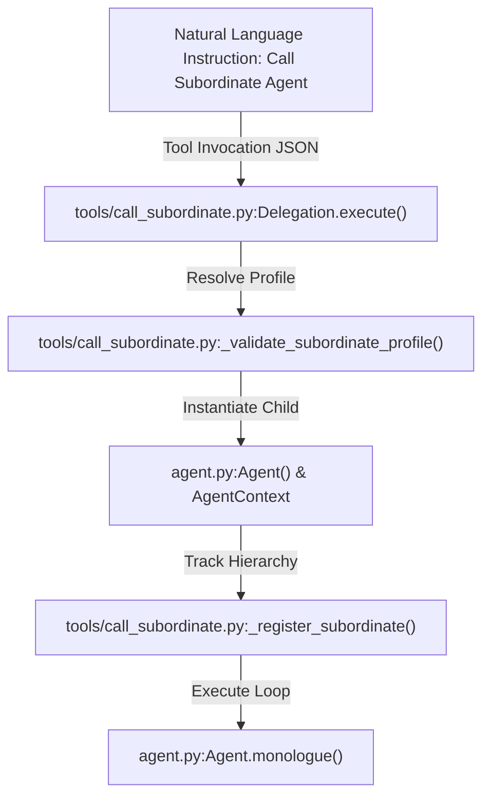
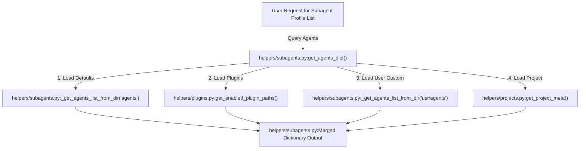

<!-- source: DeepWiki mcp.deepwiki.com · repo agent0ai/agent-zero · extra page Subordinate Agents & Delegation · fetched 2026-10-29 -->

# Subordinate Agents & Delegation

Relevant source files

The following files were used as context for generating this wiki page:

- [api/agent_profile_set.py](api/agent_profile_set.py)
- [api/agent_profile_set.py.dox.md](api/agent_profile_set.py.dox.md)
- [helpers/plugins.py](helpers/plugins.py)
- [helpers/plugins.py.dox.md](helpers/plugins.py.dox.md)
- [helpers/providers.py](helpers/providers.py)
- [helpers/providers.py.dox.md](helpers/providers.py.dox.md)
- [helpers/subagents.py](helpers/subagents.py)
- [helpers/subagents.py.dox.md](helpers/subagents.py.dox.md)
- [plugins/_office/prompts/agent.system.tool.office_artifact.md](plugins/_office/prompts/agent.system.tool.office_artifact.md)
- [plugins/_orchestrator/AGENTS.md](plugins/_orchestrator/AGENTS.md)
- [plugins/_orchestrator/README.md](plugins/_orchestrator/README.md)
- [plugins/_orchestrator/default_config.yaml](plugins/_orchestrator/default_config.yaml)
- [plugins/_orchestrator/helpers/adapters/AGENTS.md](plugins/_orchestrator/helpers/adapters/AGENTS.md)
- [plugins/_orchestrator/helpers/adapters/gemini.py](plugins/_orchestrator/helpers/adapters/gemini.py)
- [plugins/_orchestrator/helpers/registry.py](plugins/_orchestrator/helpers/registry.py)
- [plugins/_orchestrator/plugin.yaml](plugins/_orchestrator/plugin.yaml)
- [plugins/_orchestrator/skills/orchestrator/AGENTS.md](plugins/_orchestrator/skills/orchestrator/AGENTS.md)
- [plugins/_orchestrator/skills/orchestrator/SKILL.md](plugins/_orchestrator/skills/orchestrator/SKILL.md)
- [plugins/_orchestrator/skills/orchestrator/references/AGENTS.md](plugins/_orchestrator/skills/orchestrator/references/AGENTS.md)
- [plugins/_orchestrator/skills/orchestrator/references/gemini.md](plugins/_orchestrator/skills/orchestrator/references/gemini.md)
- [plugins/_orchestrator/tests/test_status_adapters.py](plugins/_orchestrator/tests/test_status_adapters.py)
- [plugins/_orchestrator/webui/thumbnail.png](plugins/_orchestrator/webui/thumbnail.png)
- [prompts/agent.system.tool.call_sub.md](prompts/agent.system.tool.call_sub.md)
- [tests/test_plugin_activation_ui.py](tests/test_plugin_activation_ui.py)
- [tests/test_plugin_asset_precedence.py](tests/test_plugin_asset_precedence.py)
- [tests/test_plugin_hook_context.py](tests/test_plugin_hook_context.py)
- [tests/test_subagent_metadata_merge.py](tests/test_subagent_metadata_merge.py)
- [tests/test_subagent_profiles.py](tests/test_subagent_profiles.py)
- [tests/test_subordinate_lifecycle.py](tests/test_subordinate_lifecycle.py)
- [tools/call_subordinate.py](tools/call_subordinate.py)
- [tools/call_subordinate.py.dox.md](tools/call_subordinate.py.dox.md)

## Purpose and Scope

This page covers the sub-agent architecture of Agent Zero, detailing how tasks are delegated to specialized subordinate agents or external harnesses. It focuses on the `call_subordinate` tool (`tools/call_subordinate.py`), subagent profile loading and merging via `helpers/subagents.py`, profile validation semantics, and the `_orchestrator` plugin which bridges Agent Zero to external terminal agents and coding harnesses.

Sources: [tools/call_subordinate.py:1-46](), [helpers/subagents.py:1-90](), [plugins/_orchestrator/AGENTS.md:1-10]()

---

## 1. The `call_subordinate` Tool & Delegation Mechanics

The `call_subordinate` tool allows an agent to delegate research, development tasks, or specialized sub-workflows to a subordinate agent instance [prompts/agent.system.tool.call_sub.md:1-4](). 

### Execution and Arguments

The core tool implementation resides in `tools/call_subordinate.py` under the `Delegation` class (`Tool`) [tools/call_subordinate.py.dox.md:1-15](). It accepts the following arguments during execution:
- `message`: The concrete task instruction, role definition, and goal for the subordinate [prompts/agent.system.tool.call_sub.md:5-11]().
- `profile`: Optional string designating a named prompt profile key (e.g., `researcher`, `developer`) [prompts/agent.system.tool.call_sub.md:6]() [tests/test_subagent_profiles.py:104-124]().
- `reset`: Boolean (`true`/`false`) determining whether to spawn a fresh child instance or continue an existing one [prompts/agent.system.tool.call_sub.md:8]() [tools/call_subordinate.py:122-139]().
- `context_id`: Stable child ID returned by a prior direct or parallel call, used alongside `reset: false` to target an exact child context [prompts/agent.system.tool.call_sub.md:9]() [tools/call_subordinate.py:122-139]().

### Hierarchy and Context Isolation

Every agent caller creates its next level in the delegation tree: A0 instantiates A1 children, A1 instantiates A2 children, and so forth (`parent.number + 1`) [prompts/agent.system.tool.call_sub.md:12]() [tools/call_subordinate.py:165](). Subordinates operate within isolated child contexts containing metadata linking them back to their superior [tools/call_subordinate.py:166-169]():
- `parent_context_id`: Stores the superior agent's context ID [tools/call_subordinate.py:13]() [tools/call_subordinate.py:168]().
- `parent_agent_number`: Tracks the generation depth (`parent.number`) [tools/call_subordinate.py:14]() [tools/call_subordinate.py:169]().
- `subordinate_slot`: Logical slot key (default is `"default"`) [tools/call_subordinate.py:17-18]().

Registered subordinates are maintained in the superior agent's persistent data store under the key `_subordinates` (`SUBORDINATES_DATA_KEY`) [tools/call_subordinate.py:12]() [tools/call_subordinate.py:49-54]().

*Diagram 1: Bridging Natural Language tool invocation space to internal Python delegation execution functions (`Delegation`, `_validate_subordinate_profile`, `Agent`, `_register_subordinate`).*

Sources: [tools/call_subordinate.py:1-169](), [tools/call_subordinate.py.dox.md:1-40](), [prompts/agent.system.tool.call_sub.md:1-27]()

---

## 2. Subagent Profiles & Resolution (`helpers/subagents.py`)

Agent Zero handles subagent profiles dynamically, merging system defaults, installed plugins, custom user configurations, and project-specific overrides [helpers/subagents.py:48-90]().

### Data Models

Profiles are defined using Pydantic models in `helpers/subagents.py`:
- `SubAgentListItem`: Contains metadata such as `name`, `title`, `description`, `context`, `path`, `origin` list (`default`, `plugin`, `user`, `project`), and `enabled` status [helpers/subagents.py:23-32]().
- `SubAgent`: Extends `SubAgentListItem` with a `prompts` dictionary holding custom `.md` prompt fragment overrides [helpers/subagents.py:40-41]().

### Resolution Hierarchy

When `get_agents_dict()` or `load_agent_data()` is invoked, agents are discovered and merged across the filesystem in a strict precedence order [helpers/subagents.py:48-155]():
1. **Default Agents:** Loaded from `agents/` (`DEFAULT_AGENTS_DIR`) [helpers/subagents.py:11]() [helpers/subagents.py:68]().
2. **Plugin Agents:** Discovered via enabled plugin paths providing agent directories [helpers/subagents.py:72-76]().
3. **User Agents:** Loaded from custom user paths (`usr/agents/`) [helpers/subagents.py:12]() [helpers/subagents.py:79-80]().
4. **Project Agents:** Loaded from active project metadata (`projects.get_project_meta(project_name, "agents")`) [helpers/subagents.py:83-88]().

*Diagram 2: Bridging Natural Language profile queries to code entity space within `helpers/subagents.py` and `helpers/plugins.py`.*

Sources: [helpers/subagents.py:1-155]()

---

## 3. Profile Validation & Error Recovery

When `call_subordinate` specifies a profile, `_validate_subordinate_profile()` cross-references it against available profile titles and names [tools/call_subordinate.py:29-36](). If an unknown profile key is supplied, a `RepairableException` is raised, listing all available valid profiles so the agent can self-correct and retry [tools/call_subordinate.py:44-46]() [tests/test_subagent_profiles.py:104-124]().

Sources: [tools/call_subordinate.py:29-46](), [tests/test_subagent_profiles.py:104-124]()

---

## 4. The `_orchestrator` Plugin & External-Harness Adapters

The `_orchestrator` plugin extends Agent Zero's delegation capabilities by providing structured integration with external terminal and headless coding harnesses (such as Codex CLI, Claude Code, Cursor CLI, Gemini CLI, Grok Build, Hermes Agent, and OpenCode) [plugins/_orchestrator/AGENTS.md:1-8]() [plugins/_orchestrator/tests/test_status_adapters.py:40-50]().

### Toolless Architecture

Unlike built-in subagents managed by `call_subordinate`, the orchestrator plugin is deliberately **toolless**: it defines no `terminal_agent.py` tool or custom subprocess execution runner [plugins/_orchestrator/AGENTS.md:14-17](). Instead, repository and coding work is delegated to external CLI agents through Agent Zero's standard code execution tools, guided by the `orchestrator` skill (`plugins/_orchestrator/skills/orchestrator/SKILL.md`) [plugins/_orchestrator/AGENTS.md:15-18]().

### Adapters and Status Detection

Adapters inherit from `TerminalAgentAdapter` and reside under `plugins/_orchestrator/helpers/adapters/` [plugins/_orchestrator/tests/test_status_adapters.py:16-26](). Their scope is restricted to status reporting:
- `auth_status()`: Verifies connection state, authentication paths, and configuration modes [plugins/_orchestrator/tests/test_status_adapters.py:24-26]() [plugins/_orchestrator/tests/test_status_adapters.py:91-116]().
- Binary resolution: Locates and validates executable availability on the host or within the container [plugins/_orchestrator/tests/test_status_adapters.py:28-38]().

The orchestrator settings UI and API handlers manage status dashboards, device-login polling (such as Codex OAuth flows), and safe disconnect paths without coupling execution mechanics directly to Python runtime runners [plugins/_orchestrator/AGENTS.md:15-32]().

Sources: [plugins/_orchestrator/AGENTS.md:1-64](), [plugins/_orchestrator/tests/test_status_adapters.py:1-178]()

---

