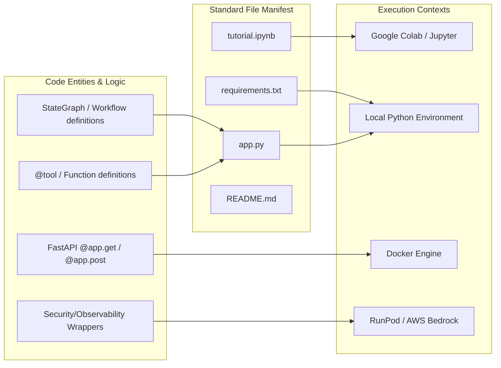
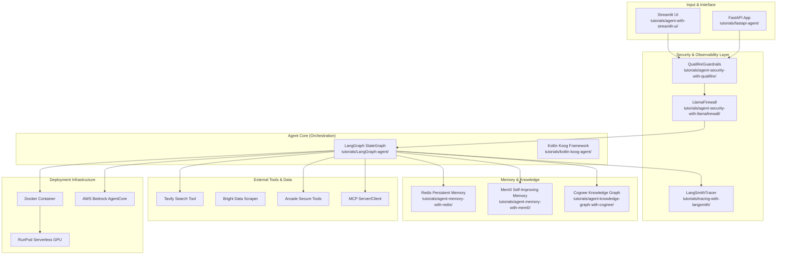

<!-- source: DeepWiki mcp.deepwiki.com · repo NirDiamant/agents-towards-production · page 1 Overview · fetched 2026-10-29 -->

# Overview

Relevant source files

The following files were used as context for generating this wiki page:

- [README.md](README.md)
- [assets/repos_images/ai_architecture_diagram.svg](assets/repos_images/ai_architecture_diagram.svg)

## Purpose and Scope

The **Agents Towards Production** repository is a comprehensive technical playbook and educational platform designed to transition GenAI agents from experimental prototypes to scalable, enterprise-ready products. It provides a curated collection of hands-on tutorials, each addressing a critical layer of the production agent stack, including stateful orchestration, persistent memory, security guardrails, observability, and infrastructure deployment [README.md:3-11]().

The repository is structured to serve as both a reference architecture and a practical implementation guide for engineers. It covers the entire development lifecycle, from building basic ReAct patterns to deploying fine-tuned models on serverless GPU infrastructure [README.md:7-8]().

Sources: [README.md:3-11](), [README.md:7-8]()

## Repository Architecture

The codebase is organized into a modular, tutorial-first structure. Each directory under `tutorials/` represents a self-contained production capability, often integrated with industry-standard tools and partner platforms [README.md:24-30]().

### Repository Structure and Code Organization

```mermaid
graph TB
    subgraph "Repository Root"
        readme["README.md"]
        contributing["CONTRIBUTING.md"]
    end
    
    subgraph "Asset Management"
        assets["assets/repos_images/"]
        logos["sponsors_logos/trimmed_padded/"]
    end
    
    subgraph "Core Tutorial Categories"
        tutorials["tutorials/"]
        
        subgraph "Orchestration & Frameworks"
            langgraph["LangGraph-agent/"]
            fastapi["fastapi-agent/"]
            kotlin["kotlin-koog-agent/"]
            xpander["agentic-applications-by-xpander.ai/"]
        end
        
        subgraph "Memory & Knowledge"
            redis["agent-memory-with-redis/"]
            mem0["agent-memory-with-mem0/"]
            cognee["agent-knowledge-graph-with-cognee/"]
            contextual["agent-RAG-with-Contextual/"]
        end
        
        subgraph "Tools & Integration"
            mcp["agent-with-mcp/"]
            arcade["arcade-secure-tool-calling/"]
            tavily["agent-with-tavily-web-access/"]
            brightdata["agent-with-brightdata/"]
        end
        
        subgraph "Security & Observability"
            qualifire_sec["agent-security-with-qualifire/"]
            qualifire_obs["agent-observability-with-qualifire/"]
            langsmith["tracing-with-langsmith/"]
            llamafirewall["agent-security-with-llamafirewall/"]
            apex["agent-security-apex/"]
        end
        
        subgraph "Deployment & Infra"
            docker["docker-intro/"]
            runpod["runpod-gpu-deploy/"]
            bedrock["aws-bedrock-agentcore/"]
            ollama["on-prem-llm-ollama/"]
            finetuning["fine-tuning-agents/"]
        end
    end
    
    readme --> tutorials
    assets --> logos
    tutorials --> langgraph
    tutorials --> redis
    tutorials --> mcp
    tutorials --> qualifire_sec
    tutorials --> docker
```

Sources: [README.md:31-106](), [README.md:146-402]()

### Tutorial Implementation Pattern and Code Entities

Every tutorial follows a standardized implementation pattern to ensure reproducibility across different environments [README.md:420-446]().

Sources: [README.md:420-446](), [README.md:430-434]()

## Production Capability Map

The repository maps technical challenges to specific code implementations and partner integrations:

| Production Capability | Implementation Detail | Key Code Entities |
| :--- | :--- | :--- |
| **Stateful Orchestration** | Complex task routing and human-in-the-loop | `StateGraph`, `MemorySaver` [README.md:31-51]() |
| **Dual-Memory Systems** | Short-term state + Long-term semantic search | `RedisConfig`, `VectorStore` [README.md:53-68]() |
| **Secure Tool Calling** | Multi-user OAuth2 and permission scoping | `ArcadeTool`, `auth_callback` [README.md:130-145]() |
| **Real-time Web Access** | Search-engine-as-a-tool for agents | `TavilySearchResults` [README.md:113-128]() |
| **Security Guardrails** | Prompt injection and PII filtering | `LlamaFirewall`, `QualifireGuard` [README.md:162-177]() |
| **Managed Runtime** | Serverless agent hosting with SDKs | `BedrockAgentCoreApp`, `@app.entrypoint` [README.md:374-389]() |
| **Multi-Agent Protocols** | Standardized JSON-RPC communication | `A2AProtocol`, `AgentCard` [README.md:287-302]() |

Sources: [README.md:31-145](), [README.md:162-389]()

## Production Architecture Diagram

The following diagram bridges the high-level architecture with the specific code entities found in the repository.

Sources: [README.md:31-402](), [assets/repos_images/ai_architecture_diagram.svg:1-145]()

## Development & Contribution

The repository is maintained as an open-source project with specific guidelines for community contributions. To maintain the quality of the playbook, all new tutorials must include a README, a Jupyter Notebook, and an `app.py` script [README.md:420-428]().

### Contribution Workflow
1.  **Fork** the repository.
2.  **Create** a tutorial directory following the standard structure [README.md:420-428]().
3.  **Implement** the logic using production-grade frameworks (e.g., LangGraph, FastAPI).
4.  **Submit** a Pull Request for review.

For detailed instructions on contributing, see the [Contributing Guidelines](6.1.-Contributing-Guidelines) page.

Sources: [README.md:420-446]()

---

