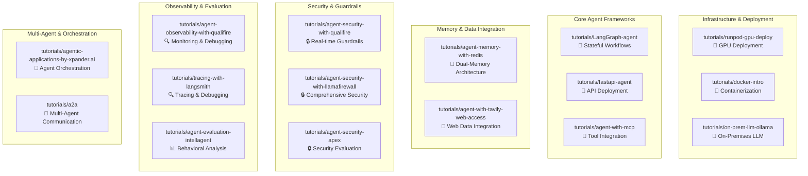
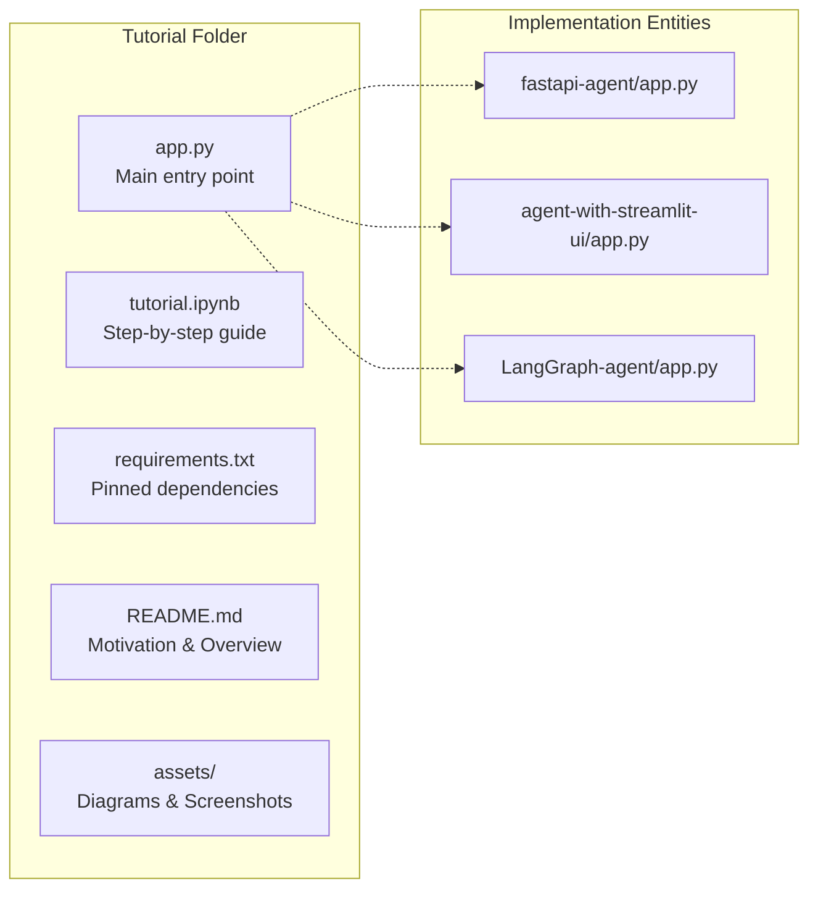
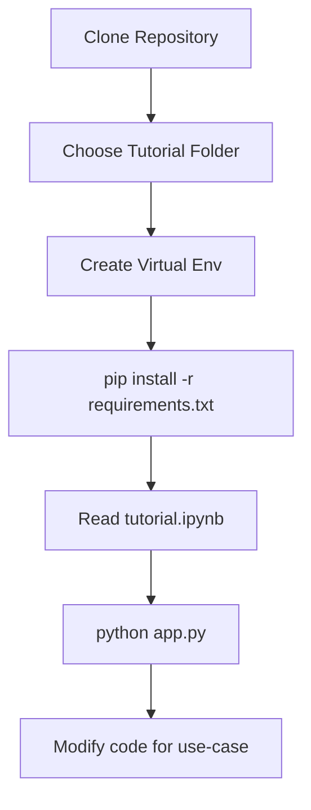

<!-- source: DeepWiki mcp.deepwiki.com · repo NirDiamant/agents-towards-production · page 2 Tutorial System · fetched 2026-10-29 -->

# Tutorial System

Relevant source files

The following files were used as context for generating this wiki page:

- [CONTRIBUTING.md](CONTRIBUTING.md)
- [README.md](README.md)
- [assets/repos_images/ai_architecture_diagram.svg](assets/repos_images/ai_architecture_diagram.svg)

## Purpose and Scope

The Tutorial System implements a tutorial-first learning approach for the Agents Towards Production repository, delivering comprehensive agent development knowledge through hands-on, runnable examples. Each tutorial provides both conceptual understanding and working implementations that developers can execute locally to understand production-ready AI agent patterns [README.md:3-7]().

The system covers the complete agent development lifecycle from prototype to production, organized into distinct categories with over 20 individual tutorials. This document covers the tutorial organization, delivery mechanisms, and learning pathways.

*   For specific tutorial content on agent frameworks and workflows, see [Agent Frameworks & Workflows](#2.1).
*   For memory system implementations, see [Memory Management Systems](#2.2).
*   For tool integration and external APIs, see [Tool Integration](#2.3).
*   For agent-to-agent protocols, see [Multi-Agent Communication](#2.4).
*   For monitoring and debugging, see [Observability & Monitoring](#2.5).
*   For automated testing and quality assurance, see [Agent Evaluation & Testing](#2.6).

## Tutorial Organization Architecture

The tutorial system organizes educational content into categories that map to production agent capabilities.

### Tutorial Categories by Production Capability

Sources: [README.md:148-402]()

### Tutorial Directory Structure Mapping

Every tutorial follows a strict file convention to ensure reproducibility [CONTRIBUTING.md:15-36]().

Sources: [CONTRIBUTING.md:37-48](), [README.md:234-272]()

## Tutorial Implementation Standards

Each tutorial must follow standardized directory structures and content quality requirements to maintain repository consistency [CONTRIBUTING.md:49-61]().

### Required Components

| Component | File/Path | Requirement |
|-----------|-----------|-------------|
| **Overview** | `README.md` | Must include motivation, benefits, and "what you will learn" [CONTRIBUTING.md:51](). |
| **Documentation** | `.ipynb` or `tutorial.md` | Must contain detailed explanations and Mermaid diagrams [CONTRIBUTING.md:27-29](). |
| **Working Code** | `app.py` | Must be well-commented and represent the main application logic [CONTRIBUTING.md:31](). |
| **Dependencies** | `requirements.txt` | Must include specific versions for reproducibility [CONTRIBUTING.md:33](). |
| **Visuals** | `assets/` | Folder for images, videos, and media [CONTRIBUTING.md:35](). |

### Quality Gates

*   **Code Quality**: Code must be broken into small, clear blocks with explanatory text before every cell [CONTRIBUTING.md:69-70]().
*   **Security**: No sensitive information (API keys) should be committed; environment variables are required [CONTRIBUTING.md:124]().
*   **External Links**: All partner or service links must use UTM-tagged parameters for tracking [CONTRIBUTING.md:12-13]().

## Partner Integration System

The tutorial system integrates sponsored content from technology partners, providing real-world integration examples with production tools across the complete agent development stack [README.md:24-30]().

| Partner | Category | Key Tutorial |
|---------|----------|--------------|
| **LangChain** | Frameworks | `tutorials/LangGraph-agent` [README.md:38]() |
| **Redis** | Memory | `tutorials/agent-memory-with-redis` [README.md:55]() |
| **Arcade** | Tools | `tutorials/arcade-secure-tool-calling` [README.md:132]() |
| **Tavily** | Search | `tutorials/agent-with-tavily-web-access` [README.md:115]() |
| **Qualifire** | Security | `tutorials/agent-security-with-qualifire` [README.md:154]() |

## Learning Pathways

The repository supports two primary access methods:

1.  **Online Exploration**: Browsing the GitHub interface to understand architectural patterns and conceptual documentation [README.md:406-410]().
2.  **Local Development**: Cloning the repository and running implementations locally.

### Execution Workflow

Sources: [CONTRIBUTING.md:111-115](), [README.md:440-447]()

---

