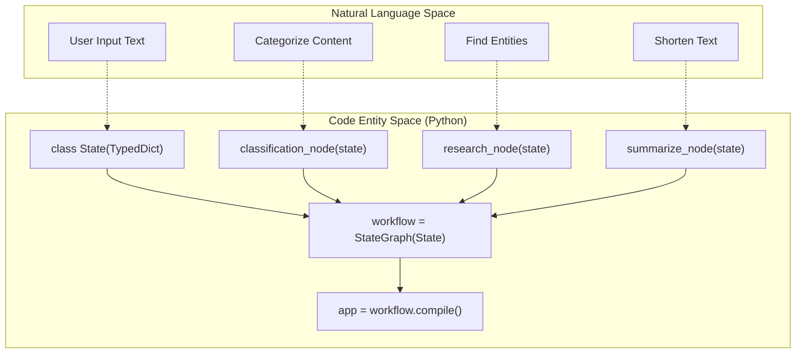
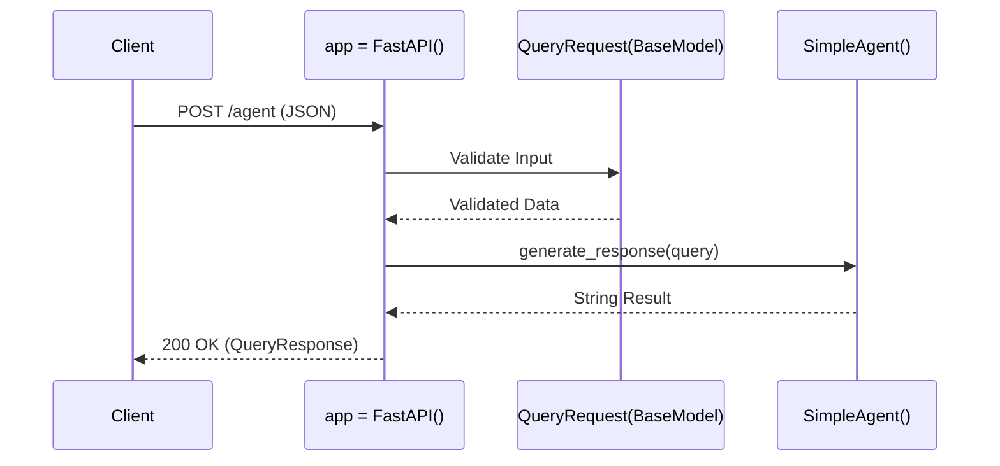
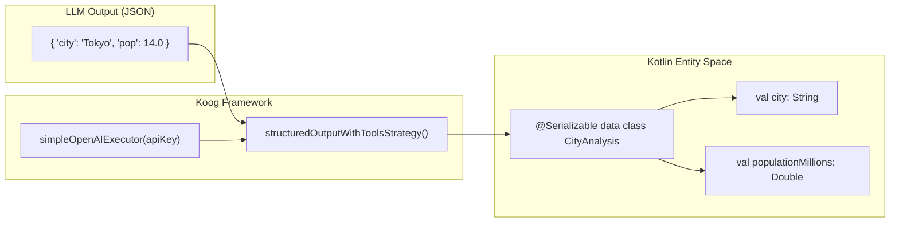

<!-- source: DeepWiki mcp.deepwiki.com · repo NirDiamant/agents-towards-production · page 2.1 Agent Frameworks & Workflows · fetched 2026-10-29 -->

# Agent Frameworks & Workflows

Relevant source files

The following files were used as context for generating this wiki page:

- [tutorials/LangGraph-agent/langgraph_tutorial.ipynb](tutorials/LangGraph-agent/langgraph_tutorial.ipynb)
- [tutorials/a2a/a2a_tutorial.ipynb](tutorials/a2a/a2a_tutorial.ipynb)
- [tutorials/agent-evaluation-intellagent/intellagent-evaluation-tutorial.ipynb](tutorials/agent-evaluation-intellagent/intellagent-evaluation-tutorial.ipynb)
- [tutorials/agent-memory-with-redis/README.md](tutorials/agent-memory-with-redis/README.md)
- [tutorials/agent-security-apex/agent-security-evaluation-tutorial.ipynb](tutorials/agent-security-apex/agent-security-evaluation-tutorial.ipynb)
- [tutorials/agent-with-mcp/mcp-tutorial.ipynb](tutorials/agent-with-mcp/mcp-tutorial.ipynb)
- [tutorials/agent-with-streamlit-ui/building-chatbot-notebook.ipynb](tutorials/agent-with-streamlit-ui/building-chatbot-notebook.ipynb)
- [tutorials/agent-with-tavily-web-access/hybrid-agent-tutorial.ipynb](tutorials/agent-with-tavily-web-access/hybrid-agent-tutorial.ipynb)
- [tutorials/agent-with-tavily-web-access/supplemental/vectorize_tutorial.ipynb](tutorials/agent-with-tavily-web-access/supplemental/vectorize_tutorial.ipynb)
- [tutorials/agent-with-tavily-web-access/web-agent-tutorial.ipynb](tutorials/agent-with-tavily-web-access/web-agent-tutorial.ipynb)
- [tutorials/fastapi-agent/fastapi-agent-tutorial.ipynb](tutorials/fastapi-agent/fastapi-agent-tutorial.ipynb)
- [tutorials/kotlin-agent-with-koog/.gitignore](tutorials/kotlin-agent-with-koog/.gitignore)
- [tutorials/kotlin-agent-with-koog/README.md](tutorials/kotlin-agent-with-koog/README.md)
- [tutorials/kotlin-agent-with-koog/Step1_HelloAgent.kt](tutorials/kotlin-agent-with-koog/Step1_HelloAgent.kt)
- [tutorials/kotlin-agent-with-koog/Step2_AgentWithTools.kt](tutorials/kotlin-agent-with-koog/Step2_AgentWithTools.kt)
- [tutorials/kotlin-agent-with-koog/Step3_StructuredOutput.kt](tutorials/kotlin-agent-with-koog/Step3_StructuredOutput.kt)
- [tutorials/kotlin-agent-with-koog/assets/architecture-diagram.png](tutorials/kotlin-agent-with-koog/assets/architecture-diagram.png)
- [tutorials/kotlin-agent-with-koog/assets/project-structure.png](tutorials/kotlin-agent-with-koog/assets/project-structure.png)
- [tutorials/kotlin-agent-with-koog/assets/run-sh.png](tutorials/kotlin-agent-with-koog/assets/run-sh.png)
- [tutorials/kotlin-agent-with-koog/assets/step1-output.png](tutorials/kotlin-agent-with-koog/assets/step1-output.png)
- [tutorials/kotlin-agent-with-koog/assets/step2-output.png](tutorials/kotlin-agent-with-koog/assets/step2-output.png)
- [tutorials/kotlin-agent-with-koog/build.gradle.kts](tutorials/kotlin-agent-with-koog/build.gradle.kts)
- [tutorials/kotlin-agent-with-koog/run.sh](tutorials/kotlin-agent-with-koog/run.sh)
- [tutorials/kotlin-agent-with-koog/tutorial.md](tutorials/kotlin-agent-with-koog/tutorial.md)
- [tutorials/on-prem-llm-ollama/scripts/langchain_agent.ipynb](tutorials/on-prem-llm-ollama/scripts/langchain_agent.ipynb)
- [tutorials/tracing-with-langsmith/langsmith_basics.ipynb](tutorials/tracing-with-langsmith/langsmith_basics.ipynb)

## Purpose and Scope

This document covers the foundational agent frameworks and workflows within the "Agents Towards Production" repository. It provides technical detail on building stateful logic with **LangGraph**, deploying agents as production APIs using **FastAPI**, creating interactive **Streamlit** UIs, and developing JVM-based agents using the **JetBrains Koog** framework. These tools allow developers to move from basic prompt-response patterns to complex, autonomous, and type-safe agentic systems.

---

## LangGraph: Stateful Orchestration

LangGraph is an extension of LangChain designed for creating stateful, multi-actor applications. It uses a graph-based approach to define how an agent thinks and acts, allowing for loops, persistence, and complex decision-making.

### Core Components
- **State Management**: Uses a `TypedDict` to maintain a persistent state object that is passed between nodes.
- **Nodes**: Python functions that receive the current state, perform logic (e.g., calling an LLM), and return updates to the state.
- **Edges**: Define the control flow. Conditional edges allow the graph to route to different nodes based on LLM output or state values.

### Text Analysis Pipeline Architecture
The following diagram maps the LangGraph conceptual space to the specific code entities used in the text analysis tutorial.

**Title: LangGraph Pipeline Entity Mapping**

Sources: [tutorials/LangGraph-agent/langgraph_tutorial.ipynb:161-166](), [tutorials/LangGraph-agent/langgraph_tutorial.ipynb:188-197](), [tutorials/LangGraph-agent/langgraph_tutorial.ipynb:262-277]()

---

## FastAPI: Production Agent Deployment

FastAPI serves as the bridge between agent logic and the web. It is used to expose agents via RESTful endpoints, supporting both standard JSON responses and Server-Sent Events (SSE) for streaming.

### Key Implementation Patterns
- **Pydantic Models**: Used for request/response validation (e.g., `QueryRequest`, `QueryResponse`).
- **Asynchronous Streaming**: Leveraging `async def` and `yield` to stream tokens to the client as they are generated by the model.
- **Dependency Injection**: Managing agent instances and configuration across API routes.

**Title: FastAPI Agent Service Flow**

Sources: [tutorials/fastapi-agent/fastapi-agent-tutorial.ipynb:95-122](), [tutorials/fastapi-agent/fastapi-agent-tutorial.ipynb:146-162](), [tutorials/fastapi-agent/fastapi-agent-tutorial.ipynb:187-218]()

---

## Koog: Kotlin-Native Agents

For the JVM ecosystem, the **Koog** framework by JetBrains provides a type-safe way to build agents. It leverages Kotlin features like Coroutines for async execution and Serialization for structured data.

### The ReAct Loop in Koog
Koog implements the **Reason-Act-Observe** pattern. The agent reasons about a task, selects a tool, observes the result, and iterates until a final answer is reached.

### Structured Output Strategy
One of Koog's most powerful features is `structuredOutputWithToolsStrategy`. This allows the LLM to return a fully instantiated Kotlin data class instead of raw JSON strings.

**Title: Koog Structured Output Mapping**

Sources: [tutorials/kotlin-agent-with-koog/tutorial.md:9-26](), [tutorials/kotlin-agent-with-koog/Step3_StructuredOutput.kt:25-46](), [tutorials/kotlin-agent-with-koog/Step3_StructuredOutput.kt:68-76]()

### Project Configuration
Kotlin agents require specific dependencies in `build.gradle.kts` to handle AI tasks:
- `ai.koog:koog-agents`: Core framework logic.
- `kotlinx-coroutines-core`: For non-blocking agent execution.
- `kotlinx-serialization-json`: For tool definitions and structured outputs.

Sources: [tutorials/kotlin-agent-with-koog/build.gradle.kts:10-22]()

---

## Comparison of Framework Approaches

| Feature | LangGraph (Python) | Koog (Kotlin) | FastAPI (Python) |
| :--- | :--- | :--- | :--- |
| **Primary Use** | Complex Stateful Logic | JVM Backend Integration | Web API / Microservice |
| **State Handling** | Graph-based `TypedDict` | Coroutine-based objects | Stateless (per request) |
| **Type Safety** | Optional (Type Hints) | Native (Strongly Typed) | Pydantic Validation |
| **Async Support** | Native (Asyncio) | Native (Coroutines) | Native (Uvicorn/Starlette) |
| **Tool Calling** | Bindings/Tools | Annotations (`@LLMDescription`) | Manual or LangChain-integrated |

Sources: [tutorials/LangGraph-agent/langgraph_tutorial.ipynb:13-28](), [tutorials/kotlin-agent-with-koog/tutorial.md:5-7](), [tutorials/fastapi-agent/fastapi-agent-tutorial.ipynb:16-34]()

---

## Web Research Workflows

Modern workflows often require real-time data. This is achieved by integrating search tools like **Tavily** into the ReAct loop.

1. **Search**: Querying the web for live data.
2. **Extract**: Pulling clean content from specific URLs.
3. **Crawl**: Navigating entire domains for deep research.

In LangGraph, these are implemented as specialized nodes or tools bound to the LLM via `bind_tools`.

Sources: [tutorials/agent-with-tavily-web-access/web-agent-tutorial.ipynb:140-153](), [tutorials/agent-with-tavily-web-access/web-agent-tutorial.ipynb:182-189]()

---

