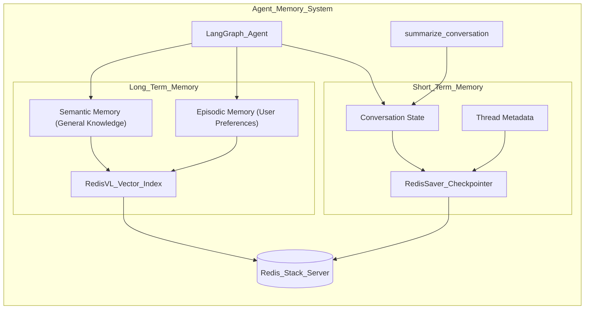
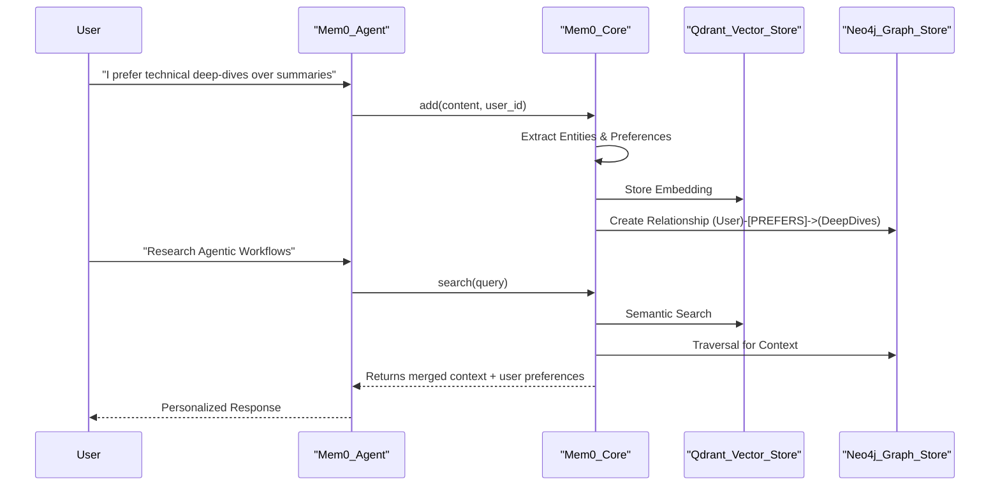
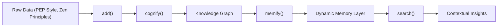

<!-- source: DeepWiki mcp.deepwiki.com · repo NirDiamant/agents-towards-production · page 2.2 Memory Management Systems · fetched 2026-10-29 -->

# Memory Management Systems

<details>
<summary>Relevant source files</summary>

The following files were used as context for generating this wiki page:

- [tutorials/agent-memory-with-mem0/Assets/mem0_add_architecture.jpg](tutorials/agent-memory-with-mem0/Assets/mem0_add_architecture.jpg)
- [tutorials/agent-memory-with-mem0/Assets/mem0_architecture.png](tutorials/agent-memory-with-mem0/Assets/mem0_architecture.png)
- [tutorials/agent-memory-with-mem0/Assets/mem0_search_architecture.jpg](tutorials/agent-memory-with-mem0/Assets/mem0_search_architecture.jpg)
- [tutorials/agent-memory-with-mem0/README.md](tutorials/agent-memory-with-mem0/README.md)
- [tutorials/agent-memory-with-mem0/mem0_tutorial.ipynb](tutorials/agent-memory-with-mem0/mem0_tutorial.ipynb)
- [tutorials/agent-memory-with-redis/README.md](tutorials/agent-memory-with-redis/README.md)
- [tutorials/agent-memory-with-redis/agent_memory_tutorial.ipynb](tutorials/agent-memory-with-redis/agent_memory_tutorial.ipynb)
- [tutorials/ai-memory-with-cognee/README.md](tutorials/ai-memory-with-cognee/README.md)
- [tutorials/ai-memory-with-cognee/cognee-ai-memory.ipynb](tutorials/ai-memory-with-cognee/cognee-ai-memory.ipynb)
- [tutorials/ai-memory-with-cognee/data/cognee_diagram.png](tutorials/ai-memory-with-cognee/data/cognee_diagram.png)
- [tutorials/fastapi-agent/fastapi-agent-tutorial.ipynb](tutorials/fastapi-agent/fastapi-agent-tutorial.ipynb)
- [tutorials/tracing-with-langsmith/langsmith_basics.ipynb](tutorials/tracing-with-langsmith/langsmith_basics.ipynb)

</details>


## Purpose and Scope

This document describes the memory management architecture implemented in the Agents Towards Production repository. It covers the implementation of dual-memory systems using **Redis** for short-term and long-term state, self-improving memory with **Mem0** using hybrid vector and graph storage, and the construction of specialized knowledge graphs using **Cognee**. These systems enable AI agents to overcome "memory amnesia" by maintaining conversation context, user preferences, and structured domain knowledge.

## Overview of Memory Architecture

The repository demonstrates three primary patterns for memory management:

1.  **Dual-Memory with Redis**: A production-ready pattern using `RedisSaver` for checkpoints (short-term) and `RedisVL` for semantic vector search (long-term) [tutorials/agent-memory-with-redis/agent_memory_tutorial.ipynb:42-61]().
2.  **Self-Improving Memory (Mem0)**: A hybrid architecture that automatically extracts insights and resolves conflicts, storing data in both vector databases (e.g., Qdrant) and graph databases (e.g., Neo4j) [tutorials/agent-memory-with-mem0/mem0_tutorial.ipynb:22-26]().
3.  **Knowledge Graph Memory (Cognee)**: A system that transforms technical documentation and personal rules into an interconnected network of entities and relationships [tutorials/ai-memory-with-cognee/cognee-ai-memory.ipynb:28-32]().

### Dual-Memory Architecture (Redis)

This architecture mirrors cognitive models by separating transient conversation state from persistent semantic knowledge.


Sources: [tutorials/agent-memory-with-redis/agent_memory_tutorial.ipynb:42-62](), [tutorials/agent-memory-with-redis/agent_memory_tutorial.ipynb:151-157]()

## Self-Improving Memory with Mem0

Mem0 addresses the limitation where agents forget everything after a session. It implements a "self-improving" loop where the system extracts information, resolves conflicts with existing knowledge, and updates its storage [tutorials/agent-memory-with-mem0/mem0_tutorial.ipynb:22-27]().

### Hybrid Storage Flow
Mem0 utilizes a multi-layered approach to storage:
*   **Vector Memory**: Uses embeddings for semantic recall of research notes and preferences [tutorials/agent-memory-with-mem0/mem0_tutorial.ipynb:41-42]().
*   **Graph Memory**: Captures key ideas and links related concepts (e.g., author connections, paper citations) inside a graph database like Neo4j [tutorials/agent-memory-with-mem0/mem0_tutorial.ipynb:43-45]().


Sources: [tutorials/agent-memory-with-mem0/mem0_tutorial.ipynb:37-48](), [tutorials/agent-memory-with-mem0/mem0_tutorial.ipynb:58-62]()

## Knowledge Graph Construction with Cognee

Cognee specializes in "Cognifying" data—transforming raw files (JSON, Markdown) into a traversable knowledge graph. This is particularly useful for complex domains like Python development knowledge [tutorials/ai-memory-with-cognee/cognee-ai-memory.ipynb:10-12]().

### Core Operations
The Cognee framework operates through four primary functions:
*   `add()`: Normalizes and prepares raw data for ingestion [tutorials/ai-memory-with-cognee/cognee-ai-memory.ipynb:58-59]().
*   `cognify()`: The core engine that uses AI to extract entities and identify relationships [tutorials/ai-memory-with-cognee/cognee-ai-memory.ipynb:58-59]().
*   `search()`: Interacts with the graph via natural language or Cypher queries [tutorials/ai-memory-with-cognee/cognee-ai-memory.ipynb:58-59]().
*   `memify()`: Applies algorithms to infer implicit connections and rules from the existing graph [tutorials/ai-memory-with-cognee/cognee-ai-memory.ipynb:58-59]().


Sources: [tutorials/ai-memory-with-cognee/cognee-ai-memory.ipynb:58-61](), [tutorials/ai-memory-with-cognee/cognee-ai-memory.ipynb:70-75]()

## Short-Term Memory and Summarization

In production systems using LangGraph, short-term memory is often managed via **checkpointers**. These save the full `StateGraph` at every node transition.

### Conversation Summarization Logic
To prevent context window overflow, a `summarize_conversation` node is typically included in the graph. It triggers when the message history exceeds a specific threshold [tutorials/agent-memory-with-redis/agent_memory_tutorial.ipynb:51-52]().

```python
# Logic implemented in the summarize_conversation node
def summarize_conversation(state: State):
    # 1. Get existing messages
    # 2. If len(messages) > threshold:
    # 3.   Send history to LLM to create summary
    # 4.   Replace old messages with SummaryMessage
    # 5.   Retain N most recent messages
    pass
```
Sources: [tutorials/agent-memory-with-redis/agent_memory_tutorial.ipynb:1304-1375]()

## Memory Types and Data Models

The system categorizes persistent memory to improve retrieval accuracy:

| Memory Type | Description | Example |
| :--- | :--- | :--- |
| **Episodic** | Specific user experiences, preferences, and past interactions. | "User prefers flying Delta." |
| **Semantic** | General facts, domain knowledge, and world data. | "Singapore requires a passport." |
| **Procedural** | Encoded in the agent's Python workflow/logic. | The specific steps in a LangGraph. |

Sources: [tutorials/agent-memory-with-redis/agent_memory_tutorial.ipynb:55-62](), [tutorials/agent-memory-with-redis/agent_memory_tutorial.ipynb:228-246]()

### Vector Schema (RedisVL)
The `SearchIndex` in Redis is configured with specific fields for memory management:
*   `content`: The actual text of the memory.
*   `memory_type`: Tag for filtering (Episodic vs Semantic).
*   `embedding`: A 1536-dimensional vector for cosine similarity.
*   `user_id`: Tag for multi-tenant isolation.

Sources: [tutorials/agent-memory-with-redis/agent_memory_tutorial.ipynb:310-342]()

## Conflict Resolution and Deduplication

A critical feature of production memory systems is ensuring that similar or conflicting information is handled gracefully.

1.  **Deduplication**: Before storing a new memory, the system calls `similar_memory_exists` using a vector search with a high similarity threshold [tutorials/agent-memory-with-redis/agent_memory_tutorial.ipynb:519-553]().
2.  **Self-Correction**: Mem0 automatically updates existing memories if new information contradicts old data (e.g., a user changing their airline preference) [tutorials/agent-memory-with-mem0/mem0_tutorial.ipynb:26-27]().

Sources: [tutorials/agent-memory-with-redis/agent_memory_tutorial.ipynb:519-553](), [tutorials/agent-memory-with-mem0/mem0_tutorial.ipynb:22-27]()

---

