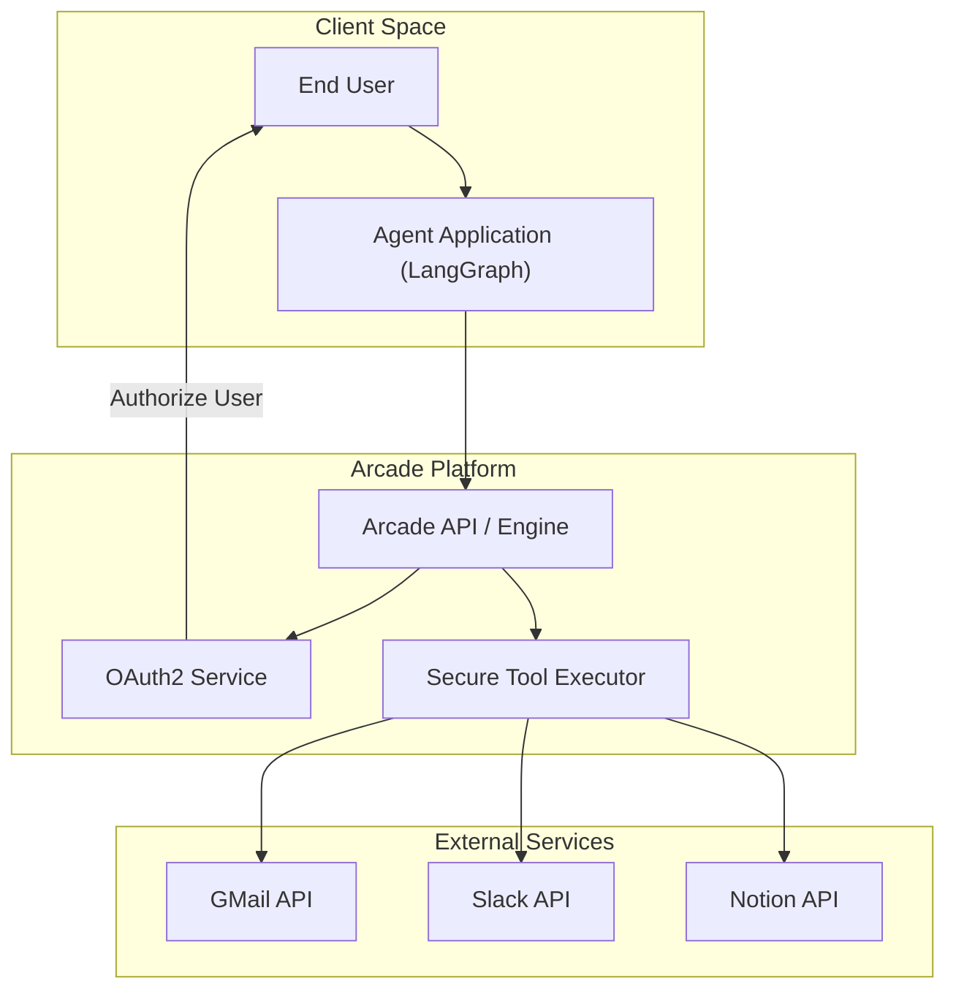
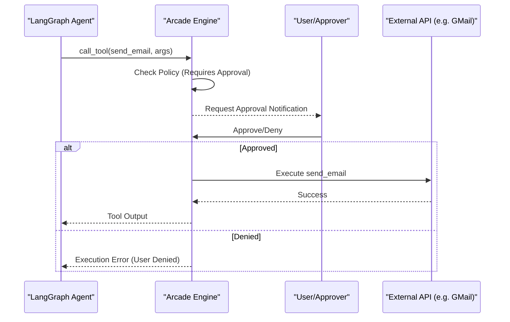
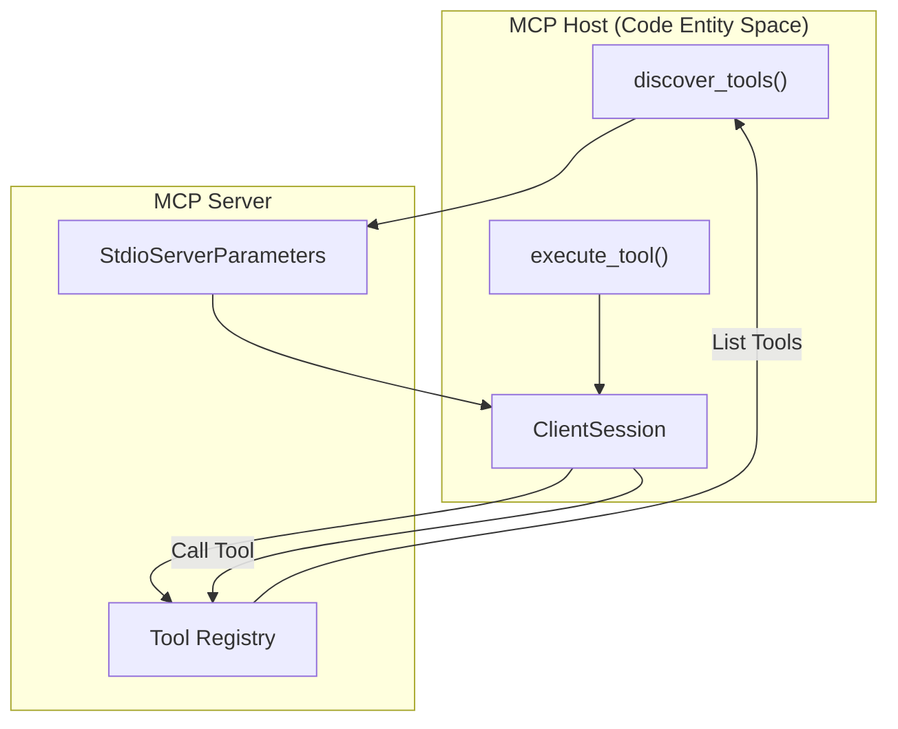
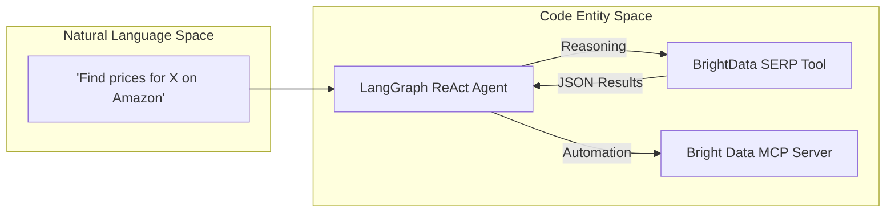

<!-- source: DeepWiki mcp.deepwiki.com · repo NirDiamant/agents-towards-production · page 2.3 Tool Integration · fetched 2026-10-29 -->

# Tool Integration

Relevant source files

The following files were used as context for generating this wiki page:

- [tutorials/LangGraph-agent/langgraph_tutorial.ipynb](tutorials/LangGraph-agent/langgraph_tutorial.ipynb)
- [tutorials/a2a/a2a_tutorial.ipynb](tutorials/a2a/a2a_tutorial.ipynb)
- [tutorials/agent-RAG-with-Contextual/README.md](tutorials/agent-RAG-with-Contextual/README.md)
- [tutorials/agent-RAG-with-Contextual/contextual_tutorial.ipynb](tutorials/agent-RAG-with-Contextual/contextual_tutorial.ipynb)
- [tutorials/agent-RAG-with-Contextual/requirements.txt](tutorials/agent-RAG-with-Contextual/requirements.txt)
- [tutorials/agent-evaluation-intellagent/intellagent-evaluation-tutorial.ipynb](tutorials/agent-evaluation-intellagent/intellagent-evaluation-tutorial.ipynb)
- [tutorials/agent-security-apex/README.md](tutorials/agent-security-apex/README.md)
- [tutorials/agent-security-apex/agent-security-evaluation-tutorial.ipynb](tutorials/agent-security-apex/agent-security-evaluation-tutorial.ipynb)
- [tutorials/agent-with-brightdata/assets/Settings.png](tutorials/agent-with-brightdata/assets/Settings.png)
- [tutorials/agent-with-brightdata/assets/Signup.png](tutorials/agent-with-brightdata/assets/Signup.png)
- [tutorials/agent-with-brightdata/langgraph_integration.ipynb](tutorials/agent-with-brightdata/langgraph_integration.ipynb)
- [tutorials/agent-with-brightdata/web_scraping_agent.ipynb](tutorials/agent-with-brightdata/web_scraping_agent.ipynb)
- [tutorials/agent-with-mcp/mcp-tutorial.ipynb](tutorials/agent-with-mcp/mcp-tutorial.ipynb)
- [tutorials/agent-with-streamlit-ui/building-chatbot-notebook.ipynb](tutorials/agent-with-streamlit-ui/building-chatbot-notebook.ipynb)
- [tutorials/agent-with-tavily-web-access/hybrid-agent-tutorial.ipynb](tutorials/agent-with-tavily-web-access/hybrid-agent-tutorial.ipynb)
- [tutorials/agent-with-tavily-web-access/supplemental/vectorize_tutorial.ipynb](tutorials/agent-with-tavily-web-access/supplemental/vectorize_tutorial.ipynb)
- [tutorials/agent-with-tavily-web-access/web-agent-tutorial.ipynb](tutorials/agent-with-tavily-web-access/web-agent-tutorial.ipynb)
- [tutorials/arcade-secure-tool-calling/README.md](tutorials/arcade-secure-tool-calling/README.md)
- [tutorials/arcade-secure-tool-calling/arcade-diagram.png](tutorials/arcade-secure-tool-calling/arcade-diagram.png)
- [tutorials/arcade-secure-tool-calling/multiuser-agent-arcade.ipynb](tutorials/arcade-secure-tool-calling/multiuser-agent-arcade.ipynb)
- [tutorials/on-prem-llm-ollama/scripts/langchain_agent.ipynb](tutorials/on-prem-llm-ollama/scripts/langchain_agent.ipynb)

## Purpose and Scope

This section covers connecting AI agents to external tools and APIs through three primary integration approaches: Model Context Protocol (MCP) for standardized tool integration, Arcade for secure multi-user OAuth2 tool calling with human-in-the-loop controls, and web data integration via Tavily and Bright Data. These patterns allow agents to dynamically discover, configure, and execute external tools while maintaining production-grade security and reliability.

## Secure Multi-User Tool Calling (Arcade)

Arcade provides a unified platform for secure tool execution, handling OAuth2 flows and identity management. This solves the gap between local demos (using personal access tokens) and production systems requiring multi-user support.

### Arcade Architecture and Flow

Sources: [tutorials/arcade-secure-tool-calling/README.md:12-16](), [tutorials/arcade-secure-tool-calling/multiuser-agent-arcade.ipynb:13-17]()

### Human-in-the-Loop (HITL) Safety Controls

For sensitive operations (e.g., sending emails or deleting data), Arcade implements safety guardrails where a human must approve the tool execution.

Sources: [tutorials/arcade-secure-tool-calling/multiuser-agent-arcade.ipynb:25-26](), [tutorials/arcade-secure-tool-calling/README.md:14-15]()

## Model Context Protocol (MCP) Architecture

MCP is a standardized protocol for connecting AI hosts to external data and tools using a client-server pattern.

### Tool Discovery and Execution

Sources: [tutorials/agent-with-mcp/mcp-tutorial.ipynb:401-446](), [tutorials/agent-with-mcp/mcp-tutorial.ipynb:539-586]()

## Web Data Integration (Tavily & Bright Data)

Agents leverage specialized web tools to search, extract, and crawl live web data.

### Tavily Web Research Tools

| Tool | Implementation Class | Primary Function |
|------|----------------------|------------------|
| **Search** | `TavilySearch` | Real-time web search with ranking |
| **Extract** | `TavilyExtract` | Deep content extraction from specific URLs |
| **Crawl** | `TavilyCrawl` | Recursive website exploration |

Sources: [tutorials/agent-with-tavily-web-access/web-agent-tutorial.ipynb:140-153]()

### Bright Data Intelligent Scraping

Bright Data provides enterprise-grade scraping via the Model Context Protocol (MCP) or native LangChain tools, enabling agents to navigate complex web structures.

Sources: [tutorials/agent-with-brightdata/langgraph_integration.ipynb:30-49](), [tutorials/agent-with-brightdata/web_scraping_agent.ipynb:34-47]()

## Managed RAG Tooling (Contextual AI)

For enterprise document analysis, managed platforms like Contextual AI simplify the tool integration by abstracting the chunking, embedding, and retrieval pipeline.

### Document Analysis Pipeline

| Phase | Description |
|-------|-------------|
| **Ingestion** | Handling diverse formats (PDF, tables, charts) via `ContextualAI` client. |
| **Datastore** | Managed indexing of financial and quantitative data. |
| **Agent Tool** | Custom RAG agent that acts as a tool for document-grounded Q&A. |

Sources: [tutorials/agent-RAG-with-Contextual/contextual_tutorial.ipynb:40-45](), [tutorials/agent-RAG-with-Contextual/README.md:16-19]()

## Summary of Integration Patterns

| Pattern | Technology | Security Model | Use Case |
|---------|------------|----------------|----------|
| **Standardized** | MCP | JSON-RPC over Stdio/HTTP | Local/Server tool ecosystems |
| **Multi-User** | Arcade | OAuth2 + HITL | SaaS integrations (Gmail, Slack) |
| **Live Web** | Tavily / Bright Data | API Key / Managed Infrastructure | Real-time research & scraping |
| **Managed RAG** | Contextual AI | Managed Platform API | Enterprise document intelligence |

Sources: [tutorials/arcade-secure-tool-calling/README.md:26-31](), [tutorials/agent-with-mcp/mcp-tutorial.ipynb:65-76](), [tutorials/agent-with-tavily-web-access/web-agent-tutorial.ipynb:27-30](), [tutorials/agent-RAG-with-Contextual/contextual_tutorial.ipynb:16-26]()

---

