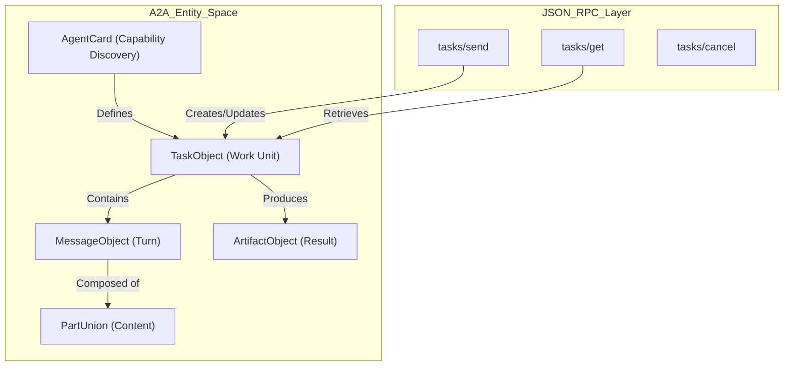
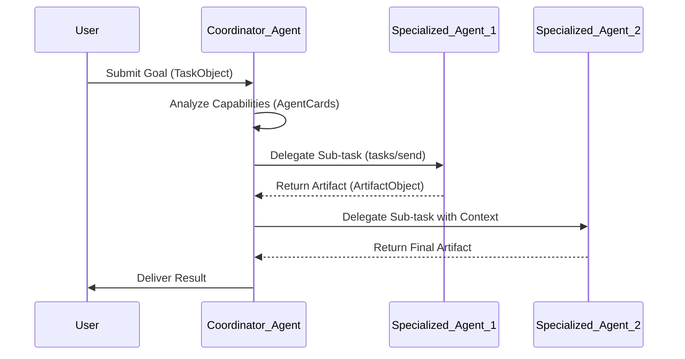
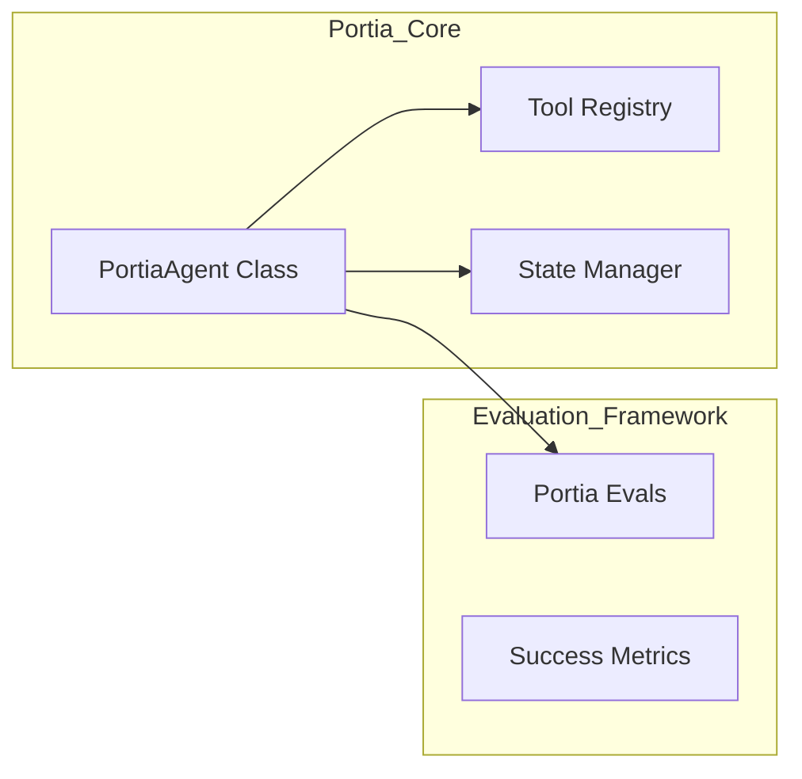

<!-- source: DeepWiki mcp.deepwiki.com · repo NirDiamant/agents-towards-production · page 2.4 Multi-Agent Communication · fetched 2026-10-29 -->

# Multi-Agent Communication

Relevant source files

The following files were used as context for generating this wiki page:

- [tutorials/LangGraph-agent/langgraph_tutorial.ipynb](tutorials/LangGraph-agent/langgraph_tutorial.ipynb)
- [tutorials/a2a/a2a_tutorial.ipynb](tutorials/a2a/a2a_tutorial.ipynb)
- [tutorials/agent-evaluation-intellagent/intellagent-evaluation-tutorial.ipynb](tutorials/agent-evaluation-intellagent/intellagent-evaluation-tutorial.ipynb)
- [tutorials/agent-security-apex/agent-security-evaluation-tutorial.ipynb](tutorials/agent-security-apex/agent-security-evaluation-tutorial.ipynb)
- [tutorials/agent-with-mcp/mcp-tutorial.ipynb](tutorials/agent-with-mcp/mcp-tutorial.ipynb)

This section covers multi-agent communication protocols and orchestration platforms implemented in the repository, focusing on the Agent2Agent (A2A) Protocol, orchestrating multi-agent workflows with Coral, and building fullstack agents with Portia including evaluation capabilities. These implementations demonstrate standardized communication patterns and production-ready multi-agent coordination.

For agent workflow frameworks like LangGraph, see [Agent Frameworks & Workflows](2.1). For persistent memory in multi-agent contexts, see [Memory Management Systems](2.2).

## Purpose and Scope

The repository implements several primary approaches to multi-agent communication and coordination:

1.  **A2A Protocol Implementation**: An open standard communication protocol for agent interoperability using JSON-RPC to manage tasks, messages, and artifacts.
2.  **Multi-Agent Orchestration with Coral**: Managing complex workflows where multiple specialized agents collaborate on a single user goal.
3.  **Fullstack Agents with Portia**: Building end-to-end agentic applications that include tool execution, state management, and built-in evaluation frameworks.

Key capabilities demonstrated include:
*   Standardized message formats (Text, File, Data parts) for cross-platform communication.
*   Task-centric coordination where work is encapsulated in `Task` objects.
*   Capability discovery through `Agent Cards`.
*   Evaluation of multi-agent system performance and reliability.

Sources: [tutorials/a2a/a2a_tutorial.ipynb:20-41](), [tutorials/a2a/a2a_tutorial.ipynb:68-79]()

## Agent2Agent (A2A) Protocol Implementation

The A2A Protocol implementation demonstrates Google's open standard for agent interoperability, enabling agents built with different tools to communicate across programming languages and organizations.

### A2A Protocol Core Components

The protocol relies on a set of core objects that define the state and content of an interaction.

**A2A Protocol Data Flow**

### Key A2A Protocol Objects

| Component | Role | Code Entity / Specification |
|-----------|------|-----------------------------|
| `AgentCard` | Describes capabilities and auth requirements | [tutorials/a2a/a2a_tutorial.ipynb:72-72]() |
| `TaskObject` | Central object representing a piece of work | [tutorials/a2a/a2a_tutorial.ipynb:73-73]() |
| `MessageObject` | Represents a conversational turn | [tutorials/a2a/a2a_tutorial.ipynb:74-74]() |
| `PartUnion` | Defines content: `TextPart`, `FilePart`, or `DataPart` | [tutorials/a2a/a2a_tutorial.ipynb:75-75]() |
| `ArtifactObject` | Represents outputs or results (files/structured data) | [tutorials/a2a/a2a_tutorial.ipynb:76-76]() |
| `JSON-RPC` | Transport layer for remote procedure calls | [tutorials/a2a/a2a_tutorial.ipynb:77-77]() |

Sources: [tutorials/a2a/a2a_tutorial.ipynb:68-79]()

## Multi-Agent Orchestration Patterns

Multi-agent systems in this repository often follow a pattern where a "Coordinator" or "Orchestrator" manages the flow between specialized sub-agents.

### Orchestration Data Flow

**Task Coordination Workflow**

### Implementation Examples

*   **Meeting Automation**: A workflow where a `Meeting Recorder Agent` captures audio, a `Report Generator Agent` processes transcripts, and a `Task Coordinator` manages the sequence.
*   **Text Analysis Pipeline**: Using LangGraph to orchestrate a `Classification Node`, `Entity Extraction Node`, and `Summarization Node`.

Sources: [tutorials/LangGraph-agent/langgraph_tutorial.ipynb:23-28](), [tutorials/a2a/a2a_tutorial.ipynb:36-41]()

## Building Fullstack Agents with Portia

The Portia integration demonstrates building agents that are "production-ready" by combining execution capabilities with rigorous evaluation.

### Portia Agent Architecture

**Portia System Components**

### Evaluation and Quality Assurance

A critical part of multi-agent communication is ensuring that information passed between agents is accurate. The repository utilizes `IntellAgent` and `Portia` for behavioral testing.

| Evaluation Metric | Description |
|-------------------|-------------|
| **Task Success Rate** | Percentage of multi-agent workflows that reach the intended goal. |
| **Tool Accuracy** | Verification that sub-agents call the correct tools with valid parameters. |
| **Communication Fidelity** | Ensuring `TaskObjects` and `Artifacts` maintain integrity across hops. |

Sources: [tutorials/agent-evaluation-intellagent/intellagent-evaluation-tutorial.ipynb:52-58](), [tutorials/a2a/a2a_tutorial.ipynb:76-77]()

## Development Workflows

### Standardized Communication (A2A)
The A2A tutorial demonstrates adherence to the A2A Protocol Specification v0.1.0, ensuring:
*   **Interoperability**: Agents from different organizations can collaborate.
*   **Negotiation**: Agents can negotiate interaction modalities (text vs. structured data).
*   **Security**: Secure exchange of information to achieve user goals.

Sources: [tutorials/a2a/a2a_tutorial.ipynb:33-41]()

### Stateful Orchestration (LangGraph)
For internal multi-agent communication within a single application, the repository uses `StateGraph`.
*   **State Management**: Maintaining a persistent `TypedDict` across nodes.
*   **Flexible Routing**: Defining transitions between agent nodes based on LLM outputs.

Sources: [tutorials/LangGraph-agent/langgraph_tutorial.ipynb:152-169]()

---

