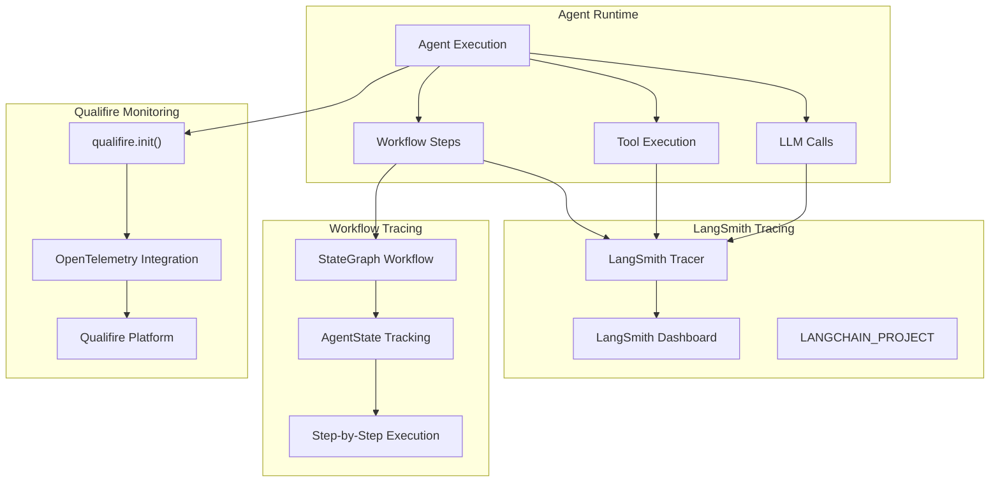
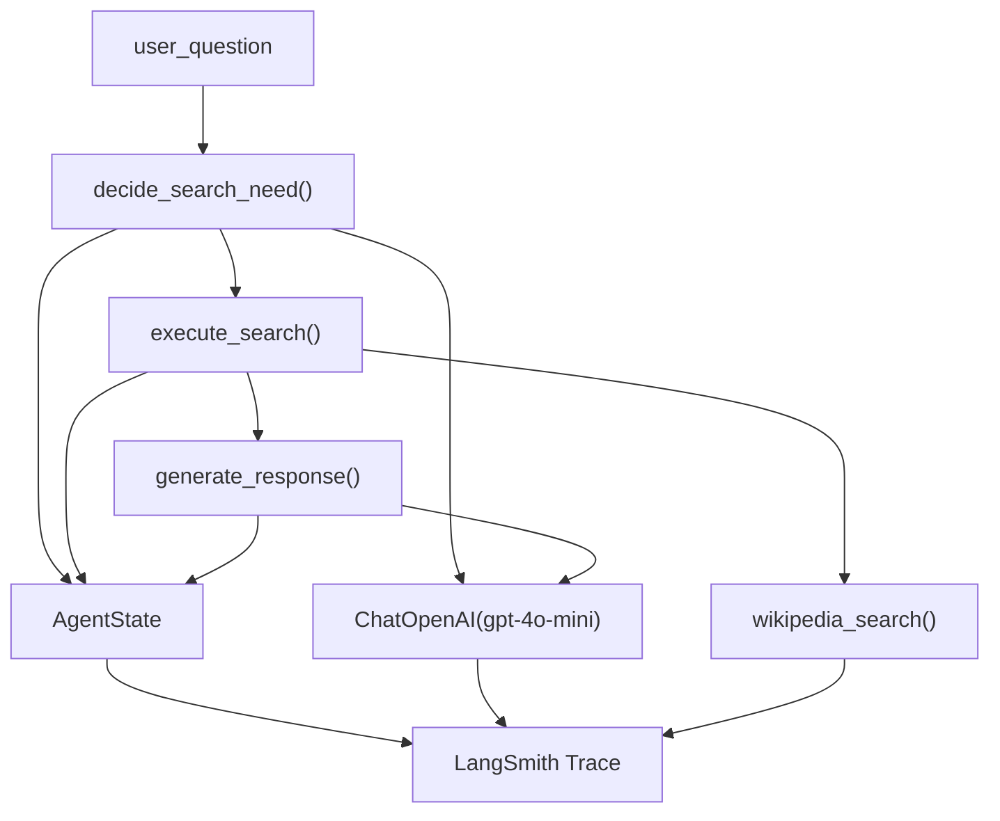
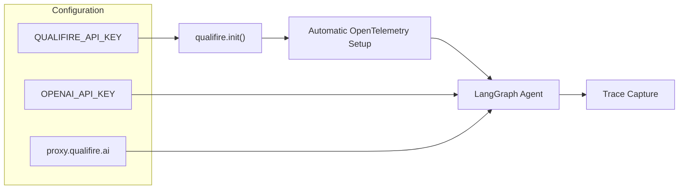
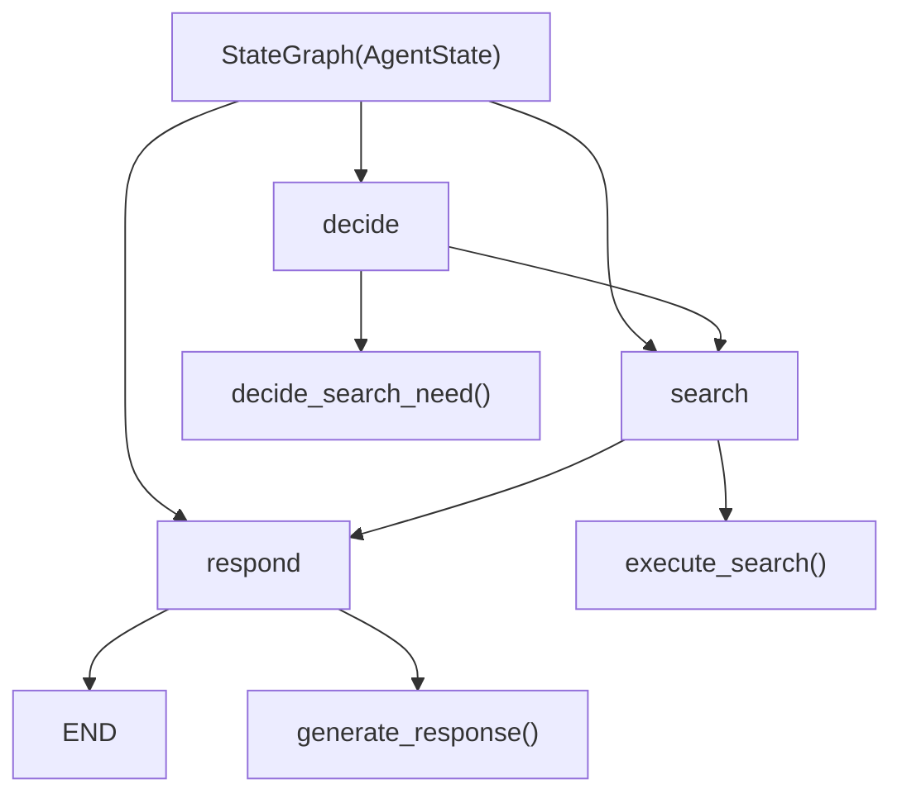
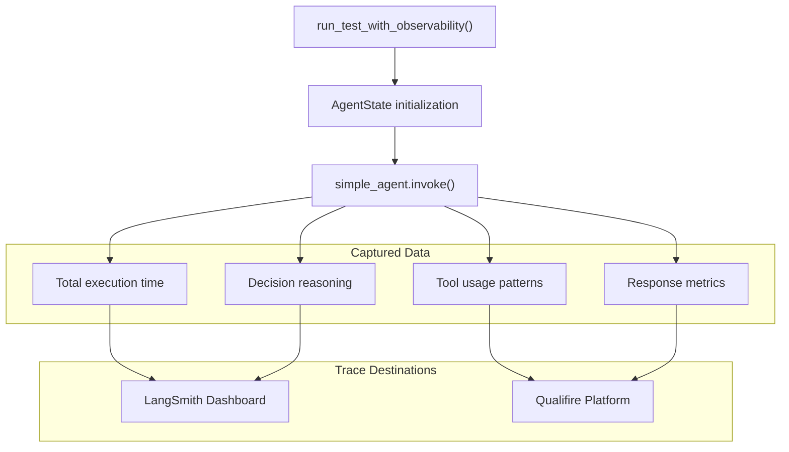
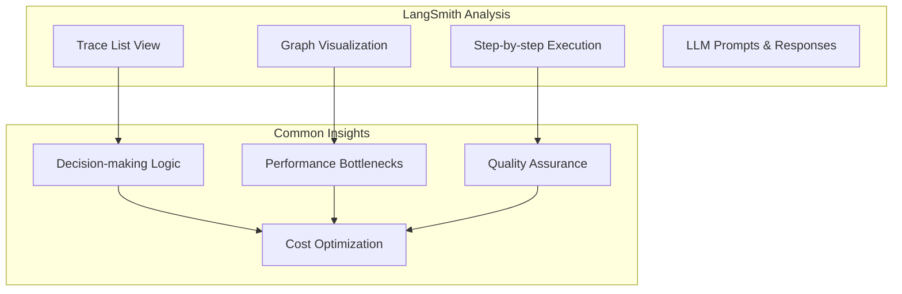

<!-- source: DeepWiki mcp.deepwiki.com · repo NirDiamant/agents-towards-production · page 2.5 Observability & Monitoring · fetched 2026-10-29 -->

# Observability & Monitoring

<details>
<summary>Relevant source files</summary>

The following files were used as context for generating this wiki page:

- [tutorials/agent-memory-with-redis/README.md](tutorials/agent-memory-with-redis/README.md)
- [tutorials/fastapi-agent/fastapi-agent-tutorial.ipynb](tutorials/fastapi-agent/fastapi-agent-tutorial.ipynb)
- [tutorials/tracing-with-langsmith/langsmith_basics.ipynb](tutorials/tracing-with-langsmith/langsmith_basics.ipynb)

</details>


This document covers the comprehensive observability and monitoring capabilities implemented in the agent framework, including tracing, logging, performance monitoring, and debugging workflows. The system provides two primary observability solutions: LangSmith for workflow tracing and Qualifire for comprehensive monitoring with OpenTelemetry integration.

For security-focused monitoring and evaluation, see [Security Testing & Evaluation](#3.2). For agent behavioral testing and evaluation frameworks, see [Agent Evaluation & Testing](#2.6).

## Observability Architecture Overview

The observability framework provides multiple layers of monitoring and tracing capabilities across different aspects of agent execution. It transforms AI development from guesswork into engineering by adding a "flight recorder" to the system [tutorials/tracing-with-langsmith/langsmith_basics.ipynb:18-21]().

### Core Observability Components



Sources: [tutorials/tracing-with-langsmith/langsmith_basics.ipynb:10-26](), [tutorials/tracing-with-langsmith/langsmith_basics.ipynb:62-67]()

## LangSmith Integration

LangSmith provides comprehensive tracing capabilities for LangGraph workflows, automatically capturing decision-making processes, timing data, and execution flows. It works by intercepting and logging all LangGraph operations once configured [tutorials/tracing-with-langsmith/langsmith_basics.ipynb:38-39]().

### Configuration and Setup

The LangSmith integration is enabled through environment variables and automatic instrumentation:

| Configuration | Purpose | Default Value |
|---------------|---------|---------------|
| `LANGCHAIN_TRACING_V2` | Enable LangSmith tracing | `true` |
| `LANGCHAIN_API_KEY` | Authentication key | User-provided |
| `LANGCHAIN_PROJECT` | Project organization | `langsmith-tutorial-demo` |

Sources: [tutorials/tracing-with-langsmith/langsmith_basics.ipynb:90-97]()

### Workflow Tracing Architecture



Sources: [tutorials/tracing-with-langsmith/langsmith_basics.ipynb:139-150](), [tutorials/tracing-with-langsmith/langsmith_basics.ipynb:184-194](), [tutorials/tracing-with-langsmith/langsmith_basics.ipynb:226-274]()

### State Management and Tracing

The `AgentState` class defines the structured information flow that LangSmith captures:

```python
class AgentState(TypedDict):
    user_question: str        # Original user input
    needs_search: bool        # Decision-making flag
    search_result: str        # Tool execution result
    final_answer: str         # Generated response
    reasoning: str            # Decision explanation
```

Sources: [tutorials/tracing-with-langsmith/langsmith_basics.ipynb:139-146](), [tutorials/tracing-with-langsmith/langsmith_basics.ipynb:184-194]()

## Qualifire Integration

Qualifire provides comprehensive observability through OpenTelemetry integration, offering end-to-end tracing, real-time monitoring, and detailed performance analytics.

### Initialization and Configuration



Sources: [tutorials/tracing-with-langsmith/langsmith_basics.ipynb:90-97]()

## Implementation Patterns

### Workflow Graph Construction

LangGraph workflows are structured using `StateGraph` to create traceable execution paths. Nodes are added for specific functions like `decide_search_need`, `execute_search`, and `generate_response` [tutorials/tracing-with-langsmith/langsmith_basics.ipynb:458-480]().



Sources: [tutorials/tracing-with-langsmith/langsmith_basics.ipynb:458-480]()

### Tool Integration with Tracing

Tools are instrumented automatically when decorated with `@tool`. This allows LangSmith to capture the input and output of tool calls within the trace [tutorials/tracing-with-langsmith/langsmith_basics.ipynb:226-274]().

```python
@tool
def wikipedia_search(query: str) -> str:
    """Search Wikipedia for current information about a topic."""
    # Implementation with comprehensive error handling
    # and logging for LangSmith traces
```

Sources: [tutorials/tracing-with-langsmith/langsmith_basics.ipynb:226-274]()

### Metadata and Tagging

Both systems support metadata tagging for trace organization, allowing developers to filter traces by test type or tutorial name [tutorials/tracing-with-langsmith/langsmith_basics.ipynb:536-542]().

```python
config = {
    "metadata": {
        "test_type": test_type,
        "tutorial": "langsmith-observability"
    },
    "tags": ["tutorial", "demo", test_type]
}
```

Sources: [tutorials/tracing-with-langsmith/langsmith_basics.ipynb:536-542]()

## Monitoring Workflows

### Test Execution with Observability

The framework includes test runners that capture observability data during execution. This captures execution time, decision reasoning, and tool usage patterns [tutorials/tracing-with-langsmith/langsmith_basics.ipynb:515-575]().



Sources: [tutorials/tracing-with-langsmith/langsmith_basics.ipynb:515-575]()

### Performance Analytics

The observability systems capture key performance metrics to identify bottlenecks and optimize costs [tutorials/tracing-with-langsmith/langsmith_basics.ipynb:18-20]().

| Metric Category | LangSmith | Qualifire |
|-----------------|-----------|-----------|
| Execution Time | ✓ Per-step timing | ✓ End-to-end latency |
| Token Usage | ✓ Per-LLM call | ✓ Aggregate usage |
| Tool Execution | ✓ Input/output logging | ✓ Span-level tracing |
| Error Tracking | ✓ Exception capture | ✓ Error span attributes |
| Cost Analysis | ✓ Token cost estimation | ✓ Resource usage |

Sources: [tutorials/tracing-with-langsmith/langsmith_basics.ipynb:18-20](), [tutorials/tracing-with-langsmith/langsmith_basics.ipynb:62-67]()

## Debugging and Troubleshooting

### Trace Analysis Capabilities

LangSmith provides a visualization of the decision-making process, making it clear why an AI chose a particular response or tool trajectory [tutorials/tracing-with-langsmith/langsmith_basics.ipynb:18-20]().



Sources: [tutorials/tracing-with-langsmith/langsmith_basics.ipynb:18-20](), [tutorials/tracing-with-langsmith/langsmith_basics.ipynb:64-67]()

### Error Handling and Visibility

Error handling patterns include comprehensive try-catch blocks where errors are captured in the trace context for later analysis [tutorials/tracing-with-langsmith/langsmith_basics.ipynb:268-270]().

```python
try:
    # Tool execution with automatic tracing
    search_result = wikipedia_search.invoke({"query": state["user_question"]})
except Exception as e:
    # Error information captured in traces
    return f"Search error: {str(e)}"
```

Sources: [tutorials/tracing-with-langsmith/langsmith_basics.ipynb:268-270]()

---

