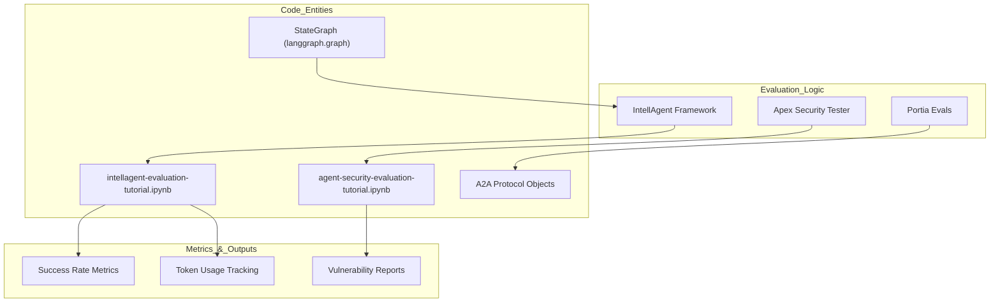
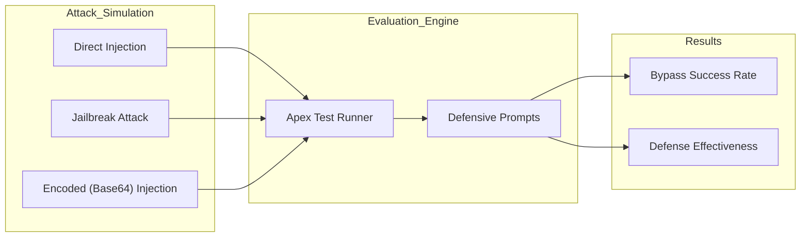

<!-- source: DeepWiki mcp.deepwiki.com · repo NirDiamant/agents-towards-production · page 2.6 Agent Evaluation & Testing · fetched 2026-10-29 -->

# Agent Evaluation & Testing

<details>
<summary>Relevant source files</summary>

The following files were used as context for generating this wiki page:

- [tutorials/LangGraph-agent/langgraph_tutorial.ipynb](tutorials/LangGraph-agent/langgraph_tutorial.ipynb)
- [tutorials/a2a/a2a_tutorial.ipynb](tutorials/a2a/a2a_tutorial.ipynb)
- [tutorials/agent-evaluation-intellagent/intellagent-evaluation-tutorial.ipynb](tutorials/agent-evaluation-intellagent/intellagent-evaluation-tutorial.ipynb)
- [tutorials/agent-security-apex/agent-security-evaluation-tutorial.ipynb](tutorials/agent-security-apex/agent-security-evaluation-tutorial.ipynb)
- [tutorials/agent-with-mcp/mcp-tutorial.ipynb](tutorials/agent-with-mcp/mcp-tutorial.ipynb)

</details>


This document covers the methodologies, frameworks, and patterns for evaluating AI agent performance and quality within the `agents-towards-production` repository. The evaluation system focuses on automated behavioral testing, performance metrics, and systematic approaches to improving agent quality using tools like **IntellAgent** and **Portia**.

## Purpose and Scope

The agent evaluation system provides structured approaches to:
- **Automated Behavioral Analysis**: Testing how agents handle complex reasoning and multi-step tasks.
- **Performance Metrics**: Measuring success rates, latency, and cost across different LLM backends.
- **Test Dataset Construction**: Building robust evaluation sets (Evals) to prevent regressions.
- **Security Validation**: Testing agents against prompt injections and jailbreaks using the **Apex** framework [tutorials/agent-security-apex/agent-security-evaluation-tutorial.ipynb:10-20]().

## Evaluation Framework Architecture

The repository utilizes a multi-layered evaluation strategy. While **IntellAgent** handles behavioral and performance metrics, the **Portia** framework is used for full-stack agent evaluation, and **Apex** focuses on security-specific testing.

### System Entity Mapping

The following diagram maps high-level evaluation concepts to the specific code entities and files used in the tutorials.

**Evaluation Code Entity Map**



**Sources:** [tutorials/agent-evaluation-intellagent/intellagent-evaluation-tutorial.ipynb:1-10](), [tutorials/agent-security-apex/agent-security-evaluation-tutorial.ipynb:42-49](), [tutorials/LangGraph-agent/langgraph_tutorial.ipynb:138-140]()

## Core Evaluation Components

### 1. Behavioral & Performance Evaluation (IntellAgent)
IntellAgent provides automated analysis of agent decision-making. It is used to evaluate the "brain" of the agent—its ability to reason through a `StateGraph` [tutorials/LangGraph-agent/langgraph_tutorial.ipynb:138-138]().

| Component | Purpose | Implementation Reference |
|-----------|---------|--------------------------|
| **State Analysis** | Validates if the `State` TypedDict is updated correctly | `class State(TypedDict)` [tutorials/LangGraph-agent/langgraph_tutorial.ipynb:161-166]() |
| **Node Testing** | Individual testing of logic units (e.g., Classification) | `classification_node(state)` [tutorials/LangGraph-agent/langgraph_tutorial.ipynb:188-197]() |
| **End-to-End** | Measuring total time from `HumanMessage` to `END` | `from langgraph.graph import END` [tutorials/LangGraph-agent/langgraph_tutorial.ipynb:138-138]() |

### 2. Security Evaluation (Apex Framework)
The **Apex** tutorial focuses on "Stage 2: Vulnerability testing" [tutorials/agent-security-apex/agent-security-evaluation-tutorial.ipynb:46-46](). It measures the effectiveness of security implementations against known attack vectors.

**Security Testing Pipeline**


**Sources:** [tutorials/agent-security-apex/agent-security-evaluation-tutorial.ipynb:85-130]()

## Evaluation Methodologies

### Automated Testing of Agentic Protocols
For multi-agent systems, evaluation focuses on the **Agent2Agent (A2A)** protocol. Testing ensures that `Task Objects` and `Message Objects` maintain integrity during handoffs [tutorials/a2a/a2a_tutorial.ipynb:71-78]().

- **Task Object Validation**: Checking ID, status, and artifact consistency.
- **JSON-RPC Simulation**: Testing the reliability of `tasks/send` and `tasks/get` methods [tutorials/a2a/a2a_tutorial.ipynb:77-78]().

### Tool Integration Testing (MCP)
When agents use the **Model Context Protocol (MCP)**, evaluation includes:
- **Discovery Testing**: Can the agent dynamically find new tools? [tutorials/agent-with-mcp/mcp-tutorial.ipynb:30-30]()
- **Protocol Compliance**: Ensuring communication over JSON-RPC 2.0/WebSockets is error-free [tutorials/agent-with-mcp/mcp-tutorial.ipynb:76-76]().

## Production Evaluation Patterns

### Quality Metrics Framework
The repository implements a comprehensive metrics suite:

| Metric Category | Specific Code Entities / Methods |
|-----------------|---------------------------------|
| **Accuracy** | Comparison of `classification` node output vs. ground truth [tutorials/LangGraph-agent/langgraph_tutorial.ipynb:188-196]() |
| **Robustness** | Success rate against `Encoded injection` (Base64/ROT13) [tutorials/agent-security-apex/agent-security-evaluation-tutorial.ipynb:121-129]() |
| **Interoperability** | `A2A` protocol compliance across different languages [tutorials/a2a/a2a_tutorial.ipynb:27-28]() |
| **Tool Reliability** | Connection stability for `MCP Servers` and `Data Sources` [tutorials/agent-with-mcp/mcp-tutorial.ipynb:73-74]() |

### Continuous Evaluation Pipeline
In production, evaluation is not a one-time event but a pipeline:
1. **Attack Analysis**: Identifying new threat patterns [tutorials/agent-security-apex/agent-security-evaluation-tutorial.ipynb:44-44]().
2. **Automated Regression**: Running datasets of real attack examples [tutorials/agent-security-apex/agent-security-evaluation-tutorial.ipynb:20-20]().
3. **Defense Validation**: Measuring the impact of new security controls on agent performance [tutorials/agent-security-apex/agent-security-evaluation-tutorial.ipynb:57-57]().

## Getting Started with Evaluation

To run the evaluation suites locally, navigate to the respective tutorial directories and install the dependencies:

```bash
# For Behavioral Evaluation
cd tutorials/agent-evaluation-intellagent
pip install -r requirements.txt

# For Security Evaluation
cd tutorials/agent-security-apex
pip install -r requirements.txt
```

**Sources:** [tutorials/agent-evaluation-intellagent/intellagent-evaluation-tutorial.ipynb:1-10](), [tutorials/agent-security-apex/agent-security-evaluation-tutorial.ipynb:1-10]()

---

