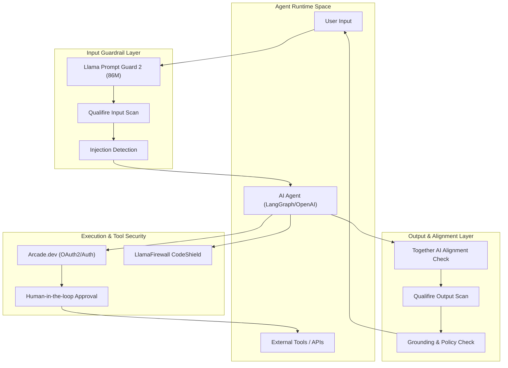
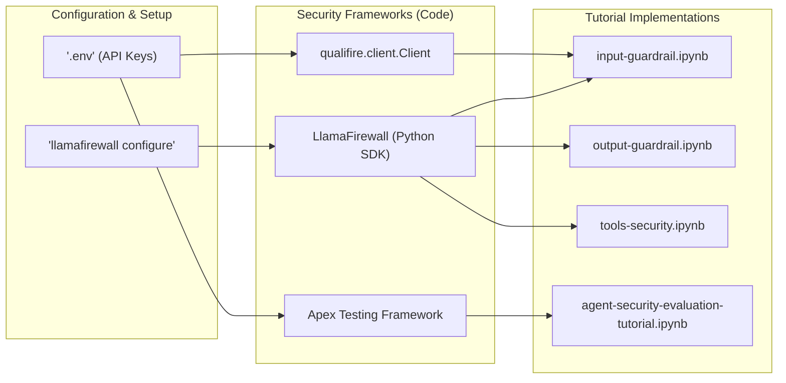

<!-- source: DeepWiki mcp.deepwiki.com · repo NirDiamant/agents-towards-production · page 3 Security Framework · fetched 2026-10-29 -->

# Security Framework

Relevant source files

The following files were used as context for generating this wiki page:

- [tutorials/agent-security-apex/README.md](tutorials/agent-security-apex/README.md)
- [tutorials/agent-security-with-llamafirewall/README.md](tutorials/agent-security-with-llamafirewall/README.md)
- [tutorials/agent-with-brightdata/README.md](tutorials/agent-with-brightdata/README.md)
- [tutorials/arcade-secure-tool-calling/README.md](tutorials/arcade-secure-tool-calling/README.md)

## Purpose and Scope

The Security Framework provides a comprehensive, multi-layered approach to protecting AI agents throughout their development and deployment lifecycle. This framework addresses critical vulnerabilities including prompt injection, unsafe content generation, unauthorized tool access, and behavior misalignment. It combines real-time runtime guardrails with automated security testing to ensure production-ready reliability.

For detailed implementation of real-time defenses, see [Security Guardrails](#3.1). For information about red-teaming and automated vulnerability assessment, see [Security Testing & Evaluation](#3.2).

## Security Attack Surfaces

The framework addresses three primary attack surfaces inherent to LLM-based agents:

| Attack Surface | Vulnerabilities | Mitigation Strategy |
|---|---|---|
| **Input Security** | Prompt injection, jailbreaking, harmful content, obfuscated attacks (Base64/ROT13) | Input validation, `Llama Prompt Guard 2`, content filtering, injection detection |
| **Output Security** | Policy violations, hallucination (ungrounded responses), information disclosure | Output filtering, grounding checks, policy enforcement, alignment scanning |
| **Tool Security** | Unauthorized API access, resource abuse, malicious code execution | RBAC (Role-Based Access Control), human-in-the-loop (HITL), `CodeShield` |

Sources: [tutorials/agent-security-with-llamafirewall/README.md:12-19](), [tutorials/agent-security-apex/README.md:10-15]()

## Security Architecture Overview

The following diagram bridges the conceptual security layers with specific code entities and external services used in the repository.

### Defense-in-Depth Architecture

Sources: [tutorials/agent-security-with-llamafirewall/README.md:23-33](), [tutorials/arcade-secure-tool-calling/README.md:12-16](), [tutorials/agent-security-apex/README.md:12-15]()

## Core Security Components

### Real-Time Guardrails
The framework utilizes `LlamaFirewall` and `Qualifire` to provide synchronous protection. 
- **LlamaFirewall**: Focuses on model-based scanning using `meta-llama/Llama-Prompt-Guard-2-86M` for input safety and `CodeShield` for preventing malicious code generation [tutorials/agent-security-with-llamafirewall/README.md:39-40]().
- **Qualifire**: Provides a gateway-based approach where agents connect via a proxy URL (`https://proxy.qualifire.ai/api/providers/openai`) to enforce protection rules like `grounding_check` and `dangerous_content_check` automatically.

For details, see [Security Guardrails](#3.1).

### Secure Tool Access
For agents interacting with sensitive data (Gmail, Slack, etc.), the framework integrates `Arcade.dev`. This replaces static API keys with dynamic **OAuth2 flows**, ensuring that the agent operates under the user's specific permissions and requires **Human-in-the-loop** approval for high-risk actions.

Sources: [tutorials/arcade-secure-tool-calling/README.md:12-16](), [tutorials/arcade-secure-tool-calling/README.md:28-30]()

### Security Testing & Evaluation
Before deployment, agents are subjected to automated penetration testing using the **Apex framework**. This involves:
1. **Attack Simulation**: Running 91+ real-world prompt injection examples against the agent [tutorials/agent-security-apex/README.md:12-12]().
2. **Obfuscation Testing**: Attempting to bypass filters using Base64, ROT13, and Caesar cipher encodings [tutorials/agent-security-apex/README.md:15-15]().
3. **Success Rate Measurement**: Quantifying the effectiveness of defensive prompts.

For details, see [Security Testing & Evaluation](#3.2).

## Security Integration Mapping

This diagram maps the security components to the specific tutorial implementations and configuration commands.

### Code Entity & Configuration Map

Sources: [tutorials/agent-security-with-llamafirewall/README.md:26-33](), [tutorials/agent-security-with-llamafirewall/README.md:40-40](), [tutorials/agent-security-apex/README.md:19-20](), [tutorials/agent-security-apex/README.md:25-25]()

## Child Pages
- [Security Guardrails](#3.1) — Detailed implementation of `LlamaFirewall`, `Qualifire`, and real-time input/output/tool security.
- [Security Testing & Evaluation](#3.2) — Deep dive into prompt injection attacks, obfuscation bypasses, and automated testing with `Apex`.

---

