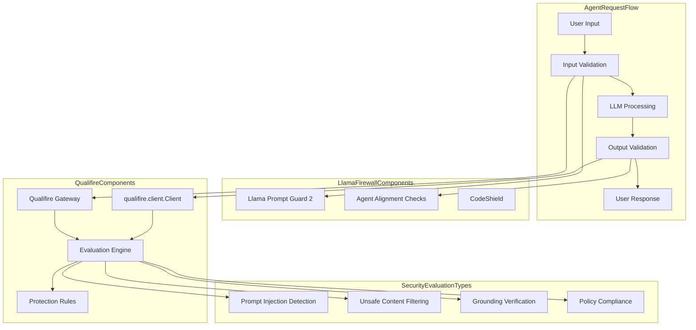
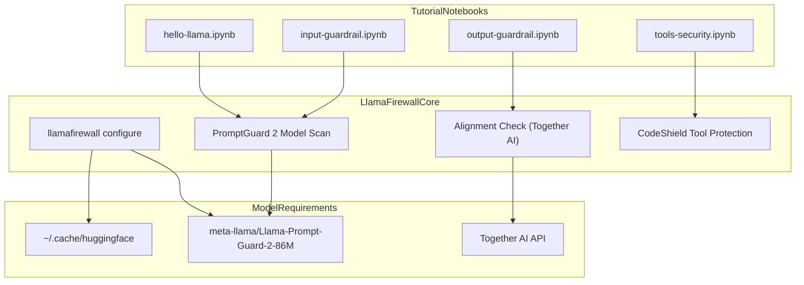
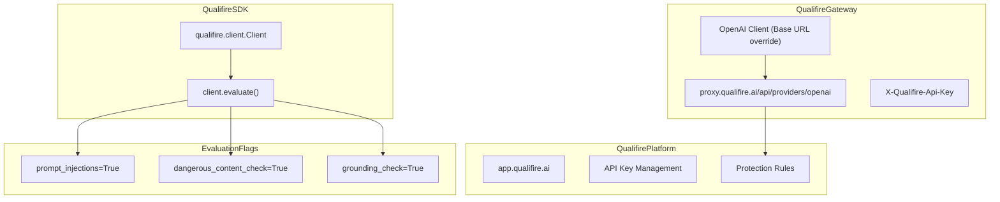

<!-- source: DeepWiki mcp.deepwiki.com · repo NirDiamant/agents-towards-production · page 3.1 Security Guardrails · fetched 2026-10-29 -->

# Security Guardrails

<details>
<summary>Relevant source files</summary>

The following files were used as context for generating this wiki page:

- [tutorials/agent-security-with-llamafirewall/README.md](tutorials/agent-security-with-llamafirewall/README.md)
- [tutorials/agent-with-brightdata/README.md](tutorials/agent-with-brightdata/README.md)

</details>


## Purpose and Scope

This document covers the implementation of real-time security guardrails for AI agents using two complementary approaches: **LlamaFirewall** (open-source) and **Qualifire** (commercial platform). Security guardrails provide automated protection against prompt injection, harmful content generation, policy violations, and unauthorized tool usage during agent execution.

The implementation focuses on:
- **Input Guardrails**: Detecting malicious prompts and injection attacks before they reach the LLM.
- **Output Guardrails**: Ensuring agent responses align with safety policies and grounding requirements.
- **Tool Security**: Controlling access to external tools and preventing resource abuse.
- **Alignment Scanning**: Using the Llama Prompt Guard 2 model for real-time safety classification.

## Security Guardrails Architecture Overview

The security guardrails system operates at multiple interception points in the AI agent request/response lifecycle, providing layered protection through input validation, output filtering, and behavioral monitoring.

### Core Security Architecture



**Sources:** [tutorials/agent-security-with-llamafirewall/README.md:13-19](), [tutorials/agent-security-with-qualifire/1-agent-security-with-qualifire.ipynb:11-31]()

### Security Attack Surface Coverage

| Attack Surface | LlamaFirewall Protection | Qualifire Protection |
|---|---|---|
| **Input Security** | `Llama Prompt Guard 2` model | `prompt_injections=True` evaluation |
| **Output Security** | `Agent Alignment Checks` | `grounding_check=True`, `assertions=[]` |
| **Tool Security** | `CodeShield` protection | Custom policy enforcement |
| **Content Safety** | Harmful content detection | `dangerous_content_check=True`, `harassment_check=True` |

**Sources:** [tutorials/agent-security-with-llamafirewall/README.md:15-18](), [tutorials/agent-security-with-qualifire/1-agent-security-with-qualifire.ipynb:132-138]()

## LlamaFirewall Implementation

LlamaFirewall provides an open-source security framework that integrates directly into agent workflows using HuggingFace models for local security processing.

### LlamaFirewall Component Architecture



**Sources:** [tutorials/agent-security-with-llamafirewall/README.md:23-33](), [tutorials/agent-security-with-llamafirewall/README.md:38-40]()

### LlamaFirewall Configuration Requirements

The LlamaFirewall system requires specific setup steps to initialize models and API keys:

1.  **Dependencies**: Install via `pip install -r requirements.txt`.
2.  **API Keys**: Requires an OpenAI API key for agent execution and a Together AI key for alignment checks.
3.  **HuggingFace Access**: Users must request access to the `meta-llama/Llama-Prompt-Guard-2-86M` model on HuggingFace.
4.  **CLI Configuration**: Run `llamafirewall configure` to set up models and keys locally.

**Sources:** [tutorials/agent-security-with-llamafirewall/README.md:37-40]()

### LlamaFirewall Security Modules

| Module | Purpose | File Reference |
|---|---|---|
| **Message Scanning** | Basic detection of harmful content in message strings. | [tutorials/agent-security-with-llamafirewall/README.md:23-24]() |
| **Input Guardrail** | Validating user inputs against injection attacks. | [tutorials/agent-security-with-llamafirewall/README.md:26-27]() |
| **Output Guardrail** | Validating AI responses against intended behavior policies. | [tutorials/agent-security-with-llamafirewall/README.md:29-30]() |
| **Tool Security** | Access control and input validation for agent tools. | [tutorials/agent-security-with-llamafirewall/README.md:32-33]() |

**Sources:** [tutorials/agent-security-with-llamafirewall/README.md:23-33]()

## Qualifire Implementation

Qualifire provides a platform-based approach with two integration methods: the **Gateway** (proxy-based) and the **SDK** (direct client integration).

### Qualifire Integration Architecture



**Sources:** [tutorials/agent-security-with-qualifire/1-agent-security-with-qualifire.ipynb:61-66](), [tutorials/agent-security-with-qualifire/1-agent-security-with-qualifire.ipynb:184-202](), [tutorials/agent-security-with-qualifire/1-agent-security-with-qualifire.ipynb:519-527]()

### Qualifire SDK Client Usage

Direct integration is handled via the `qualifire.client.Client` class, which allows for granular evaluation of specific inputs or outputs.

```python
# Example of SDK usage for prompt injection detection
q_client = qualifire.client.Client(api_key=QUALIFIRE_API_KEY)
result = q_client.evaluate(
    input=user_query,
    prompt_injections=True,
)
```

**Sources:** [tutorials/agent-security-with-qualifire/1-agent-security-with-qualifire.ipynb:184-202]()

### Qualifire Gateway Integration

The Gateway approach allows developers to secure any OpenAI-compatible client by changing the `base_url` and adding the `X-Qualifire-Api-Key` header. This routes all traffic through Qualifire's security filters automatically.

```python
# Example of Gateway configuration
openai_client = OpenAI(
    api_key=OPENAI_API_KEY,
    base_url="https://proxy.qualifire.ai/api/providers/openai",
    default_headers={
        "X-Qualifire-Api-Key": QUALIFIRE_API_KEY,
    },
)
```

**Sources:** [tutorials/agent-security-with-qualifire/1-agent-security-with-qualifire.ipynb:519-527]()

## Security Evaluation Framework

Both systems implement a taxonomy of safety checks to categorize and mitigate risks.

### Unsafe Content Taxonomy

Qualifire categorizes content across several dimensions:
- `DANGEROUS_CONTENT`: Promotion of violence, self-harm, or illegal acts.
- `HARASSMENT`: Bullying or intimidating content.
- `HATE_SPEECH`: Content targeting protected groups.
- `SEXUALLY_EXPLICIT_INFORMATION`: Lewd or graphic material.

**Sources:** [tutorials/agent-security-with-qualifire/1-agent-security-with-qualifire.ipynb:223-231]()

### Grounding and Policy Verification

Grounding ensures the agent does not hallucinate information outside its provided context.
- **Grounding Check**: Uses `grounding_check=True` in the SDK to verify context-response alignment.
- **Assertions**: Custom policy rules can be passed as a list of strings to `assertions=[]` to enforce specific business logic.

**Sources:** [tutorials/agent-security-with-qualifire/1-agent-security-with-qualifire.ipynb:313-331](), [tutorials/agent-security-with-qualifire/1-agent-security-with-qualifire.ipynb:410-429]()

## Monitoring and Observability

Real-time monitoring is critical for identifying ongoing attacks and refining guardrail policies.

- **LlamaFirewall Monitoring**: Provides real-time tracking of security events and comprehensive logging. [tutorials/agent-security-with-llamafirewall/README.md:18-18]()
- **Qualifire Monitoring**: Interaction logs are accessible via `app.qualifire.ai/logs`, showing evaluation results, scores, and specific violation reasons. [tutorials/agent-security-with-qualifire/1-agent-security-with-qualifire.ipynb:546-556]()

**Sources:** [tutorials/agent-security-with-llamafirewall/README.md:18-18](), [tutorials/agent-security-with-qualifire/1-agent-security-with-qualifire.ipynb:546-556]()

---

