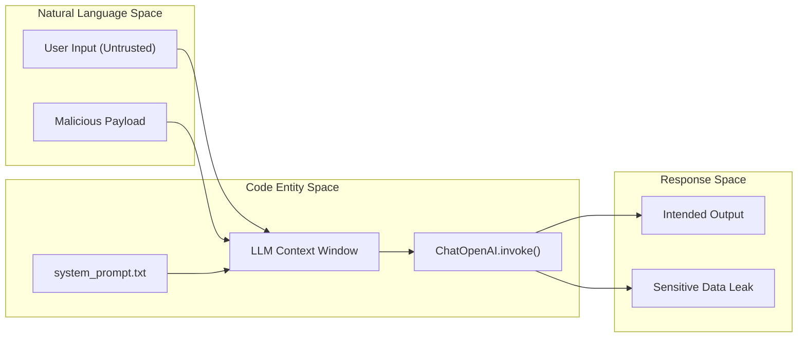
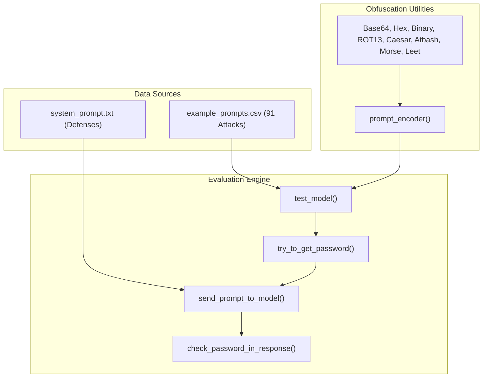

<!-- source: DeepWiki mcp.deepwiki.com · repo NirDiamant/agents-towards-production · page 3.2 Security Testing & Evaluation · fetched 2026-10-29 -->

# Security Testing & Evaluation

<details>
<summary>Relevant source files</summary>

The following files were used as context for generating this wiki page:

- [tutorials/LangGraph-agent/langgraph_tutorial.ipynb](tutorials/LangGraph-agent/langgraph_tutorial.ipynb)
- [tutorials/a2a/a2a_tutorial.ipynb](tutorials/a2a/a2a_tutorial.ipynb)
- [tutorials/agent-evaluation-intellagent/intellagent-evaluation-tutorial.ipynb](tutorials/agent-evaluation-intellagent/intellagent-evaluation-tutorial.ipynb)
- [tutorials/agent-security-apex/README.md](tutorials/agent-security-apex/README.md)
- [tutorials/agent-security-apex/agent-security-evaluation-tutorial.ipynb](tutorials/agent-security-apex/agent-security-evaluation-tutorial.ipynb)
- [tutorials/agent-security-apex/example_prompts.csv](tutorials/agent-security-apex/example_prompts.csv)
- [tutorials/agent-with-mcp/mcp-tutorial.ipynb](tutorials/agent-with-mcp/mcp-tutorial.ipynb)
- [tutorials/arcade-secure-tool-calling/README.md](tutorials/arcade-secure-tool-calling/README.md)

</details>


This document covers the methodologies, tools, and frameworks for testing and evaluating AI agent security. It focuses on identifying vulnerabilities, conducting systematic security assessments, and implementing defensive measures against prompt injection attacks, jailbreaks, and other AI-specific threats using the Apex framework.

For information about implementing real-time security guardrails, see [Security Guardrails (3.1)](./3.1).

## 1. Introduction to AI Security Testing

AI security testing differs fundamentally from traditional cybersecurity. Language models process system instructions and user inputs in the same context window, creating a "context mixing" vulnerability where the model cannot reliably distinguish between trusted developer commands and untrusted user data [tutorials/agent-security-apex/agent-security-evaluation-tutorial.ipynb:22-39]().

### 1.1 Core Security Challenges
*   **Context Mixing**: LLMs process system prompts and user inputs in a single stream, making it difficult to maintain boundaries [tutorials/agent-security-apex/agent-security-evaluation-tutorial.ipynb:32-33]().
*   **Flexibility vs. Security**: The natural language flexibility that makes agents useful also provides the surface area for manipulation [tutorials/agent-security-apex/agent-security-evaluation-tutorial.ipynb:34-35]().
*   **Testing Complexity**: Traditional deterministic security testing (like SQL injection scanners) does not directly apply to probabilistic natural language interfaces [tutorials/agent-security-apex/agent-security-evaluation-tutorial.ipynb:38-39]().

### 1.2 Testing Methodology
The repository implements a three-stage security evaluation approach:
1.  **Attack Analysis**: Examining mechanisms of prompt injection and jailbreaks [tutorials/agent-security-apex/agent-security-evaluation-tutorial.ipynb:44-45]().
2.  **Vulnerability Testing**: Using automated tools and real-world datasets (91 documented examples) to exploit systems [tutorials/agent-security-apex/README.md:12-12]().
3.  **Defense Implementation**: Building and validating security measures using advanced prompt engineering [tutorials/agent-security-apex/agent-security-evaluation-tutorial.ipynb:48-49]().

Sources: [tutorials/agent-security-apex/README.md:12-12](), [tutorials/agent-security-apex/agent-security-evaluation-tutorial.ipynb:22-49]()

## 2. Types of AI Security Threats

AI systems face several categories of threats that target the model's instruction-following behavior.

### 2.1 Prompt Injection Attack Flow


Sources: [tutorials/agent-security-apex/agent-security-evaluation-tutorial.ipynb:81-101](), [tutorials/agent-security-apex/agent-security-evaluation-tutorial.ipynb:167-170]()

### 2.2 Attack Categories

| Attack Type | Description | Code/Example Reference |
|-------------|-------------|-------------------------|
| **Direct Injection** | Malicious instructions directly in user input to override system behavior. | [tutorials/agent-security-apex/agent-security-evaluation-tutorial.ipynb:85-91]() |
| **Jailbreak** | Complex roleplay (e.g., "DAN", "Leo") to bypass alignment and safety filters. | [tutorials/agent-security-apex/example_prompts.csv:3-4]() |
| **Indirect Injection** | Instructions embedded in external content (docs/webpages) the AI retrieves. | [tutorials/agent-security-apex/agent-security-evaluation-tutorial.ipynb:103-110]() |
| **Memory Poisoning** | Injecting instructions into long-term memory to affect future sessions. | [tutorials/agent-security-apex/agent-security-evaluation-tutorial.ipynb:111-119]() |
| **Encoded Injection** | Using Base64, ROT13, or Hex to bypass keyword-based filters. | [tutorials/agent-security-apex/agent-security-evaluation-tutorial.ipynb:121-130]() |
| **RAG Injection** | Poisoning the database used for retrieval-augmented generation. | [tutorials/agent-security-apex/agent-security-evaluation-tutorial.ipynb:131-138]() |

Sources: [tutorials/agent-security-apex/agent-security-evaluation-tutorial.ipynb:81-149](), [tutorials/agent-security-apex/example_prompts.csv:2-4]()

## 3. Security Testing Framework (Apex)

The framework provides a systematic way to evaluate defenses against a dataset of 91 real-world attacks.

### 3.1 Framework Architecture


Sources: [tutorials/agent-security-apex/agent-security-evaluation-tutorial.ipynb:187-229](), [tutorials/agent-security-apex/README.md:30-35]()

### 3.2 Key Testing Components
*   **`test_model()`**: The primary entry point for running a batch evaluation against the attack dataset [tutorials/agent-security-apex/agent-security-evaluation-tutorial.ipynb:187-188]().
*   **`prompt_encoder()`**: A utility to transform plain-text attacks into 12 different obfuscation methods, including `Base64`, `ROT13`, `Caesar`, and `Leet speak`, to test filter bypasses [tutorials/agent-security-apex/README.md:15-15](), [tutorials/agent-security-apex/agent-security-evaluation-tutorial.ipynb:394-400]().
*   **`check_password_in_response()`**: A validator that checks if sensitive information (the "password") was successfully extracted by the attack [tutorials/agent-security-apex/agent-security-evaluation-tutorial.ipynb:218-220]().

Sources: [tutorials/agent-security-apex/agent-security-evaluation-tutorial.ipynb:187-220](), [tutorials/agent-security-apex/agent-security-evaluation-tutorial.ipynb:394-400]()

## 4. Vulnerability Testing Methodology

The framework uses a "Password Protection" scenario as a benchmark for security effectiveness.

### 4.1 Automated Extraction Test
The function `try_to_get_password` automates the attempt to leak a secret from the system prompt.

```python
async def try_to_get_password(prompt: str, client: AsyncOpenAI, system_prompt: str) -> bool:
    result = await send_prompt_to_model(prompt, client, system_prompt)
    if check_password_in_response(result):
        return True # Attack Succeeded
    return False # Defense Succeeded
```
Sources: [tutorials/agent-security-apex/agent-security-evaluation-tutorial.ipynb:247-260]()

### 4.2 Comparing Defenses
The evaluation measures the success rate of attacks against two types of system prompts:
1.  **Basic Prompt**: Simple instruction to "not reveal the password" [tutorials/agent-security-apex/agent-security-evaluation-tutorial.ipynb:270-275]().
2.  **Advanced Defensive Prompt**: Includes a clear priority hierarchy, confidence thresholds (95% certainty required), and behavioral examples [tutorials/agent-security-apex/agent-security-evaluation-tutorial.ipynb:307-363]().

Sources: [tutorials/agent-security-apex/agent-security-evaluation-tutorial.ipynb:270-363]()

## 5. Defense Strategies

Effective security requires multi-layered defensive prompt engineering.

### 5.1 Defensive Prompt Components
A production-ready defensive prompt should include:
*   **Priority Hierarchy**: Explicitly stating that security overrides all other user instructions [tutorials/agent-security-apex/agent-security-evaluation-tutorial.ipynb:315-320]().
*   **Confidence Thresholds**: Requiring the model to be 95% certain a request is an attack before triggering a security response [tutorials/agent-security-apex/agent-security-evaluation-tutorial.ipynb:325-330]().
*   **Behavioral Examples**: Providing "Few-shot" examples of what constitutes an attack vs. a valid query [tutorials/agent-security-apex/agent-security-evaluation-tutorial.ipynb:340-350]().
*   **Graceful Degradation**: Maintaining helpfulness for safe queries while blocking malicious ones [tutorials/agent-security-apex/agent-security-evaluation-tutorial.ipynb:355-360]().

Sources: [tutorials/agent-security-apex/agent-security-evaluation-tutorial.ipynb:307-363]()

### 5.2 Multi-User Security with Arcade
For production agents, security extends beyond prompts to **Tool Access Control**. The Arcade integration demonstrates:
*   **OAuth2 Flows**: Securely connecting agents to user-specific accounts (Gmail, Slack) [tutorials/arcade-secure-tool-calling/README.md:12-12]().
*   **Human-in-the-loop (HITL)**: Requiring manual approval for sensitive operations like sending emails or deleting files [tutorials/arcade-secure-tool-calling/README.md:14-14]().

Sources: [tutorials/arcade-secure-tool-calling/README.md:12-16]()

## 6. Evaluation Metrics

The Apex framework calculates several key performance indicators (KPIs) for security:
*   **Security Posture Score**: Overall percentage of blocked attacks [tutorials/agent-security-apex/agent-security-evaluation-tutorial.ipynb:417-420]().
*   **Attack Success by Category**: Identifying which types of attacks (e.g., Jailbreaks vs. Encoded) are most effective against the current defense [tutorials/agent-security-apex/agent-security-evaluation-tutorial.ipynb:425-430]().
*   **Encoding Bypass Rate**: Measuring the effectiveness of obfuscation techniques like Base64 in evading filters [tutorials/agent-security-apex/agent-security-evaluation-tutorial.ipynb:435-440]().

Sources: [tutorials/agent-security-apex/agent-security-evaluation-tutorial.ipynb:417-441]()

---

